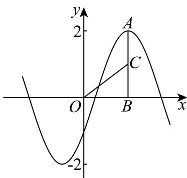
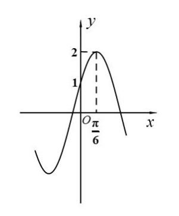
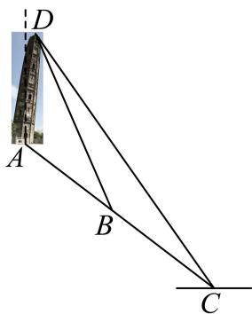
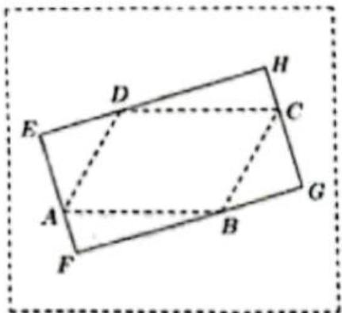

# 2026一模：三角函数与解三角形 · 学生版

> 依据原卷规范化转录稿整理，按数学任务分类；完整大题保留，不拆取小问。未逐题核对全部原卷及独立重算所有解析。

## 题型导航

- [1. 同角关系、二倍角与三角恒等变换（5题）](#class-1)
- [2. 周期、奇偶性与分段三角函数（5题）](#class-2)
- [3. 三角函数图像、参数与周期模型（5题）](#class-3)
- [4. 三角函数的区间、单调性与值域（5题）](#class-4)
- [5. 正余弦定理、边角关系与面积（7题）](#class-5)
- [6. 测量、几何建模与空间综合（8题）](#class-6)
- [7. 半角公式与集合元素个数（1题）](#class-7)
- [8. 待补原题资料（1题）](#class-8)

## 1 同角关系、二倍角与三角恒等变换

### 徐汇 · 原卷第3题

来源：2026届上海高三一模徐汇卷，第3题。

函数 $f(x)=\sin x+\cos x$ 的值域为 \_\_\_\_.

### 金山 · 原卷第2题

来源：2026届上海高三一模金山卷，第2题。

若 $\alpha$ 是第二象限角， $\sin \alpha = \frac{3}{5}$ ，则 $\cos \alpha = \underline{\quad}$ .

### 静安 · 原卷第5题

来源：2026届上海高三一模静安卷，第5题。

已知 $\alpha$ 是第四象限角， $\cos \alpha = \frac{3}{5}$ ，则 $\tan 2\alpha =$ \_\_\_\_

### 松江 · 原卷第8题

来源：2026届上海高三一模松江卷，第8题。

设 $\alpha \in \left(0, \frac{\pi}{2}\right)$ ，若 $\sin^2\alpha - \sin\alpha\sin\left(\frac{\pi}{2} - \alpha\right) = \frac{2}{5}$ ，则 $\tan\alpha$ 的值为 \_\_\_\_.

### 黄浦 · 原卷第9题

来源：2026届上海高三一模黄浦卷，第9题。

已知角 $\alpha$ 的顶点与坐标原点重合, 始边与 $x$ 轴的正半轴重合, 终边与以坐标原点为圆心、1为半径的圆交于点 $P$ , 若点 $P$ 的横坐标与纵坐标之和为 $\frac{1}{2}$ , 则 $\tan \alpha + \cot \alpha$ 的值为 \_\_\_\_.

## 2 周期、奇偶性与分段三角函数

### 崇明 · 原卷第4题

来源：2026届上海高三一模崇明卷，第4题。

函数 $y = 2 \cos\left(ax - \frac{\pi}{3}\right) (a > 0)$ 的最小正周期为 $\pi$ ，则 a 的值为 \_\_\_\_.

### 杨浦 · 原卷第2题

来源：2026届上海高三一模杨浦卷，第2题。

函数 $y = 3 \sin \left( 2x + \frac{\pi}{6} \right)$ 的最小正周期为 \_\_\_\_.

### 嘉定 · 原卷第14题

来源：2026届上海高三一模嘉定卷，第14题。

函数 $y = 1 - 2\cos^2\left(x + \frac{\pi}{4}\right)$ 是（）

- A. 最小正周期为 $2\pi$ 的奇函数
- B. 最小正周期为 $2\pi$ 的偶函数
- C. 最小正周期为 $\pi$ 的奇函数
- D. 最小正周期为 $\pi$ 的偶函数

### 普陀 · 原卷第13题

来源：2026届上海高三一模普陀卷，第13题。

下列函数中，周期为 $\pi$ 的奇函数是（）

- A. $y = \left| \sin x \right|$
- B. $y = \cos^{2}x - \sin^{2}x$
- C. $y = \cos\left(\frac{\pi}{2} - x\right)$
- D. $y = \frac{\sin 2x}{1 + \cos 2x}$

### 虹口 · 原卷第14题

来源：2026届上海高三一模虹口卷，第14题。

已知 $f(x)=\left\{\begin{aligned}\tan x,x>0\\ -f(x+\pi),x<0\end{aligned}\right.$ ，若 $f(\alpha)=\sqrt{3}$ ，则实数 $\alpha$ 的取值可以是（）

- A. $-\frac{2\pi}{3}$
- B. $-\frac{\pi}{3}$
- C. $\frac{\pi}{6}$
- D. $\frac{2\pi}{3}$

## 3 三角函数图像、参数与周期模型

### 宝山 · 原卷第19题

来源：2026届上海高三一模宝山卷，第19题。

如图，摩天轮上一点 $P$ 距离地面的高度 $y(\mathrm{m})$ 关于时间 $t(\min)$ 的函数表达式为： $y = A\sin (\omega t + \varphi) + b, (A > 0, \omega > 0, |\varphi| \leq \pi)$ . 已知摩天轮的半径为 $30\mathrm{m}$ ，其中心点 $O$ 距地面 $40\mathrm{m}$ ，摩天轮以每12分钟转一圈的方式做匀速转动，而点 $P$ 的起始位置在摩天轮的最低点处.

（1）根据条件具体写出 $y$ 关于 $t$ 的函数表达式：

(2) 在摩天轮转动的一圈内, 点 $P$ 有多长时间距离地面超过 $55 \mathrm{~m}$ ?

### 松江 · 原卷第17题

来源：2026届上海高三一模松江卷，第17题。

已知函数 $y = A \sin (\omega x + \varphi)$ （ $A$ 、 $\omega > 0$ ， $0 < \varphi < \pi$ ）的周期为 $\pi$ ，在 $x = \frac{\pi}{6}$ 时取到最大值4，记 $y = f(x)$ .

（1）求函数 $y = f(x)$ 的表达式；

（2）若数列 $\{a_{n}\}$ 为等差数列， $a_2 = f(0)$ ， $a_4 = f\left(\frac{\pi}{6}\right)$ ，记 $b_{n} = 2^{a_{n}}$ ，求数列 $\{b_n\}$ 的前 $n$ 项和 $T_{n}$ ：

### 金山 · 原卷第19题

来源：2026届上海高三一模金山卷，第19题。

已知 $f(x)=2\sin(\omega x+\varphi)$ （其中 $\omega>0,|\varphi|<\frac{\pi}{2}$ ），函数 $y=f(x)$ 相邻的极小值点和极大值点分别为 $-\frac{\pi}{3}$ 和 $\frac{2\pi}{3}$ ．直线 l 为函数 $y=f(x)$ 在 y 轴右侧与 y 轴距离最近的对称轴，且分别交函数 $y=f(x)$ 的图象和 x 轴于 A, B 两点，点 C 为线段 AB 上一动点.

（1）求函数 $y = f(x)$ 的表达式，并写出其严格增区间；

（2）设 $\angle BOC = \theta$ ，记 $L = AC + 2OC$ ，请写出 L 关于 $\theta$ 的函数表达式，并求 L 的最小值.

### 青浦 · 原卷第17题

来源：2026届上海高三一模青浦卷，第17题。

已知直线 $x = \frac{\pi}{6}$ 是函数 $f(x) = \sin (2x + \varphi)\left(\left|\varphi\right| < \frac{\pi}{2}\right)$ 的一条对称轴.

（1）求函数 $f(x)$ 的解析式；

（2）设函数 $g(x) = f\left(x - \frac{\pi}{12}\right) + f\left(x + \frac{\pi}{6}\right)$ ，求 $g(x)$ 在 $\left[-\frac{\pi}{4}, \frac{\pi}{4}\right]$ 上的最大值和最小值.

### 闵行 · 原卷第18题

来源：2026届上海高三一模闵行卷，第18题。

已知函数 $y=f(x)$，$f(x)=A\sin(\omega x+\varphi)$（$A>0,\omega>0,|\varphi|<\frac\pi2$），其部分图像如图所示。

（1）求 $y=f(x)$ 的解析式；

（2）在 $\triangle ABC$ 中，$a,b,c$ 分别是角 $A,B,C$ 的对边，若 $f(B)=1$，$a,b,c$ 成等差数列，判断 $\triangle ABC$ 的形状。

## 4 三角函数的区间、单调性与值域

### 奉贤 · 原卷第17题

来源：2026届上海高三一模奉贤卷，第17题。

已知函数 $f(x) = \frac{1}{2}\sin 2x - \frac{\sqrt{3}}{2}\cos 2x$ .

（1）当 $x \in \left[\frac{5\pi}{6}, \frac{13\pi}{12}\right)$ 时，求函数 $f(x)$ 的值域；

（2）在 $\triangle ABC$ 中，角 $A$ 、 $B$ 及 $C$ 所对边的边长分别为 $a$ 、 $b$ 及 $c$ ，若 $f(C) = 0$ ， $a = 2$ ， $B = \frac{\pi}{4}$ ，求 $b$ ：

### 浦东 · 原卷第17题

来源：2026届上海高三一模浦东卷，第17题。

已知函数 $y = f(x)$ ，其中 $f(x) = \cos \left(2x - \frac{\pi}{3}\right)$ .

（1）求函数 $y = f(x)$ 的最小正周期及单调减区间.

（2）求函数 $y = 2\sin^{2}x + f(x)$ ， $x \in [-\frac{\pi}{6}, \frac{\pi}{3}]$ 的最大值，并求出取得最大值时 x 的值.

### 长宁 · 原卷第18题

来源：2026届上海高三一模长宁卷，第18题。

已知函数 $f(x) = \cos \omega x (\omega > 0)$ .

（1）若函数 $y = f(x)$ 的最小正周期为 $\pi$ ，求 $\omega$ 的值及 $y = f(x)$ 的单调递减区间；

（2）设 $\omega = 1$ ， $g(x) = f(2x) - 2f(x)f\left(x + \frac{\pi}{2}\right)$ ，求函数 $y = g(x)$ 在区间 $\left[0,\frac{\pi}{2}\right]$ 上的值域.

### 静安 · 原卷第18题

来源：2026届上海高三一模静安卷，第18题。

已知函数 $f(x) = 4\sin \left( \omega x + \frac{\pi}{4} \right) \cdot \cos \omega x - \sqrt{2} (\omega > 0)$ .

（1）将函数 $y = f(x)$ 化为 $y = A\sin (kx + \varphi)\left(A > 0, k > 0, |\varphi| \leq \frac{\pi}{2}\right)$ 的形式，并指出这个函数的振幅和初始相位；

（2）若函数 $y = f(x)$ 的最小正周期为 $\pi$ ，求 $\omega$ 的值并求函数 $y = f(x)$ 的值域.

### 虹口 · 原卷第18题

来源：2026届上海高三一模虹口卷，第18题。

已知$\omega > 0$ ， $|\varphi| \leq \pi$ ，设 $f(x) = \cos (\omega x + \varphi)$ .

（1）当 $\omega = 2$ ， $\varphi = \frac{\pi}{4}$ 时，试判断函数 $y = f(x)$ 的奇偶性，并说明理由；

（2）当 $\varphi = -\frac{\pi}{2}$ 且函数 $y = f(x)$ 的最小正周期为 $2\pi$ 时，若在 $\triangle ABC$ 中，

$\sin^2 A + \sin^2 C - \sin^2 B = \sin A\sin C$ ，求 $f(A) + f(C)$ 的取值范围.

## 5 正余弦定理、边角关系与面积

### 崇明 · 原卷第17题

来源：2026届上海高三一模崇明卷，第17题。

在 $\triangle ABC$ 中，角 $A, B, C$ 的对边分别为 $a, b, c, (2b - c) \cos A = a \cos C$ .

(1) 求 A;

(2) 若 $\triangle ABC$ 的面积为 $\sqrt{3}$ , BC 边上的高为 1，求 $\triangle ABC$ 的周长.

### 徐汇 · 原卷第17题

来源：2026届上海高三一模徐汇卷，第17题。

在 $\triangle ABC$ 中，角 $A$ 、 $B$ 、 $C$ 的对边分别为 $a$ 、 $b$ 、 $c$ ，已知 $a = 4$ ， $b = 5$ ：

（1）若 $\cos 2C = \frac{4}{5}$ ，求 $\triangle ABC$ 的面积；

（2）若内角 C 的对边 c=6 ，求角 A 的正弦值及 $\triangle ABC$ 外接圆的半径 R .

### 普陀 · 原卷第18题

来源：2026届上海高三一模普陀卷，第18题。

在 $\triangle ABC$ 中，内角 $A, B, C$ 所对的边分别为 $a, b, c$ ，且 $a = \frac{\sqrt{3}}{3}, b \sin 2A = \sin B$ .

(1) 求角 A 的大小;

（2）设 $m \in \mathbf{R}$ ， $0 < \varphi < \frac{\pi}{2}$ ，函数 $y = f(x)$ 的表达式为 $f(x) = \tan (2x + \varphi)$ ，且$f(A) = -\sqrt{3}$ , 若在区间 $\left(-\frac{5\pi}{6}, m\right)$ 上恰有 3 次使得函数 $f(x)$ 的值能取遍区间 $[2025, +\infty)$ 内的所有值，求 $m$ 的取值范围.

### 杨浦 · 原卷第18题

来源：2026届上海高三一模杨浦卷，第18题。

已知函数 $f(x) = \sin x + \cos x, x \in \mathbf{R}$ .

（1）记 $g(x) = f(x) + f\left(x + \frac{\pi}{2}\right)$ ，求证：函数 $y = g(x)$ 为偶函数；

（2）在 $\triangle ABC$ 中， $A$ ， $B$ ， $C$ 所对的边分别为 $a$ ， $b$ ， $c$ ，已知 $f\left(C + \frac{\pi}{4}\right) = -\frac{\sqrt{2}}{4}, a = 3,$ $c = 2b$ ，求 $\triangle ABC$ 的面积.

### 浦东 · 原卷第7题

来源：2026届上海高三一模浦东卷，第7题。

$\triangle ABC$ 中， $A = \frac{2\pi}{3}$ ， $b = 1$ ， $\sin C = 2\sin B$ ，则 $a = \_$ .

### 静安 · 原卷第10题

来源：2026届上海高三一模静安卷，第10题。

在 $\triangle ABC$ 中，将角 $A, B, C$ 所对边的边长分别记作 $a, b, c$ . 设 $b = \sqrt{2}c - a$ . 若 $c = 1$ , $\cos C = \frac{1}{5}$ ，则 $\triangle ABC$ 的面积为 \_\_\_\_.

### 黄浦 · 原卷第19题

来源：2026届上海高三一模黄浦卷，第19题。

在 $\triangle ABC$ 中， $\angle BAC = \frac{3\pi}{4}$ ， $AB = 6$ ， $AC = 3\sqrt{2}$ .

（1）求 $BC$ 的长和 $\angle B$ 的正弦值；

（2）若点 $D$ 在 $BC$ 边上，且 $\angle BAD = \theta$ ，设 $AD = f(\theta)$ ，求 $f(\theta)$ 的表达式，并判断是否存在 $\theta_0$ ，使得 $f(\theta)$ 在 $\theta = \theta_0$ 处的瞬时变化率等于 $-f(\theta_0)$ ：

### 闵行 · 原卷第11题

来源：2026届上海高三一模闵行卷，第11题。

草坪上有一个带有围栏的边长为 $30\,\mathrm{m}$ 的正三角形活动区域 $ABC$，点 $P$ 在边 $BC$ 上，且 $|PB|=2|PC|$，小闵同学在该区域玩耍，他在 $P$ 处放置了一个手电筒，若手电筒发出的光线张角（任两条光线的最大夹角）为 $60^\circ$，则手电筒在 $ABC$ 内部所能照射到的地面的最大面积为________ $\mathrm{m}^2$。

## 6 测量、几何建模与空间综合

### 奉贤 · 原卷第12题

来源：2026届上海高三一模奉贤卷，第12题。

运动员关心的是在足球场上的哪些位置射门命中的角度较大。在真实的射门过程中，我们做一些假定：

（1）将足球看成一个质点；

（2）接近球门时，足球运动的轨迹与地面平行；

（3）射门时，足球与球门之间无防守员；

(4) 足球场平面图是一个矩形;

（5）标准足球场的长度为 105 米，宽度为 68 米，球门的宽度为 7.32 米；

如图，以线段 AB 所在直线为 y 轴，以线段 AB 的垂直平分线为 x 轴建立平面直角坐标系，

$O$ 是球门中心，两门柱位置分别为点 $A$ 、 $B$ ，两个角球点为 $C$ 、 $D$ ， $EF$ 是半场分界线.

对于区域 CDEF 内，射门点 $P(x,y)$ ,

对于每一个确定的横坐标 $x$ ，可以找到唯一的 $y$ ，可以证明横坐标不变时， $y = 0$ 时， $\angle APB$ 最大。此时，点 $P$ 在 $x$ 轴上是最佳射门点。

对于每一个确定的纵坐标 $y(3.66 < y < 34)$ ，同样可以找到唯一的 x，当 x = ______ 时， $\angle APB$ 最大．此时，点 P 是最佳射门点．

### 徐汇 · 原卷第11题

来源：2026届上海高三一模徐汇卷，第11题。

某城市核心区域可看作一个平面，市中心为点 $O$，城市有两个交通枢纽站点 $A,B$，其中站点 $A$ 在市中心 $O$ 的正东方向，距离 $O$ 点 $4$ 公里，站点 $B$ 在市中心 $O$ 的正北方向，距离 $O$ 点也是 $4$ 公里。为了动态调整交通信号，相关部门计划在距离中心 $O$ 点 $2$ 公里的位置，设置一个移动数据采集点 $C$，通过监测 $\angle ACB$ 的大小来优化信号。当 $\angle ACB$ 最大时，$\sin\angle ACB=$______（结果精确到 $0.01$）。

### 普陀 · 原卷第8题

来源：2026届上海高三一模普陀卷，第8题。

在 $\triangle ABC$ 中, $A = \frac{\pi}{3}$ , $AB = 2$ , $AC = 5$ , $D$ 为 $AC$ 边上的一点, 且 $AD = 2$ , 现将 $\triangle ABD$ 沿 $BD$ 边折起, 使得点 $A$ 至点 $P$ 的位置, 且满足平面 $PBD \perp$ 平面 $BDC$ , 如图所示, 则直线 $PC$ 与平面 $BDC$ 所成的角的正弦值为 \_\_\_\_.

### 杨浦 · 原卷第11题

来源：2026届上海高三一模杨浦卷，第11题。

某数学建模活动小组在开展主题为“空中不可到达两点的测距问题”的探究活动中，抽象并构建了如图所示的几何模型，该模型中 $MA$ ， $NB$ 均与水平面 $ABC$ 垂直，在已测得可直接到达的两点间距离 $AC$ ， $BC$ ，且 $AC < BC$ ，用测角仪测得 $\angle MCA$ ， $\angle NCB$ 的情况下，四名同学用测角仪各自测得下面一个角：① $\angle ABC$ ；② $\angle ACB$ ；③ $\angle BAC$ ；④ $\angle MCN$ ，其中一定能唯一确定 $M, N$ 之间的距离有\_\_\_\_。（写出所有正确的序号）

### 松江 · 原卷第18题

来源：2026届上海高三一模松江卷，第18题。

已知四棱锥 $P - ABCD$ 的底面 $ABCD$ 是直角梯形， $AB // CD$ ， $AB = 2CD = 2$ ， $\angle ABC = 90^\circ$ ， $\triangle PBC$ 是边长为 2 的正三角形，侧面 $PBC \perp$ 底面 $ABCD$ .

（1）证明： $PA \perp BD$ ;

(2) 求点 D 到平面 PAB 的距离.

### 金山 · 原卷第11题

来源：2026届上海高三一模金山卷，第11题。

上海护珠塔，俗称斜塔，始建于北宋元丰年间（1078-1085年），是世界上倾斜程度最大的佛塔之一，其倾斜角（塔身所在直线与铅垂线的夹角）超过意大利比萨斜塔。如图，护珠塔前有一条笔直的山路，山路所在直线与水平面夹角为 $34^{\circ}$ 。康同学为了测量护珠塔的倾斜程度，实施如下方案：从塔底 $A$ 沿着山路往下走至 $B$ ，此时测得 $AB$ 长度为10米，观察塔顶 $D$ 的仰角（视线与水平面的夹角）为 $76^{\circ}$ ，继续往下走至 $C$ ，测得 $AC$ 长度为25.9米，观察塔顶 D 的仰角为 $60^{\circ}$ 。根据康同学的数据，可得该塔的倾斜角为 \_\_\_\_。（精确到 $0.1^{\circ}$ ）

（参考数值： $\tan76^{\circ}\approx4.0108,\tan60^{\circ}\approx1.732,\sin34^{\circ}\approx0.5592,\cos34^{\circ}\approx0.8290,\tan6.5^{\circ}\approx0.1147$ ）

### 长宁 · 原卷第11题

来源：2026届上海高三一模长宁卷，第11题。

如图, 两塔的塔尖分别为 $M 、 N$ , 塔底分别为 $A 、 B$ , 塔身 $M A 、 N B$ 均垂直水平面 $A B C$ . 已测得 $C$ 与 $A 、 B$ 的距离, 4 名同学分别测得如下 4 组数据:

① $\angle MCA$ , $\angle NCB$ , $\angle ACB$ ; ② $\angle MCA$ , $\angle ACB$ , $\angle MCN$ ;

③ $\angle MCA, \angle NCB, \angle MCN;$ ④ $\angle MCA, \angle ACB, \angle NCA.$

其中不能唯一确定 M 与 N 之间距离的数据的序号有 ______.

### 黄浦 · 原卷第11题

来源：2026届上海高三一模黄浦卷，第11题。

如图，在一块空地上有四棵树，若把它们所在的位置看成点，则这四个点 A, B, C, D 恰好是一个平行四边形的四个顶点，且 AB = 40 米，BC = 30 米， $\angle BAD = 60^{\circ}$ ，现要用挡板围出一个形状为矩形的展览区 EFGH，使得其边 EF, FG, GH, HE 分别经过点 A, B, C, D，则该展览区的最大面积约为 \_\_\_\_ 平方米（精确到 1 平方米）.

## 7 半角公式与集合元素个数

### 青浦 · 原卷第15题

来源：2026届上海高三一模青浦卷，第15题。

对于实数 $m \in [-1, 1]$ ，定义集合 $A_{m} = \left\{x \mid x = \sin \frac{\alpha}{2}, \sin \alpha = m\right\}$ ，集合 $A_{m}$ 的元素个数为 $\left|A_{m}\right|$ ，给出下列说法：

①存在 $m$ ，使得 $\left|A_m\right| = 1$

②存在 $m$ ，使得 $\left|A_m\right| = 2$

③存在 $m$ ，使得 $\left|A_m\right| = 3$

④存在 $m$ ，使得 $\left|A_m\right| = 4$

其中正确的说法有（）个.

- A. 1
- B. 2
- C. 3
- D. 4

