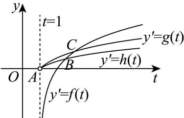
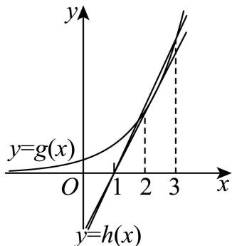
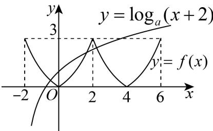
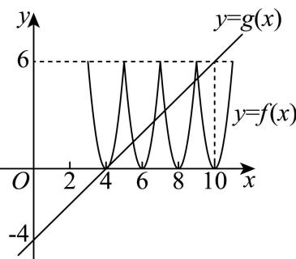
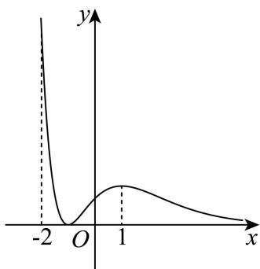
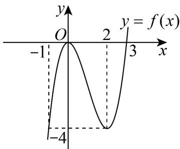
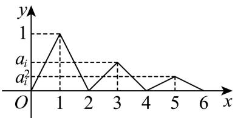

# 2026一模：函数与导数 · 教师版

> 阶段性整理，53道原题按具体题型与方法分类；原题允许跨专题出现。未完整核对原卷或独立重算全部解析；题面及解答疑点均标待核。

## 1 函数的定义域、解析式与值域（8题）

### 黄浦 · 第1题

**考点说明：** 根式函数定义域：根据被开方数非负确定自变量范围。

来源：2026届上海高三一模黄浦卷，第1题。

规范化源文件：`2026届黄浦一模数学试卷 逐题解析.md`。

函数 $y = \sqrt{x - 2}$ 的定义域是 \_\_\_\_.

【答案】 $[2, + \infty)$ 【解析】
【分析】

写出使函数有意义的表达式，求定义域.

【详解】 $y=\sqrt{x-2}$ 的定义域需满足 $x-2\geq0\Rightarrow x\geq2$ ，

所以函数的定义域 $[2, +\infty)$ .

故答案为： $\left[2,+\infty\right)$

### 浦东 · 第2题

**考点说明：** 对数函数定义域：由真数大于零求自变量范围。

来源：2026届上海高三一模浦东卷，第2题。

规范化源文件：`2026届浦东一模数学试卷 逐题解析.md`。

函数 $y=\lg(x+1)$ 的定义域为 \_\_\_\_

【答案】 $(-1,+\infty)$

【解析】

【分析】根据对数函数的定义域列不等式求解即可.

【详解】由 $x+1>0$ 得x>-1，

所以函数 $y=\lg(x+1)$ 的定义域为 $(-1,+\infty)$ .

故答案为： $(-1,+\infty)$ .

### 虹口 · 第2题

**考点说明：** 函数定义域：同时要求分式有意义且根号内非负，按临界点划分区间。

来源：2026届上海高三一模虹口卷，第2题。

规范化源文件：`2026届虹口一模数学试卷 逐题解析.md`。

函数 $y = \sqrt{\frac{x + 1}{x - 2}}$ 的定义域为 \_\_\_\_

【答案】 $(-∞,-1]∪(2,+∞)$

【解析】

【分析】根据偶数根式被开方数非负，结合分式不等式的解法，即可得答案.

【详解】由题意得 $\frac{x + 1}{x - 2} \geq 0$ ，即 $\left\{ \begin{array}{l} (x + 1)(x - 2) \geq 0 \\ x - 2 \neq 0 \end{array} \right.$ ，解得 $x > 2$ 或 $x \leq -1$ ，

所以定义域为 $(-∞,-1]∪(2,+∞)$

故答案为： $(-∞,-1]∪(2,+∞)$

### 徐汇 · 第4题

**考点说明：** 幂函数解析式：代入给定点建立指数方程，并由幂函数的定义确定表达式。

来源：2026届上海高三一模徐汇卷，第4题。

规范化源文件：`2026届徐汇一模数学试卷 逐题解析.md`。

若幂函数 $y = x^a$ 的图象经过 $\left(\sqrt[3]{3}, 3\right)$ ，则此幂函数的表达式为 \_\_\_\_.

【答案】 $y = x^{3}$

【解析】

【分析】将点的坐标代入函数表达式算出参数 a 即可得解.

【详解】由题意得 $\left(\sqrt[3]{3}\right)^{a}=3^{\frac{a}{3}}=3^{1}=3$ ，所以 $\frac{a}{3}=1$ ，解得a=3，

所以此幂函数的表达式为 $y = x^{3}$ .

故答案为： $y = x^{3}$ .

### 金山 · 第4题

**考点说明：** 根式函数定义域：令被开方数非负，求对应不等式解集。

来源：2026届上海高三一模金山卷，第4题。

规范化源文件：`2026届金山一模数学试卷 逐题解析.md`。

函数 $y=\sqrt{x^{2}-2x-3}$ 的定义域为 \_\_\_\_.

【答案】 $(-∞,-1]∪[3,+∞)$

【解析】

【分析】根据题意列出一元二次不等式，求解即得函数的定义域.

【详解】要使函数 $y=\sqrt{x^{2}-2x-3}$ 有意义，需使 $x^{2}-2x-3\geq0$

解得 $x \leq -1$ 或 $x \geq 3$ .

故函数的定义域为 $(-∞,-1]∪[3,+∞)$ .

故答案为： $(-∞,-1]∪[3,+∞)$ .

### 长宁 · 第8题

**考点说明：** 函数的定义域与值域：利用反比例关系，由给定函数值的范围反求自变量集合。

来源：2026届上海高三一模长宁卷，第8题。

规范化源文件：`2026届长宁一模数学试卷 逐题解析.md`。

函数 $y=\frac{1}{x-1}, x \in D$ 的值域为 $(-1,0) \cup (0,+\infty)$ ，则集合 $D=$ \_\_\_\_.

【答案】 $(-\infty,0)∪(1,+\infty)$

【解析】

【分析】利用函数的值域求解不等式，进而得到函数的定义域即可.

【详解】令 $\frac{1}{x - 1} \in (0, +\infty)$ ，解得 $x \in (1, +\infty)$ ，

令 $\frac{1}{x-1}\in(-1,0)$ ，解得 $x\in(-\infty,0)$ ，

则集合 $D = (-\infty, 0) \cup (1, +\infty)$ .

故答案为： $(-\infty ,0)\cup (1, + \infty)$

### 静安 · 第8题

**考点说明：** 递推式分段函数求值：将自变量逐次平移到已知表达式所在区间，再代入对数值。

来源：2026届上海高三一模静安卷，第8题。

规范化源文件：`2026届静安一模数学试卷 逐题解析.md`。

已知函数 $f(x)=\left\{\begin{aligned}f(x+1),&x<4\\ \left(\frac{1}{3}\right)^{x},&x\geq4\end{aligned}\right.$ ，则 $f(\log_{3}5)=$ \_\_\_\_.

【答案】 $\frac{1}{135}$

【解析】

【分析】根据分段函数的解析式结合指、对数的运算性质求解即可.

【详解】因为 $1 < \log_3 5 < 2$ ，则 $f(\log_3 5) = f(\log_3 5 + 1) = f(\log_3 5 + 2) = f(\log_3 5 + 3)$ ，且 $f(\log_35 + 3) = \left(\frac{1}{3}\right)^{\log_35 + 3} = (3^{-1})^{\log_35 + 3} = (3^{\log_35 + 3})^{-1} = (3^{\log_35}\cdot 3^3)^{-1} = (5\cdot 27)^{-1} = \frac{1}{135},$ 所以 $f(\log_35) = \frac{1}{135}$ 故答案为： $\frac{1}{135}$

### 崇明 · 第16题

**考点说明：** 函数对应关系与几何量：由曲线上点的坐标分析张角是否唯一确定，并检验反向对应及端点；原题存在版本与条件争议。

来源：2026届上海高三一模崇明卷，第16题。

已知 $A(-2,0),B(2,0)$，点 $P(m,n)$ 在曲线 $y=\sqrt{1-\frac{x^2}{4}}$ 上。记 $\angle APB=\alpha$，则存在函数 $y=f(x)$，对曲线上的任意一点 $P$ 都有（ ）。

- A. $m=f(\alpha)$

- B. $\alpha=f(m)$

- C. $n=f(\alpha)$

- D. $\alpha=f(n)$

> 原题条件或版本存在疑点，请结合教师版核对说明使用。

【答案】【源答案】微信逐题解析PDF印 D；这不是本轮认可的唯一正确答案。

【源解析要点】源解给出 $\alpha=\pi-\arccos\frac{3n}{\sqrt{9n^2+16}}$，据此选择 D。

【独立核查】排除 $P=A,B$ 后，$0<n\le1$。由 $m^2=4(1-n^2)$ 得
$$\cot\alpha=\frac{\overrightarrow{PA}\cdot\overrightarrow{PB}}{|\det(\overrightarrow{PA},\overrightarrow{PB})|}=\frac{m^2+n^2-4}{4n}=-\frac{3n}{4}.$$
因此 $\alpha=\frac\pi2+\arctan\frac{3n}{4}$ 随 $n$ 严格递增，D成立，反函数关系C也成立。又 $n=\sqrt{1-m^2/4}$，$m$ 唯一确定 $\alpha$，B成立；但正负 $m$ 对应同一个 $\alpha$，A不成立。

因此按该PDF题面，B、C、D均成立，不能作为唯一答案D的单选题使用。

回源核对说明：实质版本冲突：微信逐题解析版问“存在函数…都有”且答D；教习解析版改成“不成立的是”且答A。微信题面排除端点后B/C/D均成立，端点本身角又未定义。不得静默混用版本或印D为唯一正确答案。

## 2 指数、对数的运算与大小比较（6题）

### 崇明 · 第2题

**考点说明：** 对数与指数互化：利用对数定义化为指数方程，并注意真数为正。

来源：2026届上海高三一模崇明卷，第2题。

规范化源文件：`2026届崇明一模数学试卷 逐题解析.md`。

若 $\log_{2}(x+1)=3$ ，则 x= \_\_\_\_.

【答案】7

【解析】

【分析】先将3化成以2为底的对数即 $3=\log_{2}2^{3}$ ，再根据对数值相等得 $x+1=8$ ，解之得解.

【详解】因为 $\log_2(x + 1) = 3 = \log_22^3 = \log_28$ ，所以 $x + 1 = 8$ ，解得 $x = 7$

故填:7.

【点睛】本题考查对数的运算法则，在解决对数的方程或不等式的问题时，把所求解的式子转化成同底数的对数方程或不等式是一个比较重要的求解方法，属于基础题.

### 金山 · 第6题

**考点说明：** 对数运算：用换底公式将所求对数表示为常用对数之比。

来源：2026届上海高三一模金山卷，第6题。

规范化源文件：`2026届金山一模数学试卷 逐题解析.md`。

已知 $\lg 2 = a, \lg 3 = b$ ，则 $\log_4 6 =$ \_\_\_\_.（用 $a$ 和 $b$ 表示）

【答案】 $\frac{a + b}{2a}$

【解析】

【分析】根据题意，利用对数的运算公式，准确化简、运算，即可求解.

【详解】因为 $\lg 2 = a, \lg 3 = b$ ，可得 $\log_4 6 = \frac{\lg 6}{\lg 4} = \frac{\lg 2 + \lg 3}{2 \lg 2} = \frac{a + b}{2a}$ .

故答案为： $\frac{a + b}{2a}$

### 松江 · 第7题

**考点说明：** 幂的大小比较：通过取对数或构造函数比较对应幂值，注意底数与指数的不同。

来源：2026届上海高三一模松江卷，第7题。

规范化源文件：`2026届松江一模数学试卷 逐题解析.md`。

比较两数的大小: $2025^{2026}$ \_\_\_\_ $2026^{2025}$ .

【答案】>

【解析】

【分析】构造函数，利用函数导数与单调性分析即可.

【详解】设函数 $f(x)=\frac{\ln x}{x}$ ,

由 $f'(x)=\frac{1-\ln x}{x^{2}}$ ，令 $f'(x)=0$ ，解得： $x=e$

当 $x > \mathrm{e}\Rightarrow f'(x) < 0$

当 $0 < x < \mathrm{e} \Rightarrow f'(x) > 0$

所以函数 $f(x)$ 在 $(e, +\infty)$ 单调递减，在 $(0, e)$ 上单调递增，

所以 $f(2025) > f(2026)$ ,

即 $\frac{\ln 2025}{2025} >\frac{\ln 2026}{2026}$

$$
2025 \times 2026 \times \frac {\ln 2025}{2025} > \frac {\ln 2026}{2026} \times 2025 \times 2026
$$

所以 $\ln 2025^{2026} > \ln 2026^{2025}$ ,

因为函数 $y=\ln x$ 在 $(0,+\infty)$ 单调递增，

所以 $2025^{2026} > 2026^{2025}$ ,

故答案为：>.

### 长宁 · 第7题

**考点说明：** 指数与对数换算：利用指数与对数互逆及换底公式化简倒数。

来源：2026届上海高三一模长宁卷，第7题。

规范化源文件：`2026届长宁一模数学试卷 逐题解析.md`。

已知 $3^{x} = 2$ ， $y = \log_{6} 2$ ，则 $\frac{1}{x} - \frac{1}{y} =$ \_\_\_\_

【答案】-1

【解析】

【分析】由指对数的关系得 $x = \log_{3} 2$ ，再有 $\frac{1}{x} - \frac{1}{y} = \log_{2} 3 - \log_{2} 6$ ，即可求值.

【详解】由题设 $x = \log_32$ ， $y = \log_62$

根据换底公式，则 $\frac{1}{x} -\frac{1}{y} = \frac{1}{\log_32} -\frac{1}{\log_62} = \log_23 - \log_26 = \log_2\frac{1}{2} = -1.$

故答案为：-1

### 奉贤 · 第13题

**考点说明：** 不等式命题辨析：结合对数函数的严格单调性，并用反例检验其他断言。

来源：2026届上海高三一模奉贤卷，第13题。

规范化源文件：`2026届奉贤一模数学试卷 逐题解析.md`。

设 $a$ 、 $b$ 为实数，且 $a > b > 0$ ，则下列不等式一定正确的是（）

- A. $a^4 > b^2$
- B. $\sin a > \sin b$
- C. $c > 0$ 时， $\left(\frac{b}{a}\right)^c > 1$
- D. $\ln a > \ln b$

【答案】D

【解析】

【分析】应用特殊值法计算判断 A，B，C，应用对数函数单调性判断 D.

【详解】因为a、b为实数，且a>b>0，

当 $a = \frac{1}{2}, b = \frac{1}{4}$ , $a^4 = \frac{1}{16} = b^2 = \frac{1}{16}$ , A选项错误;

当 $a = \frac{2\pi}{3}, b = \frac{\pi}{3}$ , $\sin \frac{2\pi}{3} = \sin \frac{\pi}{3}$ , B选项错误;

当 $a = 2, b = 1, c = 1$ 时， $\left(\frac{b}{a}\right)^c = \frac{1}{2} < 1$ ，C选项错误；

当 a > b > 0 ，所以 $\ln a > \ln b$ ，D 选项正确；

故选：D.

### 嘉定 · 第15题

**考点说明：** 指数与对数的大小比较：引入共同值并换底，分析不同区间内参数的顺序。

来源：2026届上海高三一模嘉定卷，第15题。

规范化源文件：`2026届嘉定一模数学试卷 逐题解析.md`。

若实数 $x$ 、 $y$ 、 $z$ 满足 $1 + 2^{x} = 3^{y} = 5^{z}$ ，则 $x$ 、 $y$ 、 $z$ 的大小关系不可能是（）

- A. $x > y > z$
- B. $y > z > x$
- C. $y > x > z$
- D. $x > z > y$

【答案】D

【解析】

【分析】根据给定条件，求出 $x, y, z$ 的函数关系，再在同一坐标系内作出函数图象，数形结合即可判断.

【详解】令 $1+2^{x}=3^{y}=5^{z}=t$ ，得 $x=\log_{2}(t-1)$ ， $y=\log_{3}t$ ， $z=\log_{5}t$ ，t>1在同一直角坐标系内作出函数 $f(t) = \log_2(t - 1), g(t) = \log_3 t, h(t) = \log_5 t$ ， $t > 1$ 的图像，

则 $x, y, z$ 分别是函数 $y' = f(t), y' = g(t), y' = h(t)$ ， $t > 1$ 的图像与直线 $t = a(a > 1)$ 交点的纵坐标，

设 B 点的横坐标为 $x_{1}$ ，C 点的横坐标为 $x_{2}$ ，

观察图像得当 $1<a<x_{1}$ 时，y>z>x，

当 $x_{1}<a<x_{2}$ 时，y>x>z，

当 $a>x_{2}$ 时，x>y>z，

所以 ABC 是可能的，D 不可能.

故选：D

## 3 函数的奇偶性与单调性（10题）

### 虹口 · 第4题

**考点说明：** 幂函数奇偶性：分别检查候选指数对应函数的定义域和 f(-x) 与 f(x) 的关系。

来源：2026届上海高三一模虹口卷，第4题。

规范化源文件：`2026届虹口一模数学试卷 逐题解析.md`。

已知 $a\in\left\{-\frac13,\frac23,\frac32\right\}$，若幂函数 $y=x^a$ 为偶函数，则实数 $a=\underline{\qquad}$。

【答案】$\frac23$。

【核对说明】原卷第1页的候选指数与规范化稿不同；其旧解析针对错误题面，未沿用。按照实数范围内的幂函数定义，$x^{2/3}$ 为偶函数，$x^{-1/3}$ 为奇函数，$x^{3/2}$ 的定义域不是关于原点对称的集合，因此选 $\frac23$。

核对：虹口原卷PDF第1页；依据原题另补核对说明。

### 宝山 · 第7题

**考点说明：** 对数函数奇偶性与最值：利用偶函数条件确定参数，并在真数为正的范围内求最值。

来源：2026届上海高三一模宝山卷，第7题。

规范化源文件：`2026届宝山一模数学试卷 逐题解析.md`。

已知 $f(x)=\ln(2+x)+\ln(1+ax)$ 是偶函数，则 $f(x)$ 的最大值为 \_\_\_\_.

【答案】ln2

【解析】

【分析】根据偶函数的定义域关于原点对称可得 $a = -\frac{1}{2}$ ，再由利用导数求得函数单调性可得其最大值.

【详解】因为函数 $f(x)$ 为偶函数，所以其定义域关于原点对称，

易知定义域为 $\left\{ \begin{array}{l} 2 + x > 0 \\ 1 + ax > 0 \end{array} \right.$ ，即 $\left\{ \begin{array}{l} x > -2 \\ ax > -1 \end{array} \right.$ ，因此 $ax > -1$ 的解集为 $\{x \mid x < 2\}$ ；

即可得 $-\frac{1}{a}=2$ ，所以 $a=-\frac{1}{2}$ ;

此时 $f(x) = \ln (2 + x) + \ln \left(\frac{2 - x}{2}\right) = \ln (2 + x) + \ln (2 - x) - \ln 2,$

经检验满足 $f(x)=f(-x)$ ，符合题意；

此时 $f(x)$ 的定义域为 $(-2,2)$ ，且 $f'(x)=\frac{1}{2+x}-\frac{1}{2-x}=\frac{-2x}{4-x^{2}}$

易知当 $x \in (-2,0)$ 时， $f'(x) > 0$ ，即 $f(x)$ 在 $(-2,0)$ 上单调递增，

当 $x \in (0,2)$ 时， $f'(x) < 0$ ，即 $f(x)$ 在 $(0,2)$ 上单调递减，

可知 $f(x)$ 在 x=0 处取得极大值，也是最大值，即 $f(0)=\ln2$ ;

所以 $f(x)$ 的最大值为 $\ln 2$ .

故答案为: $\ln 2$

### 奉贤 · 第8题

**考点说明：** 函数奇偶性：写出偶函数恒等式，利用指数式在 x 与 -x 下的关系确定参数。

来源：2026届上海高三一模奉贤卷，第8题。

规范化源文件：`2026届奉贤一模数学试卷 逐题解析.md`。

若函数 $y = \frac{a \cdot 2^x - 1}{2^x + 1} (a \in \mathbf{R})$ 是偶函数，则实数 $a =$ \_\_\_\_.

【答案】-1

【解析】

【分析】由偶函数定义建立方程，解得实数 a .

【详解】函数的定义域为R，

由题意可知 $\frac{a\cdot 2^x - 1}{2^x + 1} = \frac{a\cdot 2^{-x} - 1}{2^{-x} + 1}$ ，即 $\frac{a\cdot 2^x - 1}{2^x + 1} = \frac{a - 2^x}{1 + 2^x}$

所以 $(a+1)\cdot2^{x}=a+1$ ，

因该等式对定义域内的任意 x 都成立，故 $a+1=0$ ，

解得 $a = -1$

故答案为：-1

### 崇明 · 第9题

**考点说明：** 函数奇偶性与分段求值：利用奇函数的对称关系，将负自变量处的求值转化为正半轴的已知表达式。

来源：2026届上海高三一模崇明卷，第9题。

规范化源文件：`2026届崇明一模数学试卷 逐题解析.md`。

已知 $y = f(x)$ 是定义在 $\mathbf{R}$ 上的奇函数，且当 $x > 0$ 时， $f(x) = x^2 - 3^x$ ，则 $f(-1) =$ \_\_\_\_.

【答案】2

【解析】

【分析】由函数解析式求 $f(1)$ ，结合奇函数的性质求得正确答案.

【详解】依题意， $f(1)=1^{2}-3^{1}=-2$ ，

而 $f(x)$ 是奇函数，

所以 $f(-1) = -f(1) = 2$ .

故答案为：2

### 浦东 · 第9题

**考点说明：** 奇函数的导数：由奇函数对称关系确定正半轴表达式，或利用可导奇函数导数的偶性求值。

来源：2026届上海高三一模浦东卷，第9题。

规范化源文件：`2026届浦东一模数学试卷 逐题解析.md`。

已知奇函数 $y = f(x)$ 的定义域为 R，当 x < 0 时， $f(x) = x^{3} + e^{x} - 1$ ，则函数 $y = f(x)$ 在 x = 1 处的导数 $f'(1) =$ \_\_\_\_ .

【答案】 $3+e^{-1}$

【解析】

【分析】先根据奇函数的定义求出 x > 0 时的函数的解析式，再求导即可求出导数值.

【详解】因为奇函数 $y = f(x)$ 的定义域为 R，

令 $x > 0$ ，则 $-x < 0$ ，所以 $f(x) = -f(-x) = -\left(-x^3 + e^{-x} - 1\right) = x^3 - e^{-x} + 1$

所以当 $x > 0$ 时， $f(x) = x^3 - \mathrm{e}^{-x} + 1$

所以 $f'(x)=3x^{2}+e^{-x}\Rightarrow f'(1)=3+e^{-1}$ .

故答案为： $3 + e^{-1}$ .

### 杨浦 · 第10题

**考点说明：** 分段函数奇偶性：利用偶函数把负半轴与正半轴联系，再由奇函数条件求目标函数值。

来源：2026届上海高三一模杨浦卷，第10题。

规范化源文件：`2026届杨浦一模数学试卷 逐题解析.md`。

已知定义在 $\mathbf{R}$ 上的函数 $y = f(x)$ 为奇函数，且 $g(x) = \begin{cases} 2^x, & x \geq 0 \\ f(x), & x < 0 \end{cases}$ 为偶函数，则 $f(\log_2 3) =$ \_\_\_\_.

【答案】-3

【解析】

【分析】先根据 $f(x)$ 为奇函数，得 $f(\log_{2}3) = -f(-\log_{2}3)$ ，再根据 $g(x)$ 解析式及偶函数性质可得所求函数值.

【详解】因为函数 $y = f(x)$ 为 R 上的奇函数，所以 $f(-x) = -f(x)$ ，得

$$
f \left(\log_ {2} 3\right) = - f (- \log_ {2} 3)
$$

又因为 $g(x) = \begin{cases} 2^x, & x \geq 0 \\ f(x), & x < 0 \end{cases}$ 为偶函数，所以 $g(-x) = g(x)$ ， $g(-\log_2 3) = g(\log_2 3)$ . 因为 $\log_2 3 > 0$ ，所以

$$
f \left(\log_ {2} 3\right) = - f \left(- \log_ {2} 3\right) = - g \left(- \log_ {2} 3\right) = - g \left(\log_ {2} 3\right) = - 2 ^ {\log_ {2} 3} = - 3.
$$

故答案为：-3.

### 虹口 · 第13题

**考点说明：** 充分必要条件：运用立方函数、指数函数的单调性化简命题，比较两个不等式的蕴含。

来源：2026届上海高三一模虹口卷，第13题。

规范化源文件：`2026届虹口一模数学试卷 逐题解析.md`。

已知 $x$ 、 $y$ 为实数，则 “ $x^{3} > y^{3}$ ” 是 “ $2^{x} > 2^{y+1}$ ” 的（）条件.

- A. 充分非必要
- B. 必要非充分
- C. 充要
- D. 非充分又非必要

【答案】B

【解析】

【详解】因为 $x^{3}>y^{3}$ ，则x>y，又 $2^{x}>2^{y+1}$ ，则 $x>y+1$ ，命题“若 $x>y+1$ ，则 $x>y$ ”为真命题，即 $2^{x}>2^{y+1}\Rightarrow x^{3}>y^{3}$ ，命题“若x>y，则 $x>y+1$ ”为假命题，即 $x^{3}>y^{3}\not\Rightarrow2^{x}>2^{y+1}$ 所以“ $x^{3}>y^{3}$ ”是“ $2^{x}>2^{y+1}$ ”的必要非充分条件.

故选：B.

### 黄浦 · 第13题

**考点说明：** 函数奇偶与单调性：先检查定义域与偶性，再判断在给定区间上的严格单调性。

来源：2026届上海高三一模黄浦卷，第13题。

规范化源文件：`2026届黄浦一模数学试卷 逐题解析.md`。

下列函数中，既是偶函数、又在 $[0,1]$ 上严格减的函数是（）

- A. $y = -x$
- B. $y = -|x|$
- C. $y = x^2$
- D. $$ y = 2 ^ {- x} $$

【答案】B

【解析】

【分析】根据基本初等函数的奇偶性、单调性逐项判断 ACD，利用奇偶性定义及一次函数的单调性判断 B 即可.

【详解】对于 A，y = -x 为奇函数，不是偶函数，在 $[0,1]$ 上严格减，故 A 错误；

对于B， $f(x) = -|x|$ 定义域为R，关于原点对称，且 $f(-x) = -| - x| = -|x| = f(x)$ ，所

以函数 $y = -\left|x\right|$ 为偶函数，

当 $x \in [0,1]$ 时， $y = -|x| = -x$ ，显然在 $[0,1]$ 上严格减，故 B 正确；

对于 C，由幂函数性质知， $y = x^{2}$ 为偶函数，在 $[0,1]$ 上严格增，故 C 错误；

对于D，由指数函数性质知， $y = 2^{-x} = \left(\frac{1}{2}\right)^x$ 既不是奇函数也不是偶函数，故D错误.

故选：B

### 闵行 · 第16题

**考点说明：** 逻辑新关系与函数奇偶性：分别检验两个方向的蕴含，使用 x 与 -x 的替换辨识等价或单向关系。

来源：2026届上海高三一模闵行卷，第16题。

如果“若 $p$，则 $q$”和“若 $q$，则 $p$”中有且仅有一个真命题，称 $p$ 与 $q$ 具有“$U$-关系”。已知函数 $y=f(x)$ 的定义域为 $\mathbb R$，$p$：$y=f(x)$ 为偶函数，则 $p$ 与下列选项中的 $q$ 具有“$U$-关系”的为（ ）。

- A. $q$：对任意 $x\in\mathbb R$ 都有 $-f(x)\ge f(x)$

- B. $q$：对任意 $x\in\mathbb R$ 都有 $f(-x)\ge f(x)$

- C. $q$：对任意 $x\in\mathbb R$ 都有 $f(-x)=|f(x)|$

- D. $q$：对任意 $x\in\mathbb R$ 都有 $f(-x)=f(|x|)$

【答案】C

【解析·参考原解整理】

对 A，两命题互不蕴含。对 B，将 $x$ 换为 $-x$ 得反向不等式，故 B 与偶函数等价。对 C，将 $x$ 换为 $-x$ 得 $f(x)=|f(-x)|\ge0$，故 $f(-x)=f(x)$，即 C 蕴含 $p$；但负常值函数是偶函数而不满足 C，故 $p$ 不蕴含 C。对 D，当 $x<0$ 时条件自动成立，当 $x>0$ 时要求 $f(-x)=f(x)$，故 D 与偶函数等价。选 C。

回源核对说明：对照题面与标答PDF；解析参考原标答重新整理，非逐字转录，待独立复核。

### 松江 · 第14题

**考点说明：** 函数严格单调性：由差积判断函数增减，须检验自变量相等的边界；原题未排除此情形，字面条件存在矛盾。

来源：2026届上海高三一模松江卷，第14题。

下列函数 $y = f(x)$ 中，对任意的 $x_{1}$ 、 $x_{2} \in (0, +\infty)$ 时，均有 $(x_{1}-x_{2})[f(x_{1})-f(x_{2})]>0$ 的是（）

- A. $f(x)=x^{-2}$

- B. $f(x)=x^{2}-4x+4$

- C. $f(x)=2^{x}$

- D. $f(x)=\log_{\frac{1}{2}}x$

> 原题条件或版本存在疑点，请结合教师版核对说明使用。

【答案】C

【解析】

【分析】先确定函数的单调性，再对所给函数进行判断即可.

【详解】因为，对任意的 $x_{1}$ 、 $x_{2} \in (0, +\infty)$ 时，均有 $(x_{1} - x_{2})[f(x_{1}) - f(x_{2})] > 0$ ，所以函数 $y = f(x)$ 在 $(0, +\infty)$ 上单调递增.

对 A：因为 -2 < 0，所以幂函数 $f(x) = x^{-2}$ 在 $(0, +\infty)$ 上单调递减，不合题意；

对 B: 因为函数 $f(x) = x^{2} - 4x + 4$ 的图象是开口向上的抛物线，对称轴为 $x = 2$ ，所以函数 $f(x)$ 在 $(0,2)$ 上单调递减，在 $(2,+\infty)$ 上单调递增，不合题意；

对 C：因为 2 > 1，所以指数函数 $f(x) = 2^{x}$ 在 $(-∞, +∞)$ 上单调递增，在 $(0, +∞)$ 上就是单

调递增，符合题意；

对 D: 因为 $0 < \frac{1}{2} < 1$ ，所以对数函数 $f(x) = \log_{\frac{1}{2}} x$ 在 $(0, +\infty)$ 上单调递减，不合题意.
故选：C

回源核对说明：已视觉确认4页学生卷第2页未给x1≠x2；x1=x2时左侧为0，与严格大于0矛盾。原题字面无正确选项；源答案C须额外按x1≠x2理解。不是OCR漏识别。

## 4 函数图像、方程根与零点个数（7题）

### 青浦 · 第7题

**考点说明：** 指数函数图像与方程根：按绝对值分段，结合图像判断水平直线交点个数。

来源：2026届上海高三一模青浦卷，第7题。

规范化源文件：`2026届青浦一模数学试卷 逐题解析.md`。

若曲线 $y=\left|2^{x}-1\right|$ 与直线 y=b 有两个公共点，则 b 的取值范围是 \_\_\_\_.

【答案】(0,1)

【解析】

【分析】画出曲线 $y=\left|2^{x}-1\right|$ 与直线 y=b 的图象，由条件结合图象求 b 的范围.

【详解】画出曲线 $y=\left|2^{x}-1\right|$ 与直线 y=b 的图象如图所示，

由图象可得，如果曲线 $y = \left|2^{x} - 1\right|$ 与直线 $y = b$ 有两个公共点，则 $b$ 的取值范围是(0,1).

故答案为： $(0,1)$ .

### 徐汇 · 第10题

**考点说明：** 分段函数同值多根与最值：利用图像和共同函数值联系三根，确定参数范围，再优化所给表达式。

来源：2026届上海高三一模徐汇卷，第10题。

规范化源文件：`2026届徐汇一模数学试卷 逐题解析.md`。

设 $f(x) = \begin{cases} |x - 2|, & x \geq 0 \\ -\frac{1}{x}, & x < 0 \end{cases}$ ，若实数 $x_1, x_2, x_3$ 满足 $x_1 < x_2 < x_3$ ，且 $f(x_1) = f(x_2) = f(x_3)$ ，则 $\frac{\sqrt{x_2x_3}}{x_1}$ 的最小值为 \_\_\_\_.

【答案】-2

【解析】

【分析】根据题目条件，令 $f(x_{1}) = f(x_{2}) = f(x_{3}) = k(k > 0)$ ，用 $k$ 替换 $x_{1}, x_{2}, x_{3}$ ，构造函数结合基本不等式求值.

【详解】已知分段函数 $f(x) = \begin{cases} |x - 2|, & x \geq 0 \\ -\frac{1}{x}, & x < 0 \end{cases}$ ，且实数 $x_{1}, x_{2}, x_{3}$ 满足 $x_{1} < x_{2} < x_{3}$ ，

令 $f(x_{1})=f(x_{2})=f(x_{3})=k(k>0)$ ,

对于 $x_{1} < 0$ ，由 $f(x_{1}) = -\frac{1}{x_{1}} = k$ ， $x_{1} = -\frac{1}{k}$

对于 $x \geq 0, f(x) = |x - 2| = k, \quad x = 2 \pm k,$

因 $x_{2}<x_{3}$ ，故 $x_{2}=2-k, x_{3}=2+k$ ， $k\leq2$ ，否则 $x_{2}=2-k<0$ 不满足 $x\geq0$ ，

$$
x _ {2} x _ {3} = (2 - k) (2 + k) = 4 - k ^ {2} \Rightarrow \sqrt {x _ {2} x _ {3}} = \sqrt {4 - k ^ {2}}
$$

故 $\frac{\sqrt{x_2x_3}}{x_1} = \frac{\sqrt{4 - k^2}}{-\frac{1}{k}} = -k\sqrt{4 - k^2}$

设 $g(k) = -k\sqrt{4 - k^{2}} (0 < k \leq 2)$ ，令 $g(k) = -h(k)$ ，等价于求 $h(k) = k\sqrt{4 - k^{2}}$ 的最大值， $h(k)=\sqrt{k^{2}\left(4-k^{2}\right)}\leq\sqrt{\left(\frac{k^{2}+4-k^{2}}{2}\right)^{2}}=2$ ，当且仅当 $k^{2}=4-k^{2}$ 即 $k=\sqrt{2}$ 时取等号，
此时 $h(k)_{\max}=2$ ，故 $g(k)_{\min}=-2$ ，

综上， $\frac{\sqrt{x_{2}x_{3}}}{x_{1}}$ 的最小值为 -2.

故答案为：-2

核对：解析版PDF第4—5页；已截除混入的第11题解析。

### 青浦 · 第11题

**考点说明：** 函数不等式的整数解个数：研究函数负值区间与相邻整数的位置关系，注意参数边界。

来源：2026届上海高三一模青浦卷，第11题。

规范化源文件：`2026届青浦一模数学试卷 逐题解析.md`。

已知函数 $f(x) = \mathrm{e}^{x - 1} - ax + a (a > 0)$ ，若 $f(x) < 0$ 仅存在唯一整数解，则 $a$ 的取值范围为 \_\_\_\_.

【答案】 $\left(\mathrm{e},\frac{\mathrm{e}^{2}}{2}\right]$

【解析】

【分析】由题意知，原题等价于函数 $g(x)=\mathrm{e}^{x-1}$ 在直线 $h(x)=a(x-1)(a>0)$ 下方的图象中只有一个点的横坐标为整数，进而研究函数的图象与性质，数形结合即可求出结果.

【详解】根据题意，令 $g(x)=\mathrm{e}^{x-1}$ ， $h(x)=a(x-1)(a>0)$ ，

$f(x)<0$ 仅存在唯一整数解 $\Leftrightarrow g(x)$ 的图象在 $h(x)$ 的图象下方的部分有且只有一个横坐标为整数的点，

当 $h(x)$ 与 $g(x)$ 相切时，设切点 $\left(x_0, \mathrm{e}^{x_0 - 1}\right)$ ，

由于 $g^{\prime}(x) = \mathrm{e}^{x - 1}$ ，故切线斜率 $a = \mathrm{e}^{x_0 - 1}$

切线方程为： $y - e^{x_0 - 1} = e^{x_0 - 1}(x - x_0)$ ,

代入 $(1,0)$ 得 $-\mathrm{e}^{x_{0}-1}=\mathrm{e}^{x_{0}-1}(1-x_{0})$ ，解得 $x_{0}=2$ ，此时a=e，切点为 $(2,\mathrm{e})$ ，
又当 $x \leq 1$ 时， $h(x) \leq 0$ ， $g(x) > 0$ ，

所以符合要求的条件为 $\left\{ \begin{array}{l} g(2) < h(2) \\ g(3) \geq h(3) \end{array} \right.$ ，解得 $e < a \leq \frac{e^2}{2}$ .

即 a 的取值范围为 $\left(\mathrm{e},\frac{\mathrm{e}^{2}}{2}\right]$ .

故答案为： $\left(\mathrm{e},\frac{\mathrm{e}^{2}}{2}\right]$

### 静安 · 第12题

**考点说明：** 函数奇偶性、周期与零点：由对称关系确定周期，分析周期函数与对数曲线的交点及端点。

来源：2026届上海高三一模静安卷，第12题。

规范化源文件：`2026届静安一模数学试卷 逐题解析.md`。

设 $y = f(x)$ 是定义在 R 上的偶函数，对任意的 $x \in R$ ，都有 $f(-x) = f(x + 4)$ ，且当 $x \in [-2, 0]$ 时， $f(x) = \left(\frac{1}{2}\right)^x - 1$ 。设 $g(x) = f(x) - \log_a (x + 2), (a > 1)$ ，若函数 $y = g(x)$ 在左开右闭区间 $(-2, 6]$ 上恰有 3 个不同的零点，则实数 a 的取值范围是 \_\_\_\_.

【答案】 $\left(\sqrt[3]{4},2\right)$

【解析】

【分析】首先根据对称性，周期性画出函数 $f(x)$ 在区间 $(-2,6]$ 的图象，再在同一坐标系下作出函数 $y=\log_{a}(x+2)$ 的图象，由函数 $y=g(x)$ 的零点个数，转化为两个函数图象的交点个数，列式求解.

【详解】因为 $f(x)$ 是定义在R上的偶函数，则 $f(-x) = f(x)$ ，函数 $f(x)$ 图象关于y轴对称，

且 $f(x + 4) = f(x)$ ，即 $f(x)$ 的周期为4.

作出函数 $f(x) = \left(\frac{1}{2}\right)^x - 1$ 在 $x \in [-2, 0]$ 上的图象，

根据 $f(x)$ 的对称性及周期性，可得出 $f(x)$ 在 $[-2,6]$ 上的图象，

若函数 $y = g(x)$ 在左开右闭区间 $(-2, 6]$ 上恰有 3 个不同的零点，

则在区间 $(-2,6]$ 上关于 $x$ 的方程 $f(x) - \log_a (x + 2) = 0 (a > 1)$ 恰有3个不同的实数根，

则函数 $f(x)$ 与函数 $y = \log_a (x + 2)(a > 1)$ 在 $(-2,6]$ 上恰有3个不同的交点；

所以 $\left\{ \begin{array}{l} \log_a(2 + 2) < 3 \\ \log_a(6 + 2) > 3 \end{array} \right.$ ，解得 $\sqrt[3]{4} < a < 2$ 。

故答案为： $\left(\sqrt[3]{4},2\right)$

### 黄浦 · 第12题

**考点说明：** 图形覆盖圆：利用图像对称性和关键边界点，将最小覆盖半径转化为距离最值问题。

来源：2026届上海高三一模黄浦卷，第12题。

规范化源文件：`2026届黄浦一模数学试卷 逐题解析.md`。

若图形 $\Gamma$ 上的每个点都在圆 $C$ 上或在圆 $C$ 内部，则称圆 $C$ 为 $\Gamma$ 的一个覆盖圆．设 $\Gamma$ 由函数 $y = 2|x| - 4(-2 < x < 2)$ 与 $y = \sqrt{2|x| - x^2}$ 的图像所组成，则 $\Gamma$ 的最小覆盖圆的半径为 \_\_\_\_.

【答案】 $\frac{8}{3}$

【解析】

【分析】根据函数 $y=\sqrt{2|x|-x^{2}}$ 的奇偶性结合圆的方程得其图像构成，由函数 $y=2|x|-4(-2<x<2)$ 的奇偶性与一次函数关系得其图像构成，从而可确定最小覆盖圆的圆心位置，设覆盖圆的半径为 r，根据几何性质列不等式求解最小半径即可.

【详解】函数 $y = \sqrt{2|x| - x^2}$ 的定义域满足 $2|x| - x^2 \geq 0$ ，解得 $0 \leq |x| \leq 2$ ，即 $-2 \leq x \leq 2$ ，则函数 $y = \sqrt{2|x| - x^2}$ 为偶函数，

又 $y^{2} = 2|x| - x^{2}$ ，整理得 $\left(|x| - 1\right)^{2} + y^{2} = 1, y \geq 0$ ，则函数 $y = \sqrt{2|x| - x^2}$ 的图像为：

以 $C_1(1,0)$ 为圆心，1为半径的上半圆与以 $C_2(-1,0)$ 为圆心，1为半径的上半圆，函数 $y = 2|x| - 4(-2 < x < 2)$ 为偶函数，图象为先减后增的“V”型图，最低点为 $A(0, - 4)$ 则 $\Gamma$ 的图像大致如下：

由于 $\Gamma$ 的图像关于 $y$ 轴对称，要使得覆盖圆的半径最小，则覆盖圆的圆心 $M$ 在 $y$ 轴上，设 $M(0,m)$ ，且 $-4 < m < 0$ ，覆盖圆的半径为 $r$ ，

设 $P$ 点在半圆 $C_1$ 上，满足 $P, C_1, M$ 三点共线，

则 $\left\{ \begin{array}{l} |AM| \leq r \\ |PM| \leq r \end{array} \right. \Rightarrow \left\{ \begin{array}{l} m + 4 \leq r \\ 1 + \sqrt{m^2 + 1} \leq r \end{array} \right.$ 当 $m + 4 = 1 + \sqrt{m^2 + 1}$ 时，解得 $m = -\frac{4}{3}$ ，此时 $r \geq -\frac{4}{3} + 4 = \frac{8}{3}$ ;

当 $m + 4 < 1 + \sqrt{m^2 + 1}$ 时，解得 $-4 < m < -\frac{4}{3}$ ，此时 $r \geq 1 + \sqrt{m^2 + 1} > 1 + \sqrt{\left(-\frac{4}{3}\right)^2 + 1} = \frac{8}{3}$ ;

当 $m + 4 > 1 + \sqrt{m^2 + 1}$ 时，解得 $-\frac{4}{3} < m < 0$ ，此时 $r \geq m + 4 > -\frac{4}{3} + 4 = \frac{8}{3}$ ;

综上可得 $r \geq \frac{8}{3}$ ，故 $r$ 的最小值为 $\frac{8}{3}$ .

故答案为： $\frac{8}{3}$ .

### 松江 · 第15题

**考点说明：** 函数方程与周期图像：先由对任意自变量成立的关系确定二次函数参数，再利用分段周期图像分析交点个数。

来源：2026届上海高三一模松江卷，第15题。

规范化源文件：`2026届松江一模数学试卷 逐题解析.md`。

已知函数 $y = f(x)$ 其表达式为 $f(x) = 6(x - 2k)^{2}$ ， $x \in [2k - 1, 2k + 1](k \in Z)$ ，函数 $y = g(x)$ 其表达式为 $g(x) = ax^{2} + x + c$ ，若对任意 $x_{1}, x_{2} \in R$ ，都有 $g(x_{1} + x_{2}) = g(x_{1}) + g(x_{2}) + 4$ ，则方程 $f(x) = g(x)$ 的解的个数为（）

- A. 6
- B. 7
- C. 8
- D. 9

【答案】B

【解析】

【分析】由题意可求得 $g(x) = x - 4$ ，将函数 $y = f(x)$ 写成分段函数，得出其值域为[0,6]，作出两函数的图象，将原方程解的个数转化为两函数图象交点的个数即可.
【详解】因为对任意 $x_1, x_2 \in \mathbb{R}$ ，都有 $g(x_1 + x_2) = g(x_1) + g(x_2) + 4$ ，令 $x_1 = x_2 = 0$ ，则有 $g(0) = 2g(0) + 4$ ，解得 $g(0) = -4$ ，从而得 $c = -4$ ；令 $x_1 = -x_2$ ，则有 $g(0) = g(-x_2) + g(x_2) + 4$ ，所以 $g(-x_2) + g(x_2) = -8$ ，即 $ax_2^2 - x_2 - 4 + ax_2^2 + x_2 - 4 = 2ax_2^2 - 8 = -8$ ，所以 $ax_2^2 = 0$ 对任意 $x_2 \in \mathbb{R}$ 恒成立，所以 $a = 0$ ，所以 $g(x) = x - 4$ ，所以当 $x < 4$ 时， $g(x) = x - 4 < 0$ ，又因为 $f(x) = 6(x - 2k)^2 \geq 0$ ，所以当 $x < 4$ 时，方程 $f(x) = g(x)$ 无解：

所以 $f(x)=6(x-2k)^{2}=\left\{\begin{aligned}&\cdots\\ &6(x-4)^{2},x\in[3,5]\\ &6(x-6)^{2},x\in(5,7]\\ &6(x-8)^{2},x\in(7,9]\\ &6(x-10)^{2},x\in(9,11]\\ &\cdots\end{aligned}\right.$

所以 $y = f(x)$ 的值域为 $[0,6]$ ,

当 $x \geq 10$ 时， $g(x) = x - 4 \geq 6$

此时方程 $f(x)=g(x)$ 无解;

作出 $y = f(x)$ 和 $y = g(x)$ 的部分图象，如图所示：

当 $x \in [3,5]$ 时，令 $6(x - 4)^2 = x - 4$ ，解得 $x = 4$ 或 $x = \frac{25}{6} \in [3,5]$ ，

此时方程 $f(x)=g(x)$ 有 2 个解.

由此可得两函数图象有 7 个交点，

即方程 $f(x)=g(x)$ 有 7 个解.

故选：B.

### 静安 · 第16题

**考点说明：** 含参函数零点与导数方程：分析定义域、单调性及方程条件，分别判断两个结论。

来源：2026届上海高三一模静安卷，第16题。

规范化源文件：`2026届静安一模数学试卷 逐题解析.md`。

已知函数 $f(x) = \ln (x + 1) + \frac{ax}{x + 1} (a \in \mathbb{R})$ ; 现有下述两个结论:

①若 $y = f(x)$ 在区间 $(-1,0)$ 内恰有一个零点，则 a 的取值范围是 $(-1,0)$ ;

②若 a > 0，则方程 $f'(x) - f(x) = \frac{\sqrt{5} - 1}{2} - \ln \frac{\sqrt{5} + 1}{2}$ 的解为 $x = \frac{-1 \pm \sqrt{5}}{2}$ ；则下列说法正确的是（）

- A. 结论①和②均正确
- B. 结论①正确，结论②错误
- C. 结论①错误，结论②正确
- D. 结论①和②均错误

【答案】B

【解析】

【分析】①求导，分 $a \geq 0$ 和 $a < 0$ 讨论函数单调性，再结合零点问题确定参数范围即可；
②令 $g(x) = f'(x) - f(x)$ ，求导，根据单调性即可判断.

【详解】① $f'(x)=\frac{1}{x+1}+\frac{a}{(x+1)^{2}}=\frac{x+1+a}{(x+1)^{2}}(x>-1)$ ,

当 $a \geq 0$ 时，因为 $x > -1$ ，所以 $x + 1 + a \geq x + 1 > 0$ ，即 $f'(x) > 0$ ， $f(x)$ 在定义域内 $(-1, +\infty)$ 单调递增；

当 $a < 0$ 时，由 $f'(x) < 0 \Rightarrow -1 < x < -1 - a$ ；由 $f'(x) > 0 \Rightarrow x > -1 - a$ .

所以 $f(x)$ 在 $(-1, -1 - a)$ 上单调递减，在 $(-1 - a, +\infty)$ 上单调递增.

综上，当 $a \geq 0$ 时， $f(x)$ 在定义域内单调递增；

当 $a < 0$ 时， $f(x)$ 在 $(-1, -1 - a)$ 上单调递减，在 $(-1 - a, +\infty)$ 上单调递增.

当 $a \geq 0$ 时， $f(x)$ 在 $(-1, +\infty)$ 内单调递增，且注意到 $f(0) = 0$ ，因此 $f(x)$ 在区间 $(-1, 0)$ 上无零点；

当 $a < 0$ 时，由 $\ln (x + 1) + \frac{ax}{x + 1} = 0, (x \in (-1,0))$ 可得 $(x + 1)\ln (x + 1) = -ax, (x \in (-1,0))$ 仅有一解，

所以 $x\ln x = -a(x - 1), (x \in (0,1))$ 仅有一解，

令 $p(x) = x\ln x, (x \in (0,1))$ ，则直线 $y = -a(x - 1)$ 与 $p(x)$ 的图象仅有一个交点，

因为 $p'(x)=\ln x+1,(x\in(0,1))$ ，且直线 $y=-a(x-1)$ 过点 $(1,0)$ ，

所以当 $x \in \left(0, \frac{1}{\mathbf{e}}\right)$ 时， $p'(x) < 0$ ， $p(x)$ 单调递减，当 $x \in \left(\frac{1}{\mathbf{e}}, 1\right)$ 时， $p'(x) > 0$ ， $p(x)$ 单

调递增，且 $p(1) = 0$ ， $p^{\prime}(1) = 1$

所以 $-a<1\Rightarrow a>-1$ ，结合 a<0 ，则 a 的取值范围为 $(-1,0)$ 。结论①正确

②由题， $f'(x)-f(x)=\frac{-ax^{2}+(1-a)x+1+a}{(x+1)^{2}}-\ln(x+1)$ ，记上式为 $g(x)$ ,

由 $a > 0, x > -1$ ，则

$g^{\prime}(x) = -\frac{(a + 1)x + 1 + 3a}{(x + 1)^{3}} -\frac{1}{x + 1}$ $= -\frac{x^2 + (a + 3)x + 2 + 3a}{(x + 1)^3} = -\frac{(x + a + 2)(x + 1) + 2a}{(x + 1)^3} < 0,$

所以函数 $g(x)$ 在定义域内单调递减，因此 $g(x) = \frac{\sqrt{5} - 1}{2} - \ln \frac{\sqrt{5} + 1}{2}$ ，仅有一个解，至此可以判断结论②错误.

注意到待求方程 $g(x) = \frac{\sqrt{5} - 1}{2} -\ln \frac{\sqrt{5} + 1}{2} = \frac{\sqrt{5} - 1}{2} +\ln \frac{\sqrt{5} - 1}{2}$ ，对 $g(x)$ 中含 $a$ 的部分单独考察，即 $a(-x^{2} - x + 1)$

其中关于 $x$ 的多项式的解为 $x = \frac{-1 + \sqrt{5}}{2}$ 或 $x = \frac{-1 - \sqrt{5}}{2}$ （舍去），

因此 $x = \frac{-1 + \sqrt{5}}{2}$ 时可消去 $a$

当 $x = \frac{\sqrt{5} - 1}{2}$ 时，有 $g\left(\frac{\sqrt{5} - 1}{2}\right) = \frac{\sqrt{5} - 1}{2} + \ln \frac{\sqrt{5} - 1}{2}$ ，满足题意；

综上，原方程的解为 $x = \frac{\sqrt{5} - 1}{2}$

故选：B.

## 5 函数性质与不等式、参数范围（3题）

### 嘉定 · 第11题

**考点说明：** 对数函数的定义域、奇偶性与单调性：将函数值之和化为自变量比较，结合参数的定义域求范围。

来源：2026届上海高三一模嘉定卷，第11题。

规范化源文件：`2026届嘉定一模数学试卷 逐题解析.md`。

已知 $f(x)=\ln\frac{1-x^{3}}{1+x^{3}}$ ，且 $f(1-a)+f(1-a^{2})>0$ ，则实数 a 的取值范围是 \_\_\_\_。

【答案】 $(1,\sqrt{2})$

【解析】

【分析】根据题意求函数 $f(x)$ 的定义域，并判断 $f(x)$ 的奇偶性和单调性，结合函数性质解不等式即可.

【详解】令 $\frac{1 - x^3}{1 + x^3} > 0$ ，等价于 $(1 - x^3)(1 + x^3) > 0$ ，可得 $-1 < x^3 < 1$ ，解得 $-1 < x < 1$ ，

可知函数 $f(x) = \ln \frac{1 - x^3}{1 + x^3}$ 的定义域为 $(-1, 1)$ ，

因为 $f(-x) + f(x) = \ln \frac{1 + x^3}{1 - x^3} +\ln \frac{1 - x^3}{1 + x^3} = \ln 1 = 0$ ，即 $f(-x) = -f(x)$

可知函数 $f(x)$ 为奇函数，

且 $f(x) = \ln \frac{1 - x^3}{1 + x^3} = \ln \left(\frac{2}{1 + x^3} - 1\right)$ ,

因为 $y = 1 + x^3$ 在 $(-1,1)$ 内单调递增，则 $u = \frac{2}{1 + x^3} - 1$ 在 $(-1,1)$ 内单调递减，

且 $y = \ln u$ 在定义域内单调递增，可知函数 $f(x)$ 在 $(-1,1)$ 内单调递减，

若 $f(1 - a) + f(1 - a^2) > 0$ ，则 $f(1 - a) > -f(1 - a^2) = f(a^2 - 1)$

可得 $\left\{\begin{aligned}-1<1-a<1\\-1
### 虹口 · 第11题

**考点说明：** 对数方程有解的参数范围：先处理真数条件，将等式变为参数函数的值域问题。

来源：2026届上海高三一模虹口卷，第11题。

规范化源文件：`2026届虹口一模数学试卷 逐题解析.md`。

若 $\{x \mid \lg \left(x^{2} + 2x\right) - \lg \left(a \cdot e^{x} - 1\right) = 0\} \neq \emptyset$ ，则实数 $a$ 的取值范围是：

【答案】 $\left(0,\frac{4}{e}\right]\cup\left(e^{2},+\infty\right)$

【解析】

【分析】将问题转化为函数 $f(x) = \frac{x^2 + 2x + 1}{\mathrm{e}^x}$ 在 $(-\infty,-2)\cup(0,+\infty)$ 上的值域，利用导数结合函数图像即可求解.

【详解】由题意可知：方程 $\lg\left(x^{2}+2x\right)-\lg\left(a\cdot e^{x}-1\right)=0$ 有解，可化为

$$
x ^ {2} + 2 x = a \mathrm{e} ^ {x} - 1 \Rightarrow a = \frac {x ^ {2} + 2 x + 1}{\mathrm{e} ^ {x}},
$$

并且 $x^{2} + 2x > 0 \Rightarrow x > 0$ 或 $x < -2$ ，令 $f(x) = \frac{x^2 + 2x + 1}{\mathrm{e}^x}$ ， $x \in (-\infty, -2) \cup (0, +\infty)$ ，

$$
f ^ {\prime} (x) = \frac {(2 x + 2) \mathrm{e} ^ {x} - (x ^ {2} + 2 x + 1) \mathrm{e} ^ {x}}{\mathrm{e} ^ {2 x}} = \frac {- x ^ {2} + 1}{\mathrm{e} ^ {x}}
$$

当0<x<1时， $f'(x)>0$ ， $f(x)$ 单调递增，

当 $x > 1$ 或 $x < -2$ 时， $f(x)$ 在 $(- \infty, -2), (1, +\infty)$ 上单调递减，

且当 $x \to -\infty$ 时， $f(x) \to +\infty$ ， $x \to +\infty$ ， $f(x) \to 0$ ，

所以 $f(x)$ 的大致图像如图所示，因为 $f(0)=1,\quad f(1)=\frac{4}{e},\quad f(-2)=e^{2}>1,$

所以 $f(x)$ 在 $(- \infty, -2) \cup (0, +\infty)$ 上的值域为 $\left(0, \frac{4}{e}\right] \cup (e^2, +\infty)$ ,

即 $a$ 的取值范围是 $\left(0, \frac{4}{\mathbf{e}}\right] \cup \left(\mathbf{e}^2, +\infty\right)$ .

故答案为： $\left(0,\frac{4}{\mathrm{e}}\right]\cup \left(\mathrm{e}^2, + \infty\right)$

勘误：原分析段的区间已按原详解修正。

### 普陀 · 第12题

**考点说明：** 含参函数乘积恒非负：结合指数函数和二次函数的符号、零点及边界分析参数范围。

来源：2026届上海高三一模普陀卷，第12题。

规范化源文件：`2026届普陀一模数学试卷 逐题解析.md`。

设 $k \in \mathbb{R}$ , 函数 $y = f(x)$ 和 $y = g(x)$ 的表达式分别为

$f(x)=\mathrm{e}^{x}-kx,\quad g(x)=x^{2}+(k-2)x+\frac{1}{4}$ ，若对任意的实数 $x_{0}$ ，皆有 $f(x_{0})\cdot g(x_{0})\geq0$ 成立，则k的取值范围是______.

【答案】 $[1, e]$

【解析】

【分析】利用二次函数不等式恒大于等于零，通过判别式可求得参数范围 $1 \leq k \leq 3$ ，再利用分离参变量来求不等式 $f(x) = e^{x} - kx \geq 0$ 恒成立的参数范围 $0 \leq k \leq e$ ，最后可得充分条件是 $1 \leq k \leq e$ ，接下来分析必要性，即对k的补集范围进行分类讨论，利用二次不等式的最小值小于0，来分析此时的 $f(x_{0}) = e^{x_{0}} - kx_{0} > 0$ ，从而找到矛盾，最后可得充要条件是 $[1, e]$ .

【详解】由 $g(x) = x^2 + (k - 2)x + \frac{1}{4} \geq 0$ 恒成立可得：

$$
\Delta = (k - 2) ^ {2} - 1 \leq 0 \Rightarrow (k - 3) (k - 1) \leq 0,
$$

解得 $1 \leq k \leq 3$ ，

再由 $f(x) = \mathrm{e}^{x} - kx\geq 0\Rightarrow k\leq \frac{\mathrm{e}^{x}}{x} (x > 0)$ 或 $k\geq \frac{\mathrm{e}^x}{x} (x <   0)$

令 $h(x) = \frac{\mathrm{e}^x}{x}$ ，则 $h'(x) = \frac{\mathrm{e}^x(x - 1)}{x^2}$ ，

当 $x \in (-\infty, 0) \cup (0, 1)$ 时， $h'(x) = \frac{\mathrm{e}^x(x - 1)}{x^2} < 0$ ，所以 $h(x) = \frac{\mathrm{e}^x}{x}$ 在 $(- \infty, 0)$ 和 $(0, 1)$ 上单调递减，

当 $x \in (1, +\infty)$ 时， $h'(x) = \frac{\mathrm{e}^x(x - 1)}{x^2} > 0$ ，所以 $h(x) = \frac{\mathrm{e}^x}{x}$ 在 $x \in (1, +\infty)$ 上单调递增，

所以当 $x \in (-\infty, 0)$ 时，恒有 $h(x) = \frac{\mathrm{e}^x}{x} < 0$ ，则 $k \geq 0$ ，

当 $x \in (0, +\infty)$ 时， $h(x)_{\min} = h(1) = e$ ，则 $k \leq e$ ，

即可得 $0 \leq k \leq e$ ，

综上可得，当 $1 \leq k \leq \mathsf{e}$ 时，对任意实数 $x_0$ ，恒有 $f(x_0) \geq 0, g(x_0) \geq 0$ ，即满足题意 $f(x_0) \cdot g(x_0) \geq 0$ ，即这是充分条件.

当 $0 \leq k < 1$ ，由 $\Delta > 0$ ，可知不等式 $g(x) = x^2 + (k - 2)x + \frac{1}{4} \geq 0$ 的解集不为 $\mathbb{R}$ ，此时对称轴为 $x = \frac{2 - k}{2} > 0$ ，必存在 $x_0 = \frac{2 - k}{2}$ ，满足 $g(x_0) < 0$ ，

而此时 $f(x_{0}) \geq 0$ ，所以不满足 $f(x_{0}) \cdot g(x_{0}) \geq 0$ ;

又当 $\mathbf{e} < k \leq 3$ ，可知不等式 $f(x) = \mathbf{e}^x - kx \geq 0$ 不恒成立，此时必存在 $f(x_0) < 0$ ，而在 $\mathbf{e} < k \leq 3$ 时， $\Delta \leq 0$ ，不等式 $g(x) \geq 0$ 恒成立，即此时 $g(x_0) \geq 0$ ，

所以不满足 $f(x_{0})\cdot g(x_{0})\geq0$ ;

当 $k > 3$ ，由 $\Delta >0$ ，可知不等式 $g(x) = x^{2} + (k - 2)x + \frac{1}{4}\geq 0$ 的解集不为R，此时对称轴为 $x = \frac{2 - k}{2} < 0$ ，必存在 $x_0 = \frac{2 - k}{2}$ ，使得 $g(x_0) < 0$ 而此时因为 $x_0 < 0$ ， $k > 3$ ，必有 $f(x_0) = \mathrm{e}^{x_0} - kx_0 > 0$ ，所以不满足 $f(x_0)\cdot g(x_0)\geq 0$ 当 $k < 0$ 时，由 $\Delta >0$ ，可知不等式 $g(x) = x^2 +(k - 2)x + \frac{1}{4}\geq 0$ 的解集不为R，此时对称轴为 $x = \frac{2 - k}{2} >0$ ，必存在 $x_0 = \frac{2 - k}{2}$ ，使得 $g(x_0) < 0$ 而此时因为 $x_0 > 0$ ， $k < 0$ ，必有 $f(x_0) = \mathrm{e}^{x_0} - kx_0 > 0$ 所以不满足 $f(x_0)\cdot g(x_0)\geq 0$ 综上分析可得： $1\leq k\leq \mathbf{e}$ 是对任意的实数 $x_0$ ，都有 $f(x_0)\cdot g(x_0)\geq 0$ 成立的充要条件，故答案为：[1,e]

## 6 导数研究单调性、极值与零点（4题）

### 嘉定 · 第19题

**考点说明：** 第（1）问：利用导数符号求多项式函数的单调区间。 第（2）问：将正半轴上存在零点转化为参数范围问题，可用函数最值或分离参数法处理。

来源：2026届上海高三一模嘉定卷，第19题。

规范化源文件：`2026届嘉定一模数学试卷 逐题解析.md`。

已知 $f(x) = x^3 + ax + 1$ .

（1）若 a = -3，求函数 $y = f(x)$ 的单调区间.

(2) 若 $y = f(x)$ 在 $(0, +\infty)$ 上存在零点，求实数 a 的最大值.

【答案】（1）答案见解析；

(2) $-3\cdot\left(\frac{1}{2}\right)^{\frac{2}{3}}$ .

【解析】

【分析】（1）应用导数研究函数的单调区间即可；

（2）问题化为 $y = a$ 与 $g(x) = -x^2 - \frac{1}{x}$ 在 $x \in (0, +\infty)$ 上有交点，应用导数研究 $g(x)$ 的单调性并求出值域，即可得范围.

【小问 1 详解】

由题设 $f(x)=x^{3}-3x+1$ ，则 $f'(x)=3(x^{2}-1)$ ，

当 $f'(x)>0\Rightarrow x<-1$ 或x>1，即 $y=f(x)$ 在 $(-∞,-1),(1,+∞)$ 上单调递增，

当 $f^{\prime}(x) < 0 \Rightarrow -1 < x < 1$ ，即 $y = f(x)$ 在 $(-1, 1)$ 上单调递减，

所以 $y = f(x)$ 的单调增区间为 $(-∞, -1)$ , $(1, +∞)$ ，单调减区间为 $(-1, 1)$ ;

【小问 2 详解】

在 $(0, +\infty)$ 上，令 $f(x) = 0 \Leftrightarrow x^3 + ax + 1 = 0 \Leftrightarrow a = -x^2 - \frac{1}{x}$ ，

所以 $a = -x^{2} - \frac{1}{x}$ 在 $x\in (0, + \infty)$ 上有解，

即 $y = a$ 与 $g(x) = -x^{2} - \frac{1}{x}$ 在 $x\in (0, + \infty)$ 上有交点，

由 $g'(x) = -2x + \frac{1}{x^2} = \frac{1 - 2x^3}{x^2}$ 且 $x\in (0, + \infty)$

所以 $g'(x) > 0 \Rightarrow 1 - 2x^3 > 0 \Leftrightarrow 0 < x < \sqrt[3]{\frac{1}{2}}$ ， $g'(x) < 0 \Rightarrow 1 - 2x^3 < 0 \Leftrightarrow x > \sqrt[3]{\frac{1}{2}}$

所以 $g(x)$ 在 $(0, \sqrt[3]{\frac{1}{2}})$ 上单调递增，在 $(\sqrt[3]{\frac{1}{2}}, +\infty)$ 上单调递减，

当 $x \to 0$ 或 $+\infty$ ，有 $g(x) \to -\infty$ ，且 $g\left(\sqrt[3]{\frac{1}{2}}\right) = -2^{-\frac{2}{3}} - 2^{\frac{1}{3}} = -3 \cdot \left(\frac{1}{2}\right)^{\frac{2}{3}}$

所以 $a \leq -3 \cdot \left(\frac{1}{2}\right)^{\frac{2}{3}}$ ，故最大的 $a$ 为 $-3 \cdot \left(\frac{1}{2}\right)^{\frac{2}{3}}$ .

### 松江 · 第21题

**考点说明：** 第（1）问：导数与区间单调性：在给定参数下求导，根据区间内导数符号说明增减性。 第（2）问：含参函数同时有极大值和极小值：考查导数零点的个数、所在定义域及两侧变号情况，不能只看判别式。 第（3）问：对数不等式与数列求和：构造或调用前问的函数比较，把对数差与倒数项逐项比较后叠加。

来源：2026届上海高三一模松江卷，第21题。

规范化源文件：`2026届松江一模数学试卷 逐题解析.md`。

已知函数 $y = x - 1 - a \ln x$ ，正常数 $a \in R$ ，记 $y = f(x)$ .

（1）当 $a = 1$ 时，试判断函数 $y = f(x)$ 在区间 $[1, +\infty)$ 上的单调性，并说明理由；

（2）若函数 $g(x)=x^{2}-f(x)$ 既存在极小值也存在极大值，求实数 a 的取值范围；

（3）求证：对于任意正整数 n，都有 $1+\frac{1}{3}+\frac{1}{5}+\cdots+\frac{1}{2n+1}>\frac{1}{2}\ln\left[2(n+1)\right]$ .

【答案】（1）函数 $y = f(x)$ 在区间 $[1, +\infty)$ 上单调递增，理由见详解

(2) $\left(0, \frac{1}{8}\right)$

（3）证明见详解

【解析】

【分析】（1）利用导数判断函数的单调性即可；

（2）对 $g(x)$ 求导得 $g'(x) = 2x - 1 + \frac{a}{x} = \frac{2x^2 - x + a}{x}$ ，将 $g(x)$ 既存在极小值也存在极大值转化为方程 $h(x) = 0$ 在 $(0, +\infty)$ 上有两个不同的正实数根即可求解；

（3）利用（1）的结论得到 $x-1>\ln x$ ，再令 $x=\frac{2k+1}{2k-1}(k=1,2,3,\cdots,n+1)$ 进行累加，即可得证.

【小问 1 详解】

函数 $y = f(x)$ 在区间 $[1, +\infty)$ 上单调递增，理由如下：

当 $a = 1$ 时， $f(x) = x - 1 - \ln x$ ，定义域为 $(0, +\infty)$ ，则 $f'(x) = 1 - \frac{1}{x} = \frac{x - 1}{x}$ ，

$\because x \in [1, +\infty)$ ， $\therefore x - 1 \geq 0$ 且 $x > 0$ ， $\therefore f'(x) \geq 0$ ，当且仅当 $x = 1$ 时取等号，

∴函数 $y = f(x)$ 在区间 $[1, +\infty)$ 上单调递增；

【小问 2 详解】

$g(x)=x^{2}-f(x)=x^{2}-x+1+a\ln x$ ，定义域为 $(0,+\infty)$ ,

则 $g'(x)=2x-1+\frac{a}{x}=\frac{2x^{2}-x+a}{x}$ ，设 $h(x)=2x^{2}-x+a(x>0)$ ,

$\because x>0,\therefore g'(x)$ 的符号由分子 $2x^{2}-x+a$ 决定，

函数 $g(x)$ 既存在极小值也存在极大值等价于方程 $h(x)=0$ 在 $(0,+\infty)$ 上有两个不同的正实数根，

$\therefore \left\{ \begin{array}{l} \Delta = 1 - 8a > 0 \\ \frac{1}{2} > 0 \\ \frac{a}{2} > 0 \end{array} \right.$ ，解得 $0 < a < \frac{1}{8}$ ， $\therefore$ 实数 $a$ 的取值范围是 $\left(0, \frac{1}{8}\right)$ ；

【小问 3 详解】

由（1）知，当 $x > 1$ 时， $f(x) = x - 1 - \ln x > f(1) = 0$ ，即 $x - 1 > \ln x$

令 $x=\frac{2k+1}{2k-1}(k=1,2,3,\cdots,n+1)$ ,

则 $\frac{2k + 1}{2k - 1} - 1 = \frac{2}{2k - 1} > \ln \frac{2k + 1}{2k - 1}$ ，即 $\frac{1}{2k - 1} > \frac{1}{2} \ln \frac{2k + 1}{2k - 1}$

将 $k = 1$ 到 $k = n + 1$ 累加得，

$$
1 + \frac {1}{3} + \frac {1}{5} + \dots + \frac {1}{2 n + 1} > \frac {1}{2} \left(\ln \frac {3}{1} + \ln \frac {5}{3} + \ln \frac {7}{5} + \dots + \ln \frac {2 n + 3}{2 n + 1}\right),
$$

$$
\text {即} 1 + \frac {1}{3} + \frac {1}{5} + \dots + \frac {1}{2 n + 1} > \frac {1}{2} \left[ \ln \left(\frac {3}{1} \times \frac {5}{3} \times \frac {7}{5} \times \dots \times \frac {2 n + 3}{2 n + 1}\right) \right] = \frac {1}{2} \ln (2 n + 3) > \frac {1}{2} \ln 2 (n + 1),
$$

$$
\therefore 1 + \frac {1}{3} + \frac {1}{5} + \dots + \frac {1}{2 n + 1} > \frac {1}{2} \ln \left[ 2 (n + 1) \right], \text {得证.}
$$

### 长宁 · 第21题

**考点说明：** 第（1）问：对含对数函数求导，由导数为零确定驻点。 第（2）问：利用递推式处理负自变量，将方程化为单变量方程并通过值域求参数范围。 第（3）问：把符号函数化为绝对值形式，结合参数限制、函数单调性与集合条件求最值。

来源：2026届上海高三一模长宁卷，第21题。

规范化源文件：`2026届长宁一模数学试卷 逐题解析.md`。

已知 $a \in \mathbb{R}$ , $f(x) = 2x - \ln x + a$ .

（1）求函数 $y = f(x)$ 的驻点；

（2）设 $g(x) = \begin{cases} f(x), & x > 0 \\ g(x + 1), & x < 0 \end{cases}$ ，若关于 $x$ 的方程 $g(x) + g(-x) = 0$ 在区间 $(-1, 0)$ 内有解，求 $a$ 的取值范围：

（3）定义 $\operatorname{sgn}(x) = \begin{cases} 1, & x > 0 \\ 0, & x = 0 \\ -1, & x < 0 \end{cases}$ ，设

$h(x)=2x-\left(2x-f(x)\right)\mathrm{sgn}\left(2x-f(x)\right),\quad h(x_{0})=\frac{t}{a}$ ，若存在实数a，使得 $\left\{x\mid h(x)\geq\frac{t}{a}\right\}\neq\left[x_{0},+\infty\right)$ ，求实数t的最小值.

【答案】（1） $x=\frac{1}{2}$

(2) $a \leq -1 - \ln 2$

(3) $-\frac{2}{e}$

【解析】

【分析】（1）确定函数定义域，根据驻点定义求解即可；

（2）先根据函数推出 $g(x) + g(-x) = 2 + 2a - \ln (x + 1) - \ln (-x)$ ，再根据参变分离确定参数范围即可；

（3）根据题意可得 $h(x) = \left\{ \begin{array}{l} 2x - \ln x + a, x > \mathrm{e}^a \\ 2x + \ln x - a, 0 < x \leq \mathrm{e}^a \end{array} \right.$ ，再由题意可得 $\frac{t}{a} \leq h(\mathrm{e}^a) = 2\mathrm{e}^a$ ，则 $t \geq 2a\mathrm{e}^a$ ，令 $\varphi(a) = 2a\mathrm{e}^a$ ，求导，利用导数求函数 $\varphi(a)$ 最值即可.

【小问 1 详解】

函数 $f(x)$ 定义域为 $(0, +\infty)$ ， $f'(x) = 2 - \frac{1}{x}$ ，

令 $f'(x)=2-\frac{1}{x}=0$ ，解得 $x=\frac{1}{2}$ ，

所以函数 $y = f(x)$ 的驻点为 $x = \frac{1}{2}$ ;

【小问 2 详解】

$$
\because x \in (- 1, 0), \therefore - x \in (0, 1), x + 1 \in (0, 1),
$$

则 $g(x) = g(x + 1) = f(x + 1) = 2(x + 1) - \ln (x + 1) + a$

$$
g (- x) = f (- x) = - 2 x - \ln (- x) + a,
$$

$$
\therefore g (x) + g (- x) = 2 + 2 a - \ln (x + 1) - \ln (- x),
$$

又关于 $x$ 的方程 $g(x) + g(-x) = 0$ 在区间 $(-1,0)$ 内有解，

所以 $2 + 2a - \ln (x + 1) - \ln (-x) = 0$ 在区间 $(-1,0)$ 内有解，

即 $2 + 2a = \ln(x + 1) + \ln(-x) = \ln(-x^{2} - x)$ ,

$$
\because x \in (- 1, 0), \therefore - x ^ {2} - x = - \left(x + \frac {1}{2}\right) ^ {2} + \frac {1}{4} \in \left(0, \frac {1}{4} \right],
$$

$$
\therefore \ln (- x ^ {2} - x) \in (- \infty , - 2 \ln 2 ],
$$

即 $2 + 2a \leq -2\ln 2$

解得 $a \leq -1 - \ln 2$ ；

【小问 3 详解】

由题意可得 $2x - f(x) = \ln x - a$ ,

$$
h (x) = \left\{ \begin{array}{l} 2 x - (\ln x - a), \ln x - a > 0 \\ 2 x, \ln x - a = 0, \\ 2 x + \ln x - a, \ln x - a <   0 \end{array} \right.
$$

即 $h(x)=\left\{\begin{aligned}&2x-\ln x+a,x>\mathrm{e}^{a}\\ &2x+\ln x-a,0<x\leq\mathrm{e}^{a}\end{aligned}\right.$

又∵ $y=2x+\ln x-a$ 是增函数，

由（1）知 $y = 2x - \ln x + a$ 在 $\left(0, \frac{1}{2}\right)$ 单调递减，在 $\left(\frac{1}{2}, +\infty\right)$ 单调递增，

又∵ $h(x_{0})=\frac{t}{a}$ ，且存在实数a，使得 $\left\{x\mid h(x)\geq\frac{t}{a}\right\}\neq\left[x_{0},+\infty\right)$ ，

所以 $h(x)$ 不单调， $\therefore \mathrm{e}^a <  \frac{1}{2}$ ，解得 $a <   \ln \frac{1}{2} = -\ln 2$

即 $h(x)$ 在 $\left(0, \mathrm{e}^a\right)$ 单调递增，在 $\left(\mathrm{e}^a, \frac{1}{2}\right)$ 单调递减，在 $\left(\frac{1}{2}, +\infty\right)$ 单调递增，

$\therefore \frac{t}{a} \leq h\left(\mathrm{e}^{a}\right) = 2\mathrm{e}^{a}$ ，又 $a < -\ln 2$

$\therefore t \geq 2a\mathrm{e}^{a}$

令 $\varphi(a)=2a\mathrm{e}^{a}$ ， $\varphi'(a)=2\mathrm{e}^{a}(a+1)$

当 $a < -1$ 时， $\varphi'(a) < 0$ ， $\varphi(a)$ 单调递减；

当 $a > -1$ 时， $\varphi^{\prime}(a) > 0$ ， $\varphi (a)$ 单调递增；

$$
\therefore \varphi (a) _ {\min} = \varphi (- 1) = - \frac {2}{\mathrm{e}}
$$

故 $t \geq -\frac{2}{e}$ ,

即实数 $t$ 的最小值为 $-\frac{2}{\mathrm{e}}$

读题说明：题中的分式 $t/a$ 要求 $a\neq0$，按此隐含限制阅读。

### 静安 · 第21题

**考点说明：** 第（1）问：把指定对称中心转化为平移后函数为奇函数，比较系数求参数。 第（2）问：对三次函数求导，分析导数零点及符号；再根据指定极小值点确定参数和极值点。 第（3）问：由指定极大值点先确定参数，再通过平移或三次函数的中心对称性求对称中心。

来源：2026届上海高三一模静安卷，第21题。

规范化源文件：`2026届静安一模数学试卷 逐题解析.md`。

已知函数 $y = f(x)$ （ $x \in \mathbb{R}$ ）的图象关于点 $(m, n)$ 成中心对称的充要条件是 $g(x) = f(x + m) - n$ （ $x \in \mathbb{R}$ ）是奇函数；如果一个函数 $y = f(x)$ 的图象关于点 $(m, n)$ 成中心对称，则称这个函数是点 $(m, n)$ 奇函数，其中点 $(m, n)$ 为对称中心；设函数

$f(x) = x(x - 1)(x - a), x\in \mathbb{R}.$

（1）若函数 $y = f(x)$ 是点 $(1,0)$ 奇函数，求实数 a 的值；

（2）证明：对于任意给定的实数 $a$ ，函数 $y = f(x)$ 存在两个极值点；若 $x = a$ 是 $y = f(x)$ 的极小值点，求出 $y = f(x)$ 的所有极值点；

（3）若 $x = a$ 是 $y = f(x)$ 的极大值点，函数 $y = f(x)$ 是否是点 $(m, n)$ 奇函数？若是，求出对称中心 $(m, n)$ ；若不是，请说明理由.

【答案】(1) a = 2;

(2) 证明见解析, 极小值点 1, 极大值点 $\frac{1}{3}$ ;

（3）是， $\left(\frac{1}{3},-\frac{2}{27}\right)$ .

【解析】

【分析】（1）法一：由题意可得 $y = f(x + 1)$ 是奇函数，由此计算可求得 a；法二：由题意可得 $f(x) + f(2 - x) = 0$ 对任意实数 x 恒成立，据此计算可求得 a；

（2）求导可得 $f'(x)$ ，可得 $f'(x)=0$ 有两个不等的解，进而可得有两个极值点，由题意可得 $f'(a)=0$ ，求得 a 的值，验证即可；

（3）法一：当 $a = 0$ 时，由题意有 $f(x + m) - n = -\left[f(-x + m) - n\right]$ ，可得 $6m - 2 = 0$ 求解即可. 法二：由题意可得 $2x^{2}(3m - 1) - 4m(3m - 1)x + 4m^{2}(2m - 1) = 2n$ 恒成立，求解即可.

【小问 1 详解】

法一：若函数 $y = f(x)$ 是点 $(1,0)$ 奇函数，则 $g(x) = f(x+1) - 0$ 是奇函数，得 $y=f(x+1)$ 是奇函数，

即 $f(x + 1) = -f(-x + 1)$ ，因为 $f(x + 1) = x(x + 1)(x + 1 - a)$ ，

$f(-x+1)=-x(-x+1)(-x+1-a)$ ，比较两式右边，由 $f(x+1)=-f(-x+1)$

所以 $1 - a = -1$ ，解得 $a = 2$

法二：若函数 $y = f(x)$ 是点 $(1,0)$ 奇函数，则 $y = f(x)$ 的图像关于点 $(1,0)$ 对称，

则 $f(x) + f(2 - x) = 0$ 对任意实数 $x$ 恒成立，

即 $x(x-1)(x-a)+(2-x)(2-x-1)(2-x-a)=0$ ，化简得 $(x-1)(2a-4)(1-x)=0$

所以 $2a - 4 = 0$ ，解得 $a = 2$ ：

【小问 2 详解】

$f(x) = x^3 - (a + 1)x^2 + ax$ ，从而 $f'(x) = 3x^2 - (2 + 2a)x + a$ ，其中

$$
\Delta = 4 \left(a - \frac {1}{2}\right) ^ {2} + 3 > 0,
$$

所以 $f'(x)=0$ 恰有两解，即函数 $y=f(x)$ 恰有两个驻点，设为 $x_{1}$ ， $x_{2}$ ， $x_{1}<x_{2}$ ，

则 $f'(x)=0$ 就是一元二次方程 $3(x-x_{1})(x-x_{2})=0$ ;

当 $x < x_{1}$ 时， $f'(x) > 0$ ，当 $x_{1} < x < x_{2}$ 时， $f'(x) < 0$ ，当 $x > x_{2}$ 时 $f'(x) > 0$

从而 $x = x_{1}$ 是 $f(x)$ 的极大值点， $x = x_{2}$ 是 $f(x)$ 的极小值点，所以函数 $y = f(x)$ 存在两个极值点，此外再无极值点.

因为 x = a 是 $f(x)$ 的极小值点，所以 $f'(a) = 0$ ，即 $3a^{2} - 2(1 + a)a + a = 0$ ，解得 a = 0 或 1.

当 $a = 0$ 时， $f'(x) = x(3x - 2)$ ，

当 $x \in (-\infty, 0)$ 时 $f'(x) > 0$ ， $f(x)$ 单调递增，

当 $x \in \left(0, \frac{2}{3}\right)$ 时 $f'(x) < 0$ ， $f(x)$ 单调递减，

因此 x=0 是 $f(x)$ 的极大值点(舍去);

当 $a = 1$ 时， $f'(x) = (3x - 1)(x - 1)$ ，

当 $x \in \left(\frac{1}{3}, 1\right)$ 时 $f'(x) < 0$ ， $f(x)$ 单调递减，

当 $x \in (1, +\infty)$ 时 $f'(x) > 0$ ， $f(x)$ 单调递增，

因此 x=1 是 $f(x)$ 的极小值点.

综上，可得 $a = 1$ ，极小值点 $x = 1$ ，极大值点 $x = \frac{1}{3}$

所以 $y = f(x)$ 的所有极值点为 x = 1 和 $x = \frac{1}{3}$ .

【小问 3 详解】

法一：由（2）可知，当 $a = 0$ 时， $x = 0$ 是 $f(x)$ 的极大值点，

$f(x) = x^{2}(x - 1), f'(x) = x(3x - 2)$ 极大值点 $x = 0$ ，极小值点 $x = \frac{2}{3}$

假设 $f(x) = x^{2}(x - 1)$ 是点 $(m, n)$ 奇函数，则满足： $f(x + m) - n = -\left[f(-x + m) - n\right]$ ，

即 $f(x + m) + f(-x + m) = 2n$

等式左边展开计算： $f(x + m) + f(-x + m) = 2m^3 - 2m^2 + (6m - 2)x^2$ ，

要求与 x 无关，所以 $x^{2}$ 的系数必须为 0，所以 6m - 2 = 0，解得 $m = \frac{1}{3}$ .

$$
n = \frac {f (x + m) + f (- x + m)}{2} = \frac {2 m ^ {3} - 2 m ^ {2}}{2} = - \frac {2}{2 7}.
$$

即函数的对称中心是 $\left(\frac{1}{3}, -\frac{2}{27}\right)$ ，函数 $y = f(x)$ 是点 $\left(\frac{1}{3}, -\frac{2}{27}\right)$ 奇函数.

法二：由（2）可知，当 $a = 0$ 时， $x = 0$ 是 $f(x)$ 的极大值点， $f(x) = x^2 (x - 1)$ ，

此时 $f'(x)=x(3x-2)$ 极大值点 x=0 ，极小值点 $x=\frac{2}{3}$ . 符合题意；

假设 $f(x) = x^{2}(x - 1)$ 存在对称中心 $(m, n)$ ，则满足 $f(x) + f(2m - x) = 2n$ 恒成立，

即 $x^{2}(x-1)+(2m-x)^{2}(2m-x-1)=2n$

化简得 $2x^{2}(3m - 1) - 4m(3m - 1)x + 4m^{2}(2m - 1) = 2n$ 恒成立，

所以 $\left\{ \begin{array}{l} 3m - 1 = 0 \\ 4m^2(2m - 1) = 2n \end{array} \right.$ ，解得 $m = \frac{1}{3}, n = -\frac{2}{27}$

所以函数 $y = f(x)$ 存在唯一的对称中心 $\left(\frac{1}{3}, -\frac{2}{27}\right)$ ,

所以函数 $y = f(x)$ 是点 $\left(\frac{1}{3}, -\frac{2}{27}\right)$ 奇函数.

## 7 导数、切线与函数新定义（6题）

### 奉贤 · 第21题

**考点说明：** 第（1）问：函数值与导数同时相等的新定义：列出接触条件，消去参数并结合对数函数定义域求解。 第（2）问：新定义的不存在性证明：由导数相等限制候选自变量，再结合函数值条件及三角函数界排除可能。 第（3）问：含参数接触点的存在性：联立函数值与导数条件消去参数，将任意正常数的要求转化为辅助函数的值域问题。

来源：2026届上海高三一模奉贤卷，第21题。

规范化源文件：`2026届奉贤一模数学试卷 逐题解析.md`。

记 $y = f'(x)$ ， $y = g'(x)$ 分别为函数 $y = f(x)$ 和 $y = g(x)$ 的导数，存在 $x_0 \in \mathbf{R}$ ，满足 $f(x_0) = g(x_0)$ 且 $f'(x_0) = g'(x_0)$ ，则称 $x_0$ 为 $y = f(x)$ 和 $y = g(x)$ 的一个“Ω点”.

（1）若函数 $f(x) = ax^2 - 1$ 与 $g(x) = \ln x$ 存在“Ω点”，求实数 $a$ 的值；

（2）证明函数 $f(x)=\sin x$ 与 $g(x)=x^{2}+2x-2$ 不存在“Ω点”；

（3）已知函数 $f(x) = -x^2 + a$ ， $g(x) = \frac{be^x}{x}$ ，对任意的 $a > 0$ ，判断是否存在 $b > 0$ ，使得函数 $y = f(x)$ 和 $y = g(x)$ 在区间 $(0, +\infty)$ 内存在“ $\Omega$ 点”，请说明理由.

【答案】(1) $a=\frac{e}{2}$ ;

（2）证明见解析； （3）存在，理由见解析.

【解析】

【分析】（1）求导，设“Ω点”为 $x_{0}$ ，解方程组 $\left\{\begin{aligned}f(x_{0})&=g(x_{0})\\ f'(x_{0})&=g'(x_{0})\end{aligned}\right.$ ，可得结论.

（2）假设存在“ $\Omega$ 点”为 $x_0$ ，解方程组 $\left\{ \begin{array}{l} f(x_0) = g(x_0) \\ f'(x_0) = g'(x_0) \end{array} \right.$ ，应用等式无解可得结论；

（3）设“ $\Omega$ 点”为 $x_0$ ，由 $\left\{ \begin{array}{l} f(x_0) = g(x_0) \\ f'(x_0) = g'(x_0) \end{array} \right.$ ，用 $x_0$ 表示出 $a$ ，由 $a > 0$ 求得 $x_0$ 的范围，利用导数求得 $b$ 的范围即可求解.

【小问 1 详解】

设 $f(x) = ax^{2} - 1$ ， $g(x) = \ln x$ ，则 $f^{\prime}(x) = 2ax$ ， $g^{\prime}(x) = \frac{1}{x}$

由题意得： $x_{0}$ 需同时满足： $\left\{\begin{aligned}f(x_{0})&=g(x_{0})\\ f'(x_{0})&=g'(x_{0})\end{aligned}\right.$ ，故 $\left\{\begin{aligned}ax_{0}^{2}&-1=\ln x_{0}\\ 2ax_{0}&=\frac{1}{x_{0}}\Rightarrow ax_{0}^{2}=\frac{1}{2}\end{aligned}\right.$

所以 $\frac{1}{2} - 1 = \ln x_0 \Rightarrow -\frac{1}{2} = \ln x_0 \Rightarrow x_0 = e^{-\frac{1}{2}} = \frac{1}{\sqrt{e}}$

得 $a \cdot \left(\frac{1}{\sqrt{\mathrm{e}}}\right)^2 = \frac{1}{2} \Rightarrow a \cdot \frac{1}{\mathrm{e}} = \frac{1}{2} \Rightarrow a = \frac{\mathrm{e}}{2}$ ，所以 $a = \frac{\mathrm{e}}{2}$ .

【小问 2 详解】

由题意 $x_0$ 需同时满足： $\left\{ \begin{array}{l}f(x_0) = g(x_0)\\ f'(x_0) = g'(x_0) \end{array} \right.$

令 $\sin x_{0}=x_{0}^{2}+2x_{0}-2$

函数 $f(x)=\sin x$ 有 $f'(x)=\cos x$ ，函数 $g(x)=x^{2}+2x-2$ ，有 $g'(x)=2x+2$ ，

令 $2x_{0} + 2 = \cos x_{0}$ ，所以 $\sin^2 x_0 + \cos^2 x_0 = (x_0^2 + 2x_0 - 2)^2 + (2x_0 + 2)^2 = 1$

$$
\left(x _ {0} + 1\right) ^ {4} - 2 \left(x _ {0} + 1\right) ^ {2} + 8 = 0
$$

因为 $\Delta = 4 - 4\times 1\times 8 = -28 <   0$ ，所以 $x_0$ 无解，

故函数 $f(x) = \sin x$ 与 $g(x) = x^2 + 2x - 2$ 不存在“Ω点”；

【小问 3 详解】

对任意的 a > 0，存在 b > 0，使得函数 $y = f(x)$ 和 $y = g(x)$ 在区间 $(0, +\infty)$ 内存在“Ω 点”.

设 $f(x) = -x^{2} + a$ ， $g(x) = \frac{be^x}{x}$ ，则 $f^{\prime}(x) = -2x$ ， $g^{\prime}(x) = b\cdot \frac{\mathrm{e}^{x}(x - 1)}{x^{2}}$

函数 $y = f(x)$ 与 $y = g(x)$ 在区间 $(0, +\infty)$ 内存在“Ω 点”，

则 $x_{0}>0$ 且需同时满足： $\left\{\begin{aligned}f(x_{0})&=g(x_{0})\\ f'(x_{0})&=g'(x_{0})\end{aligned}\right.$ ，即 $\left\{\begin{aligned}-x_{0}^{2}+a&=\frac{b\mathrm{e}^{x_{0}}}{x_{0}}\\ -2x_{0}&=b\cdot\frac{\mathrm{e}^{x_{0}}(x_{0}-1)}{x_{0}^{2}}\end{aligned}\right.$

得： $b=\frac{(-x_{0}^{2}+a)x_{0}}{\mathrm{e}^{x_{0}}}$ 且 $b=\frac{-2x_{0}^{3}}{\mathrm{e}^{x_{0}}(x_{0}-1)}$ ,

联立得： $\frac{-2x_0^3}{\mathrm{e}^{x_0}(x_0 - 1)} = \frac{(-x_0^2 + a)x_0}{\mathrm{e}^{x_0}}\Rightarrow \frac{2x_0^3}{x_0 - 1} = (x_0^2 -a)x_0,$

因为 $x_0 > 0$

所以 $\frac{2x_0^2}{x_0 - 1} = x_0^2 - a \Rightarrow a = -\frac{2x_0^2}{x_0 - 1} + x_0^2 = x_0^2\left(1 - \frac{2}{x_0 - 1}\right) = x_0^2 \cdot \frac{x_0 - 3}{x_0 - 1}$ ,

由 $a > 0$ 得： $x_0^2\cdot \frac{x_0 - 3}{x_0 - 1} >0$ ，

又因为 $x_0 > 0$ ，所以 $\frac{x_0 - 3}{x_0 - 1} > 0$ ，解得 $x_0 \in (3, +\infty) \cup (0, 1)$ ，

此时 $b = \frac{-2x_0^3}{\mathrm{e}^{x_0}(x_0 - 1)}$ ，当 $b > 0$ ，所以 $x_0\in (0,1)$

当 $x \in (0,1)$ ，设 $s(x) = x^2 \cdot \frac{x - 3}{x - 1}$ ， $s'(x) = \frac{2x(x^2-3x+3)}{(x-1)^2} > 0$ ，

故 $s(x)$ 在 $(0,1)$ 为增函数，且 $s(0) = 0$ ，而 $x\to 1$ 时， $s(x)\rightarrow +\infty$

故对于任意 a > 0，总存在 $x_{0} \in (0,1)$ ，使得 $\frac{2x_{0}^{2}}{x_{0}-1} = x_{0}^{2} - a$ ，

令 $h(x)=\frac{-2x^{3}}{\mathrm{e}^{x}(x-1)},0<x<1,$

求导得 $h'(x)=-\frac{6x^{2}\cdot\mathrm{e}^{x}(x-1)-2x^{3}\cdot\mathrm{e}^{x}(x-1)-2x^{3}\cdot\mathrm{e}^{x}}{\left[\mathrm{e}^{x}(x-1)\right]^{2}}$

$$
= - \frac {2 x ^ {2} \cdot \mathrm{e} ^ {x} \cdot (3 x - 3 - x ^ {2})}{\left[ \mathrm{e} ^ {x} (x - 1) \right] ^ {2}} = \frac {2 x ^ {2} \cdot \mathrm{e} ^ {x} \cdot \left[ \left(x - \frac {3}{2}\right) ^ {2} + \frac {3}{4} \right]}{\left[ \mathrm{e} ^ {x} (x - 1) \right] ^ {2}} > 0,
$$

故函数 $h(x)$ 在 $(0,1)$ 单调递增，故 $x \in (0,1)$ , $h(x) > h(0) = 0$ ,

所以存在 $b > 0$ 满足题意；

所以存在 b > 0，使得函数 $y = f(x)$ 和 $y = g(x)$ 在区间 $(0, +\infty)$ 内存在“Ω 点”.

勘误：原解析此处求导有误，已更正；在 $(0,1)$ 上导数仍为正。

### 宝山 · 第21题

**考点说明：** 第（1）问：指数函数解析式及单调性：确定底数后解函数差对应的不等式。 第（2）问：导数与参数范围：由极值点条件建立参数关系，再判断极值点是否属于所定义集合。 第（3）问：导函数严格递减与切线位置：结合函数图像和集合单点条件，证明充要关系。

来源：2026届上海高三一模宝山卷，第21题。

规范化源文件：`2026届宝山一模数学试卷 逐题解析.md`。

已知连续函数 $y = f(x)$ 和 $y = g(x)$ ，设 $F(x) = f(x) - g(x)$ ，集合 $M = \{x \mid F(x) \geq 0\}$ .

（1）若指数函数 $y = g(x)$ 的图像过点 $\left(\frac{1}{2}, 2\right)$ ，且 $f(x) = g(2x)$ ，求 $M$ ；

（2）若 $f(x) = \mathrm{e}^x - a\ln x$ ， $g(x) = a - e^x$ ，且 $y = f(x)$ 在区间(0,1)上存在极值点 $t$ ，求实数 $a$ 的取值范围，并判断 $t$ 是否属于 $M$ ，请说明理由；

（3）若 $y = f(x)$ 的导函数 $y = f'(x)$ 是 R 上的严格减函数， $g(x) = ax + b(a, b \in \mathbb{R})$ ，且函数 $y = f(x)$ 在 $x = x_{0}$ 处的切线方程是 $y = h(x)$ ．求证：“ $M = \{x_{0}\}$ ”的充要条件是 “ $h(x) = g(x)$ ”.

【答案】（1） $M=\left\{x\mid x\geq0\right\}$

(2) 0 < a < e, $t \in M$ ; (3) 证明见解析

【解析】

【分析】（1）根据指数函数的解析式代入计算求解得出 a=4，再解指数不等式得出 $M=\left\{x \mid x \geq 0\right\}$ ;

（2）构造函数 $h(x) = x\mathrm{e}^{x} - a,0 <   x <   1$ ，再根据导数得出函数单调性及极值，结合新定义得出即 $t\in M$ ：

（3）根据充分条件及必要条件定义应用导数结合切线及单调性计算证明即可.

【小问 1 详解】

设 $g(x) = a^x, a > 0, a \neq 1$ ，由题意可知 $g\left(\frac{1}{2}\right) = a^{\frac{1}{2}} = 2$ ，则 $a = 4$ ，

所以 $f(x)=4^{2x}, g(x)=4^{x}$ ,

由 $4^{2x} - 4^x = 4^x(4^x - 1) \geq 0$ ，得 $x \geq 0$ ，

即 $M=\left\{x \mid x \geq 0\right\}$ ;

【小问 2 详解】

因为 $f(x)=\mathrm{e}^{x}-a\ln x$ ，所以 $f'(x)=\mathrm{e}^{x}-\frac{a}{x}=\frac{x\mathrm{e}^{x}-a}{x}$ ，

设 $h(x)=xe^{x}-a,0<x<1$ ，因为 $h'(x)=(x+1)e^{x}>0$ ，所以 $h(x)$ 在 $(0,1)$ 上是增函数，

所以 $-a < h(x) < e - a$ ，又因为 $y = f(x)$ 在区间 $(0,1)$ 上存在极值点 t，

所以 $-a(\mathbf{e} - a) < 0$ ，解得 $0 < a < \mathbf{e}$ ，由 $f^{\prime}(t) = 0$ 得 $t\mathrm{e}^{t} - a = 0$ ，则 $\mathbf{e}^t = \frac{a}{t}$

$$
F (t) = f (t) - g (t) = 2 \mathrm{e} ^ {t} - a \ln t - a = \frac {2 a}{t} - a \ln t - a = \frac {a (2 - t - t \ln t)}{t}
$$

因为 0 < a < e, 0 < t < 1，所以 $2 - t - t \ln t > 0$ ，所以 $F(t) > 0$ ，即 $t \in M$ ;

【小问 3 详解】

已知 $M = \{x_0\}$ ，则当 $x \neq x_0$ 时， $F(x) < 0$

因为 $y = F(x)$ 是连续函数且 $F(x_0) \geq 0$ ，所以 $F(x_0) = 0$ ，

所以 $x_{0}$ 是 $y = F(x)$ 得一个极大值点，故 $F'(x_{0}) = 0$ ，

又 $F(x) = f(x) - (ax + b)$ ，于是 $\begin{cases} f(x_0) - (ax_0 + b) = 0 \\ f'(x_0) - a = 0 \end{cases}$ ，

所以函数 $y = f(x)$ 在 $x = x_{0}$ 处的切线方程是 $y - f(x_{0}) = f'(x_{0})(x - x_{0})$ .

代入化简得 $y = ax + b$ ，即 $h(x) = g(x)$ ，充分性成立；

已知 $h(x) = g(x) = ax + b$ ，又函数 $y = f(x)$ 在 $x = x_0$ 处的切线方程是

$$
y - f \left(x _ {0}\right) = f ^ {\prime} \left(x _ {0}\right) \left(x - x _ {0}\right)
$$

即 $h(x)=f'(x_{0})x+f(x_{0})-x_{0}f'(x_{0})$ ,

于是 $\left\{ \begin{array}{l} f'(x_0) = a \\ f(x_0) - x_0 f'(x_0) = b \end{array} \right.$ ，所以 $F'(x_0) = 0$ ， $F(x_0) = 0$ ，

因为 $F'(x)=f'(x)-a$ ，又因为函数 $y=f'(x)$ 是 R 上的减函数，

所以函数 $y = F'(x)$ 是 R 上的减函数，

当 $x > x_0$ 时， $F'(x) < F'(x_0) = 0$

所以 $y = F(x)$ 是在 $(x_{0}, +\infty)$ 上单调递减，则 $F(x) < F(x_{0})$ ,

当 $x < x_0$ 时， $F'(x) > F'(x_0) = 0$

所以 $y = F(x)$ 是在 $(-∞, x_{0})$ 上单调递增，则 $F(x) < F(x_{0})$ ,

所以 $M = \{x \mid F(x) \geq 0\} = \{x_0\}$ ，必要性成立；

综上，“ $M=\left\{x_{0}\right\}$ ”的充要条件是“ $h(x)=g(x)$ ”.

### 崇明 · 第21题

**考点说明：** 第（1）问：导数与切线方程：计算指定点切线，再解函数图像与切线位置关系对应的不等式。 第（2）问：偶函数对称性与集合包含：利用函数值及对应切线的对称关系证明结论。 第（3）问：参数与切线位置：将集合仅含切点转化为切线差函数的符号条件，求参数范围。

来源：2026届上海高三一模崇明卷，第21题。

规范化源文件：`2026届崇明一模数学试卷 逐题解析.md`。

已知函数 $y = f(x), x \in D$ ，其导函数是 $y = f'(x)$ 。对于任意 $t \in D$ ，记曲线 $y = f(x)$ 在点 $P(t, f(t))$ 处的切线方程为 $y = l_{t}(x)$ 。定义集合 $M(f, t) = \{x \mid f(x) \leq l_{t}(x), x \in D\}$ .

（1）若 $f(x)=x^{3}-2x^{2}+x$ ，求集合 $M(f,1)$ ;

（2）若定义域 $D = \mathbf{R}$ 且函数 $y = f(x)$ 是偶函数，证明：若 $x_0 \in M(f, t)$ 则 $-x_0 \in M(f, -t)$ ；

（3）设 $f(x) = a\ln x + \frac{1}{2} x^2 (a < 1)$ ，若集合 $M(f,1) = \{1\}$ ，求实数 $a$ 的取值范围.

【答案】（1） $\{x \mid x \leq 0 \text{ 或 } x = 1\}$

(2) 证明见解析 (3) $(- \infty, 0]$

【解析】

【分析】（1）利用导数的几何意义，求得 $f(x)$ 在 $(1, f(1))$ 处的切线方程 $y = 0$ ，得到 $l_{1}(x) = 0$ ，由 $f(x) \leq l_{1}(x)$ ，得出 $x^{3} - 2x^{2} + x \leq 0$ ，即可求解；

（2）求得点 $P(t, f(t))$ 和 $P(-t, f(-t))$ 处的切线方程，得到 $l_{t}(x) = f'(t)(x - t) + f(t)$ 和 $l_{-t}(x) = f'(-t)(x + t) + f(-t)$ ，结合题意，化简得到 $l_{-t}(x) = -f'(t)(x + t) + f(t)$ ，由 $x_{0} \in M(f, t)$ ，得到 $f(x_{0}) \leq f'(t)(x_{0} - t) + f(t)$ ，转化为证明 $f(-x_{0}) \leq l_{-t}(-x_{0})$ ，即可得证；

（3）求得 $l_{1}(x) = (a + 1)(x - 1) + \frac{1}{2}$ ，得到 $a\ln x + \frac{1}{2} x^2 \leq (a + 1)(x - 1) + \frac{1}{2}$ 的解集为 $\{1\}$ ，令 $g(x) = a\ln x + \frac{1}{2} x^2 - (a + 1)(x - 1) - \frac{1}{2}$ ，求得 $g'(x) = \frac{(x - 1)(x - a)}{x}$ ，分 $a \leq 0$ 和 $0 < a < 1$ ，两种情况讨论，求得其单调性和极值，结合 $g(1) = 0$ ，即可求解.

【小问 1 详解】

解：由函数 $f(x) = x^3 - 2x^2 + x$ ，可得 $f'(x) = 3x^2 - 4x + 1$ ，

则 $f'(1)=0$ 且可得 $f(1)=0$ ,

所以曲线 $f(x)$ 在 $(1,0)$ 处的切线方程为 y=0 ，即 $l_{1}(x)=0$ ，

又由 $f(x) \leq l_1(x)$ ，可得 $x^3 - 2x^2 + x \leq 0$ ，解 $x(x^2 - 2x + 1) = x(x - 1)^2 \leq 0$ ，

解得 $x \leq 0$ 或 $x = 1$ ，所以 $M(f, 1) = \{x \mid x \leq 0$ 或 $x = 1\}$ .

【小问 2 详解】

解：因为函数 $y = f(x)$ 是偶函数，所以 $f(-x) = f(x)$ ，且 $f'(-x) = -f'(x)$ ，

则在点 $P(t, f(t))$ 处的切线方程为 $y - f(t) = f'(t)(x - t)$ ，即 $l_{t}(x) = f'(t)(x - t) + f(t)$ ，

在点 $P(-t, f(-t))$ 处的切线方程为 $y - f(-t) = f'(-t)(x + t)$ ,

即 $l_{-t}(x)=f'(-t)(x+t)+f(-t)$ ,

又因为 $f(-t) = f(t)$ 且 $f'(-t) = -f'(t)$ ，所以 $l_{-t}(x) = -f'(t)(x + t) + f(t)$ ，

因为 $x_0 \in M(f, t)$ ，则 $f(x_0) \leq l_t(x_0)$ ，即 $f(x_0) \leq f'(t)(x_0 - t) + f(t)$ ，

要证明 $-x_0 \in M(f, -t)$ ，即证明 $f(-x_0) \leq l_{-t}(-x_0)$ ，

因为 $f(-x_{0})=f(x_{0}), l_{-t}(-x_{0})=-f'(t)(-x_{0}+t)+f(t)=f'(t)(x_{0}-t)+f(t)$

所以 $f(-x_{0}) \leq l_{-t}(-x_{0})$ ，即 $-x_{0} \in M(f, -t)$ .

【小问 3 详解】

解：由函数 $f(x) = a\ln x + \frac{1}{2} x^2 (a < 1)$ ，可得 $f'(x) = \frac{a}{x} + x$ ，

当 $x = 1$ 时，可得 $f(1) = \frac{1}{2}, f'(1) = a + 1$

所以切线方程为 $y-\frac{1}{2}=(a+1)(x-1)$ ，即 $l_{1}(x)=(a+1)(x-1)+\frac{1}{2}$ ,

因为集合 $M(f,1) = \{1\}$ ，所以 $f(x) \leq l_1(x)$ 的解集为 $\{1\}$ ，

即 $a\ln x + \frac{1}{2} x^2\leq (a + 1)(x - 1) + \frac{1}{2}$ 的解集为 $\{1\}$

令 $g(x) = a\ln x + \frac{1}{2} x^2 - (a + 1)(x - 1) - \frac{1}{2}$ ，则 $g(x) \leq 0$ 的解集为 $\{1\}$ ，且 $g(1) = 0$ ，

又由 $g'(x)=\frac{a}{x}+x-(a+1)=\frac{x^{2}-(a+1)x+a}{x}=\frac{(x-1)(x-a)}{x}$

若 $a \leq 0$ ，当 $x \in (0,1)$ 时， $g'(x) < 0$ ， $g(x)$ 单调递减；

当 $x \in (1, +\infty)$ 时， $g'(x) > 0$ ， $g(x)$ 单调递增，

所以 $g(x)$ 在 x=1 处取得极小值 $g(1)=0$ ，满足 $g(x)\leq0$ 的解集为 $\{1\}$ ;

若 0 < a < 1，当 $x \in (0, a)$ 时， $g'(x) > 0$ ， $g(x)$ 单调递增；

当 $x \in (a,1)$ 时， $g'(x) < 0$ ， $g(x)$ 单调递减；

当 $x \in (1, +\infty)$ 时， $g'(x) > 0$ ， $g(x)$ 单调递增，所以 $g(x)$ 在 x=a 处取得极大值 $g(a)>g(1)=0$ ，不满足 $g(x)\leq0$ 的解集为 $\{1\}$ ，综上可得，实数 a 的取值范围为 $(-∞,0]$ .

### 徐汇 · 第21题

**考点说明：** 第（1）问：函数新定义与导数单调性：求导并判断导函数在定义域上的变化。 第（2）问：等差数列与函数增量：利用导数严格递减及等间隔关系比较两段增量。 第（3）问：函数符号与导数单调性：结合零点两侧的符号和导数递减条件证明整体单调性。

来源：2026届上海高三一模徐汇卷，第21题。

规范化源文件：`2026届徐汇一模数学试卷 逐题解析.md`。

已知函数 $y = f(x)$ 的定义域为 D，若其导函数 $y = f'(x)$ 在 D 上是严格减函数，则称 $f(x)$ 是一个 “S 函数”.

（1）设 $f_{1}(x)=\ln x$ ， $f_{2}(x)=\mathrm{e}^{x}$ ，分别判断 $y=f_{1}(x)$ 、 $y=f_{2}(x)$ 是否为“S函数”，并说明理由；

（2）已知数列 $\{b_{n}\}$ 是公差为 $d(d > 0)$ 的等差数列，且 $\{b_{n}\}$ 的各项都为正数，若定义在 $(0, +\infty)$ 上的函数 $y = g(x)$ 是“S函数”，求证： $g(b_{n+3}) - g(b_{n+2}) < g(b_{n+1}) - g(b_{n})$ 。

（3）已知“S函数” $y = F(x)$ 的定义域为R，不等式 $F(x) > 0$ 的解集为 $(-\infty, 0)$ 。证明：函数 $y = F(x)$ 在R上是严格减函数。

【答案】（1）函数 $y = f_{1}(x)$ 为 “S 函数”，函数 $y = f_{2}(x)$ 不是 “S 函数”

(2) 证明见解析 (3) 证明见解析

【解析】

【分析】（1）根据 “S 函数” 的定义判断即可；

(2) 要证 $g(b_{n+3}) - g(b_{n+2}) < g(b_{n+1}) - g(b_n)$ ，即证

$g(b_{n}+3d)-g(b_{n}+2d)<g(b_{n}+d)-g(b_{n})$ ，构造函数 $h(x)=g(x+d)-g(x)$ ，其中x>0，利用“S函数”的定义结合导数分析函数 $h(x)$ 在 $(0,+\infty)$ 上的单调性，即可得出结论；

（3）利用反证法，假设 $F(x)$ 不是减函数，分两种情况讨论， $F(x)$ 为增函数、 $F(x)$ 不单调，结合 “S 函数” 的定义分析函数 $F(x)$ 的单调性，分析函数 $F(x)$ 的函数值变化，对不等式 $F(x) > 0$ 的解集进行分析，推出矛盾，即可证得结论成立.

【小问 1 详解】

函数 $f_{1}(x) = \ln x$ 的定义域为 $(0, +\infty)$ ，其导函数 $f_{1}^{\prime}(x) = \frac{1}{x}$ 在 $(0, +\infty)$ 上为减函数，

函数 $f_{2}(x) = \mathrm{e}^{x}$ 的定义域为 $\mathbf{R}$ ，其导函数 $f_{2}^{\prime}(x) = \mathrm{e}^{x}$ 在 $\mathbf{R}$ 上为增函数，

故函数 $y = f_{1}(x)$ 为 “S 函数”，函数 $y = f_{2}(x)$ 不是 “S 函数”.

【小问 2 详解】

因为数列 $\{b_n\}$ 是公差为 $d(d > 0)$ 的等差数列，

所以 $b_{n+1}=b_{n}+d$ ， $b_{n+2}=b_{n}+2d$ ， $b_{n+3}=b_{n}+3d$ ，

要证 $g(b_{n + 3}) - g(b_{n + 2}) <   g(b_{n + 1}) - g(b_n)$ ，即证

$$
g \left(b _ {n} + 3 d\right) - g \left(b _ {n} + 2 d\right) <   g \left(b _ {n} + d\right) - g \left(b _ {n}\right),
$$

设函数 $h(x)=g(x+d)-g(x)$ ，其中 x>0，则 $h'(x)=g'(x+d)-g'(x)$ ，

因为函数 $g(x)$ 为 “S 函数”，则函数 $g'(x)$ 在 $(0, +\infty)$ 上为减函数，且 $x + d > x$ ，

所以 $g'(x+d)<g'(x)$ ，故 $h'(x)=g'(x+d)-g'(x)<0$ 对任意的 x>0 恒成立，

故函数 $h(x)$ 在 $(0, +\infty)$ 上为减函数，

又因为对任意的 $n \in \mathbf{N}^*$ ， $b_n > 0$ ，所以 $h(b_n + 2d) < h(b_n)$ ，

即 $g(b_{n} + 3d) - g(b_{n} + 2d) <   g(b_{n} + d) - g(b_{n})$ ，故

$$
g \left(b _ {n + 3}\right) - g \left(b _ {n + 2}\right) <   g \left(b _ {n + 1}\right) - g \left(b _ {n}\right).
$$

【小问 3 详解】

假设函数 $F(x)$ 不是减函数，因为不等式 $F(x)>0$ 的解集为 $(-∞,0)$ ,

若函数 $F(x)$ 在R上为增函数，则不等式 $F(x)>0$ 的解集中必包含正无穷大，不合乎题意，

所以函数 $F(x)$ 在 R 上存在极值点，即存在 $x_{0} \in R$ ，使得 $F'(x_{0}) = 0$ ，

因为函数 $F(x)$ 为 “S 函数”，所以函数 $F'(x)$ 为减函数，

故当 $x \in (-\infty, x_0)$ 时， $F'(x) > 0$ ，即函数 $F(x)$ 在 $(- \infty, x_0)$ 上单调递增，

当 $x \in (x_0, +\infty)$ 时， $F'(x) < 0$ ，即函数 $F(x)$ 在 $(x_0, +\infty)$ 上单调递减，

取 $x_{1} < x_{0}$ ，则 $F^{\prime}(x_1) > F^{\prime}(x_0) = 0$

所以函数 $F(x)$ 在 $x = x_{1}$ 处的切线方程为 $y - F(x_{1}) = F'(x_{1})(x - x_{1})$ ，即

$$
y = F ^ {\prime} \left(x _ {1}\right) \left(x - x _ {1}\right) + F \left(x _ {1}\right)
$$

令 $\varphi (x) = F^{\prime}(x_{1})(x - x_{1}) + F(x_{1})$ ，令 $\varphi (x) = 0$ ，可得 $x = -\frac{F(x_1)}{F'(x_1)} +x_1$ ，记

$$
x _ {2} = - \frac {F \left(x _ {1}\right)}{F ^ {\prime} \left(x _ {1}\right)} + x _ {1},
$$

构造函数 $p(x)=\varphi(x)-F(x)=F'(x_{1})(x-x_{1})+F(x_{1})-F(x)$ ，则 $p(x_{1})=0$ ，

所以 $p'(x)=F'(x_{1})-F'(x)$ ,

因为函数 $F'(x)$ 在 R 上为减函数，当 $x > x_1$ 时， $p'(x) = F'(x_1) - F'(x) > 0$ ，即 $p(x)$ 在 $(x_1, +\infty)$ 上为增函数，

当 $x < x_{1}$ 时， $p^{\prime}(x) = F^{\prime}(x_{1}) - F^{\prime}(x) < 0$ ，即函数 $p(x)$ 在 $(- \infty, x_{1})$ 上为减函数，

所以 $p(x) \geq p(x_{1}) = 0$ ，即 $\varphi(x) - F(x) \geq 0$ ，即 $\varphi(x) \geq F(x)$ ，当且仅当 $x = x_{1}$ 时，等号成立，

而 $p\left(x_{2}\right) = 0$ ，结合 $F^{\prime}(x) > 0$ ，可知函数 $\varphi (x)$ 为增函数，

故当 $x < x_{2}$ 时， $F(x) \leq \varphi(x) < \varphi(x_{2}) = 0$

与不等式 $F(x)>0$ 的解集为 $(-∞,0)$ 矛盾，假设不成立，

故函数 $F(x)$ 在 R 上为减函数.

### 普陀 · 第21题

**考点说明：** 第（1）问：代入新定义并转化为对数方程，利用函数单调性与零点存在性判断。 第（2）问：把性质转化为含参数的三次方程，利用极值及根的个数求参数范围。 第（3）问：将新定义化为含参数指数方程，分别证明正参数下根存在与非正参数下不可能。

来源：2026届上海高三一模普陀卷，第21题。

规范化源文件：`2026届普陀一模数学试卷 逐题解析.md`。

设函数 $y = f(x)$ 的定义域为 D，导函数为 $y = f'(x)$ ，对于实数 t，若存在 $x_0 \in D$ ，使得 $f(tx_0) = tf'(x_0)$ 成立，则称函数 $y = f(x)$ 具有性质 $P(t)$ .

（1）若函数 $f(x)=\ln x$ ，请判断该函数是否具有性质 $P(1)$ ，并说明理由；

（2）设 $a \in \mathbb{R}$ ，若函数 $f(x) = x^3 + a$ 具有性质 $P(2)$ ，且 $x_0$ 的值恰有三个，求 $a$ 的取值范围；

（3）若函数 $f(x)=\mathrm{e}^{x}+x$ ，求证：该函数具有性质 $P(t)$ 的充要条件是 t>0.

【答案】（1）函数 $f(x)=\ln x$ 具有性质，理由见解析

(2) $\left(0,\frac{1}{2}\right)$

（3）证明见解析

【解析】

【分析】（1）求导，将问题转化为函数 $p(x)=f(x)-f'(x)=\ln x-\frac{1}{x}$ ，x>0 的零点问题，进而结合单调性与零点存在性定理求解即可；

（2）根据 $P(2)$ 函数定义，将问题转化为存在实数 $x_{0}$ ，使得 $a = -8x_{0}^{3} + 6x_{0}^{2}$ 有三个实数根问题，再构造函数求解即可.

（3）由题将问题转化为 $g(x) = \mathrm{e}^{tx} - t\mathrm{e}^x + t(x - 1)$ 存在实数根的充要条件为 $t > 0$ . 充分性的证明方面，先验证当 $t = 1$ 时，函数 $f(x)$ 具有性质 $P(1)$ ，再讨论当 $t > 0$ 且 $t \neq 1$ 时，结合函数隐零点得存在 $x_0 \in (-\infty, 1)$ 满足 $g(x_0) = 0$ ，即 $f(tx_0) = tf'(x_0)$ 成立；再证必要性：先说明 $t = 0$ 不成立，再研究 $t < 0$ 的性质得函数 $g(x)$ 在 $x \in (-\infty, m)$ 严格减函数， $x \in (m, +\infty)$ 严格增函数，进而得 $g(x) \geq g(m) > 0$ 得矛盾即可证明.

【小问 1 详解】

解：由 $f(x) = \ln x$ 得， $f'(x) = \frac{1}{x}$

设 $p(x) = f(x) - f'(x) = \ln x - \frac{1}{x}, x > 0$

当 $x > 0$ 时， $p'(x) = \frac{1}{x} + \frac{1}{x^2} > 0$

又 $p(1) = \ln 1 - \frac{1}{1} = -1\left\langle 0, p(\mathrm{e}) = \ln \mathrm{e} - \frac{1}{\mathrm{e}} = 1 - \frac{1}{\mathrm{e}}\right\rangle 0,$

则存在 $x_0 \in (1, \mathbf{e})$ ，使得 $p(x_0) = 0$ ，即 $f(x_0) = f'(x_0)$

故函数 $f(x)=\ln x$ 具有性质 $P(1)$ .

【小问 2 详解】

解：由 $f(x) = x^3 + a$ 得， $f'(x) = 3x^2$ ，

因为函数 $f(x)=x^{3}+a$ 具有性质 $P(2)$ ,

所以存在实数 $x_0$ ，使得 $f(2x_0) = 2f'(x_0)$

即 $\left(2x_0\right)^3 + a = 2\left(3x_0^2\right)$ ，即 $a = -8x_0^3 + 6x_0^2$

即存在实数 $x_0$ ，使得 $a = -8x_0^3 + 6x_0^2$ 有三个实数根

设 $h(x) = -8x^{3} + 6x^{2}$ ，则 $h'(x) = -24x^{2} + 12x = -12x(2x - 1)$ ，

令 $h^\prime (x) = 0$ ，解得 $x = 0$ 或 $x = \frac{1}{2}$ ，列表如下：

因为函数 $f(x) = x^3 + a$ 具有性质 $P(2)$ 时， $x_0$ 的值恰有三个，

所以满足条件的 $a$ 的取值范围是 $\left(0, \frac{1}{2}\right)$ .

【小问 3 详解】

证明：由 $f(x) = \mathrm{e}^x + x$ 得， $f'(x) = \mathrm{e}^x + 1$

由 $f(tx) = tf'(x)$ 得， $\mathbf{e}^{tx} + tx = t\left(\mathbf{e}^x +1\right),$

设 $g(x) = \mathrm{e}^{tx} - t\mathrm{e}^x +t(x - 1)$

先证充分性：当 t > 0 时， $g(1) = e^{t} - te$ ，

考虑函数 $y = e^{x} - xe$ ，则 $y' = e^{x} - e$ ，

当0<x<1时， $y^{\prime}<0$ ，当x=1时， $y^{\prime}=0$ ，当x>1时， $y^{\prime}>0$ ，

所以函数 $y = e^{x} - xe$ 在 $(0,1)$ 上严格单调递减，在 $(1,+\infty)$ 上严格单调递增，在 x = 1 时有极小值 0，

所以，当 $t = 1$ 时， $g(1) = \mathrm{e}^t - te = 0$ ，函数 $f(x)$ 具有性质 $P(1)$ ，

当 $t > 0$ 且 $t \neq 1$ 时， $g(1) = e^t - te > e^1 - 1 \cdot e = 0$

且当 $x \to -\infty$ 时， $\mathrm{e}^{tx} \to 0, -\mathrm{e}^x \to 0, t(x - 1) \to -\infty$ ，则 $g(x) \to -\infty$ ，

则存在 $x_0 \in (-\infty, 1)$ 满足 $g(x_0) = 0$ ，即 $f(tx_0) = tf'(x_0)$ 成立，

所以函数 $y = f(x)$ 具有性质 $P(t)$

再证必要性：即证函数 $f(x)=\mathrm{e}^{x}+x$ 具有性质 $P(t)$ ，则 t>0.

由 $g(x)=\mathrm{e}^{tx}-t\mathrm{e}^{x}+t(x-1)$ 得 $g'(x)=t\left(\mathrm{e}^{tx}-\mathrm{e}^{x}+1\right)$ ,

若 t=0，则 $g(x)=1$ ，与已知矛盾；

若 t<0，设 $h(x)=\mathrm{e}^{tx}-\mathrm{e}^{x}+1$ ，则 $h'(x)=te^{tx}-\mathrm{e}^{x}<0$ ，即函数 $h(x)$ 是严格减函数，
所以函数 $g'(x)=t\left(\mathrm{e}^{tx}-\mathrm{e}^{x}+1\right)$ 是严格增函数，

又 $g^{\prime}(0) = t\left(\mathrm{e}^{0} - \mathrm{e}^{0} + 1\right) = t <   0$ ， $g^{\prime}(1) = t\left(\mathrm{e}^{t} - \mathrm{e} + 1\right) > t(2 - \mathrm{e}) > 0$

则存在 $m \in (0,1)$ 使得 $g'(m) = 0$ ，即 $\mathrm{e}^{tm} - \mathrm{e}^m + 1 = 0$ ，

当 $x \in (-\infty, m)$ 时， $g'(x) < 0$ ，即函数 $g(x)$ 严格减函数，

当 $x \in (m, +\infty)$ 时， $g'(x) > 0$ ，即函数 $g(x)$ 严格增函数，

所

以

$$
g (x) \geq g (m) = \mathrm{e} ^ {t m} - t \mathrm{e} ^ {m} + t (m - 1) = \mathrm{e} ^ {m} - 1 - t \mathrm{e} ^ {m} + t (m - 1) = (1 - t) \mathrm{e} ^ {m} + t (m - 1) - 1,
$$

需证 $\mathbf{e}^m\geq m + 1$

令 $y=e^{x}-x-1, x\in(0,1)$ ，则 $y' = e^{x} - 1 > 0$ ， $y=e^{x}-x-1$ 在 $(0,1)$ 单调递增，

所以 $y=e^{x}-x-1>e^{0}-1=0$ ,

所以 $g(x) \geq g(m) > (1 - t)(m + 1) + t(m - 1) - 1 = m - 2t > 0$ ,

则不存在 $x_0 \in D$ ，使得 $f(tx_0) = tf'(x_0)$ 成立，与 $y = f(x)$ 具有性质 $P(t)$ 矛盾；综上，函数 $y = f(x)$ 具有性质 $P(t)$ 的充要条件为 $t > 0$ 。

### 杨浦 · 第21题

**考点说明：** 第（1）问：运用压缩函数定义，因式分解函数值之差并利用区间范围判断。 第（2）问：用导数或平均值定理将压缩条件转化为导数绝对值约束，求参数范围。 第（3）问：围绕中点函数值关系，分别证明单调性推出条件及条件推出单调性。

来源：2026届上海高三一模杨浦卷，第21题。

规范化源文件：`2026届杨浦一模数学试卷 逐题解析.md`。

已知区间 $I \subseteq \mathbf{R}$ ，函数 $y = f(x)$ 的定义域为 $I$ ，若函数 $y = f(x)$ 满足：对任意 $x_{1}, x_{2} \in I$ ，均有 $\left|f(x_{1}) - f(x_{2})\right| \leq \left|x_{1} - x_{2}\right|$ ，则称函数 $y = f(x)$ 为压缩函数.

（1）判断函数 $f(x) = x^2$ ， $x \in \left[-\frac{1}{2}, \frac{1}{2}\right]$ ，是否为压缩函数？并说明理由；

（2）若函数 $f(x) = \mathrm{e}^{x} + kx$ ， $x \in [0,1]$ 为压缩函数，求实数 $k$ 的取值范围；

（3）已知函数 $y = f(x)$ ， $x \in I$ 为压缩函数，求证： $y = f(x)$ ， $x \in I$ 为单调函数的充要条件是：对任意 $x_{1}, x_{2} \in I$ ，均有 $\left(f(x_{1}) - f\left(\frac{x_{1} + x_{2}}{2}\right)\right) \cdot \left(f(x_{2}) - f\left(\frac{x_{1} + x_{2}}{2}\right)\right) \leq 0$ .

【答案】（1）是压缩函数.

(2) $[-2, 1 - e]$

（3）证明过程详见解析.

【解析】

【分析】（1）根据压缩函数的定义，判断对于任意 $x_{1}, x_{2} \in \left[-\frac{1}{2}, \frac{1}{2}\right]$ ，是否都有 $\left|f(x_{1}) - f(x_{2})\right| \leq \left|x_{1} - x_{2}\right|$ 成立.

（2）根据压缩函数的定义，得到关于 $k$ 的不等式，进而求出 $k$ 的取值范围.

（3）结合压缩函数的定义，分充分性和必要性进行证明.

【小问1详解】

已知函数 $f(x) = x^2$ ，则 $\left|f(x_1) - f(x_2)\right| = \left|x_1^2 - x_2^2\right| = \left|x_1 + x_2\right|\left|x_1 - x_2\right|$ .

因为 $x \in \left[-\frac{1}{2}, \frac{1}{2}\right]$ ，所以 $\left|x_{1} + x_{2}\right| \leq \left|x_{1}\right| + \left|x_{2}\right| \leq \frac{1}{2} + \frac{1}{2} = 1$ ，

那么 $\left|f\left(x_1\right) - f\left(x_2\right)\right| = \left|x_1 + x_2\right|\left|x_1 - x_2\right|\leq \left|x_1 - x_2\right|$

所以函数 $f(x) = x^2$ ， $x \in \left[-\frac{1}{2}, \frac{1}{2}\right]$ ，是压缩函数.

【小问 2 详解】

因为函数 $f(x)=\mathrm{e}^{x}+kx,\quad x\in[0,1]$ 为压缩函数，

所以对于任意 $x_{1}, x_{2} \in [0,1]$ ，均有 $\left|f(x_1) - f(x_2)\right| \leq \left|x_1 - x_2\right|$ .

不妨设 $x_{1} > x_{2}$ ，则不等式可化为： $-\left(x_{1} - x_{2}\right)\leq f\left(x_{1}\right) - f\left(x_{2}\right)\leq x_{1} - x_{2},$

即 $-1 \leq \frac{f(x_{1}) - f(x_{2})}{x_{1} - x_{2}} \leq 1.$

有导数的定义，当 $x_{1}\rightarrow x_{2}$ ， $\frac{f(x_1) - f(x_2)}{x_1 - x_2}\rightarrow f'(x)$

因此需满足 $-1 \leq f'(x) \leq 1$ 对任意 $x \in [0,1]$ 恒成立.

$f^{\prime}(x) = \mathrm{e}^{x} + k$ ，则

① $f'(x) \leq 1$ 对任意 $x \in [0,1]$ 恒成立，即 $e^{x} + k \leq 1$ ，所以 $k \leq 1 - e^{x}$

又 $e^x\in [1,\mathbf{e}]$ ，故 $1 - \mathrm{e}^{x}\in [1 - \mathrm{e},0]$ ，因此 $k\leq 1 - \mathrm{e}$

② $f'(x) \geq -1$ 对任意 $x \in [0,1]$ 恒成立，即 $e^x + k \geq -1$ ，所以 $k \geq -1 - e^x$ ，

又 $e^x\in [1,\mathbf{e}]$ ，故 $-1 - \mathbf{e}^x\in [-1 - \mathbf{e}, - 2]$ ，因此 $k\geq -2$

综上， $k$ 的取值范围为 $[-2,1 - e]$

【小问 3 详解】

必要性证明

设 $f(x)$ 单调，不妨设 $f(x)$ 单调递增（单调递减同理），

任取 $x_{1}, x_{2} \in I$ ，不妨设 $x_{1} \leq x_{2}$ ，则 $x_{1} \leq \frac{x_{1} + x_{2}}{2} \leq x_{2}$ ，

所以 $f(x_{1})\leq f\left(\frac{x_{1} + x_{2}}{2}\right)\leq f(x_{2}),$

故 $\left(f(x_{1})-f\left(\frac{x_{1}+x_{2}}{2}\right)\right)\cdot\left(f(x_{2})-f\left(\frac{x_{1}+x_{2}}{2}\right)\right)\leq0.$

充分性证明

假设 $f(x)$ 不单调，则存在 $a, b, c \in I$ ， $a < b < c$ ，使得 $f(a) \langle f(b) \rangle f(c)$ （或

$$
f (a) > f (b) <   f (c)),
$$

不妨设 $f(a)\langle f(b)\rangle f(c)$ ，取实数 $\lambda_1 < \lambda_2$ 满足 $f(a), f(c) < \lambda_1, f(b) > \lambda_2$

记 $I_{1} = \left[a_{1},c_{1}\right] = \left[a,c\right]$ ，由于 $\left(f(x_1) - f\left(\frac{x_1 + x_2}{2}\right)\right)\cdot \left(f(x_2) - f\left(\frac{x_1 + x_2}{2}\right)\right)\leq 0,$

可知： $f\left(\frac{a+c}{2}\right)<\lambda_{1}$ ，所以 $\frac{a+c}{2}\neq b$ ，

若 $\frac{a + c}{2} < b$ ，记 $I_{2} = [a_{2},c_{2}] = \left[a,\frac{a + c}{2}\right]$ （若 $\frac{a + c}{2} >b$ ，记 $I_{2} = [a_{2},c_{2}] = \left[\frac{a + c}{2},c\right]$ ）

重复上面的操作，可得到区间 $I_{n} = \left[a_{n},c_{n}\right]$ 满足： $a_{n} < b < c_{n}\left(n\in \mathbb{N}^{*}\right)$ ，且区间 $I_{n}$ 的长度 $I_{n} = c_{n} - a_{n} = \frac{1}{2^{n - 1}} (c - a),f(a_{n}),f(c_{n}) <   \lambda_{1},$

因为函数 $y = f(x)$ ， $x \in I$ 为压缩函数，

可得： $\left|f(b)-f(a_{n})\right|\leq\left|b-a_{n}\right|\leq\left|c_{n}-a_{n}\right|=\frac{1}{2^{n-1}}(c-a)$

又 $\left|f(b)-f(a_{n})\right|=f(b)-f(a_{n})>\lambda_{2}-\lambda_{1}$ ，记 $\lambda>\lambda_{2}-\lambda_{1}>0$ ，

所以 $\lambda < \frac{1}{2^{n - 1}} (c - a)$ 对任意 $n\in \mathbf{N}^*$ 恒成立.

取 $n_0 > 1 + \log_2\left(\frac{c - a}{\lambda}\right), n_0 \in \mathbb{N}^*$ ，则与 $\lambda > \frac{1}{2^{n_0 - 1}}(c - a)$ 矛盾，

所以 $y = f(x)$ ， $x \in I$ 为单调函数.

综上， $y = f(x)$ ， $x \in I$ 为单调函数的充要条件是：对任意 $x_{1}, x_{2} \in I$ ，均有

$\left(f(x_{1}) - f\left(\frac{x_{1} + x_{2}}{2}\right)\right) \cdot \left(f(x_{2}) - f\left(\frac{x_{1} + x_{2}}{2}\right)\right) \leq 0$ 成立.

## 8 函数新定义、集合与性质综合（9题）

### 杨浦 · 第16题

**考点说明：** 函数值域与集合量词：理解尾部函数增量集合，分别通过具体构造和反例检验全称命题。

来源：2026届上海高三一模杨浦卷，第16题。

规范化源文件：`2026届杨浦一模数学试卷 逐题解析.md`。

函数 $y = f(x)$ 的定义域、值域均为 R，定义集合 $M_{a} = \left\{ t \mid t = f(x) - f(a), x \geq a \right\}$ . 给出如下两个结论：①存在函数 $y = f(x)$ ，使得对任意实数 a 均有 $M_{a} = [0, +\infty)$ ；②对任意函数 $y = f(x)$ ，都存在实数 b，使得对任意实数 a 均有 $M_{b} \subseteq M_{a}$ . 下面判断正确的是（）

- A. ①正确，②正确
- B. ①正确，②错误
- C. ①错误，②正确
- D. ①错误，②错误

【答案】B

【解析】

【分析】对于①，根据定义找到满足条件的一个函数进行说明即可；对于②，假设 $f(x)=\left\{\begin{aligned}&0,x=0\\ &\frac{1}{x},x\neq0\end{aligned}\right.$ ，分b>0,b=0,b<0讨论即可说明②不成立.

【详解】假设 $f(x)=x$ ， $f(x)$ 在 R 上单调递增函数，

对于任意实数 $a$ ， $t = f(x) - f(a) = x - a, x \geq a$

$\because x \geq a, \therefore f(x) \geq f(a), \therefore t \geq 0, \therefore M_a = [0, +\infty)$ ，故①正确；

设 $f(x) = \begin{cases} 0, & x = 0 \\ \frac{1}{x}, & x \neq 0 \end{cases}$ ，当 $b = 0$ 时， $t = f(x), x \geq 0$ ， $M_b = \{t | t \geq 0\}$ ，

此时取 $a = 2$ ，则 $M_{a} = \left\{t\Big|t = f(x) - \frac{1}{2},x\geq 2\right\} = \left\{t\Big| - \frac{1}{2} < t\leq 0\right\}$ ，不满足 $M_{b}\subseteq M_{a}$ 当 $b > 0$ 时， $M_{b} = \left\{t\Big| - f(b) < t\leq 0\right\}$ ，取 $a > b$ ，则 $M_{a} = \left\{t\Big| - f(a) < t\leq 0\right\}$ 因为 $a > b > 0$ ，所以 $f(a) < f(b)$ ，所以 $-f(a) > - f(b)$

此时 $M_{b} \supseteq M_{a}$ ，不满足 $M_{b} \subseteq M_{a}$ ；

当 $b < 0$ 时， $M_{b} = (-\infty, 0] \cup [-f(b), +\infty)$ ，

取 $a = 2$ ，则 $M_{a} = \left\{t\left| - \frac{1}{2} < t \leq 0\right.\right\}$ ，不满足 $M_{b} \subseteq M_{a}$

综上，不存在实数 $b$ ，使得对任意 $a \in \mathbf{R}$ 均有 $M_b \subseteq M_a$ . 故②错误.

故选：B.

### 浦东 · 第16题

**考点说明：** 函数与集合元素个数：利用函数代入及集合元素互异条件，对有限种有序组合计算结果并分析命题。

来源：2026届上海高三一模浦东卷，第16题。

规范化源文件：`2026届浦东一模数学试卷 逐题解析.md`。

已知函数 $y = f(x)$ ，其中 $f(x) = x - \frac{1}{x}, x > 0$ . 集合 $A = \{1, a, b\}$ ，其中 $1 < a < b$ ，集合 $B = \left\{z \mid z = xy + \frac{x}{y} + f\left(\frac{y}{x}\right), x, y \in A, x \neq y\right\}$ ，现有以下两个命题：

①存在实数 a 、 b ，使得集合 B 中恰好有 5 个元素；

②若实数 a 、 b 是方程 $f(x)=kx+t$ 的两个不同实根，则存在实数 k 、 t ，使得集合 B 中恰好有 4 个元素.

那么（）

- A. ①是真命题，②是真命题
- B. ①是假命题，②是假命题
- C. ①是真命题，②是假命题
- D. ①是假命题，②是真命题

【答案】A

【解析】

【分析】先化简集合 $B$ 的元素，通过构造具体数值验证命题①中元素的合并情况；结合韦达定理与函数零点存在性，验证命题②中元素的合并可行性。
【详解】 $B = \left\{z\mid z = xy + \frac{x}{y} +f\left(\frac{y}{x}\right),x,y\in A,x\neq y\right\} = \left\{z\mid z = xy + \frac{y}{x},x,y\in A,x\neq y\right\}$ 集合 $A = \{1,a,b\}$ ，其中 $1 < a < b$ ， $x,y$ 取不同元素时，
集合 $B$ 的元素可能为 $2a,2b,a + \frac{1}{a},b + \frac{1}{b},ab + \frac{b}{a},ab + \frac{a}{b}$ ，共6个可能. ① 若集合 $B$ 中恰好有5个元素，则当 $2a = b + \frac{1}{b}$ 时， $1 < a < b$ 必然能找到 $a,b,$ 例如：当 $a = \frac{5}{4}$ ，可取 $b = 2$ ，此时 $B = \left\{\frac{5}{2},4,\frac{41}{20},\frac{41}{10},\frac{25}{8}\right\}$ ，共5个元素.
所以 ① 是真命题. ② 依题意，若存在实数 $a,b$ 是方程 $f(x) = kx + t$ 的两个不同实根， $x - \frac{1}{x} = kx + t\Rightarrow (k - 1)x^2 +tx + 1 = 0$

所以 $a + b = \frac{-t}{k - 1}, ab = \frac{1}{k - 1}$ .

因为 $1 < a < b$ ， $a + \frac{1}{a} < b + \frac{1}{b} < 2b$ ， $a + \frac{1}{a} < a\left(b + \frac{1}{b}\right)$ ， $b + \frac{1}{b} < a\left(b + \frac{1}{b}\right)$

若 $\left\{ \begin{array}{l} 2a = b + \frac{1}{b} \\ 2b = ab + \frac{b}{a} \end{array} \right. \Rightarrow \left\{ \begin{array}{l} a = 1 \\ b = 1 \end{array} \right.$ 不符；

若 $\left\{ \begin{array}{l} 2a = b + \frac{1}{b} \\ 2b = ab + \frac{a}{b} \end{array} \right. \Rightarrow a^4 - 2a^3 + 1 = 0$ (\*),

设 $h(x) = x^4 - 2x^3 + 1$ ， $x \in (1, +\infty)$

$$
h \left(\frac {3}{2}\right) = - \frac {1 1}{1 6}, h (2) = 1
$$

$$
h \left(\frac {3}{2}\right) \times h (2) <   0
$$

所以 $h(x)=x^{4}-2x^{3}+1,\quad x\in(1,+\infty)$ 有零点，即（\*）有解，

即存在 $a, b$ ，满足 $\left\{ \begin{array}{l} 2a = b + \frac{1}{b} \\ 2b = ab + \frac{a}{b} \end{array} \right.$ ，使得 $B$ 中恰好有4个元素.

所以实数 k、t，使得集合 B 中恰好有 4 个元素，②是真命题.

故选：A.

### 浦东 · 第21题

**考点说明：** 第（1）问：函数迭代与新定义判断：分别计算二次迭代，检查其像集能否与任意原区间相交，否定时构造区间反例。 第（2）问：分式函数迭代的周期结构：逐次复合寻找回到恒等映射的周期，并以区间反例排除更小的回归指数。 第（3）问：分段伸展映射与区间回归：追踪区间在分支上的迭代像及跨分段点情形；原解析的连续性及后续论证仍须核查。

来源：2026届上海高三一模浦东卷，第21题。

规范化源文件：`2026届浦东一模数学试卷 逐题解析.md`。

已知函数 $y = f(x)$ 的定义域为 D. 若对任意区间 $I \subseteq D$ ，存在正整数 k，使得 $I_k \cap I \neq \varnothing$ ，则称函数 $y = f(x)$ 为“回归函数”，k 为回归指数. 其中 $I_n = \left\{ f^{(n)}(x) | x \in I \right\}$ ， $f^{(1)}(x)=f(x),\quad f^{(2)}(x)=f(f(x)),\quad\ldots\ldots,\quad f^{(n+1)}(x)=f\left(f^{(n)}(x)\right).$

（1）若 $f(x) = \frac{1}{x}$ ， $g(x) = x^2$ . 请分别判断函数 $y = f(x)$ 、 $y = g(x)$ 是否为回归指数为 2 的“回归函数”；

（2）若 $f(x) = \frac{x + 1}{1 - x}$ ， $D = \{x \mid x \in \mathbf{R}, \text{且} x \neq 0, x \neq 1, x \neq -1\}$ . 求证：函数 $y = f(x)$ 是“回归函数”，并求满足条件的回归指数 $k$ 的最小值.

(3) 若 $y = f(x)$ 是定义域为 $(0,1]$ 的函数，且 $f(x) = \begin{cases} \frac{x}{a}, & 0 < x \leq a, \\ \frac{x - a}{1 - a}, & a < x \leq 1. \end{cases}$ ，其中 $a \in (0,1)$ .

请判断函数 $y = f(x)$ 是否为“回归函数”? 若是，请写出证明过程；若不是，请说明理由.

【答案】（1） $y = f(x)$ 是回归指数为2的"回归函数"， $y = g(x)$ 不是回归指数为2的"回归函数"；

（2）证明见解析，k 的最小值为 4;

（3）函数 $y = f(x)$ 是 “回归函数”，证明见解析.

【解析】

【分析】（1）计算出 $f^{(1)}(x) = \frac{1}{x}, f^{(2)}(x) = x$ ，从而得到 $I_2 \cap I \neq \emptyset$ 即可判断 $y = f(x)$ ，再计算 $g^{(2)}(x) = x^4$ ，取 $I = [2,3]$ 即可判断；

（2）计算得 $f^{(5)}(x)=f^{(1)}(x),\cdots,f^{(k+4)}(x)=f^{(k)}(x)$ ，再取 $I=(2,3)$ ，分析得

$I_{4m - 3}\cap I = \emptyset ,I_{4m - 2}\cap I = \emptyset ,I_{4m - 1}\cap I = \emptyset$ ，则得到 $k$ 的最小值；

（3）首先求出函数 $y = f(x)$ 的值域为(0,1]，再分区间求出对应直线斜率，再设区间 $I$ 的长度为 $L, L > 0$ ，根据变换则区间长度也会变化，最后分析得总存在这样的正整数 $k$ ，使得 $I_{k} \cap I \neq \emptyset$ .

【小问 1 详解】

由题意， $y = f(x)$ 的定义域 $D = (-\infty, 0) \cup (0, +\infty)$ .

$$
f ^ {(1)} (x) = f (x) = \frac {1}{x}, f ^ {(2)} (x) = f (f (x)) = f \left(\frac {1}{x}\right) = x,
$$

故对任意区间 $I \subseteq (-\infty, 0) \cup (0, +\infty)$ ，必有 $I_{2} = I$ ，即 $I_{2} \cap I \neq \varnothing$ .

因此 $y = f(x)$ 是回归指数为 2 的 "回归函数".

又 $y = g(x)$ 的定义域 $D = \mathrm{R},g^{(2)}(x) = \left(x^2\right)^2 = x^4$

取区间 $I = [2,3]$ ，则 $I_{2} = [16,81]$ 。显然， $I \cap I_{2} = \varnothing$ 。

显然， $y = g(x)$ 不是回归指数为 2 的 "回归函数".

【小问 2 详解】

由题意，对任意 $x \in D, f^{(1)}(x) = \frac{x + 1}{1 - x}$ ， $f^{(2)}(x) = \frac{\frac{x + 1}{1 - x} + 1}{1 - \frac{x + 1}{1 - x}} = \frac{2}{-2x} = -\frac{1}{x}$ ，

$$
f ^ {(3)} (x) = \frac {- \frac {1}{x} + 1}{1 - \left(- \frac {1}{x}\right)} = \frac {x - 1}{x + 1}, f ^ {(4)} (x) = \frac {\frac {x - 1}{x + 1} + 1}{1 - \frac {x - 1}{x + 1}} = \frac {2 x}{2} = x,
$$

$$
f ^ {(5)} (x) = f ^ {(1)} (x), \dots , f ^ {(k + 4)} (x) = f ^ {(k)} (x).
$$

显然，对任意区间 $I \subseteq D$ ，都存在正整数 $m$ ，使得 $I_{4m} = I$ ，即 $I_{4m} \cap I \neq \emptyset$

若取区间 $I = (2,3)$ ，则 $I_{1} = (-3, - 2), I_{2} = \left(\frac{1}{3},\frac{1}{2}\right), I_{3} = \left(-\frac{1}{2}, - \frac{1}{3}\right)$ .

$$
I _ {4 m - 3} = I _ {1} = (- 3, - 2), I _ {4 m - 2} = I _ {2} = \left(\frac {1}{3}, \frac {1}{2}\right), I _ {4 m - 1} = I _ {3} = \left(- \frac {1}{2}, - \frac {1}{3}\right).
$$

故 $I_{4m-3} \cap I = \varnothing, I_{4m-2} \cap I = \varnothing, I_{4m-1} \cap I = \varnothing$ .

综上，函数 $y = f(x)$ 是 "回归函数"，且满足条件的回归指数 k 的最小值为 4.

【小问 3 详解】

当 $x \in (0, a]$ 时， $f(x) = \frac{x}{a}, f(x) \in (0, 1]$ .

当 $x \in (a,1]$ 时， $f(x) = \frac{x - a}{1 - a}, f(x) \in (0,1]$ .

因此，函数 $y = f(x)$ 的值域为(0,1]，即对任意 $y \in (0,1]$ ，总存在 $x \in (0,1]$ 使得 $f(x) = y$ .

在区间 $(0, a]$ 上，函数为 $f(x) = \frac{x}{a}$ ，对应直线的斜率 $k = \frac{1}{a} > 1$ 。

在区间 $(a,1]$ 上， $f(x) = \frac{x - a}{1 - a}$ ，对应直线的斜率 $k = \frac{1}{1 - a} > 1$ 。

显然，对任意区间 $I \subseteq D$ ，作用函数 $y = f(x)$ 后，区间长度必然会变大.

假设常数 $c = \min \left\{\frac{1}{a},\frac{1}{1 - a}\right\}$ ，必有 $c > 1$ ，即每次变换后区间长度至少放大 $c$ 倍.

设区间 I 的长度为 L, L > 0 。则经过 k 次变换后， $I_{k}$ 的长度至少为 $L \cdot c^{k}$

当 k 足够大时，必有 $L \cdot c^{k} > 1$ 。又函数 $y = f(x)$ 的值域为 $(0,1]$ ，

即 $I_{k} \subseteq (0,1]$ ，所以 $I_{k}$ 的长度不能超过1，矛盾.

实际上，由于 $y = f(x)$ 的图像是分段线性且连续的，变换过程中 $I_{k}$ 会覆盖(0,1]的每个非空开区间子集.

必存在正整数 $k$ ，使得 $I_{k} \cap I \neq \emptyset$

否则，如果所有 $I_{k}$ 都与 I 不相交，则 $I_{k}$ 始终停留在区间 $(0,1]$ 或区间 I 中，

但区间长度作用函数 $y = f(x)$ 后会变大，即 $I_{k}$ 长度的不断增长，最终必须与区间 I 相交.

因此，总存在这样的正整数 $k$ ，使得 $I_{k} \cap I \neq \emptyset$

综上所述，函数 $y = f(x)$ 是 "回归函数".

### 虹口 · 第21题

**考点说明：** 第（1）问：函数增量的解析式与零点：代入指定函数及步长，展开差式并求其零点。 第（2）问：含参增量恒正问题：先限定自变量与平移后自变量的共同定义域，再研究关于自变量的多项式最小值及参数边界。 第（3）问：有理数域上的严格中点凸性与增量递增：分别论证必要性与充分性，利用有理步长细分和通分比较；原充分性证明的跳步需补足。

来源：2026届上海高三一模虹口卷，第21题。

规范化源文件：`2026届虹口一模数学试卷 逐题解析.md`。

已知函数 $y = f(x)$ 的定义域为 $D$ （ $D \subseteq \mathbf{R}$ ），记 $g(x) = f(x + a) - f(x)$ ，其中 $a \in D$ ，且 $x + a \in D$ .

（1）当 $D = \mathbf{R}$ ， $f(x) = x^{2}$ ， $a = 1$ ，求函数 $y = g(x)$ 的零点；

（2）当 $D = \left[-1, + \infty\right)$ ， $f(x) = x^3 -3x$ ，若恒有 $g(x) > 0$ ，求实数 $a$ 的取值范围；

(3) 当 $D = \mathbf{Q}$ , 求证: “对于任意的正有理数 $a$ , 函数 $y = g(x)$ 在 $D$ 上均是严格增函数”的充要条件是“任取 $D$ 中两个不相同的元素 $x_{1}$ 和 $x_{2}$ , 均有

$$
f \left(\frac {x _ {1} + x _ {2}}{2}\right) <   \frac {1}{2} \left(f \left(x _ {1}\right) + f \left(x _ {2}\right)\right),
$$

【答案】(1) $-\frac{1}{2}$

(2) $(3, +\infty)$

（3）证明见解析

【解析】

【分析】（1）求出 $g(x)$ ，令 $g(x)=0$ 解方程即可得到答案；

(2) 求出 $g(x)$ 并根据题意化简得到 $3x^{2} + 3ax + a^{2} - 3 > 0$ ，令 $h(x) = 3x^{2} + 3ax + a^{2} - 3$ ，
根据题意得到 $h(-1)=a^{2}-3a>0$ ，解得 a>3，再结合二次函数图象即可求得答案；

（3）利用充要条件的定义，结合函数严格递增的概念进行证明.

【小问 1 详解】

当 $D = \mathbf{R}$ ， $f(x) = x^2$ ， $a = 1$ 时， $g(x) = f(x + 1) - f(x) = (x + 1)^2 -x^2 = 2x + 1$ ，令 $g(x) = 0$ ，解得 $x = -\frac{1}{2}$ 所以函数 $y = g(x)$ 的零点为 $-\frac{1}{2}$

【小问 2 详解】

$$
g (x) = (x + a) ^ {3} - 3 (x + a) - x ^ {3} + 3 x = 3 a x ^ {2} + 3 a ^ {2} x + a ^ {3} - 3 a > 0, x \geq - 1,
$$

若 $a \leq 0$ ，当 a < 0 时 $g(x)$ 的二次项系数为负导致当 $x \to +\infty$ 时， $g(x) \to -\infty$ ，

$$
g (x) > 0
$$

$$
a > 0
$$

所以 $3x^{2} + 3ax + a^{2} - 3 > 0$ ，设 $h(x) = 3x^{2} + 3ax + a^{2} - 3$

则 $h(-1) = a^2 - 3a > 0$ ，解得 $a > 3$ 或 $a < 0$ （舍去），即 $a > 3$ ，

此时 $-\frac{a}{2} < -\frac{3}{2} < -1$ ，所以 $h(x) = 3x^{2} + 3ax + a^{2} - 3$ 在 $[-1, +\infty)$ 上单调递增，

所以 $x \in [-1, +\infty)$ ， $h(x) \geq h(-1) > 0$

所以实数 a 的取值范围为 $(3, +\infty)$ .

【小问 3 详解】

必要性：对于 $x_{1} < x_{2}$ ，取 $a = \frac{x_2 - x_1}{2}$

因为函数 $y = g(x)$ 在 $D$ 上是严格增函数且 $x_{1} < \frac{x_{1} + x_{2}}{2}$ ，所以 $g(x_{1}) < g\left(\frac{x_{1} + x_{2}}{2}\right)$ ，

即 $f(x_{1}+a)-f(x_{1})<f\left(\frac{x_{1}+x_{2}}{2}+a\right)-f\left(\frac{x_{1}+x_{2}}{2}\right)$ ,

即 $f\left(\frac{x_1 + x_2}{2}\right) - f(x_1) <   f(x_2) - f\left(\frac{x_1 + x_2}{2}\right),$

所以 $f\left(\frac{x_1 + x_2}{2}\right) < \frac{1}{2}\left[f(x_1) + f(x_2)\right]$ .

充分性： $\forall x_{1}\in \mathbf{Q}$ ， $\forall a\in \mathbf{Q}$ 且 $a > 0$

因为 $f\left(\frac{x_1 + (x_1 + 2a)}{2}\right) < \frac{1}{2}\left[f(x_1) + f(x_1 + 2a)\right]$ ,

所以 $f(x_{1} + 2a) - f(x_{1} + a) > f(x_{1} + a) - f(x_{1})$

即 $g(x_{1} + a) > g(x_{1})$ ，又 $x_{1} + a > x_{1}$

所以函数 $y = g(x)$ 在 $D$ 上是严格增函数.

### 青浦 · 第21题

**考点说明：** 第（1）问：集合新定义：代入二次函数和给定参数，联立不等式求集合。 第（2）问：集合包含与全称量词：借助三次函数图像或单调性，将包含关系转化为参数条件。 第（3）问：偶函数与对称集：分别证明两方向，注意量词与集合成员的对应关系；现有原解析证明仍有待复核。

来源：2026届上海高三一模青浦卷，第21题。

规范化源文件：`2026届青浦一模数学试卷 逐题解析.md`。

已知函数 $y = f(x)$ 定义域为 R，对于实数 a，定义集合 $R_{a} = \left\{ x \mid x \geq a, f(x) \geq f(a) \right\}$ ， $L_{a}=\left\{x\mid x\leq a,f(x)\geq f(a)\right\}$ .

(1) 若 $f(x)=x^{2}$ ，求 $R_{1}$ 和 $L_{1}$ ;

（2）给定实数 $a$ ，若 $f(x) = x^{2}(x - 3)$ 满足对任意 $b > a$ ，均有 $R_{b} \subseteq R_{a}$ ，求 $a$ 的取值范围；

（3）若集合 A、B 满足： $x \in A \Leftrightarrow -x \in B$ ，则称 A 和 B 互为对称集。证明：“函数 $y = f(x)$ 为偶函数”的充要条件是“对任意实数 a, $R_{a}$ 与 $L_{-a}$ 互为对称集”。

【答案】（1） $R_{1} = \{x|x\geq 1\}$ ， $L_{1} = \{x|x\leq -1$ 或 $x = 1\}$

(2) $\left(-\infty, -1\right] \cup [2, +\infty)$

（3）证明见解析

【解析】

【分析】（1）根据题设定义求解即可；

（2）根据题设定义得到对于任意 $b > a$ ，都有 $f(b) \geq f(a)$ ，分析函数 $f(x)$ 的单调性，结合图象求解即可；

（3）根据偶函数的定义和对称集的定义即可证明必要性和充分性.

【小问 1 详解】

由 $f(x) = x^2$ 在 $(- \infty, 0]$ 上单调递减，在 $[0, +\infty)$ 上单调递增，

则 $x \geq 1$ 时， $f(x) \geq f(1) = 1$ ，即 $R_{1} = \{x | x \geq 1, f(x) \geq f(1)\} = \{x | x \geq 1\}$ ，

而 $L_{1} = \left\{x\mid x\leq 1,f(x)\geq 1\right\} = \left\{x\mid x\leq 1,x^{2}\geq 1\right\} = \left\{x\mid x\leq -1\text{或} x = 1\right\}.$

【小问 2 详解】

因为对于任意 b > a ，均有 $R_{b} \subseteq R_{a}$ ，

若 $x \in R_b$ ，则 $x \in R_a$ ，即若 $f(x) \geq f(b)$ ，则 $f(x) \geq f(a)$ ，所以 $f(b) \geq f(a)$ ，

由 $f(x) = x^{2}(x - 3) = x^{3} - 3x^{2}$ ，则 $f'(x) = 3x^{2} - 6x = 3x(x - 2)$ ，

令 $f'(x) < 0$ ，得 $0 < x < 2$ ，令 $f'(x) > 0$ ，得 $x < 0$ 或 $x > 2$ ，

所以函数 $f(x)$ 在 $(0,2)$ 上单调递减，在 $(-∞,0)$ 和 $(2,+∞)$ 上单调递增，

又 $f(0)=0,f(-1)=f(2)=-4$ ,

作出函数 $f(x)$ 的图象，

由于对于任意 $b > a$ ，都有 $f(b)\geq f(a)$ ，则 $a\leq -1$ 或 $a\geq 2$

所以 a 的取值范围为 $(-∞, -1] ∪ [2, +∞)$ .

【小问 3 详解】

若函数 $y = f(x)$ 是偶函数，

则对任意 $x \in R$ ， $f(x) = f(-x)$ ，

对任意 $a \in \mathbb{R}$ ，若 $x \in R_{a}$ ，即 $x \geq a$ 且 $f(x) \geq f(a)$ ，

则 $f(-x) = f(x)\geq f(a) = f(-a)$

由 $x \geq a$ ，得 $-x \leq -a$ ，而 $L_{-a} = \left\{ x \mid x \leq -a, f(x) \geq f(-a) \right\}$ ，则 $-x \in L_{-a}$ ；

若 $-x\in L_{-a}$ ，则 $-x\leq -a$ 且 $f(-x)\geq f(-a)$

则 $f(x) = f(-x)\geq f(-a) = f(a)$

由 $-x\leq -a$ ，得 $x\geq a$ ，而 $R_{a} = \left\{x\mid x\geq a,f(x)\geq f(a)\right\}$ ，则 $x\in R_a$

所以对任意实数 $a, R_{a}$ 与 $L_{-a}$ 互为对称集，充分性成立；

若对任意实数 $a, R_{a}$ 与 $L_{-a}$ 互为对称集，则 $x \in R_{a} \Leftrightarrow -x \in L_{-a}$ ，

而 $R_{a} = \left\{x\mid x\geq a,f(x)\geq f(a)\right\} ,L_{-a} = \left\{x\mid x\leq -a,f(x)\geq f(-a)\right\} ,$

由 $x \geq a$ ，等价于 $-x \leq -a$ ，

对任意 $x \in R$ ， $x \in R_{a}$ ，则 $-x \in L_{-a}$ ，则 $f(a) \geq f(-a)$ ，

对任意 $x \in R$ ， $-x \in L_{-a}$ ，则 $x \in R_{a}$ ，则 $f(-a) \geq f(a)$ ，

所以 $f(a)=f(-a)$ ，则函数 $y=f(x)$ 是偶函数，必要性成立.

综上所述，“函数 $y = f(x)$ 为偶函数”的充要条件是“对任意实数 a, $R_{a}$ 与 $L_{-a}$ 互为对称集”.

### 黄浦 · 第21题

**考点说明：** 第（1）问：代入位移参数并化简函数差，通过不等式求新定义集合。 第（2）问：利用集合等于定义域得到两个方向的函数值不等式，证明周期性的充要条件。 第（3）问：将对所有正位移的集合条件转化为函数单调性，结合导数不等式求参数范围。

来源：2026届上海高三一模黄浦卷，第21题。

规范化源文件：`2026届黄浦一模数学试卷 逐题解析.md`。

已知函数 $y = f(x)$ 的定义域为 $D$ ，对于给定实数 $t$ ，定义集合 $V_{f(t)} = \{x | f(x + t) \geq f(x)\}$ .

（1）若 $f(x) = x^3 - 13x$ ，求 $V_{f(2)}$

（2）若 D = R ，求证：“ $y = f(x)$ 为周期函数”的充要条件是“存在非零常数 t ，使得 $V_{f(t)} = V_{f(-t)} = D$ ”.

（3）若 $f(x) = \frac{1}{2} a\left(x - \frac{\mathrm{e}}{\mathrm{e} - 1}\right)^2 - x\left(\ln x - \frac{\mathrm{e}}{\mathrm{e} - 1}\right), D = (0, +\infty)$ ，且对于任意的 $t \in D$ ，都有 $V_{f(t)} = D$ ，求实数 $a$ 的取值范围.

【答案】（1） $V_{f(2)}=\left(-\infty,-3\right]\cup\left[1,+\infty\right)$ ;

(2) 证明见解析; (3) $a \in [\frac{1}{e},1]$ .

【解析】

【分析】（1）根据函数新定义结合一元二次不等式计算求解；

（2）应用函数新定义结合周期定义及充要条件定义证明；

（3）根据 $\forall x, t > 0$ ， $f(x + t) \geq f(x)$ ，得出函数单调递增，再分 $a \leq 0$ 和 $a > 0$ 分类讨论单调性及值域计算求参.

【小问 1 详解】

$$
V _ {f (2)} = \left\{x \mid f (x + 2) \geq f (x) \right\},
$$

若 $f(x + 2) \geq f(x)$ ，则 $(x + 2)^{3} - 13(x + 2) \geq x^{3} - 13x$

所以 $6x^{2}+12x-18=6(x+3)(x-1)\geq0$

所以 $V_{f(2)} = (-\infty, - 3]\cup [1, + \infty)$

【小问 2 详解】

充分性：因为 $V_{f(t)} = V_{f(-t)} = \mathbf{R}$ ， $\forall x\in \mathbb{R},f(x + t)\geq f(x),f(x - t)\geq f(x)$

所以 $f(x) \geq f(x + t)$ ，所以 $f(x) = f(x + t)$ ，因为 $t \neq 0$ ，所以 $f(x)$ 是周期函数；

必要性：若 $f(x)$ 是周期函数，设 T 是 $f(x)$ 的周期，则 $f(x)=f(x\pm T)$ ,

所以 $V_{f(T)} = \{x | f(x + T) \geq f(x)\} = R$ ， $V_{f(-T)} = \{x | f(x - T) \geq f(x)\} = R$ ，

所以存在 $t = T \neq 0$ ，使 $V_{f(t)} = V_{f(-t)} = R$ .

## 【小问 3 详解】

因为 $\forall t > 0,\quad V_{f(t)} = (0, +\infty)$ ，所以 $\forall x, t > 0,\quad f(x + t) \geq f(x)$ ,

所以 $f(x)$ 在 $(0, +\infty)$ 上单调递增，所以 $f'(x) = a\left(x - \frac{e}{e-1}\right) - \ln x + \frac{1}{e-1} \geq 0$ ，

若 $a \leq 0$ ，则 $x \to +\infty, f'(x) \to -\infty$ ，则不满足 $f'(x) \geq 0$ ；

所以 $a > 0$ ，设 $f^{\prime}(x) = a\left(x - \frac{\mathrm{e}}{\mathrm{e} - 1}\right) - \ln x + \frac{1}{\mathrm{e} - 1} = h(x)$

因为 $h'(x)=\frac{ax-1}{x}$ ,

当 $x \in \left(0, \frac{1}{a}\right], h'(x) < 0, h(x)$ 单调递减；当 $x \in \left(\frac{1}{a}, +\infty\right), h'(x) > 0, h(x)$ 单调递增；

所以 $h\left(\frac{1}{a}\right) = f'\left(\frac{1}{a}\right) \geq 0$ ，即 $\ln a - \frac{\mathrm{e}}{\mathrm{e} - 1}(a - 1) \geq 0$

设 $g(x) = \ln x - \frac{\mathrm{e}}{\mathrm{e} - 1}(x - 1)$ ，则 $g'(x) = \frac{1}{x} - \frac{\mathrm{e}}{\mathrm{e} - 1}$ ，

当 $x \in \left(0, \frac{\mathrm{e} - 1}{\mathrm{e}}\right], g'(x) > 0, g(x)$ 单调递增；当 $x \in \left(\frac{\mathrm{e} - 1}{\mathrm{e}}, +\infty\right), g'(x) < 0, g(x)$ 单调递减；

又 $g\left(\frac{1}{\mathbf{e}}\right) = g(1) = 0, g(a) \geq 0$ ，所以 $\frac{1}{\mathbf{e}} \leq a \leq 1$ ；

所以 $a \in \left[\frac{1}{\mathrm{e}}, 1\right]$ .

勘误：答案行缺失括号已按同题解析版PDF第15页恢复。

### 闵行 · 第12题

**考点说明：** 参数曲线族与量词：先求曲线族覆盖的点集边界，再将全称比较转化为函数最值与取值范围。

来源：2026届上海高三一模闵行卷，第12题。

已知集合 $T=\{(x,y)\mid x>1,y\in\mathbb R\}$，$M_a=\{(x,y)\mid y=(a\ln x+\frac1a)^2\}$。如果存在 $(x_0,y_0)\in M_{a_0}$，对属于 $T$ 且不属于任意 $M_a\,(a\ne0)$ 的所有元素 $(x,y)$，都有 $y-x\le y_0-x_0$ 成立，则 $y_0-x_0$ 的取值范围是________。

【答案】$[8\ln2-4,+\infty)$

【解析·参考原解整理】

对固定 $x>1$，令 $t=\ln x>0$，则 $(at+1/a)^2\ge4t$，且所有不小于 $4t$ 的值均可取得。因此属于 $T$ 而不属于任何 $M_a$ 的点满足 $y<4\ln x$。函数 $4\ln x-x$ 在 $x=4$ 取得最大值 $8\ln2-4$，故这些点的 $y-x$ 的上确界为 $8\ln2-4$。所求点必须满足 $y_0-x_0\ge8\ln2-4$；反之取 $x_0=4$，令 $y_0=x_0+s$，每个 $s\ge8\ln2-4$ 均有 $y_0\ge4\ln4$，故可取到某个 $M_{a_0}$ 中的点。故取值范围为 $[8\ln2-4,+\infty)$。

回源核对说明：逐题对照该PDF题面页面视觉核对；答案转录自第7或12页，非独立数学复核。

### 金山 · 第21题

**考点说明：** 第（1）问①：结合正弦函数在指定区间的中点不等式，按题给U函数定义判断。 第（1）问②：利用二次函数的中点不等式，按题给U函数定义判断。 第（2）问：参数与中点不等式：在正半轴上分析函数凸性或直接比较两端，确定参数范围。 第（3）问：递推分段图像的面积：利用等比求和求各面积，再应用题给U函数性质处理多变量最小值及取等。

来源：2026届上海高三一模金山卷，第21题。

现给出“U函数”的定义与性质。

定义：若函数 $y=f(x)$ 在区间 $D$ 上连续，且对于区间 $D$ 内任意两数 $x_1,x_2$，如果都有 $f\left(\frac{x_1+x_2}{2}\right)\leq\frac{f(x_1)+f(x_2)}{2}$ 成立，则称函数 $y=f(x)$ 为区间 $D$ 上的“U函数”；

性质：若函数 $y=f(x)$ 为区间 $D$ 上的“U函数”，则对于任意 $x_1,x_2,\ldots,x_n\in D$ 和满足 $\lambda_1+\lambda_2+\cdots+\lambda_n=1$ 的正数 $\lambda_1,\lambda_2,\ldots,\lambda_n$，有

$$f\left[\sum_{i=1}^{n}(\lambda_i x_i)\right]\leq\sum_{i=1}^{n}[\lambda_i f(x_i)]\quad(n\geq2,\ n\in\mathbb N)$$

成立。

（1）判断下列两个函数是否为其定义域上的“U函数”（不需要说明理由）：

① $y=\sin x,\ x\in(0,\frac{\pi}{2})$；② $y=x^2+2x$。

（2）若函数 $y=x-\frac ax$ 为区间 $(0,+\infty)$ 上的“U函数”，求实数 $a$ 的取值范围；

（3）若 $g_i(x)=\begin{cases}1-|x-1|,&0\leq x<2,\\a_i\cdot g_i(x-2),&x\geq2,\end{cases}$（$1\leq i\leq2025$ 且 $i\in\mathbb N$），记 $S_i$ 为函数 $y=g_i(x)$ 的图像与 $x$ 轴所围成的图形面积，当 $a_i>0$ 且 $\sum_{i=1}^{2025}a_i=1$ 时，求 $\sum_{i=1}^{2025}S_i$ 的最小值。

【答案】（1）①不是；②是；

(2) $a \leq 0$ ;

(3) $\frac{2025^{2}}{2024}$ .

【解析】

【分析】（1）设 $f(x) = \sin x, x \in \left(0, \frac{\pi}{2}\right), s(x) = x^2 + 2x$ ，由“ $U$ 函数”定义，比较 $f\left(\frac{x_1 + x_2}{2}\right) - \frac{f(x_1) + f(x_2)}{2}$ 以及 $\frac{s(x_1) + s(x_2)}{2} - s\left(\frac{x_1 + x_2}{2}\right)$ 与 0 的大小关系，可完成判断；

（2）设 $t(x) = x - \frac{a}{x}, x \in (0, +\infty)$ ，由题可得 $\frac{t(x_1) + t(x_2)}{2} - t\left(\frac{x_1 + x_2}{2}\right) \geq 0$ ，据此可得答案；

（3）由题可得 $2n - 2 \leq x \leq 2n - 1, n \in \mathbb{N}^*$ ， $g_i(x) = a_i^{n-1}(x - 2n + 2)$ ， $2n - 1 < x < 2n, n \in \mathbb{N}^*$ ， $g_i(x) = a_i^{n-1}(2n - x)$ ，据此可得 $g_i(x)$ 大致图像以及

$S_{i}=\frac{1}{1-a_{i}}$ ，设 $h(x)=\frac{1}{1-x}$ ， $x\in(0,1)$ ，由题可得 $h(x)=\frac{1}{1-x}$ 为区间 $(0,1)$ 上的 “U 函数”。然后由题干提供信息结合取 $\lambda_{1}=\lambda_{2}=\cdots=\lambda_{2025}=\frac{1}{2025}$ 可得答案。

【小问 1 详解】

设 $f(x) = \sin x, x \in \left(0, \frac{\pi}{2}\right)$ ，取 $x_{1}, x_{2} \in \left(0, \frac{\pi}{2}\right)$ 则 $f\left(\frac{x_{1} + x_{2}}{2}\right) = \sin \frac{x_{1} + x_{2}}{2}$ ， $\frac{f(x_{1}) + f(x_{2})}{2} = \frac{1}{2} (\sin x_{1} + \sin x_{2}) = \frac{1}{2} \times 2 \sin \frac{x_{1} + x_{2}}{2} \cos \frac{x_{1} - x_{2}}{2} = \sin \frac{x_{1} + x_{2}}{2} \cos \frac{x_{1} - x_{2}}{2}$

$$
f \left(\frac {x _ {1} + x _ {2}}{2}\right) - \frac {f (x _ {1}) + f (x _ {2})}{2} = \sin \frac {x _ {1} + x _ {2}}{2} \left(1 - \cos \frac {x _ {1} - x _ {2}}{2}\right)
$$

因 $x_{1}, x_{2} \in \left(0, \frac{\pi}{2}\right)$ ，则 $\frac{x_{1} + x_{2}}{2} \in \left(0, \frac{\pi}{2}\right), \frac{x_{1} - x_{2}}{2} \in \left(-\frac{\pi}{4}, \frac{\pi}{4}\right)$ ，

从而 $\sin \frac{x_1 + x_2}{2} > 0$ ， $\cos \frac{x_1 - x_2}{2} \in \left(\frac{\sqrt{2}}{2}, 1\right]$ ，则 $\sin \frac{x_1 + x_2}{2} \left(1 - \cos \frac{x_1 - x_2}{2}\right) \geq 0$ ，

即 $f\left(\frac{x_1 + x_2}{2}\right) \geq \frac{f(x_1) + f(x_2)}{2}$ ，当且仅当 $x_1 = x_2$ 时取等号，

则 $y = \sin x, \quad x \in \left(0, \frac{\pi}{2}\right)$ 不是定义域上的 “U 函数”；

设 $s(x) = x^2 + 2x$ ， $x_1, x_2 \in \mathbb{R}$ ，

$$
s \left(\frac {x _ {1} + x _ {2}}{2}\right) = \left(\frac {x _ {1} + x _ {2}}{2}\right) ^ {2} + x _ {1} + x _ {2}, \quad \frac {s (x _ {1}) + s (x _ {2})}{2} = \frac {x _ {1} ^ {2} + x _ {2} ^ {2}}{2} + x _ {1} + x _ {2},
$$

$$
\frac {s \left(x _ {1}\right) + s \left(x _ {2}\right)}{2} - s \left(\frac {x _ {1} + x _ {2}}{2}\right) = \frac {x _ {1} ^ {2} + x _ {2} ^ {2}}{2} - \frac {x _ {1} ^ {2} + x _ {2} ^ {2} + 2 x _ {1} x _ {2}}{4} = \frac {\left(x _ {1} - x _ {2}\right) ^ {2}}{4} \geq 0,
$$

当且仅当 $x_{1} = x_{2}$ 时取等号，则 $y = x^{2} + 2x$ 是定义域上的“ $U$ 函数”；

【小问 2 详解】

设 $t(x) = x - \frac{a}{x}$ ， $x \in (0, +\infty)$ ，因 $y = x - \frac{a}{x}$ 是 $(0, +\infty)$ 上的“ $U$ 函数”，

$$
\forall x _ {1}, x _ {2} \in (0,+\infty), \frac {t \left(x _ {1}\right) + t \left(x _ {2}\right)}{2} - t \left(\frac {x _ {1} + x _ {2}}{2}\right) \geq 0 \Rightarrow a \left(\frac {2}{x _ {1} + x _ {2}} - \frac {x _ {1} + x _ {2}}{2 x _ {1} x _ {2}}\right) \geq 0,
$$

注意到 $\frac{2}{x_1 + x_2} -\frac{x_1 + x_2}{2x_1x_2} = \frac{4x_1x_2 - (x_1 + x_2)^2}{2x_1x_2(x_1 + x_2)} = \frac{-(x_1 - x_2)^2}{2x_1x_2(x_1 + x_2)}\leq 0$ ，则 $a\leq 0$

【小问 3 详解】

由题可得 $g_{i}(x)=\left\{\begin{aligned}x,0&\leq x\leq1\\ 2-x,1&<x<2\end{aligned}\right.$

当 $2 \leq x \leq 3$ 时， $0 \leq x - 2 \leq 1$ ，则 $g_{i}(x) = a_{i} g_{i}(x - 2) = a_{i}(x - 2)$ ；

当 $3 < x < 4$ ， $1 < x - 2 < 2$ ，则 $g_{i}(x) = a_{i}g(x - 2) = a_{i}[2 - (x - 2)] = a_{i}(4 - x)$

当 $4 \leq x \leq 5$ 时， $2 \leq x - 2 \leq 3$ ，则 $g_{i}(x) = a_{i} g_{i}(x - 2) = a_{i}^{2}(x - 4)$ ;

当 $5 < x < 6$ ， $3 < x - 2 < 4$ ，则 $g_{i}(x) = a_{i}g(x - 2) = a_{i}^{2}[4 - (x - 2)] = a_{i}^{2}(6 - x)$

依次类推可得： $2n-2\leq x\leq2n-1,\quad n\in\mathbb{N}^{*},\quad g_{i}(x)=a_{i}^{n-1}(x-2n+2)$

$2n - 1 < x < 2n, n \in \mathbf{N}^{*}, g_{i}(x) = a_{i}^{n - 1}(2n - x).$

据此可得 $g_{i}(x)$ 大致图像如下：

$$
S _ {i} = \frac {1}{2} \times 2 \times \left(1 + a _ {i} + a _ {i} ^ {2} + \dots + a _ {i} ^ {n} + \dots\right) = \lim _ {n \rightarrow + \infty} \frac {1 - a _ {i} ^ {n}}{1 - a _ {i}} = \frac {1}{1 - a _ {i}},
$$

则 $\sum_{i=1}^{2025} S_i = \sum_{i=1}^{2025} \frac{1}{1 - a_i}$ .

设 $h(x) = \frac{1}{1 - x}, x \in (0,1)$ ，则 $\sum_{i=1}^{2025} S_i = \sum_{i=1}^{2025} h(a_i)$

取 $\forall x_{1},\quad x_{2}\in(0,1)$ ,

$$
\frac {h \left(x _ {1}\right) + h \left(x _ {2}\right)}{2} - h \left(\frac {x _ {1} + x _ {2}}{2}\right) = \frac {2 - \left(x _ {1} + x _ {2}\right)}{2 \left(1 - x _ {1}\right) \left(1 - x _ {2}\right)} - \frac {2}{2 - \left(x _ {1} + x _ {2}\right)}
$$

$$
= \frac {\left[ 2 - \left(x _ {1} + x _ {2}\right) \right] ^ {2} - 4 \left(1 - x _ {1}\right) \left(1 - x _ {2}\right)}{2 \left(1 - x _ {1}\right) \left(1 - x _ {2}\right) \left[ 2 - \left(x _ {1} + x _ {2}\right) \right]} = \frac {\left(x _ {1} - x _ {2}\right) ^ {2}}{2 \left(1 - x _ {1}\right) \left(1 - x _ {2}\right) \left[ 2 - \left(x _ {1} + x _ {2}\right) \right]}
$$

因 $x_{1}, x_{2} \in (0,1)$ ，则 $1 - x_{1} > 0$ ， $1 - x_{2} > 0$ ， $2 - (x_{1} + x_{2}) > 0$ ，

$2(1-x_{1})(1-x_{2})\left[2-(x_{1}+x_{2})\right]>0$ ，从而 $\frac{h(x_{1})+h(x_{2})}{2}\geq h\left(\frac{x_{1}+x_{2}}{2}\right)$ ,

即 $h(x)=\frac{1}{1-x}$ 为区间 $(0,1)$ 上的 “U 函数”.

由题干提供信息可得：取 $\lambda_{1}=\lambda_{2}=\cdots=\lambda_{2025}=\frac{1}{2025}$

$$
\frac {1}{2 0 2 5} \sum_ {i = 1} ^ {2 0 2 5} h \left(a _ {i}\right) \geq h \left(\frac {1}{2 0 2 5} \sum_ {i = 1} ^ {2 0 2 5} a _ {i}\right) \Rightarrow
$$

$$
\sum_ {i = 1} ^ {2 0 2 5} S _ {i} = \sum_ {i = 1} ^ {2 0 2 5} h \left(a _ {i}\right) \geq 2 0 2 5 \times h \left(\frac {1}{2 0 2 5}\right) = 2 0 2 5 \times \frac {1}{1 - \frac {1}{2 0 2 5}} = \frac {2 0 2 5 ^ {2}}{2 0 2 4}
$$

当且仅当 $a_1=a_2=\cdots=a_{2025}=\frac1{2025}$ 时取等。

回源核对说明：题面已对照本地整理版PDF第6页核实；源解析按正确条件整理，非完整独立数学终审。

### 闵行 · 第21题

**考点说明：** 第（1）问：全局比较型新定义的检验：分别检查候选点左右两侧的函数值关系，必要时选具体自变量构造反例。 第（2）问：集合等式与差商符号的等价转化：区分自变量位于候选点左右两侧的情形，完成两个方向的充要性证明。 第（3）问：绝对值分段函数、多项式函数与集合包含：由全局比较限制参数，再结合导数求相应函数的新定义点及对应值集，处理包含关系。

来源：2026届上海高三一模闵行卷，第21题。

已知函数 $y=f(x)$ 的定义域为 $\mathbb R$，对于 $x_0\in\mathbb R$，若 $\{x\mid f(x)\le f(x_0)\}=(-\infty,x_0]$，且 $\{x\mid f(x)\ge f(x_0)\}=[x_0,+\infty)$，则称 $x_0$ 为 $y=f(x)$ 的一个“M点”，记 $M_f$ 为 $y=f(x)$ 的所有“M点”构成的集合。

（1）若 $f(x)=\begin{cases}0,&x=0,\\1/x,&x\ne0,\end{cases}$ 分别判断 $0\in M_f$ 与 $1\in M_f$ 是否正确；

（2）证明：“$x_0\in M_f$”的一个充要条件为“当 $x\ne x_0$ 时，$\frac{f(x)-f(x_0)}{x-x_0}>0$”；

（3）已知 $f(x)=(a-1)|x-b|+(a+1)|x+b|$，$g(x)=ax^4+2x^3-3(b+1)x^2+6bx+2b$，其中 $a,b\in\mathbb R$，记 $A=\{y\mid y=f(x_0),x_0\in M_f\}\ne\varnothing$，$B=\{y\mid y=g(x_0),x_0\in M_g\}\ne\mathbb R$。若 $A\cap B=A$，求 $a+b$ 的取值范围。

【答案】（1）$0\in M_f$ 正确，$1\in M_f$ 不正确；（2）证明见解析；（3）$[\frac13,1)\cup(1,3]$

【解析·参考原解整理】

（1）当 $x<0$ 时 $1/x<0$，当 $x>0$ 时 $1/x>0$，故 $0\in M_f$。但 $x=2$ 时 $f(2)<f(1)$ 且 $2>1$，故 $1\notin M_f$。

（2）若 $x_0\in M_f$，则 $f(x)=f(x_0)$ 只能在 $x=x_0$ 成立；由两集合条件，$x<x_0$ 时 $f(x)<f(x_0)$，$x>x_0$ 时 $f(x)>f(x_0)$，因此差商恒正。反过来若差商恒正，则左右两侧分别严格小于、大于 $f(x_0)$，故两集合等式成立，$x_0\in M_f$。

（3）若 $a>0$，则 $x\to-\infty$ 时 $f(x)\to+\infty$，不可能有M点；若 $a<0$，则 $x\to+\infty$ 时 $f(x)\to-\infty$，也不可能有M点。因此 $a=0$。当 $b\le0$ 时函数非增，无M点；当 $b>0$ 时，$M_f\ne\varnothing$ 当且仅当 $a=0,b>0$，此时 $f(x)$ 在 $[-b,b]$ 间为 $2x$、两侧分别为常数 $-2b,2b$，故 $A=(-2b,2b)$。此时 $g(x)=2x^3-3(b+1)x^2+6bx+2b$，$g\prime(x)=6(x-1)(x-b)$。当 $b=1$ 时 $g$ 严格递增，$B=\mathbb R$，不合题意。当 $b>1$ 时 $B=(-\infty,g(b))\cup(g(1),+\infty)$，由 $A\subseteq B$ 得 $g(b)\ge2b$，化简得 $1<b\le3$。当 $0<b<1$ 时 $B=(-\infty,g(1))\cup(g(b),+\infty)$，由 $A\subseteq B$ 得 $g(1)\ge2b$，化简得 $\frac13\le b<1$。因此 $a+b\in[\frac13,1)\cup(1,3]$。

回源核对说明：逐题对照该PDF题面页面视觉核对；答案转录自第7或12页，非独立数学复核。

