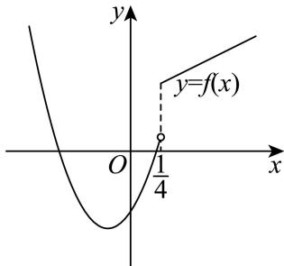

# 2026届上海高三一模 · 数列专题（教师版）

> 阶段性专题：按题型和方法组织，原题可在其他专题重复出现。本稿优先采用规范化原卷，未对全部原题或解析逐题重算。

## 目录

- [1 等差数列的通项、中项与前项和](#class-1)（7题）
- [2 等比数列的通项、求和及等差等比结合](#class-2)（5题）
- [3 递推关系与数列通项](#class-3)（3题）
- [4 数列与函数、导数及不等式](#class-4)（2题）
- [5 数列新定义、命题与构造](#class-5)（6题）
- [6 题面或条件待核](#class-6)（4题）

## 1 等差数列的通项、中项与前项和

### 崇明 · 原卷第6题

**考点说明：** 等差数列前项和：根据首项、公差求指定项数的和。

来源：2026届上海高三一模崇明卷，第6题。

规范化源文件：`2026届崇明一模数学试卷 逐题解析.md`。

已知等差数列 $\left\{a_{n}\right\}$ 首项为 $a_{1}=1$ ，公差 d=2，则其前 6 项和 $S_{6}=$ \_\_\_\_.

【答案】36

【解析】

【分析】根据条件及通项公式，可求得 $a_{6}$ ，代入求和公式，即可得答案.

【详解】由题意 $a_6 = a_1 + 5d = 11$ ，所以 $S_{6} = \frac{6(a_{1} + a_{6})}{2} = 36$

故答案为：36

### 普陀 · 原卷第5题

**考点说明：** 等差数列通项与前项和：利用已知项和求和条件列方程，确定公差。

来源：2026届上海高三一模普陀卷，第5题。

规范化源文件：`2026届普陀一模数学试卷 逐题解析.md`。

设 $n \geq 1, n \in \mathbf{N}, S_n$ 是等差数列 $\{a_n\}$ 的前 $n$ 项和，若 $a_3 = 1, S_7 = 3a_6$ ，则该等差数列的公差为 \_\_\_\_.

【答案】2

【解析】

【分析】设出基本量，根据已知条件列方程组即可求解.

【详解】设等差数列 $\{a_{n}\}$ 的公差为 $d$ ，

由 $a_{3} = 1, S_{7} = 3a_{6}$ 得 $\left\{ \begin{array}{l} a_{3} = a_{1} + 2d = 1 \\ 7a_{1} + \frac{7 \times 6}{2} d = 3(a_{1} + 5d) \end{array} \right.$ ,

即 $\left\{ \begin{array}{l}a_{1} + 2d = 1\\ 2a_{1} + 3d = 0 \end{array} \right.$ ，解得 $\left\{ \begin{array}{l}a_1 = -3\\ d = 2 \end{array} \right.$

故答案为：2.

### 青浦 · 原卷第5题

**考点说明：** 等差数列通项与求和：联立首项和公差的关系，确定指定项。

来源：2026届上海高三一模青浦卷，第5题。

规范化源文件：`2026届青浦一模数学试卷 逐题解析.md`。

设等差数列 $\{a_{n}\}$ 的前 $n$ 项和为 $S_{n}$ ，若 $S_{5} = 5, a_{2} = 0$ ，则 $a_{8} = \underline{\quad}$ .

【答案】6

【解析】

【分析】设公差为 d，由条件，根据等差数列的项与前 n 项和的基本量运算，求出 $a_{1}, d$ ，即可求得答案.

【详解】设等差数列 $\{a_{n}\}$ 的公差为 $d$ ，

由 $S_{5} = 5, a_{2} = 0$ ，可得 $\left\{ \begin{array}{l} 5a_{1} + 10d = 5 \\ a_{1} + d = 0 \end{array} \right.$ ，解得 $a_{1} = -1, d = 1$ ，

则 $a_{8} = a_{1} + 7d = -1 + 7 = 6$

故答案为：6.

### 静安 · 原卷第6题

**考点说明：** 等差数列通项与求和：由首项及指定项求公差，再计算前若干项和。

来源：2026届上海高三一模静安卷，第6题。

规范化源文件：`2026届静安一模数学试卷 逐题解析.md`。

设等差数列 $\left\{a_{n}\right\}$ 的前 n 项和为 $S_{n}$ （n 为正整数），首项 $a_{1}=\frac{3}{2}$ ， $a_{6}=9$ ，则 $S_{7}=$ \_\_\_\_.

【答案】42

【解析】

【分析】设等差数列 $\{a_{n}\}$ 的公差为 $d$ ，根据题意，列出方程，求得 $d = \frac{3}{2}$ ，结合等差数列的求和公式，即可求解.

【详解】设等差数列 $\{a_{n}\}$ 的公差为 $d$ ，

因为 $a_1 = \frac{3}{2}$ ，且 $a_6 = 9$ ，可得 $a_1 + 5d = \frac{3}{2} + 5d = 9$ ，解得 $d = \frac{3}{2}$ ，

所以 $S_{7}=7a_{1}+\frac{7\times6}{2}d=7\times\frac{3}{2}+21\times\frac{3}{2}=42$

故答案为：42.

### 长宁 · 原卷第3题

**考点说明：** 等差数列通项：利用已知项和公差列出通项方程求项数。

来源：2026届上海高三一模长宁卷，第3题。

规范化源文件：`2026届长宁一模数学试卷 逐题解析.md`。

在等差数列 $\left\{a_{n}\right\}$ 中， $a_{2}=1$ ，公差 d=2， $a_{n}=11$ ，则 n= \_\_\_\_.

【答案】7

【解析】

【分析】利用已知求得等差数列 $\{a_{n}\}$ 的通项公式，进而求得 $n$ ：

【详解】因为等差数列 $\{a_{n}\}$ 中， $a_2 = 1$ ，公差 $d = 2$

所以数列 $\{a_{n}\}$ 的通项公式 $a_{n} = a_{2} + (n - 2)d = 1 + 2(n - 2) = 2n - 3$

又 $a_{n} = 11$ ，所以 $2n - 3 = 11$ ，解得 $n = 7$

故答案为：7.

### 金山 · 原卷第9题

**考点说明：** 等差中项与整数最值：由非零公差得到下标约束，再在允许的正整数情形中求最小值。

来源：2026届上海高三一模金山卷，第9题。

规范化源文件：`2026届金山一模数学试卷 逐题解析.md`。

在公差不为 0 的等差数列 $\{a_{n}\}$ 中，若 $a_{3}$ 是 $a_{x}$ 与 $a_{y}$ 的等差中项，则 $\frac{1}{x} + \frac{4}{y}$ 的最小值为 \_\_\_\_.

【答案】 $\frac{3}{2}$

【解析】

【分析】根据等差中项性质可得 $x + y = 6$ ，再利用基本不等式中“1”的应用计算可得结果.

【详解】因为在公差不为0的等差数列 $\{a_{n}\}$ 中， $a_3$ 是 $a_{x}$ 与 $a_{y}$ 的等差中项，

所以 $2a_{3}=a_{x}+a_{y}$ ，所以 $x+y=6$ ，

因此 $\frac{1}{x} +\frac{4}{y} = \frac{1}{6}\big(x + y\big)\left(\frac{1}{x} +\frac{4}{y}\right) = \frac{1}{6}\left(5 + \frac{y}{x} +\frac{4x}{y}\right)\geq \frac{1}{6}\left(5 + 2\sqrt{\frac{y}{x}\cdot\frac{4x}{y}}\right) = \frac{3}{2},$

当且仅当 $\frac{y}{x} = \frac{4x}{y}$ ，即 $x = 2, y = 4$ 时等号成立，

所以 $\frac{1}{x} +\frac{4}{y}$ 的最小值为 $\frac{3}{2}$

故答案为: $\frac{3}{2}$

### 奉贤 · 原卷第16题

**考点说明：** 等差数列前项和：由指定部分和为零建立对称关系，判断命题时注意 k 的边界。

来源：2026届上海高三一模奉贤卷，第16题。

规范化源文件：`2026届奉贤一模数学试卷 逐题解析.md`。

已知等差数列 $\{a_{n}\}$ 的公差不为零， $S_{n}$ 为其前 $n$ 项和，存在正整数 $k$ 满足 $S_{k} = 0$ ，有两个命题：
命题①：设数列公差 $d$ ，则 $d \cdot S_{1} < 0$ 。

命题②：i、j 均是小于 k 的正整数，则 $S_{i} \cdot S_{j} = S_{k-i} S_{k-j}$ .

以上判断正确的是（）

- A. 命题①②都是真命题
- B. 命题①是真命题，命题②是假命题
- C. 命题①②都是假命题
- D. 命题①是假命题，命题②是真命题

【答案】D

【解析】

【分析】命题①：利用等差数列的求和公式，将条件 $S_{k}=0$ 整理得到 $a_{1}=-\frac{(k-1)d}{2}$ ，又 $S_{1}=a_{1}$ ，计算 $d\cdot S_{1}$ 即可得解；命题②：利用等差数列的求和公式求解即可.
【详解】∵等差数列 $\left\{a_{n}\right\}$ 的公差不为零， $S_{n}$ 为其前n项和， $S_{k}=0$ ，
∴ $ka_{1}+\frac{k(k-1)d}{2}=0,\quad\therefore a_{1}=-\frac{(k-1)d}{2}$ 命题①：∵ $S_{1}=a_{1}$ ∴ $d\cdot S_{1}=d\cdot\left[-\frac{(k-1)d}{2}\right]=-\frac{(k-1)d^{2}}{2}$ ∵ $d\neq0$ ，∴ $d^{2}>0$ 当k=1时， $d\cdot S_{1}=0$ ；
当k>1且 $k\in N$ 时， $d\cdot S_{1}<0$ ；故命题①错误；
命题②：∵ $a_{1}=-\frac{(k-1)d}{2}$ ，i、j均是小于k的正整数，
∴ $S_{i}\cdot S_{j}=\left(-\frac{i(k-1)d}{2}+\frac{i(i-1)d}{2}\right)\cdot\left(-\frac{j(k-1)d}{2}+\frac{j(j-1)d}{2}\right)=\frac{ijd^{2}(i-k)(j-k)}{4}$ ∴ $S_{k-i}S_{k-j}=\left((k-i)a_{1}+\frac{(k-i)(k-i-1)d}{2}\right)\cdot\left((k-j)a_{1}+\frac{(k-j)(k-j-1)d}{2}\right)$

$$
= \frac {i j d ^ {2} (k - i) (k - j)}{4} = \frac {i j d ^ {2} (i - k) (j - k)}{4},
$$

$\therefore S_{i}\cdot S_{j} = S_{k - i}S_{k - j}$ ，故命题②正确.

故选：D.

## 2 等比数列的通项、求和及等差等比结合

### 奉贤 · 原卷第5题

**考点说明：** 等比数列基本量：利用相邻两组同间隔项的和之间的公比关系，结合各项为正求参数。

来源：2026届上海高三一模奉贤卷，第5题。

规范化源文件：`2026届奉贤一模数学试卷 逐题解析.md`。

已知等比数列 $\{a_{n}\}$ 的各项均为正数，若 $a_{1} + a_{3} = 16$ ， $a_{2} + a_{4} = 4$ ，则该等比数列 $\{a_{n}\}$ 的公比为 \_\_\_\_.

【答案】 $\frac{1}{4}$ ##0.25

【解析】

【分析】根据等比数列的通项关系作除法运算即可得公比的值.

【详解】设等比数列 $\{a_{n}\}$ 的公比为 $q$ ，

因为 $\{a_{n}\}$ 各项均为正数，若 $a_1 + a_3 = 16$ ， $a_2 + a_4 = 4$

则 $\frac{a_2 + a_4}{a_1 + a_3} = \frac{q(a_1 + a_3)}{a_1 + a_3} = q = \frac{4}{16} = \frac{1}{4}$

故该等比数列 $\{a_{n}\}$ 的公比为 $\frac{1}{4}$ .

故答案为： $\frac{1}{4}$ .

### 宝山 · 原卷第3题

**考点说明：** 等比数列求和：利用首项、公比及项数计算有限项之和。

来源：2026届上海高三一模宝山卷，第3题。

规范化源文件：`2026届宝山一模数学试卷 逐题解析.md`。

已知数列 $\left\{a_{n}\right\}$ 为等比数列，且 $a_{1} = 3$ ，公比 $q = 2$ ，则该数列的前4项的和等于

______

【答案】45

【解析】

【分析】直接运用等比数列前 n 项和公式进行求解即可.

【详解】因为数列 $\left\{a_{n}\right\}$ 为等比数列，且 $a_{1}=3$ ，公比q=2，

所以该数列的前 4 项的和为 $S_{4}=\frac{3\times\left(1-2^{4}\right)}{1-2}=45$ ，

故答案为：45

### 杨浦 · 原卷第9题

**考点说明：** 等差与等比数列综合：将三项成等比数列转化为乘积关系，再用等差通项和求和公式化简。

来源：2026届上海高三一模杨浦卷，第9题。

规范化源文件：`2026届杨浦一模数学试卷 逐题解析.md`。

等差数列 $\left\{a_{n}\right\}$ 的公差不为 0，前 n 项和为 $S_{n}$ ，若 $a_{3}$ ， $a_{5}$ ， $a_{8}$ 成等比数列，则 $\frac{S_{11}}{a_{10}} =$ \_\_\_\_ .

【答案】7

【解析】

【分析】设等差数列 $\{a_{n}\}$ 的公差为 $d(d\neq 0)$ ，根据条件得 $a_1 = 2d$ ，再利用等差数列的前 $n$ 项和公式及等差数列的通项公式，即可求解.

【详解】设等差数列 $\left\{a_{n}\right\}$ 的公差为 $d(d\neq0)$ ，因为 $a_{3}$ ， $a_{5}$ ， $a_{8}$ 成等比数列，

则 $a_5^2 = a_3a_8$ ，所以 $\left(a_{1} + 4d\right)^{2} = \left(a_{1} + 2d\right)\left(a_{1} + 7d\right)$ ，整理得到 $a_1 = 2d$

所以 $\frac{S_{11}}{a_{10}} = \frac{11a_1 + \frac{11\times 10}{2}d}{a_1 + 9d} = \frac{77d}{11d} = 7$

故答案为：7.

### 黄浦 · 原卷第10题

**考点说明：** 等差数列与对数运算：把对数等差转化为相应项的乘积关系，并按允许的项号讨论。

来源：2026届上海高三一模黄浦卷，第10题。

规范化源文件：`2026届黄浦一模数学试卷 逐题解析.md`。

已知数列 $\left\{a_{n}\right\}$ 是公差为 2 的等差数列，数列 $\lg a_{1}$ ， $\lg a_{k}$ ， $\lg a_{7}$ 也为等差数列，且 $k \in \{3,4,5\}$ ，则 $a_{1} =$ \_\_\_\_ .

【答案】4

【解析】

【分析】根据题意利用等差中项化简，可得关于 $a_{1}, k$ 的方程，分别取k求 $a_{1}$ 即可.

【详解】因为数列 $\lg a_{1}$ ， $\lg a_{k}$ ， $\lg a_{7}$ 为等差数列，

所以 $2\lg a_{k}=\lg a_{1}+\lg a_{7}=\lg a_{1}a_{7}$ ，即 $a_{k}^{2}=a_{1}a_{7}$ ，

所以 $\left[a_{1} + 2(k - 1)\right]^{2} = a_{1}(a_{1} + 6\times 2)$

化简可得 $(k - 1)^2 +(k - 1)a_1 = 3a_1$

当 $k = 3$ 时， $4 + 2a_{1} = 3a_{1}$ ，解得 $a_{1} = 4$ ；

当 $k = 4$ 时， $9 + 3a_{1} = 3a_{1}$ ，此时 $a_{1}$ 无解；

当 k=5 时， $16+4a_{1}=3a_{1}$ ，解得 $a_{1}=-16<0$ ，不合题意；

综上， $a_1 = 4$

故答案为：4

### 松江 · 原卷第17题

**考点说明：** 第（1）问：正弦型函数的参数识别：由周期、最大值和取到最大值的位置确定频率、振幅及初相。 第（2）问：等差数列与指数变换：由指定项求等差通项，说明指数变换后成为等比数列，再用等比求和公式。

来源：2026届上海高三一模松江卷，第17题。

规范化源文件：`2026届松江一模数学试卷 逐题解析.md`。

已知函数 $y = A \sin (\omega x + \varphi)$ （ $A$ 、 $\omega > 0$ ， $0 < \varphi < \pi$ ）的周期为 $\pi$ ，在 $x = \frac{\pi}{6}$ 时取到最大值4，记 $y = f(x)$ .

（1）求函数 $y = f(x)$ 的表达式；

（2）若数列 $\{a_{n}\}$ 为等差数列， $a_2 = f(0)$ ， $a_4 = f\left(\frac{\pi}{6}\right)$ ，记 $b_{n} = 2^{a_{n}}$ ，求数列 $\{b_n\}$ 的前 $n$ 项和 $T_{n}$ ：

【答案】（1） $y=4\sin\left(2x+\frac{\pi}{6}\right)$ ;

(2) $T_{n} = 2^{n + 1} - 2.$

【解析】

【分析】（1）根据正弦函数的性质，结合已知条件求出 A、 $\omega$ 、 $\varphi$ 的值，进而得到函数 $y = f(x)$ 的表达式；

(2)先根据函数表达式求出 $a_2$ 和 $a_4$ 的值, 再利用等差数列的通项公式求出 $a_n$ , 进而得到 $b_n$ , 最后根据等比数列的前 $n$ 项和公式求出 $T_n$ .

【小问 1 详解】

由题意，函数 $y = A \sin (\omega x + \varphi)$ （A、 $\omega > 0$ ， $0 < \varphi < \pi$ ）的周期为 $\pi$ ，

所以 $T = \frac{2\pi}{|\omega|}$ ，即 $\pi = \frac{2\pi}{|\omega|}$ ，解得 $\omega = 2$

又函数 $f(x)$ 在 $x = \frac{\pi}{6}$ 时取到最大值4，所以 $\left\{ \begin{array}{l}A = 4\\ A\sin \left(2\times \frac{\pi}{6} +\varphi\right) = 4 \end{array} \right.$

解得 A=4， $\varphi=\frac{\pi}{6}+2k\pi(k\in\mathbf{Z})$

又 $0 < \varphi < \pi$ ，所以当 $k = 0$ 时， $\varphi = \frac{\pi}{6}$

所以函数 $y = f(x)$ 的表达式为 $y = 4\sin\left(2x + \frac{\pi}{6}\right)$ ;

【小问 2 详解】

由（1）知，函数 $y = f(x)$ 的表达式为 $y = 4\sin \left(2x + \frac{\pi}{6}\right)$ ，

所以 $a_2 = f(0) = 4\sin \left(2\times 0 + \frac{\pi}{6}\right) = 4\times \frac{1}{2} = 2$

$$
a _ {4} = f \left(\frac {\pi}{6}\right) = 4 \sin \left(2 \times \frac {\pi}{6} + \frac {\pi}{6}\right) = 4 \times 1 = 4,
$$

又数列 $\{a_{n}\}$ 为等差数列，则 $\left\{ \begin{array}{l} a_{2} = a_{1} + d = 2 \\ a_{4} = a_{1} + 3d = 4 \end{array} \right.$ ，解得 $a_{1} = 1$ ， $d = 1$ ，

所以 $a_{n} = n$ ，

又 $b_{n}=2^{a_{n}}$ ，所以 $b_{n}=2^{n}$ ，即数列 $\left\{b_{n}\right\}$ 为首项是2，公比为2的等比数列，

所以数列 $\{b_n\}$ 的前 $n$ 项和 $T_{n} = \frac{2(1 - 2^{n})}{1 - 2} = 2^{n + 1} - 2.$

### 闵行 · 原卷第8题

**考点说明：** 等比数列与一元二次方程：通过根的乘积求等比中项平方，再结合两根的符号确定中项。

来源：2026届上海高三一模闵行卷，第8题。

已知 $\{a_n\}$ 是等比数列，若 $a_1$、$a_5$ 是函数 $y=x^2+3x+1$ 的两个零点，则 $a_3=$________。

【答案】$-1$

【解析·参考原解整理】

由根与系数关系 $a_1+a_5=-3$，$a_1a_5=1$，故两根均为负。又等比数列有 $a_3^2=a_1a_5=1$，且 $a_3<0$，故 $a_3=-1$。

回源核对说明：逐题对照该PDF题面页面视觉核对；答案转录自第7或12页，非独立数学复核。

## 3 递推关系与数列通项

### 嘉定 · 原卷第9题

**考点说明：** 分式递推的通项：对非零项取倒数，把递推转化为等差数列。

来源：2026届上海高三一模嘉定卷，第9题。

规范化源文件：`2026届嘉定一模数学试卷 逐题解析.md`。

已知数列 $\{a_{n}\}$ 满足 $a_{1} = \frac{1}{3}$ ，且 $a_{n} = \frac{a_{n - 1}}{2a_{n - 1} + 1}(n\geq 2)$ ，则 $a_{100} = \underline{\quad}$ .

【答案】 $\frac{1}{201}$

【解析】

【分析】观察递推式为分式的形式，通过取倒数将其转化为线性递推关系，构造等差数列可求得数列 $\{a_{n}\}$ 的通项公式，进而求解.

【详解】对 $a_{n} = \frac{a_{n - 1}}{2a_{n - 1} + 1}$ 的两边取倒数得 $\frac{1}{a_n} = \frac{2a_{n - 1} + 1}{a_{n - 1}} = 2 + \frac{1}{a_{n - 1}}$

所以 $\frac{1}{a_n} -\frac{1}{a_{n - 1}} = 2(n\geq 2)$ ，所以数列 $\left\{\frac{1}{a_n}\right\}$ 是首项为 $\frac{1}{a_1} = 3$ ，公差为2的等差数列，

所以数列 $\left\{\frac{1}{a_n}\right\}$ 的通项公式为 $\frac{1}{a_n} = 3 + 2(n - 1) = 2n + 1$

所以数列 $\{a_{n}\}$ 的通项公式为 $a_{n} = \frac{1}{2n + 1}$ ，所以 $a_{100} = \frac{1}{2\times 100 + 1} = \frac{1}{201}$ .

故答案为： $\frac{1}{201}$ .

### 浦东 · 原卷第12题

**考点说明：** 分段函数与等差数列：将等差递推与分段函数递推联合，分析数列项所在区间及无限延续的条件。

来源：2026届上海高三一模浦东卷，第12题。

规范化源文件：`2026届浦东一模数学试卷 逐题解析.md`。

已知 $f(x)=\left\{\begin{aligned}&8x^{2}+3x-1,x<\frac{1}{4}\\ &x+\frac{7}{8},x\geq\frac{1}{4}\end{aligned}\right.$ ，若等差数列 $\left\{a_{n}\right\}$ 为无穷数列，且均满足递推关系 $a_{n+1}=f(a_{n})$ ，则该数列首项 $a_{1}$ 的取值范围为 \_\_\_\_.

【答案】 $\left\{-\frac{1}{2},-\frac{5}{8}\right\}\cup\left[\frac{1}{4},+\infty\right]$ .

【解析】

【分析】由递推关系 $a_{n+1} = f(a_n)$ ，则 $f(a_n) = a_{n+1} = a_n + d$ ，根据分段函数的解析式，分三种情况讨论，列出关系式，即可求解.

【详解】由函数 $f(x) = \begin{cases} 8x^2 + 3x - 1, & x < \frac{1}{4} \\ x + \frac{7}{8}, & x \geq \frac{1}{4} \end{cases}$ ，可得函数 $f(x)$ 的图像，如图所示，

因为等差数列 $\{a_n\}$ 为无穷数列，且均满足递推关系 $a_{n+1} = f(a_n)$ ，则 $f(a_n) = a_{n+1} = a_n + d$ ，

当 $a_n \in \left[\frac{1}{4}, +\infty\right)$ 时， $f(a_n) = a_{n+1} = a_n + \frac{7}{8} = a_n + d$ ，

可得 $d = \frac{7}{8}$ ，符合题意，此时 $a_1 \in \left[\frac{1}{4}, +\infty\right)$ ;

当 $a_n \in \left(-\infty, \frac{1}{4}\right)$ 时，则 $a_{n+1} \in \left(-\infty, \frac{1}{4}\right)$ ，可得 $f(a_n) = 8a_n^2 + 3a_n - 1 = a_n + d$ ， $f(a_{n+1}) = 8a_{n+1}^2 + 3a_{n+1} - 1 = a_{n+1} + d$ ，

两式相减，可得 $8(a_{n+1}^2 - a_n^2) + 2(a_{n+1} - a_n) = 0$ ，即 $(a_{n+1} - a_n)[4(a_{n+1} + a_n) + 1] = 0$ ，

所以 $a_{n+1} - a_n = 0$ ，所以 $d = 0$ ，此时数列 $\{a_n\}$ 为常数列，

可得 $8a_1^2 + 3a_1 - 1 = a_1$ ，解得 $a_1 = -\frac{1}{2}$ 或 $a_1 = \frac{1}{4}$ （舍去）；

若 $a_1 \in \left(-\infty, \frac{1}{4}\right)$ ， $a_2 \in \left[\frac{1}{4}, +\infty\right)$ ，则 $f(a_1) = 8a_1^2 + 3a_1 - 1 = a_1 + \frac{7}{8}$ ，解得 $a_1 = -\frac{5}{8}$ 综上可得：首项 $a_1$ 的取值范围为 $\left\{-\frac{1}{2}, -\frac{5}{8}\right\} \cup \left[\frac{1}{4}, +\infty\right)$ .

故答案为： $\left\{-\frac{1}{2}, -\frac{5}{8}\right\} \cup \left[\frac{1}{4}, +\infty\right)$ .

### 静安 · 原卷第15题

**考点说明：** 对数递推与连乘化简：将递推改写为指数关系，使前后相邻项在乘积中消去。

来源：2026届上海高三一模静安卷，第15题。

规范化源文件：`2026届静安一模数学试卷 逐题解析.md`。

若数列 $\left\{a_{n}\right\}$ 满足 $a_{n+1}=\log_{m}a_{n}(m>1$ 且 $m\in Z)$ ，则称数列 $\left\{a_{n}\right\}$ 为“对数 m 底数列”. 已知正项数列 $\left\{a_{n}\right\}$ 是“对数 2 底数列”且 $a_{5}=1$ ，则当 $n\geqslant2$ 且 $n\in N^{*}$ 时， $\frac{4^{a_{2}+a_{3}+\cdots+a_{n}}}{a_{2}^{2}\cdots\cdots a_{n-1}^{2}}=(\quad)$

- A. $2^{12}$
- B. $2^{16}$
- C. $2^{32}$
- D. $2^{64}$

【答案】C

【解析】

【分析】根据定义 $a_{n+1}=\log_{2}a_{n}$ ，即 $2^{a_{n+1}}=a_{n}$ ，再利用累乘 $\frac{2^{a_{2}+a_{3}+\cdots+a_{n}}}{a_{2}\cdots a_{n-1}}=a_{1}$ ，平方后再由 $a_{5}=1$ 根据递推关系可得答案.

【详解】因为正项数列 $\left\{a_{n}\right\}$ 是“对数 2 底数列”，所以 $a_{n+1}=\log_{2}a_{n}$ ，所以 $2^{a_{n+1}}=2^{\log_{2}a_{n}}=a_{n}$ ，
所以 $2^{a_{2}} = a_{1}, 2^{a_{3}} = a_{2}, 2^{a_{4}} = a_{3}, \cdots, 2^{a_{n}} = a_{n-1} (n \geq 2 \text{ 且 } n \in \mathbb{N}^{*})$ ,

以上式子相乘得 $2^{a_2} \cdot 2^{a_3} \cdots 2^{a_n} = a_1 \cdot a_2 \cdots a_{n-1}$ ，所以 $2^{a_2 + a_3 + \cdots + a_n} = a_1 \cdot a_2 \cdots a_{n-1}$ ，

所以 $\frac{2^{a_2 + a_3 + \cdots + a_n}}{a_2\cdots a_{n - 1}} = a_1$ ，得 $\frac{2^{a_2 + a_3 + \cdots + a_n}\cdot 2^{a_2 + a_3 + \cdots + a_n}}{a_2\cdots a_{n - 1}\cdot a_2\cdots a_{n - 1}} = a_1^2,$

即 $\frac{2^{2a_2 + 2a_3 + \cdots + 2a_n}}{a_2^2\cdots a_{n - 1}^2} = a_1^2$ ，得 $\frac{4^{a_2 + a_3 + \cdots + a_n}}{a_2^2\cdots a_{n - 1}^2} = a_1^2$ ，因为 $a_5 = \log_2a_4,a_5 = 1$ ，所以 $a_4 = 2$

同理， $a_4 = \log_2a_3$ ，所以 $a_3 = 4;a_3 = \log_2a_2$ ，所以 $a_2 = 16;a_2 = \log_2a_1$

所以 $a_{1}=2^{16}$ . 故 $\frac{4^{a_{2}+a_{3}+\cdots+a_{n}}}{a_{2}^{2}\cdots a_{n-1}^{2}}=\left(2^{16}\right)^{2}=2^{32}$ .

故选：C.

### 徐汇 · 原卷第12题

**考点说明：** 递推数列与不等式的恒成立：比较允许的相邻差对两段和的影响；原题递推下标涉及未定义的首项前一项，解释需注明。

来源：2026届上海高三一模徐汇卷，第12题。

已知数列 $\{a_n\}$ 满足：$a_1=0$，对任意的正整数 $n$ 均有 $a_n-a_{n-1}\in\{1,2\}$，若存在正整数 $k$（$1\le k\le9$），使得所有数列 $\{a_n\}$ 均满足 $a_1+a_2+\cdots+a_k\le a_{k+1}+a_{k+2}+\cdots+a_{10}$，则 $k$ 的最大值为______。

【答案】6

#### 解析

先按递推条件应为 $n\ge2$ 的通常题意解释。设 $d_j=a_j-a_{j-1}\in\{1,2\}$（$2\le j\le10$），则 $a_i=\sum_{j=2}^id_j$。

记 $D_k=\sum_{i=k+1}^{10}a_i-\sum_{i=1}^ka_i$。当 $k=6$ 时，各 $d_j$ 的系数依次为 $-1,0,1,2,3,4,3,2,1$，故其最小值为 $-2+0+1+2+3+4+3+2+1=14>0$，所以 $k=6$ 恒满足。

当 $k=7$，取 $(a_1,\ldots,a_{10})=(0,2,4,6,8,10,11,12,13,14)$，则前7项和为 $41$，后3项和为 $39$，不满足。又 $a_i\ge0$，故 $D_k$ 随 $k$ 不增，$k\ge7$ 也不可能恒满足。因此最大值为 $6$。

> 原题从 $n=1$ 开始引用未定义的 $a_0$，应核对递推范围；上述答案基于 $n\ge2$ 的解释。

回源核对说明：已视觉确认标答整理版第2页同样写“对任意的正整数n”并引用a_(n-1)，不是本次OCR漏条件；保留原文，解析按n≥2理解，原题下标瑕疵。

### 闵行 · 原卷第15题

**考点说明：** 递推取数：根据每次向后计数得到位置递推，累加为三角数并判断终止边界。

来源：2026届上海高三一模闵行卷，第15题。

从等差数列 $1,2,3,\cdots,1000$ 中取出若干数字按先后顺序构成数列 $\{a_n\}$。第一次取出数字“$1$”，然后从取出的“$1$”开始往后数 $2$ 个数，再取出数到 $2$ 的数字“$3$”，……，以此类推，如果某次取出的是数字“$a_k$”，则下一次从取出的“$a_k$”开始往后数 $k+1$ 个数，再取出数到 $k+1$ 的数字“$a_{k+1}$”；当往后数的数字个数小于“$k+1$”时，结束取数。那么 $\{a_n\}$ 的最后一项是（ ）。

- A. $6$

- B. $990$

- C. $999$

- D. $1000$

【答案】B

【解析·参考原解整理】

由取数规则，$a_1=1,a_2=3,a_3=6$，一般地 $a_k=1+2+\cdots+k=\frac{k(k+1)}2$。由 $\frac{44\times45}2=990\le1000<\frac{45\times46}2$，得最后一项为 $990$，选 B。

回源核对说明：逐题对照该PDF题面页面视觉核对；答案转录自第7或12页，非独立数学复核。

## 4 数列与函数、导数及不等式

### 徐汇 · 原卷第21题

**考点说明：** 第（1）问：函数新定义与导数单调性：求导并判断导函数在定义域上的变化。 第（2）问：等差数列与函数增量：利用导数严格递减及等间隔关系比较两段增量。 第（3）问：函数符号与导数单调性：结合零点两侧的符号和导数递减条件证明整体单调性。

来源：2026届上海高三一模徐汇卷，第21题。

规范化源文件：`2026届徐汇一模数学试卷 逐题解析.md`。

已知函数 $y = f(x)$ 的定义域为 D，若其导函数 $y = f'(x)$ 在 D 上是严格减函数，则称 $f(x)$ 是一个 “S 函数”.

（1）设 $f_{1}(x)=\ln x$ ， $f_{2}(x)=\mathrm{e}^{x}$ ，分别判断 $y=f_{1}(x)$ 、 $y=f_{2}(x)$ 是否为“S函数”，并说明理由；

（2）已知数列 $\{b_{n}\}$ 是公差为 $d(d > 0)$ 的等差数列，且 $\{b_{n}\}$ 的各项都为正数，若定义在 $(0, +\infty)$ 上的函数 $y = g(x)$ 是“S函数”，求证： $g(b_{n+3}) - g(b_{n+2}) < g(b_{n+1}) - g(b_{n})$ 。

（3）已知“S函数” $y = F(x)$ 的定义域为R，不等式 $F(x) > 0$ 的解集为 $(-\infty, 0)$ 。证明：函数 $y = F(x)$ 在R上是严格减函数。

【答案】（1）函数 $y = f_{1}(x)$ 为 “S 函数”，函数 $y = f_{2}(x)$ 不是 “S 函数”

(2) 证明见解析 (3) 证明见解析

【解析】

【分析】（1）根据 “S 函数” 的定义判断即可；

(2) 要证 $g(b_{n+3}) - g(b_{n+2}) < g(b_{n+1}) - g(b_n)$ ，即证

$g(b_{n}+3d)-g(b_{n}+2d)<g(b_{n}+d)-g(b_{n})$ ，构造函数 $h(x)=g(x+d)-g(x)$ ，其中x>0，利用“S函数”的定义结合导数分析函数 $h(x)$ 在 $(0,+\infty)$ 上的单调性，即可得出结论；

（3）利用反证法，假设 $F(x)$ 不是减函数，分两种情况讨论， $F(x)$ 为增函数、 $F(x)$ 不单调，结合 “S 函数” 的定义分析函数 $F(x)$ 的单调性，分析函数 $F(x)$ 的函数值变化，对不等式 $F(x) > 0$ 的解集进行分析，推出矛盾，即可证得结论成立.

【小问 1 详解】

函数 $f_{1}(x) = \ln x$ 的定义域为 $(0, +\infty)$ ，其导函数 $f_{1}^{\prime}(x) = \frac{1}{x}$ 在 $(0, +\infty)$ 上为减函数，

函数 $f_{2}(x) = \mathrm{e}^{x}$ 的定义域为 $\mathbf{R}$ ，其导函数 $f_{2}^{\prime}(x) = \mathrm{e}^{x}$ 在 $\mathbf{R}$ 上为增函数，

故函数 $y = f_{1}(x)$ 为 “S 函数”，函数 $y = f_{2}(x)$ 不是 “S 函数”.

【小问 2 详解】

因为数列 $\{b_n\}$ 是公差为 $d(d > 0)$ 的等差数列，

所以 $b_{n+1}=b_{n}+d$ ， $b_{n+2}=b_{n}+2d$ ， $b_{n+3}=b_{n}+3d$ ，

要证 $g(b_{n + 3}) - g(b_{n + 2}) <   g(b_{n + 1}) - g(b_n)$ ，即证

$$
g \left(b _ {n} + 3 d\right) - g \left(b _ {n} + 2 d\right) <   g \left(b _ {n} + d\right) - g \left(b _ {n}\right),
$$

设函数 $h(x)=g(x+d)-g(x)$ ，其中 x>0，则 $h'(x)=g'(x+d)-g'(x)$ ，

因为函数 $g(x)$ 为 “S 函数”，则函数 $g'(x)$ 在 $(0, +\infty)$ 上为减函数，且 $x + d > x$ ，

所以 $g'(x+d)<g'(x)$ ，故 $h'(x)=g'(x+d)-g'(x)<0$ 对任意的 x>0 恒成立，

故函数 $h(x)$ 在 $(0, +\infty)$ 上为减函数，

又因为对任意的 $n \in \mathbf{N}^*$ ， $b_n > 0$ ，所以 $h(b_n + 2d) < h(b_n)$ ，

即 $g(b_{n} + 3d) - g(b_{n} + 2d) <   g(b_{n} + d) - g(b_{n})$ ，故

$$
g \left(b _ {n + 3}\right) - g \left(b _ {n + 2}\right) <   g \left(b _ {n + 1}\right) - g \left(b _ {n}\right).
$$

【小问 3 详解】

假设函数 $F(x)$ 不是减函数，因为不等式 $F(x)>0$ 的解集为 $(-∞,0)$ ,

若函数 $F(x)$ 在R上为增函数，则不等式 $F(x)>0$ 的解集中必包含正无穷大，不合乎题意，

所以函数 $F(x)$ 在 R 上存在极值点，即存在 $x_{0} \in R$ ，使得 $F'(x_{0}) = 0$ ，

因为函数 $F(x)$ 为 “S 函数”，所以函数 $F'(x)$ 为减函数，

故当 $x \in (-\infty, x_0)$ 时， $F'(x) > 0$ ，即函数 $F(x)$ 在 $(- \infty, x_0)$ 上单调递增，

当 $x \in (x_0, +\infty)$ 时， $F'(x) < 0$ ，即函数 $F(x)$ 在 $(x_0, +\infty)$ 上单调递减，

取 $x_{1} < x_{0}$ ，则 $F^{\prime}(x_1) > F^{\prime}(x_0) = 0$

所以函数 $F(x)$ 在 $x = x_{1}$ 处的切线方程为 $y - F(x_{1}) = F'(x_{1})(x - x_{1})$ ，即

$$
y = F ^ {\prime} \left(x _ {1}\right) \left(x - x _ {1}\right) + F \left(x _ {1}\right)
$$

令 $\varphi (x) = F^{\prime}(x_{1})(x - x_{1}) + F(x_{1})$ ，令 $\varphi (x) = 0$ ，可得 $x = -\frac{F(x_1)}{F'(x_1)} +x_1$ ，记

$$
x _ {2} = - \frac {F \left(x _ {1}\right)}{F ^ {\prime} \left(x _ {1}\right)} + x _ {1},
$$

构造函数 $p(x)=\varphi(x)-F(x)=F'(x_{1})(x-x_{1})+F(x_{1})-F(x)$ ，则 $p(x_{1})=0$ ，

所以 $p'(x)=F'(x_{1})-F'(x)$ ,

因为函数 $F'(x)$ 在 R 上为减函数，当 $x > x_1$ 时， $p'(x) = F'(x_1) - F'(x) > 0$ ，即 $p(x)$ 在 $(x_1, +\infty)$ 上为增函数，

当 $x < x_{1}$ 时， $p^{\prime}(x) = F^{\prime}(x_{1}) - F^{\prime}(x) < 0$ ，即函数 $p(x)$ 在 $(- \infty, x_{1})$ 上为减函数，

所以 $p(x) \geq p(x_{1}) = 0$ ，即 $\varphi(x) - F(x) \geq 0$ ，即 $\varphi(x) \geq F(x)$ ，当且仅当 $x = x_{1}$ 时，等号成立，

而 $p\left(x_{2}\right) = 0$ ，结合 $F^{\prime}(x) > 0$ ，可知函数 $\varphi (x)$ 为增函数，

故当 $x < x_{2}$ 时， $F(x) \leq \varphi(x) < \varphi(x_{2}) = 0$

与不等式 $F(x)>0$ 的解集为 $(-∞,0)$ 矛盾，假设不成立，

故函数 $F(x)$ 在 R 上为减函数.

### 松江 · 原卷第21题

**考点说明：** 第（1）问：导数与区间单调性：在给定参数下求导，根据区间内导数符号说明增减性。 第（2）问：含参函数同时有极大值和极小值：考查导数零点的个数、所在定义域及两侧变号情况，不能只看判别式。 第（3）问：对数不等式与数列求和：构造或调用前问的函数比较，把对数差与倒数项逐项比较后叠加。

来源：2026届上海高三一模松江卷，第21题。

规范化源文件：`2026届松江一模数学试卷 逐题解析.md`。

已知函数 $y = x - 1 - a \ln x$ ，正常数 $a \in R$ ，记 $y = f(x)$ .

（1）当 $a = 1$ 时，试判断函数 $y = f(x)$ 在区间 $[1, +\infty)$ 上的单调性，并说明理由；

（2）若函数 $g(x)=x^{2}-f(x)$ 既存在极小值也存在极大值，求实数 a 的取值范围；

（3）求证：对于任意正整数 n，都有 $1+\frac{1}{3}+\frac{1}{5}+\cdots+\frac{1}{2n+1}>\frac{1}{2}\ln\left[2(n+1)\right]$ .

【答案】（1）函数 $y = f(x)$ 在区间 $[1, +\infty)$ 上单调递增，理由见详解

(2) $\left(0, \frac{1}{8}\right)$

（3）证明见详解

【解析】

【分析】（1）利用导数判断函数的单调性即可；

（2）对 $g(x)$ 求导得 $g'(x) = 2x - 1 + \frac{a}{x} = \frac{2x^2 - x + a}{x}$ ，将 $g(x)$ 既存在极小值也存在极大值转化为方程 $h(x) = 0$ 在 $(0, +\infty)$ 上有两个不同的正实数根即可求解；

（3）利用（1）的结论得到 $x-1>\ln x$ ，再令 $x=\frac{2k+1}{2k-1}(k=1,2,3,\cdots,n+1)$ 进行累加，即可得证.

【小问 1 详解】

函数 $y = f(x)$ 在区间 $[1, +\infty)$ 上单调递增，理由如下：

当 $a = 1$ 时， $f(x) = x - 1 - \ln x$ ，定义域为 $(0, +\infty)$ ，则 $f'(x) = 1 - \frac{1}{x} = \frac{x - 1}{x}$ ，

$\because x \in [1, +\infty)$ ， $\therefore x - 1 \geq 0$ 且 $x > 0$ ， $\therefore f'(x) \geq 0$ ，当且仅当 $x = 1$ 时取等号，

∴函数 $y = f(x)$ 在区间 $[1, +\infty)$ 上单调递增；

【小问 2 详解】

$g(x)=x^{2}-f(x)=x^{2}-x+1+a\ln x$ ，定义域为 $(0,+\infty)$ ,

则 $g'(x)=2x-1+\frac{a}{x}=\frac{2x^{2}-x+a}{x}$ ，设 $h(x)=2x^{2}-x+a(x>0)$ ,

$\because x>0,\therefore g'(x)$ 的符号由分子 $2x^{2}-x+a$ 决定，

函数 $g(x)$ 既存在极小值也存在极大值等价于方程 $h(x)=0$ 在 $(0,+\infty)$ 上有两个不同的正实数根，

$\therefore \left\{ \begin{array}{l} \Delta = 1 - 8a > 0 \\ \frac{1}{2} > 0 \\ \frac{a}{2} > 0 \end{array} \right.$ ，解得 $0 < a < \frac{1}{8}$ ， $\therefore$ 实数 $a$ 的取值范围是 $\left(0, \frac{1}{8}\right)$ ；

【小问 3 详解】

由（1）知，当 $x > 1$ 时， $f(x) = x - 1 - \ln x > f(1) = 0$ ，即 $x - 1 > \ln x$

令 $x=\frac{2k+1}{2k-1}(k=1,2,3,\cdots,n+1)$ ,

则 $\frac{2k + 1}{2k - 1} - 1 = \frac{2}{2k - 1} > \ln \frac{2k + 1}{2k - 1}$ ，即 $\frac{1}{2k - 1} > \frac{1}{2} \ln \frac{2k + 1}{2k - 1}$

将 $k = 1$ 到 $k = n + 1$ 累加得，

$$
1 + \frac {1}{3} + \frac {1}{5} + \dots + \frac {1}{2 n + 1} > \frac {1}{2} \left(\ln \frac {3}{1} + \ln \frac {5}{3} + \ln \frac {7}{5} + \dots + \ln \frac {2 n + 3}{2 n + 1}\right),
$$

$$
\text {即} 1 + \frac {1}{3} + \frac {1}{5} + \dots + \frac {1}{2 n + 1} > \frac {1}{2} \left[ \ln \left(\frac {3}{1} \times \frac {5}{3} \times \frac {7}{5} \times \dots \times \frac {2 n + 3}{2 n + 1}\right) \right] = \frac {1}{2} \ln (2 n + 3) > \frac {1}{2} \ln 2 (n + 1),
$$

$$
\therefore 1 + \frac {1}{3} + \frac {1}{5} + \dots + \frac {1}{2 n + 1} > \frac {1}{2} \ln \left[ 2 (n + 1) \right], \text {得证.}
$$

## 5 数列新定义、命题与构造

### 嘉定 · 原卷第16题

**考点说明：** 数列项与前项和的量词命题：理解对每个n存在m的条件，结合构造和反例检验选项。

来源：2026届上海高三一模嘉定卷，第16题。

规范化源文件：`2026届嘉定一模数学试卷 逐题解析.md`。

数列 $\{a_{n}\}$ 的前 $n$ 项和为 $S_{n}$ ，且对任意正整数 $n$ ，总存在正整数 $m$ ，使得 $S_{n} = a_{m}$ ，则下列命题中正确的是（）

- A. 对任意正整数 $n$ ，总存在正整数 $m$ ，使得 $a_{n} = S_{m}$
- B. 数列 $\{a_{n}\}$ 一定是等差数列
- C. 存在公比为正整数的等比数列 $\{a_{n}\}$ 满足条件
- D. 对任意正整数 $k$ ，总存在正整数 $m$ 、 $n$ ，使得 $a_{k} = a_{m} - a_{n}$

【答案】D

【解析】

【分析】可根据数列 $\left\{a_{n}\right\}$ 的性质，对每一选项进行分析判断即可.

【详解】选项 A：取数列 $a_{n}=n$ ，易知不存在正整数 m，使得 $S_{m}=a_{2}=2$ ，故该选项错误；

选项B：取数列 $a_{n} = \left\{ \begin{array}{l}1,n = 1\\ 0,n\geq 2 \end{array} \right.$ ，则 $S_{n} = 1$ ，满足对任意正整数 $n$ ，总存在正整数 $m$ ，使得 $S_{n} = a_{m}$ ，但数列 $a_{n}$ 不是等差数列，故该选项错误；

选项C：设等比数列 $\{a_{n}\}$ 的公比为 $q$ ，首项为 $a_1$ ，则 $a_{n} = a_{1}q^{n - 1}$

当 $q = 1$ 时， $S_{n} = na_{1}$ ， $a_{m} = a_{1}$ ，则 $S_{n} - a_{m} = (n - 1)a_{1}$ 不恒为0，不符合题意；

当正整数 $q \geq 2$ 时， $S_{n} = a_{1} + a_{2} + \cdots + a_{n} = a_{1}(1 + q + q^{2} + \cdots + q^{n-1})$ ， $a_{m} = a_{1}q^{m-1}$

若 $S_{n}=a_{m}$ ，则 $1+q+q^{2}+\cdots+q^{n-1}=q^{m-1}$ ，

由于正整数 $q \geq 2$ ，则 $q^{n-1} < 1 + q + q^{2} + \cdots + q^{n-1} = \frac{q^{n} - 1}{q - 1} < \frac{q^{n}}{q - 1} \leq q^{n}$ ，

即 $q^{n-1}<q^{m-1}<q^{n}\ldots^{*}$ ,

由于 $q^{n}$ 单调递增，且在 n-1 与 n 之间不存在其他正整数，则 \* 式不成立；

故 C 错误;

选项 D: 当正整数 $k \geq 2$ 时，由题意，存在正整数 m 使得 $S_{k} = a_{m}$ ，

且存在正整数 n 使得 $S_{k-1}=a_{n}$ ，则 $a_{k}=S_{k}-S_{k-1}=a_{m}-a_{n}$ 符合题意；

当 $k = 1$ 时，存在正整数 $m$ 使得 $S_{2} = a_{m}$ ，取 $n = 2$ ，则 $a_{1} = S_{2} - a_{2} = a_{m} - a_{n}$ 符合题意；故D正确.

故选：D.

### 宝山 · 原卷第16题

**考点说明：** 数列新定义与存在性：将“增长”条件转化为逐项差分不等式，构造或排除等差、等比数列。

来源：2026届上海高三一模宝山卷，第16题。

规范化源文件：`2026届宝山一模数学试卷 逐题解析.md`。

对任意正整数 $n$ ，数列 $\{a_n\}$ 满足 $a_{n+1} - a_n > 1$ ，则称该数列为“增长”数列.

命题 1: 存在 $a_1 = -1$ 的等差数列 $\{a_n\}$ 为“增长”数列，且满足其 $n$ 前项和 $S_n < \frac{n^2 - 2n}{2}$ .

命题 2: 存在各项均为正整数的等比数列 $\{a_n\}$ 为“增长”数列且 $\left\{\frac{a_n}{2}\right\}$ 不是“增长”数列，使得 $\left\{\frac{a_{n+1}}{n+1}\right\}$ 为“增长”数列。（）

- A. ①是真命题，②是真命题
- B. ①是真命题，②是假命题
- C. ①是假命题，②是真命题
- D. ①是假命题，②是假命题

【答案】C

【解析】

【分析】首先假设存在等差数列 $\{a_{n}\}$ 符合要求，从而得到 $(n - 1)d < n$ 成立，再分类讨论 $n = 1$ 和 $n > 1$ 的情况，即可得到判断；设数列 $\{a_{n}\}$ 的公比为 $q$ ，则 $a_{n} = a_{1}q^{n - 1}$ ，根据题意得到 $a_{n + 1} - a_{n} = a_{n}q - a_{n} = a_{n}(q - 1) > 1 > 0$ ，从而得到 $\frac{1}{2} a_2 - \frac{1}{2} a_1$ 为最小项，同理得到 $\frac{1}{2} a_2 - \frac{1}{2} a_1$ 为最小项，再利用“增长数列”的定义得到 $a_1 = 1$ ， $q = 3$ 或 $a_1 = 2$ ， $q = 2$ 再分类讨论即可得到判断.

【详解】假设存在等差数列 $\left\{a_{n}\right\}$ 符合要求，设公差为 d，则 d > 1，

由 $a_1 = -1$ ，得 $S_{n} = -n + \frac{n(n - 1)}{2} d$

由题意，得 $-n+\frac{n(n-1)}{2}d<\frac{n^{2}-2n}{2}$ 对 $n\in N^{*}$ 均成立，即 $(n-1)d<n$ .

当 $n = 1$ 时， $d \in \mathbf{R}$ ；

当 $n > 1$ 时， $d < \frac{n}{n - 1}$ ，

因为 $\frac{n}{n-1}=1+\frac{1}{n-1}>1$ ,

所以 $d \leq 1$ ，与 d > 1 矛盾，所以这样的等差数列不存在。①是假命题；

设数列 $\{a_{n}\}$ 的公比为 $q$ ，则 $a_{n} = a_{1}q^{n - 1}$

因为 $\{a_{n}\}$ 的每一项均为正整数，且 $a_{n + 1} - a_n = a_nq - a_n = a_n(q - 1) > 1 > 0$

所以在数列 $\{a_{n} - a_{n - 1}\}$ 中， $a_2 - a_1$ 为最小项.

同理，在数列 $\left\{\frac{1}{2} a_n - \frac{1}{2} a_{n-1}\right\}$ 中， $\frac{1}{2} a_2 - \frac{1}{2} a_1$ 为最小项.

由 $\{a_{n}\}$ 为“增长数列”，只需 $a_{2} - a_{1} > 1$ ，即 $a_1(q - 1) > 1$

又因为 $\left\{\frac{1}{2} a_n\right\}$ 不是“增长数列”，且 $\frac{1}{2} a_2 - \frac{1}{2} a_1$ 为最小项，

所以 $\frac{1}{2} a_2 - \frac{1}{2} a_1 \leq 1$ ，即 $a_1(q - 1) \leq 2$ ，

由数列 $\{a_{n}\}$ 的每一项均为正整数，可得 $a_1(q - 1) = 2$

所以 $a_{1}=1,\quad q=3$ 或 $a_{1}=2,\quad q=2$

设 $b_{n}=\frac{a_{n+1}}{n+1}$ ,

当 $a_1 = 1$ ， $q = 3$ 时， $a_{n} = 3^{n - 1}$ ，则 $b_{n} = \frac{3^{n}}{n + 1}$

令 $c_{n} = b_{n + 1} - b_{n}\left(n\in \mathbf{N}^{*}\right)$ ，则 $c_{n} = \frac{3^{n + 1}}{n + 2} -\frac{3^{n}}{n + 1} = 3^{n}\cdot \frac{2n + 1}{(n + 1)(n + 2)}$

$$
3 ^ {n + 1} \cdot \frac {2 n + 3}{(n + 2) (n + 3)} - 3 ^ {n} \cdot \frac {2 n + 1}{(n + 1) (n + 2)} = \frac {3 ^ {n}}{n + 2} \cdot \frac {4 n ^ {2} + 8 n + 6}{(n + 1) (n + 3)} > 0,
$$

所以 $\left\{c_{n}\right\}$ 为递增数列，即 $c_{n}>c_{n-1}>c_{n-2}>\cdots>c_{1}$

所以 $b_{2}-b_{1}=3-\frac{3}{2}=\frac{3}{2}>1$ ，

所以对于任意的 $n \in \mathbf{N}^*$ ，都有 $b_{n+1} - b_n > 1$ ，即数列 $\{b_n\}$ 为“增长数列”。

当 $a_1 = 2$ ， $q = 2$ 时， $a_{n} = 2^{n}$ ，则 $b_{n} = \frac{2^{n + 1}}{n + 1}$

因为 $b_{2}-b_{1}=\frac{2}{3}\leq1$ ，

所以数列 $\left\{b_{n}\right\}$ 不是“增长数列”.

综上：由于存在数列 $a_{n} = 3^{n - 1}$ 满足命题②的所有条件，故命题②为真命题.

故选：C

### 普陀 · 原卷第16题

**考点说明：** 数列递推与命题：由0、1取值分析相邻项及倍数关系，分别研究等比条件和极值下的整除性。

来源：2026届上海高三一模普陀卷，第16题。

规范化源文件：`2026届普陀一模数学试卷 逐题解析.md`。

设 $n \geq 1, n \in \mathbf{N}$ ，数列 $\{a_n\}$ 和 $\{b_n\}$ 满足 $a_1 = b_1 = 1$ ，且 $a_{n+1} \in \{0, 1\}$ ，

$b_{n+1}=\left|a_{n+1}-2a_{n}\right|b_{n}$ ，现有如下两个命题：

①若数列 $\{b_{n}\}$ 是等比数列，则数列 $\{a_{n}\}$ 是常数列：

②设 $S_{n}$ 是数列 $\left\{b_{n}\right\}$ 的前 n 项和，若 $b_{2026}$ 取得最大值时，则 $S_{2026}-2$ 能被 7 整除.

则下列结论中正确的是（）

- A. ①为真 ②为真
- B. ①为真 ②为假
- C. ①为假 ②为真
- D. ①为假 ②为假

【答案】A

【解析】

【分析】对于①：结合等比数列的定义，采用反证法证明；

对于②分析 $a_{n}, a_{n+1}$ 的取值，可得 $b_{n+2}, b_{n}$ 的关系，得出 $b_{n+2} \leq 2b_{n}$ ，据此可求出 $b_{2026}$ 的最大值时的 $S_{2026}-2$ ，再根据二项式定理处理整除问题。

【详解】假设 $\{b_{n}\}$ 为等比数列，而 $\{a_{n}\}$ 不为常数列，

则 $\{a_{n}\}$ 中存在等于 0 的项，设项数最小的等于 0 的项为 $a_{k}$ ，其中 $k > 1$ ，

所以 $b_{k} = |a_{k} - 2a_{k-1}|b_{k-1} = 2b_{k-1}$ ,

则等比数列 $\{b_{n}\}$ 的公比为 $\frac{b_k}{b_{k-1}} = 2(*)$ .

又 $b_{k+1} = |a_{k+1}|b_k$ ，得等比数列 $\{b_n\}$ 的公比为 $|a_{k+1}| \leq 1$ ，与 $(*)$ 式矛盾，

所以假设不成立，所以当 $\{b_n\}$ 为等比数列时， $\{a_n\}$ 为常数列，故①为真命题；

当 $a_{n} = 1, a_{n+1} = 1$ 时， $b_{n+1} = b_n$ ，当 $a_{n} = 1, a_{n+1} = 0$ 时， $b_{n+1} = 2b_n$ ，

当 $a_{n} = 0, a_{n+1} = 1$ 时， $b_{n+1} = b_n$ ，当 $a_{n} = 0, a_{n+1} = 0$ 时， $b_{n+1} = 0$ ，

综上所述， $b_{n+2} = b_n$ 或 $b_{n+2} = 2b_n$ 或 $b_{n+2} = 0$ （上述四种情形每种中 $a_{n+2} = 0$ 或 1）.

又由题意可知 $b_n \geq 0$ ，所以 $b_{n+2} \leq 2b_n$ ，

所以 $b_{2026} \leq 2b_{2024} \leq \cdots \leq 2^{1012} \cdot b_2$ ，而 $b_2 = |a_2 - 2a_1|b_1 = |a_2 - 2| \leq 2$ ，

故 $b_{2026} \leq 2^{1013}$ ，所以 $b_{2026}$ 取得最大值时为 $b_{2026} = 2^{1013}$ ，

此时 $b_{n + 2} = 2b_n$ ， $b_{1} = 1,b_{2} = 2$

$$
S _ {2 0 2 6} - 2 = (1 + 2 + 4 + \dots + 2 ^ {1 0 1 2}) + (2 + 4 + 8 + \dots 2 ^ {1 0 1 3}) - 2
$$

$$
= \frac {1 (1 - 2 ^ {1 0 1 3})}{1 - 2} + \frac {2 (1 - 2 ^ {1 0 1 3})}{1 - 2} - 2 = 3 \times 2 ^ {1 0 1 3} - 5
$$

$$
= 1 2 \times 2 ^ {1 0 1 1} - 5 = 1 2 \times (1 + 7) ^ {3 3 7} - 5,
$$

根据二项式定理可知 $(1+7)^{337}=C_{337}^{0}1^{337}7^{0}+C_{337}^{1}1^{336}7^{1}+\cdots C_{337}^{337}1^{0}7^{337}$

故 $(1+7)^{337}$ 除以7余数为1，所以 $12\times(1+7)^{337}-5$ 可以被7整除，故②为真命题.
故选：A.

### 杨浦 · 原卷第12题

**考点说明：** 数列新定义与组合计数：把任意相邻替换仍递增转化为间隔条件，再对整数递增序列计数。

来源：2026届上海高三一模杨浦卷，第12题。

规范化源文件：`2026届杨浦一模数学试卷 逐题解析.md`。

数列 A: $a_{1}, a_{2}, \cdots, a_{100}$ 满足: $a_{i} \in \mathbf{N}(1 \leq i \leq 100)$ ，且 $1 = a_{1} < a_{2} < \cdots < a_{100} = 2025$ ，记 集 合

$M(A)=\left\{(b_{1},b_{2},\cdots,b_{100})\mid b_{1}=1,b_{100}=2025,b_{i}=a_{i-1}+1\text{或}b_{i}=a_{i+1}-1,i=2,3,\cdots,99\right\}$ . 若数列 A 满足：对任意 $(b_{1},b_{2},\cdots,b_{100})\in M(A)$ ，均有 $b_{1}<b_{2}<\cdots<b_{100}$ ，则称数列 A 是“好的”。“好的”数列 A 的个数为 ______.

【答案】1926

【解析】

【分析】由题意，要 $b_{i}<b_{i+1}$ ，则要满足 $\max(b_{i})<\min(b_{i+1}),(2\leq i\leq98)$ ，可得 $a_{i+1}-a_{i}=1(2\leq i\leq98)$ ，设 $a_{2}=k$ ，则 $a_{99}=k+97$ ，分析可得k的范围，进而得到答案.
【详解】由题意，要 $b_{i}<b_{i+1}$ ，则需满足 $\max(b_{i})<\min(b_{i+1}),(2\leq i\leq98)$ ，

即 $a_{i + 1} - 1 < a_i + 1$ ，即 $a_{i + 1} - a_i < 2$

由已知数列 A 为递增数列， $a_{i+1}-a_{i}\geq1$ ，

则有 $a_{i + 1} - a_i = 1(2\leq i\leq 98)$

设 $a_{2}=k$ ，则 $a_{99}=k+97$ ，

又 $a_1 < a_2$ ，则 $k > 1$ ，则 $k \geq 2$ ；

$a_{99} < a_{100}$ ，则 $k + 97 < 2025$ ，则 $k \leq 1927$

所以 $k \in [2,1927]$ ，则整数个数为 $1927 - 2 + 1 = 1926$ ，

则“好的”数列 A 的个数为 1926.

故答案为：1926.

### 虹口 · 原卷第16题

**考点说明：** 数列新定义：把分式不等式转为项与前缀和的区间位置关系，再利用等差条件分析命题。

来源：2026届上海高三一模虹口卷，第16题。

规范化源文件：`2026届虹口一模数学试卷 逐题解析.md`。

若每一项均为正数的数列 $\{a_{n}\}$ 的前 $n$ 项和为 $S_{n}$ ，若对于任意的正整数 $n$ ，均存在正整数 $m$ 使得 $\frac{a_{n} - S_{m}}{a_{n} - S_{m + 1}} \leq 0$ ，则称 $\{a_{n}\}$ 具有“ $P$ 性质”。对于以下两个命题，说法正确的是（）①存在等比数列 $\{a_{n}\}$ ，使得 $\{a_{n}\}$ 具有“ $P$ 性质”；

②若 $\left\{a_{n}\right\}$ 具有“P 性质”，记 $\Delta_{n}=S_{m+1}-a_{n}$ 且 $\left\{\Delta_{n}\right\}$ 为等差数列，则 $S_{n}\leq2^{n}a_{1}$ .

- A. ①和②都为真命题
- B. ①和②都为假命题
- C. ①为真命题，②为假命题
- D. ①为假命题，②为真命题

【答案】A

【解析】

【分析】对于①，举出实例 $a_{n} = 2^{n}$ 即可验证；对于②，先得到 $a_{1} = a_{2}$ ， $\Delta_{n} = a_{2} = a_{1}$ 为常数列，依次类推可得，当 $n \geq 3$ 时，每一个 $a_{n}$ 的最大值为 $2^{n-3}a_{1}$ ，求和可得 $S_{n} = (2^{n-2} + 1)a_{1} \leq 2^{n}a_{1}$ .

【详解】对于①，因为数列 $\{a_{n}\}$ 每一项均为正数，故 $S_{m} \leq S_{m+1}$ ，又对于任意的正整数 $n$ ，均存在正整数 $m$ 使得 $\frac{a_{n} - S_{m}}{a_{n} - S_{m+1}} \leq 0$ ，

故存在正整数 $m$ 使得 $S_{m} \leq a_{n} < S_{m+1}$ ，即 $a_{n} \in [S_{m}, S_{m+1})$ ，

设 $a_{n} = 2^{n}$ ，则 $S_{n} = \frac{2 - 2^{n+1}}{1 - 2} = 2^{n+1} - 2$

其中 $\frac{a_n - S_m}{a_n - S_{m+1}} = \frac{2^n - (2^{m+1} - 2)}{2^n - (2^{m+2} - 2)} = \frac{2^n + 2 - 2^{m+1}}{2^n + 2 - 2^{m+2}} \leq 0$ ，故 $2^{m+1} \leq 2^n + 2 < 2^{m+2}$ ，解得 $2^m - 1 \leq 2^{n-1} < 2^{m+1} - 1$ ，当 $n = 1$ 时，取 $m = 1$ ，满足要求，对任意的正整数 $n \geq 2$ ，均存在正整数 $m = n - 1$ ，使得上式成立， $a_n = 2^n$ 具有“ $P$ 性质”，故存在等比数列 $\{a_n\}$ ，使得 $\{a_n\}$ 具有“ $P$ 性质”；①正确；对于②，当 $n = 1$ 时， $S_m \leq a_1 < S_{m+1}$ ，故 $m$ 只能等于 1，即 $\Delta_1 = S_2 - a_1 = a_2$ ，当 $n = 2$ 时， $S_m \leq a_2 < S_{m+1}$ ，故 $m$ 只能等于 1，即 $a_1 \leq a_2$ ， $\Delta_2 = S_2 - a_2 = a_1$ ， $\{\Delta_n\}$ 为等差数列，故公差为 $a_1 - a_2$ ，所以 $\Delta_n = a_2 + (n - 1)(a_1 - a_2)$ ，假设 $a_1 < a_2$ ，则当 $n \to +\infty$ 时， $\Delta_n < 0$ ，这与 $\Delta_n = S_{m+1} - a_n > 0$ 矛盾，故 $a_1 = a_2$ ，所以 $\Delta_n = a_2 = a_1$ 为常数列，易知 $a_3 < S_3$ ，若 $a_3 \in [S_2, S_3)$ ，则 $\Delta_3 = S_3 - a_3 = a_1 + a_2 > \Delta_1$ ，舍去，若 $a_3 \in [S_1, S_2)$ ，则 $\Delta_3 = S_2 - a_3 = a_1 + a_2 - a_3$ ，令 $\Delta_3 = a_1 + a_2 - a_3 = \Delta_1$ 可得 $a_3 = a_1$ ，同理易知 $a_4 < S_4$ ，若 $a_4 \in [S_3, S_4)$ ，则 $\Delta_4 = S_4 - a_4 = a_1 + a_2 + a_3 > \Delta_1$ ，舍去，所以 $a_4 < S_3$ ， $\Delta_4 = S_3 - a_4 = 3a_1 - a_4$ ，令 $3a_1 - a_4 = \Delta_1$ ，可得 $a_4 = 2a_1$ ，或 $\Delta_4 = S_2 - a_4 = 2a_1 - a_4$ ，令 $2a_1 - a_4 = \Delta_1$ ，可得 $a_4 = a_1$ ，同理 $a_5 < S_4$ ， $\Delta_5 = S_4 - a_5 = a_1$ 可得 $a_5 = 3a_1$ 或 $4a_1$ ，或 $\Delta_5 = S_3 - a_5 = a_1$ 可得 $a_5 = 2a_1$ ，或 $\Delta_5 = S_2 - a_5 = a_1$ 可得 $a_5 = a_1$ ，依次类推可得，当 $n \geq 3$ 时，每一个 $a_n$ 的最大值为 $2^{n-3}a_1$ ，当 $n \geq 3$ 时， $S_n = a_1 + a_2 + 2^0a_1 + 2a_1 + \dots + 2^{n-3}a_1 = 2a_1 + \frac{1 - 2^{n-2}}{1 - 2}a_1 = (2^{n-2} + 1)a_1 \leq 2^n a_1$ ，②正确。

故选：A

### 黄浦 · 原卷第15题

**考点说明：** 数列性质与构造反例：结合递增、无穷及部分和有界的要求，分别分析等差和等比数列。

来源：2026届上海高三一模黄浦卷，第15题。

规范化源文件：`2026届黄浦一模数学试卷 逐题解析.md`。

若数列 $\left\{a_{n}\right\}$ 同时满足如下条件：（i） $\left\{a_{n}\right\}$ 是无穷数列；（ii） $\left\{a_{n}\right\}$ 是递增数列；（iii）存在正数 M，使得对任意的 $n \in N^{*}$ ，都有 $\left\{a_{n}\right\}$ 的前 n 项的和 $S_{n} \in [-M, M]$ ，则称 $\left\{a_{n}\right\}$ 具有性质 P．关于如下结论：①存在等差数列具有性质 P；②存在等比数列具有性质 P．其中正确的说法是（）

- A. ①和②均正确
- B. ①和②均错误
- C. ①正确，②错误
- D. ①错误，②正确

【答案】D

【解析】

【分析】利用等差和等比数列的性质以及前 $n$ 项和公式的性质结合题意推导可得.
【详解】对①，对于任意等差数列 $\{a_{n}\}$ ，若是递增数列，则 $a_{n} - a_{n-1} = d > 0$ ， $S_{n} = na_{1} + \frac{n(n-1)}{2}d$ ，当 $n \to +\infty$ 时， $S_{n} \to +\infty$ ，与 $\{a_{n}\}$ 的前 $n$ 项的和 $S_{n} \in [-M, M]$ 矛盾，故不存在；对于②，构造等比数列 $\{a_{n}\}$ ，令 $a_{1} = -1, q = \frac{1}{2}$ ，则 $a_{n} = -1 \times \left(\frac{1}{2}\right)^{n-1} = -\left(\frac{1}{2}\right)^{n-1}$ ， $a_{n} - a_{n-1} = -\left(\frac{1}{2}\right)^{n-1} - \left[-\left(\frac{1}{2}\right)^{n-2}\right] = \left(\frac{1}{2}\right)^{n-2} \left(-\frac{1}{2} + 1\right) = \left(\frac{1}{2}\right)^{n-1} > 0$ ，故 $\{a_{n}\}$ 为递增数列. 由等比数列前 $n$ 项和公式得 $S_{n} = \frac{-1 \times \left[1 - \left(\frac{1}{2}\right)^{n}\right]}{1 - \frac{1}{2}} = -2 + \left(\frac{1}{2}\right)^{n-1}$ ，因为 $0 < \left(\frac{1}{2}\right)^{n-1} \leq \left(\frac{1}{2}\right)^{0} = 1$ ，所以 $-2 < S_{n} \leq -1$ ，取 $M = 2 > 0$ ，则对于任意的 $n \in \mathbf{N}^{*}$ 都有 $S_{n} \in [-M, M]$ . 综上分析，可知①错误，②正确. 故选：D

核对说明：黄浦同题解析版PDF第8页视觉核对，补齐原稿错置于答案字段的四个选项。

### 崇明 · 原卷第12题

**考点说明：** 受约束数列的构造与前项和最值：利用相邻差为0或1分析取值及重复次数，并检查任意量词与下标互异条件的兼容性；原题字面条件存在冲突。

来源：2026届上海高三一模崇明卷，第12题。

设 $M=\{x\mid1\le x\le20,x\in\mathbb N\}$。数列 $\{a_n\}$ 满足下列条件：$a_1=1,a_{20}=5,a_{k+1}-a_k\in\{0,1\}$，且对任意的 $i,j\in M$，都存在 $m,n\in M$ 使得 $a_i+a_j=a_m+a_n$，其中 $i,j,m,n$ 互不相等，则数列 $\{a_n\}$ 的前20项和的最大值是______。

【答案】解析版给出 74。

【源解析】设数列中1、2、3、4、5分别有 $x_1,x_2,x_3,x_4,x_5$ 个。解析版声称 $x_1\ge4,x_5\ge4,x_2\ge2,x_3\ge1,x_4\ge2$，于是取 $(x_1,x_2,x_3,x_4,x_5)=(4,2,1,2,11)$，得到和为 $74$。源解析见PDF第5—6页，需另核完整论证。

回源核对说明：微信解析PDF第5—6页与先前解析版一致，任意i,j与四下标互不相等存在字面冲突。按i≠j的修订解释，独立枚举全部长度20非降数列确认最大74，次数(4,2,1,2,11)。保留原题风险。

