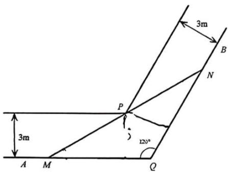
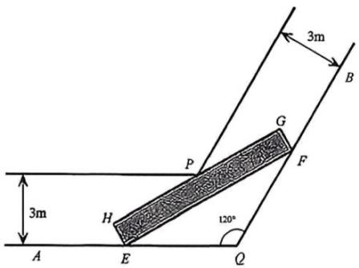

# 2026一模：新定义与综合 · 学生版

> 依据原卷规范化转录稿及已核专题整理，按数学任务分类；完整大题保留。未逐题核对全部原卷及独立重算所有解析。

## 题型导航

- [1. 几何新定义与空间建模（2题）](#class-1)
- [2. 集合、数列与有限取值结构（3题）](#class-2)
- [3. 函数迭代、增量与相关集合（4题）](#class-3)
- [4. 函数对称性、命题与新关系（2题）](#class-4)
- [5. 待补原题资料（3题）](#class-5)

## 1 几何新定义与空间建模

### 嘉定 · 原卷第21题

来源：2026届上海高三一模嘉定卷，第21题。

图 1 为转角过道的地面平面示意图. 该过道由两条直道连接形成转角, 由水平平坦的地面与垂直于地面的墙面共同围成, 两端延伸至足够远处, 且高度充足. 其中, $QA$ 、 $QB$ 构成地面上过道的一侧边界, $\angle AQB = 120^{\circ}$ ; 地面上过道的另一侧边界, 则分别与 $QA$ 、 $QB$ 平行, 且交于点 $P$ . 过道两侧平行墙面之间的距离均为 3 米.

(图 1)

(图 3)

(图 2)

(图 4)

（1）如图 2，在地面有一圆，该圆与 QA、QB 均相切，且过点 P. 求此圆的半径；

（2）如图3，有一根长度为 $y$ 米的无粗细木棒 $MN$ 紧贴地面，端点 $N$ 沿 $QB$ 移动，另一端点 $M$ 沿 $AQ$ 移动.当木棒 $MN$ 触碰到点 $P$ 时， $\angle QMN = x$ （弧度），求 $y$ 关于 $x$ 的函数关系及 $y$ 的最小值；

（3）如图4，某长方体家具的底面为长方形 $EFGH$ ，其宽为1米，长为10米（因过道高度足够，无需考虑家具高度）。现将底面 $EFGH$ 紧贴地面移动，判断该家具能否顺利通过此转角过道，并说明理由。

### 松江 · 原卷第16题

来源：2026届上海高三一模松江卷，第16题。

定义：一个平面封闭区域内任意两点之间的距离的最大值称为该区域的“直径”。在 $\triangle ABC$ 中，$BC=1$，$BC$ 边上的高等于 $\tan A$，以 $\triangle ABC$ 的各边为直径向 $\triangle ABC$ 外分别作三个半圆，记三个半圆围成的平面区域的“直径”为 $d$，则以下两个结论：

① 当 $\angle ABC=\frac\pi2$ 时，$d=\frac{\sqrt2+2}{2}$；

② $d$ 的最大值为 $\frac{\sqrt6+1}{2}$。（ ）

- A. ①正确，②错误

- B. ①②都正确

- C. ①错误，②正确

- D. ①②都错误

### 金山 · 原卷第16题

来源：2026届上海高三一模金山卷，第16题。

记曲线 $C:\dfrac{|x|^n}{a}+\dfrac{|y|^n}{b}=1$（$a>0$ 且 $b>0$，$n>0$ 且 $n\in\mathbb R$）为 $C_{(a,b)}^n$，称其为“超椭圆”。命题 $p$：直线 $l:2x+9y-12=0$ 与超椭圆 $C_{(3,2)}^{\frac12}$ 有3个不同交点；命题 $q$：超椭圆 $C_{(9,1)}^8$ 上的点到坐标原点距离的取值范围为 $[1,2^{5/8}]$，则下列说法正确的是（　）

- A. 命题 $p$ 为真命题，命题 $q$ 为假命题

- B. 命题 $p$ 为假命题，命题 $q$ 为真命题

- C. 命题 $p,q$ 均为真命题

- D. 命题 $p,q$ 均为假命题

## 2 集合、数列与有限取值结构

### 浦东 · 原卷第16题

来源：2026届上海高三一模浦东卷，第16题。

已知函数 $y = f(x)$ ，其中 $f(x) = x - \frac{1}{x}, x > 0$ . 集合 $A = \{1, a, b\}$ ，其中 $1 < a < b$ ，集合 $B = \left\{z \mid z = xy + \frac{x}{y} + f\left(\frac{y}{x}\right), x, y \in A, x \neq y\right\}$ ，现有以下两个命题：

①存在实数 a 、 b ，使得集合 B 中恰好有 5 个元素；

②若实数 a 、 b 是方程 $f(x)=kx+t$ 的两个不同实根，则存在实数 k 、 t ，使得集合 B 中恰好有 4 个元素.

那么（）

- A. ①是真命题，②是真命题
- B. ①是假命题，②是假命题
- C. ①是真命题，②是假命题
- D. ①是假命题，②是真命题

### 虹口 · 原卷第16题

来源：2026届上海高三一模虹口卷，第16题。

若每一项均为正数的数列 $\{a_{n}\}$ 的前 $n$ 项和为 $S_{n}$ ，若对于任意的正整数 $n$ ，均存在正整数 $m$ 使得 $\frac{a_{n} - S_{m}}{a_{n} - S_{m + 1}} \leq 0$ ，则称 $\{a_{n}\}$ 具有“ $P$ 性质”。对于以下两个命题，说法正确的是（）①存在等比数列 $\{a_{n}\}$ ，使得 $\{a_{n}\}$ 具有“ $P$ 性质”；

②若 $\left\{a_{n}\right\}$ 具有“P 性质”，记 $\Delta_{n}=S_{m+1}-a_{n}$ 且 $\left\{\Delta_{n}\right\}$ 为等差数列，则 $S_{n}\leq2^{n}a_{1}$ .

- A. ①和②都为真命题
- B. ①和②都为假命题
- C. ①为真命题，②为假命题
- D. ①为假命题，②为真命题

### 静安 · 原卷第15题

来源：2026届上海高三一模静安卷，第15题。

若数列 $\left\{a_{n}\right\}$ 满足 $a_{n+1}=\log_{m}a_{n}(m>1$ 且 $m\in Z)$ ，则称数列 $\left\{a_{n}\right\}$ 为“对数 m 底数列”. 已知正项数列 $\left\{a_{n}\right\}$ 是“对数 2 底数列”且 $a_{5}=1$ ，则当 $n\geqslant2$ 且 $n\in N^{*}$ 时， $\frac{4^{a_{2}+a_{3}+\cdots+a_{n}}}{a_{2}^{2}\cdots\cdots a_{n-1}^{2}}=(\quad)$

- A. $2^{12}$
- B. $2^{16}$
- C. $2^{32}$
- D. $2^{64}$

## 3 函数迭代、增量与相关集合

### 浦东 · 原卷第21题

来源：2026届上海高三一模浦东卷，第21题。

已知函数 $y = f(x)$ 的定义域为 D. 若对任意区间 $I \subseteq D$ ，存在正整数 k，使得 $I_k \cap I \neq \varnothing$ ，则称函数 $y = f(x)$ 为“回归函数”，k 为回归指数. 其中 $I_n = \left\{ f^{(n)}(x) | x \in I \right\}$ ， $f^{(1)}(x)=f(x),\quad f^{(2)}(x)=f(f(x)),\quad\ldots\ldots,\quad f^{(n+1)}(x)=f\left(f^{(n)}(x)\right).$

（1）若 $f(x) = \frac{1}{x}$ ， $g(x) = x^2$ . 请分别判断函数 $y = f(x)$ 、 $y = g(x)$ 是否为回归指数为 2 的“回归函数”；

（2）若 $f(x) = \frac{x + 1}{1 - x}$ ， $D = \{x \mid x \in \mathbf{R}, \text{且} x \neq 0, x \neq 1, x \neq -1\}$ . 求证：函数 $y = f(x)$ 是“回归函数”，并求满足条件的回归指数 $k$ 的最小值.

(3) 若 $y = f(x)$ 是定义域为 $(0,1]$ 的函数，且 $f(x) = \begin{cases} \frac{x}{a}, & 0 < x \leq a, \\ \frac{x - a}{1 - a}, & a < x \leq 1. \end{cases}$ ，其中 $a \in (0,1)$ .

请判断函数 $y = f(x)$ 是否为“回归函数”? 若是，请写出证明过程；若不是，请说明理由.

### 虹口 · 原卷第21题

来源：2026届上海高三一模虹口卷，第21题。

已知函数 $y = f(x)$ 的定义域为 $D$ （ $D \subseteq \mathbf{R}$ ），记 $g(x) = f(x + a) - f(x)$ ，其中 $a \in D$ ，且 $x + a \in D$ .

（1）当 $D = \mathbf{R}$ ， $f(x) = x^{2}$ ， $a = 1$ ，求函数 $y = g(x)$ 的零点；

（2）当 $D = \left[-1, + \infty\right)$ ， $f(x) = x^3 -3x$ ，若恒有 $g(x) > 0$ ，求实数 $a$ 的取值范围；

(3) 当 $D = \mathbf{Q}$ , 求证: “对于任意的正有理数 $a$ , 函数 $y = g(x)$ 在 $D$ 上均是严格增函数”的充要条件是“任取 $D$ 中两个不相同的元素 $x_{1}$ 和 $x_{2}$ , 均有

$$
f \left(\frac {x _ {1} + x _ {2}}{2}\right) <   \frac {1}{2} \left(f \left(x _ {1}\right) + f \left(x _ {2}\right)\right),
$$

### 青浦 · 原卷第21题

来源：2026届上海高三一模青浦卷，第21题。

已知函数 $y = f(x)$ 定义域为 R，对于实数 a，定义集合 $R_{a} = \left\{ x \mid x \geq a, f(x) \geq f(a) \right\}$ ， $L_{a}=\left\{x\mid x\leq a,f(x)\geq f(a)\right\}$ .

(1) 若 $f(x)=x^{2}$ ，求 $R_{1}$ 和 $L_{1}$ ;

（2）给定实数 $a$ ，若 $f(x) = x^{2}(x - 3)$ 满足对任意 $b > a$ ，均有 $R_{b} \subseteq R_{a}$ ，求 $a$ 的取值范围；

（3）若集合 A、B 满足： $x \in A \Leftrightarrow -x \in B$ ，则称 A 和 B 互为对称集。证明：“函数 $y = f(x)$ 为偶函数”的充要条件是“对任意实数 a, $R_{a}$ 与 $L_{-a}$ 互为对称集”。

### 黄浦 · 原卷第21题

来源：2026届上海高三一模黄浦卷，第21题。

已知函数 $y = f(x)$ 的定义域为 $D$ ，对于给定实数 $t$ ，定义集合 $V_{f(t)} = \{x | f(x + t) \geq f(x)\}$ .

（1）若 $f(x) = x^3 - 13x$ ，求 $V_{f(2)}$

（2）若 D = R ，求证：“ $y = f(x)$ 为周期函数”的充要条件是“存在非零常数 t ，使得 $V_{f(t)} = V_{f(-t)} = D$ ”.

（3）若 $f(x) = \frac{1}{2} a\left(x - \frac{\mathrm{e}}{\mathrm{e} - 1}\right)^2 - x\left(\ln x - \frac{\mathrm{e}}{\mathrm{e} - 1}\right), D = (0, +\infty)$ ，且对于任意的 $t \in D$ ，都有 $V_{f(t)} = D$ ，求实数 $a$ 的取值范围.

### 金山 · 原卷第21题

来源：2026届上海高三一模金山卷，第21题。

现给出“U函数”的定义与性质。

定义：若函数 $y=f(x)$ 在区间 $D$ 上连续，且对于区间 $D$ 内任意两数 $x_1,x_2$，如果都有 $f\left(\frac{x_1+x_2}{2}\right)\leq\frac{f(x_1)+f(x_2)}{2}$ 成立，则称函数 $y=f(x)$ 为区间 $D$ 上的“U函数”；

性质：若函数 $y=f(x)$ 为区间 $D$ 上的“U函数”，则对于任意 $x_1,x_2,\ldots,x_n\in D$ 和满足 $\lambda_1+\lambda_2+\cdots+\lambda_n=1$ 的正数 $\lambda_1,\lambda_2,\ldots,\lambda_n$，有

$$f\left[\sum_{i=1}^{n}(\lambda_i x_i)\right]\leq\sum_{i=1}^{n}[\lambda_i f(x_i)]\quad(n\geq2,\ n\in\mathbb N)$$

成立。

（1）判断下列两个函数是否为其定义域上的“U函数”（不需要说明理由）：

① $y=\sin x,\ x\in(0,\frac{\pi}{2})$；② $y=x^2+2x$。

（2）若函数 $y=x-\frac ax$ 为区间 $(0,+\infty)$ 上的“U函数”，求实数 $a$ 的取值范围；

（3）若 $g_i(x)=\begin{cases}1-|x-1|,&0\leq x<2,\\a_i\cdot g_i(x-2),&x\geq2,\end{cases}$（$1\leq i\leq2025$ 且 $i\in\mathbb N$），记 $S_i$ 为函数 $y=g_i(x)$ 的图像与 $x$ 轴所围成的图形面积，当 $a_i>0$ 且 $\sum_{i=1}^{2025}a_i=1$ 时，求 $\sum_{i=1}^{2025}S_i$ 的最小值。

### 闵行 · 原卷第21题

来源：2026届上海高三一模闵行卷，第21题。

已知函数 $y=f(x)$ 的定义域为 $\mathbb R$，对于 $x_0\in\mathbb R$，若 $\{x\mid f(x)\le f(x_0)\}=(-\infty,x_0]$，且 $\{x\mid f(x)\ge f(x_0)\}=[x_0,+\infty)$，则称 $x_0$ 为 $y=f(x)$ 的一个“M点”，记 $M_f$ 为 $y=f(x)$ 的所有“M点”构成的集合。

（1）若 $f(x)=\begin{cases}0,&x=0,\\1/x,&x\ne0,\end{cases}$ 分别判断 $0\in M_f$ 与 $1\in M_f$ 是否正确；

（2）证明：“$x_0\in M_f$”的一个充要条件为“当 $x\ne x_0$ 时，$\frac{f(x)-f(x_0)}{x-x_0}>0$”；

（3）已知 $f(x)=(a-1)|x-b|+(a+1)|x+b|$，$g(x)=ax^4+2x^3-3(b+1)x^2+6bx+2b$，其中 $a,b\in\mathbb R$，记 $A=\{y\mid y=f(x_0),x_0\in M_f\}\ne\varnothing$，$B=\{y\mid y=g(x_0),x_0\in M_g\}\ne\mathbb R$。若 $A\cap B=A$，求 $a+b$ 的取值范围。

## 4 函数对称性、命题与新关系

### 闵行 · 原卷第16题

来源：2026届上海高三一模闵行卷，第16题。

如果“若 $p$，则 $q$”和“若 $q$，则 $p$”中有且仅有一个真命题，称 $p$ 与 $q$ 具有“$U$-关系”。已知函数 $y=f(x)$ 的定义域为 $\mathbb R$，$p$：$y=f(x)$ 为偶函数，则 $p$ 与下列选项中的 $q$ 具有“$U$-关系”的为（ ）。

- A. $q$：对任意 $x\in\mathbb R$ 都有 $-f(x)\ge f(x)$

- B. $q$：对任意 $x\in\mathbb R$ 都有 $f(-x)\ge f(x)$

- C. $q$：对任意 $x\in\mathbb R$ 都有 $f(-x)=|f(x)|$

- D. $q$：对任意 $x\in\mathbb R$ 都有 $f(-x)=f(|x|)$

### 静安 · 原卷第21题

来源：2026届上海高三一模静安卷，第21题。

已知函数 $y = f(x)$ （ $x \in \mathbb{R}$ ）的图象关于点 $(m, n)$ 成中心对称的充要条件是 $g(x) = f(x + m) - n$ （ $x \in \mathbb{R}$ ）是奇函数；如果一个函数 $y = f(x)$ 的图象关于点 $(m, n)$ 成中心对称，则称这个函数是点 $(m, n)$ 奇函数，其中点 $(m, n)$ 为对称中心；设函数

$f(x) = x(x - 1)(x - a), x\in \mathbb{R}.$

（1）若函数 $y = f(x)$ 是点 $(1,0)$ 奇函数，求实数 a 的值；

（2）证明：对于任意给定的实数 $a$ ，函数 $y = f(x)$ 存在两个极值点；若 $x = a$ 是 $y = f(x)$ 的极小值点，求出 $y = f(x)$ 的所有极值点；

（3）若 $x = a$ 是 $y = f(x)$ 的极大值点，函数 $y = f(x)$ 是否是点 $(m, n)$ 奇函数？若是，求出对称中心 $(m, n)$ ；若不是，请说明理由.

