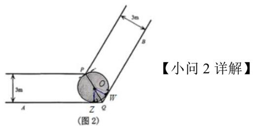
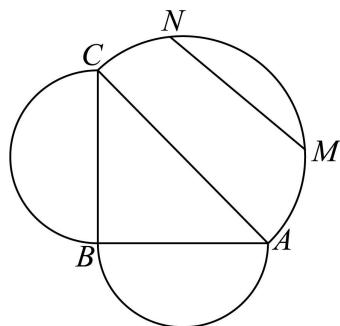
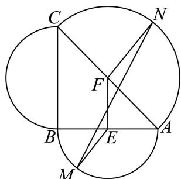
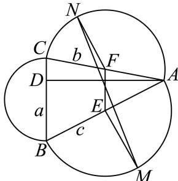

# 2026一模：新定义与综合 · 教师版

> 依据原卷规范化转录稿及已核专题整理，按数学任务分类；完整大题保留。未逐题核对全部原卷及独立重算所有解析。

## 题型导航

- [1. 几何新定义与空间建模（2题）](#class-1)
- [2. 集合、数列与有限取值结构（3题）](#class-2)
- [3. 函数迭代、增量与相关集合（4题）](#class-3)
- [4. 函数对称性、命题与新关系（2题）](#class-4)
- [5. 待补原题资料（3题）](#class-5)

## 1 几何新定义与空间建模

### 嘉定 · 原卷第21题

**考点说明：** 第（1）问：圆与两直线相切：利用圆心角平分线及点到直线距离建立半径方程。 第（2）问：利用转角几何关系建立木棒长度与角度的函数，并求定义域内的最小值。 第（3）问：实际通道几何建模：结合家具宽度、长度和移动姿态，判断能否连续通过转角。

来源：2026届上海高三一模嘉定卷，第21题。

规范化源文件：`2026届嘉定一模数学试卷 逐题解析.md`。

图 1 为转角过道的地面平面示意图. 该过道由两条直道连接形成转角, 由水平平坦的地面与垂直于地面的墙面共同围成, 两端延伸至足够远处, 且高度充足. 其中, $QA$ 、 $QB$ 构成地面上过道的一侧边界, $\angle AQB = 120^{\circ}$ ; 地面上过道的另一侧边界, 则分别与 $QA$ 、 $QB$ 平行, 且交于点 $P$ . 过道两侧平行墙面之间的距离均为 3 米.

(图 1)

(图 3)

(图 2)

(图 4)

（1）如图 2，在地面有一圆，该圆与 QA、QB 均相切，且过点 P. 求此圆的半径；

（2）如图3，有一根长度为 $y$ 米的无粗细木棒 $MN$ 紧贴地面，端点 $N$ 沿 $QB$ 移动，另一端点 $M$ 沿 $AQ$ 移动.当木棒 $MN$ 触碰到点 $P$ 时， $\angle QMN = x$ （弧度），求 $y$ 关于 $x$ 的函数关系及 $y$ 的最小值；

（3）如图4，某长方体家具的底面为长方形 $EFGH$ ，其宽为1米，长为10米（因过道高度足够，无需考虑家具高度）。现将底面 $EFGH$ 紧贴地面移动，判断该家具能否顺利通过此转角过道，并说明理由。

【答案】（1） $r = 12 - 6\sqrt{3}$

(2) $y = \frac{3}{\sin x} + \frac{3}{\sin\left(\frac{\pi}{3} - x\right)}, y_{\min} = 12$

（3）不能通过，理由见解析

【解析】

【分析】（1）连接 PQ，设圆心为 O，过 O 作 $OW \perp QB$ ， $OZ \perp QA$ ，由几何性质建立半径 r 的方程，解方程可得结果；

（2）过点 $M$ 作 $MD \perp QA$ ，交过道另一侧边界于点 $D$ ，过点 $N$ 作 $NE \perp QB$ ，交过道另一侧于点 $E$ ，由图形关系可得 $y$ 与 $x$ 的函数关系，并利用导数和函数的对称性求得 $y$ 的最小值；

(3) 设 $\angle QEF = \alpha$ ，延长 $HG$ 交 $QA$ 于 $R$ ，交 $QB$ 于 $S$ ，由 $RS = RH + HG + GS$ ，得到 $HG$ 的表达式，验证 $g\left(\frac{\pi}{6}\right) < 10$ 可得结论.

【小问 1 详解】

连接 PQ，设圆心为 O，过 O 作 $OW \perp QB$ ， $OZ \perp QA$ ，

由 $OW = OZ = r$ ， $\angle OWQ = \angle OZQ = 90^{\circ}$ ， $OQ = OQ$ ，可得 $\triangle OWQ\cong \triangle OZQ$

从而 $\angle OQW = \angle OQZ = \frac{\pi}{3}$ , $PQ = \frac{3}{\sin\frac{\pi}{3}} = 2\sqrt{3}$ ,

所以 $r + \frac{r}{\sin\frac{\pi}{3}} = 2\sqrt{3}$ ，解得 $r = 12 - 6\sqrt{3}$

如图，过点 $M$ 作 $MC \perp QA$ ，交过道另一侧边界于点 $C$ ，过点 $N$ 作 $ND \perp QB$ ，交过道另一侧于点 $D$ ，

则 $MP=\frac{3}{\sin x}$ ， $NP=\frac{3}{\sin\left(\frac{\pi}{3}-x\right)}$

所以 $y = MP + NP = \frac{3}{\sin x} + \frac{3}{\sin\left(\frac{\pi}{3} - x\right)}$ ,

$$
\text {令} f (x) = \frac {3}{\sin x} + \frac {3}{\sin \left(\frac {\pi}{3} - x\right)} \left(0 <   x <   \frac {\pi}{3}\right),
$$

$$
f ^ {\prime} (x) = - \frac {3 \cos x}{\sin^ {2} x} + \frac {3 \cos \left(\frac {\pi}{3} - x\right)}{\sin^ {2} \left(\frac {\pi}{3} - x\right)} = \frac {3 \cos \left(\frac {\pi}{3} - x\right) \sin^ {2} x - 3 \cos x \sin^ {2} \left(\frac {\pi}{3} - x\right)}{\sin^ {2} x \sin^ {2} \left(\frac {\pi}{3} - x\right)},
$$

当 $x \in \left(0, \frac{\pi}{6}\right]$ 时， $\cos x \geq \cos \left(\frac{\pi}{3} - x\right) > 0$ ， $\sin \left(\frac{\pi}{3} - x\right) \geq \sin x > 0$

所以 $3\cos \left(\frac{\pi}{3} -x\right)\sin^2 x\leq 3\cos x\sin^2 \left(\frac{\pi}{3} -x\right),$

所以 $f'(x) \leq 0$ ，当且仅当 $x = \frac{\pi}{6}$ 时取等号，故 $y = f(x)$ 在 $\left(0, \frac{\pi}{6}\right]$ 上严格单调递减，

并且 $f(x) = f\left(\frac{\pi}{3} - x\right)$ ，所以 $y = f(x)$ 关于 $x = \frac{\pi}{6}$ 对称，

所以 $f(x)_{\min}=f\left(\frac{\pi}{6}\right)=12$ ，即 $x=\frac{\pi}{6}$ 时，y 的最小值为 12 米.

【小问 3 详解】

设底面长方形顶点 E 、 F 分别在边界 QA 、 QB 上移动，

设 $\angle QEF = \alpha$ ，延长 $HG$ 交 $QA$ 于 $R$ ，交 $QB$ 于S，

$$
R S = R H + H G + G S = \frac {1}{\tan \alpha} + H G + \frac {1}{\tan \left(\frac {\pi}{3} - \alpha\right)},\tag{则}
$$

$$
R S = \frac {3}{\sin \alpha} + \frac {3}{\sin \left(\frac {\pi}{3} - \alpha\right)},
$$

$$
\text {设} g (\alpha) = H G = \frac {3}{\sin \alpha} + \frac {3}{\sin \left(\frac {\pi}{3} - \alpha\right)} - \frac {1}{\tan \alpha} - \frac {1}{\tan \left(\frac {\pi}{3} - \alpha\right)},
$$

若家具可以通过转角，则对于 $\forall \alpha \in \left(0, \frac{\pi}{3}\right)$ ， $g(\alpha) \geq 10$ ，

但 $g\left(\frac{\pi}{6}\right)=\frac{3}{\sin\frac{\pi}{6}}\times2-\frac{1}{\tan\frac{\pi}{6}}\times2=12-2\sqrt{3}\approx8.53<10$ ，所以家具不能通过该转角.

(图 4)

### 松江 · 原卷第16题

**考点说明：** 平面区域直径新定义与几何最值：将距离上界联系三角形半周长并说明可取到，再由边角关系和基本不等式求最大值。

来源：2026届上海高三一模松江卷，第16题。

定义：一个平面封闭区域内任意两点之间的距离的最大值称为该区域的“直径”。在 $\triangle ABC$ 中，$BC=1$，$BC$ 边上的高等于 $\tan A$，以 $\triangle ABC$ 的各边为直径向 $\triangle ABC$ 外分别作三个半圆，记三个半圆围成的平面区域的“直径”为 $d$，则以下两个结论：

① 当 $\angle ABC=\frac\pi2$ 时，$d=\frac{\sqrt2+2}{2}$；

② $d$ 的最大值为 $\frac{\sqrt6+1}{2}$。（ ）

- A. ①正确，②错误

- B. ①②都正确

- C. ①错误，②正确

- D. ①②都错误

【答案】B

【解析·参考原解整理】

【分析】根据“直径”的定义，找出“直径”与三角形边长之间的关系，分别对两个结论进行分析判断即可.

【详解】结论①：∵ $\angle ABC = \frac{\pi}{2}$ ，BC 边上的高等于 tan A，

$$
\therefore A B = \tan A
$$

在 $\mathbf{Rt}_{\triangle}ABC$ 中， $\tan A = \frac{BC}{AB}$ ，又 $BC = 1$

所以 $AB=\frac{1}{AB}$ ，即 $AB^{2}=1$ ，解得 $AB=1(AB>0)$ ，

因此， $AC = \sqrt{AB^2 + BC^2} = \sqrt{1^2 + 1^2} = \sqrt{2}$

当封闭区域内两点位于在同一半圆上时，

以在 $\widehat{AC}$ 上任取两点 $M$ ， $N$ 为例，连接 $MN$

则 $MN \leq AC$ ，又 $AB + BC > AC$ ，所以 $MN < \frac{1}{2}(AC + AB + BC)$ ，

当封闭区域内两点位于在不同半圆上时，

以在 $\widehat{AB}$ 上取一点 M，在 $\widehat{AC}$ 上取一点 N 为例，设 AB，AC 的中点分别为 E，F，连接 ME，EF，FN，MN，

由两点间线段最短可得 $MN \leq ME + EF + FN = \frac{1}{2} (AB + BC + AC)$ ，当且仅当 $M$ ， $N$ ， $E$ ， $F$ 四点共线时取等号，

综上， $MN\leq \frac{1}{2}\bigl (AB + BC + AC\bigr) = \frac{1}{2}\Bigl (1 + 1 + \sqrt{2}\Bigr) = \frac{2 + \sqrt{2}}{2},$

所以 $d=\frac{2+\sqrt{2}}{2}$ ,

故结论①正确.

结论②：设 $\triangle ABC$ 中角 $A, B, C$ 所对的边长分别为 $a, b, c$ ，设 $BC$ 边上的高为 $AD$ ，即 $a = 1$ ， $AD = \tan A$ .

由三角形面积公式可得 $S = \frac{1}{2} bc\sin A = \frac{1}{2} a\cdot AD = \frac{1}{2}\tan A$

所以 $\cos A=\frac{1}{bc}$ ,

由余弦定理可得 $\cos A=\frac{b^{2}+c^{2}-a^{2}}{2bc}$ ，即 $\frac{1}{bc}=\frac{b^{2}+c^{2}-a^{2}}{2bc}$ ，

所以 $b^{2}+c^{2}=3$ .

$$
(b + c) ^ {2} = b ^ {2} + c ^ {2} + 2 b c \leq 2 (b ^ {2} + c ^ {2}) = 6,
$$

即 $b + c \leq \sqrt{6}$ ，当且仅当 $b = c = \frac{\sqrt{6}}{2}$ 时取等号.

由①知， $MN\leq ME + EF + FN = \frac{1}{2}\bigl (AB + BC + AC\bigr) = \frac{1}{2}\bigl (a + b + c\bigr)$

将 $a = 1$ ， $b + c\leq \sqrt{6}$ 代入可得 $MN\leq ME + EF + FN\leq \frac{1}{2}\big(a + b + c\big) = \frac{1 + \sqrt{6}}{2},$

当且仅当 $M$ ， $N$ ， $E$ ， $F$ 四点共线， $b = c = \frac{\sqrt{6}}{2}$ 时取等号，

所以 $d = \frac{1 + \sqrt{6}}{2}$ ，故结论②正确.

故选：B

【独立复核补充】设 $E,F$ 分别是 $AB,AC$ 的中点，沿直线 $EF$ 向两端延长至两个外侧半圆的极点，可同时达到半周长上界。最终结论是 $d$ 的最大值为 $\frac{1+\sqrt6}{2}$，不是任意三角形都取此值。

回源核对说明：D选项已恢复，原题没有配图；现有解析图应留在答案折叠区域。

回源核对说明：逐项视觉核对题干、两结论及A-D选项；源卷第7页标答为B；本次未独立重解。

### 金山 · 原卷第16题

**考点说明：** 新定义曲线与命题判断：按象限分析超椭圆与直线的交点，并研究曲线上点到原点的距离范围。

来源：2026届上海高三一模金山卷，第16题。

记曲线 $C:\dfrac{|x|^n}{a}+\dfrac{|y|^n}{b}=1$（$a>0$ 且 $b>0$，$n>0$ 且 $n\in\mathbb R$）为 $C_{(a,b)}^n$，称其为“超椭圆”。命题 $p$：直线 $l:2x+9y-12=0$ 与超椭圆 $C_{(3,2)}^{\frac12}$ 有3个不同交点；命题 $q$：超椭圆 $C_{(9,1)}^8$ 上的点到坐标原点距离的取值范围为 $[1,2^{5/8}]$，则下列说法正确的是（　）

- A. 命题 $p$ 为真命题，命题 $q$ 为假命题

- B. 命题 $p$ 为假命题，命题 $q$ 为真命题

- C. 命题 $p,q$ 均为真命题

- D. 命题 $p,q$ 均为假命题

【答案】A

【解析】

【分析】命题 $p$ ：代入 $a, b, n$ ，移项由绝对值范围求解 $x, y$ 的范围，分情况与直线列方程组求解，根据结果可判断命题 $p$ ；命题 $q$ ：由图形的对称性将方程降幂，写成平方和的形式，三角换元，根据权方和不等式可得出距离范围的最大值，从而判断命题 $q$ ．

【详解】命题 $p: C_{(3,2)}^{\frac{1}{2}}: \frac{\sqrt{|x|}}{3} + \frac{\sqrt{|y|}}{2} = 1$ ，由 $\frac{\sqrt{|y|}}{2} = 1 - \frac{\sqrt{|x|}}{3} \geq 0$ 可得： $|x| \leq 9$ ，同理 $|y| \leq 4$ ， $1^\circ$ 当 $x \geq 0, y \geq 0$ 时， $C_{(3,2)}^{\frac{1}{2}}$ 方程可化简为 $y = \frac{4}{9} x - \frac{8}{3} \sqrt{x} + 4$ ，
联立 $\left\{ \begin{array}{l} y = \frac{4}{9} x - \frac{8}{3} \sqrt{x} + 4 \\ 2x + 9y - 12 = 0 \end{array} \right.$ ，解得： $\left\{ \begin{array}{l} x = 4 \\ y = \frac{4}{9} \end{array} \right.$ $2^\circ$ 当 $x < 0, y \geq 0$ 时， $C_{(3,2)}^{\frac{1}{2}}$ 方程可化简为 $y = -\frac{4}{9} x - \frac{8}{3} \sqrt{-x} + 4$ ，
联立 $\left\{ \begin{array}{l} y = -\frac{4}{9} x - \frac{8}{3} \sqrt{-x} + 4 \\ 2x + 9y - 12 = 0 \end{array} \right.$ ，解得： $\left\{ \begin{array}{l} x = -60 - 24\sqrt{6} \\ y = \frac{44 + 16\sqrt{6}}{3} \end{array} \right.$ （舍）或 $\left\{ \begin{array}{l} x = -60 + 24\sqrt{6} \\ y = \frac{44 - 16\sqrt{6}}{3} \end{array} \right.$ ； $3^\circ$ 当 $x < 0, y < 0$ 时， $l: 2x + 9y - 12 = 0$ 不过第三象限，所以第三象限无交点； $4^\circ$ 当 $x \geq 0, y < 0$ 时， $C_{(3,2)}^{\frac{1}{2}}$ 方程可化简为 $y = -\frac{4}{9} x + \frac{8}{3}\sqrt{x} - 4$ ，
联立 $\left\{ \begin{array}{l} y = -\frac{4}{9} x + \frac{8}{3}\sqrt{x} - 4 \\ 2x + 9y - 12 = 0 \end{array} \right.$ ，解得： $\left\{ \begin{array}{l} x = 48 - 24\sqrt{3} \\ y = \frac{-28 + 16\sqrt{3}}{3} \end{array} \right.$ 或 $\left\{ \begin{array}{l} x = 48 + 24\sqrt{3} \\ y = \frac{-28 - 16\sqrt{3}}{3} \end{array} \right.$ （舍）

综上： $C_{(3,2)}^{\frac{1}{2}}$ 与直线 $l: 2x + 9y - 12 = 0$ 共3个交点，所以命题 $p$ 正确；

命题 $q: C_{(9,1)}^{8}: \frac{x^8}{9} + y^8 = 1$ ，由图形的对称性，不妨考虑 $x \geq 0, y \geq 0$ .

即 $\left(\frac{x^4}{3}\right)^2 +\left(y^4\right)^2 = 1$ ，令 $\left\{ \begin{array}{l} \frac{x^4}{3} = \cos \alpha \\ y^4 = \sin \alpha \end{array} \right.$ ，则 $\left\{ \begin{array}{l} x^{2} = \sqrt{3\cos\alpha}\\ y^{2} = \sqrt{\sin\alpha} \end{array} \right.$

则 $x^{2} + y^{2} = \sqrt{3\cos\alpha} +\sqrt{\sin\alpha}$

由权方和不等式可得： $\frac{\left(\sqrt{3\cos\alpha} + \sqrt{\sin\alpha}\right)^4}{\left(\sqrt[3]{9} + 1\right)^3}\leq \frac{9\cos^2\alpha}{9} +\sin^2\alpha = 1,$

所以 $\sqrt{3\cos\alpha} +\sqrt{\sin\alpha}\leq \left(\sqrt[3]{9} +1\right)^{\frac{3}{4}} <   2^{\frac{5}{4}}$ ，所以命题 $q$ 错误

## 2 集合、数列与有限取值结构

### 浦东 · 原卷第16题

**考点说明：** 函数与集合元素个数：利用函数代入及集合元素互异条件，对有限种有序组合计算结果并分析命题。

来源：2026届上海高三一模浦东卷，第16题。

规范化源文件：`2026届浦东一模数学试卷 逐题解析.md`。

已知函数 $y = f(x)$ ，其中 $f(x) = x - \frac{1}{x}, x > 0$ . 集合 $A = \{1, a, b\}$ ，其中 $1 < a < b$ ，集合 $B = \left\{z \mid z = xy + \frac{x}{y} + f\left(\frac{y}{x}\right), x, y \in A, x \neq y\right\}$ ，现有以下两个命题：

①存在实数 a 、 b ，使得集合 B 中恰好有 5 个元素；

②若实数 a 、 b 是方程 $f(x)=kx+t$ 的两个不同实根，则存在实数 k 、 t ，使得集合 B 中恰好有 4 个元素.

那么（）

- A. ①是真命题，②是真命题
- B. ①是假命题，②是假命题
- C. ①是真命题，②是假命题
- D. ①是假命题，②是真命题

【答案】A

【解析】

【分析】先化简集合 $B$ 的元素，通过构造具体数值验证命题①中元素的合并情况；结合韦达定理与函数零点存在性，验证命题②中元素的合并可行性。
【详解】 $B = \left\{z\mid z = xy + \frac{x}{y} +f\left(\frac{y}{x}\right),x,y\in A,x\neq y\right\} = \left\{z\mid z = xy + \frac{y}{x},x,y\in A,x\neq y\right\}$ 集合 $A = \{1,a,b\}$ ，其中 $1 < a < b$ ， $x,y$ 取不同元素时，
集合 $B$ 的元素可能为 $2a,2b,a + \frac{1}{a},b + \frac{1}{b},ab + \frac{b}{a},ab + \frac{a}{b}$ ，共6个可能. ① 若集合 $B$ 中恰好有5个元素，则当 $2a = b + \frac{1}{b}$ 时， $1 < a < b$ 必然能找到 $a,b,$ 例如：当 $a = \frac{5}{4}$ ，可取 $b = 2$ ，此时 $B = \left\{\frac{5}{2},4,\frac{41}{20},\frac{41}{10},\frac{25}{8}\right\}$ ，共5个元素.
所以 ① 是真命题. ② 依题意，若存在实数 $a,b$ 是方程 $f(x) = kx + t$ 的两个不同实根， $x - \frac{1}{x} = kx + t\Rightarrow (k - 1)x^2 +tx + 1 = 0$

所以 $a + b = \frac{-t}{k - 1}, ab = \frac{1}{k - 1}$ .

因为 $1 < a < b$ ， $a + \frac{1}{a} < b + \frac{1}{b} < 2b$ ， $a + \frac{1}{a} < a\left(b + \frac{1}{b}\right)$ ， $b + \frac{1}{b} < a\left(b + \frac{1}{b}\right)$

若 $\left\{ \begin{array}{l} 2a = b + \frac{1}{b} \\ 2b = ab + \frac{b}{a} \end{array} \right. \Rightarrow \left\{ \begin{array}{l} a = 1 \\ b = 1 \end{array} \right.$ 不符；

若 $\left\{ \begin{array}{l} 2a = b + \frac{1}{b} \\ 2b = ab + \frac{a}{b} \end{array} \right. \Rightarrow a^4 - 2a^3 + 1 = 0$ (\*),

设 $h(x) = x^4 - 2x^3 + 1$ ， $x \in (1, +\infty)$

$$
h \left(\frac {3}{2}\right) = - \frac {1 1}{1 6}, h (2) = 1
$$

$$
h \left(\frac {3}{2}\right) \times h (2) <   0
$$

所以 $h(x)=x^{4}-2x^{3}+1,\quad x\in(1,+\infty)$ 有零点，即（\*）有解，

即存在 $a, b$ ，满足 $\left\{ \begin{array}{l} 2a = b + \frac{1}{b} \\ 2b = ab + \frac{a}{b} \end{array} \right.$ ，使得 $B$ 中恰好有4个元素.

所以实数 k、t，使得集合 B 中恰好有 4 个元素，②是真命题.

故选：A.

### 虹口 · 原卷第16题

**考点说明：** 数列新定义：把分式不等式转为项与前缀和的区间位置关系，再利用等差条件分析命题。

来源：2026届上海高三一模虹口卷，第16题。

规范化源文件：`2026届虹口一模数学试卷 逐题解析.md`。

若每一项均为正数的数列 $\{a_{n}\}$ 的前 $n$ 项和为 $S_{n}$ ，若对于任意的正整数 $n$ ，均存在正整数 $m$ 使得 $\frac{a_{n} - S_{m}}{a_{n} - S_{m + 1}} \leq 0$ ，则称 $\{a_{n}\}$ 具有“ $P$ 性质”。对于以下两个命题，说法正确的是（）①存在等比数列 $\{a_{n}\}$ ，使得 $\{a_{n}\}$ 具有“ $P$ 性质”；

②若 $\left\{a_{n}\right\}$ 具有“P 性质”，记 $\Delta_{n}=S_{m+1}-a_{n}$ 且 $\left\{\Delta_{n}\right\}$ 为等差数列，则 $S_{n}\leq2^{n}a_{1}$ .

- A. ①和②都为真命题
- B. ①和②都为假命题
- C. ①为真命题，②为假命题
- D. ①为假命题，②为真命题

【答案】A

【解析】

【分析】对于①，举出实例 $a_{n} = 2^{n}$ 即可验证；对于②，先得到 $a_{1} = a_{2}$ ， $\Delta_{n} = a_{2} = a_{1}$ 为常数列，依次类推可得，当 $n \geq 3$ 时，每一个 $a_{n}$ 的最大值为 $2^{n-3}a_{1}$ ，求和可得 $S_{n} = (2^{n-2} + 1)a_{1} \leq 2^{n}a_{1}$ .

【详解】对于①，因为数列 $\{a_{n}\}$ 每一项均为正数，故 $S_{m} \leq S_{m+1}$ ，又对于任意的正整数 $n$ ，均存在正整数 $m$ 使得 $\frac{a_{n} - S_{m}}{a_{n} - S_{m+1}} \leq 0$ ，

故存在正整数 $m$ 使得 $S_{m} \leq a_{n} < S_{m+1}$ ，即 $a_{n} \in [S_{m}, S_{m+1})$ ，

设 $a_{n} = 2^{n}$ ，则 $S_{n} = \frac{2 - 2^{n+1}}{1 - 2} = 2^{n+1} - 2$

其中 $\frac{a_n - S_m}{a_n - S_{m+1}} = \frac{2^n - (2^{m+1} - 2)}{2^n - (2^{m+2} - 2)} = \frac{2^n + 2 - 2^{m+1}}{2^n + 2 - 2^{m+2}} \leq 0$ ，故 $2^{m+1} \leq 2^n + 2 < 2^{m+2}$ ，解得 $2^m - 1 \leq 2^{n-1} < 2^{m+1} - 1$ ，当 $n = 1$ 时，取 $m = 1$ ，满足要求，对任意的正整数 $n \geq 2$ ，均存在正整数 $m = n - 1$ ，使得上式成立， $a_n = 2^n$ 具有“ $P$ 性质”，故存在等比数列 $\{a_n\}$ ，使得 $\{a_n\}$ 具有“ $P$ 性质”；①正确；对于②，当 $n = 1$ 时， $S_m \leq a_1 < S_{m+1}$ ，故 $m$ 只能等于 1，即 $\Delta_1 = S_2 - a_1 = a_2$ ，当 $n = 2$ 时， $S_m \leq a_2 < S_{m+1}$ ，故 $m$ 只能等于 1，即 $a_1 \leq a_2$ ， $\Delta_2 = S_2 - a_2 = a_1$ ， $\{\Delta_n\}$ 为等差数列，故公差为 $a_1 - a_2$ ，所以 $\Delta_n = a_2 + (n - 1)(a_1 - a_2)$ ，假设 $a_1 < a_2$ ，则当 $n \to +\infty$ 时， $\Delta_n < 0$ ，这与 $\Delta_n = S_{m+1} - a_n > 0$ 矛盾，故 $a_1 = a_2$ ，所以 $\Delta_n = a_2 = a_1$ 为常数列，易知 $a_3 < S_3$ ，若 $a_3 \in [S_2, S_3)$ ，则 $\Delta_3 = S_3 - a_3 = a_1 + a_2 > \Delta_1$ ，舍去，若 $a_3 \in [S_1, S_2)$ ，则 $\Delta_3 = S_2 - a_3 = a_1 + a_2 - a_3$ ，令 $\Delta_3 = a_1 + a_2 - a_3 = \Delta_1$ 可得 $a_3 = a_1$ ，同理易知 $a_4 < S_4$ ，若 $a_4 \in [S_3, S_4)$ ，则 $\Delta_4 = S_4 - a_4 = a_1 + a_2 + a_3 > \Delta_1$ ，舍去，所以 $a_4 < S_3$ ， $\Delta_4 = S_3 - a_4 = 3a_1 - a_4$ ，令 $3a_1 - a_4 = \Delta_1$ ，可得 $a_4 = 2a_1$ ，或 $\Delta_4 = S_2 - a_4 = 2a_1 - a_4$ ，令 $2a_1 - a_4 = \Delta_1$ ，可得 $a_4 = a_1$ ，同理 $a_5 < S_4$ ， $\Delta_5 = S_4 - a_5 = a_1$ 可得 $a_5 = 3a_1$ 或 $4a_1$ ，或 $\Delta_5 = S_3 - a_5 = a_1$ 可得 $a_5 = 2a_1$ ，或 $\Delta_5 = S_2 - a_5 = a_1$ 可得 $a_5 = a_1$ ，依次类推可得，当 $n \geq 3$ 时，每一个 $a_n$ 的最大值为 $2^{n-3}a_1$ ，当 $n \geq 3$ 时， $S_n = a_1 + a_2 + 2^0a_1 + 2a_1 + \dots + 2^{n-3}a_1 = 2a_1 + \frac{1 - 2^{n-2}}{1 - 2}a_1 = (2^{n-2} + 1)a_1 \leq 2^n a_1$ ，②正确。

故选：A

### 静安 · 原卷第15题

**考点说明：** 对数递推与连乘化简：将递推改写为指数关系，使前后相邻项在乘积中消去。

来源：2026届上海高三一模静安卷，第15题。

规范化源文件：`2026届静安一模数学试卷 逐题解析.md`。

若数列 $\left\{a_{n}\right\}$ 满足 $a_{n+1}=\log_{m}a_{n}(m>1$ 且 $m\in Z)$ ，则称数列 $\left\{a_{n}\right\}$ 为“对数 m 底数列”. 已知正项数列 $\left\{a_{n}\right\}$ 是“对数 2 底数列”且 $a_{5}=1$ ，则当 $n\geqslant2$ 且 $n\in N^{*}$ 时， $\frac{4^{a_{2}+a_{3}+\cdots+a_{n}}}{a_{2}^{2}\cdots\cdots a_{n-1}^{2}}=(\quad)$

- A. $2^{12}$
- B. $2^{16}$
- C. $2^{32}$
- D. $2^{64}$

【答案】C

【解析】

【分析】根据定义 $a_{n+1}=\log_{2}a_{n}$ ，即 $2^{a_{n+1}}=a_{n}$ ，再利用累乘 $\frac{2^{a_{2}+a_{3}+\cdots+a_{n}}}{a_{2}\cdots a_{n-1}}=a_{1}$ ，平方后再由 $a_{5}=1$ 根据递推关系可得答案.

【详解】因为正项数列 $\left\{a_{n}\right\}$ 是“对数 2 底数列”，所以 $a_{n+1}=\log_{2}a_{n}$ ，所以 $2^{a_{n+1}}=2^{\log_{2}a_{n}}=a_{n}$ ，
所以 $2^{a_{2}} = a_{1}, 2^{a_{3}} = a_{2}, 2^{a_{4}} = a_{3}, \cdots, 2^{a_{n}} = a_{n-1} (n \geq 2 \text{ 且 } n \in \mathbb{N}^{*})$ ,

以上式子相乘得 $2^{a_2} \cdot 2^{a_3} \cdots 2^{a_n} = a_1 \cdot a_2 \cdots a_{n-1}$ ，所以 $2^{a_2 + a_3 + \cdots + a_n} = a_1 \cdot a_2 \cdots a_{n-1}$ ，

所以 $\frac{2^{a_2 + a_3 + \cdots + a_n}}{a_2\cdots a_{n - 1}} = a_1$ ，得 $\frac{2^{a_2 + a_3 + \cdots + a_n}\cdot 2^{a_2 + a_3 + \cdots + a_n}}{a_2\cdots a_{n - 1}\cdot a_2\cdots a_{n - 1}} = a_1^2,$

即 $\frac{2^{2a_2 + 2a_3 + \cdots + 2a_n}}{a_2^2\cdots a_{n - 1}^2} = a_1^2$ ，得 $\frac{4^{a_2 + a_3 + \cdots + a_n}}{a_2^2\cdots a_{n - 1}^2} = a_1^2$ ，因为 $a_5 = \log_2a_4,a_5 = 1$ ，所以 $a_4 = 2$

同理， $a_4 = \log_2a_3$ ，所以 $a_3 = 4;a_3 = \log_2a_2$ ，所以 $a_2 = 16;a_2 = \log_2a_1$

所以 $a_{1}=2^{16}$ . 故 $\frac{4^{a_{2}+a_{3}+\cdots+a_{n}}}{a_{2}^{2}\cdots a_{n-1}^{2}}=\left(2^{16}\right)^{2}=2^{32}$ .

故选：C.

## 3 函数迭代、增量与相关集合

### 浦东 · 原卷第21题

**考点说明：** 第（1）问：函数迭代与新定义判断：分别计算二次迭代，检查其像集能否与任意原区间相交，否定时构造区间反例。 第（2）问：分式函数迭代的周期结构：逐次复合寻找回到恒等映射的周期，并以区间反例排除更小的回归指数。 第（3）问：分段伸展映射与区间回归：追踪区间在分支上的迭代像及跨分段点情形；原解析的连续性及后续论证仍须核查。

来源：2026届上海高三一模浦东卷，第21题。

规范化源文件：`2026届浦东一模数学试卷 逐题解析.md`。

已知函数 $y = f(x)$ 的定义域为 D. 若对任意区间 $I \subseteq D$ ，存在正整数 k，使得 $I_k \cap I \neq \varnothing$ ，则称函数 $y = f(x)$ 为“回归函数”，k 为回归指数. 其中 $I_n = \left\{ f^{(n)}(x) | x \in I \right\}$ ， $f^{(1)}(x)=f(x),\quad f^{(2)}(x)=f(f(x)),\quad\ldots\ldots,\quad f^{(n+1)}(x)=f\left(f^{(n)}(x)\right).$

（1）若 $f(x) = \frac{1}{x}$ ， $g(x) = x^2$ . 请分别判断函数 $y = f(x)$ 、 $y = g(x)$ 是否为回归指数为 2 的“回归函数”；

（2）若 $f(x) = \frac{x + 1}{1 - x}$ ， $D = \{x \mid x \in \mathbf{R}, \text{且} x \neq 0, x \neq 1, x \neq -1\}$ . 求证：函数 $y = f(x)$ 是“回归函数”，并求满足条件的回归指数 $k$ 的最小值.

(3) 若 $y = f(x)$ 是定义域为 $(0,1]$ 的函数，且 $f(x) = \begin{cases} \frac{x}{a}, & 0 < x \leq a, \\ \frac{x - a}{1 - a}, & a < x \leq 1. \end{cases}$ ，其中 $a \in (0,1)$ .

请判断函数 $y = f(x)$ 是否为“回归函数”? 若是，请写出证明过程；若不是，请说明理由.

【答案】（1） $y = f(x)$ 是回归指数为2的"回归函数"， $y = g(x)$ 不是回归指数为2的"回归函数"；

（2）证明见解析，k 的最小值为 4;

（3）函数 $y = f(x)$ 是 “回归函数”，证明见解析.

【解析】

【分析】（1）计算出 $f^{(1)}(x) = \frac{1}{x}, f^{(2)}(x) = x$ ，从而得到 $I_2 \cap I \neq \emptyset$ 即可判断 $y = f(x)$ ，再计算 $g^{(2)}(x) = x^4$ ，取 $I = [2,3]$ 即可判断；

（2）计算得 $f^{(5)}(x)=f^{(1)}(x),\cdots,f^{(k+4)}(x)=f^{(k)}(x)$ ，再取 $I=(2,3)$ ，分析得

$I_{4m - 3}\cap I = \emptyset ,I_{4m - 2}\cap I = \emptyset ,I_{4m - 1}\cap I = \emptyset$ ，则得到 $k$ 的最小值；

（3）首先求出函数 $y = f(x)$ 的值域为(0,1]，再分区间求出对应直线斜率，再设区间 $I$ 的长度为 $L, L > 0$ ，根据变换则区间长度也会变化，最后分析得总存在这样的正整数 $k$ ，使得 $I_{k} \cap I \neq \emptyset$ .

【小问 1 详解】

由题意， $y = f(x)$ 的定义域 $D = (-\infty, 0) \cup (0, +\infty)$ .

$$
f ^ {(1)} (x) = f (x) = \frac {1}{x}, f ^ {(2)} (x) = f (f (x)) = f \left(\frac {1}{x}\right) = x,
$$

故对任意区间 $I \subseteq (-\infty, 0) \cup (0, +\infty)$ ，必有 $I_{2} = I$ ，即 $I_{2} \cap I \neq \varnothing$ .

因此 $y = f(x)$ 是回归指数为 2 的 "回归函数".

又 $y = g(x)$ 的定义域 $D = \mathrm{R},g^{(2)}(x) = \left(x^2\right)^2 = x^4$

取区间 $I = [2,3]$ ，则 $I_{2} = [16,81]$ 。显然， $I \cap I_{2} = \varnothing$ 。

显然， $y = g(x)$ 不是回归指数为 2 的 "回归函数".

【小问 2 详解】

由题意，对任意 $x \in D, f^{(1)}(x) = \frac{x + 1}{1 - x}$ ， $f^{(2)}(x) = \frac{\frac{x + 1}{1 - x} + 1}{1 - \frac{x + 1}{1 - x}} = \frac{2}{-2x} = -\frac{1}{x}$ ，

$$
f ^ {(3)} (x) = \frac {- \frac {1}{x} + 1}{1 - \left(- \frac {1}{x}\right)} = \frac {x - 1}{x + 1}, f ^ {(4)} (x) = \frac {\frac {x - 1}{x + 1} + 1}{1 - \frac {x - 1}{x + 1}} = \frac {2 x}{2} = x,
$$

$$
f ^ {(5)} (x) = f ^ {(1)} (x), \dots , f ^ {(k + 4)} (x) = f ^ {(k)} (x).
$$

显然，对任意区间 $I \subseteq D$ ，都存在正整数 $m$ ，使得 $I_{4m} = I$ ，即 $I_{4m} \cap I \neq \emptyset$

若取区间 $I = (2,3)$ ，则 $I_{1} = (-3, - 2), I_{2} = \left(\frac{1}{3},\frac{1}{2}\right), I_{3} = \left(-\frac{1}{2}, - \frac{1}{3}\right)$ .

$$
I _ {4 m - 3} = I _ {1} = (- 3, - 2), I _ {4 m - 2} = I _ {2} = \left(\frac {1}{3}, \frac {1}{2}\right), I _ {4 m - 1} = I _ {3} = \left(- \frac {1}{2}, - \frac {1}{3}\right).
$$

故 $I_{4m-3} \cap I = \varnothing, I_{4m-2} \cap I = \varnothing, I_{4m-1} \cap I = \varnothing$ .

综上，函数 $y = f(x)$ 是 "回归函数"，且满足条件的回归指数 k 的最小值为 4.

【小问 3 详解】

当 $x \in (0, a]$ 时， $f(x) = \frac{x}{a}, f(x) \in (0, 1]$ .

当 $x \in (a,1]$ 时， $f(x) = \frac{x - a}{1 - a}, f(x) \in (0,1]$ .

因此，函数 $y = f(x)$ 的值域为(0,1]，即对任意 $y \in (0,1]$ ，总存在 $x \in (0,1]$ 使得 $f(x) = y$ .

在区间 $(0, a]$ 上，函数为 $f(x) = \frac{x}{a}$ ，对应直线的斜率 $k = \frac{1}{a} > 1$ 。

在区间 $(a,1]$ 上， $f(x) = \frac{x - a}{1 - a}$ ，对应直线的斜率 $k = \frac{1}{1 - a} > 1$ 。

显然，对任意区间 $I \subseteq D$ ，作用函数 $y = f(x)$ 后，区间长度必然会变大.

假设常数 $c = \min \left\{\frac{1}{a},\frac{1}{1 - a}\right\}$ ，必有 $c > 1$ ，即每次变换后区间长度至少放大 $c$ 倍.

设区间 I 的长度为 L, L > 0 。则经过 k 次变换后， $I_{k}$ 的长度至少为 $L \cdot c^{k}$

当 k 足够大时，必有 $L \cdot c^{k} > 1$ 。又函数 $y = f(x)$ 的值域为 $(0,1]$ ，

即 $I_{k} \subseteq (0,1]$ ，所以 $I_{k}$ 的长度不能超过1，矛盾.

实际上，由于 $y = f(x)$ 的图像是分段线性且连续的，变换过程中 $I_{k}$ 会覆盖(0,1]的每个非空开区间子集.

必存在正整数 $k$ ，使得 $I_{k} \cap I \neq \emptyset$

否则，如果所有 $I_{k}$ 都与 I 不相交，则 $I_{k}$ 始终停留在区间 $(0,1]$ 或区间 I 中，

但区间长度作用函数 $y = f(x)$ 后会变大，即 $I_{k}$ 长度的不断增长，最终必须与区间 I 相交.

因此，总存在这样的正整数 $k$ ，使得 $I_{k} \cap I \neq \emptyset$

综上所述，函数 $y = f(x)$ 是 "回归函数".

### 虹口 · 原卷第21题

**考点说明：** 第（1）问：函数增量的解析式与零点：代入指定函数及步长，展开差式并求其零点。 第（2）问：含参增量恒正问题：先限定自变量与平移后自变量的共同定义域，再研究关于自变量的多项式最小值及参数边界。 第（3）问：有理数域上的严格中点凸性与增量递增：分别论证必要性与充分性，利用有理步长细分和通分比较；原充分性证明的跳步需补足。

来源：2026届上海高三一模虹口卷，第21题。

规范化源文件：`2026届虹口一模数学试卷 逐题解析.md`。

已知函数 $y = f(x)$ 的定义域为 $D$ （ $D \subseteq \mathbf{R}$ ），记 $g(x) = f(x + a) - f(x)$ ，其中 $a \in D$ ，且 $x + a \in D$ .

（1）当 $D = \mathbf{R}$ ， $f(x) = x^{2}$ ， $a = 1$ ，求函数 $y = g(x)$ 的零点；

（2）当 $D = \left[-1, + \infty\right)$ ， $f(x) = x^3 -3x$ ，若恒有 $g(x) > 0$ ，求实数 $a$ 的取值范围；

(3) 当 $D = \mathbf{Q}$ , 求证: “对于任意的正有理数 $a$ , 函数 $y = g(x)$ 在 $D$ 上均是严格增函数”的充要条件是“任取 $D$ 中两个不相同的元素 $x_{1}$ 和 $x_{2}$ , 均有

$$
f \left(\frac {x _ {1} + x _ {2}}{2}\right) <   \frac {1}{2} \left(f \left(x _ {1}\right) + f \left(x _ {2}\right)\right),
$$

【答案】(1) $-\frac{1}{2}$

(2) $(3, +\infty)$

（3）证明见解析

【解析】

【分析】（1）求出 $g(x)$ ，令 $g(x)=0$ 解方程即可得到答案；

(2) 求出 $g(x)$ 并根据题意化简得到 $3x^{2} + 3ax + a^{2} - 3 > 0$ ，令 $h(x) = 3x^{2} + 3ax + a^{2} - 3$ ，
根据题意得到 $h(-1)=a^{2}-3a>0$ ，解得 a>3，再结合二次函数图象即可求得答案；

（3）利用充要条件的定义，结合函数严格递增的概念进行证明.

【小问 1 详解】

当 $D = \mathbf{R}$ ， $f(x) = x^2$ ， $a = 1$ 时， $g(x) = f(x + 1) - f(x) = (x + 1)^2 -x^2 = 2x + 1$ ，令 $g(x) = 0$ ，解得 $x = -\frac{1}{2}$ 所以函数 $y = g(x)$ 的零点为 $-\frac{1}{2}$

【小问 2 详解】

$$
g (x) = (x + a) ^ {3} - 3 (x + a) - x ^ {3} + 3 x = 3 a x ^ {2} + 3 a ^ {2} x + a ^ {3} - 3 a > 0, x \geq - 1,
$$

若 $a \leq 0$ ，当 a < 0 时 $g(x)$ 的二次项系数为负导致当 $x \to +\infty$ 时， $g(x) \to -\infty$ ，

$$
g (x) > 0
$$

$$
a > 0
$$

所以 $3x^{2} + 3ax + a^{2} - 3 > 0$ ，设 $h(x) = 3x^{2} + 3ax + a^{2} - 3$

则 $h(-1) = a^2 - 3a > 0$ ，解得 $a > 3$ 或 $a < 0$ （舍去），即 $a > 3$ ，

此时 $-\frac{a}{2} < -\frac{3}{2} < -1$ ，所以 $h(x) = 3x^{2} + 3ax + a^{2} - 3$ 在 $[-1, +\infty)$ 上单调递增，

所以 $x \in [-1, +\infty)$ ， $h(x) \geq h(-1) > 0$

所以实数 a 的取值范围为 $(3, +\infty)$ .

【小问 3 详解】

必要性：对于 $x_{1} < x_{2}$ ，取 $a = \frac{x_2 - x_1}{2}$

因为函数 $y = g(x)$ 在 $D$ 上是严格增函数且 $x_{1} < \frac{x_{1} + x_{2}}{2}$ ，所以 $g(x_{1}) < g\left(\frac{x_{1} + x_{2}}{2}\right)$ ，

即 $f(x_{1}+a)-f(x_{1})<f\left(\frac{x_{1}+x_{2}}{2}+a\right)-f\left(\frac{x_{1}+x_{2}}{2}\right)$ ,

即 $f\left(\frac{x_1 + x_2}{2}\right) - f(x_1) <   f(x_2) - f\left(\frac{x_1 + x_2}{2}\right),$

所以 $f\left(\frac{x_1 + x_2}{2}\right) < \frac{1}{2}\left[f(x_1) + f(x_2)\right]$ .

充分性： $\forall x_{1}\in \mathbf{Q}$ ， $\forall a\in \mathbf{Q}$ 且 $a > 0$

因为 $f\left(\frac{x_1 + (x_1 + 2a)}{2}\right) < \frac{1}{2}\left[f(x_1) + f(x_1 + 2a)\right]$ ,

所以 $f(x_{1} + 2a) - f(x_{1} + a) > f(x_{1} + a) - f(x_{1})$

即 $g(x_{1} + a) > g(x_{1})$ ，又 $x_{1} + a > x_{1}$

所以函数 $y = g(x)$ 在 $D$ 上是严格增函数.

### 青浦 · 原卷第21题

**考点说明：** 第（1）问：集合新定义：代入二次函数和给定参数，联立不等式求集合。 第（2）问：集合包含与全称量词：借助三次函数图像或单调性，将包含关系转化为参数条件。 第（3）问：偶函数与对称集：分别证明两方向，注意量词与集合成员的对应关系；现有原解析证明仍有待复核。

来源：2026届上海高三一模青浦卷，第21题。

规范化源文件：`2026届青浦一模数学试卷 逐题解析.md`。

已知函数 $y = f(x)$ 定义域为 R，对于实数 a，定义集合 $R_{a} = \left\{ x \mid x \geq a, f(x) \geq f(a) \right\}$ ， $L_{a}=\left\{x\mid x\leq a,f(x)\geq f(a)\right\}$ .

(1) 若 $f(x)=x^{2}$ ，求 $R_{1}$ 和 $L_{1}$ ;

（2）给定实数 $a$ ，若 $f(x) = x^{2}(x - 3)$ 满足对任意 $b > a$ ，均有 $R_{b} \subseteq R_{a}$ ，求 $a$ 的取值范围；

（3）若集合 A、B 满足： $x \in A \Leftrightarrow -x \in B$ ，则称 A 和 B 互为对称集。证明：“函数 $y = f(x)$ 为偶函数”的充要条件是“对任意实数 a, $R_{a}$ 与 $L_{-a}$ 互为对称集”。

【答案】（1） $R_{1} = \{x|x\geq 1\}$ ， $L_{1} = \{x|x\leq -1$ 或 $x = 1\}$

(2) $\left(-\infty, -1\right] \cup [2, +\infty)$

（3）证明见解析

【解析】

【分析】（1）根据题设定义求解即可；

（2）根据题设定义得到对于任意 $b > a$ ，都有 $f(b) \geq f(a)$ ，分析函数 $f(x)$ 的单调性，结合图象求解即可；

（3）根据偶函数的定义和对称集的定义即可证明必要性和充分性.

【小问 1 详解】

由 $f(x) = x^2$ 在 $(- \infty, 0]$ 上单调递减，在 $[0, +\infty)$ 上单调递增，

则 $x \geq 1$ 时， $f(x) \geq f(1) = 1$ ，即 $R_{1} = \{x | x \geq 1, f(x) \geq f(1)\} = \{x | x \geq 1\}$ ，

而 $L_{1} = \left\{x\mid x\leq 1,f(x)\geq 1\right\} = \left\{x\mid x\leq 1,x^{2}\geq 1\right\} = \left\{x\mid x\leq -1\text{或} x = 1\right\}.$

【小问 2 详解】

因为对于任意 b > a ，均有 $R_{b} \subseteq R_{a}$ ，

若 $x \in R_b$ ，则 $x \in R_a$ ，即若 $f(x) \geq f(b)$ ，则 $f(x) \geq f(a)$ ，所以 $f(b) \geq f(a)$ ，

由 $f(x) = x^{2}(x - 3) = x^{3} - 3x^{2}$ ，则 $f'(x) = 3x^{2} - 6x = 3x(x - 2)$ ，

令 $f'(x) < 0$ ，得 $0 < x < 2$ ，令 $f'(x) > 0$ ，得 $x < 0$ 或 $x > 2$ ，

所以函数 $f(x)$ 在 $(0,2)$ 上单调递减，在 $(-∞,0)$ 和 $(2,+∞)$ 上单调递增，

又 $f(0)=0,f(-1)=f(2)=-4$ ,

作出函数 $f(x)$ 的图象，

由于对于任意 $b > a$ ，都有 $f(b)\geq f(a)$ ，则 $a\leq -1$ 或 $a\geq 2$

所以 a 的取值范围为 $(-∞, -1] ∪ [2, +∞)$ .

【小问 3 详解】

若函数 $y = f(x)$ 是偶函数，

则对任意 $x \in R$ ， $f(x) = f(-x)$ ，

对任意 $a \in \mathbb{R}$ ，若 $x \in R_{a}$ ，即 $x \geq a$ 且 $f(x) \geq f(a)$ ，

则 $f(-x) = f(x)\geq f(a) = f(-a)$

由 $x \geq a$ ，得 $-x \leq -a$ ，而 $L_{-a} = \left\{ x \mid x \leq -a, f(x) \geq f(-a) \right\}$ ，则 $-x \in L_{-a}$ ；

若 $-x\in L_{-a}$ ，则 $-x\leq -a$ 且 $f(-x)\geq f(-a)$

则 $f(x) = f(-x)\geq f(-a) = f(a)$

由 $-x\leq -a$ ，得 $x\geq a$ ，而 $R_{a} = \left\{x\mid x\geq a,f(x)\geq f(a)\right\}$ ，则 $x\in R_a$

所以对任意实数 $a, R_{a}$ 与 $L_{-a}$ 互为对称集，充分性成立；

若对任意实数 $a, R_{a}$ 与 $L_{-a}$ 互为对称集，则 $x \in R_{a} \Leftrightarrow -x \in L_{-a}$ ，

而 $R_{a} = \left\{x\mid x\geq a,f(x)\geq f(a)\right\} ,L_{-a} = \left\{x\mid x\leq -a,f(x)\geq f(-a)\right\} ,$

由 $x \geq a$ ，等价于 $-x \leq -a$ ，

对任意 $x \in R$ ， $x \in R_{a}$ ，则 $-x \in L_{-a}$ ，则 $f(a) \geq f(-a)$ ，

对任意 $x \in R$ ， $-x \in L_{-a}$ ，则 $x \in R_{a}$ ，则 $f(-a) \geq f(a)$ ，

所以 $f(a)=f(-a)$ ，则函数 $y=f(x)$ 是偶函数，必要性成立.

综上所述，“函数 $y = f(x)$ 为偶函数”的充要条件是“对任意实数 a, $R_{a}$ 与 $L_{-a}$ 互为对称集”.

### 黄浦 · 原卷第21题

**考点说明：** 第（1）问：代入位移参数并化简函数差，通过不等式求新定义集合。 第（2）问：利用集合等于定义域得到两个方向的函数值不等式，证明周期性的充要条件。 第（3）问：将对所有正位移的集合条件转化为函数单调性，结合导数不等式求参数范围。

来源：2026届上海高三一模黄浦卷，第21题。

规范化源文件：`2026届黄浦一模数学试卷 逐题解析.md`。

已知函数 $y = f(x)$ 的定义域为 $D$ ，对于给定实数 $t$ ，定义集合 $V_{f(t)} = \{x | f(x + t) \geq f(x)\}$ .

（1）若 $f(x) = x^3 - 13x$ ，求 $V_{f(2)}$

（2）若 D = R ，求证：“ $y = f(x)$ 为周期函数”的充要条件是“存在非零常数 t ，使得 $V_{f(t)} = V_{f(-t)} = D$ ”.

（3）若 $f(x) = \frac{1}{2} a\left(x - \frac{\mathrm{e}}{\mathrm{e} - 1}\right)^2 - x\left(\ln x - \frac{\mathrm{e}}{\mathrm{e} - 1}\right), D = (0, +\infty)$ ，且对于任意的 $t \in D$ ，都有 $V_{f(t)} = D$ ，求实数 $a$ 的取值范围.

【答案】（1） $V_{f(2)}=\left(-\infty,-3\right]\cup\left[1,+\infty\right)$ ;

(2) 证明见解析; (3) $a \in [\frac{1}{e},1]$ .

【解析】

【分析】（1）根据函数新定义结合一元二次不等式计算求解；

（2）应用函数新定义结合周期定义及充要条件定义证明；

（3）根据 $\forall x, t > 0$ ， $f(x + t) \geq f(x)$ ，得出函数单调递增，再分 $a \leq 0$ 和 $a > 0$ 分类讨论单调性及值域计算求参.

【小问 1 详解】

$$
V _ {f (2)} = \left\{x \mid f (x + 2) \geq f (x) \right\},
$$

若 $f(x + 2) \geq f(x)$ ，则 $(x + 2)^{3} - 13(x + 2) \geq x^{3} - 13x$

所以 $6x^{2}+12x-18=6(x+3)(x-1)\geq0$

所以 $V_{f(2)} = (-\infty, - 3]\cup [1, + \infty)$

【小问 2 详解】

充分性：因为 $V_{f(t)} = V_{f(-t)} = \mathbf{R}$ ， $\forall x\in \mathbb{R},f(x + t)\geq f(x),f(x - t)\geq f(x)$

所以 $f(x) \geq f(x + t)$ ，所以 $f(x) = f(x + t)$ ，因为 $t \neq 0$ ，所以 $f(x)$ 是周期函数；

必要性：若 $f(x)$ 是周期函数，设 T 是 $f(x)$ 的周期，则 $f(x)=f(x\pm T)$ ,

所以 $V_{f(T)} = \{x | f(x + T) \geq f(x)\} = R$ ， $V_{f(-T)} = \{x | f(x - T) \geq f(x)\} = R$ ，

所以存在 $t = T \neq 0$ ，使 $V_{f(t)} = V_{f(-t)} = R$ .

## 【小问 3 详解】

因为 $\forall t > 0,\quad V_{f(t)} = (0, +\infty)$ ，所以 $\forall x, t > 0,\quad f(x + t) \geq f(x)$ ,

所以 $f(x)$ 在 $(0, +\infty)$ 上单调递增，所以 $f'(x) = a\left(x - \frac{e}{e-1}\right) - \ln x + \frac{1}{e-1} \geq 0$ ，

若 $a \leq 0$ ，则 $x \to +\infty, f'(x) \to -\infty$ ，则不满足 $f'(x) \geq 0$ ；

所以 $a > 0$ ，设 $f^{\prime}(x) = a\left(x - \frac{\mathrm{e}}{\mathrm{e} - 1}\right) - \ln x + \frac{1}{\mathrm{e} - 1} = h(x)$

因为 $h'(x)=\frac{ax-1}{x}$ ,

当 $x \in \left(0, \frac{1}{a}\right], h'(x) < 0, h(x)$ 单调递减；当 $x \in \left(\frac{1}{a}, +\infty\right), h'(x) > 0, h(x)$ 单调递增；

所以 $h\left(\frac{1}{a}\right) = f'\left(\frac{1}{a}\right) \geq 0$ ，即 $\ln a - \frac{\mathrm{e}}{\mathrm{e} - 1}(a - 1) \geq 0$

设 $g(x) = \ln x - \frac{\mathrm{e}}{\mathrm{e} - 1}(x - 1)$ ，则 $g'(x) = \frac{1}{x} - \frac{\mathrm{e}}{\mathrm{e} - 1}$ ，

当 $x \in \left(0, \frac{\mathrm{e} - 1}{\mathrm{e}}\right], g'(x) > 0, g(x)$ 单调递增；当 $x \in \left(\frac{\mathrm{e} - 1}{\mathrm{e}}, +\infty\right), g'(x) < 0, g(x)$ 单调递减；

又 $g\left(\frac{1}{\mathbf{e}}\right) = g(1) = 0, g(a) \geq 0$ ，所以 $\frac{1}{\mathbf{e}} \leq a \leq 1$ ；

所以 $a \in \left[\frac{1}{\mathrm{e}}, 1\right]$ .

勘误：答案行缺失括号已按同题解析版PDF第15页恢复。

### 金山 · 原卷第21题

**考点说明：** 第（1）问①：结合正弦函数在指定区间的中点不等式，按题给U函数定义判断。 第（1）问②：利用二次函数的中点不等式，按题给U函数定义判断。 第（2）问：参数与中点不等式：在正半轴上分析函数凸性或直接比较两端，确定参数范围。 第（3）问：递推分段图像的面积：利用等比求和求各面积，再应用题给U函数性质处理多变量最小值及取等。

来源：2026届上海高三一模金山卷，第21题。

现给出“U函数”的定义与性质。

定义：若函数 $y=f(x)$ 在区间 $D$ 上连续，且对于区间 $D$ 内任意两数 $x_1,x_2$，如果都有 $f\left(\frac{x_1+x_2}{2}\right)\leq\frac{f(x_1)+f(x_2)}{2}$ 成立，则称函数 $y=f(x)$ 为区间 $D$ 上的“U函数”；

性质：若函数 $y=f(x)$ 为区间 $D$ 上的“U函数”，则对于任意 $x_1,x_2,\ldots,x_n\in D$ 和满足 $\lambda_1+\lambda_2+\cdots+\lambda_n=1$ 的正数 $\lambda_1,\lambda_2,\ldots,\lambda_n$，有

$$f\left[\sum_{i=1}^{n}(\lambda_i x_i)\right]\leq\sum_{i=1}^{n}[\lambda_i f(x_i)]\quad(n\geq2,\ n\in\mathbb N)$$

成立。

（1）判断下列两个函数是否为其定义域上的“U函数”（不需要说明理由）：

① $y=\sin x,\ x\in(0,\frac{\pi}{2})$；② $y=x^2+2x$。

（2）若函数 $y=x-\frac ax$ 为区间 $(0,+\infty)$ 上的“U函数”，求实数 $a$ 的取值范围；

（3）若 $g_i(x)=\begin{cases}1-|x-1|,&0\leq x<2,\\a_i\cdot g_i(x-2),&x\geq2,\end{cases}$（$1\leq i\leq2025$ 且 $i\in\mathbb N$），记 $S_i$ 为函数 $y=g_i(x)$ 的图像与 $x$ 轴所围成的图形面积，当 $a_i>0$ 且 $\sum_{i=1}^{2025}a_i=1$ 时，求 $\sum_{i=1}^{2025}S_i$ 的最小值。

【答案】（1）①不是；②是；

(2) $a \leq 0$ ;

(3) $\frac{2025^{2}}{2024}$ .

【解析】

【分析】（1）设 $f(x) = \sin x, x \in \left(0, \frac{\pi}{2}\right), s(x) = x^2 + 2x$ ，由“ $U$ 函数”定义，比较 $f\left(\frac{x_1 + x_2}{2}\right) - \frac{f(x_1) + f(x_2)}{2}$ 以及 $\frac{s(x_1) + s(x_2)}{2} - s\left(\frac{x_1 + x_2}{2}\right)$ 与 0 的大小关系，可完成判断；

（2）设 $t(x) = x - \frac{a}{x}, x \in (0, +\infty)$ ，由题可得 $\frac{t(x_1) + t(x_2)}{2} - t\left(\frac{x_1 + x_2}{2}\right) \geq 0$ ，据此可得答案；

（3）由题可得 $2n - 2 \leq x \leq 2n - 1, n \in \mathbb{N}^*$ ， $g_i(x) = a_i^{n-1}(x - 2n + 2)$ ， $2n - 1 < x < 2n, n \in \mathbb{N}^*$ ， $g_i(x) = a_i^{n-1}(2n - x)$ ，据此可得 $g_i(x)$ 大致图像以及

$S_{i}=\frac{1}{1-a_{i}}$ ，设 $h(x)=\frac{1}{1-x}$ ， $x\in(0,1)$ ，由题可得 $h(x)=\frac{1}{1-x}$ 为区间 $(0,1)$ 上的 “U 函数”。然后由题干提供信息结合取 $\lambda_{1}=\lambda_{2}=\cdots=\lambda_{2025}=\frac{1}{2025}$ 可得答案。

【小问 1 详解】

设 $f(x) = \sin x, x \in \left(0, \frac{\pi}{2}\right)$ ，取 $x_{1}, x_{2} \in \left(0, \frac{\pi}{2}\right)$ 则 $f\left(\frac{x_{1} + x_{2}}{2}\right) = \sin \frac{x_{1} + x_{2}}{2}$ ， $\frac{f(x_{1}) + f(x_{2})}{2} = \frac{1}{2} (\sin x_{1} + \sin x_{2}) = \frac{1}{2} \times 2 \sin \frac{x_{1} + x_{2}}{2} \cos \frac{x_{1} - x_{2}}{2} = \sin \frac{x_{1} + x_{2}}{2} \cos \frac{x_{1} - x_{2}}{2}$

$$
f \left(\frac {x _ {1} + x _ {2}}{2}\right) - \frac {f (x _ {1}) + f (x _ {2})}{2} = \sin \frac {x _ {1} + x _ {2}}{2} \left(1 - \cos \frac {x _ {1} - x _ {2}}{2}\right)
$$

因 $x_{1}, x_{2} \in \left(0, \frac{\pi}{2}\right)$ ，则 $\frac{x_{1} + x_{2}}{2} \in \left(0, \frac{\pi}{2}\right), \frac{x_{1} - x_{2}}{2} \in \left(-\frac{\pi}{4}, \frac{\pi}{4}\right)$ ，

从而 $\sin \frac{x_1 + x_2}{2} > 0$ ， $\cos \frac{x_1 - x_2}{2} \in \left(\frac{\sqrt{2}}{2}, 1\right]$ ，则 $\sin \frac{x_1 + x_2}{2} \left(1 - \cos \frac{x_1 - x_2}{2}\right) \geq 0$ ，

即 $f\left(\frac{x_1 + x_2}{2}\right) \geq \frac{f(x_1) + f(x_2)}{2}$ ，当且仅当 $x_1 = x_2$ 时取等号，

则 $y = \sin x, \quad x \in \left(0, \frac{\pi}{2}\right)$ 不是定义域上的 “U 函数”；

设 $s(x) = x^2 + 2x$ ， $x_1, x_2 \in \mathbb{R}$ ，

$$
s \left(\frac {x _ {1} + x _ {2}}{2}\right) = \left(\frac {x _ {1} + x _ {2}}{2}\right) ^ {2} + x _ {1} + x _ {2}, \quad \frac {s (x _ {1}) + s (x _ {2})}{2} = \frac {x _ {1} ^ {2} + x _ {2} ^ {2}}{2} + x _ {1} + x _ {2},
$$

$$
\frac {s \left(x _ {1}\right) + s \left(x _ {2}\right)}{2} - s \left(\frac {x _ {1} + x _ {2}}{2}\right) = \frac {x _ {1} ^ {2} + x _ {2} ^ {2}}{2} - \frac {x _ {1} ^ {2} + x _ {2} ^ {2} + 2 x _ {1} x _ {2}}{4} = \frac {\left(x _ {1} - x _ {2}\right) ^ {2}}{4} \geq 0,
$$

当且仅当 $x_{1} = x_{2}$ 时取等号，则 $y = x^{2} + 2x$ 是定义域上的“ $U$ 函数”；

【小问 2 详解】

设 $t(x) = x - \frac{a}{x}$ ， $x \in (0, +\infty)$ ，因 $y = x - \frac{a}{x}$ 是 $(0, +\infty)$ 上的“ $U$ 函数”，

$$
\forall x _ {1}, x _ {2} \in (0,+\infty), \frac {t \left(x _ {1}\right) + t \left(x _ {2}\right)}{2} - t \left(\frac {x _ {1} + x _ {2}}{2}\right) \geq 0 \Rightarrow a \left(\frac {2}{x _ {1} + x _ {2}} - \frac {x _ {1} + x _ {2}}{2 x _ {1} x _ {2}}\right) \geq 0,
$$

注意到 $\frac{2}{x_1 + x_2} -\frac{x_1 + x_2}{2x_1x_2} = \frac{4x_1x_2 - (x_1 + x_2)^2}{2x_1x_2(x_1 + x_2)} = \frac{-(x_1 - x_2)^2}{2x_1x_2(x_1 + x_2)}\leq 0$ ，则 $a\leq 0$

【小问 3 详解】

由题可得 $g_{i}(x)=\left\{\begin{aligned}x,0&\leq x\leq1\\ 2-x,1&<x<2\end{aligned}\right.$

当 $2 \leq x \leq 3$ 时， $0 \leq x - 2 \leq 1$ ，则 $g_{i}(x) = a_{i} g_{i}(x - 2) = a_{i}(x - 2)$ ；

当 $3 < x < 4$ ， $1 < x - 2 < 2$ ，则 $g_{i}(x) = a_{i}g(x - 2) = a_{i}[2 - (x - 2)] = a_{i}(4 - x)$

当 $4 \leq x \leq 5$ 时， $2 \leq x - 2 \leq 3$ ，则 $g_{i}(x) = a_{i} g_{i}(x - 2) = a_{i}^{2}(x - 4)$ ;

当 $5 < x < 6$ ， $3 < x - 2 < 4$ ，则 $g_{i}(x) = a_{i}g(x - 2) = a_{i}^{2}[4 - (x - 2)] = a_{i}^{2}(6 - x)$

依次类推可得： $2n-2\leq x\leq2n-1,\quad n\in\mathbb{N}^{*},\quad g_{i}(x)=a_{i}^{n-1}(x-2n+2)$

$2n - 1 < x < 2n, n \in \mathbf{N}^{*}, g_{i}(x) = a_{i}^{n - 1}(2n - x).$

据此可得 $g_{i}(x)$ 大致图像如下：

$$
S _ {i} = \frac {1}{2} \times 2 \times \left(1 + a _ {i} + a _ {i} ^ {2} + \dots + a _ {i} ^ {n} + \dots\right) = \lim _ {n \rightarrow + \infty} \frac {1 - a _ {i} ^ {n}}{1 - a _ {i}} = \frac {1}{1 - a _ {i}},
$$

则 $\sum_{i=1}^{2025} S_i = \sum_{i=1}^{2025} \frac{1}{1 - a_i}$ .

设 $h(x) = \frac{1}{1 - x}, x \in (0,1)$ ，则 $\sum_{i=1}^{2025} S_i = \sum_{i=1}^{2025} h(a_i)$

取 $\forall x_{1},\quad x_{2}\in(0,1)$ ,

$$
\frac {h \left(x _ {1}\right) + h \left(x _ {2}\right)}{2} - h \left(\frac {x _ {1} + x _ {2}}{2}\right) = \frac {2 - \left(x _ {1} + x _ {2}\right)}{2 \left(1 - x _ {1}\right) \left(1 - x _ {2}\right)} - \frac {2}{2 - \left(x _ {1} + x _ {2}\right)}
$$

$$
= \frac {\left[ 2 - \left(x _ {1} + x _ {2}\right) \right] ^ {2} - 4 \left(1 - x _ {1}\right) \left(1 - x _ {2}\right)}{2 \left(1 - x _ {1}\right) \left(1 - x _ {2}\right) \left[ 2 - \left(x _ {1} + x _ {2}\right) \right]} = \frac {\left(x _ {1} - x _ {2}\right) ^ {2}}{2 \left(1 - x _ {1}\right) \left(1 - x _ {2}\right) \left[ 2 - \left(x _ {1} + x _ {2}\right) \right]}
$$

因 $x_{1}, x_{2} \in (0,1)$ ，则 $1 - x_{1} > 0$ ， $1 - x_{2} > 0$ ， $2 - (x_{1} + x_{2}) > 0$ ，

$2(1-x_{1})(1-x_{2})\left[2-(x_{1}+x_{2})\right]>0$ ，从而 $\frac{h(x_{1})+h(x_{2})}{2}\geq h\left(\frac{x_{1}+x_{2}}{2}\right)$ ,

即 $h(x)=\frac{1}{1-x}$ 为区间 $(0,1)$ 上的 “U 函数”.

由题干提供信息可得：取 $\lambda_{1}=\lambda_{2}=\cdots=\lambda_{2025}=\frac{1}{2025}$

$$
\frac {1}{2 0 2 5} \sum_ {i = 1} ^ {2 0 2 5} h \left(a _ {i}\right) \geq h \left(\frac {1}{2 0 2 5} \sum_ {i = 1} ^ {2 0 2 5} a _ {i}\right) \Rightarrow
$$

$$
\sum_ {i = 1} ^ {2 0 2 5} S _ {i} = \sum_ {i = 1} ^ {2 0 2 5} h \left(a _ {i}\right) \geq 2 0 2 5 \times h \left(\frac {1}{2 0 2 5}\right) = 2 0 2 5 \times \frac {1}{1 - \frac {1}{2 0 2 5}} = \frac {2 0 2 5 ^ {2}}{2 0 2 4}
$$

当且仅当 $a_1=a_2=\cdots=a_{2025}=\frac1{2025}$ 时取等。

回源核对说明：题面已对照本地整理版PDF第6页核实；源解析按正确条件整理，非完整独立数学终审。

### 闵行 · 原卷第21题

**考点说明：** 第（1）问：全局比较型新定义的检验：分别检查候选点左右两侧的函数值关系，必要时选具体自变量构造反例。 第（2）问：集合等式与差商符号的等价转化：区分自变量位于候选点左右两侧的情形，完成两个方向的充要性证明。 第（3）问：绝对值分段函数、多项式函数与集合包含：由全局比较限制参数，再结合导数求相应函数的新定义点及对应值集，处理包含关系。

来源：2026届上海高三一模闵行卷，第21题。

已知函数 $y=f(x)$ 的定义域为 $\mathbb R$，对于 $x_0\in\mathbb R$，若 $\{x\mid f(x)\le f(x_0)\}=(-\infty,x_0]$，且 $\{x\mid f(x)\ge f(x_0)\}=[x_0,+\infty)$，则称 $x_0$ 为 $y=f(x)$ 的一个“M点”，记 $M_f$ 为 $y=f(x)$ 的所有“M点”构成的集合。

（1）若 $f(x)=\begin{cases}0,&x=0,\\1/x,&x\ne0,\end{cases}$ 分别判断 $0\in M_f$ 与 $1\in M_f$ 是否正确；

（2）证明：“$x_0\in M_f$”的一个充要条件为“当 $x\ne x_0$ 时，$\frac{f(x)-f(x_0)}{x-x_0}>0$”；

（3）已知 $f(x)=(a-1)|x-b|+(a+1)|x+b|$，$g(x)=ax^4+2x^3-3(b+1)x^2+6bx+2b$，其中 $a,b\in\mathbb R$，记 $A=\{y\mid y=f(x_0),x_0\in M_f\}\ne\varnothing$，$B=\{y\mid y=g(x_0),x_0\in M_g\}\ne\mathbb R$。若 $A\cap B=A$，求 $a+b$ 的取值范围。

【答案】（1）$0\in M_f$ 正确，$1\in M_f$ 不正确；（2）证明见解析；（3）$[\frac13,1)\cup(1,3]$

【解析·参考原解整理】

（1）当 $x<0$ 时 $1/x<0$，当 $x>0$ 时 $1/x>0$，故 $0\in M_f$。但 $x=2$ 时 $f(2)<f(1)$ 且 $2>1$，故 $1\notin M_f$。

（2）若 $x_0\in M_f$，则 $f(x)=f(x_0)$ 只能在 $x=x_0$ 成立；由两集合条件，$x<x_0$ 时 $f(x)<f(x_0)$，$x>x_0$ 时 $f(x)>f(x_0)$，因此差商恒正。反过来若差商恒正，则左右两侧分别严格小于、大于 $f(x_0)$，故两集合等式成立，$x_0\in M_f$。

（3）若 $a>0$，则 $x\to-\infty$ 时 $f(x)\to+\infty$，不可能有M点；若 $a<0$，则 $x\to+\infty$ 时 $f(x)\to-\infty$，也不可能有M点。因此 $a=0$。当 $b\le0$ 时函数非增，无M点；当 $b>0$ 时，$M_f\ne\varnothing$ 当且仅当 $a=0,b>0$，此时 $f(x)$ 在 $[-b,b]$ 间为 $2x$、两侧分别为常数 $-2b,2b$，故 $A=(-2b,2b)$。此时 $g(x)=2x^3-3(b+1)x^2+6bx+2b$，$g\prime(x)=6(x-1)(x-b)$。当 $b=1$ 时 $g$ 严格递增，$B=\mathbb R$，不合题意。当 $b>1$ 时 $B=(-\infty,g(b))\cup(g(1),+\infty)$，由 $A\subseteq B$ 得 $g(b)\ge2b$，化简得 $1<b\le3$。当 $0<b<1$ 时 $B=(-\infty,g(1))\cup(g(b),+\infty)$，由 $A\subseteq B$ 得 $g(1)\ge2b$，化简得 $\frac13\le b<1$。因此 $a+b\in[\frac13,1)\cup(1,3]$。

回源核对说明：逐题对照该PDF题面页面视觉核对；答案转录自第7或12页，非独立数学复核。

## 4 函数对称性、命题与新关系

### 闵行 · 原卷第16题

**考点说明：** 逻辑新关系与函数奇偶性：分别检验两个方向的蕴含，使用 x 与 -x 的替换辨识等价或单向关系。

来源：2026届上海高三一模闵行卷，第16题。

如果“若 $p$，则 $q$”和“若 $q$，则 $p$”中有且仅有一个真命题，称 $p$ 与 $q$ 具有“$U$-关系”。已知函数 $y=f(x)$ 的定义域为 $\mathbb R$，$p$：$y=f(x)$ 为偶函数，则 $p$ 与下列选项中的 $q$ 具有“$U$-关系”的为（ ）。

- A. $q$：对任意 $x\in\mathbb R$ 都有 $-f(x)\ge f(x)$

- B. $q$：对任意 $x\in\mathbb R$ 都有 $f(-x)\ge f(x)$

- C. $q$：对任意 $x\in\mathbb R$ 都有 $f(-x)=|f(x)|$

- D. $q$：对任意 $x\in\mathbb R$ 都有 $f(-x)=f(|x|)$

【答案】C

【解析·参考原解整理】

对 A，两命题互不蕴含。对 B，将 $x$ 换为 $-x$ 得反向不等式，故 B 与偶函数等价。对 C，将 $x$ 换为 $-x$ 得 $f(x)=|f(-x)|\ge0$，故 $f(-x)=f(x)$，即 C 蕴含 $p$；但负常值函数是偶函数而不满足 C，故 $p$ 不蕴含 C。对 D，当 $x<0$ 时条件自动成立，当 $x>0$ 时要求 $f(-x)=f(x)$，故 D 与偶函数等价。选 C。

回源核对说明：对照题面与标答PDF；解析参考原标答重新整理，非逐字转录，待独立复核。

### 静安 · 原卷第21题

**考点说明：** 第（1）问：把指定对称中心转化为平移后函数为奇函数，比较系数求参数。 第（2）问：对三次函数求导，分析导数零点及符号；再根据指定极小值点确定参数和极值点。 第（3）问：由指定极大值点先确定参数，再通过平移或三次函数的中心对称性求对称中心。

来源：2026届上海高三一模静安卷，第21题。

规范化源文件：`2026届静安一模数学试卷 逐题解析.md`。

已知函数 $y = f(x)$ （ $x \in \mathbb{R}$ ）的图象关于点 $(m, n)$ 成中心对称的充要条件是 $g(x) = f(x + m) - n$ （ $x \in \mathbb{R}$ ）是奇函数；如果一个函数 $y = f(x)$ 的图象关于点 $(m, n)$ 成中心对称，则称这个函数是点 $(m, n)$ 奇函数，其中点 $(m, n)$ 为对称中心；设函数

$f(x) = x(x - 1)(x - a), x\in \mathbb{R}.$

（1）若函数 $y = f(x)$ 是点 $(1,0)$ 奇函数，求实数 a 的值；

（2）证明：对于任意给定的实数 $a$ ，函数 $y = f(x)$ 存在两个极值点；若 $x = a$ 是 $y = f(x)$ 的极小值点，求出 $y = f(x)$ 的所有极值点；

（3）若 $x = a$ 是 $y = f(x)$ 的极大值点，函数 $y = f(x)$ 是否是点 $(m, n)$ 奇函数？若是，求出对称中心 $(m, n)$ ；若不是，请说明理由.

【答案】(1) a = 2;

(2) 证明见解析, 极小值点 1, 极大值点 $\frac{1}{3}$ ;

（3）是， $\left(\frac{1}{3},-\frac{2}{27}\right)$ .

【解析】

【分析】（1）法一：由题意可得 $y = f(x + 1)$ 是奇函数，由此计算可求得 a；法二：由题意可得 $f(x) + f(2 - x) = 0$ 对任意实数 x 恒成立，据此计算可求得 a；

（2）求导可得 $f'(x)$ ，可得 $f'(x)=0$ 有两个不等的解，进而可得有两个极值点，由题意可得 $f'(a)=0$ ，求得 a 的值，验证即可；

（3）法一：当 $a = 0$ 时，由题意有 $f(x + m) - n = -\left[f(-x + m) - n\right]$ ，可得 $6m - 2 = 0$ 求解即可. 法二：由题意可得 $2x^{2}(3m - 1) - 4m(3m - 1)x + 4m^{2}(2m - 1) = 2n$ 恒成立，求解即可.

【小问 1 详解】

法一：若函数 $y = f(x)$ 是点 $(1,0)$ 奇函数，则 $g(x) = f(x+1) - 0$ 是奇函数，得 $y=f(x+1)$ 是奇函数，

即 $f(x + 1) = -f(-x + 1)$ ，因为 $f(x + 1) = x(x + 1)(x + 1 - a)$ ，

$f(-x+1)=-x(-x+1)(-x+1-a)$ ，比较两式右边，由 $f(x+1)=-f(-x+1)$

所以 $1 - a = -1$ ，解得 $a = 2$

法二：若函数 $y = f(x)$ 是点 $(1,0)$ 奇函数，则 $y = f(x)$ 的图像关于点 $(1,0)$ 对称，

则 $f(x) + f(2 - x) = 0$ 对任意实数 $x$ 恒成立，

即 $x(x-1)(x-a)+(2-x)(2-x-1)(2-x-a)=0$ ，化简得 $(x-1)(2a-4)(1-x)=0$

所以 $2a - 4 = 0$ ，解得 $a = 2$ ：

【小问 2 详解】

$f(x) = x^3 - (a + 1)x^2 + ax$ ，从而 $f'(x) = 3x^2 - (2 + 2a)x + a$ ，其中

$$
\Delta = 4 \left(a - \frac {1}{2}\right) ^ {2} + 3 > 0,
$$

所以 $f'(x)=0$ 恰有两解，即函数 $y=f(x)$ 恰有两个驻点，设为 $x_{1}$ ， $x_{2}$ ， $x_{1}<x_{2}$ ，

则 $f'(x)=0$ 就是一元二次方程 $3(x-x_{1})(x-x_{2})=0$ ;

当 $x < x_{1}$ 时， $f'(x) > 0$ ，当 $x_{1} < x < x_{2}$ 时， $f'(x) < 0$ ，当 $x > x_{2}$ 时 $f'(x) > 0$

从而 $x = x_{1}$ 是 $f(x)$ 的极大值点， $x = x_{2}$ 是 $f(x)$ 的极小值点，所以函数 $y = f(x)$ 存在两个极值点，此外再无极值点.

因为 x = a 是 $f(x)$ 的极小值点，所以 $f'(a) = 0$ ，即 $3a^{2} - 2(1 + a)a + a = 0$ ，解得 a = 0 或 1.

当 $a = 0$ 时， $f'(x) = x(3x - 2)$ ，

当 $x \in (-\infty, 0)$ 时 $f'(x) > 0$ ， $f(x)$ 单调递增，

当 $x \in \left(0, \frac{2}{3}\right)$ 时 $f'(x) < 0$ ， $f(x)$ 单调递减，

因此 x=0 是 $f(x)$ 的极大值点(舍去);

当 $a = 1$ 时， $f'(x) = (3x - 1)(x - 1)$ ，

当 $x \in \left(\frac{1}{3}, 1\right)$ 时 $f'(x) < 0$ ， $f(x)$ 单调递减，

当 $x \in (1, +\infty)$ 时 $f'(x) > 0$ ， $f(x)$ 单调递增，

因此 x=1 是 $f(x)$ 的极小值点.

综上，可得 $a = 1$ ，极小值点 $x = 1$ ，极大值点 $x = \frac{1}{3}$

所以 $y = f(x)$ 的所有极值点为 x = 1 和 $x = \frac{1}{3}$ .

【小问 3 详解】

法一：由（2）可知，当 $a = 0$ 时， $x = 0$ 是 $f(x)$ 的极大值点，

$f(x) = x^{2}(x - 1), f'(x) = x(3x - 2)$ 极大值点 $x = 0$ ，极小值点 $x = \frac{2}{3}$

假设 $f(x) = x^{2}(x - 1)$ 是点 $(m, n)$ 奇函数，则满足： $f(x + m) - n = -\left[f(-x + m) - n\right]$ ，

即 $f(x + m) + f(-x + m) = 2n$

等式左边展开计算： $f(x + m) + f(-x + m) = 2m^3 - 2m^2 + (6m - 2)x^2$ ，

要求与 x 无关，所以 $x^{2}$ 的系数必须为 0，所以 6m - 2 = 0，解得 $m = \frac{1}{3}$ .

$$
n = \frac {f (x + m) + f (- x + m)}{2} = \frac {2 m ^ {3} - 2 m ^ {2}}{2} = - \frac {2}{2 7}.
$$

即函数的对称中心是 $\left(\frac{1}{3}, -\frac{2}{27}\right)$ ，函数 $y = f(x)$ 是点 $\left(\frac{1}{3}, -\frac{2}{27}\right)$ 奇函数.

法二：由（2）可知，当 $a = 0$ 时， $x = 0$ 是 $f(x)$ 的极大值点， $f(x) = x^2 (x - 1)$ ，

此时 $f'(x)=x(3x-2)$ 极大值点 x=0 ，极小值点 $x=\frac{2}{3}$ . 符合题意；

假设 $f(x) = x^{2}(x - 1)$ 存在对称中心 $(m, n)$ ，则满足 $f(x) + f(2m - x) = 2n$ 恒成立，

即 $x^{2}(x-1)+(2m-x)^{2}(2m-x-1)=2n$

化简得 $2x^{2}(3m - 1) - 4m(3m - 1)x + 4m^{2}(2m - 1) = 2n$ 恒成立，

所以 $\left\{ \begin{array}{l} 3m - 1 = 0 \\ 4m^2(2m - 1) = 2n \end{array} \right.$ ，解得 $m = \frac{1}{3}, n = -\frac{2}{27}$

所以函数 $y = f(x)$ 存在唯一的对称中心 $\left(\frac{1}{3}, -\frac{2}{27}\right)$ ,

所以函数 $y = f(x)$ 是点 $\left(\frac{1}{3}, -\frac{2}{27}\right)$ 奇函数.

