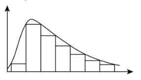
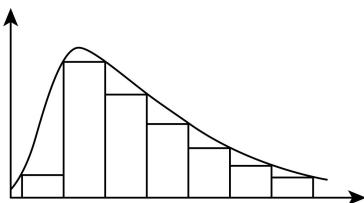
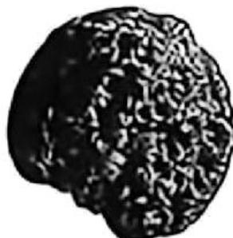
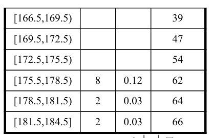
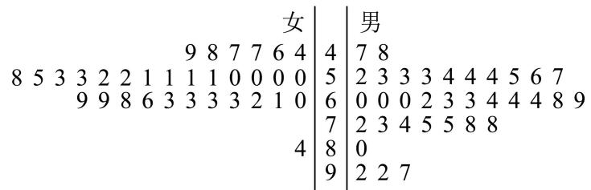
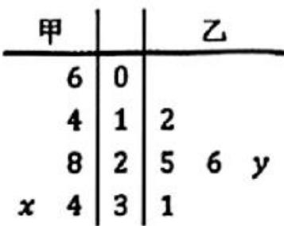
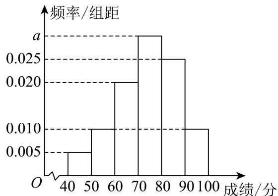

# 2026一模：概率与统计 · 教师版

> 阶段性整理。题型按任务与方法组织；图表回源重建并注明，尚未对所有原卷与解析完成独立数学审校。

## 1 事件的关系与独立性

### 宝山 · 原卷第10题

**考点说明：** 互斥事件与对立事件：结合两事件均不发生的概率及概率之比列式。

来源：2026届上海高三一模宝山卷，第10题。

规范化源文件：`2026届宝山一模数学试卷 逐题解析.md`。

已知事件 A 与事件 B 互斥，它们都不发生的概率为 $\frac{3}{4}$ ，且 $P(A)=2P(B)$ ，则 $P(\overline{A})=$ \_\_\_\_。

【答案】 $\frac{5}{6}$
【解析】

【分析】根据互斥事件及所给条件求出 $P(B)$ ，即可求出 $P(A)$ ，从而得解.

【详解】因为事件 A 与 B 互斥，它们都不发生的概率为 $\frac{3}{4}$ ，且 $P(A)=2P(B)$ ，

$\therefore 1 - P(A) - P(B) = 1 - 2P(B) - P(B) = \frac{3}{4}$ ，解得 $P(B) = \frac{1}{12}$ ，

$$
\therefore P (A) = 2 P (B) = \frac {1}{6}
$$

则 $P\left(\overline{A}\right) = 1 - P(A) = 1 - \frac{1}{6} = \frac{5}{6}$ .

故答案为： $\frac{5}{6}$ .

### 崇明 · 原卷第13题

**考点说明：** 独立事件概率：根据独立性使用乘法公式求两个事件同时发生的概率。

来源：2026届上海高三一模崇明卷，第13题。

规范化源文件：`2026届崇明一模数学试卷 逐题解析.md`。

已知事件 $A$ 、 $B$ 相互独立，事件 $A$ 发生的概率为 $P(A) = \frac{1}{2}$ ，事件 $B$ 发生的概率为 $P(B) = \frac{1}{2}$ ，则事件 $A \cap B$ 发生的概率 $P(A \cap B)$ 为（）

- A. $\frac{1}{8}$
- B. $\frac{1}{4}$
- C. $\frac{1}{2}$
- D. 0

【答案】B
【解析】
【分析】根据独立事件的概率公式可求 $P(A \cap B)$ .
【详解】因为 A, B 相互独立，故 $P(A \cap B) = P(A)P(B) = \frac{1}{2} \times \frac{1}{2} = \frac{1}{4}$ ，故选：B.

### 普陀 · 原卷第7题

**考点说明：** 古典概型与事件独立性：枚举两枚骰子的点数和，利用交事件概率等式判断参数。

来源：2026届上海高三一模普陀卷，第7题。

规范化源文件：`2026届普陀一模数学试卷 逐题解析.md`。

设 $m \in R$ ，同时抛掷两枚质地均匀的骰子一次，事件 A 表示“第一枚骰子向上的点数为奇数”，事件 B 表示“两枚骰子向上的点数之和为 m”，若事件 A 与事件 B 相互独立，则 m 的一个可取值为 \_\_\_\_.

【答案】3（或5、7、9、11其中之一）

【解析】

【分析】设第一次的点数为 $a$ ，第二次的点数为 $b$ ，进而依次讨论

$m = 2,3,4,5,6,7,8,9,10,11,12$ 的情况即可得答案.

【详解】设第一次的点数为a，第二次的点数为b，

则两次抛掷两枚质地均匀的骰子的结果记为 $(a,b)$ ，其中 $a,b\in \{1,2,3,4,5,6\}$ ，共36种基

本事件，

故由题知， $P(A)=\frac{3}{6}=\frac{1}{2}$ ,

当 $m = 2$ 时， $B$ 的基本事件为 $(1,1)$ ， $AB$ 的基本事件为 $(1,1)$ ，故 $P(B) = \frac{1}{36}$ ， $P(AB) = \frac{1}{36}$ ， $P(AB) \neq P(A)P(B)$ ，事件 $A$ 与事件 $B$ 不独立；

当 $m = 3$ 时， $B$ 的基本事件为 $(1,2), (2,1)$ ， $AB$ 的基本事件为 $(1,2)$ ，故 $P(B) = \frac{2}{36} = \frac{1}{18}$ ， $P(AB) = \frac{1}{36}$ ，

$$
P (A B) = P (A) P (B)
$$

当 $m = 4$ 时， $B$ 的基本事件为 $(1,3), (3,1), (2,2)$ ， $AB$ 的基本事件为 $(1,3), (3,1)$ ，

故 $P(B) = \frac{3}{36} = \frac{1}{12}$ , $P(AB) = \frac{2}{36} = \frac{1}{18}$ , $P(AB) \neq P(A)P(B)$ 事件 $A$ 与事件 $B$ 不独立; 当 $m = 5$ 时, $B$ 的基本事件为 $(1,4),(4,1),(2,3),(3,2)$ , $AB$ 的基本事件为 $(1,4),(3,2)$ , 故 $P(B) = \frac{4}{36} = \frac{1}{9}$ , $P(AB) = \frac{2}{36} = \frac{1}{18}$ , $P(AB) = P(A)P(B)$ 事件 $A$ 与事件 $B$ 相互独立; 当 $m = 6$ 时, $B$ 的基本事件为 $(1,5),(5,1),(2,4),(4,2),(3,3)$ , $AB$ 的基本事件为 $(1,5),(5,1),(3,3)$ ,

故 $P(B) = \frac{5}{36}$ , $P(AB) = \frac{3}{36} = \frac{1}{12}$ , $P(AB) \neq P(A)P(B)$ 事件 $A$ 与事件 $B$ 不独立;

当 $m = 7$ 时， $B$ 的基本事件为 $(1,6), (6,1), (2,5), (5,2), (3,4), (4,3)$ ， $AB$ 的基本事件为 $(1,6), (5,2), (3,4)$ ，

故 $P(B) = \frac{6}{36} = \frac{1}{6}$ , $P(AB) = \frac{3}{36} = \frac{1}{12}$ , $P(AB) = P(A)P(B)$ 事件 $A$ 与事件 $B$ 相互独立; 当 $m = 8$ 时, $B$ 的基本事件为 $(2,6),(6,2),(3,5),(5,3),(4,4)$ , $AB$ 的基本事件为 $(3,5),(5,3)$ ,

故 $P(B) = \frac{5}{36}$ ， $P(AB) = \frac{2}{36} = \frac{1}{18}$ ， $P(AB) \neq P(A)P(B)$ 事件 $A$ 与事件 $B$ 不独立；

$$
P (B) = \frac {4}{3 6} = \frac {1}{9}, P (A B) = \frac {2}{3 6} = \frac {1}{1 8}, P (A B) = P (A) P (B)
$$

当 $m = 10$ 时， $B$ 的基本事件为 $(4,6), (6,4), (5,5)$ ， $AB$ 的基本事件为 $(5,5)$ ，故 $P(B) = \frac{3}{36} = \frac{1}{12}$ ， $P(AB) = \frac{1}{36}$ ， $P(AB) \neq P(A)P(B)$ ，事件 $A$ 与事件 $B$ 不独立；当 $m = 11$ 时， $B$ 的基本事件为 $(5,6), (6,5)$ ， $AB$ 的基本事件为 $(5,6)$ ，故 $P(B) = \frac{2}{36} = \frac{1}{18}$ ， $P(AB) = \frac{1}{36}$ ， $P(AB) = P(A)P(B)$ ，事件 $A$ 与事件 $B$ 相互独立；当 $m = 12$ 时， $B$ 的基本事件为 $(6,6)$ ， $AB$ 的基本事件为 $\varnothing$ ，故 $P(B) = \frac{1}{36}$ ， $P(AB) = 0$ ， $P(AB) \neq P(A)P(B)$ ，事件 $A$ 与事件 $B$ 不独立；综上， $m$ 的可能取值为 $3,5,7,9,11$

故答案为：3（或5、7、9、11其中之一）

### 虹口 · 原卷第5题

**考点说明：** 互斥事件概率：利用互斥事件并的概率等于各事件概率之和。

来源：2026届上海高三一模虹口卷，第5题。

规范化源文件：`2026届虹口一模数学试卷 逐题解析.md`。

若事件 $A$、$B$ 互斥，且 $P(A)=0.4$，$P(A\cup B)=0.6$，则 $P(B)=\underline{\qquad}$。

【答案】0.2。

【补解】由互斥事件概率公式，$P(B)=P(A\cup B)-P(A)=0.6-0.4=0.2$。

### 长宁 · 原卷第14题

**考点说明：** 独立事件与充分必要条件：比较联合概率与边缘概率乘积，判断独立性的双向蕴含。

来源：2026届上海高三一模长宁卷，第14题。

规范化源文件：`2026届长宁一模数学试卷 逐题解析.md`。

甲、乙两人投篮的命中率分别为 0.7 和 0.6，两人各投篮一次，事件 A 为甲投中，事件 B 为乙投中。“甲、乙两人均投中的概率为 0.42”是“事件 A, B 互相独立”的（）

- A. 充分不必要条件
- B. 必要不充分条件
- C. 充要条件
- D. 既不充分也不必要条件

【答案】C

【解析】
【分析】由独立事件概率公式和充要条件的概念即可求解.
【详解】由甲、乙两人投篮的命中率分别为 0.7 和 0.6，

若“事件 $A, B$ 互相独立”，则 $P(AB) = P(A)P(B) = 0.42$ ，  
若 $P(AB) = 0.42 = P(A)P(B)$ ，则事件 $A, B$ 互相独立，  
即“甲、乙两人均投中的概率为0.42”是“事件 $A, B$ 互相独立”的充要条件，故选：C

### 青浦 · 原卷第14题

**考点说明：** 事件关系与独立性：列举骰子样本空间，比较交事件概率与概率乘积。

来源：2026届上海高三一模青浦卷，第14题。

规范化源文件：`2026届青浦一模数学试卷 逐题解析.md`。

抛掷一枚质地均匀的骰子一次，设“出现的点数为偶数”为事件 A，“出现的点数大于 4”为事件 B，则下述正确的是（）

- A. A 与 B 对立
- B. A 与 B 互斥
- C. A 与 B 相互独立
- D. $P(A \cup B) = P(A) + P(B)$

【答案】C

【解析】

【分析】抛掷一枚骰子的所有可能结果是： $\{1,2,3,4,5,6\}$ ；事件 A 包含的结果是： $\{2,4,6\}$ ；事件 B 包含的结果是： $\{5,6\}$ ，由对立互斥独立的概念逐一判断各个选项即可求解.

【详解】抛掷一枚骰子的所有可能结果是： $\{1,2,3,4,5,6\}$ ;

事件 A 包含的结果是： $\{2,4,6\}$ ;

事件 B 包含的结果是： $\{5,6\}$ .

因为 $A \cup B$ 未包含所有可能结果（如 1, 3 没包含在内），A 与 B 不对立，故 A 错误；

因为 $A \cap B = \{6\} \neq \emptyset$ ， $A$ 与 $B$ 不互斥，故 B 错误；

因为 $P(AB) = \frac{1}{6}$ , $P(A) \cdot P(B) = \frac{1}{2} \times \frac{1}{3} = \frac{1}{6} = P(AB)$ ,

因此 $A$ 与 $B$ 相互独立，故C正确；

$$
P (A) = \frac {3}{6} = \frac {1}{2}, \quad P (B) = \frac {2}{6} = \frac {1}{3}, \quad P (A) + P (B) = \frac {5}{6},
$$

而 $P(A \cup B) = \frac{4}{6} = \frac{2}{3}$ ，故D错误.

故选：C.

## 2 独立重复试验与比赛模型

### 嘉定 · 原卷第8题

**考点说明：** 独立事件与对立事件：先求两人均未命中的概率，再求至少一人命中。

来源：2026届上海高三一模嘉定卷，第8题。

规范化源文件：`2026届嘉定一模数学试卷 逐题解析.md`。

两个篮球运动员甲和乙罚球时命中的概率分别是 0.7 和 0.6，两人各投一次，假设事件“甲 命中”与“乙命中”是独立的，则至少一人命中的概率是______.

【答案】0.88

### 杨浦 · 原卷第8题

**考点说明：** 独立事件与对立事件：先求两人均未命中，再得到至少一人命中的概率。

来源：2026届上海高三一模杨浦卷，第8题。

规范化源文件：`2026届杨浦一模数学试卷 逐题解析.md`。

已知甲、乙两个篮球运动员罚球的命中率分别为 $\frac{2}{3}$ 、 $\frac{3}{4}$ , 两人各投一次, 假设事件“甲命中”与“乙命中”是独立的, 则至少有一个人命中的概率为 \_\_\_\_.

【答案】 $\frac{11}{12}$

【解析】

【分析】正难则反，先求其对立事件的概率，即两人都未命中的概率即可.

【详解】记事件 A=“甲和乙至少一人命中”，则其对立事件为 $\overline{A}=$ “甲和乙两人都未命中”，

由相互独立事件同时发生的概率乘法公式得 $P\left(\overline{A}\right) = \left(1 - \frac{2}{3}\right)\times \left(1 - \frac{3}{4}\right) = \frac{1}{12},$

所以 $P(A) = 1 - \frac{1}{12} = \frac{11}{12}$ .

故答案为： $\frac{11}{12}$ .

### 浦东 · 原卷第19题

**考点说明：** 第（1）问①：独立事件的乘法公式：将依次赢、输、赢分解为三个有序结果，分别使用对应单局概率。 第（1）问②：三局两胜与一局制的比较：按比赛结束局数或固定三局胜局数计算总胜率，再与单局胜率比较。 第（2）问：五局三胜的概率模型与函数单调性：分类计数得到获胜概率多项式，利用导数判断其随单局胜率的变化并解释意义。

来源：2026届上海高三一模浦东卷，第19题。

规范化源文件：`2026届浦东一模数学试卷 逐题解析.md`。

小明和小李要进行一系列的比赛，假设每局比赛的结果互不影响.

（1）若比赛没有平局，且小明每局获胜的概率为0.4.

①如果共有三局比赛，求小明的比赛结果依次为赢、输、赢的概率；

②小明作为实力较弱的一方，他可以优先选择“一局定胜负”或“三局两胜”的赛制（“三局两胜”指先赢两局者为胜，最多三局结束）。请帮助小明分析，选择哪种赛制对他更有利，并说明理由。

(2)如果小明每局获胜的概率为 $p(0 < p < 1)$ ，他和小李要进行一场“五局三胜”的比赛（“五局三胜”指先赢三局者为胜，最多五局结束）。记小明最终获胜的概率为 $f(p)$ ，请给出 $f(p)$ 的表达式，判断并说明函数 $y = f(p)$ 在 $(0,1)$ 上的单调性，并指出现实意义。

【答案】（1）① $\frac{12}{125}$ ；②一局定胜负对小明更有利，理由见解析

(2) $f(p) = 6p^{5} - 15p^{4} + 10p^{3}$ ，函数 $y = f(p)$ 在 $(0,1)$ 上的单调递增；意义见解析
【解析】

【分析】(1) ①根据独立事件概率的乘法公式即可计算小明比赛结果依次为“赢、输、赢”的概率;

②分别计算 “一局定胜负” 和 “三局两胜” 赛制下小明获胜的概率, 比较大小来确定哪种赛制对小明更有利;

（2）先根据 “五局三胜” 的规则，分情况讨论小明获胜的情况，利用独立事件概率的乘法公式和互斥事件概率的加法公式，求出 $f(p)$ 的表达式，再通过求导判断函数的单调性，并分析现实意义.

【小问 1 详解】

①根据题意，比赛没有平局，且小明每局获胜的概率为 0.4，所以三局比赛相互独立，且小明每局输的概率为 0.6，

所以小明的比赛结果依次为赢、输、赢的概率为 $P = \frac{2}{5} \times \frac{3}{5} \times \frac{2}{5} = \frac{12}{125}$ ;

②根据题意，一局定胜负时，小明赢得比赛的概率为 $p=\frac{2}{5}$ ，

三局两胜时，小明赢得比赛有两种情况：

情况一：前两局获胜，概率为 $\frac{2}{5}\times\frac{2}{5}=\frac{4}{25}$ ，

情况二：前两局胜一局，输一局，第三局获胜，其概率为 $C_{2}^{1}\left(\frac{2}{5}\right)^{2}\left(\frac{3}{5}\right)=\frac{24}{125}$

根据互斥事件的加法公式，所以在“三局两胜”的赛制下，

小明获胜的概率为 $\frac{4}{25}+\frac{24}{125}=\frac{44}{125}$ ,

因为 $\frac{2}{5}>\frac{44}{125}$ ，所以从小明的角度考虑，一局定胜负对小明更有利；

【小问 2 详解】

“五局三胜”的赛制下，小明获胜有以下几种情况：

情况一：前三局获胜，概率为 $P_{1}=p^{3}$ ，

情况二：前三局胜两局输一局，第四局获胜，则 $P_{2}=C_{3}^{2}p^{3}(1-p)$ ,

情况三：前四局胜两局输两局，第五局获胜，则 $P_{3} = \mathrm{C}_{4}^{2}p^{3}(1 - p)^{2}$

所以小明赢的概率为:

$$
P = P _ {1} + P _ {2} + P _ {3} = p ^ {3} + 3 p ^ {3} (1 - p) + 6 p ^ {3} (1 - p) ^ {2} = p ^ {3} (6 p ^ {2} - 1 5 p + 1 0),
$$

所以 $f(p)=6p^{5}-15p^{4}+10p^{3}$ ,

所以 $f'(p)=30p^{4}-60p^{3}+30p^{2}=30p^{2}(p-1)^{2}$ ,

因为 $0 < p < 1$ ，所以 $f^{\prime}(p) = 30p^{2}(p - 1)^{2} > 0$

所以函数 $y = f(p)$ 在 $(0,1)$ 上的单调递增；

现实意义: 在 “五局三胜” 的比赛中, 小明每局获胜的概率 p 越大, 他最终获胜的概率 $f(p)$

就越大，即小明实力越强，他获胜的可能性就越大.

### 黄浦 · 原卷第6题

**考点说明：** 相互独立事件概率：把至少一人译出转化为无人译出的对立事件。

来源：2026届上海高三一模黄浦卷，第6题。

规范化源文件：`2026届黄浦一模数学试卷 逐题解析.md`。

甲、乙两人独立破译某个密码，甲译出密码的概率为0.3，乙译出密码的概率为0.4，则该密码被破译的概率为\_\_\_\_。

【答案】0.58

【解析】

【分析】根据甲、乙两人破译某个密码为独立事件，利用独立事件概率公式求出甲、乙两人均未破译的概率，再利用对立事件概率公式求出该密码被破译的概率.

【详解】设甲破译某个密码为事件 A，乙破译某个密码为事件 B，

$\because$ 甲、乙两人独立破译某个密码，甲译出密码的概率为 $P(A) = 0.3$ ，乙译出密码的概率为

$$
P (B) = 0. 4,
$$

∴甲未破译的概率为 $P(\overline{A})=1-0.3=0.7$ ，乙未破译的概率为 $P(\overline{B})=1-0.4=0.6$ ，

∴ 甲、乙两人均未破译的概率为 $P(\overline{A}\overline{B}) = P(\overline{A}) \cdot P(\overline{B}) = 0.7 \times 0.6 = 0.42$ ,

∵“甲、乙两人均未破译”的对立事件为“密码被破译”，

∴该密码被破译的概率为 $P=1-P\left(\overline{A}\overline{B}\right)=1-0.42=0.58$ .

故答案为：0.58.

## 3 样本统计量与图表识读

### 宝山 · 原卷第4题

**考点说明：** 随机数表抽样：按编号位数分组读取，剔除无效编号和重复编号。

来源：2026届上海高三一模宝山卷，第4题。

规范化源文件：`2026届宝山一模数学试卷 逐题解析.md`。

现从编号为01,02,…,50的50支水笔中抽取10支水笔进行书写长度检测, 若从以下随机数表第9个数字开始由左向右读取, 则抽取的第4支水笔的编号为\_\_\_\_（以下摘自随机数表第7行）.

39832776 39918535 32591131 40469235 04982212 20671263

【答案】11

【解析】

【分析】由题目给出的随机数表，按照读取随机数表的方法得答案.

【详解】从随机数表第9个数字开始向右读，39，91（舍去），85（舍去），35，32，59（舍去），11……，

则第4支水笔的编号为11.

故答案为：11.

### 徐汇 · 原卷第6题

**考点说明：** 样本百分位数：根据有序样本的位置和百分位数规则确定对应数据。

来源：2026届上海高三一模徐汇卷，第6题。

规范化源文件：`2026届徐汇一模数学试卷 逐题解析.md`。

相关部门在上海市随机调查了 10 户居民六月份的用电量（单位： $\mathrm{kW} \cdot \mathrm{h}$ ），从小到大排列依次为 31、74、78、99、101、107、127、131、208、223，则这 10 户居民用电量的第 75

百分位数为______。

【答案】131

【解析】

【分析】由百分位数的计算公式即可求解.

【详解】因为 $10 \times 75\% = 7.5$ ，

所以第8个数131是第75百分位数，

故答案为：131

### 徐汇 · 原卷第14题

**考点说明：** 茎叶图与样本均值：从茎、叶恢复每个数据，求平均数并按要求取近似值。

来源：2026届上海高三一模徐汇卷，第14题。

规范化源文件：`2026届徐汇一模数学试卷 逐题解析.md`。

用简单随机抽样的方法抽取某个品种的小麦样本13株，测得麦穗长度（单位：cm），以其整数部分作为“茎”，小数部分作为“叶”绘制茎叶图如图所示。用该样本数据估计此品种小麦麦穗长度平均为（）（结果精确到0.1cm）

| 茎 | 叶 |
|---|---|
| 7 | 8 |
| 8 | 6 9 |
| 9 | 1 6 7 7 8 |
| 10 | 0 2 6 |
| 11 | 2 7 |

- A. 9.9cm
- B. 9.8cm
- C. 9.7cm
- D. 9.6cm

【答案】B

【解析】

【分析】利用平均数公式可求得结果.

【详解】由题意可知，抽取的13株小麦的麦穗长度分别为：7.8、8.6、8.9、9.1、9.6、9.7、9.7、9.8、10、10.2、10.6、11.2、11.7，单位：cm，

用该样本数据估计此品种小麦麦穗长度平均为 $\overline{x}=\frac{7.8+8.6+8.9+9.1+9.6+9.7\times2+9.8+10+10.2+10.6+11.2+11.7}{13}\approx9.8(\text{cm})$ .

故选：B.

### 松江 · 原卷第5题

**考点说明：** 茎叶图与均值：逐项读取茎叶图数据，再计算样本平均数。

来源：2026届上海高三一模松江卷，第5题。

规范化源文件：`2026届松江一模数学试卷 逐题解析.md`。

某运动员在某次男子 10 米气手枪射击比赛中的得分数据（单位：环）如茎叶图所示，则这组数据的平均数为 \_\_\_\_.

$$
\left| \begin{array}{c c c c c c} 8 & 6 & & & \\ 9 & 1 & 6 & 7 & 7 & 8 \\ 1 0 & 0 & 0 & 2 & 7 \end{array} \right.
$$

【答案】9.74

【解析】

【分析】先读取茎叶图得到数据，再利用平均数公式求解平均数即可.

【详解】由题意得得分数据分别为8.6,9.1,9,6,9.7,9.7,9.8,10.0,10.0,10.2,10.7,

则平均数为 $\frac{8.6 + 9.1 + 9.6 + 9.7 + 9.7 + 9.8 + 10.0 + 10.0 + 10,2 + 10.7}{10} = 9.74$

故答案为：9.74

### 浦东 · 原卷第14题

**考点说明：** 数据平移与统计量：比较所有数据同加常数时平均数、中位数、百分位数和方差的变化。

来源：2026届上海高三一模浦东卷，第14题。

规范化源文件：`2026届浦东一模数学试卷 逐题解析.md`。

某班一次数学小测验（百分制）后，老师为了奖励同学们平时认真学习，决定给每位同学的成绩加上5分作为过程性评价奖励.加分后，与原始分数相比，不会发生改变的是( )

- A. 平均数
- B. 中位数
- C. 第80百分位数
- D. 方差

【答案】D

【解析】
【分析】根据平均值、中位数、百分位数的概念判断ABC，根据方差性质判断D.
【详解】加分后，与原始分数相比，平均值，中位数，第80百分位数的数值都会发生改变，但根据方差的性质，一组数据同时加上相同的数后，方差大小不变.
故选：D.

### 静安 · 原卷第14题

**考点说明：** 频率分布形态与统计量：结合右拖尾对均值的影响，比较众数、中位数与平均数。

来源：2026届上海高三一模静安卷，第14题。

规范化源文件：`2026届静安一模数学试卷 逐题解析.md`。

如图，已知某频率分布直方图形成“右拖尾”形态，则下列结论正确的是（）

- A. 众数=平均数=中位数
- B. 众数<中位数<平均数
- C. 众数<平均数<中位数
- D. 中位数<平均数<众数

【答案】B

A.众数 $=$ 平均数 $=$ 中位数 B.众数 $<$ 中位数 $<$ 平均数C.众数 $<$ 平均数 $<$ 中位数 D.中位数 $<$ 平均数 $<$ 众数
【分析】根据平均数，中位数，众数的概念结合图形分析判断.

【详解】由频率直方图可得，单峰不对称且“右拖尾”，最高峰偏左，众数最小，平均数易受极端值的影响，与中位数相比，平均数总是在“拖尾”那边，故平均数大于中位数，所以众数 $<$ 中位数 $<$ 平均数.

故选：B

### 闵行 · 原卷第5题

**考点说明：** 分层抽样：利用各层与总体保持相同抽样比例，计算技术人员的抽取人数。

来源：2026届上海高三一模闵行卷，第5题。

某公司有 $200$ 名员工，其中有一般人员 $120$ 人，管理人员 $32$ 人，专业技术人员 $48$ 人，现用分层抽样的方法抽取 $25$ 人，以调查大家对职业培训的意愿，则应抽取的专业技术人员的人数是________。

【答案】$6$

【解析·参考原解整理】

按比例抽取，专业技术人员人数为 $25\times\frac{48}{200}=6$。

回源核对说明：逐题对照该PDF题面页面视觉核对；答案转录自第7或12页，非独立数学复核。

## 4 抽样和古典概型

### 静安 · 原卷第17题

**考点说明：** 第（1）问：列举等可能的两人组合，准确写出样本空间。 第（2）问：以组合计数建立古典概型，计算两人均为语文老师的概率。 第（3）问：按学校分类计数同校且不同学科的人数组合，再求古典概型概率。

来源：2026届上海高三一模静安卷，第17题。

规范化源文件：`2026届静安一模数学试卷 逐题解析.md`。

为开展社区与学校教育共建活动，某地区教育系统从 A、B 两所学校的 5 名教师志愿者中随机抽调 2 人到某社区为居民开展“义务教育咨询”活动.

已知 A 、 B 两所学校中的志愿者学科分布如下：A学校语文1人、数学2人；B学校语文1人、数学1人。

(1) 假设 $A$ 学校语文 $a$ 老师、数学 $b$ 、 $c$ 老师, $B$ 学校语文 $d$ 老师、数学 $e$ 老师, 列出“从 $A$ , $B$ 两所学校的 5 名教师志愿者中随机抽调 2 人”的样本空间;

（2）求事件“抽到的 2 人恰好都是语文老师”的概率；

（3）求事件“抽到的2人中，恰好有1名语文老师1名数学老师，且这2人恰好来自同一所学校”的概率.

【答案】(1) $\{ab, ac, ad, ae, bc, bd, be, cd, ce, de\}$

(2) $\frac{1}{10}$

(3) $\frac{3}{10}$

【解析】

【分析】（1）由题意可列出其样本空间，即可求解；

（2）符合“抽到的2人恰好都是语文老师”只有ad一种可能，利用古典概率即可求解；

（3）由题符合题意的有：ab，ac，de 有 3 种可能，即可求解.

【小问 1 详解】

样本空间为： $\{ab,ac,ad,ae,bc,bd,be,cd,ce,de\}$ .

【小问 2 详解】

事件“抽到的2人恰好都是语文老师”只有ad一种可能，所以概率为 $\frac{1}{10}$ ，

【小问 3 详解】

事件“抽到的2人中，恰好有1名语文老师1名数学老师，且这2人恰好来自同一所学校”，来自A学校有两种可能：ab，ac，来自B学校一种可能de，总计结果有3种可能，所以概率为 $\frac{3}{10}$ .

### 金山 · 原卷第17题

**考点说明：** 第（1）问：分层抽样：按各品类在总体中的比例分配样本数量。 第（2）问①：古典概型：统计超过指定克重的核桃数，用组合计数求抽取概率。 第（2）问②：样本统计：计算均值与标准差，再统计落在指定区间内的数据个数。

来源：2026届上海高三一模金山卷，第17题。

规范化源文件：`2026届金山一模数学试卷 逐题解析.md`。

核桃有很多品种. 小何购买了其中 4 种品类的核桃: $A$ 类核桃 100 个, $B$ 类核桃 120 个, $C$ 类核桃 80 个和 $D$ 类核桃 200 个.

（1）小何决定采用分层抽样的方法，从所有核桃中抽出25个核桃，请问应抽取 $C$ 类核桃多少个？

(2) 小何以随机抽样的方式, 从 $D$ 类核桃中抽取 20 个进行克重测量, 以下是这些核桃的克重数据: (单位: 克)

14.4，14.7，15.2，16.3，17.3，17.6，17.9，18.2，19.0，19.3，19.8，20.1，20.2，20.4，20.7，20.9，21.3，21.7，22.4，22.6。

①从该20个核桃中任取2个，则所取2个核桃的克重均大于20克的概率为多少？②记 $\overline{x}$ 为该20个核桃的平均克重， $s$ 为该20个核桃克重的标准差，则该20个核桃中有多

少个核桃的克重位于 $\overline{X} - S$ 与 $\overline{X} + S$ 之间？

【答案】（1）4； (2) ① $\frac{18}{95}$ ； ②13个.

【解析】

【分析】（1）根据分层抽样的特点计算即可‘

(2) ①先求出克重大于 20 克的核桃共 9 个, 再利用组合公式和古典概型即可得到答案;

②利用方差公式求出方差，则得到范围，再对照表格即可.

【小问 1 详解】

$$
\frac {8 0}{1 0 0 + 1 2 0 + 8 0 + 2 0 0} \times 2 5 = 4 \text {个}
$$

则应抽取 C 类核桃 4 个.

【小问 2 详解】

①因为克重大于 20 克的核桃共 9 个，

则所取2个核桃的克重均大于20克的概率为 $\frac{\mathrm{C}_9^2}{\mathrm{C}_{20}^2} = \frac{18}{95}$ .

② $\overline{x}=\frac{14.4+14.7+\cdots+22.6}{20}=\frac{380}{20}=19$ ,

则标准差 $s=\sqrt{\frac{(14.4-19)^{2}+(14.7-19)^{2}+\cdots+(22.6-19)^{2}}{20}}\approx2.42$

$$
\bar {x} - s \approx 1 9 - 2. 4 2 = 1 6. 5 8, \quad \bar {x} + s \approx 1 9 + 2. 4 2 = 2 1. 4 2.
$$

对照表格可知则该 20 个核桃中有 13 个核桃的克重位于 $\overline{X} - S$ 与 $\overline{X} + S$ 之间.

### 长宁 · 原卷第17题

**考点说明：** 第（1）问：按百分位数定义，对有序数据定位并处理相应位置。 第（2）问：用样本中不达标频率估计随机一天不达标的概率。 第（3）问：分析删除最大值、最小值对极差的影响，用组合计数求概率。

来源：2026届上海高三一模长宁卷，第17题。

规范化源文件：`2026届长宁一模数学试卷 逐题解析.md`。

小明有自觉体锻的习惯，某运动软件记录了其每天运动的时长（单位：min），小明从最近90天的记录中随机选取了10天的记录，具体数据如下：
68、34、70、45、74、126、108、66、36、72.

(1) 求这组数据的第 60 百分位数:

（2）运动时长不超过 60min 为不达标，估算从 90 天记录中随机抽取 1 天，该天运动时长不达标的概率：

(3)从这10个数中随机删除2个数得到一组新的数据,求前后两组数据的极差相同的概率.

【答案】(1) 71; (2) 0.3;

$$
\begin{array}{c} \frac {2 8}{4 5} \end{array}
$$

【解析】

【分析】（1）根据计算百分位数的步骤求解；

（2）计算样本频率，利用频率估计概率；

（3）根据古典概型的概率公式计算.

【小问1详解】

把 10 天的记录按照从小到大排列为：34,36,45,66,68,70,72,74,108,126，

因为 $10 \times 60\% = 6$ 是整数，所以第60百分位数为第6个数与第7个数的平均数，

因为 $\frac{70 + 72}{2} = 71$ ，这组数据的第60百分位数为71；

【小问 2 详解】

因为选取的样本中运动时长不达标的频率为 $\frac{3}{10}=0.3$ ，

所以估计该天运动时长不达标的概率为 0.3;

【小问3详解】

因为前后两组数据的极差相同，所以随机删除的 2 个数为 36,45,66,68,70,72,74,108 中的两个，

则概率 $P=\frac{C_{8}^{2}}{C_{10}^{2}}=\frac{28}{45}$

## 5 统计与概率综合

### 嘉定 · 原卷第17题

**考点说明：** 第（1）问：频率分布直方图：利用相应组距与频率密度求组频率，再计算人数。 第（2）问：分层样本的平均数：按男、女生样本人数加权平均，估计总体均值。 第（3）问：结合频率直方图、样本均值与标准差，检验数据落入指定区间的频率是否满足新定义。

来源：2026届上海高三一模嘉定卷，第17题。

规范化源文件：`2026届嘉定一模数学试卷 逐题解析.md`。

A 校抽取 66 名高一年级学生测量身高，因某种原因原始数据遗失。已知该样本是按照分层随机抽样的方法抽取的，其中男生 34 名，身高平均数为 173cm；女生 32 名，身高平均数为 161cm。该 66 名学生身高的方差为 60，其频率分布直方图如下：

（1）求该66名学生中身高在 $[169.5,172.5)$ （单位：cm）内的人数；

(2) 试用已知数据估计 $A$ 校高一年级全体学生身高的平均数; (结果精确到 $0.1 \mathrm{~cm}$ )

（3）若一组数据落在 $\left[\overline{x} - 2s, \overline{x} + 2s\right]$ （ $\overline{x}$ 是平均数， $s$ 是标准差）内的频率不小于 $92\%$ ，则称这组数据满足“常态”。试判断这66个身高数据是否满足“常态”，并说明理由。

【答案】(1) 8

(2) $167.2\mathrm{cm}$

（3）满足，说明见解析

【解析】

【分析】（1）根据频率分布直方图，求出身高在 $[169.5,172.5)$ 的频率，再求出频数即可得到答案；

(2) 求出 66 名学生的身高平均数, 用样本估计总体即可得到结果;

（3）根据题目数据求出 $\left[\overline{x} - 2s, \overline{x} + 2s\right]$ 约为 $[151.7, 182.7]$ ，再根据频率分布直方图求出数据落在 $[154.5, 181.5]$ 的频率，根据 $[154.5, 181.5] \subset [151.7, 182.7]$ 即可进行判断.

【小问 1 详解】

由频率分布直方图可知，身高在 $[169.5,172.5)$ 的频率为 $0.04\times 3 = 0.12$

$66 \times 0.12 = 7.92$ ，所以该66名学生中身高在 $[169.5,172.5)$ （单位：cm）内的人数为8人.
【小问 2 详解】

这66名高一年级学生身高平均数为 $\frac{34\times 173 + 32\times 161}{66}\approx 167.2$

因为该样本是按照分层随机抽样的方法抽取的，所以估计 A 校高一年级全体学生身高的平均数为 167.2cm.

【小问 3 详解】

由（2）知 $\overline{x} = 167.2$ ，所以 $[\overline{x} - 2s, \overline{x} + 2s]$ 约为 $[151.7, 182.7]$ ，

数据落在 $[154.5, 181.5]$ 内的频率为 $\left[1 - (0.015 + 0.01) \times 3\right] \times 100\% = 92.5\%$

因为 $[154.5, 181.5] \subset [151.7, 182.7]$ ，所以数据落在 $[\overline{x} - 2s, \overline{x} + 2s]$ 内的频率不小于 $92\%$ ，所以这66个身高数据满足“常态”。

### 奉贤 · 原卷第18题

**考点说明：** 第（1）问：频率分布表与有序原始数据的交叉读取：用各组人数及排序位置判断被遮挡的具体取值人数能否唯一确定。 第（2）问：分层随机抽样与茎叶图中位数：按男女比例求样本人数，再从男生有序体重中定位中间项。 第（3）问：分组数据的合并平均数与方差：同时考虑组内离散程度和组间均值差，确定两倍标准差区间并逐项计数。

来源：2026届上海高三一模奉贤卷，第18题。

规范化源文件：`2026届奉贤一模数学试卷 逐题解析.md`。

A 校高一年级共有学生 462 名，其中女生 224 名．为了解该校高一年级学生的身高和体重情况，按分层随机抽样从中获取 66 名学生的身高（cm）和体重（kg），其中 66 名学生的身高（从低到高排序三列，每列 22 人）汇总如下表（隐蔽部分信息数据），身高的频率分布表如下表（隐蔽了部分信息数据），66 名学生体重绘制茎叶图如下图．

A 校 66 名高一年级学生身高数据与频率分布表：

$A$ 校66名高一年级学生体重的茎叶图（上图）

(1) 能否推算出身高 $165 \mathrm{~cm}$ 的具体人数?

（2）求抽取的男生人数、抽取到的男生体重的中位数；

（3）已知这66名学生中男生身高平均数为 $173.1\mathrm{cm}$ ，方差为25.9；女生身高平均数为 $161.3\mathrm{cm}$ ，方差为23.3。请计算该样本数据在区间 $\left[\overline{x} - 2s, \overline{x} + 2s\right]$ 中包含样本数据的个数。（其中 $x$ 是样本平均数， $s$ 是样本标准差）

【答案】（1）不能，理由见解析

(2) 抽取的男生人数为 34 人, 抽取到的男生体重的中位数为 63

(3) 65

【解析】

【分析】（1）结合表格可得身高为165、166的共8人，不能得到身高 $165\mathrm{cm}$ 的具体人数；

(2) 借助茎叶图可得抽取的男生人数, 再利用中位数定义可得抽取到的男生体重的中位数;

（3）借助分层抽样的平均数与方差公式，可得 $\overline{x}$ 与 $s$ ，即可得 $[\overline{x} -2s,\overline{x} +2s]$ ，再借助身高数据表格即可得解.

【小问1详解】

由身高的频率分布表可得，身高位于 $[163.5, 166.5)$ 的人数为 $31 - 19 = 12$ 人，

由身高数据表格可得身高164的有4人，则身高为165、166的共8人，

故不能得到身高165cm的具体人数;

【小问 2 详解】

由茎叶图可得抽取的男生人数为34人，

抽取到的男生体重的中位数为 $\frac{63 + 63}{2} = 63$

【小问 3 详解】

$$
\overline {{x}} = \frac {1 7 3 . 1 \times 3 4 + 1 6 1 . 3 \times 3 2}{6 6} \approx 1 6 7. 4,
$$

$$
s ^ {2} \approx \frac {3 4 \times \left[ 2 5 . 9 + (1 7 3 . 1 - 1 6 7 . 4) ^ {2} \right]}{6 6} + \frac {3 2 \times \left[ 2 3 . 3 + (1 6 1 . 3 - 1 6 7 . 4) ^ {2} \right]}{6 6} \approx 5 9. 4 2,
$$

则 $s \approx \sqrt{59.42} \approx 7.7$

则 $\overline{x} - 2s \approx 167.4 - 2 \times 7.7 = 152$ ， $\overline{x} + 2s \approx 167.4 + 2 \times 7.7 = 182.8$

则由身高数据表格可得位于区间 $[152,182.8]$ 的人数为65人.

### 宝山 · 原卷第18题

**考点说明：** 第（1）问：茎叶图读取、极差与平均数：根据最大最小值及平均数列方程求参数。 第（2）问：古典概型：结合分组数据计数，用对立事件或直接计数求概率。 第（3）问：平均数条件与整数取值：消元后结合参数范围枚举或求最值并检查取等。

来源：2026届上海高三一模宝山卷，第18题。

规范化源文件：`2026届宝山一模数学试卷 逐题解析.md`。

某场篮球比赛中，甲、乙两队各 5 名队员进行比赛，他们得分的茎叶图如图．已知 $x, y \in N$ ，且 $4 \leq x \leq 9, 6 \leq y \leq 9$ ：

（1）若甲队队员得分的极差为32，乙得分的平均值为24，求其中x和y的值；

（2）从得分在 20 分及以上的队员中随机抽取 2 名，求至少有 1 名来自乙队的概率；

（3）若甲乙两队的队员平均分相等，求 $x+\frac{50}{y}$ 的最大值，并写出此时x和y的值.

【答案】（1）x=8,y=6，

(2) $\frac{6}{7}$

(3) x=8, y=6 时， $x+\frac{50}{y}$ 的最大值是 $\frac{49}{3}$ .

【解析】

【分析】（1）由甲队分数为：6，14，28，34， $30+x$ ，乙队分数为：12，25，26， $20+y$ ，

31，分别利用极差和平均数的定义求解；

(2) 利用古典概型和对立事件的概率求解;

（3）根据甲乙两队的队员平均分相等，得到 $x = 2 + y$ ，从而得到 $x + \frac{50}{y} = y + \frac{50}{y} + 2$ ，再利用对勾函数的性质求解.

【小问 1 详解】

由茎叶图知：甲队分数为：6，14，28，34， $30+x$ ，

乙队分数为：12，25，26， $20+y$ ，31，

因为甲队队员得分的极差为 32，

所以 $30 + x - 6 = 32$ ，解得 x = 8，

又因为乙得分的平均值为 24，

所以 $\frac{12 + 25 + 26 + 20 + y + 31}{5} = \frac{114 + y}{5} = 24$ ，解得 $y = 6$

【小问 2 详解】

由图知，20分以上的队员中，甲队有28、34、 $30+x$ 共3人，乙队有25、26、 $20+y$ 、31共4人，总共7人，

从 7 人中随机抽取 2 人，有 $C_{7}^{2}=21$ 种，且每种情况等可能，

记 “至少有 1 名来自乙队” 为事件 A，

其对立事件是 “2 名都来自甲队”，有 $C_{3}^{2}=3$ 种，且每种情况等可能，

所以至少有 1 名来自乙队的概率为 $P(A) = 1 - \frac{3}{21} = \frac{6}{7}$ .

【小问 3 详解】

甲队的平均数为 $\frac{6 + 14 + 28 + 34 + 30 + x}{5} = \frac{112 + x}{5}$ 又 $\frac{12 + 25 + 26 + 20 + y + 31}{5} = \frac{114 + y}{5}$ 因为甲乙两队的队员平均分相等，所以 $\frac{112 + x}{5} = \frac{114 + y}{5}$ 即 $x = 2 + y$ 则 $x + \frac{50}{y} = y + \frac{50}{y} + 2$ ，由 $\left\{ \begin{array}{l}4\leq x = y + 2\leq 9\\ 6\leq y\leq 9 \end{array} \right.$ ，解得 $6\leq y\leq 7$ 令 $f(y) = y + \frac{50}{y}$ ，由对勾函数的性质得 $f(y)$ 在 $(6,5\sqrt{2})$ 上递减，在 $(5\sqrt{2},9)$ 上递增，又 $f(6) = \frac{43}{3},f(7) = \frac{99}{7}$ ，且 $\frac{43}{3} >\frac{99}{7}$ 所以 $x + \frac{50}{y}$ 的最大值是 $\frac{49}{3}$ ，此时 $y = 6$ ， $x = 8$

### 崇明 · 原卷第19题

**考点说明：** 第（1）问：茎叶图与百分位数：整理两组数据后按规定位置读取第70百分位数。 第（2）问：独立抽样的古典概型：分别统计两组符合条件的比例，按恰有一人的情形分类。 第（3）问：样本方差变化：计算原样本及新增数据后的方差，结合新增数据相对均值的位置解释变化。

来源：2026届上海高三一模崇明卷，第19题。

规范化源文件：`2026届崇明一模数学试卷 逐题解析.md`。

为培养学生的社会责任感，某校开展了为期一学期的“温暖社区，青春奉献”志愿服务活动。活动结束后，学校从甲、乙两个班级中统计了部分学生的志愿服务时长（单位：小时），统计结果用茎叶图记录如图所示（十位数字作为“茎”，个位数字作为“叶”）。已知甲组有9名学生的数据，乙组有10名学生的数据。

（1）分别写出甲、乙两组学生服务时长的第70百分位数；

（2）从甲、乙两组学生中各随机抽取1人，求抽取的2人中恰有1人的服务时长超过30小时的概率；

（3）记甲组志愿服务时长的方差为 $s_0^2$ ；在甲组中增加一名学生 $A$ 得到“新甲组”，若 $A$ 的志愿服务时长为 27，则记“新甲组”志愿服务时长的方差为 $s_1^2$ ；若 $A$ 的志愿服务时长为 20，则记“新甲组”志愿服务时长的方差为 $s_2^2$ ；通过计算比较 $s_0^2$ 、 $s_1^2$ 、 $s_2^2$ 的大小（结果精确到 0.1），并从数学角度解释这一现象。

【答案】(1) 32; 30.5;

(2) $\frac{13}{30}$ ;

(3) $s_1^2 < s_0^2 < s_2^2$

【解析】

【分析】（1）根据百分位数的定义计算即可；

（2）根据古典概型和分步乘法计数原理计算即可；

（3）利用方差公式计算各方差，结合方差的统计意义解释即可.

【小问 1 详解】

因为 $9 \times 0.7 = 6.3$ ，所以甲组学生服务时长的第70百分位数为32；

因为 $10 \times 0.7 = 7$ ，所以乙组学生服务时长的第70百分位数为 $\frac{29 + 32}{2} = 30.5$ ;

【小问 2 详解】

因为甲组有 9 名学生，乙组有 10 名学生，根据分步乘法计数原理，从甲、乙两组学生中各随机抽取 1 人，有 $9 \times 10 = 90$ 种选取方法，

又甲、乙两组学生中各有 3 人的服务时长超过 30 小时，所以抽取的 2 人中恰有 1 人的服务时长超过 30 小时有 $3 \times 7 + 6 \times 3 = 39$ 种选取方法，

记事件 A=“抽取的 2 人中恰有 1 人的服务时长超过 30 小时”，则 $P(A)=\frac{39}{90}=\frac{13}{30}$ ,

故从甲、乙两组学生中各随机抽取 1 人，抽取的 2 人中恰有 1 人的服务时长超过 30 小时的

概率为 $\frac{13}{30}$ ;

【小问 3 详解】

对甲组:

甲组9名学生服务时长的平均数为 $\overline{x_0} = \frac{18 + 21 + 23 + 25 + 25 + 29 + 32 + 34 + 36}{9} = 27$

甲组志愿服务时长的方差为

$$
s _ {0} ^ {2} = \frac {(1 8 - 2 7) ^ {2} + (2 1 - 2 7) ^ {2} + (2 3 - 2 7) ^ {2} + (2 5 - 2 7) ^ {2} \times 2 + (2 9 - 2 7) ^ {2} + (3 2 - 2 7) ^ {2} + (3 4 - 2 7) ^ {2} + (3 6 - 2 7) ^ {2}}{9}
$$

对新甲组 1: $\overline{x_{1}} = 27$ ，所以 $s_{1}^{2} = 30$ .

对新甲组2： $\overline{x_2} = \frac{1}{10}\big(27\times 9 + 20\big) = 26.3$ ，所以 $s_2^2\approx 34.4$

所以 $s_{1}^{2}<s_{0}^{2}<s_{2}^{2}$ .

数学解释: 由于甲组均值为 27, 方差反映了数据的离散程度, 当增加数据 27 (原样本均值), 数据相对更集中, 所以方差变小; 当增加数据 20, 数据更加分散, 方差变大.

### 徐汇 · 原卷第18题

**考点说明：** 第（1）问：频率分布直方图：利用面积和为1求未知高度，并用样本频率估计总体人数。 第（2）问：均值和方差的变换：利用原始数据的和与平方和，计算剔除两个数据后的统计量。

来源：2026届上海高三一模徐汇卷，第18题。

规范化源文件：`2026届徐汇一模数学试卷 逐题解析.md`。

某校高三年级学生参加了一次时政知识竞赛，为了了解本次竞赛的成绩情况，从所有答卷中随机抽取100份作为样本进行统计，将样本的成绩（满分100分，成绩均为不低于40分的整数）分成六段： $[40,50)$ 、 $[50,60)$ 、…、 $[90,100]$ 得到如图所示的频率分布直方图.

(1) 求实数 $m$ 的值; 若年级准备选取 80 分及以上的学生进入下一轮竞赛, 已知该校高三年级有 1000 名学生, 估计该校高三年级参加下一轮竞赛的人数;

（2）王老师抽取了10名参加竞赛的学生，他们的分数为： $x_{1}$ 、 $x_{2}$ 、 $x_{3}$ 、 $\cdots$ 、 $x_{10}$ ．已知这10个分数的平均数x=91，标准差s=5，若剔除其中的96和86这2个分数，求剩余8个分数的平均数与方差.

【答案】（1）m=0.005；300人

（2）平均数为91，方差为25

【解析】

【分析】（1）在频率分布直方图中，所有矩形的面积之和为1，可求得 $m$ 的值；结合频率分布直方图可计算得出该校高三年级参加下一轮竞赛的人数；

（2）利用平均数和方差公式可求得剩余8个分数的平均数与方差.

【小问 1 详解】

在频率分布直方图中，所有矩形的面积之和为1，

即 $(m+2m+0.015+0.02\times2+0.03)\times10=1$ ，解得m=0.005，

80分及以上的学生所占的比例为 $(0.02+0.005\times2)\times10=0.3$ ，

故估计该校高三年级参加下一轮竞赛的人数为 $1000 \times 0.3 = 300$ 人.

【小问 2 详解】

不妨设 $x_{9}=96$ ， $x_{10}=86$ ，根据题意可得 $\sum_{i=1}^{8}x_{i}=10\times91-96-86=728$ ，

故剩余8个分数的平均数为 $\bar{x}=\frac{728}{8}=91$ ，

因为原数据的方差为

$$
s ^ {2} = \frac {\left(x _ {1} - 9 1\right) ^ {2} + \left(x _ {2} - 9 1\right) ^ {2} + \cdots + \left(x _ {8} - 9 1\right) ^ {2} + (9 6 - 9 1) ^ {2} + (8 6 - 9 1) ^ {2}}{1 0} = 2 5,
$$

所以 $\left(x_{1}-91\right)^{2}+\left(x_{2}-91\right)^{2}+\cdots+\left(x_{8}-91\right)^{2}=25\times10-5^{2}-5^{2}=200$

故剩余8个分数的方差为 $s^{\prime 2} = \frac{(x_1 - 91)^2 + (x_2 - 91)^2 + \cdots + (x_8 - 91)^2}{8} = \frac{200}{8} = 25$ .

### 普陀 · 原卷第19题

**考点说明：** 第（1）问：从表格计算逐年增长率，并用平均增长率模型预测市场规模。 第（2）问：按给定指数定义计算各层级占比的平方和，再依据阈值判断产业集中类型。 第（3）问：建立不放回抽样的古典概型，用组合数和分类或对立事件计算概率。

来源：2026届上海高三一模普陀卷，第19题。

规范化源文件：`2026届普陀一模数学试卷 逐题解析.md`。

人工智能生成内容（AIGC）是引领未来的新兴战略性产业。根据国家工信部发布的《人工智能产业发展年报（2025）》及国家统计局相关数据显示，中国 AIGC 产业已形成完整产业链结构，截至 2025 年 10 月，产业链核心层企业分布及核心市场规模分别如表一、表二所示.

表一：产业链层级及企业数量：第一层基础1820家；第二层模型框架1590家；第三层应用1890家。

表二：年份及市场规模（亿元）：2021年800.2；2022年1200.3；2023年1848.5；2024年2600.6；2025年3500.4。

（1）根据表二所提供的数据，请判断“2021-2025年我国AIGC市场规模年增长率持续提高”这一说法是否正确，并基于你对整体变化趋势的分析，试选用平均增长率模型预测2026年我国AIGC的市场规模（结果精确到1亿元）；

（2）赫希曼指数（HHI）是衡量产业集中程度的综合指标，计算公式为

$\mathrm{HHI} = \sum_{i=1}^{n}\left(\frac{T_i}{T}\right)^2 \times 10000$ ，其中 $T_i$ 为第 $i$ 个层级的企业数量， $T$ 为企业总数。请根据表一所提供的数据，计算我国 AIGC 产业链的 HHI 指数（结果保留整数），并参照“HHI < 1500 为竞争型， $1500 \leq \mathrm{HHI} \leq 2500$ 为低集中寡占型， $\mathrm{HHI} > 2500$ 为高集中寡占型”的标准，判断其产业分布结构类型；

（3）为制定产业支持政策，现计划从表一所提供的 AIGC 核心企业中随机抽取 4 家进行深度调研，求抽到的这 4 家企业中来自第二层和第三层的企业总数之和不少于 2 家的概率（结果精确到 0.001）.

【答案】（1）该说法不正确；5062亿元

（2）3351；目前我国AIGC产业分布结构为高集中寡占型

(3) 0.880

【解析】

【分析】（1）先计算出 2021-2025 年市场规模逐年增长率，指出五年内的变化趋势，即可得出说法不正确的结论；再求出五年的平均增长率，即可依据此模型预测 2026 年我国 AIGC 的市场规模；

（2）由表一中的数据以及赫希曼指数的计算公式，求出我国AIGC产业链的赫希曼指数为 $3351 > 2500$ ，即可判断其产业分布结构类型；

（3）先求出抽到的这4家企业全来自第一层的概率 $P_{1}$ 和来自第一层的有3家，来自第二或第三层的有1家的概率 $P_{2}$ ，用 $1 - (P_{1} + P_{2})$ 即可得解.

【小问 1 详解】

2021-2025年市场规模逐年增长率分别为：

$$
\frac{1200.3 - 800.2}{800.2} = 50\%, \frac{1848.5 - 1200.3}{1200.3}\approx 54\%
$$

$$
\frac {2 6 0 0 . 6 - 1 8 4 8 . 5}{1 8 4 8 . 5} \approx 40.69 \%, \frac {3 5 0 0 . 4 - 2 6 0 0 . 6}{2 6 0 0 . 6} \approx 34.60 \%,
$$

由此可看出：2021-2023年增长率加快，2023-2025年市场规模增长逐年放缓，

所以 “2021-2025 年我国 AIGC 市场规模年增长率持续提高” 这一说法不正确；

五年的平均增长率为 $\sqrt[4]{\frac{3500.4}{800.2}} - 1 \approx 44.62\%$

则按照该模型预测2026年我国AIGC市场规模约 $3500.4 \times \sqrt[4]{\frac{3500.4}{800.2}} \approx 5062$ 亿元.

（说明：若按照最后一年增长规模估计， $3500.4 \times (1 + 34.62\%) \approx 4712$ 亿元；

若按照最后两年增长规模估计， $3500.4 \times \sqrt{\frac{3500.4}{1848.5}} \approx 4817$ 亿元）

【小问 2 详解】

由表一中的数据以及赫希曼指数的计算公式得，我国 AIGC 产业链的赫希曼指数为：

$$
\mathrm{HHI} = \left[ \left(\frac {1 8 2 0}{5 3 0 0}\right) ^ {2} + \left(\frac {1 5 9 0}{5 3 0 0}\right) ^ {2} + \left(\frac {1 8 9 0}{5 3 0 0}\right) ^ {2} \right] \times 1 0 0 0 0 \approx 3 3 5 1 > 2 5 0 0,
$$

所以目前我国 AIGC 产业分布结构为高集中寡占型；

【小问3详解】

抽到的这 4 家企业全来自第一层的概率为： $P_{1}=\frac{C_{1820}^{4}}{C_{5300}^{4}}$ ;

抽到的这 4 家企业中来自第一层的有 3 家，来自第二或第三层的有 1 家的概率为：

$$
P _ {2} = \frac {\mathrm{C} _ {1 8 2 0} ^ {3} \mathrm{C} _ {3 4 8 0} ^ {1}}{\mathrm{C} _ {5 3 0 0} ^ {4}};
$$

则抽到的这 4 家企业中来自第二层和第三层的企业总数之和不少于 2 家的概率为:

$$
P = 1 - \left(P _ {1} + P _ {2}\right) = 1 - \frac {\mathrm{C} _ {1 8 2 0} ^ {4} + \mathrm{C} _ {1 8 2 0} ^ {3} \mathrm{C} _ {3 4 8 0} ^ {1}}{\mathrm{C} _ {5 3 0 0} ^ {4}} \approx 0. 8 8 0.
$$

### 杨浦 · 原卷第19题

**考点说明：** 第（1）问：利用频率分布直方图各组频率和为1确定图中参数。 第（2）问：根据各组人数及抽样比例进行分层抽样。 第（3）问：利用加权平均数与组内、组间离差关系求合并数据的平均数和方差。

来源：2026届上海高三一模杨浦卷，第19题。

规范化源文件：`2026届杨浦一模数学试卷 逐题解析.md`。

为了了解某校高三年级学生的体育成绩，随机选取100名学生参加考核，将考核的成绩（满分100分，成绩均为不低于40分的整数）分成六组： $[40,50)$ ， $[50,60)$ ， $[60,70)$ ， $[70,80)$ ， $[80,90)$ ， $[90,100]$ ，得到如图所示的频率分布直方图.

（1）求频率分布直方图中 $a$ 的值；

(2) 在考核成绩为 $[70,80)$ , $[80,90)$ , $[90,100]$ 的三组学生中, 用分层抽样的方法抽取 13 人, 则考核成绩在 $[70,80)$ 中的学生应抽取多少人?

(3) 若落在 $[50,60)$ 学生的平均成绩是 54.4，方差是 5.2，落在 $[60,70)$ 学生的平均成绩为 66.4，方差是 9.2，求这两组学生成绩的平均数和方差。（结果精确到 0.1）

【答案】（1） $a = 0.03$

(2) 6

（3）平均数为62.4，方差为39.9

【解析】

【分析】（1）利用频率之和为1结合频率分布直方图列式求出 $a$ ；

（2）利用频率分布直方图求出成绩为 $[70,80)$ ， $[80,90)$ ， $[90,100]$ 的学生人数，再根据分层抽样的概念求解即可；

（3）先利用频率分布直方图求出 $[50,60)$ 和 $[60,70)$ 的学生人数，再根据平均数和方差公式计算求解即可.

【小问 1 详解】

由频率分布直方图可得 $10\times(0.005+0.01+0.02+a+0.025+0.01)=1$ ，

解得 $a = 0.03$

【小问 2 详解】

由频率分布直方图知，样本考核成绩在 $[70,80)$ ， $[80,90)$ ， $[90,100]$ 的三组学生有 $100 \times 10 \times (0.03 + 0.025 + 0.01) = 65$ （人），

其中样本考核成绩在 $[70,80)$ 的市民人数为 $100\times 10\times 0.03 = 30$

用分层抽样的方法应从考核成绩在 $[70,80)$ 的市民中抽取 $\frac{30}{65} \times 13 = 6$ （人）.

【小问 3 详解】

由频率分布直方图知，成绩在 $\left[50,60\right)$ 的学生人数为 $100\times0.1=10$ ，

成绩在 $[60,70)$ 的市民人数为 $100 \times 0.2 = 20$ ，

所以总平均数 $\overline{z} = \frac{10\times 54.4 + 20\times 66.4}{10 + 20} = 62.4$

$$
s ^ {2} = \frac {1 0}{1 0 + 2 0} \left[ 5. 2 + (5 4. 4 - 6 2. 4) ^ {2} \right] + \frac {2 0}{1 0 + 2 0} \left[ 9. 2 + (6 6. 4 - 6 2. 4) ^ {2} \right] = \frac {5 9 8}{1 5} \approx 3 9. 9
$$

### 松江 · 原卷第19题

**考点说明：** 第（1）问：样本极差与中位数：先将数据排序，再分别确定最大最小值之差及中间两项。 第（2）问：不放回抽样的古典概型：按恰有两个和恰有三个长回合分类，使用组合计数求至少型事件概率。 第（3）问：比赛赛制的概率比较：在独立同胜率模型下求三局两胜概率，与单局概率作差并利用参数范围判断优劣。

来源：2026届上海高三一模松江卷，第19题。

规范化源文件：`2026届松江一模数学试卷 逐题解析.md`。

在乒乓球比赛中，一个发球回合时长是指从运动员发球开始，到其中一方得分为止的时间．现记录一场比赛中运动员连续 10 个发球回合时长（单位：秒），数据如下：3.2，4.7，5.3，4.1，5.8，9.6，12.4，6.5，7.2，8.9.

（1）求这组数据的极差和中位数；

（2）如果定义一个发球回合时长超过 5.0 秒为 “长发球回合”，那么从这 10 个发球回合时长中随机抽取 3 个，求至少有 2 个是 “长发球回合” 的概率；

(3) 假设甲乙运动员相约进行一次比赛, 比赛有两种赛制可选: ①一局定胜负: 只打一局, 胜者赢得比赛; ②三局两胜: 先赢得两局者为胜, 最多打三局. 若甲在一局中获胜的概率为 $p (0 < p < 0.5)$ . 从甲的角度考虑, 哪种赛制对他更有利? 请说明理由.

【答案】(1) 9.2, 6.15

(2) $\frac{49}{60}$

（3）一局定胜负对甲更有利

【解析】

【分析】（1）根据极差和中位数的计算公式即可求解；

（2）根据古典概型的概率的计算公式结合组合数公式即可求解；

（3）分别计算一局定输赢和三局两胜情况下甲获胜的概率，比较大小.

【小问 1 详解】

将题中数据按从小到大的排序排列得:

故极差为 $12.4 - 3.2 = 9.2$ ；中位数为 $\frac{5.8 + 6.5}{2} = 6.15$ .

【小问 2 详解】

因为长发球回合数 m=7 ，短发球回合数 n=3 ，

所以从 10 个中随机抽取 3 个，至少有 2 个是长发球回合的概率为：

$$
P = \frac {\mathrm{C} _ {7} ^ {3} \mathrm{C} _ {3} ^ {0} + \mathrm{C} _ {3} ^ {1} \mathrm{C} _ {7} ^ {2}}{\mathrm{C} _ {1 0} ^ {3}} = \frac {4 9}{6 0};
$$

【小问 3 详解】

对于甲来说，一局定胜负的情况下，赢得比赛的概率为 p，

三局两胜的情况下，赢得比赛的概率为 $p^{2} + 2p^{2}(1 - p)$ ,

$$
p ^ {2} + 2 p ^ {2} (1 - p) - p = 3 p ^ {2} - 2 p ^ {3} - p = 2 p ^ {2} - 2 p ^ {3} + p ^ {2} - p = (1 - p) p (2 p - 1)
$$

因为 $0 < p < \frac{1}{2}$ ，所以 $(1 - p)p(2p - 1) < 0$ ，即 $p^2 + 2p^2(1 - p) < p$

所以一局定胜负对甲更有利.

### 虹口 · 原卷第19题

**考点说明：** 第（1）问：茎叶图与百分位数：按有序男生数据及百分位数定义确定相应位置。 第（2）问：古典概型与事件独立性：从图表确定各类人数，分别计算两事件及其交事件概率，比较乘积关系。 第（3）问：删去极端值后的均值、等差结构与方差：利用总和变化恢复关键数据，结合女生等差条件与图表信息判断离散程度。

来源：2026届上海高三一模虹口卷，第19题。

规范化源文件：`2026届虹口一模数学试卷 逐题解析.md`。

班主任小明为了解本班每位学生每周平均手机使用时长（单位：小时），在某一学期每周对全班45名学生进行问卷调查，收集了全部数据并计算出每位学生每周平均手机使用时长，绘制了相应的统计图表，全班用时最长的为25.6小时。其中，男生每周平均手机使用时长的茎叶图如图19-1所示，女生每周平均手机使用时长的频率分布直方图如图19-2所示。

（1）求该班男生每周平均手机使用时长的第25百分位数；

（2）小明老师想从本班每周平均手机使用时长小于12小时的学生中任选2人在班会课上做经验分享。设事件 $A$ 表示“2人中至多1名男生”，事件 $B$ 表示“2人中恰有1名学生的每周平均手机使用时长位于区间 $[11,12)$”。试判断事件 $A$ 和事件 $B$ 是否独立，并说明理由；

（3）小明老师发现本班有 $t$ 位学生的每周平均手机使用时长超过20小时，这 $t$ 位学生的数据平均数为23小时。当去掉这 $t$ 位学生中用时最长和用时最短的数据后，平均数变为22.7小时，且这 $t$ 位学生中女生的数据从小到大依次排序成等差数列。那么这 $t$ 位学生每周平均手机使用时长的方差是否超过3？请说明理由。

【答案】（1）12.8小时；（2）不独立；（3）方差不超过3。

【补解】

（1）男生共有20人，按从小到大顺序，第5、6个数据为12.7和12.9，所以第25百分位数为 $\frac{12.7+12.9}{2}=12.8$。

（2）女生直方图面积为1，故 $4m+0.16+0.24+0.12+0.16=1$，得 $m=0.08$。女生共25人，时长小于12小时的女生有4人，男生有2人，其中位于 $[11,12)$ 的女生有2人、男生有2人。于是 $P(A)=1-\frac{C_2^2}{C_6^2}=\frac{14}{15}$，$P(B)=\frac{C_4^1C_2^1}{C_6^2}=\frac8{15}$。满足B时必满足A，故 $P(A\cap B)=\frac8{15}\ne P(A)P(B)$，两事件不独立。

（3）时长超过20小时的男生有24.8、25.6两人，女生有4人，故 $t=6$，六人的总时长为138。设四名女生时长从小到大为 $u,u+d,u+2d,u+3d$。去掉最长25.6和最短u后，剩余四人总时长为 $4\times22.7=90.8$，所以 $u=138-25.6-90.8=21.6$。又四名女生总时长为 $138-24.8-25.6=87.6$，可得 $4u+6d=87.6$，所以 $d=0.2$。六人的数据为21.6、21.8、22、22.2、24.8、25.6，均值为23，方差为 $\frac{(21.6-23)^2+(21.8-23)^2+(22-23)^2+(22.2-23)^2+(24.8-23)^2+(25.6-23)^2}{6}=\frac{188}{75}\approx2.507<3$。

### 闵行 · 原卷第19题

**考点说明：** 第（1）问：原始数据的中位数：将六次成绩排序后取居中两项的平均数。 第（2）问：经验概率与对立事件：以上午样本频率估计单次达标概率，在独立重复模型下计算至少一次达标。 第（3）问：两组数据合并的平均值与方差：用组容量加权合并均值，并在合并方差中加入组间均值差的贡献。

来源：2026届上海高三一模闵行卷，第19题。

规范化源文件：`2026届闵行一模数学试卷 逐题解析.md`。

（本题满分 14 分）本题共有 3 个小题，第 1 小题 4 分，第 2 小题 4 分，第 3 小题 6 分小闵同学某一天进行了 10 次 100 米短跑集训，其中上午进行了 6 次，下午进行了 4 次；如下是他上午集训 6 次的

成绩（单位：s）：13.7 、13.9 、14.9 、15.3、12.9 、13.3. （1）求这 6 次成绩的中位数；（2）参考这一天上午

集训的数据，用经验概率估计概率，求该同学训练 100 米短跑 3 次至少有一次用时小于 13s的概率；（3）若该同学

下午 4 次的集训原始成绩记录丢失，但记得这 4 次的平均成绩是 14.25s，方差是 0.75，求他这一天 10 次训练成绩的

平均值和方差.

【答案】（1）13.8s；（2）$\frac{91}{216}$；（3）平均值14.1s，方差0.745。

【补解】

（1）上午六次成绩从小到大为12.9，13.3，13.7，13.9，14.9，15.3，中位数为 $\frac{13.7+13.9}{2}=13.8$。

（2）用经验频率估计单次用时小于13s的概率为 $\frac16$，按各次训练相互独立的模型，三次至少一次用时小于13s的概率为 $1-(1-\frac16)^3=\frac{91}{216}$。

（3）上午均值为14，方差为 $\frac{43}{60}$；下午均值为14.25，方差为0.75。因此总均值为 $\bar x=\frac{6\times14+4\times14.25}{10}=14.1$，总方差为 $\frac6{10}[\frac{43}{60}+(14-14.1)^2]+\frac4{10}[0.75+(14.25-14.1)^2]=0.745$。

### 青浦 · 原卷第19题

**考点说明：** 第（1）问：样本数据整理：按百分位数规则确定位置，计算极差与第95百分位数。 第（2）问：利用均值恢复缺失数据，结合标准差判定等级，再用组合计数求概率。 第（3）问：合并样本方差：综合两组样本容量、组内方差与组间均值差计算总体方差。

来源：2026届上海高三一模青浦卷，第19题。

规范化源文件：`2026届青浦一模数学试卷 逐题解析.md`。

随着手机和网络的普及, 外卖行业得到迅速发展. 某外卖平台为了解某地区用户对其提供的服务的满意度，随机调查了 40 个用户，得到用户的满意度评分，系统自动将评分按从大到小顺序排列如下：

97，96，95，93，92，91，89，89，88，88，86，86，85，85，84，84，83，83，82，82，81，81，81，80，79，79，78，78，78，77，76，76，76，75，74，74，73，72，66，63。

（1）求这组数据的极差和第95百分位数.

（2）若从这40个用户中抽取一个容量为10的样本，有一个数据不小心丢失了，抽到的其他9个用户的评分分别为92,84,86,78,89,74,78,77,89，且这10个数据的平均数 $\overline{x} = 83$ 记这10个数据的方差为 $s^2$ ，若用户的满意度评分在区间 $(\overline{x} - s, \overline{x} + s)$ ，则满意度等级为“A级”.从这10个数据里面任取3个，求恰有2个满意度等级为“A级”的概率.

(3) 平台为拓展客流, 开发了一个新的评价系统. 把 (2) 中样本的平均数和方差作为老评价系统的数据, 且老系统的样本容量占两个系统所有样本容量的 $\frac{1}{3}$ , 新系统得出的评分平均数为 89 分, 方差为 12. 据此计算新老系统所有评分的方差.

【答案】（1）极差为34，第95百分位数为95.5

(2) $\frac{5}{12}$

(3) 27

【解析】

【分析】（1）根据极差与百分位数的定义求解即可；

(2) 先根据平均数据的计算公式求出丢失的数据, 再计算方差, 进而求得满意度等级为 “A 级” 的数据个数, 进而利用古典概型概率公式求解即可;

（3）根据两组数据合并后平均数与方差的计算公式求解即可.

【小问 1 详解】

由表中可得这 40 个用户的评分从小到大排列如下：63，66，72，73，74，74，75，76，76，76，77，78，78，78，79，79，80，81，81，81，82，82，83，83，84，84，85，85，86，86，88，88，89，89，91，92，93，95，96，97.

所以极差为97-63=34， $40\times95\%=38$ ，

所以第95百分位数为第38与第39个数据的平均数，即 $\frac{95 + 96}{2} = 95.5$

【小问 2 详解】

设丢失的数据为 $m$ ，

$$
\bar {x} = \frac {1}{1 0} (9 2 + 8 4 + 8 6 + 7 8 + 8 9 + 7 4 + 7 8 + 7 7 + 8 9 + m) = 8 3
$$

$$
m = 8 3
$$

$$
s ^ {2} = \frac {1}{1 0} \left[ (9 2 - 8 3) ^ {2} + (8 4 - 8 3) ^ {2} + (8 6 - 8 3) ^ {2} + (7 8 - 8 3) ^ {2} + (8 9 - 8 3) ^ {2} \right.
$$

$$
+ (7 4 - 8 3) ^ {2} + (7 8 - 8 3) ^ {2} + (7 7 - 8 3) ^ {2} + (8 9 - 8 3) ^ {2} + (8 3 - 8 3) ^ {2} = 3 3,
$$

由题意知评分在 $\left(83 - \sqrt{33}, 83 + \sqrt{33}\right)$ ，即 $(77.26, 88.74)$ 的满意度等级为“ $A$ 级”，

样本中评分在(77.26,88.74)内的数据有5个，

所以从这 10 个数据里面任取 3 个有 $C_{10}^{3}$ ，恰有 2 个满意度等级为 “A 级” 的取法有 $C_{5}^{2}C_{5}^{1}$ ，
所以恰有 2 个满意度等级为 “A 级” 的概率为 $\frac{C_{5}^{2}C_{5}^{1}}{C_{10}^{3}}=\frac{5}{12}$ .

【小问 3 详解】

由（2）可知，老系统的平均分为 $\overline{x_1} = 83, s_1^2 = 33$ ，新系统的平均分为 $\overline{x_2} = 89, s_2^2 = 12$ ，因为老系统的样本容量10占两个系统所有样本容量的 $\frac{1}{3}$ ，所以新系统的样本容量为20，所以 $\overline{x} = \frac{10\overline{x_1} + 20\overline{x_2}}{30} = \frac{10 \times 83 + 20 \times 89}{30} = 87$ ， $s^2 = \frac{1}{10 + 20}\left\{10\left[33 + (83 - 87)^2\right] + 20\left[12 + (89 - 87)^2\right]\right\} = 27.$

所以新老系统所有评分的方差为27.

### 黄浦 · 原卷第17题

**考点说明：** 第（1）问：根据样本数据求算术平均数。 第（2）问：将有序样本按百分位数的定位规则确定相应数值。 第（3）问：分类计算符合条件的选取方式，用组合数建立古典概型。

来源：2026届上海高三一模黄浦卷，第17题。

规范化源文件：`2026届黄浦一模数学试卷 逐题解析.md`。

一家水果店的店长为了解本店苹果的日销售情况，记录了过去20天苹果的日销售量（单位：kg），按从小到大的排序结果如下：62，74，75，84，84，85，85，85，86，87，89，92，93，94，97，99，101，104，107，117.

（1）求该水果店过去20天苹果日销售量的平均数；

（2）若以过去 20 天苹果的日销售量的第 80 百分位数作为下个月每日苹果的平均进货量，试确定下个月每日苹果的平均进货量；

(3) 若从过去 20 天中随机抽取 3 天, 分别求“3 天中每天的苹果销售量均超过 $90 \mathrm{~kg}$ ”与“3 天中恰有 2 天的苹果销售量超过 $90 \mathrm{~kg}$ ”的概率.

【答案】(1) 90kg

(2) 100kg

(3) $\frac{7}{95},\frac{33}{95}$

【解析】

【分析】（1）根据平均数的定义即可求解；

（2）根据百分位数的定义即可求解；

（3）根据古典概率公式即可求解.

【小问1详解】

该水果店过去 20 天苹果日销售量的平均数

$$
\overline {{x}} = \frac {6 2 + 7 4 + 7 5 + 8 4 \times 2 + 8 5 \times 3 + 8 6 + 8 7 + 8 9 + 9 2 + 9 3 + 9 4 + 9 7 + 9 9 + 1 0 1 + 1 0 4 + 1 0 7 + 1 1 7}{2 0} = 9 0 \mathrm{kg}
$$

【小问 2 详解】

因为 $20 \times 0.8 = 16$ ，所以第80百分位数为 $\frac{99 + 101}{2} = 100\mathrm{kg}$ ，所以下个月每日苹果的平均进货量为 $100\mathrm{kg}$ 。

【小问 3 详解】

20 天中苹果销售量超过 90kg 的有 9 天.

设 “3 天中每天的苹果销售量均超过 90kg” 为事件 A，“3 天中恰有 2 天的苹果销售量超

过90kg”为事件B，

则 $P(A) = \frac{C_9^3}{C_{20}^3} = \frac{7}{95}, P(B) = \frac{C_9^2C_{11}^1}{C_{20}^3} = \frac{33}{95}.$
