# 2026届上海高三一模 · 立体几何专题（学生版）

> 阶段性专题：按题型和方法组织，原题可在其他专题重复出现。本稿优先采用规范化原卷，未对全部原题或解析逐题重算。

## 目录

- [1 旋转体、球与多面体的面积和体积](#class-1)（12题）
- [2 空间线面位置关系与命题判断](#class-2)（9题）
- [3 异面直线角、线面角与二面角](#class-3)（6题）
- [4 平行、垂直的证明与空间角](#class-4)（6题）
- [5 点面距离、体积与动点综合](#class-5)（8题）
- [6 空间模型与实际测量](#class-6)（3题）
- [7 原题内容待核](#class-7)（1题）

## 1 旋转体、球与多面体的面积和体积

### 嘉定 · 原卷第7题

来源：2026届上海高三一模嘉定卷，第7题。

圆锥的侧面展开图中扇形中心角为 $\frac{2\pi}{3}$ , 底面周长为 $2\pi$ , 这个圆锥的侧面积是 \_\_\_\_.

### 崇明 · 原卷第8题

来源：2026届上海高三一模崇明卷，第8题。

已知圆锥的底面半径为 1，侧面积为 $2 \pi$ ，则此圆锥的体积是 \_\_\_\_.

### 杨浦 · 原卷第6题

来源：2026届上海高三一模杨浦卷，第6题。

已知圆锥底面半径为 1，高为 $\sqrt{3}$ ，则该圆锥的侧面积为 \_\_\_\_.

### 虹口 · 原卷第7题

来源：2026届上海高三一模虹口卷，第7题。

已知某圆锥的底面半径为 2, 侧面积为 $6 \pi$ , 则该圆锥的体积为 \_\_\_\_ (结果保留 $\pi$ )

### 长宁 · 原卷第5题

来源：2026届上海高三一模长宁卷，第5题。

如果圆锥的底面圆半径为 1，母线长为 2，则该圆锥的侧面积为 \_\_\_\_.

### 金山 · 原卷第14题

来源：2026届上海高三一模金山卷，第14题。

已知某正四棱锥的高为 2，体积为 24，则该正四棱锥的底面边长为（）

- A. 9
- B. 8
- C. 6
- D. $2\sqrt{3}$

### 浦东 · 原卷第8题

来源：2026届上海高三一模浦东卷，第8题。

如图, 等腰直角 $\triangle APB$ 的斜边 $AB$ 长为 $2R$ , 将 $\triangle APB$ 绕斜边 $AB$ 所在直线旋转一周形成的旋转体的体积为 \_\_\_\_.

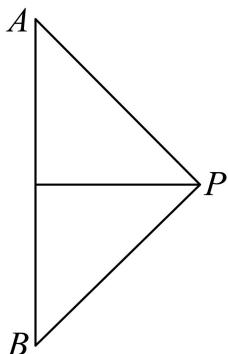

### 青浦 · 原卷第9题

来源：2026届上海高三一模青浦卷，第9题。

已知圆柱和圆锥的底面半径相同, 侧面积也相等, 且它们的高均为 $\sqrt{2}$ , 则圆锥的体积为 \_\_\_\_.

### 静安 · 原卷第7题

来源：2026届上海高三一模静安卷，第7题。

已知圆柱的底面圆的半径与球的半径相等, 若圆柱的表面积与球的表面积也相等, 则圆柱的体积 $V_{1}$ 与球的体积 $V_{2}$ 之比 $V_{1}: V_{2} =$ \_\_\_\_.

### 徐汇 · 原卷第8题

来源：2026届上海高三一模徐汇卷，第8题。

一个底面积为1的正四棱柱的所有顶点都在同一球面上, 若该球的表面积为 $4 \pi$ , 则该正四棱柱的高为 \_\_\_\_.

### 黄浦 · 原卷第7题

来源：2026届上海高三一模黄浦卷，第7题。

已知边长为 3 的正三角形 $ABC$ 的三个顶点都在球 $O$ 的球面上, 球心 $O$ 到平面 $ABC$ 的距离为 1 , 则球 $O$ 的体积为 \_\_\_\_.

### 松江 · 原卷第12题

来源：2026届上海高三一模松江卷，第12题。

在三棱锥 P-ABC 中，PA=6，PB=8， $PC=BC=8\sqrt{2}$ ， $\angle APB=60^{\circ}$ ， $\angle APC=45^{\circ}$ ，则此三棱锥的体积为 \_\_\_\_。

### 闵行 · 原卷第7题

来源：2026届上海高三一模闵行卷，第7题。

若圆锥的轴截面为等腰直角三角形，则其侧面展开图扇形圆心角的弧度数为________。

## 2 空间线面位置关系与命题判断

### 奉贤 · 原卷第14题

来源：2026届上海高三一模奉贤卷，第14题。

设 $\alpha$ ， $\beta$ ， $\gamma$ 是互不重合的平面，m，n 是互不重合的直线，给出四个命题：
①若 $m \parallel \alpha$ ， $m \parallel \beta$ ，则 $\alpha \parallel \beta$ ②若 $\alpha \perp \gamma$ ， $\beta \perp \gamma$ ，则 $\alpha \perp \beta$

③若 $m \perp \alpha, m \perp \beta$ ，则 $\alpha // \beta$ ④若 $m // \alpha, n \perp \alpha$ ，则 $m \perp n$ 其中正确命题的个数是（）

- A. 1
- B. 2
- C. 3
- D. 4

### 普陀 · 原卷第14题

来源：2026届上海高三一模普陀卷，第14题。

已知直线 $m$ 、 $l$ 和平面 $\alpha$ 、 $\beta$ ，且 $l \subset \alpha$ ， $\alpha // \beta$ ，则下列命题中正确的是（）

- A. 若 $m // \beta$ ，则 $m // l$
- B. 若 $m // l$ ，则 $m // \alpha$
- C. 若 $m \perp \beta$ ，则 $m \perp l$
- D. 若 $m \perp l$ ，则 $m \perp \alpha$

### 杨浦 · 原卷第14题

来源：2026届上海高三一模杨浦卷，第14题。

若 m, n 为两条不同直线， $\alpha, \beta$ 为两个不同平面，则下列结论中正确的是（）

- A. 若 $m // \alpha$ ， $n \subset \alpha$ ，则 $m // n$
- B. 若 $m // n$ ， $n \subset \alpha$ ，则 $m // \alpha$
- C. 若 $m \subset \alpha$ ， $m \perp \beta$ ，则 $\alpha \perp \beta$
- D. 若 $m \subset \alpha$ ， $\alpha \perp \beta$ ，则 $m \perp \beta$

### 松江 · 原卷第13题

来源：2026届上海高三一模松江卷，第13题。

若空间中三条不同的直线 $a, b, c$ 满足 $a \perp c, b \perp c$ , 则 $a // b$ 是 $a, b, c$ 共面的 ( )

- A. 充分不必要条件
- B. 必要不充分条件
- C. 充要条件
- D. 既不充分也不必要条件

### 浦东 · 原卷第13题

来源：2026届上海高三一模浦东卷，第13题。

已知直线 $a,b$ 和平面 $\alpha,\beta$，且 $a\subseteq\alpha$、$b\subseteq\beta$，则“$a$ 与 $b$ 相交”是“$\alpha$ 与 $\beta$ 相交”的（ ）。

- A. 充分必要条件

- B. 既不充分又不必要条件

- C. 充分不必要条件

- D. 必要不充分条件

> 原题条件或版本存在疑点，请结合教师版核对说明使用。

### 长宁 · 原卷第13题

来源：2026届上海高三一模长宁卷，第13题。

如图, 已知 $A 、 B 、 C 、 D 、 E 、 F 、 G$ 分别是正方体所在棱的中点, 则下列直线中与直线 $E F$ 异面的是 ( )

- A. 直线 $AB$
- B. 直线 $AC$
- C. 直线 $AD$
- D. 直线 $AG$

### 青浦 · 原卷第13题

来源：2026届上海高三一模青浦卷，第13题。

在空间中，“两条直线平行”是“这两条直线没有公共点”的（）

- A. 充分非必要条件
- B. 必要非充分条件
- C. 充要条件
- D. 既非充分也非必要

### 静安 · 原卷第13题

来源：2026届上海高三一模静安卷，第13题。

在三维空间中，下列命题是真命题的一个是（ ）

- A. 垂直于同一条直线的两条直线平行
- B. 垂直于同一个平面的两个平面平行
- C. 若一条直线垂直于一个平面，另一条直线与这个平面平行，则这两条直线互相垂直
- D. 若两个平面分别平行于两条互相垂直的直线，则这两个平面互相垂直

### 黄浦 · 原卷第14题

来源：2026届上海高三一模黄浦卷，第14题。

设 $\alpha$ 、 $\beta$ 是两个不同的平面，$l$ 是一条直线，以下命题正确的是

- A. 若 $l \perp \alpha, \alpha \perp \beta$ ，则 $l \parallel \beta$
- B. 若 $l \parallel \alpha, \alpha \parallel \beta$ ，则 $l \parallel \beta$
- C. 若 $l \perp \alpha, \alpha \parallel \beta$ ，则 $l \perp \beta$
- D. 若 $l \parallel \alpha, \alpha \perp \beta$ ，则 $l \perp \beta$

## 3 异面直线角、线面角与二面角

### 奉贤 · 原卷第7题

来源：2026届上海高三一模奉贤卷，第7题。

在正四棱台 $ABCD - A_{1}B_{1}C_{1}D_{1}$ 中，异面直线 $AA_{1}$ 与 $D_{1}B_{1}$ 所成角的大小为 \_\_\_\_.

### 宝山 · 原卷第11题

来源：2026届上海高三一模宝山卷，第11题。

如图, 点 $P$ 在圆柱 $O_{1} O$ 的底面圆 $O$ 的圆周上, $A B$ 为圆 $O$ 的直径,

$\angle AOP = 120^{\circ}, OA = 3, A_{1}B$ 与底面圆 $O$ 所成的角为 $30^{\circ}$ , 则异面直线 $A_{1}B$ 与 $AP$ 所成角的余弦值为 ______.

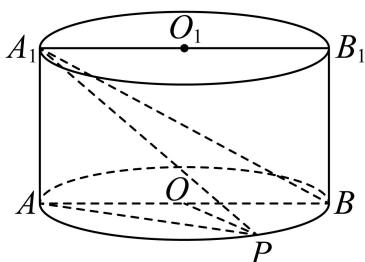

### 普陀 · 原卷第8题

来源：2026届上海高三一模普陀卷，第8题。

在 $\triangle ABC$ 中, $A = \frac{\pi}{3}$ , $AB = 2$ , $AC = 5$ , $D$ 为 $AC$ 边上的一点, 且 $AD = 2$ , 现将 $\triangle ABD$ 沿 $BD$ 边折起, 使得点 $A$ 至点 $P$ 的位置, 且满足平面 $PBD \perp$ 平面 $BDC$ , 如图所示, 则直线 $PC$ 与平面 $BDC$ 所成的角的正弦值为 \_\_\_\_.

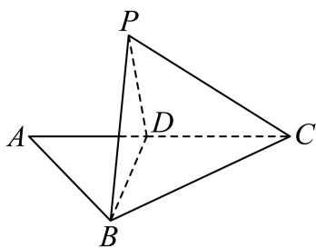

### 虹口 · 原卷第15题

来源：2026届上海高三一模虹口卷，第15题。

如图，已知点 $A, B, C, D$ 在表面积为 $12\pi$ 的球 $O$ 的球面上，且 $O \in BD$ ， $OA \perp$ 平面 $BCD$ ，点 $E$ 为 $BC$ 中点，当二面角 $A - BC - D$ 的大小为 $\frac{\pi}{3}$ 时，则有（）

- A. 异面直线 $AE$ 和 $CD$ 所成角的大小为 $\frac{\pi}{6}$
- B. 直线 $EA$ 与平面 $ABD$ 所成角的大小为 $\frac{\pi}{6}$
- C. $\sin (2\angle ABE) = \frac{\sqrt{2}}{3}$
- D. $\triangle BED$ 的面积为 $\sqrt{2}$

### 金山 · 原卷第18题

来源：2026届上海高三一模金山卷，第18题。

如图，已知圆锥 $A - O$ ，点 $B$ 、 $C$ 在底面圆周上， $OA = OB = 4$ ，且 $\angle BOC = 90^{\circ}$ ，动点 $P$ 落在劣弧 $BC$ 上.

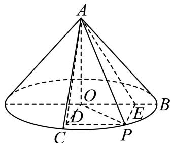

（1）求证：平面 $AOB \perp$ 平面 AOC；

(2) 若点 $P$ 平分劣弧 $BC$ , 过点 $P$ 分别作 $PD \perp OC$ 、 $PE \perp OB$ , 垂足分别为 $D$ 、 $E$ 两点,

求二面角 $D - AP - E$ 的大小.

### 闵行 · 原卷第17题

来源：2026届上海高三一模闵行卷，第17题。

如图，三棱锥 $P-ABC$ 中，侧面 $PAC$ 与底面 $ABC$ 都是以 $AC$ 为斜边的等腰直角三角形，$O$ 为 $AC$ 中点。

（1）求证：$AC\perp PB$；

（2）若 $PO\perp OB$，求二面角 $P-AB-C$ 的大小。

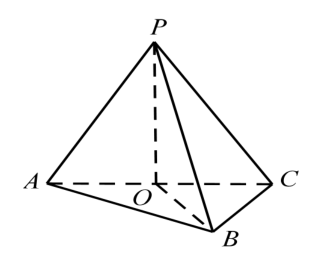

## 4 平行、垂直的证明与空间角

### 嘉定 · 原卷第18题

来源：2026届上海高三一模嘉定卷，第18题。

如图，在四面体 $V - ABC$ 中， $AC = BC$ ，从顶点 $V$ 作平面 $ABC$ 的垂线，垂足 $O$ 恰好落在 $\triangle ABC$ 的中线 $CD$ 上.

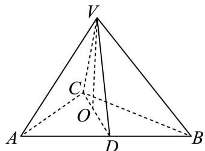

（1）如果 $DV = DA = 2$ ，直线 $VD$ 与平面 $ABC$ 所成的角为 $\frac{\pi}{4}$ ，求直线 $VA$ 与平面 $ABC$ 所成角的大小；

(2) 证明: 平面 $VCD \perp$ 平面 $VAB$ .

### 奉贤 · 原卷第19题

来源：2026届上海高三一模奉贤卷，第19题。

如图, 将直角三角形 $SOA$ 绕直角边 $SO$ 所在直线旋转一周形成圆锥 $S-O$ . 已知圆锥 $S-O$ 的底面半径为 $3 \mathrm{~cm}$ , 圆锥的侧面积 $15 \pi \mathrm{~cm}^{2}$ . 设 $A 、 B$ 是底面圆周上的两点, 线段 $AB$ 不经过点 $O$ .

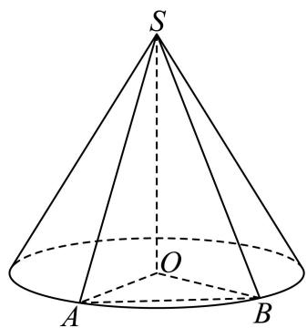

（1）求圆锥 S-O 的体积；

（2）求证：直线 SA 与直线 OB 是异面直线；

（3）二面角 $A - SO - B$ 的大小为 $\frac{2\pi}{3}$ ，求直线 $SA$ 与平面 $SOB$ 所成角的大小.

### 浦东 · 原卷第18题

来源：2026届上海高三一模浦东卷，第18题。

如图, 该几何体由一个棱长为 4 的正方体 $ABCD - A_{1}B_{1}C_{1}D_{1}$ 与一个半圆柱拼接而成, 圆心 $O$ 、 $O_{1}$ 分别为线段 $AB$ 、 $A_{1}B_{1}$ 的中点, 动点 $M$ 在弧 $\widehat{A_{1}B_{1}}$ 上滑动.

（1）若点 M 为弧 $\widehat{A_{1}B_{1}}$ 的中点，求直线 MD 与平面 $BDD_{1}B_{1}$ 所成角的大小；

（2）若弧 $\widehat{A_1M}$ 的长度为 $\frac{\pi}{2}$ ，求证：平面 $OO_{1}M //$ 平面 $ACC_{1}A_{1}$ .

### 青浦 · 原卷第18题

来源：2026届上海高三一模青浦卷，第18题。

如图，四棱锥 $P - ABCD$ 的底面是边长为 1 的正方形，侧棱 $PA \perp$ 底面 $ABCD$ ，且 $PA = 2$ ， $E$ 是侧棱 $PA$ 的中点.

（1）求证： $PC / /$ 平面BDE；

(2) 求证: 平面 $PCD \perp$ 平面 $PAD$ .

### 静安 · 原卷第19题

来源：2026届上海高三一模静安卷，第19题。

已知正四棱柱 $ABCD - A_{1}B_{1}C_{1}D_{1}$ 的底面边长为 1，点 $E$ 、 $F$ 分别在边 $AD$ 、 $CD$ 上，且 $AE = \frac{2}{3}$ ， $CF = \frac{2}{3}$ .

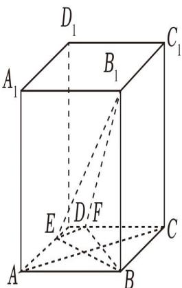

（1）证明： $AC / /$ 平面 $B_{1}EF$

(2) 若 $AA_{1} = 2$ ，求直线 $BB_{1}$ 与平面 $B_{1}EF$ 所成角的正弦值.

### 黄浦 · 原卷第18题

来源：2026届上海高三一模黄浦卷，第18题。

如图，在几何体 ABCDE 中，四边形 ABCD 是矩形， $AB \perp$ 平面 BEC， $BE \perp EC$ ， $AB = BE = EC = 2$ ，G，F 分别是线段 BE，DC 的中点.

（1）求证：GF // 平面 ADE;

（2）设平面 AEF 与平面 BEC 的交线为 l，求二面角 A-l-B 的余弦值.

## 5 点面距离、体积与动点综合

### 宝山 · 原卷第17题

来源：2026届上海高三一模宝山卷，第17题。

如图，在四棱锥 P-ABCD 中， $PD \perp$ 底面 ABCD，且底面 ABCD 为正方形，

E、F、G分别是BC、AD、PA的中点.

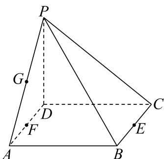

（1）证明：PE // 平面 BFG；

(2) 若 AB = 2，求点 E 到平面 BFG 的距离.

### 崇明 · 原卷第18题

来源：2026届上海高三一模崇明卷，第18题。

如图. 在直棱柱 $\mathrm{ABC - A_1B_1C_1}$ 中， $\angle \mathrm{BAC} = 90^{\circ}$ ， $\mathrm{AB} = \mathrm{AC} = \sqrt{2}$ ， $\mathrm{AA}_1 = 3$ ，D是BC的中点，点E在棱 $\mathrm{BB}_1$ 上运动.

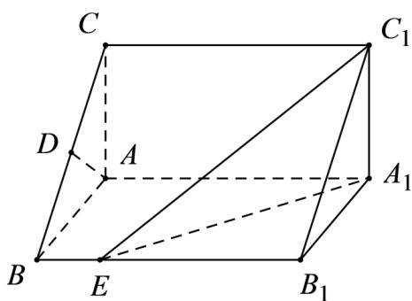

（1）证明：$AD\perp C_1E$;

(2) 当异面直线 AC, $C_{1} \mathrm{E}$ 所成的角为 $60^{\circ}$ 时, 求三棱锥 $C_{1} - A_{1} B_{1} E$ 的体积

### 徐汇 · 原卷第19题

来源：2026届上海高三一模徐汇卷，第19题。

如图，已知 $BD$ 是 $\odot O$ 的直径，点 $C$ 是 $\odot O$ 上异于 $B$ 、 $D$ 的一点．设过点 $C$ 的直线 $AC$ 垂直于 $\odot O$ 所在的平面，且 $AC = BD = 2$ ：

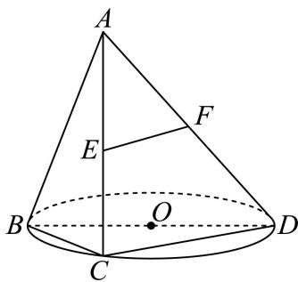

(1) 若 C 为 $\widehat{BD}$ 中点，E 为线段 AC 的中点，F 为线段 AD 上一点，且 $EF \parallel$ 平面 BCD. 求证：F 为线段 AD 中点，并求三棱锥 F-BCD 的体积；

（2）记二面角 $A - BD - C$ 的平面角为 $\theta$ ，求 $\theta$ 的最小值，并指出其取得最小值时点 $C$ 的位置.

### 普陀 · 原卷第17题

来源：2026届上海高三一模普陀卷，第17题。

如图所示, 过圆柱的轴 $O O_{1}$ 的平面与该圆柱相截所形成的截面是边长为 2 的正方形 $A A_{1} C_{1} C$ , $B$ 是该圆柱底面圆周上异于 $A 、 C$ 两点的点.

（1）设平面 $A_{1}AB \cap$ 平面 $C_{1}CB = l$ ，求证： $l / / AA_{1}$

(2) 当三棱锥 $C_{1} - ABC$ 的体积最大时, 求二面角 $C_{1} - AB - C$ 的余弦值.

### 杨浦 · 原卷第17题

来源：2026届上海高三一模杨浦卷，第17题。

如图，在长方体 $ABCD - A_{1}B_{1}C_{1}D_{1}$ 中， $M$ 为 $BB_{1}$ 上一动点，已知 $AD = CD = 2$ ， $AA_{1} = 4$ .

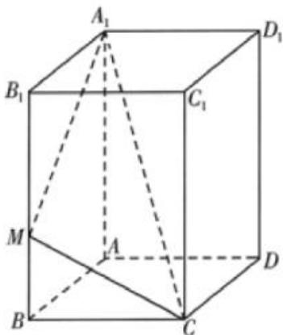

(1) 求直线 $A_{1} C$ 与平面 $A B C D$ 所成角的大小; (用反三角表示)

(2) 求三棱锥 $M - AA_{1}C$ 的体积.

### 松江 · 原卷第18题

来源：2026届上海高三一模松江卷，第18题。

已知四棱锥 $P - ABCD$ 的底面 $ABCD$ 是直角梯形， $AB // CD$ ， $AB = 2CD = 2$ ， $\angle ABC = 90^\circ$ ， $\triangle PBC$ 是边长为 2 的正三角形，侧面 $PBC \perp$ 底面 $ABCD$ .

（1）证明： $PA \perp BD$ ;

(2) 求点 D 到平面 PAB 的距离.

### 虹口 · 原卷第17题

来源：2026届上海高三一模虹口卷，第17题。

如图，已知四棱锥 $P - ABCD$ 的底面是边长为 2 的菱形，点 $E$ 为 $PC$ 中点.

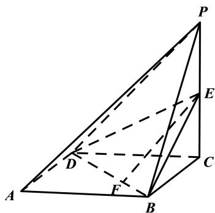

（1）若点 F 是线段 BD 上的动点，求证：直线 EF 与直线 PA 不相交；

（2）若 $PC \perp$ 平面 ABCD，AC = BD，EC = 1，求点 A 到平面 EBD 的距离.

### 长宁 · 原卷第19题

来源：2026届上海高三一模长宁卷，第19题。

如图，在四棱锥 $P - ABCD$ 中， $PA \perp$ 平面 $ABCD$ ， $AB \perp AD$ ， $AD // BC$ ， $AB = BC = 1$ ， $AD = 2$ ，直线 $PC$ 与平面 $ABCD$ 所成的角的大小为 $\arctan\sqrt{2}$ .

（1）求四棱锥 P-ABCD 的体积；

(2) 点 $Q$ 在线段 $PD$ 上, 直线 $PB //$ 平面 $AQC$ , 求二面角 $Q - AC - D$ 的余弦值.

## 6 空间模型与实际测量

### 杨浦 · 原卷第11题

来源：2026届上海高三一模杨浦卷，第11题。

某数学建模活动小组在开展主题为“空中不可到达两点的测距问题”的探究活动中，抽象并构建了如图所示的几何模型，该模型中 $MA$ ， $NB$ 均与水平面 $ABC$ 垂直，在已测得可直接到达的两点间距离 $AC$ ， $BC$ ，且 $AC < BC$ ，用测角仪测得 $\angle MCA$ ， $\angle NCB$ 的情况下，四名同学用测角仪各自测得下面一个角：① $\angle ABC$ ；② $\angle ACB$ ；③ $\angle BAC$ ；④ $\angle MCN$ ，其中一定能唯一确定 $M, N$ 之间的距离有\_\_\_\_。（写出所有正确的序号）

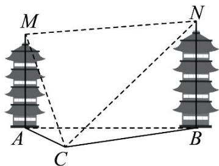

### 青浦 · 原卷第16题

来源：2026届上海高三一模青浦卷，第16题。

16. 如图所示, 水平地面上插有两根杆子 $AB$ 和 $CD$ , $AB$ 所在直线垂直于地面且 $AB = 2$ 米, $CD$ 所在直线与地面斜交. 小明有一把卷尺. 他在某时刻分别测出杆子 $AB$ 和 $CD$ 在阳光下影子的长度, 称为一次操作. 小明可以在白天的不同时刻进行多次操作. 假设阳光为平行光, 正午时分 $AB$ 的影子长度为 0. 则下列说法正确的是 ( )

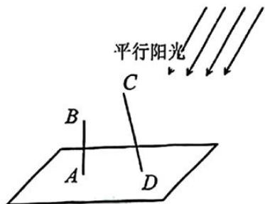

- A. 为求出 $CD$ 的长度, 小明至少需要进行 2 次操作
- B. 为求出 $CD$ 的长度, 小明至少需要进行 3 次操作
- C. 为求出 $CD$ 的长度, 小明至少需要进行 4 次操作
- D. 无论进行多少次操作, 小明都不能求出 $CD$ 的长度

### 嘉定 · 原卷第21题

来源：2026届上海高三一模嘉定卷，第21题。

图 1 为转角过道的地面平面示意图. 该过道由两条直道连接形成转角, 由水平平坦的地面与垂直于地面的墙面共同围成, 两端延伸至足够远处, 且高度充足. 其中, $QA$ 、 $QB$ 构成地面上过道的一侧边界, $\angle AQB = 120^{\circ}$ ; 地面上过道的另一侧边界, 则分别与 $QA$ 、 $QB$ 平行, 且交于点 $P$ . 过道两侧平行墙面之间的距离均为 3 米.

<figure><figcaption>图 1</figcaption></figure>

<figure><figcaption>图 2</figcaption></figure>

<figure><figcaption>图 3</figcaption></figure>

<figure><figcaption>图 4</figcaption></figure>

（1）如图 2，在地面有一圆，该圆与 QA、QB 均相切，且过点 P. 求此圆的半径；

（2）如图3，有一根长度为 $y$ 米的无粗细木棒 $MN$ 紧贴地面，端点 $N$ 沿 $QB$ 移动，另一端点 $M$ 沿 $AQ$ 移动.当木棒 $MN$ 触碰到点 $P$ 时， $\angle QMN = x$ （弧度），求 $y$ 关于 $x$ 的函数关系及 $y$ 的最小值；

（3）如图4，某长方体家具的底面为长方形 $EFGH$ ，其宽为1米，长为10米（因过道高度足够，无需考虑家具高度）。现将底面 $EFGH$ 紧贴地面移动，判断该家具能否顺利通过此转角过道，并说明理由。

