# 2026届上海高三一模 · 立体几何专题（教师版）

> 阶段性专题：按题型和方法组织，原题可在其他专题重复出现。本稿优先采用规范化原卷，未对全部原题或解析逐题重算。

## 目录

- [1 旋转体、球与多面体的面积和体积](#class-1)（12题）
- [2 空间线面位置关系与命题判断](#class-2)（9题）
- [3 异面直线角、线面角与二面角](#class-3)（6题）
- [4 平行、垂直的证明与空间角](#class-4)（6题）
- [5 点面距离、体积与动点综合](#class-5)（8题）
- [6 空间模型与实际测量](#class-6)（3题）
- [7 原题内容待核](#class-7)（1题）

## 1 旋转体、球与多面体的面积和体积

### 嘉定 · 原卷第7题

**考点说明：** 圆锥侧面积：将侧面展开为扇形，利用弧长等于底面周长求母线长。

来源：2026届上海高三一模嘉定卷，第7题。

规范化源文件：`2026届嘉定一模数学试卷 逐题解析.md`。

圆锥的侧面展开图中扇形中心角为 $\frac{2\pi}{3}$ , 底面周长为 $2\pi$ , 这个圆锥的侧面积是 \_\_\_\_.

【答案】 $3\pi$

【解析】

【分析】借助扇形弧长公司计算出圆锥母线长，结合扇形面积公式即可得圆锥侧面积.

【详解】设圆锥母线长为 l，扇形圆心角为 $\alpha$ ，则 $2\pi = \frac{2\pi}{3} \times l$ ，故 l = 3，

则 $S = \frac{1}{2}\alpha l^2 = \frac{1}{2}\times \frac{2\pi}{3}\times 3^2 = 3\pi .$

故答案为： $3\pi$

核对说明：规范稿混入下一题概率解析，已在第二个答案标记前截断。

### 崇明 · 原卷第8题

**考点说明：** 圆锥侧面积与体积：由侧面积求母线，再用勾股关系求高并计算体积。

来源：2026届上海高三一模崇明卷，第8题。

规范化源文件：`2026届崇明一模数学试卷 逐题解析.md`。

已知圆锥的底面半径为 1，侧面积为 $2 \pi$ ，则此圆锥的体积是 \_\_\_\_.

【答案】 $\frac{\sqrt{3}}{3}\pi$

【解析】

【分析】由圆锥的侧面积公式可求出母线长，再求出圆锥的高，由圆锥的体积公式即可得出答案.

【详解】设圆锥的高为 h = SO ，母线长为 l ，半径 r = 1 ，

因为圆锥的底面半径为 1，侧面积为 $2\pi$ ，

所以 $\frac{1}{2} \cdot 2\pi \cdot 1 \cdot l = 2\pi$ ，所以 $l = 2$

所以 $h=\sqrt{l^{2}-r^{2}}=\sqrt{3}$ ，

所以圆锥的体积是 $V = \frac{1}{3}\pi \times 1^{2}\cdot \sqrt{3} = \frac{\sqrt{3}}{3}\pi .$

故答案为： $\frac{\sqrt{3}}{3}\pi$

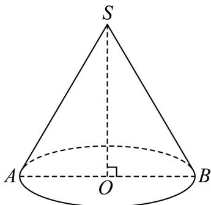

### 杨浦 · 原卷第6题

**考点说明：** 圆锥侧面积：由底面半径与高求母线长，再应用侧面积公式。

来源：2026届上海高三一模杨浦卷，第6题。

规范化源文件：`2026届杨浦一模数学试卷 逐题解析.md`。

已知圆锥底面半径为 1，高为 $\sqrt{3}$ ，则该圆锥的侧面积为 \_\_\_\_.

【答案】 $2\pi$

【解析】

【分析】由已知求得母线长，代入圆锥侧面积公式求解.

【详解】由已知可得 $r=1,\quad h=\sqrt{3}$ ，则圆锥的母线长 $1=\sqrt{1+3}=2$ ，

∴圆锥的侧面积 $S=\pi r1=2\pi$ .

故答案为 $2\pi$ ：

【点睛】本题考查圆锥侧面积的求法, 侧面积公式 S= $\pi rl$ .

### 虹口 · 原卷第7题

**考点说明：** 圆锥侧面积与体积：由底面半径和侧面积求母线，再由直角三角形求高。

来源：2026届上海高三一模虹口卷，第7题。

规范化源文件：`2026届虹口一模数学试卷 逐题解析.md`。

已知某圆锥的底面半径为 2, 侧面积为 $6 \pi$ , 则该圆锥的体积为 \_\_\_\_ (结果保留 $\pi$ )

【答案】 $\frac{4\sqrt{5}\pi}{3}$

【解析】

【分析】根据圆锥体积公式、侧面积公式，结合圆锥的性质进行求解即可.

【详解】设圆锥的母线为 $l$ ，因为圆锥侧面积为 $6\pi$ ，

所以 $\pi\cdot2\cdot l=6\pi\Rightarrow l=3$

所以该圆锥的高为 $\sqrt{3^2 - 2^2} = \sqrt{5}$ ，

因此该圆锥的体积为 $\frac{\pi}{3}\times2^{2}\times\sqrt{5}=\frac{4\sqrt{5}\pi}{3}$ ，

故答案为： $\frac{4\sqrt{5}\pi}{3}$

### 长宁 · 原卷第5题

**考点说明：** 圆锥侧面积：根据底面半径和母线长直接应用侧面积公式。

来源：2026届上海高三一模长宁卷，第5题。

规范化源文件：`2026届长宁一模数学试卷 逐题解析.md`。

如果圆锥的底面圆半径为 1，母线长为 2，则该圆锥的侧面积为 \_\_\_\_.

【答案】 $2\pi$

【解析】

【分析】由圆锥的侧面积公式即可求解.

【详解】由圆锥的侧面积公式 $S=\frac{1}{2}lR=\frac{1}{2}\times(2\pi r)\times R=\frac{1}{2}\times2\pi\times1\times2=2\pi.$

故答案为： $2\pi$

### 金山 · 原卷第14题

**考点说明：** 棱锥的体积：由体积和高求正方形底面积，再求边长。

来源：2026届上海高三一模金山卷，第14题。

规范化源文件：`2026届金山一模数学试卷 逐题解析.md`。

已知某正四棱锥的高为 2，体积为 24，则该正四棱锥的底面边长为（）

- A. 9
- B. 8
- C. 6
- D. $2\sqrt{3}$

【答案】C
【解析】
【分析】设底面边长为 $a$ ，代入体积公式，即可得答案.

【详解】设底面边长为 $a$ ，则正四棱锥的体积 $V = \frac{1}{3} \times a^2 \times 2 = 24$ ，解得 $a = 6$ . 故选：C

核对说明：规范稿混入第15题题面与解析，已在本题首处“故选：C”后截断。

### 浦东 · 原卷第8题

**考点说明：** 旋转体体积：将旋转所得几何体识别为两个同底圆锥，依据半径与高计算体积。

来源：2026届上海高三一模浦东卷，第8题。

规范化源文件：`2026届浦东一模数学试卷 逐题解析.md`。

如图, 等腰直角 $\triangle APB$ 的斜边 $AB$ 长为 $2R$ , 将 $\triangle APB$ 绕斜边 $AB$ 所在直线旋转一周形成的旋转体的体积为 \_\_\_\_.

【答案】 $\frac{2}{3}\pi R^3$

【解析】

【分析】旋转体为两个同底等高的圆锥的组合体，利用体积公式求解即可

【详解】由题意，将 $\triangle APB$ 绕斜边 $AB$ 所在直线旋转一周形成的旋转体是以 $R$ 为底面半径， $R$ 为高的两个共底面圆锥，

所以旋转体的体积为 $V = 2 \times \frac{1}{3} \pi R^2 \cdot R = \frac{2}{3} \pi R^3$ .

故答案为： $\frac{2}{3}\pi R^3$

### 青浦 · 原卷第9题

**考点说明：** 圆柱与圆锥：由侧面积相等建立母线与高的关系，再求圆锥体积。

来源：2026届上海高三一模青浦卷，第9题。

规范化源文件：`2026届青浦一模数学试卷 逐题解析.md`。

已知圆柱和圆锥的底面半径相同, 侧面积也相等, 且它们的高均为 $\sqrt{2}$ , 则圆锥的体积为 \_\_\_\_.

【答案】 $2\sqrt{2}\pi$

【解析】

【分析】设圆柱的底面半径为 $r$ ，根据圆锥和圆柱的侧面积相等可得半径 $r$ 的方程，求出解后可求圆锥的体积.

【详解】设圆柱的底面半径为 $r$ ，则圆锥的母线长为 $\sqrt{r^2 + 2}$

圆柱和圆锥的侧面积相等，所以 $2\pi \mathrm{r}\cdot \sqrt{2} = \frac{1}{2}\cdot 2\pi \mathrm{r}\cdot \sqrt{r^2 + 2}$ ，即 $2\sqrt{2} = \sqrt{r^2 + 2}$ ，故 $r = \sqrt{6}$

故圆锥的体积为 $\frac{1}{3}\pi r^2\cdot \sqrt{2} = \frac{1}{3}\pi \cdot 6\times \sqrt{2} = 2\sqrt{2}\pi .$

故答案为： $2\sqrt{2}\pi$

### 静安 · 原卷第7题

**考点说明：** 圆柱与球的表面积和体积：利用相同半径及表面积建立高与半径的关系，求体积比。

来源：2026届上海高三一模静安卷，第7题。

规范化源文件：`2026届静安一模数学试卷 逐题解析.md`。

已知圆柱的底面圆的半径与球的半径相等, 若圆柱的表面积与球的表面积也相等, 则圆柱的体积 $V_{1}$ 与球的体积 $V_{2}$ 之比 $V_{1}: V_{2} =$ \_\_\_\_.

【答案】 $\frac{3}{4}$ ##0.75

【解析】

【分析】根据圆柱的侧面积公式和球的表面积公式得出半径等于圆柱的高，再根据体积公式化简即可.

【详解】设圆柱的底面圆和球的半径为 r，圆柱的高为 h，

则由题意得， $2\pi r^{2} + 2\pi rh = 4\pi r^{2}$ ，则 $h = r$

则 $\frac{V_1}{V_2} = \frac{\pi r^2h}{\frac{4}{3}\pi r^3} = \frac{3}{4}$

故答案为: $\frac{3}{4}$

### 徐汇 · 原卷第8题

**考点说明：** 正四棱柱外接球：根据球心、底面中心及顶点组成的直角三角形，联系球半径、底面边长与棱柱高。

来源：2026届上海高三一模徐汇卷，第8题。

规范化源文件：`2026届徐汇一模数学试卷 逐题解析.md`。

一个底面积为1的正四棱柱的所有顶点都在同一球面上, 若该球的表面积为 $4 \pi$ , 则该正四棱柱的高为 \_\_\_\_.

【答案】 $\sqrt{2}$

【解析】

【分析】求出正四棱柱底边的边长以及外接球半径，分析可知该正四棱柱的外接球直径即为该正四棱柱的体对角线长，即可得解.

【详解】设该正四棱柱底边的边长为 $a$ ，高为 $h$ ，则 $a^2 = 1$ ，可得 $a = 1$

设该正四棱柱的外接球的半径为 R，则 $4\pi R^{2} = 4\pi$ ，解得 R = 1，

由题意可知，该正四棱柱的外接球直径即为该正四棱柱的体对角线长，

即 $2R=\sqrt{a^{2}+a^{2}+h^{2}}=\sqrt{2+h^{2}}=2$ ，解得 $h=\sqrt{2}$ ，

因此该正四棱柱的高为 $\sqrt{2}$

故答案为： $\sqrt{2}$

### 黄浦 · 原卷第7题

**考点说明：** 球的截面：用正三角形外接圆半径和球心到截面的距离求球半径，再求体积。

来源：2026届上海高三一模黄浦卷，第7题。

规范化源文件：`2026届黄浦一模数学试卷 逐题解析.md`。

已知边长为 3 的正三角形 $ABC$ 的三个顶点都在球 $O$ 的球面上, 球心 $O$ 到平面 $ABC$ 的距离为 1 , 则球 $O$ 的体积为 \_\_\_\_.

【答案】 $\frac{32\pi}{3}$

【解析】

【分析】由正弦定理求得正三角形 ABC 的外接圆半径，结合球心 O 到平面 ABC 的距离，根据勾股定理可求得球 O 的半径，从而求得球 O 的体积.

【详解】设正三角形 ABC 的外接圆半径为 r .

根据正弦定理可得， $2r = \frac{3}{\sin 60^{\circ}} = 2\sqrt{3}$ ，所以 $r = \sqrt{3}$

设球 O 的半径为 R，则 $R^{2}=r^{2}+1^{2}=4$ ，R=2。

所以球 O 的体积为 $\frac{4}{3}\pi R^{3}=\frac{32\pi}{3}$ .

故答案为： $\frac{32\pi}{3}$ .

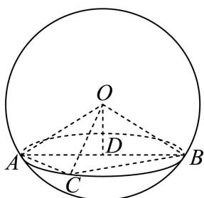

### 松江 · 原卷第12题

**考点说明：** 三棱锥体积：由侧棱长度及夹角建立几何或坐标关系，确定底面积与高后求体积。

来源：2026届上海高三一模松江卷，第12题。

规范化源文件：`2026届松江一模数学试卷 逐题解析.md`。

在三棱锥 P-ABC 中，PA=6，PB=8， $PC=BC=8\sqrt{2}$ ， $\angle APB=60^{\circ}$ ， $\angle APC=45^{\circ}$ ，则此三棱锥的体积为 \_\_\_\_。

【答案】 $32\sqrt{3}$

【解析】

【分析】过 $B$ 作 $BH \perp AP$ 于 $H$ ，连接 $HC$ ，利用余弦定理与勾股定理可证得 $CH \perp BH$ ，结合线面垂直判定定理得 $BH \perp$ 平面 $PAC$ ，则用等体积法即可得此三棱锥的体积.

【详解】如下图：过 B 作 $BH \perp AP$ 于 H，连接 HC，

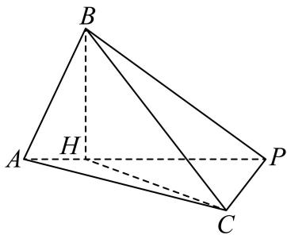

因为 $\angle APB = 60^{\circ}$ ，所以 $BH = BP\sin \angle APB = 8\times \frac{\sqrt{3}}{2} = 4\sqrt{3}$

$$
P H = B P \cos \angle A P B = 8 \times \frac {2}{2} = 4,
$$

在 $\triangle PCH$ 中，由余弦定理得：

$$
C H ^ {2} = P H ^ {2} + P C ^ {2} - 2 P H \cdot P C \cdot \cos \angle A P C = 1 6 + 1 2 8 - 2 \times 4 \times 8 \sqrt {2} \times \frac {\sqrt {2}}{2} = 8 0,
$$

则 $CH = \sqrt{80} = 4\sqrt{5}$ ，于是 $CH^2 + BH^2 = BC^2$ ，故 $CH \perp BH$ ，

又 $CH \cap PA = H, CH, PA \subset$ 平面 PAC，所以 $BH \perp$ 平面 PAC，

故此三棱锥的体积为

$$
V _ {P - A B C} = V _ {B - P A C} = \frac {1}{3} S _ {\triangle P A C} \cdot B H = \frac {1}{3} \times \frac {1}{2} \times 6 \times 8 \sqrt {2} \times \frac {\sqrt {2}}{2} \times 4 \sqrt {3} = 3 2 \sqrt {3}.
$$

故答案为： $32\sqrt{3}$

### 闵行 · 原卷第7题

**考点说明：** 圆锥侧面展开：由轴截面的形状求底面半径与母线之比，再由扇形弧长确定圆心角。

来源：2026届上海高三一模闵行卷，第7题。

若圆锥的轴截面为等腰直角三角形，则其侧面展开图扇形圆心角的弧度数为________。

【答案】$\sqrt2\pi$

【解析·参考原解整理】

设底面半径为 $r$，则母线长为 $\sqrt2r$。由侧面展开扇形弧长 $\sqrt2r\theta=2\pi r$，得 $\theta=\sqrt2\pi$。

回源核对说明：逐题对照该PDF题面页面视觉核对；答案转录自第7或12页，非独立数学复核。

## 2 空间线面位置关系与命题判断

### 奉贤 · 原卷第14题

**考点说明：** 空间线面位置关系：运用线面平行、垂直及面面关系的判定，并注意用反例排除错误命题。

来源：2026届上海高三一模奉贤卷，第14题。

规范化源文件：`2026届奉贤一模数学试卷 逐题解析.md`。

设 $\alpha$ ， $\beta$ ， $\gamma$ 是互不重合的平面，m，n 是互不重合的直线，给出四个命题：
①若 $m \parallel \alpha$ ， $m \parallel \beta$ ，则 $\alpha \parallel \beta$ ②若 $\alpha \perp \gamma$ ， $\beta \perp \gamma$ ，则 $\alpha \perp \beta$

③若 $m \perp \alpha, m \perp \beta$ ，则 $\alpha // \beta$ ④若 $m // \alpha, n \perp \alpha$ ，则 $m \perp n$ 其中正确命题的个数是（）

- A. 1
- B. 2
- C. 3
- D. 4

【答案】B

【解析】

【分析】根据线面位置关系的判定定理、性质定理，以及推论，逐项判定，即可求解.
【详解】由 $\alpha, \beta, \gamma$ 是互不重合的平面，m，n 是互不重合的直线，
对于①中，由 $m//\alpha, m//\beta$ ，则 $\alpha//\beta$ 或 $\alpha$ 与 $\beta$ 相交，所以不正确；
对于②中，由 $\alpha \perp \gamma, \beta \perp \gamma$ ，则 $\alpha \perp \beta$ 或 $\alpha // \beta$ 或 $\alpha$ 与 $\beta$ 相交，所以不正确；
对于③中，由 $m \perp \alpha, m \perp \beta$ ，根据垂直于同一直线的两平面平行，可得 $\alpha // \beta$ ，
所以正确的；
对于④中，由 $m//\alpha, n \perp \alpha$ ，可得 $m \perp n$ ，所以正确.

故选：B.

### 普陀 · 原卷第14题

**考点说明：** 空间线面位置关系：运用平面平行、线面垂直等性质，结合空间反例判断命题。

来源：2026届上海高三一模普陀卷，第14题。

规范化源文件：`2026届普陀一模数学试卷 逐题解析.md`。

已知直线 $m$ 、 $l$ 和平面 $\alpha$ 、 $\beta$ ，且 $l \subset \alpha$ ， $\alpha // \beta$ ，则下列命题中正确的是（）

- A. 若 $m // \beta$ ，则 $m // l$
- B. 若 $m // l$ ，则 $m // \alpha$
- C. 若 $m \perp \beta$ ，则 $m \perp l$
- D. 若 $m \perp l$ ，则 $m \perp \alpha$

【答案】C

【解析】

【分析】由空间线面、线线位置关系逐项判断即可.

【详解】由 $l\subset\alpha,\quad\alpha\parallel\beta$ ，可得 $l\parallel\beta$ ，

对于 A， $m // \beta$ ， $l \parallel \beta$ ，则直线 m、l 可能相交、平行或异面，故错误；

对于 B，若 $m \parallel l$ ，则 $m \parallel \alpha$ 或 $m \subset \alpha$ ，故错误；

对于 C，因为 $m \perp \beta$ ， $\alpha \parallel \beta$ ，所以 $m \perp \alpha$ ，又 $l \subset \alpha$ ，

所以 $m \perp l$ ，正确；

对于 D，要证明 $m \perp \alpha$ ，需 m 垂直平面 $\alpha$ 内两条相交直线，现在只有 $m \perp l$ ，条件不够，

故错误；

故选：C

### 杨浦 · 原卷第14题

**考点说明：** 空间线面位置关系：识别面面垂直的判定条件，并用平行、相交等情形排除错误命题。

来源：2026届上海高三一模杨浦卷，第14题。

规范化源文件：`2026届杨浦一模数学试卷 逐题解析.md`。

若 m, n 为两条不同直线， $\alpha, \beta$ 为两个不同平面，则下列结论中正确的是（）

- A. 若 $m // \alpha$ ， $n \subset \alpha$ ，则 $m // n$
- B. 若 $m // n$ ， $n \subset \alpha$ ，则 $m // \alpha$
- C. 若 $m \subset \alpha$ ， $m \perp \beta$ ，则 $\alpha \perp \beta$
- D. 若 $m \subset \alpha$ ， $\alpha \perp \beta$ ，则 $m \perp \beta$

【答案】C

【解析】

【分析】利用线面平行的判定定理和性质定理可判断 AB，利用面面垂直的判定定理和性质定理可判断 CD.

【详解】若 $m // \alpha$ ， $n \subset \alpha$ ，则 $m // n$ 或 m, n 为异面直线，故 A 错误；

若 $m / / n$ ， $n\subset \alpha$ ，则 $m / / \alpha$ 或 $m\subset \alpha$ ，故B错误；

若 $m \subset \alpha$ ， $m \perp \beta$ ，则 $\alpha \perp \beta$ ，满足面面垂直的判定定理，故C正确；
若 $m \subset \alpha$ ， $\alpha \perp \beta$ ，这缺少了2个条件，即 $\alpha \cap \beta = l, m \perp l$ ，才可以得到 $m \perp \beta$ ，故D错误；
故选：C.

### 松江 · 原卷第13题

**考点说明：** 空间线线关系与充分必要条件：结合直线互相垂直、平行及三线共面逐向判断，注意不同直线的空间位置。

来源：2026届上海高三一模松江卷，第13题。

规范化源文件：`2026届松江一模数学试卷 逐题解析.md`。

若空间中三条不同的直线 $a, b, c$ 满足 $a \perp c, b \perp c$ , 则 $a // b$ 是 $a, b, c$ 共面的 ( )

- A. 充分不必要条件
- B. 必要不充分条件
- C. 充要条件
- D. 既不充分也不必要条件

【答案】B

【解析】

【分析】通过特例说明 $a / / b$ 不能推出 $a, b, c$ 共面，即充分性不成立；再由平面几何知识得出同一平面内的直线不平行必相交，推出 $a / / b$ 一定成立，即必要条件成立，两者综合

即可得出结果.

【详解】

如图所示：满足 $a \perp c$ ， $b \perp c$ ，且 $a // b$ ，但是 $a \subset \alpha, b \subset \alpha, c \subset \beta$ ，

所以可知 a // b 是 a，b，c 共面的不充分条件；

当 $a, b, c$ 共面时，由平面几何知识可知同一平面内的直线不平行必相交，

又因为 $a \perp c$ ， $b \perp c$ ，所以必然有 $a // b$

即 $a / / b$ 是 $a, b, c$ 共面的必要条件，

综上可知 a // b 是 a, b, c 共面的必要不充分条件.

故选：B.

### 浦东 · 原卷第13题

**考点说明：** 空间位置与充分必要条件：分别分析线线相交与面面相交的推出关系；若允许两个平面重合，结论会改变，原题应明确约定。

来源：2026届上海高三一模浦东卷，第13题。

已知直线 $a,b$ 和平面 $\alpha,\beta$，且 $a\subseteq\alpha$、$b\subseteq\beta$，则“$a$ 与 $b$ 相交”是“$\alpha$ 与 $\beta$ 相交”的（ ）。

- A. 充分必要条件

- B. 既不充分又不必要条件

- C. 充分不必要条件

- D. 必要不充分条件

【答案】整理卷标答为C（按两个不同平面理解）；若允许两平面重合，则为B。

【解析·参考原解整理】

**以下保留源解析，前提是两个平面不同；原题未显式给出此前提。**

【分析】根据直线与平面的位置关系判断.

【详解】直线 a 、 b 和平面 $\alpha$ 、 $\beta$ ，且 $a \subseteq \alpha$ 、 $b \subseteq \beta$ ，

若 $a$ 与 $b$ 相交，记 $a \cap b = O$ ，由于 $a \subseteq \alpha$ 、 $b \subseteq \beta$

所以 $O \in \alpha$ 、 $O \in \beta$ ，则 $\alpha$ 与 $\beta$ 相交，

所以 “a 与 b 相交” 能得到 $\alpha$ 与 $\beta$ 相交，

但 “ $\alpha$ 与 $\beta$ 相交”，则 a 与 b 可能异面，如图，

平面 ABCD 为 $\alpha$ ，平面 ABEF 为 $\beta$ ， $\alpha \cap \beta = AB$ ，

$$
a \subseteq \alpha , b \subseteq \beta , a \cap A B = P, b \cap A B = Q,
$$

若 $P$ 与 $Q$ 不重合，则直线 $a$ 、 $b$ 为异面直线，所以 “a 与 b 相交” 是 “ $\alpha$ 与 $\beta$ 相交” 的充分不必要条件.
故选：C.

【约定边界】若允许两平面重合，取同一平面内两条相交直线，不能推出两平面相交，充分性失效；必要性也不成立，此时选B。

回源核对说明：这不是转录缺字。原文没有明确排除两平面重合；整理卷标答C依赖不同平面的约定，需在教师版说明，不能静默添加原题条件。

回源核对说明：已视觉核对原始扫描卷第2页，与署名整理卷第2页一致；原文未写两个不同平面或不重合。

### 长宁 · 原卷第13题

**考点说明：** 正方体中的异面直线：依据是否共面、相交或平行判断指定棱中点连线的位置关系。

来源：2026届上海高三一模长宁卷，第13题。

规范化源文件：`2026届长宁一模数学试卷 逐题解析.md`。

如图, 已知 $A 、 B 、 C 、 D 、 E 、 F 、 G$ 分别是正方体所在棱的中点, 则下列直线中与直线 $E F$ 异面的是 ( )

- A. 直线 $AB$
- B. 直线 $AC$
- C. 直线 $AD$
- D. 直线 $AG$

【答案】BD

【解析】

【分析】本题考查正方体的结构特征，利用异面直线的判断法若 $a \subset \alpha, AB \cap \alpha = B, A \notin \alpha, B \notin a$ 则直线 $AB$ 与 $a$ 互为异面直线依次分析选项即可

【详解】如图取中点 H, 和顶点 M, N, P, Q 连接 EF, AB, AC, AD, AG, BE, AF, GH, MN, PQ在正方体中有 $AF // PQ, PQ // BE$ ，所以 $AF // BE$ ，所以点 $A, B, E, F$ 四点共面，所以直线 $EF$ 与直线 $AB$ 共面，选项 A 不对；
直线 $GH \subset$ 平面 $BCG$ ，直线 $AC \cap$ 平面 $BCG = C, C \notin GH$ ，所以直线 $GH$ 与直线 $AC$ 是异面直线，又因为 $EF // GH$ ，所以直线 $EF$ 与直线 $AC$ 是异面直线，选项 B 正确；
在正方体中有 $EF // MN, MN // AD$ ，所以 $EF // AD$ ，选项 C 不对；
直线 $AG \subset$ 平面 $AFG$ ，直线 $EF \cap$ 平面 $AFG = F, F \notin AG$ ，所以直线 $AG$ 与直线 $EF$ 是异面直线，选项 D 正确；
故选：BD

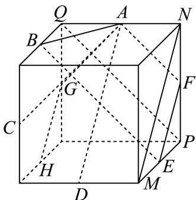

A. 充分不必要条件
B. 必要不充分条件
C. 充要条件
D. 既不充分也不必要条件

【解析】
【分析】由独立事件概率公式和充要条件的概念即可求解.
【详解】由甲、乙两人投篮的命中率分别为 0.7 和 0.6，

若“事件 $A, B$ 互相独立”，则 $P(AB) = P(A)P(B) = 0.42$ ，
若 $P(AB) = 0.42 = P(A)P(B)$ ，则事件 $A, B$ 互相独立，
即“甲、乙两人均投中的概率为0.42”是“事件 $A, B$ 互相独立”的充要条件，故选：C

### 青浦 · 原卷第13题

**考点说明：** 空间直线位置与充分必要条件：区分平行和异面直线，判断没有公共点的逆命题。

来源：2026届上海高三一模青浦卷，第13题。

规范化源文件：`2026届青浦一模数学试卷 逐题解析.md`。

在空间中，“两条直线平行”是“这两条直线没有公共点”的（）

- A. 充分非必要条件
- B. 必要非充分条件
- C. 充要条件
- D. 既非充分也非必要

【答案】A

【解析】

【分析】直接由平行直线及异面直线的定义判断充分性及必要性即可.

【详解】“两条直线平行”能推出“这两条直线没有公共点”，满足充分性；“两条直线没有公共点”不能推出“两条直线平行”，

两条直线可能异面，不满足必要性，故“两条直线平行”是“这两条直线没有公共点”的充分非必要条件.
故选：A.

### 静安 · 原卷第13题

**考点说明：** 空间线面关系：依据线面垂直及平行性质判断命题，注意空间情形与平面直觉的区别。

来源：2026届上海高三一模静安卷，第13题。

规范化源文件：`2026届静安一模数学试卷 逐题解析.md`。

在三维空间中，下列命题是真命题的一个是（ ）

- A. 垂直于同一条直线的两条直线平行
- B. 垂直于同一个平面的两个平面平行
- C. 若一条直线垂直于一个平面，另一条直线与这个平面平行，则这两条直线互相垂直
- D. 若两个平面分别平行于两条互相垂直的直线，则这两个平面互相垂直

【答案】C

【解析】

【分析】ABD 在正方体中找反例；C 利用线面线面平行的性质定理、线面垂直的性质定理

可判断.

【详解】如图为正方体，

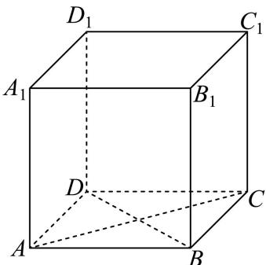

$AA_{1} \perp AD, AB \perp AD$ ，但 $AA_{1} \perp AB$ ，故 A 错误；
平面 $ADD_{1}A_{1} \perp$ 平面 ABCD，平面 $ABB_{1}A_{1} \perp$ 平面 ABCD，
但平面 $ADD_{1}A_{1} \perp$ 平面 $ABB_{1}A_{1}$ ，故 B 错误；
AC⊥BD，与平面ABCD平行的所有平面均与AC,BD平行，故D错误；
如图，

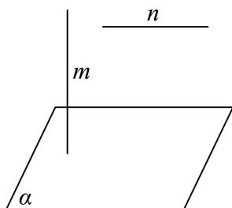

$m \perp \alpha, n // \alpha$ ，由线面平行的性质定理可知，平面 $\alpha$ 内一定存在直线 $l$ 与 $n$ 平行，由线面垂直的性质定理可知， $m \perp l$ ，则有 $m \perp n$ ，故 C 正确.
故选：C

### 黄浦 · 原卷第14题

**考点说明：** 空间线面关系：运用面面平行与线面垂直的性质，注意区分直线在平面内与平行于平面。

来源：2026届上海高三一模黄浦卷，第14题。

规范化源文件：`2026届黄浦一模数学试卷 逐题解析.md`。

设 $\alpha$ 、 $\beta$ 是两个不同的平面，$l$ 是一条直线，以下命题正确的是

- A. 若 $l \perp \alpha, \alpha \perp \beta$ ，则 $l \parallel \beta$
- B. 若 $l \parallel \alpha, \alpha \parallel \beta$ ，则 $l \parallel \beta$
- C. 若 $l \perp \alpha, \alpha \parallel \beta$ ，则 $l \perp \beta$
- D. 若 $l \parallel \alpha, \alpha \perp \beta$ ，则 $l \perp \beta$

【答案】C

【解析】

【分析】根据空间线面平行、线面垂直、面面平行和面面垂直的判定与性质，对四个选项逐个加以判断，可得正确答案.

【详解】若 $l \perp \alpha$ ， $\beta \perp \alpha$ ，则 $l \parallel \beta$ 或者 $l \subset \beta$ ，故 A 错误；

若 $l\|\alpha$ ， $\alpha\parallel\beta$ 时， $l\parallel\beta$ 或者 $l\subset\beta$ ，故B错误；

若 $\alpha//\beta$ ， $\alpha$ 内必有两条相交直线 m，n 与平面 $\beta$ 内的两条相交直线 $m'$ ， $n'$ 平行，又 $l \perp \alpha$ ，

则 $l \perp m$ ， $l \perp n$ ，即 $l \perp m'$ ， $l \perp n'$ ，故 $l \perp \beta$ ，因此C正确；

若 $l\| \alpha$ ， $\alpha \perp \beta$ ，则 $l$ 与 $\beta$ 相交或 $l / / \beta$ 或 $l\subset \beta$ ，故D错误，故选C.

【点睛】本题主要考查空间中点、线、面的位置关系，解决此类问题的关键是熟练掌握空间中直线与平面的位置关系（平行关系与垂直关系），属于基础题.

核对说明：黄浦同题解析版PDF第7—8页核对，直线符号应为字母l，已更正题面和选项中的数字1误识。

## 3 异面直线角、线面角与二面角

### 奉贤 · 原卷第7题

**考点说明：** 正四棱台与异面直线角：利用正四棱台的对称性和平移，将空间夹角转化为平面角。

来源：2026届上海高三一模奉贤卷，第7题。

规范化源文件：`2026届奉贤一模数学试卷 逐题解析.md`。

在正四棱台 $ABCD - A_{1}B_{1}C_{1}D_{1}$ 中，异面直线 $AA_{1}$ 与 $D_{1}B_{1}$ 所成角的大小为 \_\_\_\_.

【答案】 $\frac{\pi}{2}$ ##90°

【解析】

【分析】根据正四棱台特征得出 $OO_{1} \perp$ 平面 $A_{1}B_{1}C_{1}D_{1}$ ，再结合线面垂直判定定理得出 $B_{1}D_{1} \perp$ 平面 $A_{1}C_{1}CA$ ，进而得出异面直线所成的角.

【详解】

取 AC 中点 O，取 $A_{1}C_{1}$ 中点 $O_{1}$ ，连接 $OO_{1}, B_{1}D_{1}$ .

因为四棱台 $ABCD-A_{1}B_{1}C_{1}D_{1}$ 是正四棱台，

所以 $OO_{1}\perp$ 平面 $A_{1}B_{1}C_{1}D_{1}$ ， $B_{1}D_{1}\subset$ 平面 $A_{1}B_{1}C_{1}D_{1}$

所以 $OO_{1} \perp B_{1}D_{1}$ ,

又因为 $A_{1}B_{1}C_{1}D_{1}$ 是正方形，所以 $A_{1}C_{1} \perp B_{1}D_{1}$ ，

且 $A_{1}C_{1}\cap OO_{1} = O_{1},A_{1}C_{1},OO_{1}\subset$ 平面 $A_{1}C_{1}CA$ ，所以 $B_{1}D_{1}\bot$ 平面 $A_{1}C_{1}CA$

$AA_{1}\subset$ 平面 $A_{1}C_{1}CA$ ，所以 $AA_{1}\perp B_{1}D_{1}$

所以异面直线 $AA_{1}$ 与 $D_{1}B_{1}$ 所成角的大小为 $\frac{\pi}{2}$ .

故答案为： $\frac{\pi}{2}$ .

### 宝山 · 原卷第11题

**考点说明：** 异面直线所成的角：根据圆柱底面几何及线面角确定空间长度，平移或用向量求夹角。

来源：2026届上海高三一模宝山卷，第11题。

规范化源文件：`2026届宝山一模数学试卷 逐题解析.md`。

如图, 点 $P$ 在圆柱 $O_{1} O$ 的底面圆 $O$ 的圆周上, $A B$ 为圆 $O$ 的直径,

$\angle AOP = 120^{\circ}, OA = 3, A_{1}B$ 与底面圆 $O$ 所成的角为 $30^{\circ}$ , 则异面直线 $A_{1}B$ 与 $AP$ 所成角的余弦值为 ______.

【答案】 $\frac{3}{4}$ ##0.75

【解析】

【分析】根据异面直线所成角的定义，结合线面角的定义、圆的性质、余弦定理进行求解即可.

【详解】在圆O内，延长OP交圆O上一点Q，连接QB, $A_{1}Q$ ,AQ,

因为 AB, PQ 是圆 O 的直径,

所以 $QB // AP, QB = AP$ ，因此 $\angle A_{1}BQ$ 是异面直线 $A_{1}B$ 与 $AP$ 所成的角（或其补角），

在圆 O 中，因为 $\angle AOP = 120^{\circ}, OA = 3$ ，

所以 $QB = AP = \sqrt{3^2 + 3^2 - 2 \times 3 \times 3 \times \left(-\frac{1}{2}\right)} = 3\sqrt{3}$

由圆柱的性质可知： $AA_{1}$ ⊥ 底面圆 O， $A_{1}B$ 与底面圆 O 所成的角为 $30^{\circ}$ ，

所以 $\angle A_{1}BA = 30^{\circ}$ ，因为 OA = 3，所以 AB = 6，

因此有 $\cos\angle A_{1}BA=\cos30^{\circ}=\frac{AB}{A_{1}B}\Rightarrow A_{1}B=\frac{6}{\frac{\sqrt{3}}{2}}=4\sqrt{3}$

$\tan \angle A_{1}BA = \tan 30^{\circ} = \frac{AA_{1}}{AB}\Rightarrow A_{1}A = 6\times \frac{\sqrt{3}}{3} = 2\sqrt{3},$

因为 $\angle AOP = 120^{\circ}, OA = 3$

所以 $\angle AOQ = 180^{\circ} - 120^{\circ} = 60^{\circ}, OA = 3$ ,

所以 AQ = 3，

因为 $AA_{1} \perp$ 底面圆 O， $AQ \subset$ 底面圆 O，

所以 $AA_{1} \perp AQ$ ,

因此 $A_{1}Q = \sqrt{A_{1}A^{2} + AQ^{2}} = \sqrt{12 + 9} = \sqrt{21}$

在 $\triangle A_{1}QB$ 中，由余弦定理可知：

$$
\cos \angle A _ {1} B Q = \frac {B Q ^ {2} + A _ {1} B ^ {2} - A _ {1} Q ^ {2}}{2 B Q \cdot A _ {1} B} = \frac {2 7 + 4 8 - 2 1}{2 \times 3 \sqrt {3} \times 4 \sqrt {3}} = \frac {3}{4},
$$

故答案为： $\frac{3}{4}$

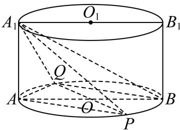

### 普陀 · 原卷第8题

**考点说明：** 折叠几何中的线面角：利用两平面垂直确定垂线及斜线的射影，结合三角关系求角。

来源：2026届上海高三一模普陀卷，第8题。

规范化源文件：`2026届普陀一模数学试卷 逐题解析.md`。

在 $\triangle ABC$ 中, $A = \frac{\pi}{3}$ , $AB = 2$ , $AC = 5$ , $D$ 为 $AC$ 边上的一点, 且 $AD = 2$ , 现将 $\triangle ABD$ 沿 $BD$ 边折起, 使得点 $A$ 至点 $P$ 的位置, 且满足平面 $PBD \perp$ 平面 $BDC$ , 如图所示, 则直线 $PC$ 与平面 $BDC$ 所成的角的正弦值为 \_\_\_\_.

【答案】 $\frac{\sqrt{3}}{4}$

【解析】

【分析】由 A、AB、AD 得到 $\triangle ABD$ 为等边三角形，取 AD 的中点 O，BD 的中点 H，得到 $AH \perp BD, BO \perp AD$ ，从而得到 $PH \perp BD$ ，由平面 $PBD \perp$ 平面 BDC 得到 $PH \perp$ 平面 BDC，过 O 作 PH 的平行线作为 z 轴，以 O 为原点，OB 为 x 轴，OD 为 y 轴，建系，写坐标，求出 $\overrightarrow{PC}$ 和平面 BDC 的法向量 $\vec{n}$ ，设直线 PC 与平面 BDC 所成的角为 $\alpha$ ，利用数量积求出 $\sin \alpha = \left| \cos \left\langle \overrightarrow{PC}, \vec{n} \right\rangle \right|$ 即可得解.

【详解】∵ $A=\frac{\pi}{3}$ ，AB=2，AD=2，∴△ABD为等边三角形，

取 AD 的中点 O，BD 的中点 H，连接 AH, BO，则 $AH \perp BD, BO \perp AD$ ，现将 $\triangle ABD$ 沿 $BD$ 边折起，使得点 $A$ 至点 $P$ 的位置，则 $PH \perp BD$ ， $\because$ 平面 $PBD \perp$ 平面 $BDC$ ，平面 $PBD \cap$ 平面 $BDC = BD$ ， $PH \perp BD$ ， $\therefore PH \perp$ 平面 $BDC$ ，

过 O 作 PH 的平行线作为 z 轴，以 O 为原点，OB 为 x 轴，OD 为 y 轴，建立空间直角坐标系，如图所示，

∵△ABD为等边三角形，AB=2，∴AH= $\sqrt{3}$ ,BO= $\sqrt{3}$ ,

$$
\because A C = 5, \therefore O D = 1, O C = 4
$$

$\therefore D(0,1,0), B(\sqrt{3},0,0), C(0,4,0), H(\frac{\sqrt{3}}{2}, \frac{1}{2}, 0), P(\frac{\sqrt{3}}{2}, \frac{1}{2}, \sqrt{3})$

$\therefore \overrightarrow{PC} = (-\frac{\sqrt{3}}{2}, \frac{7}{2}, -\sqrt{3}), \therefore |\overrightarrow{PC}| = 4$

∵平面 BDC 的法向量为 $\vec{n}=(0,0,1)$ ， $|\vec{n}|=1$ ，

设直线 $PC$ 与平面 $BDC$ 所成的角为 $\alpha$ ，

$$
\sin \alpha = \left| \cos \left\langle \overrightarrow {P C}, \vec {n} \right\rangle \right| = \frac {\left| \overrightarrow {P C} \cdot \vec {n} \right|}{\left| \overrightarrow {P C} \right| \cdot | \vec {n} |} = \frac {\sqrt {3}}{4}
$$

故直线 $PC$ 与平面 $BDC$ 所成的角的正弦值 $\frac{\sqrt{3}}{4}$ .

### 虹口 · 原卷第15题

**考点说明：** 球面与二面角：由球半径和垂直关系建立空间截面，结合二面角逐项判断角与面积。

来源：2026届上海高三一模虹口卷，第15题。

规范化源文件：`2026届虹口一模数学试卷 逐题解析.md`。

如图，已知点 $A, B, C, D$ 在表面积为 $12\pi$ 的球 $O$ 的球面上，且 $O \in BD$ ， $OA \perp$ 平面 $BCD$ ，点 $E$ 为 $BC$ 中点，当二面角 $A - BC - D$ 的大小为 $\frac{\pi}{3}$ 时，则有（）

- A. 异面直线 $AE$ 和 $CD$ 所成角的大小为 $\frac{\pi}{6}$
- B. 直线 $EA$ 与平面 $ABD$ 所成角的大小为 $\frac{\pi}{6}$
- C. $\sin (2\angle ABE) = \frac{\sqrt{2}}{3}$
- D. $\triangle BED$ 的面积为 $\sqrt{2}$

【答案】D

【解析】

【分析】设球 O 的半径为 r，求得 $r = \sqrt{3}$ ，证得 $BC \perp$ 平面 AOE，得到 $BC \perp AE$ ，得到 $\angle AEO = \frac{\pi}{3}$ ，进而得到 AE = 2, OE = 1，把异面直线 AE 和 CD 所成角转化为直线 AE 和 OE 所成角，可判定 A 不正确；作 $EF \perp BD$ ，证得 $EF \perp$ 平面 ABD，得到 $\angle EAF$ 即为直线 EA 与平面 ABD 所成角，可判定 B 不正确；在直角 $\triangle ABE$ 中，求得 $\sin \angle ABE \frac{2}{\sqrt{6}}$ ，

结合二倍角公式，可得判定 C 不正确；结合面积公式，可判定 D 正确.

【详解】设球 O 的半径为 r，因为球的表面积为 $12\pi$ ，可得 $4\pi r^{2} = 12\pi$ ，可得 $r = \sqrt{3}$ ，

因为O和E分别为BD,BC的中点，所以OE//CD，所以OE⊥BC，

又因为 $OA \perp$ 平面 BCD， $BC \subset$ 平面 BCD，所以 $BC \perp OA$ ，

因为 $OA \cap OE = O$ ，且 $OA, OE \subset$ 平面 AOE，所以 $BC \perp$ 平面 AOE，

又因为 $AE \subset$ 平面 AOE，所以 $BC \perp AE$ ，

所以 $\angle AEO$ 为二面角 A-BC-D 的平面角，所以 $\angle AEO = \frac{\pi}{3}$ ,

在直角 $\triangle AOE$ 中，可得 $AE = \frac{AO}{\sin\angle AEO} = 2, OE = \frac{AO}{\tan\angle AEO} = 1$

对于 A，由 OE // CD，可得异面直线 AE 和 CD 所成角，即为直线 AE 和 OE 所成角，

因为 $\angle AEO = \frac{\pi}{3}$ ，所以异面直线 $AE$ 和 $CD$ 所成角的大小为 $\frac{\pi}{3}$ ，所以A不正确；

对于 B，过点 E 作 $EF \perp BD$ ，垂足为 F，

因为 $OA \perp$ 平面 $BCD$ ， $EF \subset$ 平面 $BCD$ ，所以 $EF \perp OA$ ，

又因为 $OA \cap BD = O$ ，且 $OA, BD \subset$ 平面 ABD，所以 $EF \perp$ 平面 ABD，

所以 $\angle EAF$ 即为直线 $EA$ 与平面 $ABD$ 所成角，

在直角 $\triangle BOE$ 中， $OB = \sqrt{3},OE = 1$ ，可得 $BE = \sqrt{2}$ ，则 $EF = \frac{OE\cdot BE}{OB} = \frac{\sqrt{2}}{\sqrt{3}}$

所以 $\sin\angle EAF=\frac{EF}{AE}=\frac{\sqrt{6}}{6}$ ，所以 B 不正确；

对于 C，在直角 $\triangle ABE$ 中， $AE = 2, BE = \sqrt{2}$ ，可得 $AE = \sqrt{AE^{2} + BE^{2}} = \sqrt{6}$ ，

所以 $\sin \angle ABE = \frac{AE}{AB} = \frac{2}{\sqrt{6}}$ ，则 $\cos \angle ABE = \sqrt{1 - \sin^2 \angle ABE} = \frac{\sqrt{2}}{\sqrt{6}}$

所以 $\sin (2\angle ABE) = 2\sin \angle ABE\cos \angle ABE = 2\times \frac{2}{\sqrt{6}}\times \frac{\sqrt{2}}{\sqrt{6}} = \frac{2\sqrt{2}}{3}$ ，所以C不正确；

对于D，由 $\triangle BED$ 的面积为 $S = \frac{1}{2} BD\cdot EF = \frac{1}{2}\times 2\sqrt{3}\times \frac{\sqrt{2}}{\sqrt{3}} = \sqrt{2}$ ，所以D正确.故选：D.

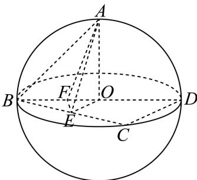

### 金山 · 原卷第18题

**考点说明：** 第（1）问：平面垂直的判定：结合圆锥轴线垂直底面与底面半径垂直关系。 第（2）问：二面角：构造平面角，或建立空间坐标利用相关向量求角。

来源：2026届上海高三一模金山卷，第18题。

规范化源文件：`2026届金山一模数学试卷 逐题解析.md`。

如图，已知圆锥 $A - O$ ，点 $B$ 、 $C$ 在底面圆周上， $OA = OB = 4$ ，且 $\angle BOC = 90^{\circ}$ ，动点 $P$ 落在劣弧 $BC$ 上.

（1）求证：平面 $AOB \perp$ 平面 AOC；

(2) 若点 $P$ 平分劣弧 $BC$ , 过点 $P$ 分别作 $PD \perp OC$ 、 $PE \perp OB$ , 垂足分别为 $D$ 、 $E$ 两点,

求二面角 $D - AP - E$ 的大小.

【答案】（1）证明见解析.

(2) $\arccos \frac{1}{3}$ .

【解析】

【分析】（1）先证明线面垂直，然后得出面面垂直；

(2) 先建立空间直角坐标系, 通过求平面的法向量解决二面角问题.

【小问 1 详解】

证明：在圆锥 A-O 中， $AO \perp$ 平面 BOC， $\therefore AO \perp OC$

$$
\because \angle B O C = 9 0 ^ {\circ}, \therefore B O \perp O C
$$

∵ $AO \cap BO = O$ , $AO, BO \subset$ 平面 AOC, ∴ OC ⊥ 平面 AOB,

$\because OC \subset$ 平面 AOC

∴平面 $AOB \perp$ 平面 AOC

【小问 2 详解】

以 O 为原点，OC 为 x 轴，OB 为 y 轴，OA 为 z 轴，如图建立空间直角坐标系

由题意， $D(2\sqrt{2},0,0)$ ， $A(0,0,4)$ ， $P(2\sqrt{2},2\sqrt{2},0)$ ， $E(0,2\sqrt{2},0)$

则 $\overrightarrow{DA} = (-2\sqrt{2},0,4)$ ， $\overrightarrow{DP} = (0,2\sqrt{2},0)$ ， $\overrightarrow{EP} = (2\sqrt{2},0,0)$ ， $\overrightarrow{EA} = (0, - 2\sqrt{2},4)$

设 $\overrightarrow{n_1} = (x_1, y_1, z_1)$ 是平面 $DAP$ 的一个法向量，

则 $\left\{ \begin{array}{l} \overrightarrow{DA} \cdot \overrightarrow{n_1} = -2\sqrt{2} x_1 + 4z_1 = 0 \\ \overrightarrow{DP} \cdot \overrightarrow{n_1} = 2\sqrt{2} y_1 = 0 \end{array} \right.$ ，取 $x_1 = \sqrt{2}$ ，则 $\overrightarrow{n_1} = (\sqrt{2}, 0, 1)$ ，

设 $\overrightarrow{n_2} = (x_2, y_2, z_2)$ 是平面 $APE$ 的一个法向量，

则 $\left\{ \begin{array}{l} \overrightarrow{EP} \cdot \overrightarrow{n_2} = 2\sqrt{2} x_2 = 0 \\ \overrightarrow{EA} \cdot \overrightarrow{n_2} = -2\sqrt{2} y_2 + 4z_2 = 0 \end{array} \right.$ ，取 $y_2 = \sqrt{2}$ ，则 $\overrightarrow{n_2} = (0, \sqrt{2}, 1)$ ，

设平面 DAP 与平面 APE 夹角为 $\theta$ ，

则 $\cos \theta = |\cos < \overrightarrow{n_1},\overrightarrow{n_2} >| = \frac{|\vec{n}_1\cdot\vec{n}_2|}{|\vec{n}_1||\vec{n}_2|} = \frac{1}{\sqrt{3}\cdot\sqrt{3}} = \frac{1}{3},$

∴平面 DAP 与平面 APE 夹角的余弦值为 $\frac{1}{3}$ .

则根据法向量朝向可知二面角 D - AP - E 的大小为 $\arccos\frac{1}{3}$ .

### 闵行 · 原卷第17题

**考点说明：** 第（1）问：等腰直角三角形的中线与空间垂直：利用公共斜边中点构造两条垂线，推出线面垂直后得到线线垂直。 第（2）问：二面角的平面角或空间向量计算：利用补充垂直条件确定三棱锥的空间结构，再求两侧面的夹角。

来源：2026届上海高三一模闵行卷，第17题。

如图，三棱锥 $P-ABC$ 中，侧面 $PAC$ 与底面 $ABC$ 都是以 $AC$ 为斜边的等腰直角三角形，$O$ 为 $AC$ 中点。

（1）求证：$AC\perp PB$；

（2）若 $PO\perp OB$，求二面角 $P-AB-C$ 的大小。

【答案】（1）证明见解析；（2）$\arctan\sqrt2$。

【解析·参考原解整理】

（1）由等腰直角三角形及 $O$ 为 $AC$ 中点，得 $PO\perp AC$，$BO\perp AC$。两线在平面 $PBO$ 内相交，故 $AC\perp$ 平面 $PBO$，从而 $AC\perp PB$。

（2）由 $PO\perp AC$，$PO\perp OB$，得 $PO\perp$ 平面 $ABC$。过 $O$ 作 $OH\perp AB$ 于 $H$，连结 $PH$，则 $PH\perp AB$，故 $\angle PHO$ 是二面角的平面角。设 $PO=AO=OB=2a$，由等腰直角三角形得 $OH=\sqrt2a$，于是 $\tan\angle PHO=\frac{PO}{OH}=\sqrt2$。所求为 $\arctan\sqrt2$。

回源核对说明：对照题面与标答PDF；解析参考原标答重新整理，非逐字转录，待独立复核。

## 4 平行、垂直的证明与空间角

### 嘉定 · 原卷第18题

**考点说明：** 第（1）问：线面角：由垂足构造射影，利用直角三角形的边角关系求角。 第（2）问：平面垂直判定：利用等腰三角形中线与底边垂直，结合线面垂直构造证明。

来源：2026届上海高三一模嘉定卷，第18题。

规范化源文件：`2026届嘉定一模数学试卷 逐题解析.md`。

如图，在四面体 $V - ABC$ 中， $AC = BC$ ，从顶点 $V$ 作平面 $ABC$ 的垂线，垂足 $O$ 恰好落在 $\triangle ABC$ 的中线 $CD$ 上.

（1）如果 $DV = DA = 2$ ，直线 $VD$ 与平面 $ABC$ 所成的角为 $\frac{\pi}{4}$ ，求直线 $VA$ 与平面 $ABC$ 所成角的大小；

(2) 证明: 平面 $VCD \perp$ 平面 $VAB$ .

【答案】(1) $\frac{\pi}{6}$

(2) 证明详见解析

【解析】

【分析】利用几何法找到线面成角，利用线面垂直证明面面垂直.

【小问 1 详解】

连接 AO，如图.

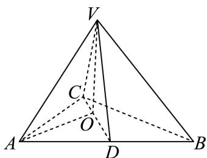

由题可知， $VO \perp$ 平面 ABC， $AB \subset$ 平面 ABC，则 $VO \perp AB$ ，

且 $\angle VDO$ 即为直线 $VD$ 与平面 $ABC$ 所成角，

即 $\angle VDO = \frac{\pi}{4}$ . 由 $AC = BC$ ， $CD$ 为 $AB$ 边的中线，

可得 $AB \perp CD$ . 而 DV = DA = 2，可得 $OV = OD = \sqrt{2}$ ， $AO = \sqrt{AD^{2} + OD^{2}} = \sqrt{6}$ .

而 $\angle VAO$ 即为直线 $VA$ 与平面 $ABC$ 所成角，且 $\angle VAO \in \left[0, \frac{\pi}{2}\right]$ ，

则 $\tan \angle VAO = \frac{\sqrt{2}}{\sqrt{6}} = \frac{\sqrt{3}}{3}$ ，可得直线 $VA$ 与平面 $ABC$ 所成角为 $\frac{\pi}{6}$ .

【小问 2 详解】

由 $VO \perp AB$ ， $AB \perp CD$ ， $CD \cap VO = O$ ， $CD, VO \subset$ 平面VCD，故 $AB \perp$ 平面VCD，
而 $AB \subset$ 平面 VAB，则平面 $VCD \perp$ 平面 VAB.

### 奉贤 · 原卷第19题

**考点说明：** 第（1）问：圆锥侧面积与体积：由底面半径和侧面积求母线，利用轴截面的直角关系求高后计算体积。 第（2）问：异面直线的判定：用共面假设或线面位置关系，排除两条直线相交及平行的可能。 第（3）问：二面角与线面角：将绕轴二面角转为底面圆心角，构造垂足或建立空间坐标求线面角。

来源：2026届上海高三一模奉贤卷，第19题。

规范化源文件：`2026届奉贤一模数学试卷 逐题解析.md`。

如图, 将直角三角形 $SOA$ 绕直角边 $SO$ 所在直线旋转一周形成圆锥 $S-O$ . 已知圆锥 $S-O$ 的底面半径为 $3 \mathrm{~cm}$ , 圆锥的侧面积 $15 \pi \mathrm{~cm}^{2}$ . 设 $A 、 B$ 是底面圆周上的两点, 线段 $AB$ 不经过点 $O$ .

（1）求圆锥 S-O 的体积；

（2）求证：直线 SA 与直线 OB 是异面直线；

（3）二面角 $A - SO - B$ 的大小为 $\frac{2\pi}{3}$ ，求直线 $SA$ 与平面 $SOB$ 所成角的大小.

【答案】(1) $12 \pi \mathrm{cm}^{3}$

（2）证明见解析 （3） $\arcsin \frac{3\sqrt{3}}{10}$

【解析】

【分析】（1）由侧面积公式求得母线长，进而得到圆锥高，结合体积公式即可求解；

(2) 由异面直线判定定理即可求解;

（3）过点 $A$ 作 $AH \perp OB$ 于 $H$ ，连接 $SH$ ，确定 $\angle ASH$ 为直线 $SA$ 与平面 $SOB$ 所成角，进而可求解.

【小问 1 详解】

设圆锥的母线长为 $l$ ，底面半径为 $r$ ，

由题意可得： $\pi rl = 15\pi \Rightarrow 3\pi l = 15\pi \Rightarrow l = 5$

所以 $SO = \sqrt{5^2 - 3^2} = 4$

所以圆锥 $S - O$ 的体积 $V = \frac{1}{3}\pi r^2\times SO = 12\pi \mathrm{cm}^3$

【小问 2 详解】

因为 $SA \cap$ 平面 SOB = S，OB ⊂ 平面 SOB, $S \notin OB$ ，

所以直线 SA 与直线 OB 是异面直线;

【小问 3 详解】

因为二面角 A-SO-B 的大小为 $\frac{2\pi}{3}$ ,

由圆锥的结构可知： $SO \perp OA, SO \perp OB$ ，

所以 $\angle AOB$ 即为二面角 $A - SO - B$ 的平面角，

所以 $\angle AOB = \frac{2\pi}{3}$ ，又 $OA = OB = 3$

所以 $AB = \sqrt{OA^2 + OB^2 - 2OA \cdot OB \cos \frac{2\pi}{3}} = 3\sqrt{3}$

过点 A 作 $AH \perp OB$ 于 H，连接 SH，

因为 $AH \perp OB, AH \perp SO, OB, SO$ 为平面 SOB 两条相交直线，

所以 $AH \perp$ 平面 $SOB$

所以 $\angle ASH$ 即为直线 $SA$ 与平面 $SOB$ 所成角，

又 $AH = AB \times \sin 30^{\circ} = \frac{3\sqrt{3}}{2}$ ,

又 $AH \perp$ 平面 $SOB$ ， $SH$ 在平面 $SOB$ 内，

所以 $AH \perp SH$ ，

所以 $\sin \angle ASH = \frac{AH}{SA} = \frac{3\sqrt{3}}{5} = \frac{3\sqrt{3}}{10}$

所以 $\angle ASH = \arcsin \frac{3\sqrt{3}}{10}$ ,

即直线 $SA$ 与平面 $SOB$ 所成角大小为 $\arcsin \frac{3\sqrt{3}}{10}$ .

### 浦东 · 原卷第18题

**考点说明：** 第（1）问：组合几何体中的线面角：由半圆弧中点确定空间位置，用正射影或法向量计算直线与对角截面所成角。 第（2）问：弧长定位与面面平行证明：由半径和弧长确定动点位置，再寻找两个平面内相应平行或同向的独立方向。

来源：2026届上海高三一模浦东卷，第18题。

规范化源文件：`2026届浦东一模数学试卷 逐题解析.md`。

如图, 该几何体由一个棱长为 4 的正方体 $ABCD - A_{1}B_{1}C_{1}D_{1}$ 与一个半圆柱拼接而成, 圆心 $O$ 、 $O_{1}$ 分别为线段 $AB$ 、 $A_{1}B_{1}$ 的中点, 动点 $M$ 在弧 $\widehat{A_{1}B_{1}}$ 上滑动.

（1）若点 M 为弧 $\widehat{A_{1}B_{1}}$ 的中点，求直线 MD 与平面 $BDD_{1}B_{1}$ 所成角的大小；

（2）若弧 $\widehat{A_1M}$ 的长度为 $\frac{\pi}{2}$ ，求证：平面 $OO_{1}M //$ 平面 $ACC_{1}A_{1}$ .

【答案】(1) $\arcsin \frac{\sqrt{7}}{7}$

(2) 证明见解析

【解析】

【分析】（1）建立空间直角坐标系，求得 $\overrightarrow{MD}$ 与平面 $BDD_{1}B_{1}$ 的法向量，通过向量夹角公式求线面角；

（2）由弧长可求得 M 点坐标，进而求得平面 $OO_{1}M$ 和平面 $ACC_{1}A_{1}$ 的法向量，计算即可得到结果.

【小问 1 详解】

建立如图所示空间直角坐标系:

则： $A(0,0,0)$ ， $B(4,0,0)$ ， $D(0,4,0)$ ， $C(4,4,0)$ ， $O(2,0,0)$ ， $O_{1}(2,0,4)$

若点 M 为弧 $\widehat{A_{1}B_{1}}$ 的中点，则 $M(2,-2,4)$

所以 $\overrightarrow{MD} = (-2,6, - 4)$

平面 $BDD_{1}B_{1}$ 的一个法向量为 $\vec{m} = \overrightarrow{AC} = (4,4,0)$

所以 $\sin \theta = \cos \vec{m},\overrightarrow{MD} = \left|\frac{\vec{m}\cdot\overrightarrow{MD}}{|\vec{m}|\cdot|\overrightarrow{MD}|}\right| = \left|\frac{16}{4\sqrt{2}\times 2\sqrt{14}}\right| = \frac{\sqrt{7}}{7}$

所以直线 MD 与平面 $BDD_{1}B_{1}$ 所成角的大小 $\arcsin\frac{\sqrt{7}}{7}$

【小问 2 详解】

若弧 $\widehat{A_1M}$ 的长度为 $\frac{\pi}{2}$ ，由弧长得 $\angle MO_{1}A_{1} = \frac{\frac{\pi}{2}}{2} = \frac{\pi}{4}$ ，则 $M(2 - \sqrt{2}, -\sqrt{2}, 4)$

$\overrightarrow{OO_1} = (0,0,4)$ , $\overrightarrow{OM} = (-\sqrt{2}, -\sqrt{2}, 4)$

设平面 $OO_{1}M$ 的一个法向量为 $\vec{n}_{1} = (x,y,z)$ ，平面 $ACC_{1}A_{1}$ 的一个法向量为 $\vec{n}_{2} = \overrightarrow{BD} = (-4,4,0)$

$$
\left\{ \begin{array}{l} \vec {n} _ {1} \cdot \overrightarrow {O O _ {1}} = 0 \\ \vec {n} _ {1} \cdot \overrightarrow {O M} = 0 \end{array} \Rightarrow \left\{ \begin{array}{c} z = 0 \\ x + y = 0 \end{array} \text {令} x = - 1 \right. \right.
$$

$$
\vec {n} _ {1} = (- 1, 1, 0)
$$

所以 $\vec{n}_1 / / \vec{n}_2$

所以平面 $OO_{1}M \parallel$ 平面 $ACC_{1}A_{1}$

### 青浦 · 原卷第18题

**考点说明：** 第（1）问：线面平行：借助正方形中心和中点构造平面内平行线。 第（2）问：平面垂直：利用侧棱垂直底面及正方形边垂直关系，构造垂直于平面的直线。

来源：2026届上海高三一模青浦卷，第18题。

规范化源文件：`2026届青浦一模数学试卷 逐题解析.md`。

如图，四棱锥 $P - ABCD$ 的底面是边长为 1 的正方形，侧棱 $PA \perp$ 底面 $ABCD$ ，且 $PA = 2$ ， $E$ 是侧棱 $PA$ 的中点.

（1）求证： $PC / /$ 平面BDE；

(2) 求证: 平面 $PCD \perp$ 平面 $PAD$ .

【答案】（1）证明见解析 （2）证明见解析

【解析】

【分析】（1）连接 AC 交 BD 于 O，连接 OE，利用中位线定理可得 PC // OE，进而可证结论；

（2）由面面垂直的判定定理可得平面 $PAD \perp$ 底面ABCD，进而利用面面垂直的性质可得 $CD \perp$ 平面PAD，进而可证结论.

【小问 1 详解】

连接 AC 交 BD 于 O，连接 OE，

因为四边形 ABCD 是正方形，所以 O 是 AC 的中点，

又 E 是侧棱 PA 的中点，所以 PC // OE，

又因为 $OE \subset$ 平面 $BDE$ ， $PC \not\subset$ 平面 $BDE$ ，

所以 $PC / /$ 平面BDE；

【小问 2 详解】

因为侧棱 $PA \perp$ 底面 ABCD， $PA \subset$ 平面 PAD，所以平面 $PAD \perp$ 底面 ABCD，

又因为 $CD \subset$ 底面 ABCD， $CD \perp AD$ ，平面 $PAD \cap$ 底面 ABCD = AD，

所以 $CD \perp$ 平面 PAD，又 $CD \subset$ 平面 PCD，所以平面 $PCD \perp$ 平面 PAD.

### 静安 · 原卷第19题

**考点说明：** 第（1）问：在底面内寻找与目标直线平行且属于目标平面的直线，证明线面平行。 第（2）问：利用线面角定义构造射影或建立空间坐标，通过法向量求正弦值。

来源：2026届上海高三一模静安卷，第19题。

规范化源文件：`2026届静安一模数学试卷 逐题解析.md`。

已知正四棱柱 $ABCD - A_{1}B_{1}C_{1}D_{1}$ 的底面边长为 1，点 $E$ 、 $F$ 分别在边 $AD$ 、 $CD$ 上，且 $AE = \frac{2}{3}$ ， $CF = \frac{2}{3}$ .

（1）证明： $AC / /$ 平面 $B_{1}EF$

(2) 若 $AA_{1} = 2$ ，求直线 $BB_{1}$ 与平面 $B_{1}EF$ 所成角的正弦值.

【答案】（1）证明见解析

(2) $\frac{5\sqrt{97}}{97}$

【解析】

【分析】（1）根据平行线的性质可得 AC // EF，进而可证线面平行；

（2）方法一：建系标点，求平面 $B_{1}EF$ 的法向量，利用空间向量求线面夹角；方法二：利用等体积法求点 $B$ 到平面 $B_{1}EF$ 的距离，进而求线面夹角.

【小问 1 详解】

因为 $AE=\frac{2}{3}$ ，CF= $\frac{2}{3}$ ，则 $\frac{ED}{AE}=\frac{DF}{FC}=\frac{1}{2}$ ，可得 AC // EF，

且 $AC \not\subset$ 平面 $B_{1}EF$ ， $EF \subset$ 平面 $B_{1}EF$ ，所以 $AC //$ 平面 $B_{1}EF$

【小问 2 详解】

方法一：以 D 为坐标原点，以 DA，DC， $DD_{1}$ 所在直线分别为 x 轴，y 轴，z 轴建立空间直角坐标系，如图所示：

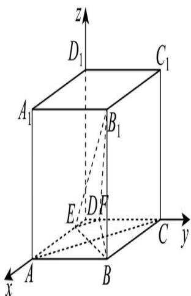

则 $B(1,1,0), B_1(1,1,2), E\left(\frac{1}{3}, 0, 0\right), F\left(0, \frac{1}{3}, 0\right)$ ,

可得 $\overrightarrow{BB_1} = (0,0,2),\overrightarrow{EB_1} = \left(\frac{2}{3},1,2\right),\overrightarrow{EF} = \left(-\frac{1}{3},\frac{1}{3},0\right),$

设平面 $B_{1}EF$ 的法向量为 $\vec{n} = (x,y,z)$ ，则 $\left\{ \begin{array}{l} \vec{n}\cdot \overrightarrow{EB_1} = \frac{2}{3} x + y + 2z = 0\\ \vec{n}\cdot \overrightarrow{EF} = -\frac{1}{3} x + \frac{1}{3} y = 0 \end{array} \right.$

令 $x = 3$ ，则 $y = 3$ ， $z = -\frac{5}{2}$ ，可得 $\vec{n} = \left(3,3, - \frac{5}{2}\right)$

$$
\cos \vec {n}, \overrightarrow {B B _ {1}} = \frac {\vec {n} \cdot \overrightarrow {B B _ {1}}}{| \vec {n} | \cdot | \overrightarrow {B B _ {1}} |} = \frac {- 5}{2 \times \frac {\sqrt {9 7}}{2}} = - \frac {5 \sqrt {9 7}}{9 7}
$$

所以直线 $BB_{1}$ 与平面 $B_{1}EF$ 所成角的正弦值是 $\frac{5\sqrt{97}}{97}$ .

方法二：由题意可知： $BE = BF = \frac{\sqrt{13}}{3}$ ， $EF = \frac{\sqrt{2}}{3}$ ， $B_{1}E = B_{1}F = \frac{7}{3}$

则 $S_{\triangle BEF} = \frac{1}{2}\times \frac{\sqrt{2}}{3}\times \sqrt{\left(\frac{\sqrt{13}}{3}\right)^2 - \left(\frac{\sqrt{2}}{6}\right)^2} = \frac{5}{18},$

$$
S _ {\triangle B _ {1} E F} = \frac {1}{2} \times \frac {\sqrt {2}}{3} \times \sqrt {\left(\frac {7}{3}\right) ^ {2} - \left(\frac {\sqrt {2}}{6}\right) ^ {2}} = \frac {\sqrt {9 7}}{1 8},
$$

设点 B 到平面 $B_{1}EF$ 的距离为 d，

因为三棱锥 $B_{1} - BEF$ 的体积即为三棱锥 $B - B_{1}EF$ 的体积，

则 $\frac{1}{3} \times 2 \times \frac{5}{18} = \frac{1}{3} d \times \frac{\sqrt{97}}{18}$ ，解得 $d = \frac{10\sqrt{97}}{97}$ ，

设直线 $BB_{1}$ 与平面 $B_{1}EF$ 所成角为 $\theta$ ，则 $\sin \theta = \frac{d}{BB_1} = \frac{\frac{10\sqrt{97}}{97}}{2} = \frac{5\sqrt{97}}{97}$

所以直线 $BB_{1}$ 与平面 $B_{1}EF$ 所成角的正弦值 $\frac{5\sqrt{97}}{97}$ .

### 黄浦 · 原卷第18题

**考点说明：** 第（1）问：利用中点与平行线构造平面内平行线，再判定线面平行。 第（2）问：确定两平面交线并构造二面角的平面角，或利用空间向量计算余弦。

来源：2026届上海高三一模黄浦卷，第18题。

规范化源文件：`2026届黄浦一模数学试卷 逐题解析.md`。

如图，在几何体 ABCDE 中，四边形 ABCD 是矩形， $AB \perp$ 平面 BEC， $BE \perp EC$ ， $AB = BE = EC = 2$ ，G，F 分别是线段 BE，DC 的中点.

（1）求证：GF // 平面 ADE;

（2）设平面 AEF 与平面 BEC 的交线为 l，求二面角 A-l-B 的余弦值.

【答案】（1）证明见解析；

(2) $\frac{2}{3}.$

【解析】

【分析】（1）取 AE 的中点 H，通过平行的传递性得到 HG // FD，由题中条件得到四边形 HGFD 为平行四边形，得到 GF // DH，利用线面平行的判定定理得到 GF // 平面 ADE；（2）设平面 AEF 与平面 BEC 所成的锐二面角的大小为 $\theta$ ，由 AB ⊥ 平面 BEC 和 FC ⊥ 平面 BEC，得到 $\triangle AEF$ 在平面 BEC 上的射影为 $\triangle BEC$ ，利用余弦定理求出 $\cos \angle AEF$ ，利用同角关系式求 $\sin \angle AEF$ ，从而得到 $S_{\triangle AEF}$ 和 $S_{\triangle BEC}$ ，则 $\cos \theta = \frac{S_{\triangle BEC}}{S_{\triangle AEF}}$ ，代入数值求解，从而得到二面角 A - l - B 的余弦值.

【小问 1 详解】

取 AE 的中点 H，连接 HG, FG, HD，∵ HG // AB // CD，即 HG // FD，

∵ AB = BE = EC = 2，G，F 分别是线段 BE，DC 的中点，

∴ HG = FD = 1，∴ 四边形 HGFD 为平行四边形，∴ GF // DH，

又∵DH⊂平面ADE，GF∉平面ADE，∴GF//平面ADE；

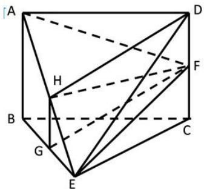

【小问 2 详解】

设平面 AEF 与平面 BEC 所成的锐二面角的大小为 $\theta$ ，

∵ AB ⊥ 平面 BEC，FC ⊥ 平面 BEC，

$\therefore \triangle AEF$ 在平面 BEC 上的射影为 $\triangle BEC$ ，

$\because AB = BE = EC = 2, \angle ABE = 90^{\circ}, \therefore AE = 2\sqrt{2}$ ,

∵ G, F 分别是线段 BE, DC 的中点, ∴ FC = 1, ∵ ∠FCE = 90°,

$\therefore EF = \sqrt{5},\therefore \cos \angle AEF = \frac{8 + 5 - 9}{2\times 2\sqrt{2}\times\sqrt{5}} = \frac{1}{\sqrt{10}},$

$$
\therefore \sin \angle A E F = \sqrt {1 - (\cos \angle A E F) ^ {2}} = \sqrt {1 - \left(\frac {1}{\sqrt {1 0}}\right) ^ {2}} = \frac {3}{\sqrt {1 0}},
$$

$$
\therefore S _ {\triangle A E F} = \frac {1}{2} \times 2 \sqrt {2} \times \sqrt {5} \times \frac {3}{\sqrt {1 0}} = 3,
$$

又 $\because S_{\triangle BEC} = \frac{1}{2}\times 2\times 2 = 2$ ， $\therefore \cos \theta = \frac{S_{\triangle BEC}}{S_{\triangle AEF}} = \frac{2}{3},$

∴二面角 A-l-B 的余弦值为 $\frac{2}{3}$ .

## 5 点面距离、体积与动点综合

### 宝山 · 原卷第17题

**考点说明：** 第（1）问：线面平行证明：利用中点构造与待证直线平行的平面内直线。 第（2）问：线面距离：利用平行关系转化点到平面的距离，并用体积法或坐标法求解。

来源：2026届上海高三一模宝山卷，第17题。

规范化源文件：`2026届宝山一模数学试卷 逐题解析.md`。

如图，在四棱锥 P-ABCD 中， $PD \perp$ 底面 ABCD，且底面 ABCD 为正方形，

E、F、G分别是BC、AD、PA的中点.

（1）证明：PE // 平面 BFG；

(2) 若 AB = 2，求点 E 到平面 BFG 的距离.

【答案】（1）证明见解析

(2) $\frac{2\sqrt{5}}{5}$

【解析】

【分析】（1）连接 DE，推导四边形 BEDF 是平行四边形，从而得到 DE // BF，再得到 FG // PD，从而 PD // 平面 BFG，DE // 平面 BFG，进而得到平面 PDE // 平面 BFG，因此得证 PE // 平面 BFG；

（2）根据平行线的性质，利用等积法进行求解即可.

【小问 1 详解】

连接 $DE$ ，

∵ ABCD 是正方形，E，F 分别是棱 BC，AD 的中点，

$\therefore DF = BE, DF // BE,$

∴四边形 BEDF 是平行四边形，∴ DE // BF，

∵ G 是 PA 的中点，∴ FG // PD，

∵ PD, DE ∉ 平面 BFG, FG, BF ⊂ 平面 BFG,

∴ PD // 平面 BFG，DE // 平面 BFG，

∵ $PD \cap DE = D$ ，直线 $PD, DE \subset$ 平面 PDE，

∴平面 PDE // 平面 BFG，∵ $PE \subset$ 平面 PDE，

∴ PE // 平面 BFG.

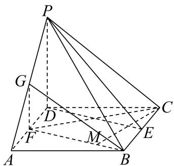
【小问 2 详解】

设点 E 到平面 BFG 的距离为 h，

因为 F、G 分别是 AD、PA 的中点，

所以 $FG / / PD$ ，

因为 $PD \perp$ 底面 ABCD，

所以 $GF \perp$ 底面 ABCD，因为 $BF \subset$ 底面 ABCD，

所以 $BF \perp GF$ ，

因为底面 ABCD 为正方形，AB = 2，E、F 分别是 BC、AD 的中点

所以 $BF = \sqrt{2^{2} + \left(2 \times \frac{1}{2}\right)^{2}} = \sqrt{5}$ ，EF // DC, EF = DC = 2，

因为 $V_{E-BFG}=V_{G-BEF}$ ，

所以 $\frac{1}{3} \times \frac{1}{2} \cdot GF \cdot BF \cdot h = \frac{1}{3} \times \frac{1}{2} \cdot BE \cdot EF \cdot GF$

$$
\Rightarrow \frac {1}{3} \times \frac {1}{2} \times \sqrt {5} \cdot h = \frac {1}{3} \times \frac {1}{2} \times \left(\frac {1}{2} \times 2\right) \times 2 \Rightarrow h = \frac {2 \sqrt {5}}{5}.
$$

### 崇明 · 原卷第18题

**考点说明：** 第（1）问：空间线线垂直证明：利用等腰直角三角形中线与直棱柱的线面垂直关系。 第（2）问：异面直线角与锥体体积：由角条件确定动点位置，再利用底面积和高计算体积。

来源：2026届上海高三一模崇明卷，第18题。

规范化源文件：`2026届崇明一模数学试卷 逐题解析.md`。

如图. 在直棱柱 $\mathrm{ABC - A_1B_1C_1}$ 中， $\angle \mathrm{BAC} = 90^{\circ}$ ， $\mathrm{AB} = \mathrm{AC} = \sqrt{2}$ ， $\mathrm{AA}_1 = 3$ ，D是BC的中点，点E在棱 $\mathrm{BB}_1$ 上运动.

（1）证明：$AD\perp C_1E$;

(2) 当异面直线 AC, $C_{1} \mathrm{E}$ 所成的角为 $60^{\circ}$ 时, 求三棱锥 $C_{1} - A_{1} B_{1} E$ 的体积

【答案】（1）见解析（2） $\frac{2}{3}$

【解析】

【详解】(1)证明:因为 AB=AC,D 是 BC 的中点,

所以 AD⊥BC.

①

又在直三棱柱 ABC-A₁B₁C₁ 中,BB₁⊥平面 ABC,

而 $\mathrm{AD} \subset$ 平面ABC,所以 $\mathrm{AD} \perp \mathrm{BB}_{1}$ .②

由①②,得 AD⊥平面 BB₁C₁C.

由点 E 在棱 $BB_{1}$ 上运动, 得 $C_{1}E \subset$ 平面 $BB_{1}C_{1}C$ ,

所以 $\mathrm{AD} \perp \mathrm{C}_{1}\mathrm{E}$ .

(2)解:因为 $AC \parallel A_{1}C_{1}$ ,

所以 $\angle A_{1}C_{1}E$ 是异面直线 $AC, C_{1}E$ 所成的角.

由题意知 $\angle A_{1}C_{1}E=60^{\circ}$ .

因为 $\angle B_{1}A_{1}C_{1} = \angle BAC = 90^{\circ}$

所以 $A_{1}C_{1}\perp A_{1}B_{1}$ .

又 $AA_{1} \perp A_{1}C_{1}$ ,

从而 $A_{1}C_{1}\perp$ 平面 $A_{1}ABB_{1}$ .

于是 $A_{1}C_{1}\perp A_{1}E.$

故 $C_{1}E=\frac{A_{1}C_{1}}{\cos60^{\circ}}=2\sqrt{2}$

又 $\mathrm{B_1C_1 =}\sqrt{A_1C_1^2 + A_1B_1^2} = 2,$

所以 $\mathrm{B}_1\mathrm{E} = \sqrt{A_1C_1^2 + A_1B_1^2} = 2.$

从而 $V_{三棱锥C_{1}-A_{1}B_{1}E}=\frac{1}{3}S_{\triangle A_{1}B_{1}E}\cdot A_{1}C_{1}=\frac{1}{3}\times\frac{1}{2}\times2\times\sqrt{2}\times\sqrt{2}=\frac{2}{3}.$

核对说明：同题解析版PDF第10页曾视觉核对，“菱BB1”应为“棱BB1”；已仅更正错字。

### 徐汇 · 原卷第19题

**考点说明：** 第（1）问：线面平行与中点性质：确定动点位置，并利用锥体底面积与高计算体积。 第（2）问：二面角与几何最值：构造平面角，分析动点位置对角度的影响。

来源：2026届上海高三一模徐汇卷，第19题。

规范化源文件：`2026届徐汇一模数学试卷 逐题解析.md`。

如图，已知 $BD$ 是 $\odot O$ 的直径，点 $C$ 是 $\odot O$ 上异于 $B$ 、 $D$ 的一点．设过点 $C$ 的直线 $AC$ 垂直于 $\odot O$ 所在的平面，且 $AC = BD = 2$ ：

(1) 若 C 为 $\widehat{BD}$ 中点，E 为线段 AC 的中点，F 为线段 AD 上一点，且 $EF \parallel$ 平面 BCD. 求证：F 为线段 AD 中点，并求三棱锥 F-BCD 的体积；

（2）记二面角 $A - BD - C$ 的平面角为 $\theta$ ，求 $\theta$ 的最小值，并指出其取得最小值时点 $C$ 的位置.

【答案】（1）证明见解析， $\frac{1}{3}$

(2) $\theta_{\min} = \arctan 2$ , C 为 $\widehat{BD}$ 中点.

【解析】

【分析】（1）由线面平行的性质定理得到 $EF // CD$ ，即可求证，由 $EF // \text{平面 } BCD$ ，得到 $F$ 到平面 $BCD$ 的距离即为 $E$ 到平面 $BCD$ 的距离，结合体积公式即可求解；

（2）过 $C$ 作 $CH \perp BD$ ，垂足为 $H$ ，确定 $\angle AHC$ 即为二面角 $A - BD - C$ 的平面角 $\theta$ ，结合 $\tan \theta = \frac{|AC|}{|CH|}$ ，通过确定 $|CH|$ 最大值即可求解.

【小问 1 详解】

$EF//$ 平面 BCD，

CD 在平面 BCD 内，所以 EF, CD 没有交点，

又 EF, CD 都在平面 ACD 内，

所以 $EF // CD$ ，

在三角形 ACD 中，因为 E 为线段 AC 的中点，

所以 $F$ 为线段 $AD$ 中点，

因为 $EF / /$ 平面 $BCD$ ，

所以 F 到平面 BCD 的距离即为 E 到平面 BCD 的距离，

又 $AC \perp$ 平面 BCD，AC = 2，

所以 E 到平面 BCD 的距离为 1，

又 $\triangle BCD$ 为等腰直角三角形，

所以 $S_{\triangle BCD} = \frac{1}{2}\times 2\times 1 = 1$

所以三棱锥 F-BCD 的体积 $V=\frac{1}{3}\times1\times1=\frac{1}{3}$ ;

【小问 2 详解】

过 C 作 $CH \perp BD$ ，垂足为 H，

因为 $AC \perp$ 平面 BCD，BD 在平面 BCD 内，

所以 $BD \perp AC$ ，又 AC, CH 为平面 ACH 内两条相交直线，

所以 $BD \perp$ 平面 ACH，又 AH 在平面 ACH 内，

所以 $BD \perp AH$ ，

所以 $\angle AHC$ 即为二面角 A-BD-C 的平面角 $\theta$ ，

在直角三角形 ACH 中，

$$
\tan \theta = \frac {| A C |}{| C H |} = \frac {2}{| C H |},
$$

又 $CH$ 为 $C$ 到 $BD$ 距离，

所以 $\left|CH\right|\leq\left|CO\right|=1$ ，当C为 $\widehat{BD}$ 中点时取得最大值，

所以 $\tan \theta = \frac{2}{|CH|} \geq 2$ ，当 $C$ 为 $\widehat{BD}$ 中点时取得最小值，

即 $\theta_{\min} = \arctan 2$ ，当且仅当 C 为 $\widehat{BD}$ 中点时取得最小值.

### 普陀 · 原卷第17题

**考点说明：** 第（1）问：利用柱面母线平行及平面交线判定线线平行。 第（2）问：利用圆柱截面和等底高体积求最值，再构造二面角或使用空间向量求余弦。

来源：2026届上海高三一模普陀卷，第17题。

规范化源文件：`2026届普陀一模数学试卷 逐题解析.md`。

如图所示, 过圆柱的轴 $O O_{1}$ 的平面与该圆柱相截所形成的截面是边长为 2 的正方形 $A A_{1} C_{1} C$ , $B$ 是该圆柱底面圆周上异于 $A 、 C$ 两点的点.

（1）设平面 $A_{1}AB \cap$ 平面 $C_{1}CB = l$ ，求证： $l / / AA_{1}$

(2) 当三棱锥 $C_{1} - ABC$ 的体积最大时, 求二面角 $C_{1} - AB - C$ 的余弦值.

【答案】（1）证明见解析

(2) $\frac{\sqrt{3}}{3}.$

【解析】

【分析】（1）由 $AA_{1}$ // 平面 $C_{1}CB$ ，结合线面平行的性质定理即可求解；

(2) 由线面垂直得到 $\angle C_{1}BC$ 是二面角 $C_{1}-AB-C$ 的平面角, 进而可求解.

【小问 1 详解】

由已知得 $AA_{1} \parallel CC_{1}$ ，又 $CC_{1} \subset$ 平面 $C_{1}BC$ ， $AA_{1}$ 在平面 $C_{1}CB$ 外，

则 $AA_{1}$ // 平面 $C_{1}CB$ ,

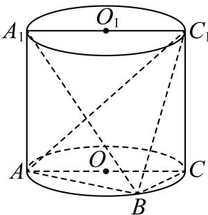

又平面 $A_{1}AB \cap$ 平面 $C_{1}CB = l, AA_{1} \subset$ 平面 $A_{1}AB$

则 $l \parallel AA_{1}$ .

【小问 2 详解】

设 $\triangle ABC$ 的边 $AC$ 上的高为 $0 < h \leq 1$ ，则 $V_{C_1 - ABC} = \frac{1}{3} S_{\triangle ABC} \cdot CC_1 = \frac{2}{3} h$

当三棱锥 $C_{1}-ABC$ 的体积最大时，h=1，即 B 为 $\widehat{AC}$ 的中点，

又 $CC_{1} \perp$ 平面 ABC, AB 在平面 ABC 上，所以 $CC_{1} \perp AB$

又 $CB \perp AB$ ， $CC_{1}, CB$ 为平面 $CC_{1}B$ 内两条相交直线，

所以 $AB \perp$ 平面 $CC_{1}B$ ，又 $C_{1}B$ 在平面 $CC_{1}B$ 内，

所以 $C_1B \perp AB$ ，

则 $\angle C_{1}BC$ 是二面角 $C_1 - AB - C$ 的平面角，

在直角三角形 $CBC_{1}$ 中， $BC = \sqrt{2}$ ， $BC_{1} = \sqrt{6}$ ，则 $\cos\angle CBC_{1} = \frac{\sqrt{3}}{3}$ ，

即所求的二面角 $C_1 - AB - C$ 的余弦值为 $\frac{\sqrt{3}}{3}$

### 杨浦 · 原卷第17题

**考点说明：** 第（1）问：确定斜线在底面上的射影，利用直角三角形求线面角。 第（2）问：利用三棱锥体积的等底等高或换底计算，分析动点对高的影响。

来源：2026届上海高三一模杨浦卷，第17题。

规范化源文件：`2026届杨浦一模数学试卷 逐题解析.md`。

如图，在长方体 $ABCD - A_{1}B_{1}C_{1}D_{1}$ 中， $M$ 为 $BB_{1}$ 上一动点，已知 $AD = CD = 2$ ， $AA_{1} = 4$ .

(1) 求直线 $A_{1} C$ 与平面 $A B C D$ 所成角的大小; (用反三角表示)

(2) 求三棱锥 $M - AA_{1}C$ 的体积.

【答案】(1) $\arcsin \frac{\sqrt{6}}{3}$

(2) $\frac{8}{3}$

【解析】

【分析】（1）先找出 $\angle ACA_{1}$ 即为直线 $A_{1}C$ 与平面 ABCD 所成角，再求 $\angle ACA_{1}$ 的大小即可；

（2）根据 $V_{M-AA_{1}C}=V_{B-AA_{1}C}=V_{A_{1}-ABC}$ ，再利用三棱锥的体积公式即可求解.

【小问 1 详解】

连接 $AC$ ，由题意得 $AA_{1} \perp$ 平面ABCD，

则 $\angle ACA_{1}$ 即为直线 $A_{1}C$ 与平面ABCD所成角，

又 $AD = CD = 2$ ， $AA_{1} = 4$

在直角 $\triangle ACA_{1}$ 中， $AC = 2\sqrt{2}$ ， $A_{1}C = \sqrt{AA_{1}^{2} + AC^{2}} = \sqrt{4^{2} + (2\sqrt{2})^{2}} = 2\sqrt{6}$

$\sin \angle ACA_{1} = \frac{AA_{1}}{A_{1}C} = \frac{4}{2\sqrt{6}} = \frac{\sqrt{6}}{3}$ 则 $\angle ACA_{1} = \arcsin \frac{\sqrt{6}}{3}$

所以直线 $A_{1}C$ 与平面ABCD所成角的大小为 $\arcsin \frac{\sqrt{6}}{3}$

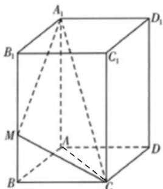
【小问 2 详解】

由题意得， $BB_{1}$ // 平面 $AA_{1}C$ ，

$$
V _ {M - A A _ {1} C} = V _ {B - A A _ {1} C} = V _ {A _ {1} - A B C} = \frac {1}{3} S _ {\triangle A B C} \cdot A A _ {1} = \frac {1}{3} \times \frac {1}{2} \times 2 \times 2 \times 4 = \frac {8}{3}
$$

所以三棱锥 $M - AA_{1}C$ 的体积为 $\frac{8}{3}$ .

### 松江 · 原卷第18题

**考点说明：** 第（1）问：面面垂直与线线垂直：利用等边三角形的高和底面梯形关系构造垂直关系，也可建立空间坐标作数量积证明。 第（2）问：点到平面的距离：用三棱锥体积的等体积转化，或求平面法向量后计算点面距离。

来源：2026届上海高三一模松江卷，第18题。

规范化源文件：`2026届松江一模数学试卷 逐题解析.md`。

已知四棱锥 $P - ABCD$ 的底面 $ABCD$ 是直角梯形， $AB // CD$ ， $AB = 2CD = 2$ ， $\angle ABC = 90^\circ$ ， $\triangle PBC$ 是边长为 2 的正三角形，侧面 $PBC \perp$ 底面 $ABCD$ .

（1）证明： $PA \perp BD$ ;

(2) 求点 D 到平面 PAB 的距离.

【答案】（1）证明见解析

(2) $\sqrt{3}$

【解析】

【分析】（1）建立空间直角坐标系，利用空间向量证明线线垂直.

(2) 利用空间向量求点到平面的距离.

【小问 1 详解】

取 BC 中点 O，AD 中点 E，连接 OP，OE。

因为 $\triangle PBC$ 为等边三角形，所以 $OP \perp BC$

又平面 $PBC \perp$ 平面 ABCD，平面 $PBC \cap$ 平面 ABCD = BC， $OP \subset$ 平面 PBC，

所以 $OP \perp$ 平面ABCD.

$OE \subset$ 平面 $ABCD$ , 所以 $OP \perp OE$ ,

又底面 ABCD 是直角梯形， $\angle ABC = 90^{\circ}$ ，所以 $AB \perp BC$ .

又 O, E 分别为 BC，AD 中点，所以 OE // AB，所以 $OE \perp BC$ .

所以 OE, OB, OP 两两垂直.

故以 $O$ 为原点，建立如图空间直角坐标系，

因为 $AB = BC = 2CD = 2$ ，所以 $P(0,0,\sqrt{3})$ ， $A(2,1,0)$ ， $B(0,1,0)$ ， $D(1, - 1,0)$

所以 $\overrightarrow{PA} = (2,1, - \sqrt{3})$ ， $\overrightarrow{BD} = (1, - 2,0)$

因为 $\overrightarrow{PA} \cdot \overrightarrow{BD} = 2 \times 1 + 1 \times (-2) + (-\sqrt{3}) \times 0 = 0$ .

所以 $\overrightarrow{PA} \perp \overrightarrow{BD}$ ，所以 $PA \perp BD$ .

【小问 2 详解】

由（1）得， $\overrightarrow{BA} = (2,0,0)$ ， $\overrightarrow{BP} = (0, - 1,\sqrt{3})$ ， $\overrightarrow{BD} = (1, - 2,0)$

设平面 PAB 的一个法向量为 $\vec{n}=(x,y,z)$ ,

则 $\left\{ \begin{array}{l} \vec{n} \perp \overrightarrow{BA} \\ \vec{n} \perp \overrightarrow{BP} \end{array} \right. \Rightarrow \left\{ \begin{array}{l} \vec{n} \cdot \overrightarrow{BA} = 2x = 0 \\ \vec{n} \cdot \overrightarrow{BP} = -y + \sqrt{3}z = 0 \end{array} \right.$ ，令 $z = \sqrt{3}$ ，可得 $\vec{n} = (0,3,\sqrt{3})$ 。

所以点 $D$ 到平面 $PAB$ 的距离为： $d = \frac{\left|\vec{n} \cdot \overrightarrow{BD}\right|}{\left|\vec{n}\right|} = \frac{6}{\sqrt{9 + 3}} = \sqrt{3}$ .

### 虹口 · 原卷第17题

**考点说明：** 第（1）问：空间直线不相交的证明：利用菱形对角线和中点关系构造平行线或平行平面，说明对所有动点均成立。 第（2）问：菱形附加条件与点面距离：由对角线关系识别底面特殊形状，再用坐标法或等体积法求距离。

来源：2026届上海高三一模虹口卷，第17题。

规范化源文件：`2026届虹口一模数学试卷 逐题解析.md`。

如图，已知四棱锥 $P - ABCD$ 的底面是边长为 2 的菱形，点 $E$ 为 $PC$ 中点.

（1）若点 F 是线段 BD 上的动点，求证：直线 EF 与直线 PA 不相交；

（2）若 $PC \perp$ 平面 ABCD，AC = BD，EC = 1，求点 A 到平面 EBD 的距离.

【答案】（1）证明见详解

(2) $\frac{\sqrt{6}}{3}$

【解析】

【分析】（1）先证明 PA// 平面 BDE，然后分析直线 EF 与直线 PA 交点情况即可证明；

(2) 利用等体积法求解即可.

【小问1详解】

连接 AC 交 BD 于点 O，连接 OE，

如图所示:

因为四边形 ABCD 为菱形，所以 O 为 AC 的中点，

所以在 $\triangle PAC$ 中有，由 $O, E$ 分别是 $AC, PC$ 的中点，

所以 PA // OE，

又 $OE \subset$ 平面 $BDE$ ， $PA \not\subset$ 平面 $BDE$ ，

所以 PA // 平面 BDE，

又因为 $EF \subset$ 平面 $BDE$ ，

所以直线 $EF$ 与直线 $EF$ 没有公共点，

即直线 EF 与直线 EF 不相交.

【小问 2 详解】

因为 $PC \perp$ 平面ABCD，点 $E$ 为 $PC$ 中点，

所以 $EC \perp$ 平面 ABCD 即 $EC \perp$ 平面 ABD，

所以 EC 为三棱锥 E-ABD 的高，且 EC=1，

因为四边形 ABCD 为菱形，且 AC = BD，

所以菱形 ABCD 为边长是 2 正方形，

所以 $S_{\triangle ABD} = \frac{1}{2}\times 2\times 2 = 2$

且 $AC = BD = 2\sqrt{2}$ ，即 $OC = \sqrt{2}$

又 $BE = DE = \sqrt{EC^2 + BC^2} = \sqrt{1^2 + 2^2} = \sqrt{5}$

在 $\mathbf{Rt}_{\triangle}OCE$ 中， $OE = \sqrt{EC^2 + OC^2} = \sqrt{1^2 + (\sqrt{2})^2} = \sqrt{3}$

即为 $\triangle DBE$ 的高，

所以 $S_{\triangle DBE} = \frac{1}{2}\times 2\sqrt{2}\times \sqrt{3} = \sqrt{6},$

设点 A 到平面 EBD 的距离为 h，

由等体积法得： $V_{E-ABD}=V_{A-EBD}$ ，

即 $\frac{1}{3} \times 2 \times 1 = \frac{1}{3} \times \sqrt{6} \times h$

解得： $h=\frac{\sqrt{6}}{3}$ ，

所以点 A 到平面 EBD 的距离为 $\frac{\sqrt{6}}{3}$ .

### 长宁 · 原卷第19题

**考点说明：** 第（1）问：利用线面角确定棱锥高度，再由底面积与高求体积。 第（2）问：由线面平行确定动点位置，构造或计算二面角的余弦。

来源：2026届上海高三一模长宁卷，第19题。

规范化源文件：`2026届长宁一模数学试卷 逐题解析.md`。

如图，在四棱锥 $P - ABCD$ 中， $PA \perp$ 平面 $ABCD$ ， $AB \perp AD$ ， $AD // BC$ ， $AB = BC = 1$ ， $AD = 2$ ，直线 $PC$ 与平面 $ABCD$ 所成的角的大小为 $\arctan\sqrt{2}$ .

（1）求四棱锥 P-ABCD 的体积；

(2) 点 $Q$ 在线段 $PD$ 上, 直线 $PB //$ 平面 $AQC$ , 求二面角 $Q - AC - D$ 的余弦值.

【答案】(1) 1

(2) $\frac{1}{3}$

【解析】

【分析】（1）根据棱锥的体积公式，结合线面角的定义进行求解即可；

（2）建立空间直角坐标系，利用线面平行的性质、空间向量夹角公式进行求解即可.

【小问 1 详解】

因为 $AB \perp AD$ ，AD // BC，

所以 $AB \perp BC$ ，因此 $AC = \sqrt{AB^2 + BC^2} = \sqrt{1 + 1} = \sqrt{2}$ ，

因为 $PA \perp$ 平面 ABCD，直线 PC 与平面 ABCD 所成的角的大小为 $\arctan\sqrt{2}$ ，

所以 $\tan \left(\arctan \sqrt{2}\right) = \frac{PA}{AC} \Rightarrow PA = \sqrt{2} \times \sqrt{2} = 2$ ，

四棱锥 P-ABCD 的体积为 $\frac{1}{3}\cdot PA\cdot\frac{(BC+AD)}{2}\cdot AB=\frac{1}{3}\times2\times\frac{(1+2)}{2}\times1=1$ ;

【小问 2 详解】

因为 $PA \perp$ 平面 ABCD，AB, AD ⊂ 平面 ABCD,

所以 $PA \perp AB$ ， $PA \perp AD$ ，又因为 $AB \perp AD$ ，

所以可以建立如图所示的空间直角坐标系，

$A(0,0,0),B(1,0,0),C(1,1,0),D(0,2,0),P(0,0,2)$

显然平面 ACD 的法向量为 $\overrightarrow{AP} = (0, 0, 2)$ ,

因为点 $Q$ 在线段 $PD$ 上，所以设

$\overrightarrow{PQ} = \lambda \overrightarrow{PD} \Rightarrow \overrightarrow{PA} + \overrightarrow{AQ} = \lambda (0,2, - 2)(\lambda \in [0,1]) \Rightarrow (0,0, - 2) + \overrightarrow{AQ} = (0,2\lambda , - 2\lambda)$ $\Rightarrow \overrightarrow{AQ} = (0,2\lambda ,2 - 2\lambda)$ ,

设平面 $AQC$ 的法向量为 $\vec{m} = (x,y,z)$ ，又 $\overrightarrow{AC} = (1,1,0)$ ， $\overrightarrow{PB} = (1,0,-2)$ ，

因为直线 $PB \cap$ 平面 ABCD = B，

所以当直线 $PB //$ 平面 $AQC$ ，显然点 $Q$ 不与点 $D$ 重合，

则当 $\lambda \in [0,1)$ 时， $\left\{ \begin{array}{l} \vec{m}\cdot \overrightarrow{AQ} = 0\\ \vec{m}\cdot \overrightarrow{AC} = 0 \end{array} \right.\Rightarrow \left\{ \begin{array}{l} 2\lambda y + (2 - 2\lambda)z = 0\\ x + y = 0 \end{array} \right.$ ，取 $\vec{m} = \left(1, - 1,\frac{\lambda}{1 - \lambda}\right)$

因为直线 $PB //$ 平面 $AQC$ ，

所以 $\overrightarrow{PB}\cdot\overrightarrow{m}=0\Rightarrow1-\frac{2\lambda}{1-\lambda}=0\Rightarrow\lambda=\frac{1}{3}$ ，即 $\vec{m}=\left(1,-1,\frac{1}{2}\right)$ ,

$$
\cos \vec {m}, \overrightarrow {A P} = \frac {\vec {m} \cdot \overrightarrow {A P}}{| \vec {m} | \cdot | \overrightarrow {A P} |} = \frac {1}{\sqrt {1 ^ {2} + (- 1) ^ {2} + \left(\frac {1}{2}\right) ^ {2}} \times 2} = \frac {1}{3},
$$

由图可知二面角 $Q - AC - D$ 是锐二面角，

所以二面角 $Q - AC - D$ 的余弦值为 $\frac{1}{3}$ .

## 6 空间模型与实际测量

### 杨浦 · 原卷第11题

**考点说明：** 空间测距与解三角形：将测得角度转化为底面形状及两塔高度，比较各种方案是否能唯一确定距离。

来源：2026届上海高三一模杨浦卷，第11题。

规范化源文件：`2026届杨浦一模数学试卷 逐题解析.md`。

某数学建模活动小组在开展主题为“空中不可到达两点的测距问题”的探究活动中，抽象并构建了如图所示的几何模型，该模型中 $MA$ ， $NB$ 均与水平面 $ABC$ 垂直，在已测得可直接到达的两点间距离 $AC$ ， $BC$ ，且 $AC < BC$ ，用测角仪测得 $\angle MCA$ ， $\angle NCB$ 的情况下，四名同学用测角仪各自测得下面一个角：① $\angle ABC$ ；② $\angle ACB$ ；③ $\angle BAC$ ；④ $\angle MCN$ ，其中一定能唯一确定 $M, N$ 之间的距离有\_\_\_\_。（写出所有正确的序号）

【答案】②③④

【解析】

【分析】结合题目给出条件以及直角三角形的边角关系，可知 $MA, MC, NB, NC$ 均已确定，对于①②③，可先根据余弦定理判断 $AB$ 是否确定，再根据勾股定理判断 $MN$ 是否确定；对于④，可直接根据余弦定理进行判断.

【详解】设

$$
A B = c, A C = b, B C = a, M A = h _ {1}, N B = h _ {2}, C M = m, C N = n, \angle M C A = \theta , \angle N C B = \alpha
$$

在 $\mathrm{Rt}_{\triangle}MAC$ 中， $CM = m = \frac{CA}{\cos\angle MCA} = \frac{b}{\cos\theta}, MA = h_1 = CA \cdot \tan \theta = b\tan \theta$

同理可得 $CN = n = \frac{a}{\cos\alpha}, NB = h_2 = a\tan \alpha$

由于 $a, b, \theta, \alpha$ 均为已知量，故 $m, n, h_1, h_2$ 均为定值.

对于①：在 $\triangle ABC$ 中，由余弦定理可得 $b^{2} = a^{2} + c^{2} - 2ac\cos \angle ABC$ ，且 $a, b, \cos \angle ABC$ 均为定值，故该方程为关于 $c$ 的一元二次方程， $c$ 可能有两解.

例如，若 $a = \sqrt{3}, b = 1, \cos \angle ABC = \frac{\sqrt{3}}{2}$ ，

则可得 $c^2 + 3 - 1 = 2 \cdot \sqrt{3} \cdot c \cdot \frac{\sqrt{3}}{2}$ ，即 $c^2 - 3c + 2 = 0$ ，解得 $c = 1$ 或 $2$ ，

由勾股定理可得 $MN = \sqrt{AB^{2} + (NB - MA)^{2}} = \sqrt{c^{2} + (h_{2} - h_{1})^{2}}$ ，由于 $h_{1}, h_{2}$ 为定值，而 c 有两解，故 MN 也有两解，故①错误；

对于②：在 $\triangle ABC$ 中，由余弦定理可得 $c^2 = a^2 + b^2 - 2ab\cos \angle ACB$ ，且 $a, b, \cos \angle ACB$ 均为定值，故 $c$ 也为定值，

又因为 $MN = \sqrt{c^2 + (h_2 - h_1)^2}$ ，其中 $c, h_1, h_2$ 均为定值，故 $MN$ 为定值，故②正确；

对于③：在 $\triangle ABC$ 中，由余弦定理可得 $a^2 = b^2 + c^2 - 2bc\cos \angle BAC$ ，整理得

$c^{2}-2bc\cos\angle BAC+b^{2}-a^{2}=0$ 且 a,b, $\cos\angle BAC$ 均为定值，

故该方程为关于 c 的一元二次方程. 又 $\because 0 < b < a, \therefore b^{2} - a^{2} < 0$ ,

故 $\Delta = 4b^{2}(\cos \angle BAC)^{2} - 4(b^{2} - a^{2}) > 0$ ，即 $c$ 有两解，设两解分别为 $c_{1}, c_{2}$ 由韦达定理可知， $c_{1}c_{2}=b^{2}-a^{2}<0$ ，即 $c_{1},c_{2}$ 异号，因此该方程仅有1个正数解，即c有唯一确定解，

又因为 $MN = \sqrt{c^2 + (h_2 - h_1)^2}$ ，其中 $c, h_1, h_2$ 均为定值，故 $MN$ 为定值，故③正确；对于④：在 $\triangle MCN$ 中，由余弦定理可知， $MN^2 = m^2 + n^2 - 2mn\cos \angle MCN$ ，因为 $m, n, \cos \angle MCN$ 均为定值，故 $MN$ 也为定值，故④正确，

故答案为：②③④.

### 青浦 · 原卷第16题

**考点说明：** 空间测量与平行投影：根据不同时刻的日影建立长度与方向关系，判断测量信息是否足够。

来源：2026届上海高三一模青浦卷，第16题。

规范化源文件：`2026届青浦一模数学试卷 逐题解析.md`。

16. 如图所示, 水平地面上插有两根杆子 $AB$ 和 $CD$ , $AB$ 所在直线垂直于地面且 $AB = 2$ 米, $CD$ 所在直线与地面斜交. 小明有一把卷尺. 他在某时刻分别测出杆子 $AB$ 和 $CD$ 在阳光下影子的长度, 称为一次操作. 小明可以在白天的不同时刻进行多次操作. 假设阳光为平行光, 正午时分 $AB$ 的影子长度为 0. 则下列说法正确的是 ( )

- A. 为求出 $CD$ 的长度, 小明至少需要进行 2 次操作
- B. 为求出 $CD$ 的长度, 小明至少需要进行 3 次操作
- C. 为求出 $CD$ 的长度, 小明至少需要进行 4 次操作
- D. 无论进行多少次操作, 小明都不能求出 $CD$ 的长度

【答案】B

【解析】

【分析】建立坐标系，得到 $\left|CD\right|=\sqrt{a^{2}+b^{2}+h^{2}}$ ，根据条件列出方程 $n^{2}=\left(a+\frac{hm}{2}\right)^{2}+b^{2}$ 其中 m, n 分别已知量，a, b, h 是三个未知量，需要列三元三次方程组才可求解，所以需要测量三次.
【详解】设点 B 在地面的影子为 $B_{1}$ ，点 C 在地面的影子为 $C_{1}$ ，杆子 AB 影子的长度为 m，杆子 CD 影子的长度为 n；
因为 AB 垂直于地面，如图以 A 为原点，地面为 xoy 平面， $AB_{1}$ 为 x 轴，AB 为 z 轴建立空间直角坐标系，则 $A(0,0,0), B(0,0,2), B_{1}(m,0,0)$ ，设 $D(x_{1},y_{1},0), C(x_{2},y_{2},h)$ ，其中 h 为 C 到地面的高度.
定义 CD 的水平分量：令 $a = x_{2} - x_{1}$ （x 方向水平距离）， $b = y_{2} - y_{1}$ （y 方向水平距离）
由题可知 a, b, h 为 3 个定值，则 $\left|CD\right|=\sqrt{a^{2}+b^{2}+h^{2}}$

设点 $C_1(x,y,0)$ ，则 $\overrightarrow{BB_1} = (m,0, - 2),\overrightarrow{CC_1} = (x - x_2,y - y_2, - h)$

由于阳光为平行光，所以 $\overrightarrow{BB_{1}}//\overrightarrow{CC_{1}}$ ，所以 $C_{1}\left(x_{2}+\frac{hm}{2},y_{2},0\right)$ ,

$$
n = \left| C _ {1} D \right| = \sqrt {\left(x _ {2} + \frac {h m}{2} - x _ {1}\right) ^ {2} + \left(y _ {2} - y _ {1}\right) ^ {2} + (0 - 0) ^ {2}}
$$

即 $n^2 = \left(x_2 + \frac{hm}{2} - x_1\right)^2 + (y_2 - y_1)^2$ ，即 $n^2 = \left(a + \frac{hm}{2}\right)^2 + b^2$

方程 $n^2 = \left(a + \frac{hm}{2}\right)^2 + b^2$ 中 $a, b, h$ 为3个未知数，需要列三个方程才可求解，则需要测量三次.

故选：B

核对说明：规范稿解析错置，本题采用MinerU原稿完整题块；待原卷逐页终核。

### 嘉定 · 原卷第21题

**考点说明：** 第（1）问：圆与两直线相切：利用圆心角平分线及点到直线距离建立半径方程。 第（2）问：利用转角几何关系建立木棒长度与角度的函数，并求定义域内的最小值。 第（3）问：实际通道几何建模：结合家具宽度、长度和移动姿态，判断能否连续通过转角。

来源：2026届上海高三一模嘉定卷，第21题。

规范化源文件：`2026届嘉定一模数学试卷 逐题解析.md`。

图 1 为转角过道的地面平面示意图. 该过道由两条直道连接形成转角, 由水平平坦的地面与垂直于地面的墙面共同围成, 两端延伸至足够远处, 且高度充足. 其中, $QA$ 、 $QB$ 构成地面上过道的一侧边界, $\angle AQB = 120^{\circ}$ ; 地面上过道的另一侧边界, 则分别与 $QA$ 、 $QB$ 平行, 且交于点 $P$ . 过道两侧平行墙面之间的距离均为 3 米.

<figure><figcaption>图 1</figcaption></figure>

<figure><figcaption>图 2</figcaption></figure>

<figure><figcaption>图 3</figcaption></figure>

<figure><figcaption>图 4</figcaption></figure>

（1）如图 2，在地面有一圆，该圆与 QA、QB 均相切，且过点 P. 求此圆的半径；

（2）如图3，有一根长度为 $y$ 米的无粗细木棒 $MN$ 紧贴地面，端点 $N$ 沿 $QB$ 移动，另一端点 $M$ 沿 $AQ$ 移动.当木棒 $MN$ 触碰到点 $P$ 时， $\angle QMN = x$ （弧度），求 $y$ 关于 $x$ 的函数关系及 $y$ 的最小值；

（3）如图4，某长方体家具的底面为长方形 $EFGH$ ，其宽为1米，长为10米（因过道高度足够，无需考虑家具高度）。现将底面 $EFGH$ 紧贴地面移动，判断该家具能否顺利通过此转角过道，并说明理由。

【答案】（1） $r = 12 - 6\sqrt{3}$

(2) $y = \frac{3}{\sin x} + \frac{3}{\sin\left(\frac{\pi}{3} - x\right)}, y_{\min} = 12$

（3）不能通过，理由见解析

【解析】

【分析】（1）连接 PQ，设圆心为 O，过 O 作 $OW \perp QB$ ， $OZ \perp QA$ ，由几何性质建立半径 r 的方程，解方程可得结果；

（2）过点 $M$ 作 $MD \perp QA$ ，交过道另一侧边界于点 $D$ ，过点 $N$ 作 $NE \perp QB$ ，交过道另一侧于点 $E$ ，由图形关系可得 $y$ 与 $x$ 的函数关系，并利用导数和函数的对称性求得 $y$ 的最小值；

(3) 设 $\angle QEF = \alpha$ ，延长 $HG$ 交 $QA$ 于 $R$ ，交 $QB$ 于 $S$ ，由 $RS = RH + HG + GS$ ，得到 $HG$ 的表达式，验证 $g\left(\frac{\pi}{6}\right) < 10$ 可得结论.

【小问 1 详解】

连接 PQ，设圆心为 O，过 O 作 $OW \perp QB$ ， $OZ \perp QA$ ，

由 $OW = OZ = r$ ， $\angle OWQ = \angle OZQ = 90^{\circ}$ ， $OQ = OQ$ ，可得 $\triangle OWQ\cong \triangle OZQ$

从而 $\angle OQW = \angle OQZ = \frac{\pi}{3}$ , $PQ = \frac{3}{\sin\frac{\pi}{3}} = 2\sqrt{3}$ ,

所以 $r + \frac{r}{\sin\frac{\pi}{3}} = 2\sqrt{3}$ ，解得 $r = 12 - 6\sqrt{3}$

如图，过点 $M$ 作 $MC \perp QA$ ，交过道另一侧边界于点 $C$ ，过点 $N$ 作 $ND \perp QB$ ，交过道另一侧于点 $D$ ，

则 $MP=\frac{3}{\sin x}$ ， $NP=\frac{3}{\sin\left(\frac{\pi}{3}-x\right)}$

所以 $y = MP + NP = \frac{3}{\sin x} + \frac{3}{\sin\left(\frac{\pi}{3} - x\right)}$ ,

$$
\text {令} f (x) = \frac {3}{\sin x} + \frac {3}{\sin \left(\frac {\pi}{3} - x\right)} \left(0 <   x <   \frac {\pi}{3}\right),
$$

$$
f ^ {\prime} (x) = - \frac {3 \cos x}{\sin^ {2} x} + \frac {3 \cos \left(\frac {\pi}{3} - x\right)}{\sin^ {2} \left(\frac {\pi}{3} - x\right)} = \frac {3 \cos \left(\frac {\pi}{3} - x\right) \sin^ {2} x - 3 \cos x \sin^ {2} \left(\frac {\pi}{3} - x\right)}{\sin^ {2} x \sin^ {2} \left(\frac {\pi}{3} - x\right)},
$$

当 $x \in \left(0, \frac{\pi}{6}\right]$ 时， $\cos x \geq \cos \left(\frac{\pi}{3} - x\right) > 0$ ， $\sin \left(\frac{\pi}{3} - x\right) \geq \sin x > 0$

所以 $3\cos \left(\frac{\pi}{3} -x\right)\sin^2 x\leq 3\cos x\sin^2 \left(\frac{\pi}{3} -x\right),$

所以 $f'(x) \leq 0$ ，当且仅当 $x = \frac{\pi}{6}$ 时取等号，故 $y = f(x)$ 在 $\left(0, \frac{\pi}{6}\right]$ 上严格单调递减，

并且 $f(x) = f\left(\frac{\pi}{3} - x\right)$ ，所以 $y = f(x)$ 关于 $x = \frac{\pi}{6}$ 对称，

所以 $f(x)_{\min}=f\left(\frac{\pi}{6}\right)=12$ ，即 $x=\frac{\pi}{6}$ 时，y 的最小值为 12 米.

【小问 3 详解】

设底面长方形顶点 E 、 F 分别在边界 QA 、 QB 上移动，

设 $\angle QEF = \alpha$ ，延长 $HG$ 交 $QA$ 于 $R$ ，交 $QB$ 于S，

$$
R S = R H + H G + G S = \frac {1}{\tan \alpha} + H G + \frac {1}{\tan \left(\frac {\pi}{3} - \alpha\right)},\tag{则}
$$

$$
R S = \frac {3}{\sin \alpha} + \frac {3}{\sin \left(\frac {\pi}{3} - \alpha\right)},
$$

$$
\text {设} g (\alpha) = H G = \frac {3}{\sin \alpha} + \frac {3}{\sin \left(\frac {\pi}{3} - \alpha\right)} - \frac {1}{\tan \alpha} - \frac {1}{\tan \left(\frac {\pi}{3} - \alpha\right)},
$$

若家具可以通过转角，则对于 $\forall \alpha \in \left(0, \frac{\pi}{3}\right)$ ， $g(\alpha) \geq 10$ ，

但 $g\left(\frac{\pi}{6}\right)=\frac{3}{\sin\frac{\pi}{6}}\times2-\frac{1}{\tan\frac{\pi}{6}}\times2=12-2\sqrt{3}\approx8.53<10$ ，所以家具不能通过该转角.

(图 4)

核对说明：嘉定可读逐题解析PDF第15页视觉核对，四图顺序为图1过道、图2相切圆、图3木棒、图4家具；已将图号紧贴对应图片。

