# 2026一模：解析几何 · 教师版

> 依据原卷规范化转录稿及已核专题整理，按数学任务分类；完整大题保留。未逐题核对全部原卷及独立重算所有解析。

## 题型导航

- [1. 直线方程、倾斜角与点线距离（8题）](#class-1)
- [2. 圆锥曲线的标准方程、焦点与离心率（7题）](#class-2)
- [3. 曲线类型、轨迹与存在性判断（5题）](#class-3)
- [4. 距离、角度与几何最值模型（8题）](#class-4)
- [5. 椭圆与动直线、焦点弦及向量关系（9题）](#class-5)
- [6. 抛物线的切线、焦点弦与最值（4题）](#class-6)
- [7. 双曲线与动直线、切线及最值（4题）](#class-7)
- [8. 待补原题资料（3题）](#class-8)

## 1 直线方程、倾斜角与点线距离

### 嘉定 · 原卷第2题

**考点说明：** 直线的斜率与倾斜角：由两点求斜率，再结合倾斜角范围确定角度。

来源：2026届上海高三一模嘉定卷，第2题。

规范化源文件：`2026届嘉定一模数学试卷 逐题解析.md`。

已知直线 l 经过点 $(-1, -1)$ 、 $(2, 2)$ ，则 l 的倾斜角为 \_\_\_\_.

【答案】 $\frac{\pi}{4}$

【解析】

【分析】根据斜率公式求斜率，即可得直线的倾斜角.

【详解】设直线 l 的倾斜角为 $\alpha \in [0, \pi)$ ,

因为直线 l 经过点 $(-1,-1)$ 、 $(2,2)$ ，则直线 l 的斜率 $k=\frac{2-(-1)}{2-(-1)}=\frac{2+1}{2+1}=1$ ，

则 $\tan \alpha = 1$ ，可得 $\alpha = \frac{\pi}{4}$

所以直线 l 的倾斜角为 $\frac{\pi}{4}$ .

故答案为： $\frac{\pi}{4}$ .

### 奉贤 · 原卷第4题

**考点说明：** 向量与直线：将已知垂直向量作为直线的法向量，再结合过点条件确定方程。

来源：2026届上海高三一模奉贤卷，第4题。

规范化源文件：`2026届奉贤一模数学试卷 逐题解析.md`。

已知向量 $\vec{a}=(1,1)$ ，则经过点 $(1,0)$ 且与 $\vec{a}$ 垂直的直线方程为 \_\_\_\_.

【答案】 $x + y - 1 = 0$

【解析】

【分析】先根据向量垂直得出斜率，再点斜式得出直线方程进而得出一般式.

【详解】因为向量 $\vec{a}=(1,1)$ ，则与 $\vec{a}$ 垂直的直线方程斜率为 -1，

则经过点 $(1,0)$ 且与 $\vec{a}$ 垂直的直线方程为 $y-0=-\left(x-1\right)$ ,

即得 $x + y - 1 = 0$

故答案为： $x + y - 1 = 0$

### 宝山 · 原卷第8题

**考点说明：** 直线斜率与基本不等式：由倾斜角得到正数变量的线性约束，求倒数和最小值并核对取等。

来源：2026届上海高三一模宝山卷，第8题。

规范化源文件：`2026届宝山一模数学试卷 逐题解析.md`。

已知第一象限的点 $(m, n)$ 和 $(6, 2)$ 经过直线 $l$ ，若直线 $l$ 的倾斜角为 $135^{\circ}$ ，则 $\frac{1}{m} + \frac{4}{n}$ 的最小值为 \_\_\_\_.

【答案】 $\frac{9}{8}$

【解析】

【分析】由题设知 $\frac{n - 2}{m - 6} = \tan 135^{\circ}$ ，根据目标式，结合基本不等式“1”的代换求最小值即可.

【详解】由题设知 $\frac{n - 2}{m - 6} = \tan 135^{\circ} = -1$ ，可得 $m + n = 8 (m, n > 0)$

$$
\therefore \frac {1}{m} + \frac {4}{n} = \frac {1}{8} \left(\frac {1}{m} + \frac {4}{n}\right) (m + n) = \frac {1}{8} \left(5 + \frac {n}{m} + \frac {4 m}{n}\right) \geq \frac {1}{8} \left(5 + 2 \sqrt {\frac {n}{m} \cdot \frac {4 m}{n}}\right) = \frac {9}{8},
$$

当且仅当 $n = 2m$ 时，即 $m = \frac{8}{3}, n = \frac{16}{3}$ 时，等号成立， $\frac{1}{m} + \frac{4}{n}$ 的最小值为 $\frac{9}{8}$ .

故答案为： $\frac{9}{8}$ .

排版说明：答案栏的重复等价表示已合并，数值未变。

### 普陀 · 原卷第9题

**考点说明：** 向量坐标与点线距离：利用平移向量建立点的坐标关系，再用点到直线的距离公式。

来源：2026届上海高三一模普陀卷，第9题。

规范化源文件：`2026届普陀一模数学试卷 逐题解析.md`。

设 $m \in R$ ，直线 $l: 2x + y + m = 0$ 经过点 P，若向量 $\overrightarrow{PQ} = (1, 3)$ ，则点 Q 到直线 l 的距离为 \_\_\_\_.

【答案】 $\sqrt{5}$

【解析】

【分析】设出点 P 的坐标，并求出点 Q 的坐标，再利用点到直线距离公式求解.

【详解】由直线 $l:2x+y+m=0$ 经过点 P，设 $P(t,-2t-m)$ ，

由向量 $\overrightarrow{PQ}=(1,3)$ ，得 $Q(1+t,3-2t-m)$ ，

所以点 $Q$ 到直线 $l$ 的距离 $h = \frac{|2(1 + t) + 3 - 2t - m + m|}{\sqrt{2^2 + 1^2}} = \sqrt{5}$ .

故答案为： $\sqrt{5}$

### 杨浦 · 原卷第7题

**考点说明：** 点到直线的距离：先从圆方程读取圆心，再应用点线距离公式。

来源：2026届上海高三一模杨浦卷，第7题。

规范化源文件：`2026届杨浦一模数学试卷 逐题解析.md`。

圆 $C: (x - 5)^2 + (y - 3)^2 = 10$ 的圆心到直线 $l: x - y + 2 = 0$ 的距离为 \_\_\_\_.

【答案】 $2\sqrt{2}$

【解析】

【分析】利用点到直线的距离公式计算即得.

【详解】圆 $C:(x-5)^{2}+(y-3)^{2}=10$ 的圆心 $C(5,3)$ 到直线 $l: x-y+2=0$ 的距离为 $d=\frac{\left|5-3+2\right|}{\sqrt{2}}=2\sqrt{2}$ .

故答案为： $2\sqrt{2}$

### 金山 · 原卷第7题

**考点说明：** 直线方程与垂直关系：求已知边的斜率，再利用垂线过顶点写方程。

来源：2026届上海高三一模金山卷，第7题。

规范化源文件：`2026届金山一模数学试卷 逐题解析.md`。

已知 $\triangle ABC$ 的三个顶点 $A(-5,0)$ 、 $B(3,-3)$ 、 $C(0,2)$ ，则 $AC$ 边上的高所在的直线方程为 \_\_\_\_.

【答案】 $5x+2y-9=0$

【解析】

【分析】根据斜率公式，先求出直线 $AC$ 的斜率，根据两直线垂直，斜率的关系，可得 $AC$ 边上的高的斜率，代入点斜式方程，化简整理，即可得答案.

【详解】由题意直线 $AC$ 的斜率 $k_{AC} = \frac{2 - 0}{0 - (-5)} = \frac{2}{5}$

所以 AC 边上的高的斜率 $k=\frac{-1}{k_{AC}}=-\frac{5}{2}$ ,

所以 AC 边上的高所在的直线方程为 $y-(-3)=-\frac{5}{2}(x-3)$ ，即 $5x+2y-9=0$ 。

故答案为： $5x + 2y - 9 = 0$

### 静安 · 原卷第3题

**考点说明：** 两直线夹角：由直线方程求斜率，结合夹角的取值范围确定角度。

来源：2026届上海高三一模静安卷，第3题。

规范化源文件：`2026届静安一模数学试卷 逐题解析.md`。

已知直线 $l_{1}: 3x - \sqrt{3}y + 10 = 0$ 与 $l_{2}: x - \sqrt{3}y = 0$ ，则直线 $l_{1}$ 与 $l_{2}$ 的夹角大小是 \_\_\_\_.

【答案】 $\frac{\pi}{6}$ ##30°

【解析】

【分析】先根据直线的斜率求出直线的倾斜角，再利用两条直线倾斜角的大小求出两条直线的夹角.

【详解】直线 $l_{1}$ 的斜率为 $k_{1} = \sqrt{3}$ ，设直线 $l_{1}$ 的倾斜角为 $\alpha (\alpha \in [0,\pi))$ ，由 $\tan \alpha = \sqrt{3}$ ，可得 $\alpha = \frac{\pi}{3}$ ；

直线 $l_{2}$ 的斜率为 $k_{2} = \frac{\sqrt{3}}{3}$ ，设直线 $l_{2}$ 的倾斜角为 $\beta (\beta \in [0,\pi))$ ，由 $\tan \beta = \frac{\sqrt{3}}{3}$ ，可得 $\beta = \frac{\pi}{6}$ ；

所以直线 $l_{1}$ 与 $l_{2}$ 的夹角 $\theta = \alpha -\beta = \frac{\pi}{6}.$

故答案为： $\frac{\pi}{6}$

### 黄浦 · 原卷第2题

**考点说明：** 两直线平行：由一般式系数确定方向关系，并排除两直线重合。

来源：2026届上海高三一模黄浦卷，第2题。

规范化源文件：`2026届黄浦一模数学试卷 逐题解析.md`。

若直线 $l_{1}: x + 2y - 1 = 0$ 与 $l_{2}: ax - 4y + 5 = 0$ 平行，则 a = \_\_\_\_.

【答案】-2

【解析】

【分析】根据直线平行列方程求解 a 的值，检验平行即可.

【详解】若直线 $l_{1}: x + 2y - 1 = 0$ 与 $l_{2}: ax - 4y + 5 = 0$ 平行，

则 $1 \times (-4) = 2a$ ，解得 $a = -2$ ，经检验 $a = -2$ 能使得直线 $l_1 // l_2$ .

故答案为：-2.

## 2 圆锥曲线的标准方程、焦点与离心率

### 嘉定 · 原卷第4题

**考点说明：** 双曲线离心率：从标准方程识别实、虚半轴，利用焦距关系求离心率。

来源：2026届上海高三一模嘉定卷，第4题。

规范化源文件：`2026届嘉定一模数学试卷 逐题解析.md`。

双曲线 $\frac{x^{2}}{9}-\frac{y^{2}}{16}=1$ 的离心率为 \_\_\_\_.

【答案】 $\frac{5}{3}$

【解析】

【详解】∵由题可知a=3,b=4

$$
\therefore c = \sqrt {3 ^ {2} + 4 ^ {4}} = 5
$$

∴离心率 $e=\frac{c}{a}=\frac{5}{3}$

故答案为： $\frac{5}{3}$ .

### 宝山 · 原卷第2题

**考点说明：** 抛物线的标准方程：根据焦点位置确定开口方向和参数。

来源：2026届上海高三一模宝山卷，第2题。

规范化源文件：`2026届宝山一模数学试卷 逐题解析.md`。

焦点为 $(1,0)$ 的抛物线的标准方程为 \_\_\_\_.

【答案】 $y^{2}=4x$

【解析】

【分析】由题意设出抛物线的方程，再根据焦点坐标求出 p 即可得出答案.

【详解】由题意设抛物线的方程为 $y^{2}=2px\left(p>0\right)$ ，

由焦点为 $(1,0)$ ，则 $\frac{p}{2}=1$ ，则p=2，

所以抛物线的方程为： $y^{2}=4x$ .

故答案为： $y^{2}=4x$ .

### 崇明 · 原卷第5题

**考点说明：** 抛物线标准方程：识别参数并写出对应准线方程。

来源：2026届上海高三一模崇明卷，第5题。

规范化源文件：`2026届崇明一模数学试卷 逐题解析.md`。

抛物线 $y^{2}=4x$ 的准线方程为 \_\_\_\_.

【答案】 $x = -1$

【解析】

【分析】根据抛物线 $C_{1}$ 方程求出准线方程.

【详解】由抛物线 $C_{1}:y^{2}=4x$ ，可得 $F_{1}(1,0)$ ，

抛物线 $C_1$ 的准线方程为 $x = -1$ ，

故答案为： $x = -1$ ：

### 松江 · 原卷第2题

**考点说明：** 抛物线焦点与准线：由标准方程识别参数，求焦点到准线的距离。

来源：2026届上海高三一模松江卷，第2题。

规范化源文件：`2026届松江一模数学试卷 逐题解析.md`。

抛物线 $y^{2}=8x$ 的焦点到其准线的距离为 \_\_\_\_.

【答案】4

【解析】

【分析】根据给定条件，求出抛物线的焦点坐标及准线方程即可.

【详解】抛物线 $y^{2}=8x$ 的焦点坐标为 $(2,0)$ ，准线方程为 x=-2，

所以所求距离为 $|2-(-2)|=4$ .

故答案为：4

### 浦东 · 原卷第15题

**考点说明：** 圆锥曲线的离心率与图形：根据图中轴长及开口特征比较椭圆、双曲线的离心率。

来源：2026届上海高三一模浦东卷，第15题。

规范化源文件：`2026届浦东一模数学试卷 逐题解析.md`。

如图，椭圆 $C_1$ 、 $C_2$ 的离心率分别为 $\pmb{e}_1$ 、 $\pmb{e}_2$ ，双曲线 $C_3$ 、 $C_4$ 的离心率分别为 $\pmb{e}_3$ 、 $\pmb{e}_4$ 则下列结论正确的是（）

- A. $e_3 > e_4 > e_2 > e_1$
- B. $e_4 > e_3 > e_1 > e_2$
- C. $e_3 > e_4 > e_1 > e_2$
- D. $e _ {4} > e _ {3} > e _ {2} > e _ {1}$

【答案】D

【解析】

【分析】根据双曲线离心率： $e=\frac{c}{a}=\sqrt{1+\frac{b^{2}}{a^{2}}}$ ，椭圆离心率 $e=\frac{c}{a}=\sqrt{1-\frac{b^{2}}{a^{2}}}$ ，比较大小即可判断.
【详解】双曲线离心率： $e=\frac{c}{a}=\sqrt{1+\frac{b^{2}}{a^{2}}}$ ，椭圆离心率 $e=\frac{c}{a}=\sqrt{1-\frac{b^{2}}{a^{2}}}$ 如图可知椭圆 $C_{1}, C_{2}$ 中 $a_{1}=a_{2}, b_{2}<b_{1}$ ，所以 $e_{1}<e_{2}<1$ ，

双曲线 $C_3$ 、 $C_4$ 中 $a_3 > a_4$ ， $b_{3} < b_{4}$ ，所以 $1 < e_{3} < e_{4}$

综上： $e_4 > e_3 > e_2 > e_1$

故选：D.

### 静安 · 原卷第2题

**考点说明：** 椭圆标准方程：识别长半轴对应的分母，求长轴长度。

来源：2026届上海高三一模静安卷，第2题。

规范化源文件：`2026届静安一模数学试卷 逐题解析.md`。

已知椭圆的标准方程为 $\frac{x^{2}}{9} + \frac{y^{2}}{25} = 1$ ，则该椭圆的长轴的长等于 \_\_\_\_.

【答案】10

【解析】

【分析】根据椭圆方程，直接求解 2a.

【详解】由椭圆方程可知， $a^{2}=25$ ，2a=10，

所以椭圆的长轴长为10.

故答案为：10

### 静安 · 原卷第9题

**考点说明：** 抛物线的焦点与反射性质：由反射点和焦点确定反射光线，再求其法向量。

来源：2026届上海高三一模静安卷，第9题。

规范化源文件：`2026届静安一模数学试卷 逐题解析.md`。

抛物线具有如下的光学性质: 所有平行于抛物线对称轴的入射光线经抛物线反射后都过这条抛物线的焦点; 设抛物线的方程为 $y^{2} = 12x$ , 一束光线从平行于其对称轴方向射向抛物线, 光线所在直线交抛物线 $y^{2} = 12x$ 于一点, 这点的纵坐标为 12, 则这束光线经过抛物线反射后所在直线的一个法向量为 \_\_\_\_.

【答案】(4,-3)，答案不唯一

【解析】

【分析】先求出反射光线所在直线的一个方向向量，然后设反射光线所在直线的法向量为 $\vec{m} = (x_0, y_0)$ ，建立等式求解即可得到答案.

【详解】设入射光线所在直线交抛物线 $y^{2}=12x$ 于点 P，由题意得点 P 坐标为 $(12,12)$ ，设抛物线 $y^{2}=12x$ 的焦点为 $F(3,0)$ ，所以反射光线所在直线的一个方向向量为 $\overrightarrow{FP}=(9,12)$ ，

设反射光线所在直线的法向量为 $\vec{m}=(x_{0},y_{0})$ ,

则 $\overrightarrow{FP}\cdot\overrightarrow{m}=9x_{0}+12y_{0}=0$ ，取 $x_{0}=4$ ，则 $y_{0}=-3$ ，

所以这束光线经过抛物线反射后所在直线的一个法向量为 $(4,-3)$ .

故答案为： $(4,-3)$ ，答案不唯一.

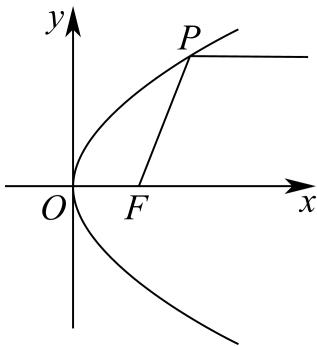

### 闵行 · 原卷第13题

**考点说明：** 抛物线标准方程：比较系数确定参数和焦轴方向，写出准线。

来源：2026届上海高三一模闵行卷，第13题。

抛物线 $y^2=x$ 的准线方程为（ ）。

- A. $x=\frac14$

- B. $x=-\frac14$

- C. $y=\frac14$

- D. $y=-\frac14$

【答案】B

【解析·参考原解整理】

抛物线标准式 $y^2=4px$ 中 $p=\frac14$，故准线为 $x=-\frac14$，选 B。

回源核对说明：逐题对照该PDF题面页面视觉核对；答案转录自第7或12页，非独立数学复核。

## 3 曲线类型、轨迹与存在性判断

### 奉贤 · 原卷第15题

**考点说明：** 二次曲线分类：按系数和常数的取值讨论椭圆、双曲线及退化情形，再考察渐近线。

来源：2026届上海高三一模奉贤卷，第15题。

规范化源文件：`2026届奉贤一模数学试卷 逐题解析.md`。

曲线 C 的方程为 $Ax^{2}-By^{2}=\lambda^{2}$ （A、B 不同时为 0），则下列说法正确的是（）

- A. 曲线 C 不可能是直线
- B. 当 A > 0, B < 0 时，曲线是椭圆
- C. 若曲线 C 是双曲线，则双曲线的渐近线与 $\lambda$ 无关
- D. 曲线 C 是抛物线

【答案】C

【解析】

【分析】根据 A, B 的取值结合圆、椭圆、双曲线方程的特点逐项分析曲线 C 的方程.
【详解】A. 当 $B = 0, A > 0, \lambda > 0$ 时， $x^{2} = \frac{\lambda^{2}}{A}$ ，所以 $x = \pm \sqrt{\frac{\lambda^{2}}{A}}$ 为两条直线，A 选项错误；
B. 因为 A = 1, B = -1, $\lambda > 0$ , $C: x^{2} + y^{2} = \lambda^{2}$ ，所以曲线 C 是半径为 $\lambda$ 的圆，故 B 错误；

C. 因为 $Ax^2 - By^2 = \lambda^2$ ， $A > 0, B > 0$ ，所以曲线 $C$ 是双曲线，则 $\frac{A}{\lambda^2} x^2 - \frac{B}{\lambda^2} y^2 = 1$ ，则渐近线 $y = \pm \sqrt{\frac{A}{B}} x$ ，故 C 正确；

D. 因为曲线 $Ax^2 - By^2 = \lambda^2$ ， $A$ 、 $B$ 不同时为 0，

当 $\lambda = 0$ 时，

当 B > 0, A > 0 时，曲线是两条相交直线；

当 $B > 0, A < 0$ 时，曲线是点；

当 $B\langle 0,A\rangle 0$ 时，曲线是点；

当 $B < 0, A < 0$ 时，曲线是两条相交直线；

当 B=0, A<0 时，曲线是直线；

当 $B = 0, A > 0$ 时，曲线是直线；

当 $A = 0, B > 0$ 时，曲线是直线；

当 A=0, B<0 时，曲线是直线；

当 $\lambda \neq 0$ 时，

当 $B > 0, A > 0$ 时，曲线是双曲线；

当 $B > 0, A < 0$ 时，曲线不存在；

当 $B\langle 0,A\rangle 0,A\neq -B$ 时，曲线是椭圆；

当 $B < 0, A > 0, A = -B$ 时，曲线是圆；

当 B < 0, A < 0 时，曲线是双曲线；

当 $B = 0, A < 0$ 时，曲线不存在；

当 B=0, A>0 时，曲线是直线；

当 $A = 0, B > 0$ 时，曲线不存在；

当 A=0, B<0 时，曲线是直线；

所以曲线 C 不能是抛物线，故 D 错误；

故选：C.

### 崇明 · 原卷第15题

**考点说明：** 向量数量积与轨迹：以定点所在直线建立坐标，把垂足向量关系转化为二次曲线方程，按参数判断可能轨迹。

来源：2026届上海高三一模崇明卷，第15题。

规范化源文件：`2026届崇明一模数学试卷 逐题解析.md`。

已知 A, B 为平面内两定点, 过该平面内动点 M 作直线 AB 的垂线, 垂足为 N. 若$\overrightarrow{MN}^2 = \lambda \overrightarrow{AN} \cdot \overrightarrow{NB}$ ，其中 $\lambda$ 为常数，则动点 $\mathsf{M}$ 的轨迹不可能是（）

- A. 圆
- B. 椭圆
- C. 抛物线
- D. 双曲线

【答案】C

【解析】

【详解】试题分析：以 AB 所在直线为 x 轴，AB 中垂线为 y 轴，建立坐标系，

设 M (x, y), A (-a, 0)、B (a, 0);

因为 $\overrightarrow{MN}^2 = \lambda \overrightarrow{AN} \cdot \overrightarrow{NB}$ ，所以 $y^2 = \lambda (x + a)(a - x)$ ，即 $\lambda x^2 + y^2 = \lambda a^2$ ，当 $\lambda = 1$ 时，轨迹是圆。当 $\lambda > 0$ 且 $\lambda \neq 1$ 时，是椭圆的轨迹方程；当 $\lambda < 0$ 时，是双曲线的轨迹方程；当 $\lambda = 0$ 时，是直线的轨迹方程；综上，方程不表示抛物线的方程。故选 C.

考点：轨迹方程的求法,圆锥曲线方程。

点评：中档题，判断轨迹是什么，一般有两种方法，一是定义法，二是求轨迹方程后加以判断。

### 青浦 · 原卷第10题

**考点说明：** 圆的切线与点的轨迹：利用切线垂直半径和勾股关系确定动点轨迹。

来源：2026届上海高三一模青浦卷，第10题。

规范化源文件：`2026届青浦一模数学试卷 逐题解析.md`。

设 A 为圆 $x^{2} + (y + 1)^{2} = 1$ 上的动点，PA 是圆的切线，且 $\left|PA\right| = 1$ ，则点 P 的轨迹方程是 \_\_\_\_.

【答案】 $x^{2} + (y + 1)^{2} = 2$

【解析】

【分析】根据给定条件，利用圆的切线性质可得 $|PC|=\sqrt{2}$ ，再利用圆的定义求出轨迹方程.
【详解】圆 $x^{2}+(y+1)^{2}=1$ 的圆心为 $C(0,-1)$ ，半径 r=1，

由 $PA$ 切圆 $C$ 于点 $A$ ，得 $CA \perp PA$ ，而 $\left|PA\right| = 1$ ，则 $\left|PC\right|^2 = \left|PA\right|^2 + \left|CA\right|^2 = 1^2 + r^2 = 2$ 即 $\left|PC\right| = \sqrt{2}$ ，因此点 $P$ 的轨迹是以点 $C(0, -1)$ 为圆心， $\sqrt{2}$ 为半径的圆，

所以点 P 的轨迹方程是 $x^{2}+(y+1)^{2}=2$ .

故答案为： $x^{2} + (y + 1)^{2} = 2$

### 长宁 · 原卷第15题

**考点说明：** 双曲线定义与直线交点：由定距离差识别双曲线，结合过原点直线与曲线相交的条件分析斜率。

来源：2026届上海高三一模长宁卷，第15题。

规范化源文件：`2026届长宁一模数学试卷 逐题解析.md`。

已知 $A(-2,0), B(2,0)$ ，若曲线 $\left(\frac{x}{a} + \frac{y}{b}\right)\left(\frac{x}{a} - \frac{y}{b}\right) = 0 (a > 0, b > 0)$ 上存在点 $P$ 满足：

$\left|PB\right| = \left|PA\right| + 2$ ，则 $\frac{b}{a}$ 的取值范围是（ ）

- A. $(0,\sqrt{3})$
- B. $(\sqrt{3}, + \infty)$
- C. $\left(0,\frac{\sqrt{3}}{3}\right)$
- D. $\left(\frac {\sqrt {3}}{3}, + \infty\right)$

【答案】A

【解析】

【分析】根据双曲线的定义及直线与双曲线相交求解 $\frac{b}{a}$ 的取值范围.

【详解】由 $A(-2,0)$ ， $B(2,0)$ 知， $|AB|=4$ .

因为点 $P$ 满足： $\left|PB\right| = \left|PA\right| + 2$ ，即 $\left|PB\right| - \left|PA\right| = 2$ ，且 $\left|PB\right| - \left|PA\right| < \left|AB\right|$

所以点 P 在以 A, B 为焦点的双曲线的左支上，设其方程为 $\frac{x^{2}}{a'^{2}} - \frac{y^{2}}{b'^{2}} = 1 (x < 0)$ ,

$$
2 c = 4
$$

$$
2 a ^ {\prime} = 2
$$

$$
c = 2, a ^ {\prime} = 1
$$

$$
b ^ {2} = c ^ {2} - a ^ {2} = 3
$$

所以点 $P$ 在双曲线 $x^{2} - \frac{y^{2}}{3} = 1$ 的左支上，其渐近线方程为 $y = \pm \sqrt{3} x$

由曲线方程 $\left(\frac{x}{a} +\frac{y}{b}\right)\left(\frac{x}{a} -\frac{y}{b}\right) = 0(a > 0,b > 0)$ 得 $y = \pm \frac{b}{a} x$

因为曲线 $\left(\frac{x}{a} +\frac{y}{b}\right)\left(\frac{x}{a} -\frac{y}{b}\right) = 0(a > 0,b > 0)$ 上存在点 $P$ 满足： $\left|PB\right| = \left|PA\right| + 2$

所以直线 $y = \pm \frac{b}{a} x$ 与双曲线 $x^{2} - \frac{y^{2}}{3} = 1$ 的左支有交点，所以 $0 < \frac{b}{a} < \sqrt{3}$ .

故选：A.

### 杨浦 · 原卷第15题

**考点说明：** 双曲线上动点的向量夹角：结合双曲线两支及渐近线研究角度范围，并判断边界能否达到。

来源：2026届上海高三一模杨浦卷，第15题。

规范化源文件：`2026届杨浦一模数学试卷 逐题解析.md`。

已知双曲线 $C: \frac{x^2}{4} - \frac{y^2}{9} = 1$ ，点 $M(4,6)$ ，点 $A$ 、 $B$ 分别在双曲线 $C$ 的左、右两支上，则向量 $\overrightarrow{MA}$ 、 $\overrightarrow{MB}$ 的夹角 $\theta$ （）

- A. 有最大值，但无最小值
- B. 无最大值，但有最小值
- C. 既有最大值，又有最小值
- D. 既无最大值，又无最小值

【答案】A

【解析】

【分析】根据题意，得到点 M 在双曲线的渐近线 $y=\frac{3}{2}x$ 上，结合双曲线的几何性质，以及向量的夹角的定义，即可求解.
【详解】由双曲线 $C:\frac{x^{2}}{4}-\frac{y^{2}}{9}=1$ ，可得 a=2, b=3，所以双曲线的其中一条渐近线方程为 $y=\frac{3}{2}x$ 则点 $M(4,6)$ 满足渐近线 $y=\frac{3}{2}x$ ，所以点 M 在双曲线的渐近线 $y=\frac{3}{2}x$ 上，
所以过点 M 存在双曲线右支的切线，但不存在与左支相切的直线，
所以向量 $\overrightarrow{MA}, \overrightarrow{MB}$ 的夹角 $\theta$ 不存在最小值，
过点 M 作 x 轴的平行线，交双曲线的左右两支分别为 A, B 两点，此时 $\overrightarrow{MA}, \overrightarrow{MB} = \pi$ ，
因为 $\theta \in [0, \pi]$ ，所以向量 $\overrightarrow{MA}, \overrightarrow{MB}$ 的夹角 $\theta$ 存在最大值，最大值为 $\pi$ ，
综上可得，向量 $\overrightarrow{MA}, \overrightarrow{MB}$ 的夹角 $\theta$ 存在最大值，不存在最小值.
故选：A.

### 金山 · 原卷第16题

**考点说明：** 新定义曲线与命题判断：按象限分析超椭圆与直线的交点，并研究曲线上点到原点的距离范围。

来源：2026届上海高三一模金山卷，第16题。

记曲线 $C:\dfrac{|x|^n}{a}+\dfrac{|y|^n}{b}=1$（$a>0$ 且 $b>0$，$n>0$ 且 $n\in\mathbb R$）为 $C_{(a,b)}^n$，称其为“超椭圆”。命题 $p$：直线 $l:2x+9y-12=0$ 与超椭圆 $C_{(3,2)}^{\frac12}$ 有3个不同交点；命题 $q$：超椭圆 $C_{(9,1)}^8$ 上的点到坐标原点距离的取值范围为 $[1,2^{5/8}]$，则下列说法正确的是（　）

- A. 命题 $p$ 为真命题，命题 $q$ 为假命题

- B. 命题 $p$ 为假命题，命题 $q$ 为真命题

- C. 命题 $p,q$ 均为真命题

- D. 命题 $p,q$ 均为假命题

【答案】A

【解析】

【分析】命题 $p$ ：代入 $a, b, n$ ，移项由绝对值范围求解 $x, y$ 的范围，分情况与直线列方程组求解，根据结果可判断命题 $p$ ；命题 $q$ ：由图形的对称性将方程降幂，写成平方和的形式，三角换元，根据权方和不等式可得出距离范围的最大值，从而判断命题 $q$ ．

【详解】命题 $p: C_{(3,2)}^{\frac{1}{2}}: \frac{\sqrt{|x|}}{3} + \frac{\sqrt{|y|}}{2} = 1$ ，由 $\frac{\sqrt{|y|}}{2} = 1 - \frac{\sqrt{|x|}}{3} \geq 0$ 可得： $|x| \leq 9$ ，同理 $|y| \leq 4$ ， $1^\circ$ 当 $x \geq 0, y \geq 0$ 时， $C_{(3,2)}^{\frac{1}{2}}$ 方程可化简为 $y = \frac{4}{9} x - \frac{8}{3} \sqrt{x} + 4$ ，
联立 $\left\{ \begin{array}{l} y = \frac{4}{9} x - \frac{8}{3} \sqrt{x} + 4 \\ 2x + 9y - 12 = 0 \end{array} \right.$ ，解得： $\left\{ \begin{array}{l} x = 4 \\ y = \frac{4}{9} \end{array} \right.$ $2^\circ$ 当 $x < 0, y \geq 0$ 时， $C_{(3,2)}^{\frac{1}{2}}$ 方程可化简为 $y = -\frac{4}{9} x - \frac{8}{3} \sqrt{-x} + 4$ ，
联立 $\left\{ \begin{array}{l} y = -\frac{4}{9} x - \frac{8}{3} \sqrt{-x} + 4 \\ 2x + 9y - 12 = 0 \end{array} \right.$ ，解得： $\left\{ \begin{array}{l} x = -60 - 24\sqrt{6} \\ y = \frac{44 + 16\sqrt{6}}{3} \end{array} \right.$ （舍）或 $\left\{ \begin{array}{l} x = -60 + 24\sqrt{6} \\ y = \frac{44 - 16\sqrt{6}}{3} \end{array} \right.$ ； $3^\circ$ 当 $x < 0, y < 0$ 时， $l: 2x + 9y - 12 = 0$ 不过第三象限，所以第三象限无交点； $4^\circ$ 当 $x \geq 0, y < 0$ 时， $C_{(3,2)}^{\frac{1}{2}}$ 方程可化简为 $y = -\frac{4}{9} x + \frac{8}{3}\sqrt{x} - 4$ ，
联立 $\left\{ \begin{array}{l} y = -\frac{4}{9} x + \frac{8}{3}\sqrt{x} - 4 \\ 2x + 9y - 12 = 0 \end{array} \right.$ ，解得： $\left\{ \begin{array}{l} x = 48 - 24\sqrt{3} \\ y = \frac{-28 + 16\sqrt{3}}{3} \end{array} \right.$ 或 $\left\{ \begin{array}{l} x = 48 + 24\sqrt{3} \\ y = \frac{-28 - 16\sqrt{3}}{3} \end{array} \right.$ （舍）

综上： $C_{(3,2)}^{\frac{1}{2}}$ 与直线 $l: 2x + 9y - 12 = 0$ 共3个交点，所以命题 $p$ 正确；

命题 $q: C_{(9,1)}^{8}: \frac{x^8}{9} + y^8 = 1$ ，由图形的对称性，不妨考虑 $x \geq 0, y \geq 0$ .

即 $\left(\frac{x^4}{3}\right)^2 +\left(y^4\right)^2 = 1$ ，令 $\left\{ \begin{array}{l} \frac{x^4}{3} = \cos \alpha \\ y^4 = \sin \alpha \end{array} \right.$ ，则 $\left\{ \begin{array}{l} x^{2} = \sqrt{3\cos\alpha}\\ y^{2} = \sqrt{\sin\alpha} \end{array} \right.$

则 $x^{2} + y^{2} = \sqrt{3\cos\alpha} +\sqrt{\sin\alpha}$

由权方和不等式可得： $\frac{\left(\sqrt{3\cos\alpha} + \sqrt{\sin\alpha}\right)^4}{\left(\sqrt[3]{9} + 1\right)^3}\leq \frac{9\cos^2\alpha}{9} +\sin^2\alpha = 1,$

所以 $\sqrt{3\cos\alpha} +\sqrt{\sin\alpha}\leq \left(\sqrt[3]{9} +1\right)^{\frac{3}{4}} <   2^{\frac{5}{4}}$ ，所以命题 $q$ 错误

## 4 距离、角度与几何最值模型

### 奉贤 · 原卷第11题

**考点说明：** 向量模的几何意义：把两条模条件分别识别为圆和椭圆，再研究两图形上点的最大距离。

来源：2026届上海高三一模奉贤卷，第11题。

规范化源文件：`2026届奉贤一模数学试卷 逐题解析.md`。

在平面中， $\vec{e}_1$ 和 $\vec{e}_2$ 是互相垂直的单位向量，向量 $\vec{a}$ 满足 $\left|\vec{a} - 6\vec{e}_1\right| = 1$ ，向量 $\vec{b}$ 满足 $\left|\vec{b} - 6\vec{e}_1\right| + \left|\vec{b} - 8\vec{e}_2\right| = 20$ ，则 $\left|\vec{a} - \vec{b}\right|$ 的最大值是 \_\_\_\_.

【答案】16

【解析】

【分析】根据模长值得出圆的轨迹，再根据模长关系得出椭圆，最后应用圆与椭圆的位置关系得出最值即可.

【详解】因为 $\overrightarrow{e_1}$ 和 $\overrightarrow{e_2}$ 是互相垂直的单位向量，所以设 $\overrightarrow{e_1} = (1,0),\overrightarrow{e_2} = (0,1)$

向量 $\vec{a}$ 满足 $\left|\vec{a} - 6\vec{e}_1\right| = 1$ ，表示以 $(6,0)$ 为圆心，半径为1的圆，

$\left|\overrightarrow{6e_1} - 8\overrightarrow{e_2}\right| = \sqrt{36 + 64 - 96\overrightarrow{e_1}\cdot\overrightarrow{e_2}} = 10$ ，向量 $\vec{b}$ 满足 $\left|\vec{b} -6\overrightarrow{e_1}\right| + \left|\vec{b} -8\overrightarrow{e_2}\right| = 20$

表示长轴为 $2a = 20$ ，焦距 $2c = 10$ 的椭圆，且 $(6,0)$ 为椭圆的一个焦点，

因为 $\left|\vec{a}-\vec{b}\right|$ 表示以 $(6,0)$ 为圆心，半径为1的圆上的点到椭圆上的点距离，

则 $\left|\vec{a} -\vec{b}\right|_{\max} = a + c + 1 = 10 + 5 + 1 = 16.$

故答案为：16.

### 徐汇 · 原卷第11题

**考点说明：** 圆上动点的张角最值：将定点连线与圆上动点构成的角作几何或代数转化，分析最大张角及相应正弦值。

来源：2026届上海高三一模徐汇卷，第11题。

某城市核心区域可看作一个平面，市中心为点 $O$，城市有两个交通枢纽站点 $A,B$，其中站点 $A$ 在市中心 $O$ 的正东方向，距离 $O$ 点 $4$ 公里，站点 $B$ 在市中心 $O$ 的正北方向，距离 $O$ 点也是 $4$ 公里。为了动态调整交通信号，相关部门计划在距离中心 $O$ 点 $2$ 公里的位置，设置一个移动数据采集点 $C$，通过监测 $\angle ACB$ 的大小来优化信号。当 $\angle ACB$ 最大时，$\sin\angle ACB=$______（结果精确到 $0.01$）。

【答案】0.54

#### 解析

取 $A=(4,0)$、$B=(0,4)$、$C=(x,y)$，则 $x^2+y^2=4$。记 $t=x+y\in[-2\sqrt2,2\sqrt2]$，$\alpha=\angle ACB$。
有
$$\overrightarrow{CA}\cdot\overrightarrow{CB}=4-4t,\qquad |\det(\overrightarrow{CA},\overrightarrow{CB})|=16-4t>0.$$
因此 $\cot\alpha=(1-t)/(4-t)$。该式关于 $t$ 的导数为 $-3/(4-t)^2<0$，而余切在 $(0,\pi)$ 递减，故 $\alpha$ 随 $t$ 严格增大。最大值对应 $t=2\sqrt2$，即 $C=(\sqrt2,\sqrt2)$。
此时
$$\sin\alpha=\frac{16-8\sqrt2}{20-8\sqrt2}=\frac{12-2\sqrt2}{17}\approx0.54.$$
> 校订说明：改用数量积和行列式，补足原解“最大角必在第一象限”的论证，并清除错误展开式。

回源核对说明：解析为既有独立校订稿，不是原解逐字转录。

### 徐汇 · 原卷第15题

**考点说明：** 椭圆定义与动点距离：识别两圆圆心为椭圆焦点，结合焦点距离和及圆上点的距离范围分析取值边界。

来源：2026届上海高三一模徐汇卷，第15题。

设 $P$ 为椭圆 $\frac{x^2}{25}+\frac{y^2}{16}=1$ 上一动点，$M,N$ 分别为圆 $C_1:(x+3)^2+y^2=1$ 和圆 $C_2:(x-3)^2+y^2=4$ 上的动点，则 $|PM|+|PN|$ 不可能为（　）。

- A. $7.5$

- B. $9.5$

- C. $11.5$

- D. $13.5$

【答案】D

#### 解析

由题可得两个圆心恰好是椭圆的焦点，结合椭圆的定义，再根据圆外一点到圆上点的距离最小值为点到圆心距离减半径，圆外一点到圆上点的距离最大值为点到圆心距离加半径，求出 $| P M | + | P N |$ 的取值范围，即可得到答案

椭圆的两个焦点坐标为 $F _ { 1 } \left( - 3 , 0 \right) , F _ { 2 } \left( 3 , 0 \right)$ ，恰好为两个圆的圆心坐标，

圆 $C _ { 1 }$ 的半径 $r _ { 1 } = 1$ ，圆 $C_2\text{的}$ 半径 $r _ { 2 } = 2 ,$

由椭圆的定义可得 $| P F _ { 1 } | + | P F _ { 2 } | = 10 .$

当椭圆上动点P与焦点连线与圆相交于M,N时， $| P M | + | P N |$ 最小，最小值为

$$
| P F _ { 1 } | + | P F _ { 2 } | - r _ { 1 } - r _ { 2 } = 7 ,
$$

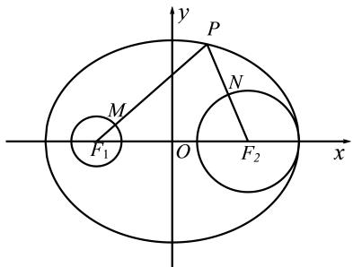

当椭圆上动点P与焦点连线的反向延长线与圆相交于M,N时， $| P M | + | P N |$ 最大，最大值为$| P F _ { 1 } | + | P F _ { 2 } | + r _ { 1 } + r _ { 2 } = 13$

所以7 $\leq | P M | + | P N | \leq 13 .$

故选：D.

### 普陀 · 原卷第15题

**考点说明：** 双曲线焦点距离最值：利用双曲线定义转化距离差，结合动点范围检查最值能否取得。

来源：2026届上海高三一模普陀卷，第15题。

规范化源文件：`2026届普陀一模数学试卷 逐题解析.md`。

设点 $M$ 是抛物线 $x^{2} = 8\sqrt{5} y$ 的焦点，点 $F$ 是双曲线 $\Gamma: x^{2} - \frac{y^{2}}{4} = 1$ 的左焦点，点 $Q$ 是

Γ上在第一象限内的一动点，则下列结论中正确的是（）

- A. $\left|QF\right|-\left|QM\right|$ 的最大值是 5
- B. $\left|QF\right|+\left|QM\right|$ 的最小值是 5
- C. $\left|QF\right|-\left|QM\right|$ 的最大值是 7
- D. $\left|QF\right|+\left|QM\right|$ 的最小值是 7

【答案】D

【解析】

【分析】作出图象，根据图象利用两边之和、差与第三边的关系分析最大值与最小值即可得解.

【详解】如图，

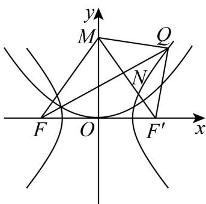

由点 M 是抛物线 $x^{2}=8\sqrt{5}y$ 的焦点，故 $M(0,2\sqrt{5})$ ,

由双曲线 $\Gamma: x^{2} - \frac{y^{2}}{4} = 1$ 知， $a = 1, b = 2, c = \sqrt{1 + 4} = \sqrt{5}$ ，

故 $F\left(-\sqrt{5},0\right)$ ，右焦点 $F'\left(\sqrt{5},0\right)$ ,

所以 $k_{FM}=\frac{2\sqrt{5}-0}{0+\sqrt{5}}=2$ ，又双曲线的渐近线方程为 $y=\pm2x$

所以直线 FM 与双曲线右支无交点，故 $\left|QF\right|-\left|QM\right|<\left|FM\right|=\sqrt{\left(\sqrt{5}\right)^{2}+\left(2\sqrt{5}\right)^{2}}=5$ ，故 AC 错误；

由双曲线的定义， $\left|QF\right|=2a+\left|QF'\right|=2+\left|QF'\right|$

所以 $\left|QF\right|+\left|QM\right|=2+\left|QF'\right|+\left|QM\right|\geq2+\left|MF'\right|=2+\sqrt{\left(\sqrt{5}\right)^{2}+\left(2\sqrt{5}\right)^{2}}=7$

即点 $Q$ 运动到点 $N$ ， $M,N,F'$ 三点共线时， $\left|QF\right| + \left|QM\right|$ 有最小值7，故B错误D正确.故选：D

### 青浦 · 原卷第12题

**考点说明：** 双曲线轨迹与向量投影：由距离差识别动点轨迹，结合圆上点的投影范围求最值。

来源：2026届上海高三一模青浦卷，第12题。

规范化源文件：`2026届青浦一模数学试卷 逐题解析.md`。

在平面直角坐标系中，O 为坐标原点. 已知点 $A(0,2)$ , $B(2,0)$ , $C(-2,0)$ ，若 $|PC| - |PB| = 2\sqrt{2}$ , $|QA| = 1$ ，则向量 $\overrightarrow{OQ}$ 在向量 $\overrightarrow{OP}$ 方向上的数量投影的取值范围是 \_\_\_\_.

【答案】 $(- \sqrt{2} - 1, \sqrt{2} + 1)$

【解析】

【分析】根据条件，结合双曲线的定义、圆的定义，可得点 P、Q 的轨迹方程，由题意，即求 $\overrightarrow{OA}$ 在向量 $\overrightarrow{OP}$ 方向上的数量投影再加减半径即可，设 $P(x,y)$ ，根据数量投影的公式，代入化简，分析计算，即可得答案.

【详解】因为 $|BC|=4$ ， $|PC|-|PB|=2\sqrt{2}<4$ ，

所以点 P 的轨迹为双曲线的右支，且 $2a = 2\sqrt{2}, c = 2$ ，

所以 $b^{2}=c^{2}-a^{2}=2$ ，则点P的方程为 $\frac{x^{2}}{2}-\frac{y^{2}}{2}=1(x\geq\sqrt{2})$

因为 $A(0,2)$ ，且 $\left|QA\right|=1$ ，

所以点 $Q$ 的轨迹是以 $A$ 为圆心，1为半径的圆，

所以 Q 的方程为 $x^{2}+(y-2)^{2}=1$ ，

要求向量 $\overrightarrow{OQ}$ 在向量 $\overrightarrow{OP}$ 方向上的数量投影，

只需求 $\overrightarrow{OA}$ 在向量 $\overrightarrow{OP}$ 方向上的数量投影再加减半径即可，

设 $P(x,y)$ ， $x^{2} - y^{2} = 2,(x\geq \sqrt{2})$

所以 $\overrightarrow{OA}$ 在向量 $\overrightarrow{OP}$ 方向上的数量投影为 $\frac{\overrightarrow{OA} \cdot \overrightarrow{OP}}{|\overrightarrow{OP}|} = \frac{2y}{\sqrt{x^2 + y^2}} = \frac{2y}{\sqrt{2 + 2y^2}} = \frac{\sqrt{2}y}{\sqrt{1 + y^2}}$

令 $t = \frac{\sqrt{2}y}{\sqrt{1 + y^2}}$ ，则当 $y = 0$ 时， $t = 0$

当 $y \neq 0$ 时， $t^2 = \frac{2y^2}{1 + y^2} = \frac{2}{\frac{1}{y^2} + 1} \in (0, 2)$ ，则 $t \in (-\sqrt{2}, 0) \cup (0, \sqrt{2})$

综上 $t\in (-\sqrt{2},\sqrt{2})$ ，即 $\frac{\overrightarrow{OA}\cdot\overrightarrow{OP}}{\left|\overrightarrow{OP}\right|}\in (-\sqrt{2},\sqrt{2})$

所以 $\overrightarrow{OQ}$ 在向量 $\overrightarrow{OP}$ 方向上的数量投影的取值范围是 $(- \sqrt{2} - 1, \sqrt{2} + 1)$ .

故答案为： $(- \sqrt{2} - 1, \sqrt{2} + 1)$

### 黄浦 · 原卷第12题

**考点说明：** 图形覆盖圆：利用图像对称性和关键边界点，将最小覆盖半径转化为距离最值问题。

来源：2026届上海高三一模黄浦卷，第12题。

规范化源文件：`2026届黄浦一模数学试卷 逐题解析.md`。

若图形 $\Gamma$ 上的每个点都在圆 $C$ 上或在圆 $C$ 内部，则称圆 $C$ 为 $\Gamma$ 的一个覆盖圆．设 $\Gamma$ 由函数 $y = 2|x| - 4(-2 < x < 2)$ 与 $y = \sqrt{2|x| - x^2}$ 的图像所组成，则 $\Gamma$ 的最小覆盖圆的半径为 \_\_\_\_.

【答案】 $\frac{8}{3}$

【解析】

【分析】根据函数 $y=\sqrt{2|x|-x^{2}}$ 的奇偶性结合圆的方程得其图像构成，由函数 $y=2|x|-4(-2<x<2)$ 的奇偶性与一次函数关系得其图像构成，从而可确定最小覆盖圆的圆心位置，设覆盖圆的半径为 r，根据几何性质列不等式求解最小半径即可.

【详解】函数 $y = \sqrt{2|x| - x^2}$ 的定义域满足 $2|x| - x^2 \geq 0$ ，解得 $0 \leq |x| \leq 2$ ，即 $-2 \leq x \leq 2$ ，则函数 $y = \sqrt{2|x| - x^2}$ 为偶函数，

又 $y^{2} = 2|x| - x^{2}$ ，整理得 $\left(|x| - 1\right)^{2} + y^{2} = 1, y \geq 0$ ，则函数 $y = \sqrt{2|x| - x^2}$ 的图像为：

以 $C_1(1,0)$ 为圆心，1为半径的上半圆与以 $C_2(-1,0)$ 为圆心，1为半径的上半圆，函数 $y = 2|x| - 4(-2 < x < 2)$ 为偶函数，图象为先减后增的“V”型图，最低点为 $A(0, - 4)$ 则 $\Gamma$ 的图像大致如下：

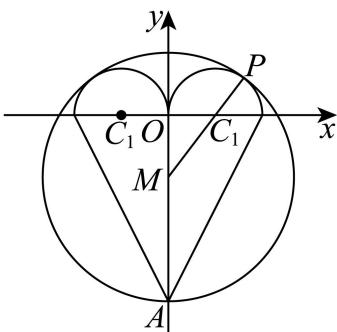

由于 $\Gamma$ 的图像关于 $y$ 轴对称，要使得覆盖圆的半径最小，则覆盖圆的圆心 $M$ 在 $y$ 轴上，设 $M(0,m)$ ，且 $-4 < m < 0$ ，覆盖圆的半径为 $r$ ，

设 $P$ 点在半圆 $C_1$ 上，满足 $P, C_1, M$ 三点共线，

则 $\left\{ \begin{array}{l} |AM| \leq r \\ |PM| \leq r \end{array} \right. \Rightarrow \left\{ \begin{array}{l} m + 4 \leq r \\ 1 + \sqrt{m^2 + 1} \leq r \end{array} \right.$ 当 $m + 4 = 1 + \sqrt{m^2 + 1}$ 时，解得 $m = -\frac{4}{3}$ ，此时 $r \geq -\frac{4}{3} + 4 = \frac{8}{3}$ ;

当 $m + 4 < 1 + \sqrt{m^2 + 1}$ 时，解得 $-4 < m < -\frac{4}{3}$ ，此时 $r \geq 1 + \sqrt{m^2 + 1} > 1 + \sqrt{\left(-\frac{4}{3}\right)^2 + 1} = \frac{8}{3}$ ;

当 $m + 4 > 1 + \sqrt{m^2 + 1}$ 时，解得 $-\frac{4}{3} < m < 0$ ，此时 $r \geq m + 4 > -\frac{4}{3} + 4 = \frac{8}{3}$ ;

综上可得 $r \geq \frac{8}{3}$ ，故 $r$ 的最小值为 $\frac{8}{3}$ .

故答案为： $\frac{8}{3}$ .

### 宝山 · 原卷第15题

**考点说明：** 双曲线的实际模型：由通风塔截面和尺寸建立方程，利用参数关系求焦距。

来源：2026届上海高三一模宝山卷，第15题。

规范化源文件：`2026届宝山一模数学试卷 逐题解析.md`。

双曲线型自然冷却通风塔的外形是由双曲线的一部分绕其虚轴所在的直线旋转一周所形成的曲面，如图所示．已知它的下口直径为 $20 \sqrt{10}$ 米，上口直径为 $20 \sqrt{2}$ 米，最小直径为 20 米，高为 80 米，则此双曲线的焦距为（）

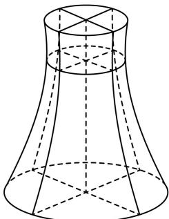

- A. $10\sqrt{3}$
- B. $10\sqrt{5}$
- C. $20\sqrt{3}$
- D. $20\sqrt{5}$

【答案】D

【解析】

【分析】根据题意，得到双曲线的方程 $\frac{x^{2}}{100}-\frac{y^{2}}{b^{2}}=1$ ，设 $A(10\sqrt{2},y_{1})$ ，得到 $B(10\sqrt{10},y_{1}-80)$ ，将其代入双曲线的方程，联立方程组，求得b=20，进而求得 $c=10\sqrt{5}$ ，即可求解.
【详解】如图所示，设双曲线的标准方程为 $\frac{x^{2}}{a^{2}}-\frac{y^{2}}{b^{2}}=1(a>0,b>0)$ ,

因为通风塔的外形最小直径为20米，可得 $2a = 10$ ，所以 $a = 10$ ，即 $\frac{x^2}{100} -\frac{y^2}{b^2} = 1$ 又因为通风塔的外形的下口直径为 $20\sqrt{10}$ 米，上口直径为 $20\sqrt{2}$ 米，且高为80米，设 $A(10\sqrt{2},y_1)$ ，其中 $y_{1} > 0$ ，则 $B(10\sqrt{10},y_{1} - 80)$ 将 $A,B$ 的坐标代入双曲线的方程，可得 $\left\{ \begin{array}{l} \frac{\left(10\sqrt{2}\right)^2}{100} -\frac{y_1^2}{b^2} = 1\\ \frac{\left(10\sqrt{10}\right)^2}{100} -\frac{\left(y_1 - 80\right)^2}{b^2} = 1 \end{array} \right.$ 整理得 $\left\{ \begin{array}{l} y_1^2 = b^2\\ (y_1 - 80)^2 = 9b^2 \end{array} \right.$ ，即 $\left\{ \begin{array}{l} y_1 = b\\ 80 - y_1 = 3b \end{array} \right.$ ，所以 $(80 - b)^2 = 9b^2$ ，解得 $b = 20$ 所以 $c = \sqrt{a^2 + b^2} = \sqrt{10^2 + 20^2} = 10\sqrt{5}$ ，则 $2c = 20\sqrt{5}$ 所以此双曲线的焦距为 $20\sqrt{5}$

故选：D.

### 虹口 · 原卷第9题

**考点说明：** 双曲线参数与距离：结合焦点三角形的直角和已知正弦确定曲线参数，再计算点到渐近线的距离。

来源：2026届上海高三一模虹口卷，第9题。

规范化源文件：`2026届虹口一模数学试卷 逐题解析.md`。

已知双曲线 C 的焦点分别为 $F_{1}(-1,0)$ 和 $F_{2}(1,0)$ ，若点 P 为 C 上的点，且满足 $PF_{2} \perp F_{1}F_{2}$ ， $\sin\angle PF_{1}F_{2} = \frac{3}{5}$ ，则点 $F_{1}$ 到 C 的一条渐近线的距离为 \_\_\_\_。

【答案】 $\frac{\sqrt{3}}{2}$

【解析】

【分析】利用勾股定理和双曲线的定义及 $a, b, c$ 的关系，先求出双曲线的方程及渐近线的方程，再根据点到直线的距离公式计算即可.

【详解】因为双曲线 C 的焦点分别为 $F_{1}(-1,0)$ 和 $F_{2}(1,0)$ ,

所以 $2c = \left|F_{1}F_{2}\right| = 2$ ，所以 $c = 1$

因为 $PF_{2} \perp F_{1}F_{2}$ ， $\sin\angle PF_{1}F_{2}=\frac{3}{5}$ ，所以在 Rt $\triangle PF_{1}F_{2}$ 中，有 $\frac{|PF_{2}|}{|PF_{1}|}=\frac{3}{5}$ .

设 $\left|PF_{1}\right|=5k,\left|PF_{2}\right|=3k(k>0)$ ，则由勾股定理可得

$\left|F_{1}F_{2}\right| = \sqrt{\left|PF_{1}\right|^{2} - \left|PF_{2}\right|^{2}} = \sqrt{(5k)^{2} - (3k)^{2}} = 4k = 2$ ，所以 $k = \frac{1}{2}$

所以 $2a = \left\| PF_1\right| - \left|PF_2\right| = \left|5k - 3k\right| = \left|\frac{5}{2} -\frac{3}{2}\right| = 1$ ，所以 $a = \frac{1}{2}$

又由 $c^2 = a^2 + b^2$ ，可得 $b^2 = c^2 - a^2 = 1 - \left(\frac{1}{2}\right)^2 = \frac{3}{4}$ ，

所以双曲线的方程为 $\frac{x^{2}}{\frac{1}{4}}-\frac{y^{2}}{\frac{3}{4}}=1$ .

其渐近线方程为 $y = \pm \frac{b}{a} x = \pm \sqrt{3} x$ ，即 $\sqrt{3} x \pm y = 0$ .

取渐近线 $\sqrt{3} x - y = 0$ ，则点 $F_{1}(-1,0)$ 到该直线的距离为

$$
d = \frac {\left| \sqrt {3} \times (- 1) - 0 \right|}{\sqrt {(\sqrt {3}) ^ {2} + 1 ^ {2}}} = \frac {\left| \sqrt {3} \right|}{2} = \frac {\sqrt {3}}{2}.
$$

故答案为： $\frac{\sqrt{3}}{2}$

核对说明：已截去图形及第二个答案起的抛物线题内容。

### 闵行 · 原卷第6题

**考点说明：** 圆的弦长：以圆心到直线的距离表示弦长，将最短弦转化为过定点直线的最大距离。

来源：2026届上海高三一模闵行卷，第6题。

过点 $P(1,1)$ 的直线被圆 $x^2+y^2=4$ 截得的最短弦长为________。

【答案】$2\sqrt2$

【解析·参考原解整理】

圆心到 $P$ 的距离为 $\sqrt2$。过 $P$ 的直线与 $OP$ 垂直时，圆心到直线距离最大，弦最短，长度为 $2\sqrt{4-2}=2\sqrt2$。

回源核对说明：逐题对照该PDF题面页面视觉核对；答案转录自第7或12页，非独立数学复核。

## 5 椭圆与动直线、焦点弦及向量关系

### 奉贤 · 原卷第20题

**考点说明：** 第（1）问：椭圆基本量与焦点作图：联立顶点距离、离心率及半轴关系求方程，并以焦距关系说明作图依据。 第（2）问：椭圆上的面积约束：把两三角形面积表示为点坐标的关系，再与椭圆方程联立并筛选第一象限点。 第（3）问：椭圆弦的分点比与定值判断：以过定点的直线参数化交点，利用根与系数的关系求长度比，注意交点存在和切线退化。

来源：2026届上海高三一模奉贤卷，第20题。

规范化源文件：`2026届奉贤一模数学试卷 逐题解析.md`。

椭圆 $\frac{x^2}{a^2} + \frac{y^2}{b^2} = 1 (a > b > 0)$ ， $P$ 是第一象限内椭圆上的点， $A_1(-a,0)$ ， $B_1(0,b)$ ， $|A_1B_1| = \sqrt{5}$ ，椭圆的离心率是 $\frac{\sqrt{3}}{2}$ 。 $M(-t,0)$ ， $N(t,0)$ ， $t > 0$ 且 $t \neq a$ 。

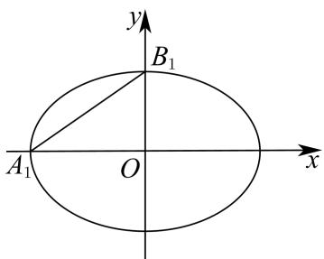

图1

图3

图2

备用图

（1）求椭圆的方程并在下图 1 中作出椭圆的左焦点，写出作图依据；

(2)如图2, 设 $t = 1$ , 三角形 $PMN$ 的面积记为 $S_{1}$ , 三角形 $PA_{1}B_{1}$ 的面积记为 $S_{2}$ , 若 $S_{2} = 2S_{1}$ , 求点 $P$ 的坐标;

(3) 设 $P(x_{0}, y_{0})$ ，连结 PM 与椭圆交于点 A，连结 PN 与椭圆交于点 B，判断 $\frac{|PM|}{|MA|} + \frac{|PN|}{|NB|}$ 是否为定值？请说明理由.

【答案】（1）椭圆的方程为 $\frac{x^{2}}{4}+y^{2}=1$ ，作图见解析

(2) $\left(\frac{8}{5},\frac{3}{5}\right)$

（3）为定值 $\left|\frac{8+2t^{2}}{4-t^{2}}\right|$

【解析】

【分析】（1）根据椭圆中 $a, b, c$ 的关系求解椭圆方程即可，利用椭圆的定义作图即可得椭圆的左焦点；

（2）设 $P\left(x_0,y_0\right)$ ，则 $\frac{x_0^2}{4} +y_0^2 = 1$ ，根据三角形面积公式即可得 $S_{1}$ ， $S_{1}$ 关于 $x_0,y_0$ 的式子，利用面积比例求解 $x_0,y_0$ 即可得所求；

（3）设 $l_{PB}: x = my + t$ ，其中 $m = \frac{x_0 - t}{y_0}$ ， $l_{PA}: x = ny - t$ ，其中 $n = \frac{x_0 + t}{y_0}$ ，分别与椭圆方程联立，根据根于系数的关系得 $y_B$ 与 $y_0$ ， $y_A$ 与 $y_0$ 的关系，再根据线段比例关系计算验证 $\frac{|PM|}{|MA|} + \frac{|PN|}{|NB|}$ 是否为定值即可.

【小问 1 详解】

因为椭圆 $\frac{x^2}{a^2} +\frac{y^2}{b^2} = 1(a > b > 0)$ 中 $A_{1}(-a,0),B_{1}(0,b),|A_{1}B_{1}| = \sqrt{5}$ ，椭圆的离心率是 $\frac{\sqrt{3}}{2},$

【小问2详解】

则 $\left\{ \begin{array}{l} \sqrt{a^2 + b^2} = \sqrt{5} \\ \frac{c}{a} = \frac{\sqrt{3}}{2} \\ a^2 = b^2 + c^2 \end{array} \right.$ ，解得 $a = 2, b = 1, c = \sqrt{3}$ ，

则椭圆的方程为 $\frac{x^2}{4} + y^2 = 1$

如下图：以 $B_{1}$ 为圆心，以 $OA_{1}$ 的长为半径在线段 $OA_{1}$ 上画圆弧，与线段 $OA_{1}$ 的交点即为椭圆的左焦点 $F_{1}\left(-\sqrt{3},0\right)$ ;

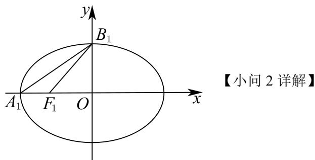

设 $P\left(x_0,y_0\right)$ ，则 $\frac{x_0^2}{4} +y_0^2 = 1$ ①，且 $0 <   x_{0} <   2,0 <   y_{0} <   1$

当 $t = 1$ 时， $M(-1,0)$ ， $N(1,0)$

又 $S_{1} = S_{\triangle PMN} = \frac{1}{2}\big|M N\big|\cdot y_{0} = \frac{1}{2}\times 2\cdot y_{0} = y_{0}$

因为 $A_{1}(-2,0)$ ， $B_{1}(0,1)$ ，所以直线 $A_{1}B_{1}$ 的方程为 $\frac{x}{-2} + y = 1$ ，即 $x - 2y + 2 = 0$

故点 $P\left(x_0,y_0\right)$ 到直线 $A_{1}B_{1}$ 的距离 $d_P = \frac{\left|x_0 - 2y_0 + 2\right|}{\sqrt{1^2 + (-2)^2}} = \frac{\left|x_0 - 2y_0 + 2\right|}{\sqrt{5}}$

$$
S _ {2} = S _ {\triangle P A _ {1} B _ {1}} = \frac {1}{2} \left| A _ {1} B _ {1} \right| \cdot d _ {P} = \frac {1}{2} \times \sqrt {5} \cdot \frac {\left| x _ {0} - 2 y _ {0} + 2 \right|}{\sqrt {5}} = \frac {\left| x _ {0} - 2 y _ {0} + 2 \right|}{2} = \frac {x _ {0} - 2 y _ {0} + 2}{2},
$$

因为 $S_{2} = 2S_{1}$ ，所以 $\frac{x_0 - 2y_0 + 2}{2} = 2y_0$ ，即 $x_0 - 6y_0 + 2 = 0$ ②，

联立①②，且 $0 < x_0 < 2, 0 < y_0 < 1$ ，解得 $x_0 = \frac{8}{5}, y_0 = \frac{3}{5}$

故点 P 的坐标为 $\left(\frac{8}{5}, \frac{3}{5}\right)$ ;

## 【小问 3 详解】

如图所示 $M(-t,0)$ ， $N(t,0)$ ， $t > 0$ 且 $t \neq a$ ， $P(x_0,y_0)$ ，则 $\frac{x_0^2}{4} + y_0^2 = 1$ ，

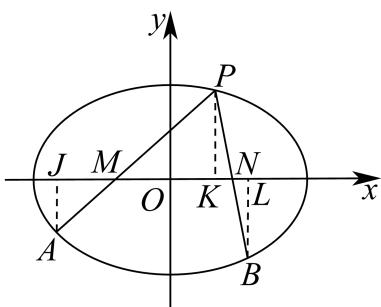

过 A 作 $AJ \perp x$ 轴于 J，过 B 作 $BL \perp x$ 轴于 L，

设 $l_{PB}: x = my + t$ ，其中 $m = \frac{x_0 - t}{y_0}$ ，

$\left\{ \begin{array}{l} x = my + t \\ \frac{x^2}{4} + y^2 = 1 \end{array} \right. \Rightarrow (m^2 + 4)y^2 + 2my + t^2 - 4 = 0, \Delta > 0$ 恒成立，

所以 $y_{B} + y_{P} = y_{B} + y_{0} = \frac{-2mt}{m^{2} + 4}, y_{B}y_{0} = \frac{t^{2} - 4}{m^{2} + 4}$ ,

$$
y _ {B} y _ {0} = \frac {t ^ {2} - 4}{\left(\frac {x _ {0} - t}{y _ {0}}\right) ^ {2} + 4} \Rightarrow y _ {B} = \frac {y _ {0} (t ^ {2} - 4)}{(x _ {0} - t) ^ {2} + 4 y _ {0} ^ {2}},
$$

设 $l_{PA}: x = ny - t$ ，其中 $n = \frac{x_0 + t}{y_0}$ ，

$\left\{ \begin{array}{l} x = ny - t \\ \frac{x^2}{4} + y^2 = 1 \end{array} \right. \Rightarrow (n^2 + 4)y^2 - 2nty + t^2 - 4 = 0, \Delta > 0$ 恒成立，

所以 $y_{A} + y_{P} = y_{A} + y_{0} = \frac{2nt}{n^{2} + 4}, y_{A}y_{0} = \frac{t^{2} - 4}{n^{2} + 4}$ ,

$$
y _ {A} y _ {0} = \frac {t ^ {2} - 4}{\left(\frac {x _ {0} + t}{y _ {0}}\right) ^ {2} + 4} \Rightarrow y _ {A} = \frac {y _ {0} (t ^ {2} - 4)}{(x _ {0} + t) ^ {2} + 4 y _ {0} ^ {2}},
$$

因为 $\frac{|PM|}{|MA|}=\frac{|PK|}{|AJ|},\frac{|PN|}{|NB|}=\frac{|PK|}{|BL|}$ ,

$$
\text {所以} \frac {| P M |}{| M A |} + \frac {| P N |}{| N B |} = \frac {| P K |}{| A J |} + \frac {| P K |}{| B L |} = \left| \frac {y _ {0}}{- y _ {A}} + \frac {y _ {0}}{- y _ {B}} \right| = \left| - y _ {0} \left(\frac {1}{y _ {A}} + \frac {1}{y _ {B}}\right) \right|
$$

$$
= \left| - y _ {0} \left(\frac {\left(x _ {0} + t\right) ^ {2} + 4 y _ {0} ^ {2}}{y _ {0} (t ^ {2} - 4)} + \frac {\left(x _ {0} - t\right) ^ {2} + 4 y _ {0} ^ {2}}{y _ {0} (t ^ {2} - 4)}\right) \right| = \left| \frac {2 \left(x _ {0} ^ {2} + 4 y _ {0} ^ {2}\right) + 2 t ^ {2}}{4 - t ^ {2}} \right| = \left| \frac {8 + 2 t ^ {2}}{4 - t ^ {2}} \right| \text {为定值，}
$$

所以 $\frac{|PM|}{|MA|} +\frac{|PN|}{|NB|}$ 为定值 $\left|\frac{8 + 2t^2}{4 - t^2}\right|$

### 崇明 · 原卷第20题

**考点说明：** 第（1）问：由椭圆标准方程求焦距与离心率。 第（2）问：平面向量数量积与椭圆方程：利用点坐标及焦点坐标确定动点和直线方程。 第（3）问：椭圆焦点弦与斜率定值：利用直线和椭圆联立、根与系数关系证明；注意斜率及分母的定义条件。

来源：2026届上海高三一模崇明卷，第20题。

规范化源文件：`2026届崇明一模数学试卷 逐题解析.md`。

已知椭圆 $\Gamma: \frac{x^2}{2} + y^2 = 1$ ， $F_1, F_2$ 分别是 $\Gamma$ 的左右焦点，点 $A, B, C, D$ 均在 $\Gamma$ 上，且点 $A$ 是第一象限点，直线 $AB$ 经过点 $F_1$ ，直线 $AC, BD$ 均经过点 $F_2$ .

（1）求椭圆 $\Gamma$ 的离心率；

(2) 若 $\overrightarrow{F_{1}A} \cdot \overrightarrow{F_{2}A} = \frac{1}{2}$ ，直线 AB 的方程；

（3）求证： $\frac{k_{CD}}{k_{AB}}$ 为定值.

【答案】(1) $\frac{\sqrt{2}}{2}$

(2) $\sqrt{2} x - 4y + \sqrt{2} = 0$

(3) 5

【解析】

【分析】（1）根据题意，求得 $a = \sqrt{2}, b = 1$ ，得到 $c = \sqrt{a^2 - b^2} = 1$ ，结合椭圆离心率的定义，即可求解；

(2) 设 $A(x_{1}, y_{1})$ ，得到 $\frac{x_{1}^{2}}{2} + y_{1}^{2} = 1$ ，由 $\overrightarrow{F_{1}A} \cdot \overrightarrow{F_{2}A} = \frac{1}{2}$ ，代入求得 $A(1, \frac{\sqrt{2}}{2})$ ，结合 $k_{AB} = k_{AF}$ ，结合直线的点斜式方程，即可求解；

（3）设 $AB$ 的方程为 $y = k(x + 1)$ ，联立方程组求得 $x_{1} + x_{2} = -\frac{4k^{2}}{1 + 2k^{2}}, x_{1}x_{2} = \frac{2(k^{2} - 1)}{1 + 2k^{2}}$ ，再设 $AC$ 的方程为 $x = ty + 1$ ，联立方程组，求得 $x_{3} = \frac{3x_{1} - 4}{2x_{1} - 3}$ ， $y_{3} = \frac{y_{1}}{2x_{1} - 3}$ ，同理求得 $x_{4} = \frac{3x_{2} - 4}{2x_{2} - 3}$ ， $y_{4} = \frac{y_{2}}{2x_{2} - 3}$ ，结合 $y_{1} = k(x_{1} + 1), y_{2} = k(x_{2} + 1)$ ，化简得到 $k_{CD} = 5k$ ，即可得证.

【小问 1 详解】

解：由椭圆 $\Gamma : \frac{x^2}{2} + y^2 = 1$ ，可得 $a^2 = 2, b^2 = 1$ ，则 $a = \sqrt{2}, b = 1$ ，

所以 $c = \sqrt{a^2 - b^2} = 1$ ，所以椭圆 $\Gamma$ 的离心率为 $e = \frac{c}{a} = \frac{\sqrt{2}}{2}$

【小问 2 详解】

解：由（1）知，椭圆 $\Gamma$ 的左焦点 $F_{1}(-1,0)$ , $F_{2}(1,0)$ ,

设 $A(x_{1},y_{1})$ ，其中 $x_{1} > 0,y_{1} > 0$ ，则 $\frac{x_1^2}{2} +y_1^2 = 1$

则向量 $\overrightarrow{F_{1}A}=(x_{1}+1,y_{1}),\overrightarrow{F_{2}A}=(x_{1}-1,y_{1})$ ，可得 $\overrightarrow{F_{1}A}\cdot\overrightarrow{F_{2}A}=x_{1}^{2}-1+y_{1}^{2}=\frac{1}{2}$

将 $y_{1}^{2} = 1 - \frac{x_{1}^{2}}{2}$ 代入得 $x_{1}^{2} - 1 + (1 - \frac{x_{1}^{2}}{2}) = \frac{1}{2}$ ，解得 $x_{1} = 1$ ，则 $y_{1} = \frac{\sqrt{2}}{2}$ ，即 $A(1, \frac{\sqrt{2}}{2})$ ，

可得 $k_{AB} = k_{AF} = \frac{\frac{\sqrt{2}}{2} - 0}{1 - (-1)} = \frac{\sqrt{2}}{4},$

又由 $AB$ 过点 $F_{1}$ ，所以 $AB$ 的方程为 $y - 0 = \frac{\sqrt{2}}{4} (x + 1)$ ，即 $\sqrt{2} x - 4y + \sqrt{2} = 0$ .

【小问 3 详解】

证明：设直线 AB 的斜率为 k，则方程为 $y = k(x + 1)$ ，联立方程组 $\left\{ \begin{array}{l} y = k(x + 1) \\ \frac{x^2}{2} + y^2 = 1 \end{array} \right.$ ，整理得 $(1 + 2k^2)x^2 + 4k^2x + 2k^2 - 2 = 0$ ，设 $A(x_1, y_1), B(x_2, y_2)$ ，可得 $x_1 + x_2 = -\frac{4k^2}{1 + 2k^2}, x_1x_2 = \frac{2(k^2 - 1)}{1 + 2k^2}$ ，由直线 $AC$ 过 $F_2(1,0)$ ，设其直线方程为 $x = ty + 1$ ，联立方程组 $\left\{ \begin{array}{l} x = ty + 1 \\ \frac{x^2}{2} + y^2 = 1 \end{array} \right.$ ，整理得 $(t^2 + 2)y^2 + 2ty - 1 = 0$ ，设 $C(x_3, y_3)$ ，可得 $y_1y_3 = -\frac{1}{t^2 + 2}$ ，因为 $A(x_1, y_1)$ 在直线 $AC$ 上，可得 $t = \frac{x_1 - 1}{y_1}$ ，化简得 $y_3 = \frac{y_1}{2x_1 - 3}$ ，则 $x_3 = \frac{3x_1 - 4}{2x_1 - 3}$ ，同理可得：设 $D(x_4, y_4)$ ，可得 $y_4 = \frac{y_2}{2x_2 - 3}$ ，则 $x_4 = \frac{3x_2 - 4}{2x_2 - 3}$ ，又因为 $y_1 = k(x_1 + 1), y_2 = k(x_2 + 1)$ ，又由 $k_{CD} = \frac{y_4 - y_3}{x_4 - x_3} = \frac{\frac{y_2}{2x_2 - 3} - \frac{y_1}{2x_1 - 3}}{\frac{3x_2 - 4}{2x_2 - 3} - \frac{3x_1 - 4}{2x_1 - 3}} = \frac{\frac{k(x_2 + 1)}{2x_2 - 3} - \frac{k(x_1 + 1)}{2x_1 - 3}}{\frac{3x_2 - 4}{2x_2 - 3} - \frac{3x_1 - 4}{2x_1 - 3}} = 5k$ ，即 $k_{CD} = 5k_{AB}$ ，所以 $\frac{k_{CD}}{k_{AB}} = 5$ 。

### 普陀 · 原卷第20题

**考点说明：** 第（1）问：利用矩形几何关系、椭圆坐标与焦距关系求离心率。 第（2）问：运用椭圆定义和弦长表达周长，分析动弦周长最值并确定椭圆参数。 第（3）问：联立直线与椭圆，利用根与系数关系及向量共线比例求定比和三角形面积。

来源：2026届上海高三一模普陀卷，第20题。

规范化源文件：`2026届普陀一模数学试卷 逐题解析.md`。

设 $a > 2, m \in \mathbb{R}, k, t$ 是不全为零的实数，椭圆 $\Gamma: \frac{x^2}{a^2} + \frac{y^2}{4} = 1, F_1, F_2$ 分别为 $\Gamma$ 的左、右两个焦点，直线 $l: kx + ty + m = 0$ 与 $\Gamma$ 交于 $A, B$ 两点， $O$ 为坐标原点.

（1）若 $k=0, t+m=0$ ，且四边形 $ABF_{1}F_{2}$ 为矩形，求 $\Gamma$ 的离心率；

（2）若 t=0，且 $\triangle F_{1}AB$ 的周长的最大值为 12，求 $\Gamma$ 的方程；

（3）若 $a = 4, t = -1, \lambda > 0$ ，直线 $OA$ 与 $OB$ 的斜率之积为 $-\frac{1}{4}$ ， $C$ 为 $OA$ 上的一点，且 $\overrightarrow{OA} = \overrightarrow{AC}$ ，直线 $BC$ 与椭圆 $\Gamma$ 交于点 $D$ ，且 $\overrightarrow{BD} = \lambda \overrightarrow{DC}$ ，求 $\lambda$ 的值以及 $\triangle ABD$ 的面积 $S$ 的值.

【答案】(1) $\frac{\sqrt{3}}{2}$

(2) $\frac{x^{2}}{9}+\frac{y^{2}}{4}=1.$

(3) $\lambda = \frac{2}{3}, S_{\triangle ABD} = \frac{8}{5}$

【解析】

【分析】（1）求出 $\left|AB\right|=\sqrt{3}a$ ，根据题意得到 $\sqrt{3}a=2c$ ，从而求出离心率；

（2）根据 $\left|AF_1\right| + \left|BF_1\right| + \left|AB\right|\leq \left|AF_1\right| + \left|BF_1\right| + \left|AF_2\right| + \left|BF_2\right|$ ，再由题意可求出 $a = 3$ ，即可求出方程；

（3）设 $A(x_{1},y_{1}),B(x_{2},y_{2}),D(x_{0},y_{0})$ ，根据题目信息求出 $D\left(\frac{x_2 + 2\lambda x_1}{1 + \lambda},\frac{y_2 + 2\lambda y_1}{1 + \lambda}\right)$

将点 D 代入椭圆方程并化简得到

$4\lambda^{2}\left(\frac{x_{1}^{2}}{16}+\frac{y_{1}^{2}}{4}\right)+\left(\frac{x_{2}^{2}}{16}+\frac{y_{2}^{2}}{4}\right)+\frac{\lambda}{4}\left(x_{1}x_{2}+4y_{1}y_{2}\right)=\left(1+\lambda\right)^{2}$ ，根据点A,B均在 $\Gamma$ 上以及 $k_{OA}\cdot k_{OB}=-\frac{1}{4}$ 得到 $4\lambda^{2}+1=\left(1+\lambda\right)^{2}$ ，解方程即可求出 $\lambda$ ；根据题目信息及求出的 $\lambda$ 可得 $S_{\triangle ABD}=\frac{2}{5}S_{\triangle OAB}$ ，求出 $|AB|$ 的长及原点O到直线l的距离，利用三角形面积公式即可求出答案.

【小问 1 详解】

由 $k = 0$ ， $t + m = 0$ 得， $l:y = 1$

将 $y = 1$ 代入椭圆方程得 $\frac{x^2}{a^2} +\frac{1}{4} = 1$ ，解得 $x = \pm \frac{\sqrt{3}}{2} a$ ，则 $\left|AB\right| = \sqrt{3} a$

又四边形 $ABF_{1}F_{2}$ 是矩形，则 $\sqrt{3}a = 2c$ ，即离心率 $e = \frac{c}{a} = \frac{\sqrt{3}}{2}$ .

【小问 2 详解】

由 $t = 0$ 得， $l: x = -\frac{m}{k}$ ，即 $AB \perp x$ 轴，

则 $\left|AF_1\right| + \left|BF_1\right| + \left|AB\right|\leq \left|AF_1\right| + \left|BF_1\right| + \left|AF_2\right| + \left|BF_2\right| = 4a$

当且仅当 $AB$ 过右焦点 $F_{2}$ 时等号成立，即 $\triangle F_{1}AB$ 的周长的最大值为 $4a$ 即 $4a = 12$ ，即 $a = 3$

则 $\Gamma$ 方程为 $\frac{x^{2}}{9} + \frac{y^{2}}{4} = 1$ .

设 $A(x_{1},y_{1}),B(x_{2},y_{2}),D(x_{0},y_{0})$ ,

由 $\overrightarrow{OA} = \overrightarrow{AC}$ 得，点 $C(2x_{1}, 2y_{1})$ ，又 $\overrightarrow{BD} = \lambda \overrightarrow{DC}$ ，

则 $x_0 = \frac{x_2 + 2\lambda x_1}{1 + \lambda}, y_0 = \frac{y_2 + 2\lambda y_1}{1 + \lambda}$ 因为点 $D$ 在 $\Gamma$ 上，所以 $\frac{\left(\frac{x_2 + 2\lambda x_1}{1 + \lambda}\right)^2}{16} + \frac{\left(\frac{y_2 + 2\lambda y_1}{1 + \lambda}\right)^2}{4} = 1$ 则 $4\lambda^2\left(\frac{x_1^2}{16} + \frac{y_1^2}{4}\right) + \left(\frac{x_2^2}{16} + \frac{y_2^2}{4}\right) + \frac{\lambda}{4}(x_1x_2 + 4y_1y_2) = (1 + \lambda)^2,$ 又点 $A, B$ 均在 $\Gamma$ 上，则 $\frac{x_1^2}{16} + \frac{y_1^2}{4} = 1, \frac{x_2^2}{16} + \frac{y_2^2}{4} = 1,$ 由 $k_{OA} \cdot k_{OB} = -\frac{1}{4}$ 得 $\frac{y_1y_2}{x_1x_2} = -\frac{1}{4}$ ，即 $x_1x_2 + 4y_1y_2 = 0$ ，则 $4\lambda^2 + 1 = (1 + \lambda)^2$ ，又 $\lambda > 0$ ，即 $\lambda = \frac{2}{3}$ . 由 $\overrightarrow{BD} = \frac{2}{3}\overrightarrow{DC}, \overrightarrow{OA} = \overrightarrow{AC}$ 得， $S_{\triangle ABD} = \frac{2}{5} S_{\triangle ABC} = \frac{2}{5} S_{\triangle OAB}$ ，又 $a = 4, t = -1$ ，即直线 $l: y = kx + m$ ，由 $\left\{ \begin{array}{l} y = kx + m \\ \frac{x^2}{16} + \frac{y^2}{4} = 1 \end{array} \right.$ 得， $(1 + 4k^2)x^2 + 8kmx + 4m^2 - 16 = 0,$ 则 $x_1 + x_2 = \frac{-8km}{1 + 4k^2}, x_1x_2 = \frac{4m^2 - 16}{1 + 4k^2}$ ，则 $|AB| = \sqrt{1 + k^2}|x_1 - x_2|$ $= \sqrt{1 + k^2}\sqrt{(x_1 + x_2)^2 - 4x_1x_2}$ $= \sqrt{1 + k^2}\sqrt{\left(\frac{-8km}{1 + 4k^2}\right)^2 - 4 \cdot \frac{4m^2 - 16}{1 + 4k^2}}$ $= \frac{4\sqrt{1 + k^2}}{1 + 4k^2}\sqrt{4 + 16k^2 - m^2}$ 由 $x_1x_2 + 4y_1y_2 = 0$ 得， $x_1x_2 + 4y_1y_2 = x_1x_2 + 4(kx_1 + m)(kx_2 + m) = 0$ 即 $(1 + 4k^2)x_1x_2 + 4km(x_1 + x_2) + 4m^2 = 0$ ，即 $(1 + 4k^2)\frac{4m^2 - 16}{1 + 4k^2} - \frac{32k^2m^2}{1 + 4k^2} + 4m^2 = 0$

化简整理得， $m^2 = 8k^2 +2$ ，则 $\left|AB\right| = \frac{4\sqrt{2\left(1 + k^2\right)}}{\sqrt{1 + 4k^2}}$

又原点 $O$ 到直线 $l$ 的距离为 $d = \frac{|m|}{\sqrt{1 + k^2}} = \frac{\sqrt{2(1 + 4k^2)}}{\sqrt{1 + k^2}}$

$$
S _ {\triangle O A B} = \frac {1}{2} \times \frac {4 \sqrt {2 (1 + k ^ {2})}}{\sqrt {1 + 4 k ^ {2}}} \times \frac {\sqrt {2 (1 + 4 k ^ {2})}}{\sqrt {1 + k ^ {2}}} = 4.
$$

则 $S_{\triangle ABD} = \frac{2}{5} S_{\triangle OAB} = \frac{8}{5}$

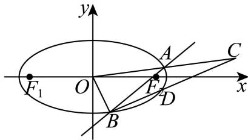

### 杨浦 · 原卷第20题

**考点说明：** 第（1）问：根据椭圆焦距关系与离心率公式求半轴参数。 第（2）问：结合垂直平分线和椭圆对称性，建立点的坐标关系求参数。 第（3）问：利用中点和向量定比分别表示相关点，结合椭圆方程和共线关系求直线斜率。

来源：2026届上海高三一模杨浦卷，第20题。

规范化源文件：`2026届杨浦一模数学试卷 逐题解析.md`。

已知椭圆 $C: \frac{x^2}{a^2} + \frac{y^2}{2} = 1(a > \sqrt{2})$ ，过动点 $M(0, m)$ 的直线交 $x$ 轴于点 $N$ ，交椭圆 $C$ 于 $A$ ， $P$ （点 $P$ 在第一象限），过点 $P$ 作 $x$ 轴的垂线交椭圆 $C$ 于另一点 $Q$ ，延长 $QM$ 交椭圆 $C$ 于点 $B$ .

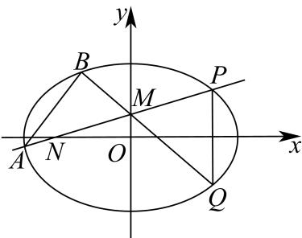

（1）若椭圆 $C$ 的离心率为 $\frac{\sqrt{3}}{2}$ ，求 $a$ 的值；

（2）已知 $m = \frac{\sqrt{3}}{3}$ ，且 $BQ$ 是线段 $PN$ 的垂直平分线，求 $a$ 的值；

（3）已知 a=2 ，点 M 是线段 PN 的中点，且 $\overrightarrow{QM}=2\overrightarrow{MB}$ ，求直线 AB 的斜率.

【答案】(1) $2 \sqrt{2}$

(2) $\sqrt{3}$

(3) $\frac{\sqrt{6}}{2}$

【解析】

【分析】（1）根据离心率的概念列式求 a 即可.

（2）根据题意，设 $P\left(x_0, \frac{2\sqrt{3}}{3}\right)$ ，则 $N(-x_0, 0)$ ， $Q\left(x_0, -\frac{2\sqrt{3}}{3}\right)$ ，根据 $\overrightarrow{NP} \perp \overrightarrow{MQ}$ 列式可求 $x_0$ 的值，在根据 $P$ 点在椭圆上，可求 $a$ 的值.

（3）根据题意，可求出 P, M, B, A 的坐标，进而求直线 AB 的斜率.

【小问 1 详解】

因为 $a > \sqrt{2} = b$ ，所以 $e^2 = \frac{c^2}{a^2} = \frac{a^2 - b^2}{a^2} = 1 - \frac{2}{a^2}$

因为 $e = \frac{\sqrt{3}}{2}$ ，所以 $1 - \frac{2}{a^2} = \frac{3}{4} \Rightarrow a^2 = 8$ ，又 $a > \sqrt{2}$ ，所以 $a = 2\sqrt{2}$ 。

【小问 2 详解】

因为 $m = \frac{\sqrt{3}}{3}$ ，且 $BQ$ 是线段 $NP$ 的垂直平分线，

所以 $M\left(0, \frac{\sqrt{3}}{3}\right)$ 是线段 $NP$ 的中点.

所以可设 $P\left(x_0, \frac{2\sqrt{3}}{3}\right)$ ，则 $N(-x_0, 0)$ ， $Q\left(x_0, -\frac{2\sqrt{3}}{3}\right)$ .

所以 $\overrightarrow{NP} = \left(2x_0, \frac{2\sqrt{3}}{3}\right)$ , $\overrightarrow{MQ} = (x_0, -\sqrt{3})$ .

由 $\overrightarrow{NP} \perp \overrightarrow{MQ} \Rightarrow \overrightarrow{NP} \cdot \overrightarrow{MQ} = 2x_0^2 - 2 = 0$ .

又点 $P$ 在第一象限，所以 $x_0 > 0$ ，所以 $x_0 = 1$ ，即 $P\left(1, \frac{2\sqrt{3}}{3}\right)$ .

又点 P 在椭圆 $\frac{x^{2}}{a^{2}} + \frac{y^{2}}{2} = 1$ 上，所以 $\frac{1}{a^{2}} + \frac{2}{3} = 1 \Rightarrow a^{2} = 3$ .

又 $a > 0$ ，所以 $a = \sqrt{3}$

【小问 3 详解】

因为 a=2 ，所以椭圆 C： $\frac{x^{2}}{4}+\frac{y^{2}}{2}=1$ .

如图，作出符合题意的图形，

因为点 $M(0,m)$ 是线段 PN 的中点，可设 $P(x_{0},2m)$ ， $N(-x_{0},0)$ ，则 $Q(x_{0},-2m)$ .

设 $B(x_{1},y_{1})$ ，因为 $\overrightarrow{QM} = 2\overrightarrow{MB}\Rightarrow (-x_0,3m) = 2(x_1,y_1 - m)\Rightarrow \left\{ \begin{array}{l}x_{1} = -\frac{x_{0}}{2}\\ y_{1} = \frac{5m}{2} \end{array} \right.$

因为 P, B 都在椭圆 C 上，所以 $\left\{\begin{aligned}\frac{x_{0}^{2}}{4}+\frac{(2m)^{2}}{2}&=1\\ \frac{\left(-\frac{x_{0}}{2}\right)^{2}}{4}+\frac{\left(\frac{5m}{2}\right)^{2}}{2}&=1\end{aligned}\right.\Rightarrow\left\{\begin{aligned}x_{0}^{2}&=\frac{12}{7}\\ m^{2}&=\frac{2}{7}\end{aligned}\right.$

因为点 $P$ 在第一象限，所以 $\left\{ \begin{array}{l} x_0 = \frac{2\sqrt{21}}{7} \\ m = \frac{\sqrt{14}}{7} \end{array} \right.$

所以 $P\left(\frac{2\sqrt{21}}{7}, \frac{2\sqrt{14}}{7}\right)$ , $M\left(0, \frac{\sqrt{14}}{7}\right)$ , $B\left(-\frac{\sqrt{21}}{7}, \frac{5\sqrt{14}}{14}\right)$ .

因为 $k_{MP} = \frac{\frac{\sqrt{14}}{7}}{\frac{2\sqrt{21}}{7}} = \frac{\sqrt{6}}{6}$ ，所以直线 $MP$ 的方程为： $y = \frac{\sqrt{6}}{6} x + \frac{\sqrt{14}}{7}$ .

$$
\left\{ \begin{array}{l} y = \frac {\sqrt {6}}{6} x + \frac {\sqrt {1 4}}{7} \\ \frac {x ^ {2}}{4} + \frac {y ^ {2}}{2} = 1 \end{array} \Rightarrow \frac {1}{3} x ^ {2} + \frac {\sqrt {2 1}}{2 1} x - \frac {6}{7} = 0. \right.
$$

由 $\frac{2\sqrt{21}}{7} \cdot x_A = -\frac{18}{7} \Rightarrow x_A = -\frac{3\sqrt{21}}{7}$ .

所以 $y_{A} = \frac{\sqrt{6}}{6}\times \left(-\frac{3\sqrt{21}}{7}\right) + \frac{\sqrt{14}}{7} = -\frac{\sqrt{14}}{14}.$

可得 $k_{AB} = \frac{\frac{5\sqrt{14}}{14} + \frac{\sqrt{14}}{14}}{-\frac{\sqrt{21}}{7} + \frac{3\sqrt{21}}{7}} = \frac{\sqrt{6}}{2}$ ，即直线 $AB$ 的斜率为 $\frac{\sqrt{6}}{2}$ .

### 松江 · 原卷第20题

**考点说明：** 第（1）问：椭圆焦半径的最值与离心率：用长半轴及半焦距表示焦半径极值，把乘积条件转为半轴关系。 第（2）问：中点坐标与椭圆、圆的联立：将线段中点落在指定圆上转为坐标条件，再结合椭圆方程求直线斜率。 第（3）问：椭圆焦点弦、中点及垂直平分线：设弦参数求截距和面积比，再将目标式转为单参数函数研究范围及边界。

来源：2026届上海高三一模松江卷，第20题。

规范化源文件：`2026届松江一模数学试卷 逐题解析.md`。

已知椭圆 $\frac{x^2}{a^2} + \frac{y^2}{b^2} = 1 (a > b > 0)$ 的左焦点为 $F$ ，过点 $F$ 的直线交椭圆于 $A, B$ 两点。 $\left|AF\right|$ 的最大值是 $M$ ， $\left|BF\right|$ 的最小值是 $m$ ，满足 $M \cdot m = \frac{3a^2}{4}$ 。

（1）求该椭圆的离心率；

（2）若 $a = 2$ ，点 $P$ 在椭圆上，且在 $x$ 轴上方，线段 $\left|PF\right|$ 的中点 $Q$ 在以原点 $O$ 为圆心， $\left|OF\right|$ 为半径的圆上，求直线 $PF$ 的斜率；

（3）设线段 $AB$ 的中点为 $G, AB$ 的垂直平分线与 $x$ 轴和 $y$ 轴分别交于 $D, E$ 两点， $O$ 是坐标原点．记 $\triangle GFD$ 的面积为 $S_{1}$ ， $\triangle OED$ 的面积为 $S_{2}$ ，求 $\frac{2S_{1}S_{2}}{S_{1}^{2} + S_{2}^{2}}$ 的取值范围.

【答案】(1) $\frac{1}{2}$

(2) $\sqrt{3}$

(3) $\left(0,\frac{9}{41}\right)$

【解析】

【分析】（1）过点 F 的直线交椭圆于 A, B 两点，由椭圆性质得 $M = a + c, m = a - c$ ，结合题意得到 a = 2c，即可求出离心率；

（2）若 a=2，结合（1）得到 c=1 和椭圆的方程，设点 $P(x_{1},y_{1})(y_{1}>0)$ ，线段 $\left|PF\right|$ 的中点 $Q\left(\frac{x_{1}-1}{2},\frac{y_{1}}{2}\right)$ ，列方程组计算得到点 $P(0,\sqrt{3})$ ，再根据直线的斜率公式计算即可.

(3) 根据题意, 设出椭圆方程和直线方程, 两方程联立, 消参, 利用韦达定理, 得到 $x_{1} + x_{2}$ 和 $x_{1}x_{2}$ , 利用三角形相似得到所求的比例值, 最后求范围.

【小问 1 详解】

设 $F(-c,0)(c>0)$ ，则根据椭圆性质得 $M=a+c,m=a-c$ ，

而 $M \cdot m = \frac{3a^2}{4}$ ，所以有 $a^2 - c^2 = \frac{3a^2}{4}$ ，即 $a^2 = 4c^2, a = 2c$ ，

因此椭圆的离心率为 $e = \frac{c}{a} = \frac{1}{2}$ .

【小问 2 详解】

若 $a = 2$ ，因为 $a = 2c$ ，所以 $c = 1$ ，且 $b = \sqrt{a^2 - c^2} = \sqrt{3}$ ， $F(-1,0)$

以原点 O 为圆心， $\left|OF\right|$ 为半径的圆的方程为 $x^{2} + y^{2} = 1$ ，

设点 $P(x_{1},y_{1})(y_{1} > 0)$ ，线段 $\left|PF\right|$ 的中点 $Q\left(\frac{x_1 - 1}{2},\frac{y_1}{2}\right),$

则 $\left\{ \begin{array}{l} \left( \frac{x_1 - 1}{2} \right)^2 + \left( \frac{y_1}{2} \right)^2 = 1 \\ \frac{x_1^2}{4} + \frac{y_1^2}{3} = 1 \end{array} \right.$ ，消 $y_1$ 化简可得 $x_1(x_1 - 8) = 0$ ，解得 $x_1 = 0$ 或 $x_1 = 8$ ，

因为 $x_{1} \in [-2, 2]$ ，所以 $x_{1} = 0$ ，计算得 $y_{1} = \sqrt{3}$ ，点 $P(0, \sqrt{3})$

所以直线 PF 的斜率为 $\frac{\sqrt{3}-0}{0+1}=\sqrt{3}$ ;

【小问 3 详解】

由（1）可知， $a = 2c, b = \sqrt{a^2 - c^2} = \sqrt{3} c$ ，椭圆的方程为 $\frac{x^2}{4c^2} + \frac{y^2}{3c^2} = 1$ .

根据条件直线 AB 的斜率一定存在且不为零，设直线 AB 的方程为 $y = k(x + c)$ ,

并设 $A(x_{1},y_{1}),B(x_{2},y_{2})$ 则由 $\left\{ \begin{array}{l} \frac{x^2}{4c^2} +\frac{y^2}{3c^2} = 1\\ y = k(x + c) \end{array} \right.$ 消去 $y$ 并整理得

$$
\left(4 k ^ {2} + 3\right) x ^ {2} + 8 c k ^ {2} x + 4 k ^ {2} c ^ {2} - 1 2 c ^ {2} = 0
$$

从而有 $x_{1} + x_{2} = -\frac{8ck^{2}}{4k^{2} + 3},y_{1} + y_{2} = k(x_{1} + x_{2} + 2c) = \frac{6ck}{4k^{2} + 3}$

所以 $G\left(-\frac{4ck^{2}}{4k^{2}+3},\frac{3ck}{4k^{2}+3}\right)$ .

因为 $DG \perp AB$ ，所以 $\frac{\frac{3ck}{4k^2 + 3}}{-\frac{4ck^2}{4k^2 + 3} - x_D} \cdot k = -1, x_D = -\frac{ck^2}{4k^2 + 3}$ ，.

由 Rt△FGD 与 Rt△EOD 相似，

$$
\frac {S _ {1}}{S _ {2}} = \frac {G D ^ {2}}{O D ^ {2}} = \frac {\left(- \frac {4 c k ^ {2}}{4 k ^ {2} + 3} + \frac {c k ^ {2}}{4 k ^ {2} + 3}\right) ^ {2} + \left(\frac {3 c k}{4 k ^ {2} + 3}\right) ^ {2}}{\left(- \frac {c k ^ {2}}{4 k ^ {2} + 3}\right) ^ {2}} = 9 + \frac {9}{k ^ {2}} > 9
$$

令 $\frac{S_1}{S_2} = t$ ，则 $t > 9$ ，从而 $\frac{2S_1S_2}{S_1^2 + S_2^2} = \frac{2}{t + \frac{1}{t}} < \frac{2}{9 + \frac{1}{9}} = \frac{9}{41}$

即 $\frac{2S_1S_2}{S_1^2 + S_2^2}$ 的取值范围是 $\left(0, \frac{9}{41}\right)$ .

### 浦东 · 原卷第20题

**考点说明：** 第（1）问：椭圆标准方程及焦点定义：由半轴求焦距，再利用两焦半径和不变计算焦点三角形周长。 第（2）问：向量数量积的坐标化：将数量积条件与椭圆方程联立，依据上半平面限制确定纵坐标。 第（3）问：焦点弦的面积比与参数范围：由直线截距和椭圆内点条件限制斜率，结合弦长或根差表达面积比并求范围。

来源：2026届上海高三一模浦东卷，第20题。

规范化源文件：`2026届浦东一模数学试卷 逐题解析.md`。

已知椭圆 $C: \frac{x^2}{9} + \frac{y^2}{8} = 1$ ，点 $O$ 为坐标原点，椭圆的右顶点为 $A$ ，左右焦点分别为 $F_1$ 、 $F_2$ ，点 $E$ 为椭圆在 $x$ 轴上方的一动点.

（1）求椭圆 C 的焦距与 $\triangle EF_{1}F_{2}$ 的周长；

（2）若 $\overrightarrow{EA} \cdot \overrightarrow{EF_1} = \frac{9}{4}$ ，求点 $E$ 到 $x$ 轴的距离；

（3）过点 $F_{1}$ 作斜率为 $k$ 的直线 $l$ 交 $y$ 轴正半轴于点 $P$ ，点 $P$ 位于椭圆内. 直线 $l$ 与椭圆 $C$ 交于 $G$ 、 $H$ 两点，记 $\triangle OGH$ 、 $\triangle OF_{1}P$ 的面积分别为 $S_{1}$ 、 $S_{2}$ ，求 $\frac{S_{1}}{S_{2}}$ 的取值范围.

【答案】（1）焦距为2， $\triangle EF_{1}F_{2}$ 的周长8；

(2) $\sqrt{6}$ ;

(3) $(\frac{9}{5}, 6)$ .

【解析】

【分析】（1）求出椭圆 C 的长短半轴长及半焦距，再结合椭圆定义求解.

（2）由（1）求出点 $A, F_{1}$ 坐标，设出点 $E$ 坐标，再利用数量积的坐标表示列式求解.

（3）设直线 l 的方程为 x=my-1，求出 m 范围，联立直线与椭圆方程，结合韦达定理表示出 $\frac{S_{1}}{S_{2}}$ ，再利用对勾函数单调性求出范围.

【小问 1 详解】

椭圆 $C: \frac{x^2}{9} + \frac{y^2}{8} = 1$ 的长短半轴长分别为 $a = 3, b = 2\sqrt{2}$ ，则半焦距 $c = \sqrt{a^2 - b^2} = 1$ ，所以椭圆 $C$ 的焦距 $2c = 2$ ， $\triangle EF_1F_2$ 的周长 $2a + 2c = 8$ 。

【小问 2 详解】

由（1）得 $A(3,0)$ , $F_{1}(-1,0)$ ，设 $E(x_{0},y_{0})$ , $y_{0}>0$ ，则 $\frac{x_{0}^{2}}{9}+\frac{y_{0}^{2}}{8}=1$ ，即 $y_{0}^{2}=8-\frac{8x_{0}^{2}}{9}$ ， $\overrightarrow{EA}=(3-x_{0},-y_{0}),\overrightarrow{EF_{1}}=(-1-x_{0},-y_{0})$ ，由 $\overrightarrow{EA}\cdot\overrightarrow{EF_{1}}=\frac{9}{4}$ 得 $\overrightarrow{EA}\cdot\overrightarrow{EF_{1}}=(3-x_{0})(-1-x_{0})+y_{0}^{2}=x_{0}^{2}-2x_{0}-3+y_{0}^{2}=\frac{1}{9}x_{0}^{2}-2x_{0}+5=\frac{9}{4}$ 整理得 $4x_{0}^{2}-72x_{0}+99=0$ ，而 $-3<x_{0}<3$ ，解得 $x_{0}=\frac{3}{2}$ ， $y_{0}=\sqrt{6}$ ，点 $E(\frac{3}{2},\sqrt{6})$

所以点 E 到 x 轴的距离为 $\sqrt{6}$ .

【小问3详解】

设直线 $l$ 的方程为 $x = my - 1$ ，因为直线 $l$ 与 $y$ 轴正半轴相交，故 $m \neq 0$ ，

则 $P(0, \frac{1}{m})$ ，由点 $P$ 在 $y$ 轴正半轴上，且位于椭圆内，

得 $0 < \frac{1}{m} < 2\sqrt{2}$ ，即 $m > \frac{\sqrt{2}}{4}$ ，

由 $\left\{\begin{aligned}x&=my-1\\ 8x^{2}&+9y^{2}=72\end{aligned}\right.$ ，消去x得 $(8m^{2}+9)y^{2}-16my-64=0$ ，

$\Delta = 256m^{2} + 256(8m^{2} + 9) > 0$ ，设 $G(x_{1},y_{1}),H(x_{2},y_{2})$ ，则

$$
y _ {1} + y _ {2} = \frac {1 6 m}{8 m ^ {2} + 9}, y _ {1} y _ {2} = \frac {- 6 4}{8 m ^ {2} + 9},
$$

$$
\left| y _ {1} - y _ {2} \right| = \sqrt {\left(y _ {1} + y _ {2}\right) ^ {2} - 4 y _ {1} y _ {2}} = \sqrt {\left(\frac {1 6 m}{8 m ^ {2} + 9}\right) ^ {2} + \frac {2 5 6}{8 m ^ {2} + 9}} = \frac {4 8 \sqrt {m ^ {2} + 1}}{8 m ^ {2} + 9},
$$

$$
S _ {1} = S _ {\triangle O G H} = \frac {1}{2} | O F _ {1} | \cdot | y _ {1} - y _ {2} | = \frac {1}{2} | y _ {1} - y _ {2} |, S _ {2} = S _ {\triangle O F _ {1} P} = \frac {1}{2} | O F _ {1} | \cdot \frac {1}{m} = \frac {1}{2 m},
$$

因此 $\frac{S_1}{S_2} = m|y_1 - y_2| = \frac{48m\sqrt{m^2 + 1}}{8m^2 + 9} = 48\sqrt{\frac{m^2(m^2 + 1)}{(8m^2 + 9)^2}}$ ，令 $m^2 = t > \frac{1}{8}$ ， $\frac{S_1}{S_2} = 48\sqrt{\frac{t(t + 1)}{(8t + 9)^2}}$

而 $f(t) = \frac{t(t + 1)}{(8t + 9)^2} = \frac{1 + \frac{1}{t}}{(8 + \frac{9}{t})^2}$ ，令 $1 + \frac{1}{t} = u \in (1,9)$ ，则 $f(t) = \frac{u}{(9u - 1)^2} = \frac{1}{81u + \frac{1}{u} - 18}$ ，

函数 $y = 81u + \frac{1}{u} - 18$ 在(1,9)上单调递增， $64 < 81u + \frac{1}{u} - 18 < \frac{6400}{9}$ ，

因此 $\frac{9}{6400} < \frac{t(t + 1)}{(8t + 9)^2} < \frac{1}{64}$ , $\frac{3}{80} < \sqrt{\frac{t(t + 1)}{(8t + 9)^2}} < \frac{1}{8}$ , 则 $\frac{9}{5} < \frac{S_1}{S_2} < 6$ ,

所以 $\frac{S_1}{S_2}$ 的取值范围是 $(\frac{9}{5}, 6)$ .

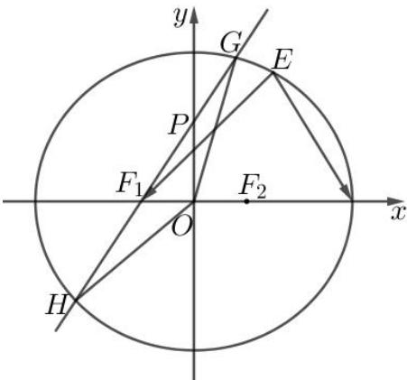

### 虹口 · 原卷第20题

**考点说明：** 第（1）问：椭圆焦点三角形周长：将两焦半径之和与焦距相加，并注意三点构成三角形的条件。 第（2）问：直线与椭圆的交点及有向分点比：联立直线和椭圆，结合已知顶点确定另一交点，再由向量方向求比例参数。 第（3）问：椭圆弦中点、向量模等式与定点：将长度条件平方化为数量积关系，结合中点弦方程及定点条件限制动点位置。

来源：2026届上海高三一模虹口卷，第20题。

规范化源文件：`2026届虹口一模数学试卷 逐题解析.md`。

已知椭圆 $\Gamma: \frac{x^2}{2} + y^2 = 1$ 的左、右焦点分别为 $F_1$ 和 $F_2$ ，点 $P$ 是 $\Gamma$ 的长轴上的动点，点 $Q$ 为 $\Gamma$ 上的动点，且异于点 $P$ .

（1）当点 P 位于椭圆 $\Gamma$ 的左焦点，且 Q、P、 $F_{2}$ 能构成三角形时，求 $\triangle QPF_{2}$ 的周长；

（2）当点 $P$ 位于椭圆 $\Gamma$ 的左顶点时，直线 $PQ$ 与 $y$ 轴交于点 $B\left(0, \frac{1}{2}\right)$ ， $\overrightarrow{PB} = \lambda \overrightarrow{BQ}$ ，求实数 $\lambda$ 的值；

（3）当点 $P$ 与椭圆 $\Gamma$ 的左、右顶点均不重合时，记直线 $PQ$ 与椭圆 $\Gamma$ 的另一个交点为S，过点 $P$ 作直线 $l$ 与椭圆 $\Gamma$ 交于 $C$ 、 $D$ 两点，设 $M$ 和 $N$ 分别为弦 $QS$ 和弦 $CD$ 的中点，若 $P$ 、 $Q$ 、

$M$ 、 $N$ 为四个相异的点， $\left|\overrightarrow{PM} +\overrightarrow{PN}\right| = \left|\overrightarrow{MN}\right|$ ，且直线 $MN$ 恒过定点 $\left(-\frac{1}{3},0\right)$ ，求点 $P$ 的坐标.

【答案】(1) $2\sqrt{2}+2$

(2) $\frac{3}{5}$

(3) $P\left(-\frac{1}{2},0\right)$

【解析】

【分析】（1）根据焦点三角形的周长计算公式求解出结果；

（2）联立直线 $PB$ 与椭圆方程，求得 $Q$ 点坐标，然后根据纵坐标求得 $\lambda$ 的值；

（3）先判断出 $QS, CD$ 的位置关系，然后通过联立直线与椭圆方程求得中点 $M, N$ 的坐标，由此可表示出直线 $MN$ 的方程，根据直线 $MN$ 过定点可求解出结果.

【小问1详解】

由椭圆方程可知， $a = \sqrt{2}, c = \sqrt{2 - 1} = 1$

所以 $\triangle QPF_{2}$ 的周长为 $C_{\triangle QPF_2} = |QP| + |QF_2| + |PF_2| = 2a + 2c = 2\sqrt{2} +2$

【小问 2 详解】

因为 $P\left(-\sqrt{2},0\right),Q\left(0,\frac{1}{2}\right)$ ，所以 $k_{PQ} = \frac{\frac{1}{2} - 0}{0 - (-\sqrt{2})} = \frac{\sqrt{2}}{4}$ ，则 $PQ:x + \sqrt{2} = 2\sqrt{2} y$ ，即 $PQ:x = 2\sqrt{2} y - \sqrt{2}$

联立 $\left\{ \begin{array}{l} x = 2\sqrt{2} y - \sqrt{2} \\ x^2 + 2y^2 = 2 \end{array} \right.$ ，可得 $10y^{2} - 8y = 0$ ，解得 $y = 0$ 或 $y = \frac{4}{5}$ ，所以 $y_{Q} = \frac{4}{5}$ ，

因为 $\overrightarrow{PB} = \lambda \overrightarrow{BQ}$ ，所以 $y_{B} - y_{P} = \lambda (y_{Q} - y_{B})$

所以 $\lambda=\frac{y_{Q}-y_{B}}{y_{B}-y_{P}}=\frac{\frac{4}{5}-\frac{1}{2}}{\frac{1}{2}-0}=\frac{3}{5}$ ;

【小问 3 详解】

因为 $\left|\overrightarrow{PM}+\overrightarrow{PN}\right|=\left|\overrightarrow{MN}\right|$ ，所以 $\left|\overrightarrow{PM}+\overrightarrow{PN}\right|=\left|\overrightarrow{PN}-\overrightarrow{PM}\right|$ ,

所以 $\overrightarrow{PM}^{2} + \overrightarrow{PN}^{2} + 2\overrightarrow{PM} \cdot \overrightarrow{PN} = \overrightarrow{PM}^{2} + \overrightarrow{PN}^{2} - 2\overrightarrow{PM} \cdot \overrightarrow{PN}$ ,

所以 $\overrightarrow{PM} \cdot \overrightarrow{PN} = 0$ ，所以 $PM \perp PN$ ，所以 $PQ \perp CD$ ;

当 PQ, CD 中有一条直线斜率不存在时，此时一定有一条弦的中点和 P 点重合，故不符合条件；

当 P 为坐标原点时，此时 M, N 均与 P 点重合，故不符合条件；

由上可知， $PQ, CD$ 的斜率都存在，设 $P(m,0)\left(m\in\left[-\sqrt{2},0\right)\cup\left(0,\sqrt{2}\right]\right)$

$$
P Q: y = k (x - m), C D: y = - \frac {1}{k} (x - m),
$$

联立 $\left\{\begin{aligned}y&=k(x-m)\\ x^{2}&+2y^{2}=2\end{aligned}\right.$ ，可得 $\left(1+2k^{2}\right)x^{2}-4k^{2}mx+2k^{2}m^{2}-2=0$ ，

所以 $x_{Q} + x_{S} = \frac{4k^{2}m}{1 + 2k^{2}}$ ，所以 $\frac{x_Q + x_S}{2} = \frac{2k^2m}{1 + 2k^2}$ ，所以$\frac{y_Q + y_S}{2} = k \cdot \left( \frac{2k^2m}{1 + 2k^2} - m \right) = \frac{-km}{1 + 2k^2}$ ，所以 $M\left( \frac{2k^2m}{1 + 2k^2}, \frac{-km}{1 + 2k^2} \right)$ ，
同理可得 $N\left( \frac{2\left(-\frac{1}{k}\right)^2m}{1 + 2\left(-\frac{1}{k}\right)^2}, \frac{-\left(-\frac{1}{k}\right)m}{1 + 2\left(-\frac{1}{k}\right)^2} \right)$ ，即 $N\left( \frac{2m}{k^2 + 2}, \frac{km}{k^2 + 2} \right)$ ，
所以 $k_{MN} = \frac{\frac{km}{k^2 + 2} - \frac{-km}{1 + 2k^2}}{\frac{2m}{k^2 + 2} - \frac{2k^2m}{1 + 2k^2}} = \frac{3k}{2(1 - k^2)}$ ，所以 $MN: y - \left( -\frac{mk}{1 + 2k^2} \right) = \frac{3k}{2(1 - k^2)} \left( x - \frac{2k^2m}{1 + 2k^2} \right)$ ，
令 $y = 0$ ，解得 $x = \frac{mk}{1 + 2k^2} \cdot \frac{2(1 - k^2)}{3k} + \frac{2k^2m}{1 + 2k^2} = \frac{2m + 4mk^2}{3(1 + 2k^2)} = \frac{2m}{3}$ ，
因为直线 $MN$ 恒过定点 $\left(-\frac{1}{3}, 0\right)$ ，所以 $\frac{2m}{3} = -\frac{1}{3}$ ，所以 $m = -\frac{1}{2}$ ，
所以 $P\left(-\frac{1}{2}, 0\right)$ .

### 金山 · 原卷第20题

**考点说明：** 第（1）问：由椭圆标准方程求半轴、焦距及离心率。 第（2）问：椭圆焦点与准线性质：表示点到焦点及定直线的距离并证明比值为定值。 第（3）问：椭圆弦与三角形面积最值：设直线或参数，利用弦长、点到直线距离及约束求最大值。

来源：2026届上海高三一模金山卷，第20题。

规范化源文件：`2026届金山一模数学试卷 逐题解析.md`。

已知椭圆 $\Gamma: \frac{x^2}{16} + \frac{y^2}{4} = 1$ ，点 $O$ 为坐标原点，点 $M$ 为椭圆 $\Gamma$ 上一点.

（1）求椭圆 $\Gamma$ 的离心率；

（2）已知点 $F_{2}$ 为椭圆 $\Gamma$ 的右焦点，直线 $l_{0}: x = \frac{8\sqrt{3}}{3}$ ，证明：点 $M$ 到点 $F_{2}$ 的距离与到直线 $l_{0}$ 的距离之比为定值；

（3）过线段 OM 中点 N 的直线 l 交椭圆 $\Gamma$ 于 P、Q 两点，求 $S_{\triangle PMQ}$ 的最大值.

【答案】(1) $\frac{\sqrt{3}}{2}$ ;

(2) 证明见解析; (3) $2 \sqrt{3}$ .

【解析】

【分析】（1）根据离心率公式即可求解；

（2）根据两点距离以及点到直线的距离公式，化简即可求解；

（3）联立直线与椭圆方程，根据弦长公式以及点到直线的距离公式，可得面积的表达式，进而根据中点关系以及三角换元，根据判别式求解 $t$ 的范围，利用二次函数的性质即可求解最值.

【小问 1 详解】

$\Gamma : \frac{x^2}{16} + \frac{y^2}{4} = 1$ 中， $a = 4, b = 2, c = \sqrt{a^2 - b^2} = 2\sqrt{3}$ ，故离心率为 $e = \frac{c}{a} = \frac{2\sqrt{3}}{4} = \frac{\sqrt{3}}{2}$ ，

【小问 2 详解】

设 $M\left(x_0,y_0\right)$ ，则 $\frac{x_0^2}{16} +\frac{y_0^2}{4} = 1$ ，则 $y_{0}^{2} = 4\left(1 - \frac{x_{0}^{2}}{16}\right),F_{2}\left(2\sqrt{3},0\right)$

故

$$
\left| M F _ {2} \right| = \sqrt {\left(x _ {0} - 2 \sqrt {3}\right) ^ {2} + y _ {0} ^ {2}} = \sqrt {\left(x _ {0} - 2 \sqrt {3}\right) ^ {2} + 4 \left(1 - \frac {x _ {0} ^ {2}}{1 6}\right)} = \sqrt {\frac {3}{4} x _ {0} ^ {2} - 4 \sqrt {3} x _ {0} + 1 6} = \sqrt {\left(\frac {\sqrt {3}}{2} x _ {0} - 4\right) ^ {2}} = \left| \frac {\sqrt {3}}{2} x _ {0} - 4 \right|
$$

$M\left(x_{0},y_{0}\right)$ 到直线 $l_0$ : $x = \frac{8\sqrt{3}}{3}$ 的距离 $d = \left|x_0 - \frac{8\sqrt{3}}{3}\right|$ ,

所以 $\frac{|MF_2|}{d} = \frac{\left|\frac{\sqrt{3}}{2}x_0 - 4\right|}{\left|x_0 - \frac{8\sqrt{3}}{3}\right|} = \frac{\sqrt{3}}{2}\frac{\left|x_0 - \frac{8\sqrt{3}}{3}\right|}{\left|x_0 - \frac{8\sqrt{3}}{3}\right|} = \frac{\sqrt{3}}{2}$ 为定值.

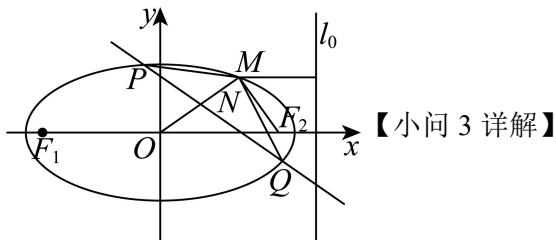

设 $M(4\cos \theta ,2\sin \theta)$ ，则 $N(2\cos \theta ,\sin \theta)$

由于 N 是线段 OM 的中点，故 M 到直线 PQ 的距离与 O 到直线 PQ 的距离 d 相等，

故 $S_{\triangle PMQ} = S_{\triangle POQ} = \frac{1}{2}\big|PQ\big|d$

设直线 PQ: $y = kx + m$ ,

联立其与椭圆的方程可得 $\left(4k^2 + 1\right)x^2 + 8kmx + 4m^2 - 16 = 0$

设 $P\big(x_1,y_1\big),Q\big(x_2,y_2\big)$ ，则 $x_{1} + x_{2} = \frac{-8km}{4k^{2} + 1},x_{1}x_{2} = \frac{4m^{2} - 16}{4k^{2} + 1}$

故

$$
\left| P Q \right| = \sqrt {1 + k ^ {2}} \sqrt {\left(x _ {1} + x _ {2}\right) ^ {2} - 4 x _ {1} x _ {2}} = \sqrt {1 + k ^ {2}} \sqrt {\left(\frac {- 8 k m}{4 k ^ {2} + 1}\right) ^ {2} - 4 \frac {4 m ^ {2} - 1 6}{4 k ^ {2} + 1}} = 4 \sqrt {1 + k ^ {2}} \frac {\sqrt {4 (4 k ^ {2} + 1) - m ^ {2}}}{4 k ^ {2} + 1}
$$

$d=\frac{|m|}{\sqrt{1+k^{2}}}$ ，故

$$
S _ {\triangle P M Q} = S _ {\triangle P O Q} = \frac {1}{2} | P Q | d = \frac {1}{2} \times 4 \sqrt {1 + k ^ {2}} \frac {\sqrt {4 (4 k ^ {2} + 1) - m ^ {2}}}{4 k ^ {2} + 1} \cdot \frac {| m |}{\sqrt {1 + k ^ {2}}} = 2 \frac {| m | \sqrt {4 (4 k ^ {2} + 1) - m ^ {2}}}{4 k ^ {2} + 1}
$$

$$
S _ {\triangle P M Q} = 2 \sqrt {\frac {4 m ^ {2} (4 k ^ {2} + 1) - m ^ {4}}{(4 k ^ {2} + 1) ^ {2}}} = 2 \sqrt {- \frac {m ^ {4}}{(4 k ^ {2} + 1) ^ {2}} + 4 \frac {m ^ {2}}{4 k ^ {2} + 1}},
$$

令 $\frac{m^2}{4k^2 + 1} = t$ ，由于 $N(2\cos \theta ,\sin \theta)$ 在直线 $PQ$ 上，所以 $\sin \theta = 2k\cos \theta +m$

由于 $m^2 = (4k^2 + 1)t$ ，故 $(\sin \theta - 2k\cos \theta)^2 = (4k^2 + 1)t$

化简可得 $4\left(\cos^2\theta -t\right)k^2 -4\sin \theta \cos \theta k + \sin^2\theta -t = 0$

由于该关于 $k$ 的方程在 $\mathbf{R}$ 上有解，故

$\Delta = (-4\sin \theta \cos \theta)^2 - 4\times 4(\cos^2\theta -t)(\sin^2\theta -t) = 16(t - t^2)\geq 0$ ，解得 $0\leq t\leq 1$ 则 $S_{\triangle PMQ} = 2\sqrt{-t^2 + 4t}$ ，故当 $t = 1$ 时，此时 $S_{\triangle PMQ}$ 取到最大值 $2\sqrt{3}$

### 青浦 · 原卷第20题

**考点说明：** 第（1）问：椭圆的离心率与焦距关系：根据题设参数求半长轴。 第（2）问：椭圆焦点距离的取值：讨论指定距离对应的交点个数与参数范围。 第（3）问：椭圆的焦点、弦与面积：分别研究周长和面积的上界及取等条件，判断能否同时取到。

来源：2026届上海高三一模青浦卷，第20题。

规范化源文件：`2026届青浦一模数学试卷 逐题解析.md`。

已知椭圆 $\Gamma: \frac{x^2}{a^2} + \frac{y^2}{a^2 - 4} = 1 (a > 2)$ 的左、右焦点分别为 $F_1, F_2, A, B$ 为 $\Gamma$ 上两个不同的点，记 $\triangle ABF_1$ 的周长和面积分别为 $C$ 和 $S$ .

（1）若 $\Gamma$ 的离心率为 $\frac{1}{2}$ ，求 $a$ 的值；

（2）若满足 $\left|AF_{1}\right|=10$ 的点A有且仅有两个，求a的取值范围；

（3）若 $a = \sqrt{5}$ ，是否存在点 $A, B$ 使得 $C$ 和 $S$ 同时取到最大值？若存在，求出直线 $AB$ 的方程；若不存在，说明理由.

【答案】(1) $a = 4$

(2) $(8,12)$

（3）不存在，理由见解析.

【解析】

【分析】（1）根据离心率的定义计算；

（2）根据椭圆的对称性以及 $a - 2 \leq \left|AF_{1}\right| \leq a + 2$ 即可求出；

（3）根据椭圆的定义得出 $C = 4\sqrt{5} + |AB| - \left(|AF_2| + |BF_2|\right)$ ，得出当 $A, B, F_2$ 三点共线时 $C$ 最大，进而设 $AB: x = my + n$ ，与椭圆方程联立，再分别令 $n = 2$ ， $n = \sqrt{3}$ ，结合基本不等式分别求面积的最大值，再作比较即可.

【小问1详解】

由题意知， $b^{2}=a^{2}-4$ ，则 $c^{2}=a^{2}-b^{2}=4$ ，

因 $a > 2$ ，则离心率为 $\frac{2}{a} = \frac{1}{2}$ ，得 $a = 4$

【小问 2 详解】

对于椭圆上任意一点 A，有 $a-2 \leq \left|AF_{1}\right| \leq a+2$ ，

因满足 $\left|AF_{1}\right|=10$ 的点A有且仅有两个且椭圆为对称图形，则 $a-2<10<a+2$ ，

得 $8 < a < 12$

故 $a$ 的取值范围为 $(8,12)$ ；

【小问 3 详解】

若 $a = \sqrt{5}$ ，则 $\Gamma : \frac{x^2}{5} + y^2 = 1$ ， $F_1(-2,0), F_2(2,0)$ ，

由椭圆的定义可知， $\left|AF_{1}\right|+\left|AF_{2}\right|=\left|BF_{1}\right|+\left|BF_{2}\right|=2\sqrt{5}$

则 $C = \left|AF_{1}\right| + \left|BF_{1}\right| + \left|AB\right| = 4\sqrt{5} +\left|AB\right| - \left(\left|AF_{2}\right| + \left|BF_{2}\right|\right)\leq 4\sqrt{5},$

等号成立时 $A, B, F_{2}$ 三点共线，

故当 $A, B, F_{2}$ 三点共线时， $C$ 取得最大值；

因直线 AB 的斜率不为 0，则可设直线 $AB: x = my + n, n \neq -2, A(x_{1}, y_{1}), B(x_{2}, y_{2})$ ,

联立 $\left\{\begin{aligned}x&=my+n\\ x^{2}&+5y^{2}=5\end{aligned}\right.$ ，得 $(m^{2}+5)y^{2}+2mny+n^{2}-5=0$ ，

则 $\Delta = 4m^2 n^2 - 4(m^2 + 5)(n^2 - 5) = 20(m^2 - n^2 + 5) > 0$ ，得 $m^2 - n^2 + 5 > 0$

由韦达定理可知， $y_{1} + y_{2} = -\frac{2mn}{m^{2} + 5}, y_{1}y_{2} = \frac{n^{2} - 5}{m^{2} + 5}$

$$
\left| y _ {1} - y _ {2} \right| = \sqrt {\left(- \frac {2 m n}{m ^ {2} + 5}\right) ^ {2} - 4 \cdot \frac {n ^ {2} - 5}{m ^ {2} + 5}} = \frac {2 \sqrt {5} \cdot \sqrt {m ^ {2} - n ^ {2} + 5}}{m ^ {2} + 5},
$$

$$
S = \frac {1}{2} \left| F _ {1} H \right| \left| y _ {1} - y _ {2} \right| = \frac {1}{2} \times | n + 2 | \times \frac {2 \sqrt {5} \cdot \sqrt {m ^ {2} - n ^ {2} + 5}}{m ^ {2} + 5} = \frac {\sqrt {5} \cdot | n + 2 | \cdot \sqrt {m ^ {2} - n ^ {2} + 5}}{m ^ {2} + 5},
$$

令 $t = \sqrt{m^2 - n^2 + 5} > 0$ ，则 $S = \frac{\sqrt{5} \cdot |n + 2| \cdot t}{t^2 + n^2} = \frac{\sqrt{5} \cdot |n + 2|}{t + \frac{n^2}{t}}$

若 $n = 2$ ，则 $t = \sqrt{m^2 + 1}\geq 1$ ，则 $S = \frac{4\sqrt{5}}{t + \frac{4}{t}}\leq \frac{4\sqrt{5}}{4} = \sqrt{5}$ ，等号成立时 $t = 2$

若 $n = \sqrt{3}$ ，则 $t = \sqrt{m^2 + 2} \geq \sqrt{2}$

则 $S = \frac{\sqrt{5} \cdot (\sqrt{3} + 2)}{t + \frac{3}{t}} \leq \frac{\sqrt{5} \cdot (\sqrt{3} + 2)}{2\sqrt{3}} = \sqrt{5}\left(\frac{1}{2} + \frac{1}{\sqrt{3}}\right)$ ，等号成立时 $t = \sqrt{3}$ ；

因 $\sqrt{5}\left(\frac{1}{2} +\frac{1}{\sqrt{3}}\right) > \sqrt{5}$

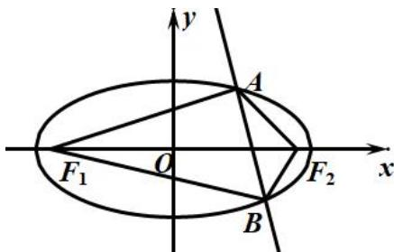

则不存在点 A, B 使得 C 和 S 同时取到最大值.

## 6 抛物线的切线、焦点弦与最值

### 嘉定 · 原卷第20题

**考点说明：** 第（1）问：抛物线上点的坐标与点到原点距离：设点坐标并联立方程。 第（2）问：抛物线焦点准线性质与几何最短路径：将焦点距离转化为到准线距离。 第（3）问：抛物线切线方程：联立动直线并利用根与系数关系，证明交点轨迹为直线。

来源：2026届上海高三一模嘉定卷，第20题。

如图, 在平面直角坐标系中, $O$ 为原点, 已知抛物线 $\Gamma: y = x^2$ 的焦点为 $F$ , 点 $A$ 的坐标为 (1,2).

（1）若点 $E$ 在 $\Gamma$ 上，且 $\left|OE\right| = \sqrt{2}$ ，求点 $E$ 的坐标；

（2）若 $P$ 是 $\Gamma$ 上的任意一点，求 $\left|AP\right| + \left|PF\right|$ 的最小值；

（3）过点 $A$ 的动直线与抛物线 $\Gamma$ 交于 $B$ 、 $C$ 两点，过点 $B$ 、 $C$ 分别作 $\Gamma$ 的切线，切线交点为 $D$ ，求证：点 $D$ 的轨迹是一条直线.

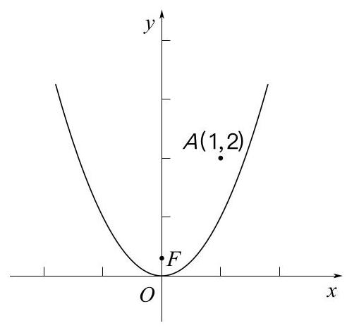

【答案】(1) $E(1,1)$ 或 $E(-1,1)$ ;

(2) $\frac{9}{4}$ ;

（3）证明见解析.

【解析】

【分析】（1）令 $E(x, x^{2})$ ，应用两点距离公式求参数值，即可得点的坐标；

（2）若 $PG$ 垂直抛物线 $\Gamma$ 的准线于 $G$ ，结合抛物线的定义得 $\left|AP\right| + \left|PF\right| = \left|AP\right| + \left|PG\right|$ ，数形结合确定其最小值；

（3）设 $BC:y - 2 = k(x - 1)$ ， $B(x_{1},y_{1}),C(x_{2},y_{2})$ ，应用导数几何意义求过 $B,C$ 的切线，进而得到 $x_{D} = \frac{x_{1} + x_{2}}{2}$ ， $y_{D} = x_{1}x_{2}$ ，联立直线 $BC$ 与抛物线并应用韦达定理得 $x_{1} + x_{2} = k$ ， $x_{1}x_{2} = k - 2$ ，即可证.

【小问 1 详解】

由题设，令 $E(x,x^2)$ ，则 $\left|OE\right| = \sqrt{x^2 + x^4} = \sqrt{2}$ ，即 $x^{4} + x^{2} - 2 = (x^{2} + 2)(x^{2} - 1) = 0$ 所以 $x^{2} = 1\Leftrightarrow x = \pm 1$ ，故 $E(1,1)$ 或 $E(-1,1)$

【小问 2 详解】

若 $PG$ 垂直抛物线 $\Gamma$ 的准线 $y = -\frac{1}{4}$ 于 $G$ ，由抛物线的定义知 $|PG| = |PF|$ 所以 $\left|AP\right| + \left|PF\right| = \left|AP\right| + \left|PG\right| \geq \left|AG\right|$ ，当且仅当 $A, P, G$ 三点共线时取等号，又 $AG \perp$ 抛物线 $\Gamma$ 的准线时， $|AG|$ 最小为 $2 - (-\frac{1}{4}) = \frac{9}{4}$ ，所以 $\left|AP\right| + \left|PF\right|$ 的最小值为 $\frac{9}{4}$ ；

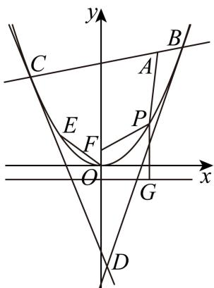  
【小问 3 详解】

由题设，直线 BC 的斜率一定存在，设 $BC: y - 2 = k(x - 1)$ ， $B(x_{1}, y_{1}), C(x_{2}, y_{2})$ ，

而 $y' = 2x$ ，则过 B 的切线斜率为 $2x_{1}$ ，对应切线为 $y - y_{1} = 2x_{1}(x - x_{1})$ ，即 $y = x_{1}(2x - x_{1})$ ，
同理过 C 的切线为 $y-y_{2}=2x_{2}(x-x_{2})$ ，即 $y=x_{2}(2x-x_{2})$ ，

联立 $\left\{ \begin{array}{l} y = x_{1}(2x - x_{1}) \\ y = x_{2}(2x - x_{2}) \end{array} \right.$ ，可得 $2x_{1}x - x_{1}^{2} = 2x_{2}x - x_{2}^{2}$ ，整理得 $2x(x_{1} - x_{2}) = x_{1}^{2} - x_{2}^{2}$ ，

由题意 $x_{1} \neq x_{2}$ ，则 $x_{D} = \frac{x_{1} + x_{2}}{2}$ ， $y_{D} = x_{1}x_{2}$ ，

联立 $\left\{ \begin{array}{l} y - 2 = k(x - 1) \\ y = x^2 \end{array} \right.$ ，得 $x^{2} - kx + k - 2 = 0$ ，且 $\Delta = k^{2} - 4(k - 2) = (k - 2)^{2} + 4 > 0$

所以 $x_{1} + x_{2} = k$ ， $x_{1}x_{2} = k - 2$ 则 $x_{D} = \frac{k}{2}$ ， $y_{D} = k - 2$

显然点 D 在直线 y=2x-2，即 2x-y-2=0 上，得证.

回源核对说明：题干图来自既有学生卷OCR附图，已视觉检查，A(1,2)、焦点F、原点O与抛物线清晰。解析沿用已有转录，并非本轮整题重算。

### 徐汇 · 原卷第20题

**考点说明：** 第（1）问：抛物线方程、焦点坐标与两点连线斜率。 第（2）问：圆的切线与直线截距：建立切线方程及切点条件，转化为截距差的最值。 第（3）问：切线与抛物线的联立：用根与系数关系表示纵坐标乘积，讨论动点条件下的定值存在性。

来源：2026届上海高三一模徐汇卷，第20题。

规范化源文件：`2026届徐汇一模数学试卷 逐题解析.md`。

已知抛物线 $\Gamma: y^2 = 2px(p > 0)$ 的焦点为 $F$ ，准线为 $l$ .

（1）若点 $E(4,4)$ 在抛物线 $\Gamma$ 上，求 EF 所在直线的斜率；

（2）若准线 l: x = -1，点 P 为抛物线 $\Gamma$ 准线 l 上的一个动点，过点 P 作圆

$M:x^{2}-4x+y^{2}+3=0$ 的两条切线，切点分别为 A、B．若两条切线 PA、PB 与 y 轴分别交于点 S、T，求 $|ST|$ 的最小值；

（3）若点 F 到准线 l 的距离为 2，过抛物线 $\Gamma$ 的准线 l 上一点 Q 作圆

$N:(x-m)^{2}+y^{2}=1(m>0)$ 的两条切线 $l_{1}$ 、 $l_{2}$ ，且 $l_{1}$ 、 $l_{2}$ 分别与 $\Gamma$ 交于 $C(s_{1},t_{1})$ 、 $D(s_{2},t_{2})$ 两点和 $G(s_{3},t_{3})$ 、 $H(s_{4},t_{4})$ 两点．问：是否存在某个圆 N，使得当点 Q 运动时， $t_{1}t_{2}t_{3}t_{4}$ 为定值？若存在，求出该定值；若不存在，请说明理由.

【答案】(1) $\frac{4}{3}$

(2) $\frac{\sqrt{2}}{2}$

（3）存在，且定值为16

【解析】

【分析】（1）将点 E 的坐标代入抛物线 $\Gamma$ 的方程，求出 p 的值，可得出该抛物线的标准方程，可求出其焦点 F 的坐标，再利用斜率的斜率公式可求出直线 EF 的斜率；

(2) 设点 $P(-1, t)$ , 由题意可知, 切线 $PA$ 、 $PB$ 的斜率都存在, 设这两条切线的斜率分别为 $k_{1}$ 、 $k_{2}$ , 设过点 $P$ 的切线方程为 $y - t = k(x + 1)$ , 利用圆心到切线的距离等于半径得出 $8k^{2} + 6tk + t^{2} - 1 = 0$ , 结合韦达定理得出 $k_{1} + k_{2} = -\frac{3t}{4}$ , $k_{1}k_{2} = \frac{t^{2} - 1}{8}$ , 求出 S、T 的坐标, 结合韦达定理可求出 $|ST|$ 的最小值;

（3）设点 $Q(-1, q)$ ，设过点 $Q$ 的切线的方程为 $y - q = k(x + 1)$ ，因为圆心 $N(m, 0)$ 到切线的距离为 1，可得出 $\left[(m + 1)^2 - 1\right]k^2 + 2q(m + 1)k + q^2 - 1 = 0$ ，设切线 $l_1$ 、 $l_2$ 的斜率分别为 $k_3$ 、 $k_4$ ，则 $k_3$ 、 $k_4$ 为该方程的两根，利用韦达定理得出 $k_3 + k_4 = -\frac{2q(m + 1)}{m(m + 2)}$ ， $k_3k_4 = \frac{q^2 - 1}{m(m + 2)}$ ，将直线 $l_1$ 的方程与抛物线的方程联立，可得出 $t_1t_2$ ，同理可得出 $t_3t_4$ ，化简 $t_1t_2t_3t_4$ 的表达式，根据韦达定理结合 $t_1t_2t_3t_4$ 为定值可求得 $m$ 的值，即可得出结论.

【小问 1 详解】

将点 E 的坐标代入抛物线 $\Gamma$ 的方程可得 $2p \times 4 = 4^{2}$ ，解得 p = 2，

故抛物线 $\Gamma$ 的标准方程为 $y^{2}=4x$ ，其焦点为 $F(1,0)$ ，

故直线 EF 的斜率为 $k_{EF} = \frac{4 - 0}{4 - 1} = \frac{4}{3}$ .

【小问 2 详解】

圆 $M$ 的标准方程为 $\left(x - 2\right)^2 + y^2 = 1$ ，则圆心为 $M(2,0)$ ，半径为 $r = 1$ ，

因为抛物线 $\Gamma$ 的准线方程为 $x = -1$ ，即 $-\frac{p}{2} = -1$ ，可得 $p = 2$ ，故抛物线 $\Gamma$ 的方程为 $y^{2} = 4x$ ，

设点 $P(-1, t)$ ，由题意可知，切线 $PA$ 、 $PB$ 的斜率都存在，设它们的斜率分别为 $k_{1}$ 、 $k_{2}$ ，不妨设过点 $P$ 的切线方程为 $y - t = k(x + 1)$ ，即 $kx - y + k + t = 0$ ，

由题意知，圆心 M 到直线 $kx - y + k + t = 0$ 的距离为 1，即 $\frac{|3k + t|}{\sqrt{k^{2} + 1}} = 1$ ，

整理可得 $8k^{2}+6tk+t^{2}-1=0$ ，

依题意， $k_{1}$ 、 $k_{2}$ 是关于 $k$ 的方程 $8k^{2} + 6tk + t^{2} - 1 = 0$ 的两根，

所以 $\Delta = 36t^{2} - 32\left(t^{2} - 1\right) = 4t^{2} + 32 > 0$ ，且 $k_{1} + k_{2} = -\frac{3t}{4}$ ， $k_{1}k_{2} = \frac{t^{2} - 1}{8}$ ，

易知直线 PA 的方程为 $y-t=k_{1}(x+1)$ ，令 x=0 可得 $y=k_{1}+t$ ，即得点 $S(0,k_{1}+t)$ ，同理点 $T(0,k_{2}+t)$ ，

$$
\left| S T \right| = \left| k _ {1} - k _ {2} \right| = \sqrt {\left(k _ {1} + k _ {2}\right) ^ {2} - 4 k _ {1} k _ {2}} = \sqrt {\frac {9 t ^ {2}}{1 6} - \frac {t ^ {2} - 1}{2}} = \frac {\sqrt {t ^ {2} + 8}}{4} \geq \frac {2 \sqrt {2}}{4} = \frac {\sqrt {2}}{2}
$$

当且仅当 $t = 0$ 时，等号成立，故 $\left|ST\right|$ 的最小值为 $\frac{\sqrt{2}}{2}$ .

【小问 3 详解】

若点 $F$ 到准线 $l$ 的距离为2，即 $p = 2$ ，故抛物线 $\Gamma$ 的方程为 $y^{2} = 4x$

其准线 l 的方程为 x = -1 ，设点 $Q(-1, q)$ ,

圆 N 的圆心为 $N(m,0)$ ，半径为 1，

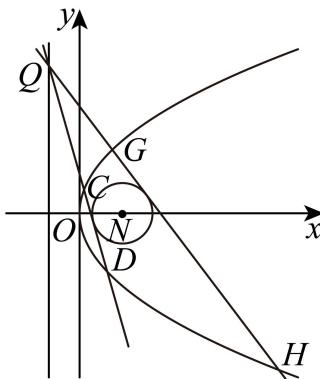

由题意可知，过点 $Q$ 的切线的斜率存在，设过点 $Q$ 的切线方程为 $y - q = k(x + 1)$ ，即 $kx - y + k + q = 0$ ，

因为圆心 $N(m,0)$ 到切线的距离为1，则 $\frac{|k(m+1)+q|}{\sqrt{k^{2}+1}}=1$ ，

整理可得 $\left[\left(m+1\right)^{2}-1\right]k^{2}+2q\left(m+1\right)k+q^{2}-1=0$ ，

设切线 $l_{1}$ 、 $l_{2}$ 的斜率分别为 $k_{3}$ 、 $k_{4}$ ，

则 $k_{3}$ 、 $k_{4}$ 为关于 $k$ 的方程 $\left[(m + 1)^2 - 1\right]k^2 + 2q(m + 1)k + q^2 - 1 = 0$ 的两根，

故 $k_{3} + k_{4} = -\frac{2q(m + 1)}{m(m + 2)}, k_{3}k_{4} = \frac{q^{2} - 1}{m(m + 2)},$

将直线 $l_{1}$ 的方程与抛物线 $\Gamma$ 的方程联立 $\left\{ \begin{array}{l} y = k_3(x + 1) + q \\ y^2 = 4x \end{array} \right.$ ，可得 $k_{3}y^{2} - 4y + 4k_{3} + 4q = 0$ ，

由韦达定理可得 $t_1t_2 = \frac{4(k_3 + q)}{k_3}$ ，同理可得 $t_3t_4 = \frac{4(k_4 + q)}{k_4}$ ，

$$
\text {故} t _ {1} t _ {2} t _ {3} t _ {4} = \frac {1 6 (k _ {3} + q) (k _ {4} + q)}{k _ {3} k _ {4}} = \frac {1 6 [ k _ {3} k _ {4} + q (k _ {3} + k _ {4}) + q ^ {2} ]}{k _ {3} k _ {4}}
$$

$$
= \frac {1 6 \left[ \frac {q ^ {2} - 1}{m (m + 2)} - \frac {2 q ^ {2} (m + 1)}{m (m + 2)} + q ^ {2} \right]}{\frac {q ^ {2} - 1}{m (m + 2)}} = \frac {1 6 \left[ q ^ {2} (m ^ {2} - 1) - 1 \right]}{q ^ {2} - 1} \text {为定值，则} m ^ {2} - 1 = 1,
$$

因为 $m > 0$ ，解得 $m = \sqrt{2}$

故当 $m = \sqrt{2}$ 时，即存在定圆 $N: \left(x - \sqrt{2}\right)^2 + y^2 = 1$ ，使得当点 $Q$ 运动时， $t_1 t_2 t_3 t_4$ 为定值16.

### 长宁 · 原卷第20题

**考点说明：** 第（1）问：应用抛物线定义及焦点、准线关系，将焦半径转化为横坐标。 第（2）问：设焦点弦所在直线并联立抛物线，利用根与系数关系及面积公式求解。 第（3）问：联立焦点弦和垂直平分线与抛物线，结合圆的直径所对圆周角条件求直线方程。

来源：2026届上海高三一模长宁卷，第20题。

规范化源文件：`2026届长宁一模数学试卷 逐题解析.md`。

已知抛物线 $\Gamma: y^{2} = 4x$ 的焦点为 F，经过点 F 的直线 l 与抛物线 $\Gamma$ 交于 A、B 两点.

（1）设 $|AF|=5$ ，求点A的横坐标；

（2）设 $O$ 为坐标原点，线段 $AB$ 中点的纵坐标为 $\frac{3}{2}$ ，求 $\triangle OAB$ 的面积；

（3）设线段 $AB$ 的垂直平分线与抛物线 $\Gamma$ 交于点 $M$ 、 $N$ ，若以线段 $MN$ 为直径的圆经过点 $A$ 、 $B$ ，求直线 $l$ 的方程.

【答案】(1) 4

(2) $\frac{5}{2}$

(3) $x = \pm y + 1$

【解析】

【分析】（1）根据抛物线的定义及 $\left|AF\right|=5$ ，求出 $x_{1}=4$ ；

（2）设 $A(x_{1},y_{1}),B(x_{2},y_{2})$ ，设直线 $l$ 的直线方程为 $x = my + 1$ ，与抛物线方程联立，根据韦达定理得到 $y_{1} + y_{2} = 4m$ ， $y_{1}y_{2} = -4$ ，再根据中点的纵坐标为 $\frac{3}{2}$ ，可解得结果；

（2）设 $MN:y - 2m = -m(x - 2m^2 -1)$ ， $M(x_{3},y_{3}),N(x_{4},y_{4})$ ，求出

$y_{3}+y_{4}=-\frac{4}{m}\ y_{3}y_{4}=-8m^{2}-12$ ，利用 $\overrightarrow{AN}\cdot\overrightarrow{AM}=0$ 可得结果.

【小问 1 详解】

由抛物线方程知： $F(1,0)$ ，设 $A(x_{1},y_{1})$ ，

由 $\left|AF\right|=5$ 得： $x_{1}+1=5,\therefore x_{1}=4$ .

【小问 2 详解】

由题意知：直线 l 斜率不为零，可设 $l: x = my + 1$ ， $A(x_{1}, y_{1}), B(x_{2}, y_{2})$ ，

由 $\left\{\begin{aligned}y^{2}&=4x\\ x&=my+1\end{aligned}\right.$ 得： $y^{2}-4my-4=0$ ，则 $\Delta=16m^{2}+16>0$ ，

$$
\therefore y _ {1} + y _ {2} = 4 m, \quad y _ {1} y _ {2} = - 4
$$

$\because F(1,0)$ ，又因为 $A,B$ 中点的纵坐标为 $\frac{3}{2}$ ，所以 $y_{1} + y_{2} = 4m = 3$

所以 $\triangle OAB$ 的面积为 $\frac{1}{2} |OF| \times |y_1 - y_2| = \frac{1}{2} \times 1 \times \sqrt{3^2 - 4 \times (-4)} = \frac{1}{2} \times 5 = \frac{5}{2}$ ;

【小问 3 详解】

由题意知：直线 l 斜率不为零，可设 $l: x = my + 1$ ， $A(x_{1}, y_{1}), B(x_{2}, y_{2})$ ，

由 $\left\{ \begin{array}{l} y^{2} = 4x \\ x = my + 1 \end{array} \right.$ 得： $y^{2} - 4my - 4 = 0$ ，则 $\Delta = 16m^2 + 16 > 0$

$\therefore y_{1} + y_{2} = 4m, y_{1}y_{2} = -4$ ，所以 $AB$ 中点为 $(2m^{2} + 1,2m)$

因为线段 $AB$ 的垂直平分线与抛物线 $\Gamma$ 交于点 $M$ 、 $N$ ，设 $MN:y - 2m = -m(x - 2m^2 -1),M(x_3,y_3),N(x_4,y_4)$ 联立 $\left\{ \begin{array}{l}y - 2m = -m(x - 2m^2 -1)\\ y^2 = 4x \end{array} \right.$ 可得 $y^{2} + \frac{4}{m} y - 8m^{2} - 12 = 0$ ，由韦达定理可得 $y_{3} + y_{4} = -\frac{4}{m},y_{3}y_{4} = -8m^{2} - 12,$ 若以线段MN为直径的圆经过点A、B， $\overrightarrow{AM} = (x_3 - x_1,y_3 - y_1),\overrightarrow{AN} = (x_4 - x_1,y_4 - y_1)$ $\therefore \overrightarrow{AM}\cdot \overrightarrow{AN} = (x_3 - x_1)(x_4 - x_1) + (y_3 - y_1)(y_4 - y_1)$ $= \frac{(y_3 - y_1)(y_4 - y_1)}{16}\times [(y_3 + y_1)(y_4 + y_1) + 16] = 0,\quad y_1,y_2$ 不相等， $y_{3},y_{4}$ 不相等，所以 $y_{3}y_{4} + y_{1}(y_{3} + y_{4}) + y_{1}^{2} + 16 = 0$ ，同理 $y_{3}y_{4} + y_{2}(y_{3} + y_{4}) + y_{2}^{2} + 16 = 0$ 可得 $(y_{1} - y_{2})(y_{3} + y_{4}) + y_{1}^{2} - y_{2}^{2} = (y_{1} - y_{2})(y_{3} + y_{4} + y_{1} + y_{2}) = 0,\quad y_{1},y_{2}$ 不相等，所以 $(y_{1} + y_{2}) + (y_{3} + y_{4}) = 4m - \frac{4}{m} = 0$ 即 $m^2 = 1$ ，解得 $m = \pm 1$

所以直线 l 的方程为 $x = \pm y + 1$ .

### 虹口 · 原卷第10题

**考点说明：** 抛物线切线与几何最值：由图形条件建立抛物线与切线方程，再将梯形面积表示成单变量函数。

来源：2026届上海高三一模虹口卷，第10题。

规范化源文件：`2026届虹口一模数学试卷 逐题解析.md`。

小虹同学要在边长为10的正方形纸片 $RSNM$ 上剪出一个等腰梯形 $ABCD$ 的图案，如图所示，腰 $AB$、$CD$ 与正方形内的抛物线 $\Gamma$ 分别相切于 $E$、$F$ 两点，其中 $\Gamma$ 的顶点 $O$ 为 $RM$ 的中点。若当点 $E$ 到 $RM$ 的距离为4.5时，$EF=6$，则当等腰梯形 $ABCD$ 的面积取到最小值时，$EF=\underline{\qquad}$。（结果保留2位小数）

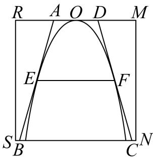

【答案】6.32

【解析】

【分析】如图建系，设抛物线方程为 $x^{2} = -2py, p > 0$ ，根据题意得到 $E(-3, -4.5)$ ，将其代入抛物线得到 p = 1，根据抛物线设 $F(x_{0}, -\frac{1}{2}x_{0}^{2})$ ， $x_{0} \in (0, 2\sqrt{5})$ ，利用导数求出 $k_{CD} = -x_{0}$ ，设直线 CD 的方程为 $y + \frac{1}{2}x_{0}^{2} = -x_{0}(x - x_{0})$ ，利用直线 CD 的方程求出 $x_{D}$ 和 $x_{C}$ ，求出 $S_{ABCD}$ ，利用基本不等式求最小值即可得解。

【详解】如图建系，设抛物线方程为 $x^{2} = -2py, p > 0$ ，

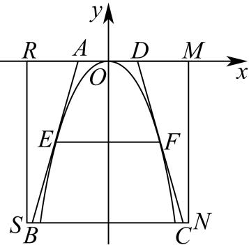

当点 E 到 RM 的距离为 4.5 时，EF = 6，

则 $E(-3, - 4.5)$ ，代入抛物线 $x^{2} = -2py,p > 0$ ，解得 $p = 1$

则 $x^{2} = -2y$ ，即 $y = -\frac{1}{2} x^2$ ，设 $y = -10$ ，则 $x = \pm 2\sqrt{5}$

设 $F(x_0, - \frac{1}{2} x_0^2)$ ， $x_0\in (0,2\sqrt{5})$

$$
\because y = - \frac {1}{2} x ^ {2}, \therefore y ^ {\prime} = - x, k _ {C D} = - x _ {0}
$$

则直线 CD 的方程为 $y + \frac{1}{2}x_{0}^{2} = -x_{0}(x - x_{0})$ ,

令 $y = 0$ ，解得 $x_{D} = \frac{1}{2} x_{0}$ ，令 $y = -10$ ，解得 $x_{C} = \frac{1}{2} x_{0} + \frac{10}{x_{0}}$

$$
S _ {A B C D} = 2 \times \frac {1}{2} \times \left(\frac {1}{2} x _ {0} + \frac {1}{2} x _ {0} + \frac {1 0}{x _ {0}}\right) \times 1 0 = 1 0 \left(x _ {0} + \frac {1 0}{x _ {0}}\right) \geq 2 0 \sqrt {x _ {0} \cdot \frac {1 0}{x _ {0}}} = 2 0 \sqrt {1 0},
$$

当且仅当 $x_0 = \frac{10}{x_0}$ 时，即 $x_0 = \sqrt{10}$ 时，等号成立，

故当 $x_0 = \sqrt{10}$ 时， $S_{ABCD}$ 取最小值，此时 $EF = 2x_0 = 2\sqrt{10} \approx 6.32$ 。

故答案为：6.32

核对说明：虹口原卷PDF第1页原文与题图已回核；源解析原先错置在第9题之后。

## 7 双曲线与动直线、切线及最值

### 宝山 · 原卷第20题

**考点说明：** 第（1）问：由离心率与已知点建立半轴参数关系，求双曲线标准方程。 第（2）问：圆的切线长与动点最值：利用切线长关系，将问题转化为动点到圆心距离的最值。 第（3）问：动直线与双曲线：结合关于原点的对称条件、垂足关系，探求并证明定长。

来源：2026届上海高三一模宝山卷，第20题。

规范化源文件：`2026届宝山一模数学试卷 逐题解析.md`。

已知双曲线 $C: \frac{x^2}{a^2} - \frac{y^2}{b^2} = 1 (a > 0, b > 0)$ 的离心率为 $\sqrt{2}$ ，点 $P(2, -1)$ 在双曲线 $C$ 上.

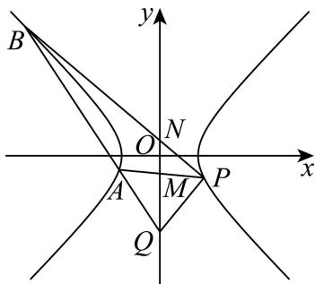

（1）求双曲线 C 的标准方程；

（2）设点S是双曲线C上的动点，T是圆 $E:(x-4)^{2}+y^{2}=1$ 上的动点，且直线ST与圆E相切，求 $|ST|$ 的最小值；

（3）如图，A、B 是双曲线 C 上两点，直线 PA、PB 与 y 轴分别交于点 M、N，点 Q 在直线 AB 上．若 M、N 关于原点对称，且 $PQ \perp AB$ ，证明：存在点 R，使得 $\left|QR\right|$ 为定值.

【答案】（1） $\frac{x^{2}}{3}-\frac{y^{2}}{3}=1$

(2) 2

（3）当 $R$ 为 $PD$ 的中点 $(1, -2)$ 时， $|RQ| = \sqrt{2}$ ，证明见解析

【解析】

【分析】（1）根据题意，列出方程组，求得 $a^{2}=b^{2}=3$ ，即可求得双曲线的方程；

（2）根据直线 $ST$ 与圆 $E$ 相切得 $\left|ST\right| = \sqrt{\left|SE\right|^2 - 1}$ ，设 $S(x_0, y_0)$ ，则 $\frac{x_0^2}{3} - \frac{y_0^2}{3} = 1$ ，从而 $\left|SE\right| = \sqrt{(x_0 - 4)^2 + y_0^2} = \sqrt{2(x_0 - 2)^2 + 5} \geq \sqrt{5}$ ，进而求得 $\left|ST\right|_{\min}$

（3）设直线 AB 的方程为 $y = kx + m$ ，联立方程组，设 $A(x_{1}, y_{1}), B(x_{2}, y_{2})$ ，得到

$x_{1} + x_{2}, x_{1}x_{2}$ ，得出直线 $PA, PB$ 的方程求得 $M$ 和 $N$ ，结合 $O$ 为 $MN$ 的中点，列出方程求得 $m = -3$ ，求得 $\left|PD\right|$ 为定值，利用直角 $\triangle PQD$ 的性质，即可求解.

【小问 1 详解】

因为双曲线 $C: \frac{x^{2}}{a^{2}} - \frac{y^{2}}{b^{2}} = 1$ 的离心率为 $\sqrt{2}$ ，且 $P(2, -1)$ 在双曲线 C 上，

可得 $\left\{\begin{aligned}\frac{4}{a^{2}}-\frac{1}{b^{2}}=1\\e=\frac{c}{a}=\sqrt{2}\\c^{2}=a^{2}+b^{2}\end{aligned}\right.$ ，解得 $a^{2}=3,b^{2}=3$ ，

所以双曲线的方程为 $\frac{x^2}{3} -\frac{y^2}{3} = 1$

【小问 2 详解】

圆 $E: (x - 4)^2 + y^2 = 1$ 的圆心 $E(4,0)$ ，半径为1，

∵ T 是圆 $E:(x-4)^{2}+y^{2}=1$ 上的动点，直线 ST 与圆 E 相切，

$$
\therefore S T \perp T E, | E T | = 1.
$$

$$
\therefore | S T | = \sqrt {\left| S E \right| ^ {2} - \left| E T \right| ^ {2}} = \sqrt {\left| S E \right| ^ {2} - 1}
$$

设 $S\left(x_0,y_0\right)$ ，因为点S是双曲线 $C$ 上的动点， $\therefore \frac{x_0^2}{3} -\frac{y_0^2}{3} = 1$

$$
\therefore | S E | = \sqrt {\left(x _ {0} - 4\right) ^ {2} + y _ {0} ^ {2}} = \sqrt {\left(x _ {0} - 4\right) ^ {2} + x _ {0} ^ {2} - 3} = \sqrt {2 \left(x _ {0} - 2\right) ^ {2} + 5},
$$

当 $x_0 = 2$ 时， $\left|SE\right|$ 取得最小值，且 $\left|SE\right|_{\min} = \sqrt{5}$

$\therefore \left|ST\right|_{\min} = \sqrt{\left(\sqrt{5}\right)^2 - 1} = 2$

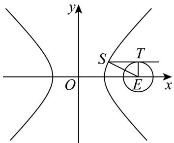

【小问3详解】

由题意知，直线 AB 的斜率存在，设直线 AB 的方程为 $y = kx + m$ ，

联立方程组 $\left\{\begin{aligned}y&=kx+m\\ x^{2}&-y^{2}=3\end{aligned}\right.$ ，整理得 $(1-k^{2})x^{2}-2kmx-m^{2}-3=0$ ，

则 $\Delta = (-2km)^{2} - 4(1 - k^{2})(-m^{2} - 3) = 4(m^{2} - 3k^{2} + 3) > 0$ 且 $1 - k^2\neq 0$

设 $A(x_{1},y_{1}),B(x_{2},y_{2})$ ，则 $x_{1} + x_{2} = \frac{2km}{1 - k^{2}},x_{1}x_{2} = \frac{-m^{2} - 3}{1 - k^{2}}$

直线 $PA$ 的方程为 $y + 1 = \frac{y_1 + 1}{x_1 - 2} (x - 2)$

令 $x = 0$ ，可得 $y = -1 - \frac{2y_1 + 2}{x_1 - 2}$ ，即 $M\left(0, - 1 - \frac{2y_1 + 2}{x_1 - 2}\right),$

同理可得 $N\left(0,-1-\frac{2y_{2}+2}{x_{2}-2}\right)$ ,

因为O为MN的中点，所以 $\left(-1-\frac{2y_{1}+2}{x_{1}-2}\right)+\left(-1-\frac{2y_{2}+2}{x_{2}-2}\right)=0$ ，

$$
- 1 - \frac {2 (k x _ {1} + m) + 2}{x _ {1} - 2} - 1 - \frac {2 (k x _ {2} + m) + 2}{x _ {2} - 2} = 0
$$

则 $(2k + 1)x_{1}x_{2} - (2k - m + 1)(x_{1} + x_{2}) - 4m = 0$

可得 $\frac{(2k + 1)(-m^2 - 3)}{1 - k^2} - \frac{2km(2k - m + 1)}{1 - k^2} - 4m = 0$

整理得 $(m+3)(m+2k+1)=0$ ，

所以 m = -3 或 $m + 2k + 1 = 0$ ，

若 $m + 2k + 1 = 0$ ，即 $m = -2k - 1$ ，则直线方程为 $y = kx - 2k - 1$ ，即 $y + 1 = k(x - 2)$

此时直线 AB 过点 $P(2,-1)$ ，不合题意；

若 m = -3 时，则直线方程为 y = kx - 3，恒过定点 $D(0, -3)$ ，

所以 $\left|PD\right|=\sqrt{2^{2}+\left(-1+3\right)^{2}}=2\sqrt{2}$ 为定值，

又由 $\triangle PQD$ 为直角三角形，且 $PD$ 为斜边，

所以当 $R$ 为 $PD$ 的中点 $(1, -2)$ 时， $\left|RQ\right| = \frac{1}{2}\left|PD\right| = \sqrt{2}$ .

### 静安 · 原卷第20题

**考点说明：** 第（1）问：联立焦距条件、双曲线半轴关系与点在曲线上条件，确定方程。 第（2）问：由圆的切线条件确定截距，联立双曲线并用根与系数关系求向量数量积。 第（3）问：利用平行焦点弦的对称关系表示四边形面积，结合交点存在范围确定直线。

来源：2026届上海高三一模静安卷，第20题。

规范化源文件：`2026届静安一模数学试卷 逐题解析.md`。

在平面直角坐标系 $xOy$ 中，已知双曲线 $\Gamma: \frac{x^2}{a^2} - \frac{y^2}{b^2} = 1 (a > 0, b > 0)$ 的焦距为 4，点 $(\sqrt{6}, 1)$ 在 $\Gamma$ 上.

（1）求双曲线 $\Gamma$ 的方程；

（2）设直线 l 的斜率为 $\frac{1}{2}$ ，l 交双曲线 $\Gamma$ 于 P、Q 两点，且与圆 $x^{2} + y^{2} = 4$ 相切，切点位于 x 轴上方，求 $\overrightarrow{OP} \cdot \overrightarrow{OQ}$ 的值；

（3）如图，设过双曲线 $\Gamma$ 的左焦点 $F_{1}$ 的直线 $AB$ 交 $\Gamma$ 的左支于点 $A$ 、 $B$ ，过 $\Gamma$ 的右焦点 $F_{2}$ 的直线 $CD$ 交 $\Gamma$ 的右支于点 $C$ 、 $D$ ，若直线 $CD // AB$ ，且四边形 $ABCD$ 的面积为 $4\sqrt{6}$ ，求直线 $AB$ 的方程.

【答案】（1） $\frac{x^{2}}{3}-y^{2}=1$

(2) -55

(3) $x - y + 2 = 0$ 或 $x + y + 2 = 0$

【解析】

【分析】（1）根据双曲线 $\Gamma$ 的焦距为 4 及点 $(\sqrt{6},1)$ 在 $\Gamma$ 上，列方程即可求得结果；

（2）设直线 $l$ 的方程为 $y = \frac{1}{2} x + m$ ，利用直线 $l$ 与圆相切，求出直线的方程，将直线方程

与双曲线方程联立，利用韦达定理或求出两个交点坐标，从而求得 $\overrightarrow{OP}\cdot\overrightarrow{OQ}$ ;

（3）由双曲线的对称性，易知四边形 ABCD 为平行四边形，设直线 AB 的方程为 $y = k(x + 2)$ （或 x = ky - 2），求出直线 AB 和直线 CD 的距离，再将直线 AB 方程与双曲线方程联立，利用弦长公式求出 $\left|AB\right|$ 的长，根据平行四边形 ABCD 的面积为 $4\sqrt{6}$ 列出方程，求出 k，再根据直线 AB 与双曲线左支有两个交点对结果进行取舍，从而得到答案.

【小问 1 详解】

由双曲线 $\Gamma : \frac{x^2}{a^2} - \frac{y^2}{b^2} = 1 (a > 0, b > 0)$ 的焦距为4，点 $(\sqrt{6}, 1)$ 在 $\Gamma$ 上，

可得 $2c = 4$ ，所以 $c = 2$ ，且 $\frac{6}{a^2} -\frac{1}{b^2} = 1$ ，又因为 $c^2 = a^2 +b^2$ ，即 $a^2 +b^2 = 4$

联立方程组 $\left\{ \begin{array}{l}a^2 +b^2 = 4\\ \frac{6}{a^2} -\frac{1}{b^2} = 1 \end{array} \right.$ ，解得 $a^2 = 3$ ， $b^{2} = 1$ ，所以 $\Gamma$ 的方程为 $\frac{x^2}{3} -y^2 = 1$

【小问 2 详解】

设直线 l 方程为 $y=\frac{1}{2}x+m$ ，代入圆的方程整理得 $\frac{5}{4}x^{2}+mx+m^{2}-4=0$ ，直线与圆相切，
所以判别式 $\Delta = m^{2} - 5m^{2} + 20 = 0$ ，所以 $m^{2} = 5$ ，切点位于 x 轴上方，故 $m = \sqrt{5}$ .

将直线 $y = \frac{1}{2} x + \sqrt{5}$ 代入双曲线 $\Gamma$ 方程，整理得 $\frac{1}{12} x^2 - \sqrt{5} x - 6 = 0$ ，解得 $x = 6\left(\sqrt{5} \pm \sqrt{7}\right)$ ，

P、Q两点的坐标分别为 $(6\sqrt{5}-6\sqrt{7},4\sqrt{5}-3\sqrt{7})$ 、 $(6\sqrt{5}+6\sqrt{7},4\sqrt{5}+3\sqrt{7})$ ,

从而 $\overrightarrow{OP} \cdot \overrightarrow{OQ} = 180 - 252 + 80 - 63 = -55$ ;

另解：由题意设直线 $l$ 方程为 $y = \frac{1}{2} x + m$ ，该直线与圆 $x^{2} + y^{2} = 4$ 相切，

则圆心到直线 l 的距离 $d=\frac{|2m|}{\sqrt{5}}=2$ ，解得 $m=\sqrt{5}$ 。联立 $\left\{\begin{aligned}y&=\frac{1}{2}x+\sqrt{5}\\ \frac{x^{2}}{3}-y^{2}&=1\end{aligned}\right.$ 得

$$
x ^ {2} - 1 2 \sqrt {5} x - 7 2 = 0
$$

设 $P\big(x_1,y_1\big)$ ， $Q\big(x_{2},y_{2}\big)$ ，则 $x_{1} + x_{2} = 12\sqrt{5}$ ， $x_{1}\cdot x_{2} = -72$

$$
\overrightarrow {O P} \cdot \overrightarrow {O Q} = x _ {1} x _ {2} + y _ {1} y _ {2} = x _ {1} x _ {2} + \left(\frac {1}{2} x _ {1} + \sqrt {5}\right) \left(\frac {1}{2} x _ {2} + \sqrt {5}\right) = \frac {5}{4} x _ {1} x _ {2} + \frac {\sqrt {5}}{2} (x _ {1} + x _ {2}) + 5
$$

$$
= \frac {5}{4} \times (- 7 2) + \frac {\sqrt {5}}{2} \times 1 2 \sqrt {5} + 5 = - 5 5
$$

【小问 3 详解】

由题意直线 $AB$ 与 $CD$ 平行，由双曲线的对称性，易知 $AB = CD$ ，四边形ABCD为平行四边形.

当直线 $AB$ 垂直于 $x$ 轴时， $|AB| = \frac{2\sqrt{3}}{3}$ ，此时四边形 $ABCD$ 的面积为 $\frac{8\sqrt{3}}{3}$ ，不合题意，舍去；

设直线 AB 方程为 $y = k(x + 2)$ ，则直线 CD 方程为 $y = k(x - 2)$ ，

直线 AB 和 CD 的距离就是点 $F_{2}$ 到直线 AB 的距离 $d = \frac{|4k|}{\sqrt{1 + k^{2}}}$ ,

设 $A(x_{3},y_{3})$ ， $B(x_4,y_4)$ ，联立方程组 $\left\{ \begin{array}{l} \frac{x^2}{3} - y^2 = 1 \\ y = k(x + 2) \end{array} \right.$ ，整理的

$$
(1 - 3 k ^ {2}) x ^ {2} - 1 2 k ^ {2} x - 1 2 k ^ {2} - 3 = 0
$$

则 $\Delta = 12\left(k^2 + 1\right) > 0$ ，且 $x_3 + x_4 = \frac{12k^2}{1 - 3k^2}$ ， $x_3x_4 = \frac{-12k^2 - 3}{1 - 3k^2}$ ，

又由双曲线的渐近线的方程为 $y = \pm \frac{\sqrt{3}}{3} x$ ，

要使得过 $\Gamma$ 的左焦点 $F_{1}$ 的直线 AB 交 $\Gamma$ 的左支于点 A、B，可得 $k^{2} > \frac{1}{3}$ ， $(x_{1}x_{2} > 0)$ 则

$$
\mid A B \mid = \sqrt {1 + k ^ {2}} \mid x _ {3} - x _ {4} \mid = \sqrt {1 + k ^ {2}} \sqrt {\left(x _ {3} + x _ {4}\right) ^ {2} - 4 x _ {3} x _ {4}}
$$

$$
= \sqrt {1 + k ^ {2}} \sqrt {\left(\frac {1 2 k ^ {2}}{1 - 3 k ^ {2}}\right) ^ {2} + \frac {4 8 k ^ {2} + 2}{1 - 3 k ^ {2}}} = \frac {2 \sqrt {3} (1 + k ^ {2})}{3 k ^ {2} - 1},
$$

所以 $S_{ABCD} = |AB| \times d = \frac{2\sqrt{3}(1 + k^2)}{3k^2 - 1} \times \frac{|4k|}{\sqrt{1 + k^2}} = \frac{8\sqrt{3}|k|\sqrt{1 + k^2}}{3k^2 - 1} = 4\sqrt{6}$ ，化简可得 $7k^4 - 8k^2 + 1 = 0$ ，

解得 $k^2 = \frac{1}{7}$ ，或 $k^2 = 1$ ，因为 $k^2 > \frac{1}{3}$ ，所以 $k^2 = 1$ ，

故直线 AB 的方程为 $x - y + 2 = 0$ 或 $x + y + 2 = 0$ .

另解：设直线 AB 方程为 x = ky - 2，代入双曲线方程得 $\frac{(ky - 2)^{2}}{3} - y^{2} = 1$ ，整理得 $(k^{2} - 3)y^{2} - 4ky + 1 = 0$ ，(因为双曲线的渐近线斜率为 $\frac{\sqrt{3}}{3}$ ，直线 AB 与双曲线左支交于两点，所以 $k^{2} \neq 3$ )

$y_{3}+y_{4}=\frac{4k}{k^{2}-3},\quad y_{3}y_{4}=\frac{1}{k^{2}-3},$ 所以

$$
\left| A B \right| = \sqrt {1 + k ^ {2}} \sqrt {\left(y _ {3} - y _ {4}\right) ^ {2}} = \sqrt {1 + k ^ {2}} \sqrt {\left(y _ {3} + y _ {4}\right) ^ {2} - 4 y _ {3} y _ {4}}
$$

点 $F_{2}$ 到直线 $AB$ 的距离 $d = \frac{4}{\sqrt{1 + k^2}}$

$$
S _ {A B C D} = | A B | \times d = \frac {\sqrt {1 + k ^ {2}}}{| k ^ {2} - 3 |} \times \sqrt {1 2 k ^ {2} + 1 2} \times \frac {4}{\sqrt {1 + k ^ {2}}} = \frac {8 \sqrt {3} \sqrt {1 + k ^ {2}}}{| k ^ {2} - 3 |} = 4 \sqrt {6},
$$

化简可得 $k^{4}-8k^{2}+7=0$ ，解得 $k^{2}=7$ ，或 $k^{2}=1$ ，因为当 $k^{2}=7$ 时，直线 AB 斜率平方 $\frac{1}{k^{2}}<\frac{1}{7}$ ，

此时 AB 与双曲线左支只能交于一点，舍去，所以 $k^{2}=1$ ，

故直线 AB 的方程为 $x - y + 2 = 0$ ，或 $x + y + 2 = 0$ 。

### 黄浦 · 原卷第20题

**考点说明：** 第（1）问：由焦距及渐近线方程建立双曲线半轴关系，求标准方程。 第（2）问：利用直线与双曲线只有一个公共点确定点P，再由垂直关系求轴上点坐标。 第（3）问：设平行截线并联立双曲线，利用根与系数关系和距离比例检验是否存在定值。

来源：2026届上海高三一模黄浦卷，第20题。

规范化源文件：`2026届黄浦一模数学试卷 逐题解析.md`。

已知双曲线 $\Gamma$ 的中心位于坐标原点 $O$ ，焦点 $F_{2}$ ， $F_{1}$ 分别在 $x$ 轴的正、负半轴上， $\left|F_{1}F_{2}\right| = 2\sqrt{2}$ ，直线 $y = -x$ 是 $\Gamma$ 的一条渐近线，直线 $l_{1}: y = \sqrt{2} x + t (t < 0)$ 与 $\Gamma$ 有且只有一个公共点 $P$ 。

（1）求 $\Gamma$ 的方程；

(2) 若点 $Q$ 在 $y$ 轴上, 且 $\angle F_{1}QP$ 为直角, 求点 $Q$ 的坐标;

（3）设动直线 $l_{2}$ 平行于 OP，与 $\Gamma$ 交于点 A，B，与 $l_{1}$ 交于点 K，是否存在常数 $\lambda$ ，使得

$\left|KA\right|\cdot \left|KB\right| = \lambda \left|KP\right|^2$ 总成立？若存在，请求出 $\lambda$ 的值；若不存在，请说明理由.

【答案】（1） $x^{2} - y^{2} = 1$

(2) $(0,2)$ 或 $(0,-1)$

（3）存在 $\lambda=1$ 符合题意.

【解析】

【分析】（1）利用双曲线的焦距确定 c，渐近线斜率确定 $\frac{b}{a}$ ，结合 $c^{2}=a^{2}+b^{2}$ 求出 a, b，
进而得到双曲线方程.

（2）联立直线与双曲线，由判别式得 $t$ 以确定 $P$ 点坐标，设 $Q$ 点坐标后，利用向量垂直的数量积为0求解 $Q$ 的坐标.

（3）先确定直线 $l_{2}$ 的方程，联立 $l_{2}$ 与双曲线得韦达定理，联立 $l_{2}$ 与 $l_{1}$ 得 $K$ 点坐标，计算 $\left|KA\right|\cdot \left|KB\right|$ 和 $\left|KP\right|^2$ 并化简对比，得出常数 $\lambda$ 的值.

【小问 1 详解】

依题意， $\left\{ \begin{array}{l}2c = 2\sqrt{2}\\ \frac{b}{a} = 1\\ c^2 = a^2 +b^2 \end{array} \right.$ ，解得 $a = b = 1,c = \sqrt{2}$

所以 $\Gamma$ 的方程为 $x^{2}-y^{2}=1$ .

【小问 2 详解】

联立 $\left\{\begin{aligned}y&=\sqrt{2}x+t\\ x^{2}-y^{2}&=1\end{aligned}\right.$ ，消去y并化简得 $x^{2}+2\sqrt{2}tx+t^{2}+1=0$ ，

由题意可得 $\Delta = 8t^2 - 4(t^2 + 1) = 0$ ，解得 $t = \pm 1$ ，因为 $t > 0$ ，

所以 t = -1，代入上式，解得 $x = \sqrt{2}, y = 1$ ，

所以 $P\left(\sqrt{2},1\right)$ ，设 $Q(0,q)$

因为 $\angle F_{1}QP$ 为直角，

所以 $\overrightarrow{QF_1}\cdot \overrightarrow{QP} = (-\sqrt{2}, - q)\cdot (\sqrt{2},1 - q) = -\sqrt{2}\times \sqrt{2} -q(1 - q) = 0$

解得 q=2 或 -1，

所以 $Q(0,2)$ 或 $(0,-1)$ .

【小问 3 详解】

$k_{OP}=\frac{\sqrt{2}}{2}$ ，设 $A(x_{1},y_{1}),B(x_{2},y_{2})$ ， $l_{2}:y=\frac{\sqrt{2}}{2}x+m$ ，

联立 $\left\{ \begin{array}{l} y = \frac{\sqrt{2}}{2} x + m \\ x^2 - y^2 = 1 \end{array} \right.$ ，消去 $y$ 并化简得 $x^2 - 2\sqrt{2} mx - 2m^2 - 2 = 0$ ，

$$
\Delta = 8 m ^ {2} - 4 (- 2 m ^ {2} - 2) = 1 6 m ^ {2} + 8 > 0,
$$

$$
x _ {1} + x _ {2} = 2 \sqrt {2} m, x _ {1} x _ {2} = - 2 (m ^ {2} + 1)
$$

联立 $\left\{\begin{aligned}y&=\frac{\sqrt{2}}{2}x+m\\ y&=\sqrt{2}x-1\end{aligned}\right.$ ，解得 $\left\{\begin{aligned}x&=\sqrt{2}m+\sqrt{2}\\ y&=2m+1\end{aligned}\right.$

所以 $K\left(\sqrt{2} m + \sqrt{2}, 2m + 1\right)$ ,

$$
\left| K A \right| \cdot \left| K B \right| = \left[ 1 + \left(\frac {\sqrt {2}}{2}\right) ^ {2} \right] \cdot \left| \left(x _ {1} - x _ {K}\right) \left(x _ {2} - x _ {K}\right) \right| = \frac {3}{2} \left| x _ {1} x _ {2} - x _ {K} \left(x _ {1} + x _ {2}\right) + x _ {K} ^ {2} \right|,
$$

代入 K 点坐标及韦达定理得

$$
\left| K A \right| \cdot \left| K B \right| = \frac {3}{2} \left| - 2 (m ^ {2} + 1) - 2 \sqrt {2} m (\sqrt {2} m + \sqrt {2}) + (\sqrt {2} m + \sqrt {2}) ^ {2} \right| = 6 m ^ {2},
$$

$$
\left| K P \right| ^ {2} = (\sqrt {2} m + \sqrt {2} - \sqrt {2}) ^ {2} + (2 m + 1 - 1) ^ {2} = 6 m ^ {2},
$$

所以 $\exists \lambda = 1$ ，使得 $\left|KA\right|\cdot \left|KB\right| = \lambda \left|KP\right|^2.$

### 闵行 · 原卷第20题

**考点说明：** 第（1）问：双曲线渐近线与夹角：由标准方程写出两条渐近线，用斜率或方向向量求夹角。 第（2）问：过焦点直线的截距三角形面积：把与两条渐近线的交点及面积表示为斜率函数，结合有效范围求最小值。 第（3）问：双曲线右支上的等长分割：将三段等长转为共线点的参数关系，联立双曲线并筛选象限及交点存在条件。

来源：2026届上海高三一模闵行卷，第20题。

已知双曲线 $\Gamma:x^2-y^2=1$，直线 $l$ 过点 $M(m,0)$，$m\in\mathbb R$，且与 $\Gamma$ 的右支交于 $P,Q$ 两点，与 $\Gamma$ 的两条渐近线分别交于 $A,B$ 两点，其中 $A,P$ 在第一象限，$B,Q$ 在第四象限。

（1）求 $\Gamma$ 的两条渐近线的夹角；

（2）若 $M$ 为 $\Gamma$ 的右焦点，求 $\triangle OAB$ 的面积的最小值；

（3）若 $|AP|=|PQ|=|QB|$，求 $m$ 的取值范围。

【答案】（1）$\frac\pi2$；（2）$2$；（3）$(1,\frac{3\sqrt2}{4}]$。

【解析·参考原解整理】

（1）两条渐近线为 $y=\pm x$，夹角为 $\frac\pi2$。

（2）设 $l:x=ty+\sqrt2$，由 $A,B$ 在第一、第四象限得 $-1<t<1$，两点横坐标分别为 $\frac{\sqrt2}{1-t},\frac{\sqrt2}{1+t}$。故 $S_{OAB}=\frac2{1-t^2}\ge2$，当 $t=0$ 时取等，满足题意。

（3）设 $l:x=ty+m$。由 $A,B$ 分别在第一、第四象限及 $P,Q$ 在双曲线右支两侧可得 $-1<t<1$，$m>1$。设 $A,B,P,Q$ 的纵坐标依次为 $y_1,y_2,y_3,y_4$，由韦达定理，$y_1+y_2=y_3+y_4=\frac{-2tm}{t^2-1}$，$y_1y_2=\frac{m^2}{t^2-1}$，$y_3y_4=\frac{m^2-1}{t^2-1}$。于是 $AB,PQ$ 中点重合；由 $|AP|=|PQ|=|QB|$ 得 $|y_1-y_2|=3|y_3-y_4|$，代入得 $t^2=1-\frac{8m^2}{9}$。因此 $1<m\le\frac{3\sqrt2}{4}$。反之该范围内可取满足上式的 $t\in(-1,1)$，并由 $m>1$ 验证四点位置与等长条件，故所求范围为 $(1,\frac{3\sqrt2}{4}]$。

回源核对说明：对照题面与标答PDF；解析参考原标答重新整理，非逐字转录，待独立复核。

