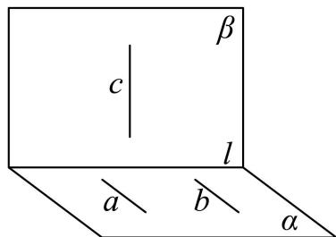
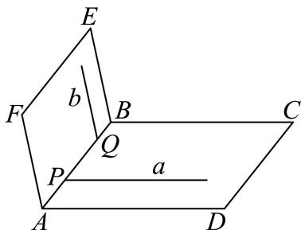

# 2026一模：集合与逻辑 · 教师版

> 阶段性整理。题目依据规范化转录稿；题面或答案存在疑点的条目保留待核。未对所有原题、解答独立重算。

## 1 集合的交、并、补运算（15题）

### 嘉定 · 第1题

**考点说明：** 区间并集：比较区间的左右端点与开闭，合并相交或相接的部分。

来源：2026届上海高三一模嘉定卷，第1题。

规范化源文件：`2026届嘉定一模数学试卷 逐题解析.md`。

1 已知集合 $A = (-2, 2), B = (-3, -1) \cup (1, +\infty)$ ，则 $A \cup B = \_$ .

【答案】 $(-3,+\infty)$

【解析】

【分析】根据题意结合集合的并集运算求解即可,

【详解】因为集合 $A=(-2,2)$ ， $B=(-3,-1)\cup(1,+\infty)$ ，

所以 $A \cup B = (-2, 2) \cup (-3, -1) \cup (1, +\infty) = (-3, +\infty)$ .

故答案为： $(-3,+\infty)$ .

### 奉贤 · 第1题

**考点说明：** 区间交集：比较两个区间的公共部分，同时检查端点是否属于两个集合。

来源：2026届上海高三一模奉贤卷，第1题。

规范化源文件：`2026届奉贤一模数学试卷 逐题解析.md`。

已知集合 $A = (0,4), B = [2,5]$ ，则 $A \cap B =$ \_\_\_\_。（区间表示结果）

【答案】[2,4)

【解析】

【分析】根据交集的定义即可得出答案.

【详解】由交集的定义可知 $A \cap B = [2, 4)$ .

故答案为： $[2,4)$

### 宝山 · 第1题

**考点说明：** 有限集合的补集：从全集中剔除已给集合的元素。

来源：2026届上海高三一模宝山卷，第1题。

规范化源文件：`2026届宝山一模数学试卷 逐题解析.md`。

若全集 $U = \{1, 2, 3, 4, 5, 6\}$ ，集合 $A = \{1, 3, 5, 6\}$ ，则 $C_U A =$ \_\_\_\_.

【答案】{2,4}

【解析】

【分析】根据题意，结合补集的定义与运算，即可求解.

【详解】由全集 $U=\{1,2,3,4,5,6\}$ ，集合 $A=\{1,3,5,6\}$ ，则 $C_{U}A=\{2,4\}$ .

故答案为： $\{2,4\}$

### 崇明 · 第1题

**考点说明：** 集合交集与不等式描述：先在有限集合中筛选小于3的元素，再求交集。

来源：2026届上海高三一模崇明卷，第1题。

规范化源文件：`2026届崇明一模数学试卷 逐题解析.md`。

已知集合 $A = \{1, 2, 3, 4\}$ ，集合 $B = \{x \mid x < 3\}$ ，则 $A \cap B =$ \_\_\_\_.

【答案】 $\{1,2\}$

【解析】

【分析】根据集合的交集定义求解即可.

【详解】由于集合 $A=\{1,2,3,4\}$ ，集合 $B=\{x \mid x<3\}$ ，

则 $A \cap B = \{1, 2\}$ .

故答案为： $\{1,2\}$

### 徐汇 · 第2题

**考点说明：** 区间交集：比较两区间端点，正确处理开闭端点。

来源：2026届上海高三一模徐汇卷，第2题。

规范化源文件：`2026届徐汇一模数学试卷 逐题解析.md`。

设集合 $A = (-2, 2), B = (1, +\infty)$ ，则 $A \cap B =$ \_\_\_\_.

【答案】(1,2)

【解析】

【分析】利用集合交集的定义求解即可.

【详解】由于集合 $A=(-2,2)$ , $B=(1,+\infty)$ ，则 $A\cap B=(1,2)$ ;

故答案为：(1,2)

### 普陀 · 第1题

**考点说明：** 集合交集：先将绝对值条件转化为闭区间，再从有限集合中筛选元素。

来源：2026届上海高三一模普陀卷，第1题。

规范化源文件：`2026届普陀一模数学试卷 逐题解析.md`。

已知集合 $A = \{x \mid |x| \leq 1\}$ , $B = \{-2, -1, 0, 1, 2\}$ , 则 $A \cap B =$ \_\_\_\_.

【答案】 $\{-1,0,1\}$

【解析】

【分析】由交集运算即可求解.

【详解】解不等式 $|x|\leq 1$ 得 $-1\leq x\leq 1$ ，则 $A = \{x| - 1\leq x\leq 1\}$

则 $A \cap B = \{-1, 0, 1\}$ .

故答案为： $\{-1,0,1\}$ .

### 松江 · 第1题

**考点说明：** 区间交集：通过比较两个区间的端点求交集。

来源：2026届上海高三一模松江卷，第1题。

规范化源文件：`2026届松江一模数学试卷 逐题解析.md`。

已知集合 $A = (-1, 5), B = \{x \mid -2 < x < 2\}$ ，则 $A \cap B =$ \_\_\_\_.

【答案】 $\{x\mid -1 <   x <   2\}$

【解析】

【分析】根据集合的交集运算，即可求解.

【详解】由题意，集合 $A=(-1,5)$ ， $B=\left\{x\mid-2<x<2\right\}$ ，

所以 $A \cap B = \{x \mid -1 < x < 2\}$ .

故答案为： $\left\{x\mid-1<x<2\right\}$

### 浦东 · 第1题

**考点说明：** 集合交集：用不等式条件从有限集合中筛选满足要求的元素。

来源：2026届上海高三一模浦东卷，第1题。

规范化源文件：`2026届浦东一模数学试卷 逐题解析.md`。

已知集合 $A = \{x \mid x > 1\}$ , $B = \{1, 2, 3\}$ , 则 $A \cap B = \_$ .

【答案】 $\{2,3\}$

【解析】

【分析】

根据集合交集的定义和运算，即可求解.

【详解】由题意，集合 $A=\left\{x\mid x>1\right\}$ ， $B=\left\{1,2,3\right\}$ ，

根据集合交集的定义和运算，可得 $A \cap B = \{2, 3\}$ .

故答案为： $\{2,3\}$ .

【点睛】本题主要考查了集合交集的定义及运算，其中熟记集合交集的定义是解答的关键，属于容易题.

### 虹口 · 第1题

**考点说明：** 集合交集：先解绝对值不等式，再与正半轴取公共部分。

来源：2026届上海高三一模虹口卷，第1题。

规范化源文件：`2026届虹口一模数学试卷 逐题解析.md`。

已知集合 $A = \{x \mid |x - 1| < 2\}$ , $B = \{x | x > 0\}$ , 则 $A \cap B =$

【答案】 $\left\{x\mid0<x<3\right\}$

【解析】

【分析】解绝对值不等式，再求交集即可.

【详解】由 $A=\left\{x\mid|x-1|<2\right\}=\left\{x|-1<x<3\right\}$ ， $B=\left\{x|x>0\right\}$

则 $A \cap B = \{x \mid 0 < x < 3\}$ ,

故答案为： $\{x\mid 0 <   x <   3\}$

### 金山 · 第1题

**考点说明：** 区间交集：取两区间共同部分，注意开端点。

来源：2026届上海高三一模金山卷，第1题。

规范化源文件：`2026届金山一模数学试卷 逐题解析.md`。

已知集合 $A = (-2, 1), B = (0, 3)$ ，则 $A \cap B =$ \_\_\_\_.

【答案】(0,1)

【解析】

【分析】由集合的交集运算即可得解.

【详解】∵ $A=(-2,1)$ , $B=(0,3)$ ，∴ $A\cap B=(0,1)$ .

故答案为：(0,1).

### 长宁 · 第1题

**考点说明：** 集合交集：从有限集合中选取符合正实数条件的元素。

来源：2026届上海高三一模长宁卷，第1题。

规范化源文件：`2026届长宁一模数学试卷 逐题解析.md`。

集合 $A = (0, +\infty)$ ，集合 $B = \{-2, -1, 0, 1, 2\}$ ，则 $A \cap B =$ \_\_\_\_.

【答案】 $\{1,2\}$

【解析】

【分析】由交集的定义运算.

【详解】由题意得， $A \cap B = \{1, 2\}$ .

故答案为： $\{1,2\}$

### 闵行 · 第1题

**考点说明：** 集合补集：从全集中剔除属于已知集合的元素。

来源：2026届上海高三一模闵行卷，第1题。

规范化源文件：`2026届闵行一模数学试卷 逐题解析.md`。

已知全集 $U=\{-2,-1,0,1,2\}$，集合 $A=\{-2,-1,0\}$，则 $C_U A=\underline{\qquad}$。

【答案】$\{1,2\}$

【解析】由补集定义，$C_U A=\{1,2\}$。

题面经同卷网页文本与本机解析交叉核对，尚未核对原卷图。

核对来源：https://www.51jiaoxi.com/doc-17703014.html （网页文本，未核对原图）

### 青浦 · 第1题

**考点说明：** 区间交集：找出同时满足两集合条件的数，并注意端点。

来源：2026届上海高三一模青浦卷，第1题。

规范化源文件：`2026届青浦一模数学试卷 逐题解析.md`。

已知集合 $A = \{x \mid -1 \leq x \leq 3\}$ , $B = \{x \mid x \leq 0\}$ , 则 $A \cap B =$ \_\_\_\_.

【答案】 $\{x\mid -1\leq x\leq 0\}$

【解析】

【分析】根据交集的知识求得正确答案.

【详解】依题意， $A=\left\{x\mid-1\leq x\leq3\right\},B=\left\{x\mid x\leq0\right\}$

所以 $A \cap B = \{x \mid -1 \leq x \leq 0\}$ .

故答案为： $\{x\mid -1\leq x\leq 0\}$

### 静安 · 第1题

**考点说明：** 二次不等式与集合补集：求原集合后，以实数集为全集确定补集及端点。

来源：2026届上海高三一模静安卷，第1题。

规范化源文件：`2026届静安一模数学试卷 逐题解析.md`。

已知全集是实数集 R，集合 $M = \left\{ x \mid (x - 3)(x + 2) \geq 0 \right\}$ ，则集合 M 的补集 $C_{R}M =$ \_\_\_\_ .

【答案】 $\{x\mid -2 <   x <   3\}$

【解析】

【分析】化简集合 M，根据补集概念求解.

【详解】由已知 $M=\left\{x\mid(x-3)(x+2)\geq0\right\}=\left\{x\mid x\geq3\right.$ 或 $x\leq-2\}$

所以 $\complement_{\mathrm{R}}M = \{x\mid -2 <   x <   3\}$

故答案为： $\{x\mid -2 <   x <   3\}$

### 黄浦 · 第3题

**考点说明：** 集合交集：先求绝对值不等式的解集，再与两段区间取公共部分。

来源：2026届上海高三一模黄浦卷，第3题。

规范化源文件：`2026届黄浦一模数学试卷 逐题解析.md`。

已知集合 $A = \{x \mid x < -1 \text{或} x > 4\}$ , $B = \{x \mid |x + 1| < 1, x \in \mathbf{R}\}$ , 则 $A \cap B =$ \_\_\_\_.

【答案】 $\left\{x\mid-2<x<-1\right\}$

【解析】

【分析】由绝对值不等式求出集合 B，再求交集可得.

【详解】由 $|x+1|<1\Leftrightarrow-1<x+1<1\Rightarrow-2<x<0$ ，所以 $B=\{x|-2<x<0\}$

所以 $A \cap B = \{x \mid -2 < x < -1\}$

故答案为： $\{x\mid -2 <   x <   - 1\}$

核对来源：同题解析版 PDF，具体页码见 `../待核证据.md`；已视觉核对。

## 2 充分条件与必要条件的判断（9题）

### 宝山 · 第14题

**考点说明：** 充分必要条件：分别求两个不等式的解集，通过包含关系判断蕴含。

来源：2026届上海高三一模宝山卷，第14题。

规范化源文件：`2026届宝山一模数学试卷 逐题解析.md`。

若 $\alpha: |x - 1| < 1, \beta: x^2 - x < 0$ ，则 $\alpha$ 是 $\beta$ 的（）

- A. 充分非必要条件
- B. 必要非充分条件
- C. 充要条件
- D. 既非充分又非必要条件

【答案】B
【解析】

【分析】应用绝对值不等式及一元二次不等式化简，再结合充要条件定义判断求解.

【详解】不等式 $|x - 1| < 1$ 的解集为 $\{x \mid 0 < x < 2\}$ ，不等式 $x^2 - x = x(x - 1) < 0$ 的解集为 $\{x \mid 0 < x < 1\}$ ，而 $\{x \mid 0 < x < 1\}$ 是 $\{x \mid 0 < x < 2\}$ 的真子集，则 $\alpha$ 是 $\beta$ 的必要非充分条件.

故选：B.

### 徐汇 · 第13题

**考点说明：** 充分必要条件与有理数：分别判断“平方为有理数”和“本身为有理数”的推出关系，可用无理数的平方为有理数作反例。

来源：2026届上海高三一模徐汇卷，第13题。

规范化源文件：`2026届徐汇一模数学试卷 逐题解析.md`。

已知 $x$ 为实数，则 “ $x^{2}$ 是有理数” 是 “ $x$ 是有理数” 的（）条件.

- A. 充分非必要
- B. 必要非充分
- C. 充要
- D. 既非充分又非必要

【答案】B

【解析】
【分析】利用充分条件、必要条件的定义结合特殊值法判断可得出结论.
【详解】若 $x^{2}$ 是有理数，不妨取 $x = \sqrt{2}$ ，则 $x^{2} = 2$ ，但 $x$ 是无理数，即 “ $x^{2}$ 是有理数” 不能推出 “x 是有理数”，
若 x 为有理数，则存在 p、 $q \in Z$ 且 $q \neq 0$ ，使得 $x = \frac{p}{q}$ ，则 $x^{2} = \frac{p^{2}}{q^{2}}$ 为有理数，
故 “ $x^{2}$ 是有理数” $\Leftarrow$ “x 是有理数”，
所以 “ $x^{2}$ 是有理数” 是 “x 是有理数” 的必要非充分条件，
故选：B.

### 松江 · 第13题

**考点说明：** 空间线线关系与充分必要条件：结合直线互相垂直、平行及三线共面逐向判断，注意不同直线的空间位置。

来源：2026届上海高三一模松江卷，第13题。

规范化源文件：`2026届松江一模数学试卷 逐题解析.md`。

若空间中三条不同的直线 $a, b, c$ 满足 $a \perp c, b \perp c$ , 则 $a // b$ 是 $a, b, c$ 共面的 ( )

- A. 充分不必要条件
- B. 必要不充分条件
- C. 充要条件
- D. 既不充分也不必要条件

【答案】B

【解析】

【分析】通过特例说明 $a / / b$ 不能推出 $a, b, c$ 共面，即充分性不成立；再由平面几何知识得出同一平面内的直线不平行必相交，推出 $a / / b$ 一定成立，即必要条件成立，两者综合

即可得出结果.

【详解】

如图所示：满足 $a \perp c$ ， $b \perp c$ ，且 $a // b$ ，但是 $a \subset \alpha, b \subset \alpha, c \subset \beta$ ，

所以可知 a // b 是 a，b，c 共面的不充分条件；

当 $a, b, c$ 共面时，由平面几何知识可知同一平面内的直线不平行必相交，

又因为 $a \perp c$ ， $b \perp c$ ，所以必然有 $a // b$

即 $a / / b$ 是 $a, b, c$ 共面的必要条件，

综上可知 a // b 是 a, b, c 共面的必要不充分条件.

故选：B.

### 浦东 · 第13题

**考点说明：** 空间位置与充分必要条件：分别分析线线相交与面面相交的推出关系；若允许两个平面重合，结论会改变，原题应明确约定。

来源：2026届上海高三一模浦东卷，第13题。

已知直线 $a,b$ 和平面 $\alpha,\beta$，且 $a\subseteq\alpha$、$b\subseteq\beta$，则“$a$ 与 $b$ 相交”是“$\alpha$ 与 $\beta$ 相交”的（ ）。

- A. 充分必要条件

- B. 既不充分又不必要条件

- C. 充分不必要条件

- D. 必要不充分条件

【答案】整理卷标答为C（按两个不同平面理解）；若允许两平面重合，则为B。

【解析·参考原解整理】

**以下保留源解析，前提是两个平面不同；原题未显式给出此前提。**

【分析】根据直线与平面的位置关系判断.

【详解】直线 a 、 b 和平面 $\alpha$ 、 $\beta$ ，且 $a \subseteq \alpha$ 、 $b \subseteq \beta$ ，

若 $a$ 与 $b$ 相交，记 $a \cap b = O$ ，由于 $a \subseteq \alpha$ 、 $b \subseteq \beta$

所以 $O \in \alpha$ 、 $O \in \beta$ ，则 $\alpha$ 与 $\beta$ 相交，

所以 “a 与 b 相交” 能得到 $\alpha$ 与 $\beta$ 相交，

但 “ $\alpha$ 与 $\beta$ 相交”，则 a 与 b 可能异面，如图，

平面 ABCD 为 $\alpha$ ，平面 ABEF 为 $\beta$ ， $\alpha \cap \beta = AB$ ，

$$
a \subseteq \alpha , b \subseteq \beta , a \cap A B = P, b \cap A B = Q,
$$

若 $P$ 与 $Q$ 不重合，则直线 $a$ 、 $b$ 为异面直线，所以 “a 与 b 相交” 是 “ $\alpha$ 与 $\beta$ 相交” 的充分不必要条件.
故选：C.

【约定边界】若允许两平面重合，取同一平面内两条相交直线，不能推出两平面相交，充分性失效；必要性也不成立，此时选B。

回源核对说明：这不是转录缺字。原文没有明确排除两平面重合；整理卷标答C依赖不同平面的约定，需在教师版说明，不能静默添加原题条件。

回源核对说明：已视觉核对原始扫描卷第2页，与署名整理卷第2页一致；原文未写两个不同平面或不重合。

### 虹口 · 第13题

**考点说明：** 充分必要条件：运用立方函数、指数函数的单调性化简命题，比较两个不等式的蕴含。

来源：2026届上海高三一模虹口卷，第13题。

规范化源文件：`2026届虹口一模数学试卷 逐题解析.md`。

已知 $x$ 、 $y$ 为实数，则 “ $x^{3} > y^{3}$ ” 是 “ $2^{x} > 2^{y+1}$ ” 的（）条件.

- A. 充分非必要
- B. 必要非充分
- C. 充要
- D. 非充分又非必要

【答案】B

【解析】

【详解】因为 $x^{3}>y^{3}$ ，则x>y，又 $2^{x}>2^{y+1}$ ，则 $x>y+1$ ，命题“若 $x>y+1$ ，则 $x>y$ ”为真命题，即 $2^{x}>2^{y+1}\Rightarrow x^{3}>y^{3}$ ，命题“若x>y，则 $x>y+1$ ”为假命题，即 $x^{3}>y^{3}\not\Rightarrow2^{x}>2^{y+1}$ 所以“ $x^{3}>y^{3}$ ”是“ $2^{x}>2^{y+1}$ ”的必要非充分条件.

故选：B.

### 长宁 · 第14题

**考点说明：** 独立事件与充分必要条件：比较联合概率与边缘概率乘积，判断独立性的双向蕴含。

来源：2026届上海高三一模长宁卷，第14题。

规范化源文件：`2026届长宁一模数学试卷 逐题解析.md`。

甲、乙两人投篮的命中率分别为 0.7 和 0.6，两人各投篮一次，事件 A 为甲投中，事件 B 为乙投中。“甲、乙两人均投中的概率为 0.42”是“事件 A, B 互相独立”的（）

- A. 充分不必要条件
- B. 必要不充分条件
- C. 充要条件
- D. 既不充分也不必要条件

【答案】C

【解析】
【分析】由独立事件概率公式和充要条件的概念即可求解.
【详解】由甲、乙两人投篮的命中率分别为 0.7 和 0.6，

若“事件 $A, B$ 互相独立”，则 $P(AB) = P(A)P(B) = 0.42$ ，  
若 $P(AB) = 0.42 = P(A)P(B)$ ，则事件 $A, B$ 互相独立，  
即“甲、乙两人均投中的概率为0.42”是“事件 $A, B$ 互相独立”的充要条件，故选：C

核对来源：同题解析版 PDF，具体页码见 `../待核证据.md`；已视觉核对。

### 闵行 · 第16题

**考点说明：** 逻辑新关系与函数奇偶性：分别检验两个方向的蕴含，使用 x 与 -x 的替换辨识等价或单向关系。

来源：2026届上海高三一模闵行卷，第16题。

如果“若 $p$，则 $q$”和“若 $q$，则 $p$”中有且仅有一个真命题，称 $p$ 与 $q$ 具有“$U$-关系”。已知函数 $y=f(x)$ 的定义域为 $\mathbb R$，$p$：$y=f(x)$ 为偶函数，则 $p$ 与下列选项中的 $q$ 具有“$U$-关系”的为（ ）。

- A. $q$：对任意 $x\in\mathbb R$ 都有 $-f(x)\ge f(x)$

- B. $q$：对任意 $x\in\mathbb R$ 都有 $f(-x)\ge f(x)$

- C. $q$：对任意 $x\in\mathbb R$ 都有 $f(-x)=|f(x)|$

- D. $q$：对任意 $x\in\mathbb R$ 都有 $f(-x)=f(|x|)$

【答案】C

【解析·参考原解整理】

对 A，两命题互不蕴含。对 B，将 $x$ 换为 $-x$ 得反向不等式，故 B 与偶函数等价。对 C，将 $x$ 换为 $-x$ 得 $f(x)=|f(-x)|\ge0$，故 $f(-x)=f(x)$，即 C 蕴含 $p$；但负常值函数是偶函数而不满足 C，故 $p$ 不蕴含 C。对 D，当 $x<0$ 时条件自动成立，当 $x>0$ 时要求 $f(-x)=f(x)$，故 D 与偶函数等价。选 C。

回源核对说明：对照题面与标答PDF；解析参考原标答重新整理，非逐字转录，待独立复核。

### 青浦 · 第13题

**考点说明：** 空间直线位置与充分必要条件：区分平行和异面直线，判断没有公共点的逆命题。

来源：2026届上海高三一模青浦卷，第13题。

规范化源文件：`2026届青浦一模数学试卷 逐题解析.md`。

在空间中，“两条直线平行”是“这两条直线没有公共点”的（）

- A. 充分非必要条件
- B. 必要非充分条件
- C. 充要条件
- D. 既非充分也不必要

【答案】A

【解析】

【分析】直接由平行直线及异面直线的定义判断充分性及必要性即可.

【详解】“两条直线平行”能推出“这两条直线没有公共点”，满足充分性；“两条直线没有公共点”不能推出“两条直线平行”，

两条直线可能异面，不满足必要性，故“两条直线平行”是“这两条直线没有公共点”的充分非必要条件.
故选：A.

### 闵行 · 第14题

**考点说明：** 充分必要条件：关注分母非零，通过同号、异号及反例检验两个条件的蕴含关系。

来源：2026届上海高三一模闵行卷，第14题。

已知 $a,b\in\mathbb R$，则“$a>b$”是“$\frac1a<\frac1b$”成立的（ ）。

- A. 充分不必要条件

- B. 必要不充分条件

- C. 充要条件

- D. 既不充分也不必要条件

【答案】D

【解析·参考原解整理】

取 $a=1,b=-1$，有 $a>b$ 但 $1/a<1/b$ 不成立；取 $a=-1,b=1$，有 $1/a<1/b$ 但 $a>b$ 不成立。因此既不充分也不必要，选 D。

回源核对说明：逐题对照该PDF题面页面视觉核对；答案转录自第7或12页，非独立数学复核。

## 4 集合新定义与元素个数（1题）

### 青浦 · 第15题

**考点说明：** 半角公式与集合元素个数：由给定正弦值约束半角值，区分特殊参数并去重计数。

来源：2026届上海高三一模青浦卷，第15题。

规范化源文件：`2026届青浦一模数学试卷 逐题解析.md`。

对于实数 $m \in [-1, 1]$ ，定义集合 $A_{m} = \left\{x \mid x = \sin \frac{\alpha}{2}, \sin \alpha = m\right\}$ ，集合 $A_{m}$ 的元素个数为 $\left|A_{m}\right|$ ，给出下列说法：

①存在 $m$ ，使得 $\left|A_m\right| = 1$

②存在 $m$ ，使得 $\left|A_m\right| = 2$

③存在 $m$ ，使得 $\left|A_m\right| = 3$

④存在 $m$ ，使得 $\left|A_m\right| = 4$

其中正确的说法有（）个.

- A. 1
- B. 2
- C. 3
- D. 4

【答案】C

【解析】

【分析】根据同角三角函数的关系及半角公式，可得 $\sin\frac{\alpha}{2}=\pm\sqrt{\frac{1-\sqrt{1-m^{2}}}{2}}$ 或 $\pm\sqrt{\frac{1+\sqrt{1-m^{2}}}{2}}$ ，对 m 赋值分析，逐一检验，即可得答案。
【详解】因为 $\sin\alpha=m,\quad m\in[-1,1]$ ，所以 $\cos\alpha=\pm\sqrt{1-m^{2}}$ 所以 $\sin\frac{\alpha}{2}=\pm\sqrt{\frac{1-\cos\alpha}{2}}=\pm\sqrt{\frac{1-\sqrt{1-m^{2}}}{2}}$ 或 $\pm\sqrt{\frac{1+\sqrt{1-m^{2}}}{2}}$ ;
当 $m = \pm 1$ 时， $x = \sin \frac{\alpha}{2} = \pm \frac{\sqrt{2}}{2}$ ，此时 $\left| A_{m} \right| = 2$ ，
所以存在 m，使得 $\left| A_{m} \right| = 2$ ，故②正确；
当 m=0 时， $x=\sin\frac{\alpha}{2}=0$ 或 $\pm1$ ，此时 $\left| A_{m}\right|=3$ ，
所以存在 m，使得 $\left| A_{m}\right|=3$ ，故③正确；
当 $m \neq \pm 1$ 且 $m \neq 0$ 时，不妨取 $m = \sin \alpha = \frac{\sqrt{3}}{2}$ 此时 $\alpha=\frac{\pi}{3}+2k\pi,k\in Z$ 或 $\alpha=\frac{2\pi}{3}+2k\pi,k\in Z$ 则 $\frac{\alpha}{2}=\frac{\pi}{6}+k\pi,k\in Z$ 或 $\alpha=\frac{\pi}{3}+k\pi,k\in Z$ 所以 $x=\sin\frac{\alpha}{2}=\pm\frac{1}{2}$ 或 $\pm\frac{\sqrt{3}}{2}$ ，此时 $\left| A_{m}\right| = 4$ ，即存在 m，使得 $\left| A_{m}\right| = 4$ ，故④正确，
综上，无论 m 在 $[-1,1]$ 上取任何实数， $x=\sin\frac{\alpha}{2}$ 都不可能只有一个解，故①错误.

故选：C

核对来源：同题解析版 PDF，具体页码见 `../待核证据.md`；已视觉核对。

