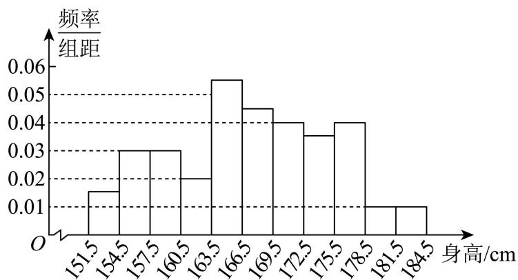
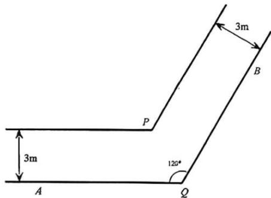
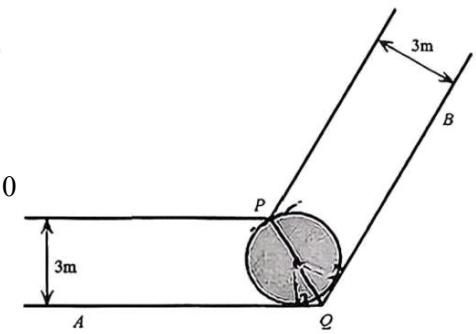
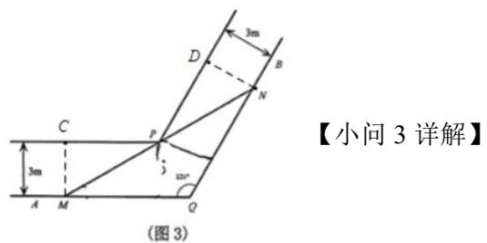
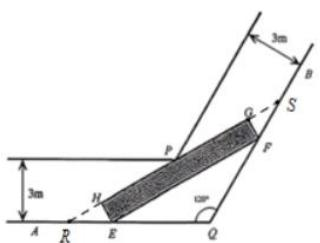

# 2026届上海高三一模 · 嘉定卷

> 按原卷题号整理；题面、图片和解答未全卷逐页终核。

## 第 1 题

> 核对提醒：采用规范稿首个题号标题之前的完整第1题块

1 已知集合 $A = (-2, 2), B = (-3, -1) \cup (1, +\infty)$ ，则 $A \cup B = \_$ .

【答案】 $(-3,+\infty)$

【解析】

【分析】根据题意结合集合的并集运算求解即可,

【详解】因为集合 $A=(-2,2)$ ， $B=(-3,-1)\cup(1,+\infty)$ ，

所以 $A \cup B = (-2, 2) \cup (-3, -1) \cup (1, +\infty) = (-3, +\infty)$ .

故答案为： $(-3,+\infty)$ .

## 第 2 题

已知直线 l 经过点 $(-1, -1)$ 、 $(2, 2)$ ，则 l 的倾斜角为 \_\_\_\_.

【答案】 $\frac{\pi}{4}$

【解析】

【分析】根据斜率公式求斜率，即可得直线的倾斜角.

【详解】设直线 l 的倾斜角为 $\alpha \in [0, \pi)$ ,

因为直线 l 经过点 $(-1,-1)$ 、 $(2,2)$ ，则直线 l 的斜率 $k=\frac{2-(-1)}{2-(-1)}=\frac{2+1}{2+1}=1$ ，

则 $\tan \alpha = 1$ ，可得 $\alpha = \frac{\pi}{4}$

所以直线 l 的倾斜角为 $\frac{\pi}{4}$ .

故答案为： $\frac{\pi}{4}$ .

## 第 3 题

已知复数 $z = \frac{3 - 4\mathrm{i}}{4 + 3\mathrm{i}}$ （i为虚数单位），则 $|z| =$ \_\_\_\_.

【答案】1

【解析】

【分析】根据复数的除法运算求得 z = -i，即可得模长.

【详解】因为复数 $z=\frac{3-4i}{4+3i}=\frac{(3-4i)(4-3i)}{(4+3i)(4-3i)}=\frac{12-9i-16i+12i^{2}}{16+9}=-i$

所以 $|z|=1$ .

故答案为：1.

## 第 4 题

> 核对提醒：原转录中焦距计算的指数笔误已更正：$c=\sqrt{3^2+4^2}=5$。

双曲线 $\frac{x^{2}}{9}-\frac{y^{2}}{16}=1$ 的离心率为 \_\_\_\_.

【答案】 $\frac{5}{3}$

【解析】

【详解】∵由题可知a=3,b=4

$$
\therefore c = \sqrt {3 ^ {2} + 4 ^ {2}} = 5
$$

∴离心率 $e=\frac{c}{a}=\frac{5}{3}$

故答案为： $\frac{5}{3}$ .

## 第 5 题

已知空间向量 $\vec{a} \perp \vec{b}$ , $\vec{a} \perp \vec{c}$ , $\vec{b} \perp \vec{c}$ , 且 $|\vec{a}| = |\vec{b}| = |\vec{c}| = 1$ , 则 $|\vec{a} + \vec{b} + \vec{c}| =$ \_\_\_\_.

【答案】 $\sqrt{3}$

【解析】

【分析】首先利用向量的垂直得出 $\vec{a} \cdot \vec{b} = 0$ ， $\vec{a} \cdot \vec{c} = 0$ ， $\vec{b} \cdot \vec{c} = 0$ ，再将 $\left|\vec{a} + \vec{b} + \vec{c}\right|$ 平方即可求解.

【详解】 $\because \vec{a} \perp \vec{b}$ , $\vec{a} \perp \vec{c}$ , $\vec{b} \perp \vec{c}$ , $\therefore \vec{a} \cdot \vec{b} = 0$ , $\vec{a} \cdot \vec{c} = 0$ , $\vec{b} \cdot \vec{c} = 0$ ,

$$
\because \left| \vec {a} \right| = \left| \vec {b} \right| = \left| \vec {c} \right| = 1, \quad \therefore \left| \vec {a} + \vec {b} + \vec {c} \right| ^ {2} = \left| \vec {a} \right| ^ {2} + \left| \vec {b} \right| ^ {2} + \left| \vec {c} \right| ^ {2} + 2 \vec {a} \cdot \vec {b} + 2 \vec {a} \cdot \vec {c} + 2 \vec {b} \cdot \vec {c} = 3,
$$

$\therefore \left|\vec{a} +\vec{b} +\vec{c}\right| = \sqrt{3}.$

故答案为： $\sqrt{3}$

## 第 6 题

在 $(1-2x)^{7}$ 的二项展开式中，各项系数的和是\_\_\_\_。

【答案】-1

【解析】

【分析】令 x=1 即可得出答案.

【详解】令 $x = 1$ ，则 $(1 - 2x)^{7} = -1$ ，则各项系数的和为-1.

故答案为：-1

## 第 7 题

圆锥的侧面展开图中扇形中心角为 $\frac{2\pi}{3}$ , 底面周长为 $2\pi$ , 这个圆锥的侧面积是 \_\_\_\_.

【答案】 $3\pi$

【解析】

【分析】借助扇形弧长公司计算出圆锥母线长，结合扇形面积公式即可得圆锥侧面积.

【详解】设圆锥母线长为 l，扇形圆心角为 $\alpha$ ，则 $2\pi = \frac{2\pi}{3} \times l$ ，故 l = 3，

则 $S = \frac{1}{2}\alpha l^2 = \frac{1}{2}\times \frac{2\pi}{3}\times 3^2 = 3\pi .$

故答案为： $3\pi$

## 第 8 题

两个篮球运动员甲和乙罚球时命中的概率分别是 0.7 和 0.6，两人各投一次，假设事件“甲 命中”与“乙命中”是独立的，则至少一人命中的概率是______.

【答案】0.88

## 第 9 题

已知数列 $\{a_{n}\}$ 满足 $a_{1} = \frac{1}{3}$ ，且 $a_{n} = \frac{a_{n - 1}}{2a_{n - 1} + 1}(n\geq 2)$ ，则 $a_{100} = \underline{\quad}$ .

【答案】 $\frac{1}{201}$

【解析】

【分析】观察递推式为分式的形式，通过取倒数将其转化为线性递推关系，构造等差数列可求得数列 $\{a_{n}\}$ 的通项公式，进而求解.

【详解】对 $a_{n} = \frac{a_{n - 1}}{2a_{n - 1} + 1}$ 的两边取倒数得 $\frac{1}{a_n} = \frac{2a_{n - 1} + 1}{a_{n - 1}} = 2 + \frac{1}{a_{n - 1}}$

所以 $\frac{1}{a_n} -\frac{1}{a_{n - 1}} = 2(n\geq 2)$ ，所以数列 $\left\{\frac{1}{a_n}\right\}$ 是首项为 $\frac{1}{a_1} = 3$ ，公差为2的等差数列，

所以数列 $\left\{\frac{1}{a_n}\right\}$ 的通项公式为 $\frac{1}{a_n} = 3 + 2(n - 1) = 2n + 1$

所以数列 $\{a_{n}\}$ 的通项公式为 $a_{n} = \frac{1}{2n + 1}$ ，所以 $a_{100} = \frac{1}{2\times 100 + 1} = \frac{1}{201}$ .

故答案为： $\frac{1}{201}$ .

## 第 10 题

已知向量 $\overrightarrow{OA} = (1, 7)$ ， $\overrightarrow{OB} = (5, 1)$ ， $\overrightarrow{OP} = (2, 1)$ ，K 为直线 OP 上的一个动点，当 $\overrightarrow{KA} \cdot \overrightarrow{KB}$ 取最小值时，向量 $\overrightarrow{OK}$ 的坐标为 \_\_\_\_.

【答案】(4,2)

【解析】

【分析】由题意设 $\overrightarrow{OK}=k\overrightarrow{OP}=(2k,k)$ ，根据数量积的坐标表示计算 $\overrightarrow{KA}\cdot\overrightarrow{KB}=5(k-2)^{2}-8$ ，即可求解.

【详解】因为 K 为直线 OP 上的一个动点，所以 $\overrightarrow{OK}$ 与 $\overrightarrow{OP}$ 共线，设 $\overrightarrow{OK}=k\overrightarrow{OP}=(2k,k)$ ，
所以 $\overrightarrow{KA}\cdot\overrightarrow{KB}=\left(\overrightarrow{OA}-\overrightarrow{OK}\right)\cdot\left(\overrightarrow{OB}-\overrightarrow{OK}\right)=\left(1-2k,7-k\right)\cdot\left(5-2k,1-k\right)$

$$
= (1 - 2 k) (5 - 2 k) + (7 - k) (1 - k) = 5 (k - 2) ^ {2} - 8,
$$

所以当 k=2 时， $\overrightarrow{KA}\cdot\overrightarrow{KB}$ 取最小值，此时 $\overrightarrow{OK}=(4,2)$ .

故答案为： $(4,2)$

## 第 11 题

已知 $f(x)=\ln\frac{1-x^{3}}{1+x^{3}}$ ，且 $f(1-a)+f(1-a^{2})>0$ ，则实数 a 的取值范围是 \_\_\_\_。

【答案】 $(1,\sqrt{2})$

【解析】

【分析】根据题意求函数 $f(x)$ 的定义域，并判断 $f(x)$ 的奇偶性和单调性，结合函数性质解不等式即可.

【详解】令 $\frac{1 - x^3}{1 + x^3} > 0$ ，等价于 $(1 - x^3)(1 + x^3) > 0$ ，可得 $-1 < x^3 < 1$ ，解得 $-1 < x < 1$ ，

可知函数 $f(x) = \ln \frac{1 - x^3}{1 + x^3}$ 的定义域为 $(-1, 1)$ ，

因为 $f(-x) + f(x) = \ln \frac{1 + x^3}{1 - x^3} +\ln \frac{1 - x^3}{1 + x^3} = \ln 1 = 0$ ，即 $f(-x) = -f(x)$

可知函数 $f(x)$ 为奇函数，

且 $f(x) = \ln \frac{1 - x^3}{1 + x^3} = \ln \left(\frac{2}{1 + x^3} - 1\right)$ ,

因为 $y = 1 + x^3$ 在 $(-1,1)$ 内单调递增，则 $u = \frac{2}{1 + x^3} - 1$ 在 $(-1,1)$ 内单调递减，

且 $y = \ln u$ 在定义域内单调递增，可知函数 $f(x)$ 在 $(-1,1)$ 内单调递减，

若 $f(1 - a) + f(1 - a^2) > 0$ ，则 $f(1 - a) > -f(1 - a^2) = f(a^2 - 1)$

可得 $\left\{\begin{aligned}-1<1-a<1\\-1<a^{2}-1<1\end{aligned}\right.$ ，解得 $1<a<\sqrt{2}$ ， $1-a<a^{2}-1$

所以实数 a 的取值范围是 $\left(1, \sqrt{2}\right)$ .

故答案为： $(1,\sqrt{2})$ .

## 第 12 题

$a_{1}$ 、 $a_{2}$ 、 $a_{3}$ 、 $a_{4}$ 、 $a_{5}$ 是 1、2、3、4、5 的全排列，如果对任意的 $i \in \{2, 3, 4\}$ ， $a_{i-1}$ 和 $a_{i+1}$ 中至少有一个大于 $a_{i}$ ，则满足要求的排列的总数为 \_\_\_\_.

【答案】16

【解析】

【分析】先判断出 5 的位置，然后对第二位进行分类讨论，同时注意数字 4 的位置，结合对称性可求解出满足要求的排列的总数.

【详解】因为没有比5大的数，所以5只能排在第一位或者第五位，

当5排在第一位时，若4排在第二位，此时排列可以是 $(5,4,1,2,3)$ ， $(5,4,2,1,3)$ ，

(5,4,3,1,2)，(5,4,3,2,1)，共4种情况；

当5排在第一位时，若3排在第二位，此时没有比4大的数，故4只能排在第五位，

此时排列可以是 $(5,3,1,2,4)$ ， $(5,3,2,1,4)$ ，共2种情况；

当5排在第一位时，若2排在第二位，此时没有比4大的数，故4只能排在第五位，

此时排列可以是 $(5,2,1,3,4)$ ，共1种情况；

当5排在第一位时，若1排在第二位，此时没有比4大的数，故4只能排在第五位，

此时排列可以是 $(5,1,2,3,4)$ ，共1种情况；

由上可知，当5排在第一位时，共有 $4+2+1+1=8$ 种情况，

同理可得，当5排在第五位时，也有8种情况满足条件，

综上所述，共有16种排列满足条件，

故答案为：16.

## 第 13 题

如果 $a < b < 0$ ，那么下列不等式中成立的是（）
A. $\frac{a}{b} < 1$ ;
B. $a^2 > ab$ ;
C. $\frac{1}{b^2} < \frac{1}{a^2}$ ;
D.

$$
\frac {1}{a} <   \frac {1}{b}
$$

【答案】B

【解析】

【分析】利用不等式的性质比较大小逐一判断即可.

【详解】对于 A：由 a < b < 0 得 $\frac{a}{b} > \frac{b}{b} = 1$ ，错误；
对于 B：由 a < b < 0，则有 $a \cdot a > a \cdot b$ ，即 $a^{2} > ab$ ，正确；
对于 C: 由 a < b < 0 得 -a > -b > 0，则根据不等式的性质有 $(-a)^{2} > (-b)^{2} > 0$ ，即 $a^{2} > b^{2}$ ，
由 $a^{2} > b^{2}$ 可得 $\frac{1}{a^{2}} < \frac{1}{b^{2}}$ ，错误；
对于 D: 由 a < b < 0 得 ab > 0，则 $\frac{a}{ab} < \frac{b}{ab}$ ，即 $\frac{1}{a} > \frac{1}{b}$ ，错误.
故选：B

## 第 14 题

函数 $y = 1 - 2\cos^2\left(x + \frac{\pi}{4}\right)$ 是（）
A. 最小正周期为 $2\pi$ 的奇函数
B. 最小正周期为 $2\pi$ 的偶函数
C. 最小正周期为 $\pi$ 的奇函数
D. 最小正周期为 $\pi$ 的偶函数

【答案】C

【解析】

【分析】利用二倍角公式和诱导公式化简，最后由正弦函数性质即可求解.

【详解】 $y=1-2\cos^{2}\left(x+\frac{\pi}{4}\right)=-\cos2\left(x+\frac{\pi}{4}\right)=-\cos\left(2x+\frac{\pi}{2}\right)=\sin2x$

所以函数 y 为奇函数，最小正周期 $T = \frac{2\pi}{2} = \pi$ .

故选：C

## 第 15 题

若实数 $x$ 、 $y$ 、 $z$ 满足 $1 + 2^{x} = 3^{y} = 5^{z}$ ，则 $x$ 、 $y$ 、 $z$ 的大小关系不可能是（）A. $x > y > z$ B. $y > z > x$ C. $y > x > z$ D. $x > z > y$

【答案】D

【解析】

【分析】根据给定条件，求出 $x, y, z$ 的函数关系，再在同一坐标系内作出函数图象，数形结合即可判断.

【详解】令 $1+2^{x}=3^{y}=5^{z}=t$ ，得 $x=\log_{2}(t-1)$ ， $y=\log_{3}t$ ， $z=\log_{5}t$ ，t>1在同一直角坐标系内作出函数 $f(t) = \log_2(t - 1), g(t) = \log_3 t, h(t) = \log_5 t$ ， $t > 1$ 的图像，

则 $x, y, z$ 分别是函数 $y' = f(t), y' = g(t), y' = h(t)$ ， $t > 1$ 的图像与直线 $t = a(a > 1)$ 交点的纵坐标，

设 B 点的横坐标为 $x_{1}$ ，C 点的横坐标为 $x_{2}$ ，

观察图像得当 $1<a<x_{1}$ 时，y>z>x，

当 $x_{1}<a<x_{2}$ 时，y>x>z，

当 $a>x_{2}$ 时，x>y>z，

所以 ABC 是可能的，D 不可能.

故选：D

## 第 16 题

数列 $\{a_{n}\}$ 的前 $n$ 项和为 $S_{n}$ ，且对任意正整数 $n$ ，总存在正整数 $m$ ，使得 $S_{n} = a_{m}$ ，则下列命题中正确的是（）
A. 对任意正整数 $n$ ，总存在正整数 $m$ ，使得 $a_{n} = S_{m}$ B. 数列 $\{a_{n}\}$ 一定是等差数列
C. 存在公比为正整数的等比数列 $\{a_{n}\}$ 满足条件
D. 对任意正整数 $k$ ，总存在正整数 $m$ 、 $n$ ，使得 $a_{k} = a_{m} - a_{n}$

【答案】D

【解析】

【分析】可根据数列 $\left\{a_{n}\right\}$ 的性质，对每一选项进行分析判断即可.

【详解】选项 A：取数列 $a_{n}=n$ ，易知不存在正整数 m，使得 $S_{m}=a_{2}=2$ ，故该选项错误；

选项B：取数列 $a_{n} = \left\{ \begin{array}{l}1,n = 1\\ 0,n\geq 2 \end{array} \right.$ ，则 $S_{n} = 1$ ，满足对任意正整数 $n$ ，总存在正整数 $m$ ，使得 $S_{n} = a_{m}$ ，但数列 $a_{n}$ 不是等差数列，故该选项错误；

选项C：设等比数列 $\{a_{n}\}$ 的公比为 $q$ ，首项为 $a_1$ ，则 $a_{n} = a_{1}q^{n - 1}$

当 $q = 1$ 时， $S_{n} = na_{1}$ ， $a_{m} = a_{1}$ ，则 $S_{n} - a_{m} = (n - 1)a_{1}$ 不恒为0，不符合题意；

当正整数 $q \geq 2$ 时， $S_{n} = a_{1} + a_{2} + \cdots + a_{n} = a_{1}(1 + q + q^{2} + \cdots + q^{n-1})$ ， $a_{m} = a_{1}q^{m-1}$

若 $S_{n}=a_{m}$ ，则 $1+q+q^{2}+\cdots+q^{n-1}=q^{m-1}$ ，

由于正整数 $q \geq 2$ ，则 $q^{n-1} < 1 + q + q^{2} + \cdots + q^{n-1} = \frac{q^{n} - 1}{q - 1} < \frac{q^{n}}{q - 1} \leq q^{n}$ ，

即 $q^{n-1}<q^{m-1}<q^{n}\ldots^{*}$ ,

由于 $q^{n}$ 单调递增，且在 n-1 与 n 之间不存在其他正整数，则 \* 式不成立；

故 C 错误;

选项 D: 当正整数 $k \geq 2$ 时，由题意，存在正整数 m 使得 $S_{k} = a_{m}$ ，

且存在正整数 n 使得 $S_{k-1}=a_{n}$ ，则 $a_{k}=S_{k}-S_{k-1}=a_{m}-a_{n}$ 符合题意；

当 $k = 1$ 时，存在正整数 $m$ 使得 $S_{2} = a_{m}$ ，取 $n = 2$ ，则 $a_{1} = S_{2} - a_{2} = a_{m} - a_{n}$ 符合题意；故D正确.

故选：D.

## 第 17 题

A 校抽取 66 名高一年级学生测量身高，因某种原因原始数据遗失。已知该样本是按照分层随机抽样的方法抽取的，其中男生 34 名，身高平均数为 173cm；女生 32 名，身高平均数为 161cm。该 66 名学生身高的方差为 60，其频率分布直方图如下：

（1）求该66名学生中身高在 $[169.5,172.5)$ （单位：cm）内的人数；

(2) 试用已知数据估计 $A$ 校高一年级全体学生身高的平均数; (结果精确到 $0.1 \mathrm{~cm}$ )

（3）若一组数据落在 $\left[\overline{x} - 2s, \overline{x} + 2s\right]$ （ $\overline{x}$ 是平均数， $s$ 是标准差）内的频率不小于 $92\%$ ，则称这组数据满足“常态”。试判断这66个身高数据是否满足“常态”，并说明理由。

【答案】(1) 8

(2) $167.2\mathrm{cm}$

（3）满足，说明见解析

【解析】

【分析】（1）根据频率分布直方图，求出身高在 $[169.5,172.5)$ 的频率，再求出频数即可得到答案；

(2) 求出 66 名学生的身高平均数, 用样本估计总体即可得到结果;

（3）根据题目数据求出 $\left[\overline{x} - 2s, \overline{x} + 2s\right]$ 约为 $[151.7, 182.7]$ ，再根据频率分布直方图求出数据落在 $[154.5, 181.5]$ 的频率，根据 $[154.5, 181.5] \subset [151.7, 182.7]$ 即可进行判断.

【小问 1 详解】

由频率分布直方图可知，身高在 $[169.5,172.5)$ 的频率为 $0.04\times 3 = 0.12$

$66 \times 0.12 = 7.92$ ，所以该66名学生中身高在 $[169.5,172.5)$ （单位：cm）内的人数为8人.
【小问 2 详解】

这66名高一年级学生身高平均数为 $\frac{34\times 173 + 32\times 161}{66}\approx 167.2$

因为该样本是按照分层随机抽样的方法抽取的，所以估计 A 校高一年级全体学生身高的平均数为 167.2cm.

【小问 3 详解】

由（2）知 $\overline{x} = 167.2$ ，所以 $[\overline{x} - 2s, \overline{x} + 2s]$ 约为 $[151.7, 182.7]$ ，

数据落在 $[154.5, 181.5]$ 内的频率为 $\left[1 - (0.015 + 0.01) \times 3\right] \times 100\% = 92.5\%$

因为 $[154.5, 181.5] \subset [151.7, 182.7]$ ，所以数据落在 $[\overline{x} - 2s, \overline{x} + 2s]$ 内的频率不小于 $92\%$ ，所以这66个身高数据满足“常态”。

## 第 18 题

如图，在四面体 $V - ABC$ 中， $AC = BC$ ，从顶点 $V$ 作平面 $ABC$ 的垂线，垂足 $O$ 恰好落在 $\triangle ABC$ 的中线 $CD$ 上.

（1）如果 $DV = DA = 2$ ，直线 $VD$ 与平面 $ABC$ 所成的角为 $\frac{\pi}{4}$ ，求直线 $VA$ 与平面 $ABC$ 所成角的大小；

(2) 证明: 平面 $VCD \perp$ 平面 $VAB$ .

【答案】(1) $\frac{\pi}{6}$

(2) 证明详见解析

【解析】

【分析】利用几何法找到线面成角，利用线面垂直证明面面垂直.

【小问 1 详解】

连接 AO，如图.

由题可知， $VO \perp$ 平面 ABC， $AB \subset$ 平面 ABC，则 $VO \perp AB$ ，

且 $\angle VDO$ 即为直线 $VD$ 与平面 $ABC$ 所成角，

即 $\angle VDO = \frac{\pi}{4}$ . 由 $AC = BC$ ， $CD$ 为 $AB$ 边的中线，

可得 $AB \perp CD$ . 而 DV = DA = 2，可得 $OV = OD = \sqrt{2}$ ， $AO = \sqrt{AD^{2} + OD^{2}} = \sqrt{6}$ .

而 $\angle VAO$ 即为直线 $VA$ 与平面 $ABC$ 所成角，且 $\angle VAO \in \left[0, \frac{\pi}{2}\right]$ ，

则 $\tan \angle VAO = \frac{\sqrt{2}}{\sqrt{6}} = \frac{\sqrt{3}}{3}$ ，可得直线 $VA$ 与平面 $ABC$ 所成角为 $\frac{\pi}{6}$ .

【小问 2 详解】

由 $VO \perp AB$ ， $AB \perp CD$ ， $CD \cap VO = O$ ， $CD, VO \subset$ 平面VCD，故 $AB \perp$ 平面VCD，
而 $AB \subset$ 平面 VAB，则平面 $VCD \perp$ 平面 VAB.

## 第 19 题

已知 $f(x) = x^3 + ax + 1$ .

（1）若 $a = -3$，求函数 $y = f(x)$ 的单调区间.

(2) 若 $y = f(x)$ 在 $(0, +\infty)$ 上存在零点，求实数 a 的最大值.

【答案】（1）答案见解析；

(2) $-3\cdot\left(\frac{1}{2}\right)^{\frac{2}{3}}$ .

【解析】

【分析】（1）应用导数研究函数的单调区间即可；

（2）问题化为 $y = a$ 与 $g(x) = -x^2 - \frac{1}{x}$ 在 $x \in (0, +\infty)$ 上有交点，应用导数研究 $g(x)$ 的单调性并求出值域，即可得范围.

【小问 1 详解】

由题设 $f(x)=x^{3}-3x+1$ ，则 $f'(x)=3(x^{2}-1)$ ，

当 $f'(x)>0\Rightarrow x<-1$ 或x>1，即 $y=f(x)$ 在 $(-∞,-1),(1,+∞)$ 上单调递增，

当 $f^{\prime}(x) < 0 \Rightarrow -1 < x < 1$ ，即 $y = f(x)$ 在 $(-1, 1)$ 上单调递减，

所以 $y = f(x)$ 的单调增区间为 $(-∞, -1)$ , $(1, +∞)$ ，单调减区间为 $(-1, 1)$ ;

【小问 2 详解】

在 $(0, +\infty)$ 上，令 $f(x) = 0 \Leftrightarrow x^3 + ax + 1 = 0 \Leftrightarrow a = -x^2 - \frac{1}{x}$ ，

所以 $a = -x^{2} - \frac{1}{x}$ 在 $x\in (0, + \infty)$ 上有解，

即 $y = a$ 与 $g(x) = -x^{2} - \frac{1}{x}$ 在 $x\in (0, + \infty)$ 上有交点，

由 $g'(x) = -2x + \frac{1}{x^2} = \frac{1 - 2x^3}{x^2}$ 且 $x\in (0, + \infty)$

所以 $g'(x) > 0 \Rightarrow 1 - 2x^3 > 0 \Leftrightarrow 0 < x < \sqrt[3]{\frac{1}{2}}$ ， $g'(x) < 0 \Rightarrow 1 - 2x^3 < 0 \Leftrightarrow x > \sqrt[3]{\frac{1}{2}}$

所以 $g(x)$ 在 $(0, \sqrt[3]{\frac{1}{2}})$ 上单调递增，在 $(\sqrt[3]{\frac{1}{2}}, +\infty)$ 上单调递减，

当 $x \to 0$ 或 $+\infty$ ，有 $g(x) \to -\infty$ ，且 $g\left(\sqrt[3]{\frac{1}{2}}\right) = -2^{-\frac{2}{3}} - 2^{\frac{1}{3}} = -3 \cdot \left(\frac{1}{2}\right)^{\frac{2}{3}}$

所以 $a \leq -3 \cdot \left(\frac{1}{2}\right)^{\frac{2}{3}}$ ，故最大的 $a$ 为 $-3 \cdot \left(\frac{1}{2}\right)^{\frac{2}{3}}$ .

## 第 20 题

> 核对提醒：题干图来自既有学生卷OCR附图，已视觉检查，A(1,2)、焦点F、原点O与抛物线清晰。解析沿用已有转录，并非本轮整题重算。

如图, 在平面直角坐标系中, $O$ 为原点, 已知抛物线 $\Gamma: y = x^2$ 的焦点为 $F$ , 点 $A$ 的坐标为 (1,2).

（1）若点 $E$ 在 $\Gamma$ 上，且 $\left|OE\right| = \sqrt{2}$ ，求点 $E$ 的坐标；

（2）若 $P$ 是 $\Gamma$ 上的任意一点，求 $\left|AP\right| + \left|PF\right|$ 的最小值；

（3）过点 $A$ 的动直线与抛物线 $\Gamma$ 交于 $B$ 、 $C$ 两点，过点 $B$ 、 $C$ 分别作 $\Gamma$ 的切线，切线交点为 $D$ ，求证：点 $D$ 的轨迹是一条直线.

【答案】(1) $E(1,1)$ 或 $E(-1,1)$ ;

(2) $\frac{9}{4}$ ;

（3）证明见解析.

【解析】

【分析】（1）令 $E(x, x^{2})$ ，应用两点距离公式求参数值，即可得点的坐标；

（2）若 $PG$ 垂直抛物线 $\Gamma$ 的准线于 $G$ ，结合抛物线的定义得 $\left|AP\right| + \left|PF\right| = \left|AP\right| + \left|PG\right|$ ，数形结合确定其最小值；

（3）设 $BC:y - 2 = k(x - 1)$ ， $B(x_{1},y_{1}),C(x_{2},y_{2})$ ，应用导数几何意义求过 $B,C$ 的切线，进而得到 $x_{D} = \frac{x_{1} + x_{2}}{2}$ ， $y_{D} = x_{1}x_{2}$ ，联立直线 $BC$ 与抛物线并应用韦达定理得 $x_{1} + x_{2} = k$ ， $x_{1}x_{2} = k - 2$ ，即可证.

【小问 1 详解】

由题设，令 $E(x,x^2)$ ，则 $\left|OE\right| = \sqrt{x^2 + x^4} = \sqrt{2}$ ，即 $x^{4} + x^{2} - 2 = (x^{2} + 2)(x^{2} - 1) = 0$ 所以 $x^{2} = 1\Leftrightarrow x = \pm 1$ ，故 $E(1,1)$ 或 $E(-1,1)$

【小问 2 详解】

若 $PG$ 垂直抛物线 $\Gamma$ 的准线 $y = -\frac{1}{4}$ 于 $G$ ，由抛物线的定义知 $|PG| = |PF|$ 所以 $\left|AP\right| + \left|PF\right| = \left|AP\right| + \left|PG\right| \geq \left|AG\right|$ ，当且仅当 $A, P, G$ 三点共线时取等号，又 $AG \perp$ 抛物线 $\Gamma$ 的准线时， $|AG|$ 最小为 $2 - (-\frac{1}{4}) = \frac{9}{4}$ ，所以 $\left|AP\right| + \left|PF\right|$ 的最小值为 $\frac{9}{4}$ ；

  
【小问 3 详解】

由题设，直线 BC 的斜率一定存在，设 $BC: y - 2 = k(x - 1)$ ， $B(x_{1}, y_{1}), C(x_{2}, y_{2})$ ，

而 $y' = 2x$ ，则过 B 的切线斜率为 $2x_{1}$ ，对应切线为 $y - y_{1} = 2x_{1}(x - x_{1})$ ，即 $y = x_{1}(2x - x_{1})$ ，
同理过 C 的切线为 $y-y_{2}=2x_{2}(x-x_{2})$ ，即 $y=x_{2}(2x-x_{2})$ ，

联立 $\left\{ \begin{array}{l} y = x_{1}(2x - x_{1}) \\ y = x_{2}(2x - x_{2}) \end{array} \right.$ ，可得 $2x_{1}x - x_{1}^{2} = 2x_{2}x - x_{2}^{2}$ ，整理得 $2x(x_{1} - x_{2}) = x_{1}^{2} - x_{2}^{2}$ ，

由题意 $x_{1} \neq x_{2}$ ，则 $x_{D} = \frac{x_{1} + x_{2}}{2}$ ， $y_{D} = x_{1}x_{2}$ ，

联立 $\left\{ \begin{array}{l} y - 2 = k(x - 1) \\ y = x^2 \end{array} \right.$ ，得 $x^{2} - kx + k - 2 = 0$ ，且 $\Delta = k^{2} - 4(k - 2) = (k - 2)^{2} + 4 > 0$

所以 $x_{1} + x_{2} = k$ ， $x_{1}x_{2} = k - 2$ 则 $x_{D} = \frac{k}{2}$ ， $y_{D} = k - 2$

显然点 D 在直线 y=2x-2，即 2x-y-2=0 上，得证.

## 第 21 题

图 1 为转角过道的地面平面示意图. 该过道由两条直道连接形成转角, 由水平平坦的地面与垂直于地面的墙面共同围成, 两端延伸至足够远处, 且高度充足. 其中, $QA$ 、 $QB$ 构成地面上过道的一侧边界, $\angle AQB = 120^{\circ}$ ; 地面上过道的另一侧边界, 则分别与 $QA$ 、 $QB$ 平行, 且交于点 $P$ . 过道两侧平行墙面之间的距离均为 3 米.

(图 1)

(图 3)

(图 2)

(图 4)

（1）如图 2，在地面有一圆，该圆与 QA、QB 均相切，且过点 P. 求此圆的半径；

（2）如图3，有一根长度为 $y$ 米的无粗细木棒 $MN$ 紧贴地面，端点 $N$ 沿 $QB$ 移动，另一端点 $M$ 沿 $AQ$ 移动.当木棒 $MN$ 触碰到点 $P$ 时， $\angle QMN = x$ （弧度），求 $y$ 关于 $x$ 的函数关系及 $y$ 的最小值；

（3）如图4，某长方体家具的底面为长方形 $EFGH$ ，其宽为1米，长为10米（因过道高度足够，无需考虑家具高度）。现将底面 $EFGH$ 紧贴地面移动，判断该家具能否顺利通过此转角过道，并说明理由。

【答案】（1） $r = 12 - 6\sqrt{3}$

(2) $y = \frac{3}{\sin x} + \frac{3}{\sin\left(\frac{\pi}{3} - x\right)}, y_{\min} = 12$

（3）不能通过，理由见解析

【解析】

【分析】（1）连接 PQ，设圆心为 O，过 O 作 $OW \perp QB$ ， $OZ \perp QA$ ，由几何性质建立半径 r 的方程，解方程可得结果；

（2）过点 $M$ 作 $MD \perp QA$ ，交过道另一侧边界于点 $D$ ，过点 $N$ 作 $NE \perp QB$ ，交过道另一侧于点 $E$ ，由图形关系可得 $y$ 与 $x$ 的函数关系，并利用导数和函数的对称性求得 $y$ 的最小值；

(3) 设 $\angle QEF = \alpha$ ，延长 $HG$ 交 $QA$ 于 $R$ ，交 $QB$ 于 $S$ ，由 $RS = RH + HG + GS$ ，得到 $HG$ 的表达式，验证 $g\left(\frac{\pi}{6}\right) < 10$ 可得结论.

【小问 1 详解】

连接 PQ，设圆心为 O，过 O 作 $OW \perp QB$ ， $OZ \perp QA$ ，

由 $OW = OZ = r$ ， $\angle OWQ = \angle OZQ = 90^{\circ}$ ， $OQ = OQ$ ，可得 $\triangle OWQ\cong \triangle OZQ$

从而 $\angle OQW = \angle OQZ = \frac{\pi}{3}$ , $PQ = \frac{3}{\sin\frac{\pi}{3}} = 2\sqrt{3}$ ,

所以 $r + \frac{r}{\sin\frac{\pi}{3}} = 2\sqrt{3}$ ，解得 $r = 12 - 6\sqrt{3}$

如图，过点 $M$ 作 $MC \perp QA$ ，交过道另一侧边界于点 $C$ ，过点 $N$ 作 $ND \perp QB$ ，交过道另一侧于点 $D$ ，

则 $MP=\frac{3}{\sin x}$ ， $NP=\frac{3}{\sin\left(\frac{\pi}{3}-x\right)}$

所以 $y = MP + NP = \frac{3}{\sin x} + \frac{3}{\sin\left(\frac{\pi}{3} - x\right)}$ ,

$$
\text {令} f (x) = \frac {3}{\sin x} + \frac {3}{\sin \left(\frac {\pi}{3} - x\right)} \left(0 <   x <   \frac {\pi}{3}\right),
$$

$$
f ^ {\prime} (x) = - \frac {3 \cos x}{\sin^ {2} x} + \frac {3 \cos \left(\frac {\pi}{3} - x\right)}{\sin^ {2} \left(\frac {\pi}{3} - x\right)} = \frac {3 \cos \left(\frac {\pi}{3} - x\right) \sin^ {2} x - 3 \cos x \sin^ {2} \left(\frac {\pi}{3} - x\right)}{\sin^ {2} x \sin^ {2} \left(\frac {\pi}{3} - x\right)},
$$

当 $x \in \left(0, \frac{\pi}{6}\right]$ 时， $\cos x \geq \cos \left(\frac{\pi}{3} - x\right) > 0$ ， $\sin \left(\frac{\pi}{3} - x\right) \geq \sin x > 0$

所以 $3\cos \left(\frac{\pi}{3} -x\right)\sin^2 x\leq 3\cos x\sin^2 \left(\frac{\pi}{3} -x\right),$

所以 $f'(x) \leq 0$ ，当且仅当 $x = \frac{\pi}{6}$ 时取等号，故 $y = f(x)$ 在 $\left(0, \frac{\pi}{6}\right]$ 上严格单调递减，

并且 $f(x) = f\left(\frac{\pi}{3} - x\right)$ ，所以 $y = f(x)$ 关于 $x = \frac{\pi}{6}$ 对称，

所以 $f(x)_{\min}=f\left(\frac{\pi}{6}\right)=12$ ，即 $x=\frac{\pi}{6}$ 时，y 的最小值为 12 米.

【小问 3 详解】

设底面长方形顶点 E 、 F 分别在边界 QA 、 QB 上移动，

设 $\angle QEF = \alpha$ ，延长 $HG$ 交 $QA$ 于 $R$ ，交 $QB$ 于S，

$$
R S = R H + H G + G S = \frac {1}{\tan \alpha} + H G + \frac {1}{\tan \left(\frac {\pi}{3} - \alpha\right)},\tag{则}
$$

$$
R S = \frac {3}{\sin \alpha} + \frac {3}{\sin \left(\frac {\pi}{3} - \alpha\right)},
$$

$$
\text {设} g (\alpha) = H G = \frac {3}{\sin \alpha} + \frac {3}{\sin \left(\frac {\pi}{3} - \alpha\right)} - \frac {1}{\tan \alpha} - \frac {1}{\tan \left(\frac {\pi}{3} - \alpha\right)},
$$

若家具可以通过转角，则对于 $\forall \alpha \in \left(0, \frac{\pi}{3}\right)$ ， $g(\alpha) \geq 10$ ，

但 $g\left(\frac{\pi}{6}\right)=\frac{3}{\sin\frac{\pi}{6}}\times2-\frac{1}{\tan\frac{\pi}{6}}\times2=12-2\sqrt{3}\approx8.53<10$ ，所以家具不能通过该转角.

(图 4)
