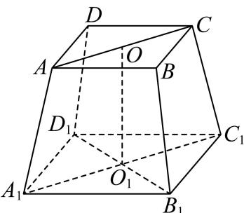
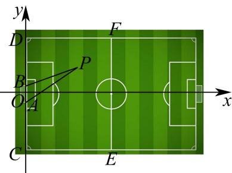
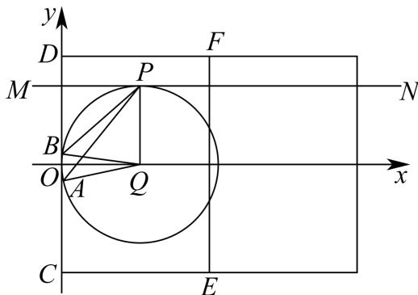
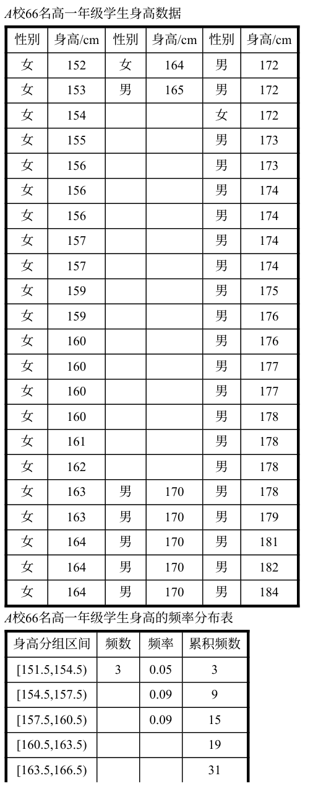
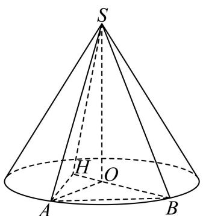
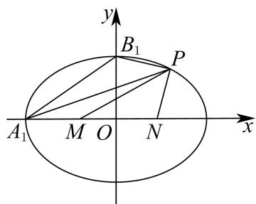
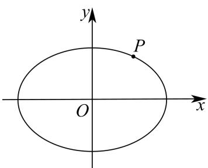
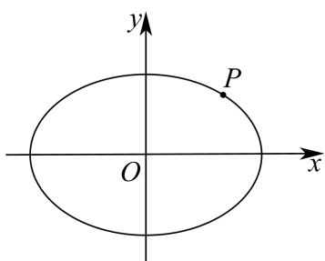

# 2026届上海高三一模 · 奉贤卷

> 按原卷题号整理；题面、图片和解答未全卷逐页终核。

## 第 1 题

已知集合 $A = (0,4), B = [2,5]$ ，则 $A \cap B =$ \_\_\_\_。（区间表示结果）

【答案】[2,4)

【解析】

【分析】根据交集的定义即可得出答案.

【详解】由交集的定义可知 $A \cap B = [2, 4)$ .

故答案为： $[2,4)$

## 第 2 题

不等式 $|2x-1|<3$ 的解集是 \_\_\_\_.

【答案】 $(-1,2)$

【解析】

【分析】根据绝对值不等式计算求解.

【详解】因为 $\left|2x-1\right|<3$ ，所以-3<2x-1<3，所以-1<x<2，

所以不等式 $\left|2x-1\right|<3$ 的解集是 $(-1,2)$ .

故答案为： $(-1,2)$ .

## 第 3 题

在二项式 $(x + 1)^9$ 的展开式中， $x^5$ 的系数是 \_\_\_\_。（用数字表示答案）

【答案】126

【解析】

【分析】根据二项式展开式计算求解.

【详解】二项式 $(x+1)^{9}$ 的展开式中，通项公式为 $T_{r+1}=C_{9}^{r}x^{9-r}$ ，

当 $r = 4$ 时， $T_{5} = \mathrm{C}_{9}^{4}x^{5}$

$x^{5}$ 的系数是 $C_{9}^{4}=\frac{9\times8\times7\times6}{1\times2\times3\times4}=126$ .

故答案为：126.

## 第 4 题

已知向量 $\vec{a}=(1,1)$ ，则经过点 $(1,0)$ 且与 $\vec{a}$ 垂直的直线方程为 \_\_\_\_.

【答案】 $x + y - 1 = 0$

【解析】

【分析】先根据向量垂直得出斜率，再点斜式得出直线方程进而得出一般式.

【详解】因为向量 $\vec{a}=(1,1)$ ，则与 $\vec{a}$ 垂直的直线方程斜率为 -1，

则经过点 $(1,0)$ 且与 $\vec{a}$ 垂直的直线方程为 $y-0=-\left(x-1\right)$ ,

即得 $x + y - 1 = 0$

故答案为： $x + y - 1 = 0$

## 第 5 题

已知等比数列 $\{a_{n}\}$ 的各项均为正数，若 $a_{1} + a_{3} = 16$ ， $a_{2} + a_{4} = 4$ ，则该等比数列 $\{a_{n}\}$ 的公比为 \_\_\_\_.

【答案】 $\frac{1}{4}$ ##0.25

【解析】

【分析】根据等比数列的通项关系作除法运算即可得公比的值.

【详解】设等比数列 $\{a_{n}\}$ 的公比为 $q$ ，

因为 $\{a_{n}\}$ 各项均为正数，若 $a_1 + a_3 = 16$ ， $a_2 + a_4 = 4$

则 $\frac{a_2 + a_4}{a_1 + a_3} = \frac{q(a_1 + a_3)}{a_1 + a_3} = q = \frac{4}{16} = \frac{1}{4}$

故该等比数列 $\{a_{n}\}$ 的公比为 $\frac{1}{4}$ .

故答案为： $\frac{1}{4}$ .

## 第 6 题

从3位女生,4位男生中选3人参加科技比赛,只有1位女生入选,则不同的选法有\_\_\_\_种。(用数字表示答案)

【答案】18

【解析】

【分析】根据组合数及乘法原理计算求解.

【详解】从 3 位女生，4 位男生中选 3 人参加科技比赛，只有 1 位女生入选，则不同的选法有 $C_{3}^{1}C_{4}^{2}=3\times6=18$ 种.

故答案为：18.

## 第 7 题

在正四棱台 $ABCD - A_{1}B_{1}C_{1}D_{1}$ 中，异面直线 $AA_{1}$ 与 $D_{1}B_{1}$ 所成角的大小为 \_\_\_\_.

【答案】 $\frac{\pi}{2}$ ##90°

【解析】

【分析】根据正四棱台特征得出 $OO_{1} \perp$ 平面 $A_{1}B_{1}C_{1}D_{1}$ ，再结合线面垂直判定定理得出 $B_{1}D_{1} \perp$ 平面 $A_{1}C_{1}CA$ ，进而得出异面直线所成的角.

【详解】

取 AC 中点 O，取 $A_{1}C_{1}$ 中点 $O_{1}$ ，连接 $OO_{1}, B_{1}D_{1}$ .

因为四棱台 $ABCD-A_{1}B_{1}C_{1}D_{1}$ 是正四棱台，

所以 $OO_{1}\perp$ 平面 $A_{1}B_{1}C_{1}D_{1}$ ， $B_{1}D_{1}\subset$ 平面 $A_{1}B_{1}C_{1}D_{1}$

所以 $OO_{1} \perp B_{1}D_{1}$ ,

又因为 $A_{1}B_{1}C_{1}D_{1}$ 是正方形，所以 $A_{1}C_{1} \perp B_{1}D_{1}$ ，

且 $A_{1}C_{1}\cap OO_{1} = O_{1},A_{1}C_{1},OO_{1}\subset$ 平面 $A_{1}C_{1}CA$ ，所以 $B_{1}D_{1}\bot$ 平面 $A_{1}C_{1}CA$

$AA_{1}\subset$ 平面 $A_{1}C_{1}CA$ ，所以 $AA_{1}\perp B_{1}D_{1}$

所以异面直线 $AA_{1}$ 与 $D_{1}B_{1}$ 所成角的大小为 $\frac{\pi}{2}$ .

故答案为： $\frac{\pi}{2}$ .

## 第 8 题

若函数 $y = \frac{a \cdot 2^x - 1}{2^x + 1} (a \in \mathbf{R})$ 是偶函数，则实数 $a =$ \_\_\_\_.

【答案】-1

【解析】

【分析】由偶函数定义建立方程，解得实数 a .

【详解】函数的定义域为R，

由题意可知 $\frac{a\cdot 2^x - 1}{2^x + 1} = \frac{a\cdot 2^{-x} - 1}{2^{-x} + 1}$ ，即 $\frac{a\cdot 2^x - 1}{2^x + 1} = \frac{a - 2^x}{1 + 2^x}$

所以 $(a+1)\cdot2^{x}=a+1$ ，

因该等式对定义域内的任意 x 都成立，故 $a+1=0$ ，

解得 $a = -1$

故答案为：-1

## 第 9 题

若复数 $z$ 满足 $\left|z\right| = \sqrt{5}$ , $\left|z - 1\right| = \left|\mathbf{Re}z + 1\right|$ , 则复数 $z =$ \_\_\_\_.

【答案】 $z=1+2i$ 或 $z=1-2i$ .

【解析】

【分析】先设复数，再计算得出 a, b 即可求解.

【详解】设复数 $z = a + bi, a, b \in R$ ,

复数 $z$ 满足 $\left|z\right| = \sqrt{5}$ ， $\left|z - 1\right| = \left|\mathbf{Re}z + 1\right|$

所以 $\left\{ \begin{array}{l}a^{2} + b^{2} = 5\\ \sqrt{(a - 1)^{2} + b^{2}} = |a + 1| \end{array} \right.$

所以 $a^{2}+4a-5=0$ ，a=1 或 a=-5（当 a=-5 时， $b^{2}=4a=-20<0$ ，与 $b\in R$ 矛盾，故舍去），

所以 $\left\{\begin{aligned}a&=1\\ b&=\pm2\end{aligned}\right.$

则复数 $z = 1 + 2\mathrm{i}$ 或 $z = 1 - 2\mathrm{i}$

故答案为： $z = 1 + 2\mathrm{i}$ 或 $z = 1 - 2\mathrm{i}$

## 第 10 题

已知两个非负实数 $a$ 、 $b$ 满足 $a + 2b = 2$ ，则 $(a - 1)^2 + (b - 4)^2$ 的最小值是

【答案】10

【解析】

【分析】由 a=2-2b，代入结合二次函数单调性即可求解.

【详解】因为两个非负实数 $a$ 、 $b$ ， $a + 2b = 2$ ，

所以 $a = 2 - 2b \geq 0$ ， $0 \leq b \leq 1$

所以 $(a - 1)^2 + (b - 4)^2 = (1 - 2b)^2 + (b - 4)^2 = 5b^2 - 12b + 17$

令 $y=5b^{2}-12b+17$ ，对称轴为 $b=\frac{6}{5}$ ，

由二次函数单调性可知当 b=1 时，取得最小值 10，

故答案为：10

## 第 11 题

在平面中， $\vec{e}_1$ 和 $\vec{e}_2$ 是互相垂直的单位向量，向量 $\vec{a}$ 满足 $\left|\vec{a} - 6\vec{e}_1\right| = 1$ ，向量 $\vec{b}$ 满足 $\left|\vec{b} - 6\vec{e}_1\right| + \left|\vec{b} - 8\vec{e}_2\right| = 20$ ，则 $\left|\vec{a} - \vec{b}\right|$ 的最大值是 \_\_\_\_.

【答案】16

【解析】

【分析】根据模长值得出圆的轨迹，再根据模长关系得出椭圆，最后应用圆与椭圆的位置关系得出最值即可.

【详解】因为 $\overrightarrow{e_1}$ 和 $\overrightarrow{e_2}$ 是互相垂直的单位向量，所以设 $\overrightarrow{e_1} = (1,0),\overrightarrow{e_2} = (0,1)$

向量 $\vec{a}$ 满足 $\left|\vec{a} - 6\vec{e}_1\right| = 1$ ，表示以 $(6,0)$ 为圆心，半径为1的圆，

$\left|\overrightarrow{6e_1} - 8\overrightarrow{e_2}\right| = \sqrt{36 + 64 - 96\overrightarrow{e_1}\cdot\overrightarrow{e_2}} = 10$ ，向量 $\vec{b}$ 满足 $\left|\vec{b} -6\overrightarrow{e_1}\right| + \left|\vec{b} -8\overrightarrow{e_2}\right| = 20$

表示长轴为 $2a = 20$ ，焦距 $2c = 10$ 的椭圆，且 $(6,0)$ 为椭圆的一个焦点，

因为 $\left|\vec{a}-\vec{b}\right|$ 表示以 $(6,0)$ 为圆心，半径为1的圆上的点到椭圆上的点距离，

则 $\left|\vec{a} -\vec{b}\right|_{\max} = a + c + 1 = 10 + 5 + 1 = 16.$

故答案为：16.

## 第 12 题

运动员关心的是在足球场上的哪些位置射门命中的角度较大。在真实的射门过程中，我们做一些假定：

（1）将足球看成一个质点；

（2）接近球门时，足球运动的轨迹与地面平行；

（3）射门时，足球与球门之间无防守员；

(4) 足球场平面图是一个矩形;

（5）标准足球场的长度为 105 米，宽度为 68 米，球门的宽度为 7.32 米；

如图，以线段 AB 所在直线为 y 轴，以线段 AB 的垂直平分线为 x 轴建立平面直角坐标系，

$O$ 是球门中心，两门柱位置分别为点 $A$ 、 $B$ ，两个角球点为 $C$ 、 $D$ ， $EF$ 是半场分界线.

对于区域 CDEF 内，射门点 $P(x,y)$ ,

对于每一个确定的横坐标 $x$ ，可以找到唯一的 $y$ ，可以证明横坐标不变时， $y = 0$ 时， $\angle APB$ 最大。此时，点 $P$ 在 $x$ 轴上是最佳射门点。

对于每一个确定的纵坐标 $y(3.66 < y < 34)$ ，同样可以找到唯一的 x，当 x = ______ 时， $\angle APB$ 最大．此时，点 P 是最佳射门点．

【答案】 $\sqrt{y^2 - 3.66^2}$

【解析】

【分析】作 $\triangle ABP$ 的外接圆 $Q$ ，得到圆心 $Q$ 所在直线，由圆的圆心角和圆周角的关系找到 $\angle APB$ 最大时 $P,Q$ 两点的位置关系，即可求得 $x$ 的值.

【详解】如图 $A(0,-3.66)$ ， $B(0,3.66)$ ，设 $P(x,y_{0})$

作 $\triangle ABP$ 的外接圆 $Q$ ， $\because A(0, -3.66)$ ， $B(0, 3.66)$ ， $\therefore$ 圆心 $Q$ 在 $x$ 轴正半轴上.

则 $\angle APB = \frac{1}{2}\angle AQB = \angle OQB$

∴当 $\angle OQB$ 最大时， $\angle APB$ 取最大值，

$$
Q O = \sqrt {B Q ^ {2} - B O ^ {2}} = \sqrt {B Q ^ {2} - 3 . 6 6 ^ {2}},
$$

$$
\therefore \cos \angle O Q B = \frac {O Q}{B Q} = \sqrt {\frac {B Q ^ {2} - 3 . 6 6 ^ {2}}{B Q ^ {2}}} = \sqrt {1 - \frac {3 . 6 6 ^ {2}}{B Q ^ {2}}},
$$

∴当 BQ 取最小值时， $\cos\angle OQB$ 取得最小值， $\because\angle OQB\in\left(0,\frac{\pi}{2}\right)$ ，所以 $\angle OQB$ 取最大值，

又∵BQ=PQ，点P为直线 $y=y_{0}$ 上动点，

∴当 $PQ \perp x$ 时，BQ = PQ 取得最小值 $y_{0}$ ，此时 $QO = \sqrt{BQ^{2} - 3.66^{2}} = \sqrt{y_{0}^{2} - 3.66^{2}}$ ，即 $x = QO = \sqrt{y_{0}^{2} - 3.66^{2}}$ .
故答案为： $\sqrt{y^{2}-3.66^{2}}$

## 第 13 题

设 $a$ 、 $b$ 为实数，且 $a > b > 0$ ，则下列不等式一定正确的是（）
A. $a^4 > b^2$ B. $\sin a > \sin b$ C. $c > 0$ 时， $\left(\frac{b}{a}\right)^c > 1$ D. $\ln a > \ln b$

【答案】D

【解析】

【分析】应用特殊值法计算判断 A，B，C，应用对数函数单调性判断 D.

【详解】因为a、b为实数，且a>b>0，

当 $a = \frac{1}{2}, b = \frac{1}{4}$ , $a^4 = \frac{1}{16} = b^2 = \frac{1}{16}$ , A选项错误;

当 $a = \frac{2\pi}{3}, b = \frac{\pi}{3}$ , $\sin \frac{2\pi}{3} = \sin \frac{\pi}{3}$ , B选项错误;

当 $a = 2, b = 1, c = 1$ 时， $\left(\frac{b}{a}\right)^c = \frac{1}{2} < 1$ ，C选项错误；

当 a > b > 0 ，所以 $\ln a > \ln b$ ，D 选项正确；

故选：D.

## 第 14 题

设 $\alpha$ ， $\beta$ ， $\gamma$ 是互不重合的平面，m，n 是互不重合的直线，给出四个命题：
①若 $m \parallel \alpha$ ， $m \parallel \beta$ ，则 $\alpha \parallel \beta$ ②若 $\alpha \perp \gamma$ ， $\beta \perp \gamma$ ，则 $\alpha \perp \beta$

③若 $m \perp \alpha, m \perp \beta$ ，则 $\alpha // \beta$ ④若 $m // \alpha, n \perp \alpha$ ，则 $m \perp n$ 其中正确命题的个数是（）
A. 1 B. 2 C. 3 D. 4

【答案】B

【解析】

【分析】根据线面位置关系的判定定理、性质定理，以及推论，逐项判定，即可求解.
【详解】由 $\alpha, \beta, \gamma$ 是互不重合的平面，m，n 是互不重合的直线，
对于①中，由 $m//\alpha, m//\beta$ ，则 $\alpha//\beta$ 或 $\alpha$ 与 $\beta$ 相交，所以不正确；
对于②中，由 $\alpha \perp \gamma, \beta \perp \gamma$ ，则 $\alpha \perp \beta$ 或 $\alpha // \beta$ 或 $\alpha$ 与 $\beta$ 相交，所以不正确；
对于③中，由 $m \perp \alpha, m \perp \beta$ ，根据垂直于同一直线的两平面平行，可得 $\alpha // \beta$ ，
所以正确的；
对于④中，由 $m//\alpha, n \perp \alpha$ ，可得 $m \perp n$ ，所以正确.

故选：B.

## 第 15 题

曲线 C 的方程为 $Ax^{2}-By^{2}=\lambda^{2}$ （A、B 不同时为 0），则下列说法正确的是（）
A. 曲线 C 不可能是直线
B. 当 A > 0, B < 0 时，曲线是椭圆
C. 若曲线 C 是双曲线，则双曲线的渐近线与 $\lambda$ 无关
D. 曲线 C 是抛物线

【答案】C

【解析】

【分析】根据 A, B 的取值结合圆、椭圆、双曲线方程的特点逐项分析曲线 C 的方程.
【详解】A. 当 $B = 0, A > 0, \lambda > 0$ 时， $x^{2} = \frac{\lambda^{2}}{A}$ ，所以 $x = \pm \sqrt{\frac{\lambda^{2}}{A}}$ 为两条直线，A 选项错误；
B. 因为 A = 1, B = -1, $\lambda > 0$ , $C: x^{2} + y^{2} = \lambda^{2}$ ，所以曲线 C 是半径为 $\lambda$ 的圆，故 B 错误；

C. 因为 $Ax^2 - By^2 = \lambda^2$ ， $A > 0, B > 0$ ，所以曲线 $C$ 是双曲线，则 $\frac{A}{\lambda^2} x^2 - \frac{B}{\lambda^2} y^2 = 1$ ，则渐近线 $y = \pm \sqrt{\frac{A}{B}} x$ ，故 C 正确；

D. 因为曲线 $Ax^2 - By^2 = \lambda^2$ ， $A$ 、 $B$ 不同时为 0，

当 $\lambda = 0$ 时，

当 B > 0, A > 0 时，曲线是两条相交直线；

当 $B > 0, A < 0$ 时，曲线是点；

当 $B\langle 0,A\rangle 0$ 时，曲线是点；

当 $B < 0, A < 0$ 时，曲线是两条相交直线；

当 B=0, A<0 时，曲线是直线；

当 $B = 0, A > 0$ 时，曲线是直线；

当 $A = 0, B > 0$ 时，曲线是直线；

当 A=0, B<0 时，曲线是直线；

当 $\lambda \neq 0$ 时，

当 $B > 0, A > 0$ 时，曲线是双曲线；

当 $B > 0, A < 0$ 时，曲线不存在；

当 $B\langle 0,A\rangle 0,A\neq -B$ 时，曲线是椭圆；

当 $B < 0, A > 0, A = -B$ 时，曲线是圆；

当 B < 0, A < 0 时，曲线是双曲线；

当 $B = 0, A < 0$ 时，曲线不存在；

当 B=0, A>0 时，曲线是直线；

当 $A = 0, B > 0$ 时，曲线不存在；

当 A=0, B<0 时，曲线是直线；

所以曲线 C 不能是抛物线，故 D 错误；

故选：C.

## 第 16 题

已知等差数列 $\{a_{n}\}$ 的公差不为零， $S_{n}$ 为其前 $n$ 项和，存在正整数 $k$ 满足 $S_{k} = 0$ ，有两个命题：
命题①：设数列公差 $d$ ，则 $d \cdot S_{1} < 0$ 。

命题②：i、j 均是小于 k 的正整数，则 $S_{i} \cdot S_{j} = S_{k-i} S_{k-j}$ .

以上判断正确的是（）
A. 命题①②都是真命题
B. 命题①是真命题，命题②是假命题
C. 命题①②都是假命题
D. 命题①是假命题，命题②是真命题

【答案】D

【解析】

【分析】命题①：利用等差数列的求和公式，将条件 $S_{k}=0$ 整理得到 $a_{1}=-\frac{(k-1)d}{2}$ ，又 $S_{1}=a_{1}$ ，计算 $d\cdot S_{1}$ 即可得解；命题②：利用等差数列的求和公式求解即可.
【详解】∵等差数列 $\left\{a_{n}\right\}$ 的公差不为零， $S_{n}$ 为其前n项和， $S_{k}=0$ ，
∴ $ka_{1}+\frac{k(k-1)d}{2}=0,\quad\therefore a_{1}=-\frac{(k-1)d}{2}$ 命题①：∵ $S_{1}=a_{1}$ ∴ $d\cdot S_{1}=d\cdot\left[-\frac{(k-1)d}{2}\right]=-\frac{(k-1)d^{2}}{2}$ ∵ $d\neq0$ ，∴ $d^{2}>0$ 当k=1时， $d\cdot S_{1}=0$ ；
当k>1且 $k\in N$ 时， $d\cdot S_{1}<0$ ；故命题①错误；
命题②：∵ $a_{1}=-\frac{(k-1)d}{2}$ ，i、j均是小于k的正整数，
∴ $S_{i}\cdot S_{j}=\left(-\frac{i(k-1)d}{2}+\frac{i(i-1)d}{2}\right)\cdot\left(-\frac{j(k-1)d}{2}+\frac{j(j-1)d}{2}\right)=\frac{ijd^{2}(i-k)(j-k)}{4}$ ∴ $S_{k-i}S_{k-j}=\left((k-i)a_{1}+\frac{(k-i)(k-i-1)d}{2}\right)\cdot\left((k-j)a_{1}+\frac{(k-j)(k-j-1)d}{2}\right)$

$$
= \frac {i j d ^ {2} (k - i) (k - j)}{4} = \frac {i j d ^ {2} (i - k) (j - k)}{4},
$$

$\therefore S_{i}\cdot S_{j} = S_{k - i}S_{k - j}$ ，故命题②正确.

故选：D.

## 第 17 题

已知函数 $f(x) = \frac{1}{2}\sin 2x - \frac{\sqrt{3}}{2}\cos 2x$ .

（1）当 $x \in \left[\frac{5\pi}{6}, \frac{13\pi}{12}\right)$ 时，求函数 $f(x)$ 的值域；

（2）在 $\triangle ABC$ 中，角 $A$ 、 $B$ 及 $C$ 所对边的边长分别为 $a$ 、 $b$ 及 $c$ ，若 $f(C) = 0$ ， $a = 2$ ， $B = \frac{\pi}{4}$ ，求 $b$ ：

【答案】（1） $\left[-1,-\frac{1}{2}\right)$

(2) $b=2\sqrt{3}-2$ 或 $b=2\sqrt{3}+2$

【解析】

【分析】（1）利用辅助角公式将函数化为正弦型函数，再利用正弦型函数的性质计算即得；

（2）由 $f(C) = 0$ 计算出 $C$ ，利用两角和的正弦公式求得 $\sin A$ ，再借助于正弦定理计算即得.

【小问 1 详解】

$$
f (x) = \frac {1}{2} \sin 2 x - \frac {\sqrt {3}}{2} \cos 2 x = \sin \left(2 x - \frac {\pi}{3}\right),
$$

当 $x \in \left[\frac{5\pi}{6}, \frac{13\pi}{12}\right)$ 时， $2x - \frac{\pi}{3} \in \left[\frac{4\pi}{3}, \frac{11\pi}{6}\right)$ ，

则 $\sin\left(2x-\frac{\pi}{3}\right)\in\left[-1,-\frac{1}{2}\right)$ ，即 $y=f(x)$ 的值域为 $\left[-1,-\frac{1}{2}\right)$ ;

【小问 2 详解】

$f(C)=\sin\left(2C-\frac{\pi}{3}\right)=0$ ，则 $2C-\frac{\pi}{3}=k\pi(k\in\mathbf{Z})$ ，即 $C=\frac{\pi}{6}+\frac{k\pi}{2}(k\in\mathbf{Z})$ ，

又 $C \in (0, \pi)$ ，故 $C = \frac{\pi}{6}$ 或 $C = \frac{2\pi}{3}$ ;

若 $C = \frac{\pi}{6}$ ，由 $B = \frac{\pi}{4}$ ，则 $\sin A = \sin (\pi - B - C) = \sin (B + C)$

$$
= \sin \frac {\pi}{6} \cos \frac {\pi}{4} + \sin \frac {\pi}{4} \cos \frac {\pi}{6} = \frac {1}{2} \times \frac {\sqrt {2}}{2} + \frac {\sqrt {2}}{2} \times \frac {\sqrt {3}}{2} = \frac {\sqrt {2} + \sqrt {6}}{4},
$$

由正弦定理 $\frac{a}{\sin A} = \frac{b}{\sin B}$ ，可得

$$
b = \frac {a \sin B}{\sin A} = \frac {2 \times \frac {\sqrt {2}}{2}}{\frac {\sqrt {2} + \sqrt {6}}{4}} = \frac {4 \sqrt {2} (\sqrt {6} - \sqrt {2})}{(\sqrt {6} + \sqrt {2}) (\sqrt {6} - \sqrt {2})} = 2 \sqrt {3} - 2;
$$

若 $C = \frac{2\pi}{3}$ ，由 $B = \frac{\pi}{4}$ ，则 $\sin A = \sin (\pi - B - C) = \sin (B + C)$

$$
= \sin \frac {2 \pi}{3} \cos \frac {\pi}{4} + \sin \frac {\pi}{4} \cos \frac {2 \pi}{3} = \frac {\sqrt {3}}{2} \times \frac {\sqrt {2}}{2} - \frac {\sqrt {2}}{2} \times \frac {1}{2} = \frac {\sqrt {6} - \sqrt {2}}{4},
$$

由正弦定理 $\frac{a}{\sin A} = \frac{b}{\sin B}$ ，可得

$$
b = \frac {a \sin B}{\sin A} = \frac {2 \times \frac {\sqrt {2}}{2}}{\frac {\sqrt {6} - \sqrt {2}}{4}} = \frac {4 \sqrt {2} (\sqrt {6} + \sqrt {2})}{(\sqrt {6} + \sqrt {2}) (\sqrt {6} - \sqrt {2})} = 2 \sqrt {3} + 2.
$$

综上， $b=2\sqrt{3}-2$ 或 $b=2\sqrt{3}+2$ .

## 第 18 题

> 核对提醒：题图参照已有补源材料恢复，仍需结合原卷核验。

A 校高一年级共有学生 462 名，其中女生 224 名．为了解该校高一年级学生的身高和体重情况，按分层随机抽样从中获取 66 名学生的身高（cm）和体重（kg），其中 66 名学生的身高（从低到高排序三列，每列 22 人）汇总如下表（隐蔽部分信息数据），身高的频率分布表如下表（隐蔽了部分信息数据），66 名学生体重绘制茎叶图如下图．

A 校 66 名高一年级学生身高数据与频率分布表：

$A$ 校66名高一年级学生体重的茎叶图（上图）

(1) 能否推算出身高 $165 \mathrm{~cm}$ 的具体人数?

（2）求抽取的男生人数、抽取到的男生体重的中位数；

（3）已知这66名学生中男生身高平均数为 $173.1\mathrm{cm}$ ，方差为25.9；女生身高平均数为 $161.3\mathrm{cm}$ ，方差为23.3。请计算该样本数据在区间 $\left[\overline{x} - 2s, \overline{x} + 2s\right]$ 中包含样本数据的个数。（其中 $x$ 是样本平均数， $s$ 是样本标准差）

【答案】（1）不能，理由见解析

(2) 抽取的男生人数为 34 人, 抽取到的男生体重的中位数为 63

(3) 65

【解析】

【分析】（1）结合表格可得身高为165、166的共8人，不能得到身高 $165\mathrm{cm}$ 的具体人数；

(2) 借助茎叶图可得抽取的男生人数, 再利用中位数定义可得抽取到的男生体重的中位数;

（3）借助分层抽样的平均数与方差公式，可得 $\overline{x}$ 与 $s$ ，即可得 $[\overline{x} -2s,\overline{x} +2s]$ ，再借助身高数据表格即可得解.

【小问1详解】

由身高的频率分布表可得，身高位于 $[163.5, 166.5)$ 的人数为 $31 - 19 = 12$ 人，

由身高数据表格可得身高164的有4人，则身高为165、166的共8人，

故不能得到身高165cm的具体人数;

【小问 2 详解】

由茎叶图可得抽取的男生人数为34人，

抽取到的男生体重的中位数为 $\frac{63 + 63}{2} = 63$

【小问 3 详解】

$$
\overline {{x}} = \frac {1 7 3 . 1 \times 3 4 + 1 6 1 . 3 \times 3 2}{6 6} \approx 1 6 7. 4,
$$

$$
s ^ {2} \approx \frac {3 4 \times \left[ 2 5 . 9 + (1 7 3 . 1 - 1 6 7 . 4) ^ {2} \right]}{6 6} + \frac {3 2 \times \left[ 2 3 . 3 + (1 6 1 . 3 - 1 6 7 . 4) ^ {2} \right]}{6 6} \approx 5 9. 4 2,
$$

则 $s \approx \sqrt{59.42} \approx 7.7$

则 $\overline{x} - 2s \approx 167.4 - 2 \times 7.7 = 152$ ， $\overline{x} + 2s \approx 167.4 + 2 \times 7.7 = 182.8$

则由身高数据表格可得位于区间 $[152,182.8]$ 的人数为65人.

## 第 19 题

> 核对提醒：原解析末尾线段比的两个数值不一致，具体推导及笔误待复核。

如图, 将直角三角形 $SOA$ 绕直角边 $SO$ 所在直线旋转一周形成圆锥 $S-O$ . 已知圆锥 $S-O$ 的底面半径为 $3 \mathrm{~cm}$ , 圆锥的侧面积 $15 \pi \mathrm{~cm}^{2}$ . 设 $A 、 B$ 是底面圆周上的两点, 线段 $AB$ 不经过点 $O$ .

（1）求圆锥 S-O 的体积；

（2）求证：直线 SA 与直线 OB 是异面直线；

（3）二面角 $A - SO - B$ 的大小为 $\frac{2\pi}{3}$ ，求直线 $SA$ 与平面 $SOB$ 所成角的大小.

【答案】(1) $12 \pi \mathrm{cm}^{3}$

（2）证明见解析 （3） $\arcsin \frac{3\sqrt{3}}{10}$

【解析】

【分析】（1）由侧面积公式求得母线长，进而得到圆锥高，结合体积公式即可求解；

(2) 由异面直线判定定理即可求解;

（3）过点 $A$ 作 $AH \perp OB$ 于 $H$ ，连接 $SH$ ，确定 $\angle ASH$ 为直线 $SA$ 与平面 $SOB$ 所成角，进而可求解.

【小问 1 详解】

设圆锥的母线长为 $l$ ，底面半径为 $r$ ，

由题意可得： $\pi rl = 15\pi \Rightarrow 3\pi l = 15\pi \Rightarrow l = 5$

所以 $SO = \sqrt{5^2 - 3^2} = 4$

所以圆锥 $S - O$ 的体积 $V = \frac{1}{3}\pi r^2\times SO = 12\pi \mathrm{cm}^3$

【小问 2 详解】

因为 $SA \cap$ 平面 SOB = S，OB ⊂ 平面 SOB, $S \notin OB$ ，

所以直线 SA 与直线 OB 是异面直线;

【小问 3 详解】

因为二面角 A-SO-B 的大小为 $\frac{2\pi}{3}$ ,

由圆锥的结构可知： $SO \perp OA, SO \perp OB$ ，

所以 $\angle AOB$ 即为二面角 $A - SO - B$ 的平面角，

所以 $\angle AOB = \frac{2\pi}{3}$ ，又 $OA = OB = 3$

所以 $AB = \sqrt{OA^2 + OB^2 - 2OA \cdot OB \cos \frac{2\pi}{3}} = 3\sqrt{3}$

过点 A 作 $AH \perp OB$ 于 H，连接 SH，

因为 $AH \perp OB, AH \perp SO, OB, SO$ 为平面 SOB 两条相交直线，

所以 $AH \perp$ 平面 $SOB$

所以 $\angle ASH$ 即为直线 $SA$ 与平面 $SOB$ 所成角，

又 $AH = AB \times \sin 30^{\circ} = \frac{3\sqrt{3}}{2}$ ,

又 $AH \perp$ 平面 $SOB$ ， $SH$ 在平面 $SOB$ 内，

所以 $AH \perp SH$ ，

所以 $\sin \angle ASH = \frac{AH}{SA} = \frac{3\sqrt{3}}{5} = \frac{3\sqrt{3}}{10}$

所以 $\angle ASH = \arcsin \frac{3\sqrt{3}}{10}$ ,

即直线 $SA$ 与平面 $SOB$ 所成角大小为 $\arcsin \frac{3\sqrt{3}}{10}$ .

## 第 20 题

> 核对提醒：原解析关于交点判别式和切线退化的讨论不充分，需核题目条件及边界。

椭圆 $\frac{x^2}{a^2} + \frac{y^2}{b^2} = 1 (a > b > 0)$ ， $P$ 是第一象限内椭圆上的点， $A_1(-a,0)$ ， $B_1(0,b)$ ， $|A_1B_1| = \sqrt{5}$ ，椭圆的离心率是 $\frac{\sqrt{3}}{2}$ 。 $M(-t,0)$ ， $N(t,0)$ ， $t > 0$ 且 $t \neq a$ 。

图1

图3

图2

备用图

（1）求椭圆的方程并在下图 1 中作出椭圆的左焦点，写出作图依据；

(2)如图2, 设 $t = 1$ , 三角形 $PMN$ 的面积记为 $S_{1}$ , 三角形 $PA_{1}B_{1}$ 的面积记为 $S_{2}$ , 若 $S_{2} = 2S_{1}$ , 求点 $P$ 的坐标;

(3) 设 $P(x_{0}, y_{0})$ ，连结 PM 与椭圆交于点 A，连结 PN 与椭圆交于点 B，判断 $\frac{|PM|}{|MA|} + \frac{|PN|}{|NB|}$ 是否为定值？请说明理由.

【答案】（1）椭圆的方程为 $\frac{x^{2}}{4}+y^{2}=1$ ，作图见解析

(2) $\left(\frac{8}{5},\frac{3}{5}\right)$

（3）为定值 $\left|\frac{8+2t^{2}}{4-t^{2}}\right|$

【解析】

【分析】（1）根据椭圆中 $a, b, c$ 的关系求解椭圆方程即可，利用椭圆的定义作图即可得椭圆的左焦点；

（2）设 $P\left(x_0,y_0\right)$ ，则 $\frac{x_0^2}{4} +y_0^2 = 1$ ，根据三角形面积公式即可得 $S_{1}$ ， $S_{1}$ 关于 $x_0,y_0$ 的式子，利用面积比例求解 $x_0,y_0$ 即可得所求；

（3）设 $l_{PB}: x = my + t$ ，其中 $m = \frac{x_0 - t}{y_0}$ ， $l_{PA}: x = ny - t$ ，其中 $n = \frac{x_0 + t}{y_0}$ ，分别与椭圆方程联立，根据根于系数的关系得 $y_B$ 与 $y_0$ ， $y_A$ 与 $y_0$ 的关系，再根据线段比例关系计算验证 $\frac{|PM|}{|MA|} + \frac{|PN|}{|NB|}$ 是否为定值即可.

【小问 1 详解】

因为椭圆 $\frac{x^2}{a^2} +\frac{y^2}{b^2} = 1(a > b > 0)$ 中 $A_{1}(-a,0),B_{1}(0,b),|A_{1}B_{1}| = \sqrt{5}$ ，椭圆的离心率是 $\frac{\sqrt{3}}{2},$

【小问2详解】

则 $\left\{ \begin{array}{l} \sqrt{a^2 + b^2} = \sqrt{5} \\ \frac{c}{a} = \frac{\sqrt{3}}{2} \\ a^2 = b^2 + c^2 \end{array} \right.$ ，解得 $a = 2, b = 1, c = \sqrt{3}$ ，

则椭圆的方程为 $\frac{x^2}{4} + y^2 = 1$

如下图：以 $B_{1}$ 为圆心，以 $OA_{1}$ 的长为半径在线段 $OA_{1}$ 上画圆弧，与线段 $OA_{1}$ 的交点即为椭圆的左焦点 $F_{1}\left(-\sqrt{3},0\right)$ ;

设 $P\left(x_0,y_0\right)$ ，则 $\frac{x_0^2}{4} +y_0^2 = 1$ ①，且 $0 <   x_{0} <   2,0 <   y_{0} <   1$

当 $t = 1$ 时， $M(-1,0)$ ， $N(1,0)$

又 $S_{1} = S_{\triangle PMN} = \frac{1}{2}\big|M N\big|\cdot y_{0} = \frac{1}{2}\times 2\cdot y_{0} = y_{0}$

因为 $A_{1}(-2,0)$ ， $B_{1}(0,1)$ ，所以直线 $A_{1}B_{1}$ 的方程为 $\frac{x}{-2} + y = 1$ ，即 $x - 2y + 2 = 0$

故点 $P\left(x_0,y_0\right)$ 到直线 $A_{1}B_{1}$ 的距离 $d_P = \frac{\left|x_0 - 2y_0 + 2\right|}{\sqrt{1^2 + (-2)^2}} = \frac{\left|x_0 - 2y_0 + 2\right|}{\sqrt{5}}$

$$
S _ {2} = S _ {\triangle P A _ {1} B _ {1}} = \frac {1}{2} \left| A _ {1} B _ {1} \right| \cdot d _ {P} = \frac {1}{2} \times \sqrt {5} \cdot \frac {\left| x _ {0} - 2 y _ {0} + 2 \right|}{\sqrt {5}} = \frac {\left| x _ {0} - 2 y _ {0} + 2 \right|}{2} = \frac {x _ {0} - 2 y _ {0} + 2}{2},
$$

因为 $S_{2} = 2S_{1}$ ，所以 $\frac{x_0 - 2y_0 + 2}{2} = 2y_0$ ，即 $x_0 - 6y_0 + 2 = 0$ ②，

联立①②，且 $0 < x_0 < 2, 0 < y_0 < 1$ ，解得 $x_0 = \frac{8}{5}, y_0 = \frac{3}{5}$

故点 P 的坐标为 $\left(\frac{8}{5}, \frac{3}{5}\right)$ ;

## 【小问 3 详解】

如图所示 $M(-t,0)$ ， $N(t,0)$ ， $t > 0$ 且 $t \neq a$ ， $P(x_0,y_0)$ ，则 $\frac{x_0^2}{4} + y_0^2 = 1$ ，

过 A 作 $AJ \perp x$ 轴于 J，过 B 作 $BL \perp x$ 轴于 L，

设 $l_{PB}: x = my + t$ ，其中 $m = \frac{x_0 - t}{y_0}$ ，

$\left\{ \begin{array}{l} x = my + t \\ \frac{x^2}{4} + y^2 = 1 \end{array} \right. \Rightarrow (m^2 + 4)y^2 + 2my + t^2 - 4 = 0, \Delta > 0$ 恒成立，

所以 $y_{B} + y_{P} = y_{B} + y_{0} = \frac{-2mt}{m^{2} + 4}, y_{B}y_{0} = \frac{t^{2} - 4}{m^{2} + 4}$ ,

$$
y _ {B} y _ {0} = \frac {t ^ {2} - 4}{\left(\frac {x _ {0} - t}{y _ {0}}\right) ^ {2} + 4} \Rightarrow y _ {B} = \frac {y _ {0} (t ^ {2} - 4)}{(x _ {0} - t) ^ {2} + 4 y _ {0} ^ {2}},
$$

设 $l_{PA}: x = ny - t$ ，其中 $n = \frac{x_0 + t}{y_0}$ ，

$\left\{ \begin{array}{l} x = ny - t \\ \frac{x^2}{4} + y^2 = 1 \end{array} \right. \Rightarrow (n^2 + 4)y^2 - 2nty + t^2 - 4 = 0, \Delta > 0$ 恒成立，

所以 $y_{A} + y_{P} = y_{A} + y_{0} = \frac{2nt}{n^{2} + 4}, y_{A}y_{0} = \frac{t^{2} - 4}{n^{2} + 4}$ ,

$$
y _ {A} y _ {0} = \frac {t ^ {2} - 4}{\left(\frac {x _ {0} + t}{y _ {0}}\right) ^ {2} + 4} \Rightarrow y _ {A} = \frac {y _ {0} (t ^ {2} - 4)}{(x _ {0} + t) ^ {2} + 4 y _ {0} ^ {2}},
$$

因为 $\frac{|PM|}{|MA|}=\frac{|PK|}{|AJ|},\frac{|PN|}{|NB|}=\frac{|PK|}{|BL|}$ ,

$$
\text {所以} \frac {| P M |}{| M A |} + \frac {| P N |}{| N B |} = \frac {| P K |}{| A J |} + \frac {| P K |}{| B L |} = \left| \frac {y _ {0}}{- y _ {A}} + \frac {y _ {0}}{- y _ {B}} \right| = \left| - y _ {0} \left(\frac {1}{y _ {A}} + \frac {1}{y _ {B}}\right) \right|
$$

$$
= \left| - y _ {0} \left(\frac {\left(x _ {0} + t\right) ^ {2} + 4 y _ {0} ^ {2}}{y _ {0} (t ^ {2} - 4)} + \frac {\left(x _ {0} - t\right) ^ {2} + 4 y _ {0} ^ {2}}{y _ {0} (t ^ {2} - 4)}\right) \right| = \left| \frac {2 \left(x _ {0} ^ {2} + 4 y _ {0} ^ {2}\right) + 2 t ^ {2}}{4 - t ^ {2}} \right| = \left| \frac {8 + 2 t ^ {2}}{4 - t ^ {2}} \right| \text {为定值，}
$$

所以 $\frac{|PM|}{|MA|} +\frac{|PN|}{|NB|}$ 为定值 $\left|\frac{8 + 2t^2}{4 - t^2}\right|$

## 第 21 题

记 $y = f'(x)$ ， $y = g'(x)$ 分别为函数 $y = f(x)$ 和 $y = g(x)$ 的导数，存在 $x_0 \in \mathbf{R}$ ，满足 $f(x_0) = g(x_0)$ 且 $f'(x_0) = g'(x_0)$ ，则称 $x_0$ 为 $y = f(x)$ 和 $y = g(x)$ 的一个“Ω点”.

（1）若函数 $f(x) = ax^2 - 1$ 与 $g(x) = \ln x$ 存在“Ω点”，求实数 $a$ 的值；

（2）证明函数 $f(x)=\sin x$ 与 $g(x)=x^{2}+2x-2$ 不存在“Ω点”；

（3）已知函数 $f(x) = -x^2 + a$ ， $g(x) = \frac{be^x}{x}$ ，对任意的 $a > 0$ ，判断是否存在 $b > 0$ ，使得函数 $y = f(x)$ 和 $y = g(x)$ 在区间 $(0, +\infty)$ 内存在“ $\Omega$ 点”，请说明理由.

【答案】(1) $a=\frac{e}{2}$ ;

（2）证明见解析； （3）存在，理由见解析.

【解析】

【分析】（1）求导，设“Ω点”为 $x_{0}$ ，解方程组 $\left\{\begin{aligned}f(x_{0})&=g(x_{0})\\ f'(x_{0})&=g'(x_{0})\end{aligned}\right.$ ，可得结论.

（2）假设存在“ $\Omega$ 点”为 $x_0$ ，解方程组 $\left\{ \begin{array}{l} f(x_0) = g(x_0) \\ f'(x_0) = g'(x_0) \end{array} \right.$ ，应用等式无解可得结论；

（3）设“ $\Omega$ 点”为 $x_0$ ，由 $\left\{ \begin{array}{l} f(x_0) = g(x_0) \\ f'(x_0) = g'(x_0) \end{array} \right.$ ，用 $x_0$ 表示出 $a$ ，由 $a > 0$ 求得 $x_0$ 的范围，利用导数求得 $b$ 的范围即可求解.

【小问 1 详解】

设 $f(x) = ax^{2} - 1$ ， $g(x) = \ln x$ ，则 $f^{\prime}(x) = 2ax$ ， $g^{\prime}(x) = \frac{1}{x}$

由题意得： $x_{0}$ 需同时满足： $\left\{\begin{aligned}f(x_{0})&=g(x_{0})\\ f'(x_{0})&=g'(x_{0})\end{aligned}\right.$ ，故 $\left\{\begin{aligned}ax_{0}^{2}&-1=\ln x_{0}\\ 2ax_{0}&=\frac{1}{x_{0}}\Rightarrow ax_{0}^{2}=\frac{1}{2}\end{aligned}\right.$

所以 $\frac{1}{2} - 1 = \ln x_0 \Rightarrow -\frac{1}{2} = \ln x_0 \Rightarrow x_0 = e^{-\frac{1}{2}} = \frac{1}{\sqrt{e}}$

得 $a \cdot \left(\frac{1}{\sqrt{\mathrm{e}}}\right)^2 = \frac{1}{2} \Rightarrow a \cdot \frac{1}{\mathrm{e}} = \frac{1}{2} \Rightarrow a = \frac{\mathrm{e}}{2}$ ，所以 $a = \frac{\mathrm{e}}{2}$ .

【小问 2 详解】

由题意 $x_0$ 需同时满足： $\left\{ \begin{array}{l}f(x_0) = g(x_0)\\ f'(x_0) = g'(x_0) \end{array} \right.$

令 $\sin x_{0}=x_{0}^{2}+2x_{0}-2$

函数 $f(x)=\sin x$ 有 $f'(x)=\cos x$ ，函数 $g(x)=x^{2}+2x-2$ ，有 $g'(x)=2x+2$ ，

令 $2x_{0} + 2 = \cos x_{0}$ ，所以 $\sin^2 x_0 + \cos^2 x_0 = (x_0^2 + 2x_0 - 2)^2 + (2x_0 + 2)^2 = 1$

$$
\left(x _ {0} + 1\right) ^ {4} - 2 \left(x _ {0} + 1\right) ^ {2} + 8 = 0
$$

因为 $\Delta = 4 - 4\times 1\times 8 = -28 <   0$ ，所以 $x_0$ 无解，

故函数 $f(x) = \sin x$ 与 $g(x) = x^2 + 2x - 2$ 不存在“Ω点”；

【小问 3 详解】

对任意的 a > 0，存在 b > 0，使得函数 $y = f(x)$ 和 $y = g(x)$ 在区间 $(0, +\infty)$ 内存在“Ω 点”.

设 $f(x) = -x^{2} + a$ ， $g(x) = \frac{be^x}{x}$ ，则 $f^{\prime}(x) = -2x$ ， $g^{\prime}(x) = b\cdot \frac{\mathrm{e}^{x}(x - 1)}{x^{2}}$

函数 $y = f(x)$ 与 $y = g(x)$ 在区间 $(0, +\infty)$ 内存在“Ω 点”，

则 $x_{0}>0$ 且需同时满足： $\left\{\begin{aligned}f(x_{0})&=g(x_{0})\\ f'(x_{0})&=g'(x_{0})\end{aligned}\right.$ ，即 $\left\{\begin{aligned}-x_{0}^{2}+a&=\frac{b\mathrm{e}^{x_{0}}}{x_{0}}\\ -2x_{0}&=b\cdot\frac{\mathrm{e}^{x_{0}}(x_{0}-1)}{x_{0}^{2}}\end{aligned}\right.$

得： $b=\frac{(-x_{0}^{2}+a)x_{0}}{\mathrm{e}^{x_{0}}}$ 且 $b=\frac{-2x_{0}^{3}}{\mathrm{e}^{x_{0}}(x_{0}-1)}$ ,

联立得： $\frac{-2x_0^3}{\mathrm{e}^{x_0}(x_0 - 1)} = \frac{(-x_0^2 + a)x_0}{\mathrm{e}^{x_0}}\Rightarrow \frac{2x_0^3}{x_0 - 1} = (x_0^2 -a)x_0,$

因为 $x_0 > 0$

所以 $\frac{2x_0^2}{x_0 - 1} = x_0^2 - a \Rightarrow a = -\frac{2x_0^2}{x_0 - 1} + x_0^2 = x_0^2\left(1 - \frac{2}{x_0 - 1}\right) = x_0^2 \cdot \frac{x_0 - 3}{x_0 - 1}$ ,

由 $a > 0$ 得： $x_0^2\cdot \frac{x_0 - 3}{x_0 - 1} >0$ ，

又因为 $x_0 > 0$ ，所以 $\frac{x_0 - 3}{x_0 - 1} > 0$ ，解得 $x_0 \in (3, +\infty) \cup (0, 1)$ ，

此时 $b = \frac{-2x_0^3}{\mathrm{e}^{x_0}(x_0 - 1)}$ ，当 $b > 0$ ，所以 $x_0\in (0,1)$

当 $x \in (0,1)$ ，设 $s(x) = x^2 \cdot \frac{x - 3}{x - 1}$ ， $s'(x) = \frac{2x^3 - 3x^2 + 3}{(x - 1)^2} = \frac{2x^3 + 3(1 - x^2)}{(x - 1)^2} > 0$ ，

故 $s(x)$ 在 $(0,1)$ 为增函数，且 $s(0) = 0$ ，而 $x\to 1$ 时， $s(x)\rightarrow +\infty$

故对于任意 a > 0，总存在 $x_{0} \in (0,1)$ ，使得 $\frac{2x_{0}^{2}}{x_{0}-1} = x_{0}^{2} - a$ ，

令 $h(x)=\frac{-2x^{3}}{\mathrm{e}^{x}(x-1)},0<x<1,$

求导得 $h'(x)=-\frac{6x^{2}\cdot\mathrm{e}^{x}(x-1)-2x^{3}\cdot\mathrm{e}^{x}(x-1)-2x^{3}\cdot\mathrm{e}^{x}}{\left[\mathrm{e}^{x}(x-1)\right]^{2}}$

$$
= - \frac {2 x ^ {2} \cdot \mathrm{e} ^ {x} \cdot (3 x - 3 - x ^ {2})}{\left[ \mathrm{e} ^ {x} (x - 1) \right] ^ {2}} = \frac {2 x ^ {2} \cdot \mathrm{e} ^ {x} \cdot \left[ \left(x - \frac {3}{2}\right) ^ {2} + \frac {3}{4} \right]}{\left[ \mathrm{e} ^ {x} (x - 1) \right] ^ {2}} > 0,
$$

故函数 $h(x)$ 在 $(0,1)$ 单调递增，故 $x \in (0,1)$ , $h(x) > h(0) = 0$ ,

所以存在 $b > 0$ 满足题意；

所以存在 b > 0，使得函数 $y = f(x)$ 和 $y = g(x)$ 在区间 $(0, +\infty)$ 内存在“Ω 点”.
