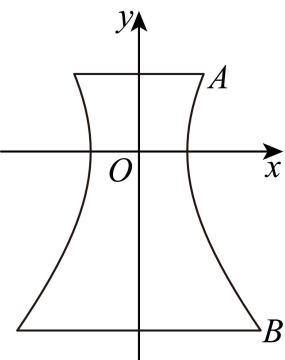
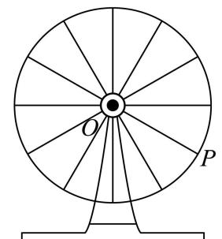
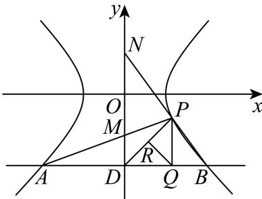

# 2026届上海高三一模 · 宝山卷

> 按原卷题号整理；题面、图片和解答未全卷逐页终核。

## 第 1 题

若全集 $U = \{1, 2, 3, 4, 5, 6\}$ ，集合 $A = \{1, 3, 5, 6\}$ ，则 $C_U A =$ \_\_\_\_.

【答案】{2,4}

【解析】

【分析】根据题意，结合补集的定义与运算，即可求解.

【详解】由全集 $U=\{1,2,3,4,5,6\}$ ，集合 $A=\{1,3,5,6\}$ ，则 $C_{U}A=\{2,4\}$ .

故答案为： $\{2,4\}$

## 第 2 题

焦点为 $(1,0)$ 的抛物线的标准方程为 \_\_\_\_.

【答案】 $y^{2}=4x$

【解析】

【分析】由题意设出抛物线的方程，再根据焦点坐标求出 p 即可得出答案.

【详解】由题意设抛物线的方程为 $y^{2}=2px\left(p>0\right)$ ，

由焦点为 $(1,0)$ ，则 $\frac{p}{2}=1$ ，则p=2，

所以抛物线的方程为： $y^{2}=4x$ .

故答案为： $y^{2}=4x$ .

## 第 3 题

已知数列 $\left\{a_{n}\right\}$ 为等比数列，且 $a_{1} = 3$ ，公比 $q = 2$ ，则该数列的前4项的和等于

______

【答案】45

【解析】

【分析】直接运用等比数列前 n 项和公式进行求解即可.

【详解】因为数列 $\left\{a_{n}\right\}$ 为等比数列，且 $a_{1}=3$ ，公比q=2，

所以该数列的前 4 项的和为 $S_{4}=\frac{3\times\left(1-2^{4}\right)}{1-2}=45$ ，

故答案为：45

## 第 4 题

现从编号为01,02,…,50的50支水笔中抽取10支水笔进行书写长度检测, 若从以下随机数表第9个数字开始由左向右读取, 则抽取的第4支水笔的编号为\_\_\_\_（以下摘自随机数表第7行）.

39832776 39918535 32591131 40469235 04982212 20671263

【答案】11

【解析】

【分析】由题目给出的随机数表，按照读取随机数表的方法得答案.

【详解】从随机数表第9个数字开始向右读，39，91（舍去），85（舍去），35，32，59（舍去），11……，

则第4支水笔的编号为11.

故答案为：11.

## 第 5 题

$\left(x + \frac{2}{x}\right)^6$ 的展开式中 $x^4$ 的系数为

【答案】12

【解析】

【分析】写出展开式的通项，得 r=1 ，再代入计算可得；

【详解】二项式 $\left(x+\frac{2}{x}\right)^{6}$ 展开式的通项为 $T_{r+1}=C_{6}^{r}\left(\frac{2}{x}\right)^{r}x^{6-r}=C_{6}^{r}2^{r}x^{6-2r}$

令 $6 - 2r = 4$ ，则 $r = 1$ ，则 $T_{2} = \mathrm{C}_{6}^{1}2^{1}x^{4} = 12x^{2}$ ，即 $x^4$ 的系数为12.

故答案为：12.

## 第 6 题

关于 x 的方程 $\left|x-1\right|+\left|2-x\right|=1$ 的解集为 \_\_\_\_.

【答案】[1,2]

【解析】

【分析】根据绝对值三角不等式进行求解即可.

【详解】因为 $|x-1|+|2-x|\geq|x-1+2-x|$ ,

所以 $|x-1|+|2-x|\geq1$ ，

当且仅当 $(x - 1)(2 - x)\geq 0$ 时取等号，

即当 $1 \leq x \leq 2$ 时， $|x - 1| + |2 - x| = 1$ 成立，

所以关于 $x$ 的方程 $\left|x - 1\right| + \left|2 - x\right| = 1$ 的解集为[1,2]，

故答案为：[1,2]

## 第 7 题

已知 $f(x)=\ln(2+x)+\ln(1+ax)$ 是偶函数，则 $f(x)$ 的最大值为 \_\_\_\_.

【答案】ln2

【解析】

【分析】根据偶函数的定义域关于原点对称可得 $a = -\frac{1}{2}$ ，再由利用导数求得函数单调性可得其最大值.

【详解】因为函数 $f(x)$ 为偶函数，所以其定义域关于原点对称，

易知定义域为 $\left\{ \begin{array}{l} 2 + x > 0 \\ 1 + ax > 0 \end{array} \right.$ ，即 $\left\{ \begin{array}{l} x > -2 \\ ax > -1 \end{array} \right.$ ，因此 $ax > -1$ 的解集为 $\{x \mid x < 2\}$ ；

即可得 $-\frac{1}{a}=2$ ，所以 $a=-\frac{1}{2}$ ;

此时 $f(x) = \ln (2 + x) + \ln \left(\frac{2 - x}{2}\right) = \ln (2 + x) + \ln (2 - x) - \ln 2,$

经检验满足 $f(x)=f(-x)$ ，符合题意；

此时 $f(x)$ 的定义域为 $(-2,2)$ ，且 $f'(x)=\frac{1}{2+x}-\frac{1}{2-x}=\frac{-2x}{4-x^{2}}$

易知当 $x \in (-2,0)$ 时， $f'(x) > 0$ ，即 $f(x)$ 在 $(-2,0)$ 上单调递增，

当 $x \in (0,2)$ 时， $f'(x) < 0$ ，即 $f(x)$ 在 $(0,2)$ 上单调递减，

可知 $f(x)$ 在 x=0 处取得极大值，也是最大值，即 $f(0)=\ln2$ ;

所以 $f(x)$ 的最大值为 $\ln 2$ .

故答案为: $\ln 2$

## 第 8 题

已知第一象限的点 $(m, n)$ 和 $(6, 2)$ 经过直线 $l$ ，若直线 $l$ 的倾斜角为 $135^{\circ}$ ，则 $\frac{1}{m} + \frac{4}{n}$ 的最小值为 \_\_\_\_.

【答案】 $\frac{9}{8}$ ##1 $\frac{1}{8}$ ##1.125

【解析】

【分析】由题设知 $\frac{n - 2}{m - 6} = \tan 135^{\circ}$ ，根据目标式，结合基本不等式“1”的代换求最小值即可.

【详解】由题设知 $\frac{n - 2}{m - 6} = \tan 135^{\circ} = -1$ ，可得 $m + n = 8 (m, n > 0)$

$$
\therefore \frac {1}{m} + \frac {4}{n} = \frac {1}{8} \left(\frac {1}{m} + \frac {4}{n}\right) (m + n) = \frac {1}{8} \left(5 + \frac {n}{m} + \frac {4 m}{n}\right) \geq \frac {1}{8} \left(5 + 2 \sqrt {\frac {n}{m} \cdot \frac {4 m}{n}}\right) = \frac {9}{8},
$$

当且仅当 $n = 2m$ 时，即 $m = \frac{8}{3}, n = \frac{16}{3}$ 时，等号成立， $\frac{1}{m} + \frac{4}{n}$ 的最小值为 $\frac{9}{8}$ .

故答案为： $\frac{9}{8}$ .

## 第 9 题

已知等腰 $\triangle ABC$ 中， $A = \frac{\pi}{2}, E, F$ 分别为 $AB, BC$ 的中点，若 $\overrightarrow{BC} = \lambda \overrightarrow{AF} + \mu \overrightarrow{CE}$ ，则 $\lambda =$ \_\_\_\_.

【答案】 $-\frac{2}{3}$

【解析】

【分析】根据平面向量的加减法结合平面向量基本定理列式计算求参即可.

【详解】如图，作出符合题意的图形，

由题意得，在等腰 $\triangle ABC$ 中， $A = \frac{\pi}{2}$

且 $E, F$ 分别为 $AB, BC$ 的中点，

则 $\overrightarrow{AF} = \frac{1}{2}\left(\overrightarrow{AB} +\overrightarrow{AC}\right)$ ， $\overrightarrow{CE} = \overrightarrow{AE} -\overrightarrow{AC} = \frac{1}{2}\overrightarrow{AB} -\overrightarrow{AC}$

由平面向量的减法法则可得 $\overrightarrow{BC} = \overrightarrow{AC} - \overrightarrow{AB}$ ,

而 $\lambda\overrightarrow{AF}+\mu\overrightarrow{CE}=\frac{\lambda}{2}\left(\overrightarrow{AB}+\overrightarrow{AC}\right)+\mu\left(\frac{1}{2}\overrightarrow{AB}-\overrightarrow{AC}\right)=\left(\frac{\lambda}{2}+\frac{\mu}{2}\right)\overrightarrow{AB}+\left(\frac{\lambda}{2}-\mu\right)\overrightarrow{AC}$ 则 $\frac{\lambda}{2}+\frac{\mu}{2}=-1,\frac{\lambda}{2}-\mu=1$ ，所以解得 $\lambda=-\frac{2}{3}$ .
故答案为： $-\frac{2}{3}$ .

## 第 10 题

已知事件 A 与事件 B 互斥，它们都不发生的概率为 $\frac{3}{4}$ ，且 $P(A)=2P(B)$ ，则 $P(\overline{A})=$ \_\_\_\_。

【答案】 $\frac{5}{6}$
【解析】

【分析】根据互斥事件及所给条件求出 $P(B)$ ，即可求出 $P(A)$ ，从而得解.

【详解】因为事件 A 与 B 互斥，它们都不发生的概率为 $\frac{3}{4}$ ，且 $P(A)=2P(B)$ ，

$\therefore 1 - P(A) - P(B) = 1 - 2P(B) - P(B) = \frac{3}{4}$ ，解得 $P(B) = \frac{1}{12}$ ，

$$
\therefore P (A) = 2 P (B) = \frac {1}{6}
$$

则 $P\left(\overline{A}\right) = 1 - P(A) = 1 - \frac{1}{6} = \frac{5}{6}$ .

故答案为： $\frac{5}{6}$ .

## 第 11 题

如图, 点 $P$ 在圆柱 $O_{1} O$ 的底面圆 $O$ 的圆周上, $A B$ 为圆 $O$ 的直径,

$\angle AOP = 120^{\circ}, OA = 3, A_{1}B$ 与底面圆 $O$ 所成的角为 $30^{\circ}$ , 则异面直线 $A_{1}B$ 与 $AP$ 所成角的余弦值为 ______.

【答案】 $\frac{3}{4}$ ##0.75

【解析】

【分析】根据异面直线所成角的定义，结合线面角的定义、圆的性质、余弦定理进行求解即可.

【详解】在圆O内，延长OP交圆O上一点Q，连接QB, $A_{1}Q$ ,AQ,

因为 AB, PQ 是圆 O 的直径,

所以 $QB // AP, QB = AP$ ，因此 $\angle A_{1}BQ$ 是异面直线 $A_{1}B$ 与 $AP$ 所成的角（或其补角），

在圆 O 中，因为 $\angle AOP = 120^{\circ}, OA = 3$ ，

所以 $QB = AP = \sqrt{3^2 + 3^2 - 2 \times 3 \times 3 \times \left(-\frac{1}{2}\right)} = 3\sqrt{3}$

由圆柱的性质可知： $AA_{1}$ ⊥ 底面圆 O， $A_{1}B$ 与底面圆 O 所成的角为 $30^{\circ}$ ，

所以 $\angle A_{1}BA = 30^{\circ}$ ，因为 OA = 3，所以 AB = 6，

因此有 $\cos\angle A_{1}BA=\cos30^{\circ}=\frac{AB}{A_{1}B}\Rightarrow A_{1}B=\frac{6}{\frac{\sqrt{3}}{2}}=4\sqrt{3}$

$\tan \angle A_{1}BA = \tan 30^{\circ} = \frac{AA_{1}}{AB}\Rightarrow A_{1}A = 6\times \frac{\sqrt{3}}{3} = 2\sqrt{3},$

因为 $\angle AOP = 120^{\circ}, OA = 3$

所以 $\angle AOQ = 180^{\circ} - 120^{\circ} = 60^{\circ}, OA = 3$ ,

所以 AQ = 3，

因为 $AA_{1} \perp$ 底面圆 O， $AQ \subset$ 底面圆 O，

所以 $AA_{1} \perp AQ$ ,

因此 $A_{1}Q = \sqrt{A_{1}A^{2} + AQ^{2}} = \sqrt{12 + 9} = \sqrt{21}$

在 $\triangle A_{1}QB$ 中，由余弦定理可知：

$$
\cos \angle A _ {1} B Q = \frac {B Q ^ {2} + A _ {1} B ^ {2} - A _ {1} Q ^ {2}}{2 B Q \cdot A _ {1} B} = \frac {2 7 + 4 8 - 2 1}{2 \times 3 \sqrt {3} \times 4 \sqrt {3}} = \frac {3}{4},
$$

故答案为： $\frac{3}{4}$

## 第 12 题

空间中，向量 $\vec{a}, \vec{b}, \vec{c}$ 满足： $|\vec{a}| = 2|\vec{b}| = 3|\vec{c}| = 6$ ，且 $\vec{a}, \vec{b}, \vec{c}$ 的两两夹角都是 $60^{\circ}$ ，对于向量 $\vec{e}_{1}, \vec{e}_{2}$ ，若 $\vec{c} \cdot \vec{e}_{1} = 12, (\vec{e}_{2} - \vec{a}) \cdot (\vec{e}_{2} - \vec{b}) = 0$ ，则 $|\vec{e}_{1} - \vec{e}_{2}|$ 的最小值是 \_\_\_\_.

【答案】 $\frac{15 - 6\sqrt{3}}{4}$

【解析】

【分析】先利用已知条件求出相关向量的模及数量积，分析可知点 M 的轨迹是与 OC 垂直的平面，记为平面 $\alpha$ ，点 N 的轨迹是以线段 AB 为直径的球，且 $\left|\overrightarrow{e_{1}}-\overrightarrow{e_{2}}\right|$ 即为平面 $\alpha$ 上的点 M 与球 $O_{1}$ 上的点 N 之间的距离，求球心 $O_{1}$ 到平面 $\alpha$ 的距离，结合球的性质运算求解即可.
【详解】设 $\vec{a}=\overrightarrow{OA},\vec{b}=\overrightarrow{OB},\vec{c}=\overrightarrow{OC},\vec{e}_{1}=\overrightarrow{OM},\vec{e}_{2}=\overrightarrow{ON}$

因为 $|\vec{a}| = 2|\vec{b}| = 3|\vec{c}| = 6$ ， $\vec{a},\vec{b},\vec{c}$ 的两两夹角都是 $60^{\circ}$

则 $\vec{a} \cdot \vec{b} = 9, \vec{a} \cdot \vec{c} = 6, \vec{b} \cdot \vec{c} = 3$

可得 $|\overrightarrow{BA}| = |\vec{a} -\vec{b}| = \sqrt{|\vec{a}|^2 + |\vec{b}|^2 - 2\vec{a}\cdot\vec{b}} = \sqrt{36 + 9 - 2\times 9} = 3\sqrt{3}$

若 $\vec{c} \cdot \vec{e}_1 = 12$ ，即 $\overrightarrow{OC} \cdot \overrightarrow{OM} = 12$

可知点 M 的轨迹是与 OC 垂直的平面，记为平面 $\alpha$ ，且向量 $\overrightarrow{OM}$ 在 $\overrightarrow{OC}$ 方向上的投影为 $\frac{\overrightarrow{OC}\cdot\overrightarrow{OM}}{\left|\overrightarrow{OC}\right|}=\frac{12}{2}=6,$ 又因为 $\bar{A}N = e_{2} - \vec{a}, \overrightarrow{BN} = e_{2} - \vec{b}$

若 $\left(\overrightarrow{e_2} -\overrightarrow{a}\right)\cdot \left(\overrightarrow{e_2} -\overrightarrow{b}\right) = 0$ ，即 $\overrightarrow{AN}\cdot \overrightarrow{BN} = 0$ ，则 $AN\bot BN$ 可知点 $N$ 的轨迹是以线段 $AB$ 为直径的球，设球心为 $AB$ 的中点 $O_{1}$ ，则 $\overrightarrow{OO_1} = \frac{1}{2}\Bigl (\overrightarrow{OA} +\overrightarrow{OB}\Bigr) = \frac{1}{2}\vec{a} +\frac{1}{2}\vec{b}$ ，半径 $r = \frac{1}{2}\big|AB\big| = \frac{3\sqrt{3}}{2}$ 可知平面 $\alpha$ 的法向量为 $\vec{c}$ ，且 $\left|\vec{e}_1 - \vec{e}_2\right| = \left|\overrightarrow{OM} -\overrightarrow{ON}\right| = \left|\overrightarrow{NM}\right|$ 则 $\left|\vec{e}_1 - \vec{e}_2\right|$ 即为平面 $\alpha$ 上的点 $M$ 与球 $O_{1}$ 上的点 $N$ 之间的距离，因为 $\overline{MO_1} = \overline{OO_1} -\overline{OM} = \frac{1}{2}\vec{a} +\frac{1}{2}\vec{b} -\vec{e}_1$ ，则 $\overline{MO_1}\cdot \overrightarrow{c} = \left(\frac{1}{2}\vec{a} +\frac{1}{2}\vec{b} -\vec{e}_1\right)\cdot \vec{c} = \frac{1}{2}\vec{a}\cdot \vec{c} +\frac{1}{2}\vec{b}\cdot \vec{c} -\vec{e}_1\cdot \vec{c} = 3 + \frac{3}{2} -12 = -\frac{15}{2},$ 可得球心 $O_{1}$ 到平面 $\alpha$ 的距离为： $d = \frac{\left|\overrightarrow{MO_1}\cdot\vec{c}\right|}{\left|\vec{c}\right|} = \frac{15}{4},$ 且 $d = \frac{15}{4} >r = \frac{3\sqrt{3}}{2}$ ，所以 $\left|\vec{e}_1 - \vec{e}_2\right|$ 的最小值为 $d - r = \frac{15}{4} -\frac{3\sqrt{3}}{2} = \frac{15 - 6\sqrt{3}}{4}.$ 故答案为： $\frac{15 - 6\sqrt{3}}{4}$

## 第 13 题

> 核对提醒：D选项据同题解析版PDF第7页补全，原答案A

如果复平面上的向量 $\overrightarrow{AB}$ 所对应的复数是 $-1 + 2\mathrm{i}$ ，则向量 $\overrightarrow{BA}$ 所对应的复数是（）
A. $1 - 2\mathrm{i}$ B. $1 + 2\mathrm{i}$ C. $-1 + 2\mathrm{i}$ D. $-1 - 2\mathrm{i}$

【答案】A

【分析】根据复数的相反向量的性质得出 $-\overrightarrow{AB} = \overrightarrow{BA}$ 求出结果.
【详解】因为向量 $\overrightarrow{AB}$ 所对应的复数为 $-1 + 2\mathrm{i}$ ，所以 $\overrightarrow{BA} = -\overrightarrow{AB}$ 所对应的复数是 $1 - 2\mathrm{i}$ . 故选：A.

## 第 14 题

若 $\alpha: |x - 1| < 1, \beta: x^2 - x < 0$ ，则 $\alpha$ 是 $\beta$ 的（）
A. 充分非必要条件 B. 必要非充分条件

C. 充要条件 D. 既非充分又非必要条件

【答案】B
【解析】

【分析】应用绝对值不等式及一元二次不等式化简，再结合充要条件定义判断求解.

【详解】不等式 $|x - 1| < 1$ 的解集为 $\{x \mid 0 < x < 2\}$ ，不等式 $x^2 - x = x(x - 1) < 0$ 的解集为 $\{x \mid 0 < x < 1\}$ ，而 $\{x \mid 0 < x < 1\}$ 是 $\{x \mid 0 < x < 2\}$ 的真子集，则 $\alpha$ 是 $\beta$ 的必要非充分条件.

故选：B.

## 第 15 题

双曲线型自然冷却通风塔的外形是由双曲线的一部分绕其虚轴所在的直线旋转一周所形成的曲面，如图所示．已知它的下口直径为 $20 \sqrt{10}$ 米，上口直径为 $20 \sqrt{2}$ 米，最小直径为 20 米，高为 80 米，则此双曲线的焦距为（）

A. $10\sqrt{3}$ B. $10\sqrt{5}$ C. $20\sqrt{3}$ D. $20\sqrt{5}$

【答案】D

【解析】

【分析】根据题意，得到双曲线的方程 $\frac{x^{2}}{100}-\frac{y^{2}}{b^{2}}=1$ ，设 $A(10\sqrt{2},y_{1})$ ，得到 $B(10\sqrt{10},y_{1}-80)$ ，将其代入双曲线的方程，联立方程组，求得b=20，进而求得 $c=10\sqrt{5}$ ，即可求解.
【详解】如图所示，设双曲线的标准方程为 $\frac{x^{2}}{a^{2}}-\frac{y^{2}}{b^{2}}=1(a>0,b>0)$ ,

因为通风塔的外形最小直径为20米，可得 $2a = 10$ ，所以 $a = 10$ ，即 $\frac{x^2}{100} -\frac{y^2}{b^2} = 1$ 又因为通风塔的外形的下口直径为 $20\sqrt{10}$ 米，上口直径为 $20\sqrt{2}$ 米，且高为80米，设 $A(10\sqrt{2},y_1)$ ，其中 $y_{1} > 0$ ，则 $B(10\sqrt{10},y_{1} - 80)$ 将 $A,B$ 的坐标代入双曲线的方程，可得 $\left\{ \begin{array}{l} \frac{\left(10\sqrt{2}\right)^2}{100} -\frac{y_1^2}{b^2} = 1\\ \frac{\left(10\sqrt{10}\right)^2}{100} -\frac{\left(y_1 - 80\right)^2}{b^2} = 1 \end{array} \right.$ 整理得 $\left\{ \begin{array}{l} y_1^2 = b^2\\ (y_1 - 80)^2 = 9b^2 \end{array} \right.$ ，即 $\left\{ \begin{array}{l} y_1 = b\\ 80 - y_1 = 3b \end{array} \right.$ ，所以 $(80 - b)^2 = 9b^2$ ，解得 $b = 20$ 所以 $c = \sqrt{a^2 + b^2} = \sqrt{10^2 + 20^2} = 10\sqrt{5}$ ，则 $2c = 20\sqrt{5}$ 所以此双曲线的焦距为 $20\sqrt{5}$

故选：D.

## 第 16 题

对任意正整数 $n$ ，数列 $\{a_n\}$ 满足 $a_{n+1} - a_n > 1$ ，则称该数列为“增长”数列.

命题 1: 存在 $a_1 = -1$ 的等差数列 $\{a_n\}$ 为“增长”数列，且满足其 $n$ 前项和 $S_n < \frac{n^2 - 2n}{2}$ .

命题 2: 存在各项均为正整数的等比数列 $\{a_n\}$ 为“增长”数列且 $\left\{\frac{a_n}{2}\right\}$ 不是“增长”数列，使得 $\left\{\frac{a_{n+1}}{n+1}\right\}$ 为“增长”数列。（）

A. ①是真命题，②是真命题

B. ①是真命题，②是假命题

C. ①是假命题，②是真命题

D. ①是假命题，②是假命题

【答案】C

【解析】

【分析】首先假设存在等差数列 $\{a_{n}\}$ 符合要求，从而得到 $(n - 1)d < n$ 成立，再分类讨论 $n = 1$ 和 $n > 1$ 的情况，即可得到判断；设数列 $\{a_{n}\}$ 的公比为 $q$ ，则 $a_{n} = a_{1}q^{n - 1}$ ，根据题意得到 $a_{n + 1} - a_{n} = a_{n}q - a_{n} = a_{n}(q - 1) > 1 > 0$ ，从而得到 $\frac{1}{2} a_2 - \frac{1}{2} a_1$ 为最小项，同理得到 $\frac{1}{2} a_2 - \frac{1}{2} a_1$ 为最小项，再利用“增长数列”的定义得到 $a_1 = 1$ ， $q = 3$ 或 $a_1 = 2$ ， $q = 2$ 再分类讨论即可得到判断.

【详解】假设存在等差数列 $\left\{a_{n}\right\}$ 符合要求，设公差为 d，则 d > 1，

由 $a_1 = -1$ ，得 $S_{n} = -n + \frac{n(n - 1)}{2} d$

由题意，得 $-n+\frac{n(n-1)}{2}d<\frac{n^{2}-2n}{2}$ 对 $n\in N^{*}$ 均成立，即 $(n-1)d<n$ .

当 $n = 1$ 时， $d \in \mathbf{R}$ ；

当 $n > 1$ 时， $d < \frac{n}{n - 1}$ ，

因为 $\frac{n}{n-1}=1+\frac{1}{n-1}>1$ ,

所以 $d \leq 1$ ，与 d > 1 矛盾，所以这样的等差数列不存在。①是假命题；

设数列 $\{a_{n}\}$ 的公比为 $q$ ，则 $a_{n} = a_{1}q^{n - 1}$

因为 $\{a_{n}\}$ 的每一项均为正整数，且 $a_{n + 1} - a_n = a_nq - a_n = a_n(q - 1) > 1 > 0$

所以在数列 $\{a_{n} - a_{n - 1}\}$ 中， $a_2 - a_1$ 为最小项.

同理，在数列 $\left\{\frac{1}{2} a_n - \frac{1}{2} a_{n-1}\right\}$ 中， $\frac{1}{2} a_2 - \frac{1}{2} a_1$ 为最小项.

由 $\{a_{n}\}$ 为“增长数列”，只需 $a_{2} - a_{1} > 1$ ，即 $a_1(q - 1) > 1$

又因为 $\left\{\frac{1}{2} a_n\right\}$ 不是“增长数列”，且 $\frac{1}{2} a_2 - \frac{1}{2} a_1$ 为最小项，

所以 $\frac{1}{2} a_2 - \frac{1}{2} a_1 \leq 1$ ，即 $a_1(q - 1) \leq 2$ ，

由数列 $\{a_{n}\}$ 的每一项均为正整数，可得 $a_1(q - 1) = 2$

所以 $a_{1}=1,\quad q=3$ 或 $a_{1}=2,\quad q=2$

设 $b_{n}=\frac{a_{n+1}}{n+1}$ ,

当 $a_1 = 1$ ， $q = 3$ 时， $a_{n} = 3^{n - 1}$ ，则 $b_{n} = \frac{3^{n}}{n + 1}$

令 $c_{n} = b_{n + 1} - b_{n}\left(n\in \mathbf{N}^{*}\right)$ ，则 $c_{n} = \frac{3^{n + 1}}{n + 2} -\frac{3^{n}}{n + 1} = 3^{n}\cdot \frac{2n + 1}{(n + 1)(n + 2)}$

$$
3 ^ {n + 1} \cdot \frac {2 n + 3}{(n + 2) (n + 3)} - 3 ^ {n} \cdot \frac {2 n + 1}{(n + 1) (n + 2)} = \frac {3 ^ {n}}{n + 2} \cdot \frac {4 n ^ {2} + 8 n + 6}{(n + 1) (n + 3)} > 0,
$$

所以 $\left\{c_{n}\right\}$ 为递增数列，即 $c_{n}>c_{n-1}>c_{n-2}>\cdots>c_{1}$

所以 $b_{2}-b_{1}=3-\frac{3}{2}=\frac{3}{2}>1$ ，

所以对于任意的 $n \in \mathbf{N}^*$ ，都有 $b_{n+1} - b_n > 1$ ，即数列 $\{b_n\}$ 为“增长数列”。

当 $a_1 = 2$ ， $q = 2$ 时， $a_{n} = 2^{n}$ ，则 $b_{n} = \frac{2^{n + 1}}{n + 1}$

因为 $b_{2}-b_{1}=\frac{2}{3}\leq1$ ，

所以数列 $\left\{b_{n}\right\}$ 不是“增长数列”.

综上：由于存在数列 $a_{n} = 3^{n - 1}$ 满足命题②的所有条件，故命题②为真命题.

故选：C

## 第 17 题

如图，在四棱锥 P-ABCD 中， $PD \perp$ 底面 ABCD，且底面 ABCD 为正方形，

E、F、G分别是BC、AD、PA的中点.

（1）证明：PE // 平面 BFG；

(2) 若 AB = 2，求点 E 到平面 BFG 的距离.

【答案】（1）证明见解析

(2) $\frac{2\sqrt{5}}{5}$

【解析】

【分析】（1）连接 DE，推导四边形 BEDF 是平行四边形，从而得到 DE // BF，再得到 FG // PD，从而 PD // 平面 BFG，DE // 平面 BFG，进而得到平面 PDE // 平面 BFG，因此得证 PE // 平面 BFG；

（2）根据平行线的性质，利用等积法进行求解即可.

【小问 1 详解】

连接 $DE$ ，

∵ ABCD 是正方形，E，F 分别是棱 BC，AD 的中点，

$\therefore DF = BE, DF // BE,$

∴四边形 BEDF 是平行四边形，∴ DE // BF，

∵ G 是 PA 的中点，∴ FG // PD，

∵ PD, DE ∉ 平面 BFG, FG, BF ⊂ 平面 BFG,

∴ PD // 平面 BFG，DE // 平面 BFG，

∵ $PD \cap DE = D$ ，直线 $PD, DE \subset$ 平面 PDE，

∴平面 PDE // 平面 BFG，∵ $PE \subset$ 平面 PDE，

∴ PE // 平面 BFG.

【小问 2 详解】

设点 E 到平面 BFG 的距离为 h，

因为 F、G 分别是 AD、PA 的中点，

所以 $FG / / PD$ ，

因为 $PD \perp$ 底面 ABCD，

所以 $GF \perp$ 底面 ABCD，因为 $BF \subset$ 底面 ABCD，

所以 $BF \perp GF$ ，

因为底面 ABCD 为正方形，AB = 2，E、F 分别是 BC、AD 的中点

所以 $BF = \sqrt{2^{2} + \left(2 \times \frac{1}{2}\right)^{2}} = \sqrt{5}$ ，EF // DC, EF = DC = 2，

因为 $V_{E-BFG}=V_{G-BEF}$ ，

所以 $\frac{1}{3} \times \frac{1}{2} \cdot GF \cdot BF \cdot h = \frac{1}{3} \times \frac{1}{2} \cdot BE \cdot EF \cdot GF$

$$
\Rightarrow \frac {1}{3} \times \frac {1}{2} \times \sqrt {5} \cdot h = \frac {1}{3} \times \frac {1}{2} \times \left(\frac {1}{2} \times 2\right) \times 2 \Rightarrow h = \frac {2 \sqrt {5}}{5}.
$$

## 第 18 题

某场篮球比赛中，甲、乙两队各 5 名队员进行比赛，他们得分的茎叶图如图．已知 $x, y \in N$ ，且 $4 \leq x \leq 9, 6 \leq y \leq 9$ ：

（1）若甲队队员得分的极差为32，乙得分的平均值为24，求其中x和y的值；

（2）从得分在 20 分及以上的队员中随机抽取 2 名，求至少有 1 名来自乙队的概率；

（3）若甲乙两队的队员平均分相等，求 $x+\frac{50}{y}$ 的最大值，并写出此时x和y的值.

【答案】（1）x=8,y=6，

(2) $\frac{6}{7}$

(3) x=8, y=6 时， $x+\frac{50}{y}$ 的最大值是 $\frac{49}{3}$ .

【解析】

【分析】（1）由甲队分数为：6，14，28，34， $30+x$ ，乙队分数为：12，25，26， $20+y$ ，

31，分别利用极差和平均数的定义求解；

(2) 利用古典概型和对立事件的概率求解;

（3）根据甲乙两队的队员平均分相等，得到 $x = 2 + y$ ，从而得到 $x + \frac{50}{y} = y + \frac{50}{y} + 2$ ，再利用对勾函数的性质求解.

【小问 1 详解】

由茎叶图知：甲队分数为：6，14，28，34， $30+x$ ，

乙队分数为：12，25，26， $20+y$ ，31，

因为甲队队员得分的极差为 32，

所以 $30 + x - 6 = 32$ ，解得 x = 8，

又因为乙得分的平均值为 24，

所以 $\frac{12 + 25 + 26 + 20 + y + 31}{5} = \frac{114 + y}{5} = 24$ ，解得 $y = 6$

【小问 2 详解】

由图知，20分以上的队员中，甲队有28、34、 $30+x$ 共3人，乙队有25、26、 $20+y$ 、31共4人，总共7人，

从 7 人中随机抽取 2 人，有 $C_{7}^{2}=21$ 种，且每种情况等可能，

记 “至少有 1 名来自乙队” 为事件 A，

其对立事件是 “2 名都来自甲队”，有 $C_{3}^{2}=3$ 种，且每种情况等可能，

所以至少有 1 名来自乙队的概率为 $P(A) = 1 - \frac{3}{21} = \frac{6}{7}$ .

【小问 3 详解】

甲队的平均数为 $\frac{6 + 14 + 28 + 34 + 30 + x}{5} = \frac{112 + x}{5}$ 又 $\frac{12 + 25 + 26 + 20 + y + 31}{5} = \frac{114 + y}{5}$ 因为甲乙两队的队员平均分相等，所以 $\frac{112 + x}{5} = \frac{114 + y}{5}$ 即 $x = 2 + y$ 则 $x + \frac{50}{y} = y + \frac{50}{y} + 2$ ，由 $\left\{ \begin{array}{l}4\leq x = y + 2\leq 9\\ 6\leq y\leq 9 \end{array} \right.$ ，解得 $6\leq y\leq 7$ 令 $f(y) = y + \frac{50}{y}$ ，由对勾函数的性质得 $f(y)$ 在 $(6,5\sqrt{2})$ 上递减，在 $(5\sqrt{2},9)$ 上递增，又 $f(6) = \frac{43}{3},f(7) = \frac{99}{7}$ ，且 $\frac{43}{3} >\frac{99}{7}$ 所以 $x + \frac{50}{y}$ 的最大值是 $\frac{49}{3}$ ，此时 $y = 6$ ， $x = 8$

## 第 19 题

如图，摩天轮上一点 $P$ 距离地面的高度 $y(\mathrm{m})$ 关于时间 $t(\min)$ 的函数表达式为： $y = A\sin (\omega t + \varphi) + b, (A > 0, \omega > 0, |\varphi| \leq \pi)$ . 已知摩天轮的半径为 $30\mathrm{m}$ ，其中心点 $O$ 距地面 $40\mathrm{m}$ ，摩天轮以每12分钟转一圈的方式做匀速转动，而点 $P$ 的起始位置在摩天轮的最低点处.

（1）根据条件具体写出 $y$ 关于 $t$ 的函数表达式：

(2) 在摩天轮转动的一圈内, 点 $P$ 有多长时间距离地面超过 $55 \mathrm{~m}$ ?

【答案】（1） $y=30\sin(\frac{\pi}{6}t-\frac{\pi}{2})+40$ ;

(2) 4 分钟.

【解析】

【分析】（1）由中心点到地面距离得 b 值，由摩天轮半径得 A 值，由周期求得 $\omega$ ，再由初

始值求得 $\varphi$ 得表达式;

(2) 解不等式 y > 55 后可得.

【小问 1 详解】

中心点 O 距地面 40m，则 b=40，摩天轮的半径为 30m，即 A=30，T=12， $\omega=\frac{2\pi}{T}=\frac{\pi}{6}$ ，最低点到地面距离为 10m，

所以 $30\sin \varphi + 40 = 10$ ， $\sin \varphi = -1$ ，又 $\varphi \in [-\pi, \pi]$ ，则 $\varphi = -\frac{\pi}{2}$ ，

所以所求表达式为 $y = 30\sin \left(\frac{\pi}{6} t - \frac{\pi}{2}\right) + 40$ ;

【小问 2 详解】

$y = 30\sin \left(\frac{\pi}{6} t - \frac{\pi}{2}\right) + 40 > 55, \sin \left(\frac{\pi}{6} t - \frac{\pi}{2}\right) > \frac{1}{2},$

取一个周期内，有 $\frac{\pi}{6} < \frac{\pi}{6} t - \frac{\pi}{2} < \frac{5\pi}{6}$ ， $4 < t < 8$ ， $8 - 4 = 4$ 。

所以在摩天轮转动一圈内，点 P 有 4 分钟的时间距离地面超过 55m.

## 第 20 题

已知双曲线 $C: \frac{x^2}{a^2} - \frac{y^2}{b^2} = 1 (a > 0, b > 0)$ 的离心率为 $\sqrt{2}$ ，点 $P(2, -1)$ 在双曲线 $C$ 上.

（1）求双曲线 C 的标准方程；

（2）设点S是双曲线C上的动点，T是圆 $E:(x-4)^{2}+y^{2}=1$ 上的动点，且直线ST与圆E相切，求 $|ST|$ 的最小值；

（3）如图，A、B 是双曲线 C 上两点，直线 PA、PB 与 y 轴分别交于点 M、N，点 Q 在直线 AB 上．若 M、N 关于原点对称，且 $PQ \perp AB$ ，证明：存在点 R，使得 $\left|QR\right|$ 为定值.

【答案】（1） $\frac{x^{2}}{3}-\frac{y^{2}}{3}=1$

(2) 2

（3）当 $R$ 为 $PD$ 的中点 $(1, -2)$ 时， $|RQ| = \sqrt{2}$ ，证明见解析

【解析】

【分析】（1）根据题意，列出方程组，求得 $a^{2}=b^{2}=3$ ，即可求得双曲线的方程；

（2）根据直线 $ST$ 与圆 $E$ 相切得 $\left|ST\right| = \sqrt{\left|SE\right|^2 - 1}$ ，设 $S(x_0, y_0)$ ，则 $\frac{x_0^2}{3} - \frac{y_0^2}{3} = 1$ ，从而 $\left|SE\right| = \sqrt{(x_0 - 4)^2 + y_0^2} = \sqrt{2(x_0 - 2)^2 + 5} \geq \sqrt{5}$ ，进而求得 $\left|ST\right|_{\min}$

（3）设直线 AB 的方程为 $y = kx + m$ ，联立方程组，设 $A(x_{1}, y_{1}), B(x_{2}, y_{2})$ ，得到

$x_{1} + x_{2}, x_{1}x_{2}$ ，得出直线 $PA, PB$ 的方程求得 $M$ 和 $N$ ，结合 $O$ 为 $MN$ 的中点，列出方程求得 $m = -3$ ，求得 $\left|PD\right|$ 为定值，利用直角 $\triangle PQD$ 的性质，即可求解.

【小问 1 详解】

因为双曲线 $C: \frac{x^{2}}{a^{2}} - \frac{y^{2}}{b^{2}} = 1$ 的离心率为 $\sqrt{2}$ ，且 $P(2, -1)$ 在双曲线 C 上，

可得 $\left\{\begin{aligned}\frac{4}{a^{2}}-\frac{1}{b^{2}}=1\\e=\frac{c}{a}=\sqrt{2}\\c^{2}=a^{2}+b^{2}\end{aligned}\right.$ ，解得 $a^{2}=3,b^{2}=3$ ，

所以双曲线的方程为 $\frac{x^2}{3} -\frac{y^2}{3} = 1$

【小问 2 详解】

圆 $E: (x - 4)^2 + y^2 = 1$ 的圆心 $E(4,0)$ ，半径为1，

∵ T 是圆 $E:(x-4)^{2}+y^{2}=1$ 上的动点，直线 ST 与圆 E 相切，

$$
\therefore S T \perp T E, | E T | = 1.
$$

$$
\therefore | S T | = \sqrt {\left| S E \right| ^ {2} - \left| E T \right| ^ {2}} = \sqrt {\left| S E \right| ^ {2} - 1}
$$

设 $S\left(x_0,y_0\right)$ ，因为点S是双曲线 $C$ 上的动点， $\therefore \frac{x_0^2}{3} -\frac{y_0^2}{3} = 1$

$$
\therefore | S E | = \sqrt {\left(x _ {0} - 4\right) ^ {2} + y _ {0} ^ {2}} = \sqrt {\left(x _ {0} - 4\right) ^ {2} + x _ {0} ^ {2} - 3} = \sqrt {2 \left(x _ {0} - 2\right) ^ {2} + 5},
$$

当 $x_0 = 2$ 时， $\left|SE\right|$ 取得最小值，且 $\left|SE\right|_{\min} = \sqrt{5}$

$\therefore \left|ST\right|_{\min} = \sqrt{\left(\sqrt{5}\right)^2 - 1} = 2$

【小问3详解】

由题意知，直线 AB 的斜率存在，设直线 AB 的方程为 $y = kx + m$ ，

联立方程组 $\left\{\begin{aligned}y&=kx+m\\ x^{2}&-y^{2}=3\end{aligned}\right.$ ，整理得 $(1-k^{2})x^{2}-2kmx-m^{2}-3=0$ ，

则 $\Delta = (-2km)^{2} - 4(1 - k^{2})(-m^{2} - 3) = 4(m^{2} - 3k^{2} + 3) > 0$ 且 $1 - k^2\neq 0$

设 $A(x_{1},y_{1}),B(x_{2},y_{2})$ ，则 $x_{1} + x_{2} = \frac{2km}{1 - k^{2}},x_{1}x_{2} = \frac{-m^{2} - 3}{1 - k^{2}}$

直线 $PA$ 的方程为 $y + 1 = \frac{y_1 + 1}{x_1 - 2} (x - 2)$

令 $x = 0$ ，可得 $y = -1 - \frac{2y_1 + 2}{x_1 - 2}$ ，即 $M\left(0, - 1 - \frac{2y_1 + 2}{x_1 - 2}\right),$

同理可得 $N\left(0,-1-\frac{2y_{2}+2}{x_{2}-2}\right)$ ,

因为O为MN的中点，所以 $\left(-1-\frac{2y_{1}+2}{x_{1}-2}\right)+\left(-1-\frac{2y_{2}+2}{x_{2}-2}\right)=0$ ，

$$
- 1 - \frac {2 (k x _ {1} + m) + 2}{x _ {1} - 2} - 1 - \frac {2 (k x _ {2} + m) + 2}{x _ {2} - 2} = 0
$$

则 $(2k + 1)x_{1}x_{2} - (2k - m + 1)(x_{1} + x_{2}) - 4m = 0$

可得 $\frac{(2k + 1)(-m^2 - 3)}{1 - k^2} - \frac{2km(2k - m + 1)}{1 - k^2} - 4m = 0$

整理得 $(m+3)(m+2k+1)=0$ ，

所以 m = -3 或 $m + 2k + 1 = 0$ ，

若 $m + 2k + 1 = 0$ ，即 $m = -2k - 1$ ，则直线方程为 $y = kx - 2k - 1$ ，即 $y + 1 = k(x - 2)$

此时直线 AB 过点 $P(2,-1)$ ，不合题意；

若 m = -3 时，则直线方程为 y = kx - 3，恒过定点 $D(0, -3)$ ，

所以 $\left|PD\right|=\sqrt{2^{2}+\left(-1+3\right)^{2}}=2\sqrt{2}$ 为定值，

又由 $\triangle PQD$ 为直角三角形，且 $PD$ 为斜边，

所以当 $R$ 为 $PD$ 的中点 $(1, -2)$ 时， $\left|RQ\right| = \frac{1}{2}\left|PD\right| = \sqrt{2}$ .

## 第 21 题

已知连续函数 $y = f(x)$ 和 $y = g(x)$ ，设 $F(x) = f(x) - g(x)$ ，集合 $M = \{x \mid F(x) \geq 0\}$ .

（1）若指数函数 $y = g(x)$ 的图像过点 $\left(\frac{1}{2}, 2\right)$ ，且 $f(x) = g(2x)$ ，求 $M$ ；

（2）若 $f(x) = \mathrm{e}^x - a\ln x$ ， $g(x) = a - e^x$ ，且 $y = f(x)$ 在区间(0,1)上存在极值点 $t$ ，求实数 $a$ 的取值范围，并判断 $t$ 是否属于 $M$ ，请说明理由；

（3）若 $y = f(x)$ 的导函数 $y = f'(x)$ 是 R 上的严格减函数， $g(x) = ax + b(a, b \in \mathbb{R})$ ，且函数 $y = f(x)$ 在 $x = x_{0}$ 处的切线方程是 $y = h(x)$ ．求证：“ $M = \{x_{0}\}$ ”的充要条件是 “ $h(x) = g(x)$ ”.

【答案】（1） $M=\left\{x\mid x\geq0\right\}$

(2) 0 < a < e, $t \in M$ ; (3) 证明见解析

【解析】

【分析】（1）根据指数函数的解析式代入计算求解得出 a=4，再解指数不等式得出 $M=\left\{x \mid x \geq 0\right\}$ ;

（2）构造函数 $h(x) = x\mathrm{e}^{x} - a,0 <   x <   1$ ，再根据导数得出函数单调性及极值，结合新定义得出即 $t\in M$ ：

（3）根据充分条件及必要条件定义应用导数结合切线及单调性计算证明即可.

【小问 1 详解】

设 $g(x) = a^x, a > 0, a \neq 1$ ，由题意可知 $g\left(\frac{1}{2}\right) = a^{\frac{1}{2}} = 2$ ，则 $a = 4$ ，

所以 $f(x)=4^{2x}, g(x)=4^{x}$ ,

由 $4^{2x} - 4^x = 4^x(4^x - 1) \geq 0$ ，得 $x \geq 0$ ，

即 $M=\left\{x \mid x \geq 0\right\}$ ;

【小问 2 详解】

因为 $f(x)=\mathrm{e}^{x}-a\ln x$ ，所以 $f'(x)=\mathrm{e}^{x}-\frac{a}{x}=\frac{x\mathrm{e}^{x}-a}{x}$ ，

设 $h(x)=xe^{x}-a,0<x<1$ ，因为 $h'(x)=(x+1)e^{x}>0$ ，所以 $h(x)$ 在 $(0,1)$ 上是增函数，

所以 $-a < h(x) < e - a$ ，又因为 $y = f(x)$ 在区间 $(0,1)$ 上存在极值点 t，

所以 $-a(\mathbf{e} - a) < 0$ ，解得 $0 < a < \mathbf{e}$ ，由 $f^{\prime}(t) = 0$ 得 $t\mathrm{e}^{t} - a = 0$ ，则 $\mathbf{e}^t = \frac{a}{t}$

$$
F (t) = f (t) - g (t) = 2 \mathrm{e} ^ {t} - a \ln t - a = \frac {2 a}{t} - a \ln t - a = \frac {a (2 - t - t \ln t)}{t}
$$

因为 0 < a < e, 0 < t < 1，所以 $2 - t - t \ln t > 0$ ，所以 $F(t) > 0$ ，即 $t \in M$ ;

【小问 3 详解】

已知 $M = \{x_0\}$ ，则当 $x \neq x_0$ 时， $F(x) < 0$

因为 $y = F(x)$ 是连续函数且 $F(x_0) \geq 0$ ，所以 $F(x_0) = 0$ ，

所以 $x_{0}$ 是 $y = F(x)$ 得一个极大值点，故 $F'(x_{0}) = 0$ ，

又 $F(x) = f(x) - (ax + b)$ ，于是 $\begin{cases} f(x_0) - (ax_0 + b) = 0 \\ f'(x_0) - a = 0 \end{cases}$ ，

所以函数 $y = f(x)$ 在 $x = x_{0}$ 处的切线方程是 $y - f(x_{0}) = f'(x_{0})(x - x_{0})$ .

代入化简得 $y = ax + b$ ，即 $h(x) = g(x)$ ，充分性成立；

已知 $h(x) = g(x) = ax + b$ ，又函数 $y = f(x)$ 在 $x = x_0$ 处的切线方程是

$$
y - f \left(x _ {0}\right) = f ^ {\prime} \left(x _ {0}\right) \left(x - x _ {0}\right)
$$

即 $h(x)=f'(x_{0})x+f(x_{0})-x_{0}f'(x_{0})$ ,

于是 $\left\{ \begin{array}{l} f'(x_0) = a \\ f(x_0) - x_0 f'(x_0) = b \end{array} \right.$ ，所以 $F'(x_0) = 0$ ， $F(x_0) = 0$ ，

因为 $F'(x)=f'(x)-a$ ，又因为函数 $y=f'(x)$ 是 R 上的减函数，

所以函数 $y = F'(x)$ 是 R 上的减函数，

当 $x > x_0$ 时， $F'(x) < F'(x_0) = 0$

所以 $y = F(x)$ 是在 $(x_{0}, +\infty)$ 上单调递减，则 $F(x) < F(x_{0})$ ,

当 $x < x_0$ 时， $F'(x) > F'(x_0) = 0$

所以 $y = F(x)$ 是在 $(-∞, x_{0})$ 上单调递增，则 $F(x) < F(x_{0})$ ,

所以 $M = \{x \mid F(x) \geq 0\} = \{x_0\}$ ，必要性成立；

综上，“ $M=\left\{x_{0}\right\}$ ”的充要条件是“ $h(x)=g(x)$ ”.
