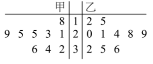
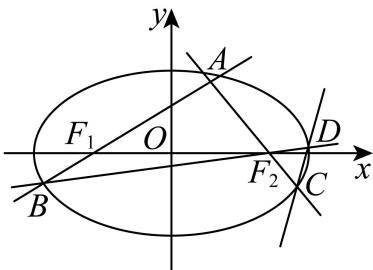

# 2026届上海高三一模 · 崇明卷

> 按原卷题号整理；题面、图片和解答未全卷逐页终核。

## 第 1 题

已知集合 $A = \{1, 2, 3, 4\}$ ，集合 $B = \{x \mid x < 3\}$ ，则 $A \cap B =$ \_\_\_\_.

【答案】 $\{1,2\}$

【解析】

【分析】根据集合的交集定义求解即可.

【详解】由于集合 $A=\{1,2,3,4\}$ ，集合 $B=\{x \mid x<3\}$ ，

则 $A \cap B = \{1, 2\}$ .

故答案为： $\{1,2\}$

## 第 2 题

若 $\log_{2}(x+1)=3$ ，则 x= \_\_\_\_.

【答案】7

【解析】

【分析】先将3化成以2为底的对数即 $3=\log_{2}2^{3}$ ，再根据对数值相等得 $x+1=8$ ，解之得解.

【详解】因为 $\log_2(x + 1) = 3 = \log_22^3 = \log_28$ ，所以 $x + 1 = 8$ ，解得 $x = 7$

故填:7.

【点睛】本题考查对数的运算法则，在解决对数的方程或不等式的问题时，把所求解的式子转化成同底数的对数方程或不等式是一个比较重要的求解方法，属于基础题.

## 第 3 题

不等式 $\frac{x - 2}{x + 1} < 0$ 的解集为 \_\_\_\_.

【答案】 $(-1,2)$

【解析】

【分析】

根据分式不等式的解法得 $(x-2)(x+1)<0$ ，再解二次不等式即可得答案.

【详解】解：由分式不等式的解法得原不等式 $\frac{x - 2}{x + 1} < 0$ 等价于 $(x - 2)(x + 1) < 0$

解不等式 $(x - 2)(x + 1) < 0$ 得 $-1 < x < 2$

故不等式 $\frac{x - 2}{x + 1} < 0$ 的解集为 $(-1,2)$ .

故答案为： $(-1,2)$

## 第 4 题

函数 $y = 2 \cos\left(ax - \frac{\pi}{3}\right) (a > 0)$ 的最小正周期为 $\pi$ ，则 a 的值为 \_\_\_\_.

【答案】2

【解析】

【分析】由题可得 $\frac{2\pi}{a}=\pi$ ，解出即可.

【详解】 $\because y=2\cos\left(ax-\frac{\pi}{3}\right)(a>0)$ 的最小正周期为 $\pi$ ，

$\therefore \frac{2\pi}{a} = \pi$ ，解得 $a = 2$

故答案为：2.

## 第 5 题

抛物线 $y^{2}=4x$ 的准线方程为 \_\_\_\_.

【答案】 $x = -1$

【解析】

【分析】根据抛物线 $C_{1}$ 方程求出准线方程.

【详解】由抛物线 $C_{1}:y^{2}=4x$ ，可得 $F_{1}(1,0)$ ，

抛物线 $C_1$ 的准线方程为 $x = -1$ ，

故答案为： $x = -1$ ：

## 第 6 题

已知等差数列 $\left\{a_{n}\right\}$ 首项为 $a_{1}=1$ ，公差 d=2，则其前 6 项和 $S_{6}=$ \_\_\_\_.

【答案】36

【解析】

【分析】根据条件及通项公式，可求得 $a_{6}$ ，代入求和公式，即可得答案.

【详解】由题意 $a_6 = a_1 + 5d = 11$ ，所以 $S_{6} = \frac{6(a_{1} + a_{6})}{2} = 36$

故答案为：36

## 第 7 题

在 $(x^{2} + \frac{2}{x})^{6}$ 的二项展开式中，常数项等于

【答案】240

【解析】

【分析】

在二项展开式的通项公式中，令 x 的幂指数等于 0，求出 r 的值，即可求得常数项.

【详解】解：在 $\left(x^{2}+\frac{2}{x}\right)^{6}$ 的二项展开式中，通项公式为 $T_{r+1}=C_{6}^{r}\cdot2^{r}\cdot x^{12-3r}$

令 $12 - 3r = 0$ ，求得 $r = 4$ ，可得展开式的常数项为 $C_6^4\cdot 2^4 = 240$

故答案为：240.

【点睛】方法点睛：求二项展开式的某一项，一般利用二项展开式的通项研究求解.

## 第 8 题

已知圆锥的底面半径为 1，侧面积为 $2 \pi$ ，则此圆锥的体积是 \_\_\_\_.

【答案】 $\frac{\sqrt{3}}{3}\pi$

【解析】

【分析】由圆锥的侧面积公式可求出母线长，再求出圆锥的高，由圆锥的体积公式即可得出答案.

【详解】设圆锥的高为 h = SO ，母线长为 l ，半径 r = 1 ，

因为圆锥的底面半径为 1，侧面积为 $2\pi$ ，

所以 $\frac{1}{2} \cdot 2\pi \cdot 1 \cdot l = 2\pi$ ，所以 $l = 2$

所以 $h=\sqrt{l^{2}-r^{2}}=\sqrt{3}$ ，

所以圆锥的体积是 $V = \frac{1}{3}\pi \times 1^{2}\cdot \sqrt{3} = \frac{\sqrt{3}}{3}\pi .$

故答案为： $\frac{\sqrt{3}}{3}\pi$

## 第 9 题

已知 $y = f(x)$ 是定义在 $\mathbf{R}$ 上的奇函数，且当 $x > 0$ 时， $f(x) = x^2 - 3^x$ ，则 $f(-1) =$ \_\_\_\_.

【答案】2

【解析】

【分析】由函数解析式求 $f(1)$ ，结合奇函数的性质求得正确答案.

【详解】依题意， $f(1)=1^{2}-3^{1}=-2$ ，

而 $f(x)$ 是奇函数，

所以 $f(-1) = -f(1) = 2$ .

故答案为：2

## 第 10 题

有七名同学站成一排照毕业纪念照，其中甲必须站在正中间，并且乙、丙两位同学要站在一起，则不同的站法有\_\_\_\_种。

【答案】192

【解析】

【详解】试题分析：不妨令乙丙在甲左侧，先排乙丙两人，有 $A_{2}^{2}$ 种站法，再取一人站左侧有 $C_4^1 \cdot A_2^2$ 种站法，余下三人站右侧，有 $A_3^3$ 种站法考虑到乙丙在右侧的站法，故总的站法总数是 $2A_{2}^{2} \times C_{4}^{1} \times A_{2}^{2} \times A_{3}^{3} = 192$ . 故答案为192.

考点：排列、组合的实际应用.

【方法点睛】本题考查排列、组合的实际应用，解题的关键是理解题中所研究的事件，并正确确定安排的先后顺序，此类排列问题一般是谁最特殊先安排谁，俗称特殊元素优先法．由于甲必须站中央，故先安排甲，两边一边三人，不妨令乙丙在甲左边，求出此种情况下的站法，再乘以2即可得到所有的站法总数，计数时要先安排乙丙两人，再安排甲左边的第三人，最后余下三人，在甲右侧是一个全排列.

## 第 11 题

在平面直角坐标系 $xOy$ 中， $\left|\overrightarrow{OA}\right| = \left|\overrightarrow{OB}\right| = \left|\overrightarrow{AB}\right| = \sqrt{3}$ 。设 $C(1,2)$ ，则 $\left|2\overrightarrow{CA} + \overrightarrow{AB}\right|$ 的最小值是 \_\_\_\_.

【答案】 $2 \sqrt{5} - 3$

【解析】

【分析】根据条件，可得 $\triangle OAB$ 为等边三角形，设 AB 的中点为 D，可求出 $\left|OD\right|$ ，分析可得以 D 点轨迹是以 O 为圆心， $\frac{3}{2}$ 为半径的圆，根据线性运算法则，可得 $\left|2\overrightarrow{CA}+\overrightarrow{AB}\right|=2\left|\overrightarrow{CD}\right|$ ，根据点与圆的位置关系，分析求解，即可得答案.

【详解】因为 $\left|\overrightarrow{OA}\right|=\left|\overrightarrow{OB}\right|=\left|\overrightarrow{AB}\right|=\sqrt{3}$ ，所以 $\triangle OAB$ 为等边三角形，

设 $AB$ 的中点为 $D$ ，连接 $OD$ ，则 $\left|OD\right| = \sqrt{3}\cos \frac{\pi}{6} = \frac{3}{2}$

所以 $D$ 点轨迹是以 $O$ 为圆心， $\frac{3}{2}$ 为半径的圆，则方程为 $x^{2} + y^{2} = \frac{9}{4}$

所以 $\left|2\overrightarrow{CA}+\overrightarrow{AB}\right|=\left|\overrightarrow{CA}+\overrightarrow{CA}+\overrightarrow{AB}\right|=\left|\overrightarrow{CA}+\overrightarrow{CB}\right|=2\left|\overrightarrow{CD}\right|$

因为 $C(1,2)$ ，所以 $\left|CD\right|_{\min} = \left|CO\right| - \frac{3}{2} = \sqrt{1^2 + 2^2} - \frac{3}{2} = \sqrt{5} - \frac{3}{2}$ ，

所以 $\left|2\overrightarrow{CA} +\overrightarrow{AB}\right|$ 的最小值为 $2\sqrt{5} -3$

故答案为： $2 \sqrt{5} - 3$

## 第 12 题

> 核对提醒：微信解析PDF第5—6页与先前解析版一致，任意i,j与四下标互不相等存在字面冲突。按i≠j的修订解释，独立枚举全部长度20非降数列确认最大74，次数(4,2,1,2,11)。保留原题风险。

设 $M=\{x\mid1\le x\le20,x\in\mathbb N\}$。数列 $\{a_n\}$ 满足下列条件：$a_1=1,a_{20}=5,a_{k+1}-a_k\in\{0,1\}$，且对任意的 $i,j\in M$，都存在 $m,n\in M$ 使得 $a_i+a_j=a_m+a_n$，其中 $i,j,m,n$ 互不相等，则数列 $\{a_n\}$ 的前20项和的最大值是______。

【答案】解析版给出 74。

【源解析】设数列中1、2、3、4、5分别有 $x_1,x_2,x_3,x_4,x_5$ 个。解析版声称 $x_1\ge4,x_5\ge4,x_2\ge2,x_3\ge1,x_4\ge2$，于是取 $(x_1,x_2,x_3,x_4,x_5)=(4,2,1,2,11)$，得到和为 $74$。源解析见PDF第5—6页，需另核完整论证。

## 第 13 题

已知事件 $A$ 、 $B$ 相互独立，事件 $A$ 发生的概率为 $P(A) = \frac{1}{2}$ ，事件 $B$ 发生的概率为 $P(B) = \frac{1}{2}$ ，则事件 $A \cap B$ 发生的概率 $P(A \cap B)$ 为（）
A. $\frac{1}{8}$ B. $\frac{1}{4}$ C. $\frac{1}{2}$ D. 0

【答案】B
【解析】
【分析】根据独立事件的概率公式可求 $P(A \cap B)$ .
【详解】因为 A, B 相互独立，故 $P(A \cap B) = P(A)P(B) = \frac{1}{2} \times \frac{1}{2} = \frac{1}{4}$ ，故选：B.

## 第 14 题

已知 $a, b \in R$ ，且 $2 + ai, b + i$ （ $i$ 是虚数单位）是实系数一元二次方程 $x^2 + px + q = 0$ 的两个根，那么 $p, q$ 的值分别是
A. $p = 4, q = 5$ B. $p = -4, q = 3$ C. $p = -4, q = 5$ D.

$$
p = 4, q = 3
$$

【答案】C

【解析】

【分析】利用根与系数的关系列出方程组，根据复数相等运算即可得出所求结果.

【详解】因为 $2+ai,b+i$ （i是虚数单位）是实系数一元二次方程 $x^{2}+px+q=0$ 的两个根，所以 $\left\{\begin{aligned}&2+ai+b+i=-p\\ &(2+ai)(b+i)=q\end{aligned}\right.$ ，所以 $\left\{\begin{aligned}&2+b=-p\\ &a+1=0\\ &2b-a=q\\ &2+ab=0\end{aligned}\right.$ ，解得 $\left\{\begin{aligned}&a=-1\\ &b=2\\ &p=-4\\ &q=5\end{aligned}\right.$

故选：C

【点睛】本题主要考查复数的有关计算，解题的关键是熟练掌握复数相等的条件和一元二次方程根与系数的关系.

## 第 15 题

已知 A, B 为平面内两定点, 过该平面内动点 M 作直线 AB 的垂线, 垂足为 N. 若$\overrightarrow{MN}^2 = \lambda \overrightarrow{AN} \cdot \overrightarrow{NB}$ ，其中 $\lambda$ 为常数，则动点 $\mathsf{M}$ 的轨迹不可能是（）A.圆 B.椭圆 C.抛物线 D.双曲线

【答案】C

【解析】

【详解】试题分析：以 AB 所在直线为 x 轴，AB 中垂线为 y 轴，建立坐标系，

设 M (x, y), A (-a, 0)、B (a, 0);

因为 $\overrightarrow{MN}^2 = \lambda \overrightarrow{AN} \cdot \overrightarrow{NB}$ ，所以 $y^2 = \lambda (x + a)(a - x)$ ，即 $\lambda x^2 + y^2 = \lambda a^2$ ，当 $\lambda = 1$ 时，轨迹是圆。当 $\lambda > 0$ 且 $\lambda \neq 1$ 时，是椭圆的轨迹方程；当 $\lambda < 0$ 时，是双曲线的轨迹方程；当 $\lambda = 0$ 时，是直线的轨迹方程；综上，方程不表示抛物线的方程。故选 C.

考点：轨迹方程的求法,圆锥曲线方程。

点评：中档题，判断轨迹是什么，一般有两种方法，一是定义法，二是求轨迹方程后加以判断。

## 第 16 题

> 核对提醒：实质版本冲突：微信逐题解析版问“存在函数…都有”且答D；教习解析版改成“不成立的是”且答A。微信题面排除端点后B/C/D均成立，端点本身角又未定义。不得静默混用版本或印D为唯一正确答案。

已知 $A(-2,0),B(2,0)$，点 $P(m,n)$ 在曲线 $y=\sqrt{1-\frac{x^2}{4}}$ 上。记 $\angle APB=\alpha$，则存在函数 $y=f(x)$，对曲线上的任意一点 $P$ 都有（ ）。

A. $m=f(\alpha)$

B. $\alpha=f(m)$

C. $n=f(\alpha)$

D. $\alpha=f(n)$

【答案】【源答案】微信逐题解析PDF印 D；这不是本轮认可的唯一正确答案。

【源解析要点】源解给出 $\alpha=\pi-\arccos\frac{3n}{\sqrt{9n^2+16}}$，据此选择 D。

【独立核查】排除 $P=A,B$ 后，$0<n\le1$。由 $m^2=4(1-n^2)$ 得
$$\cot\alpha=\frac{\overrightarrow{PA}\cdot\overrightarrow{PB}}{|\det(\overrightarrow{PA},\overrightarrow{PB})|}=\frac{m^2+n^2-4}{4n}=-\frac{3n}{4}.$$
因此 $\alpha=\frac\pi2+\arctan\frac{3n}{4}$ 随 $n$ 严格递增，D成立，反函数关系C也成立。又 $n=\sqrt{1-m^2/4}$，$m$ 唯一确定 $\alpha$，B成立；但正负 $m$ 对应同一个 $\alpha$，A不成立。

因此按该PDF题面，B、C、D均成立，不能作为唯一答案D的单选题使用。

## 第 17 题

在 $\triangle ABC$ 中，角 $A, B, C$ 的对边分别为 $a, b, c, (2b - c) \cos A = a \cos C$ .

(1) 求 A;

(2) 若 $\triangle ABC$ 的面积为 $\sqrt{3}$ , BC 边上的高为 1，求 $\triangle ABC$ 的周长.

【答案】(1) $\frac{\pi}{3}$

(2) $2\sqrt{6}+2\sqrt{3}$

【解析】

【分析】（1）利用正弦定理和三角恒等变换得 $\cos A = \frac{1}{2}$ ，则得到 A 的大小；

（2）利用三角形面积公式得 bc = 4，再结合余弦定理得 $b + c$ 的值，则得到其周长.

【小问 1 详解】

因为 $(2b-c)\cos A=a\cos C$ ，

由正弦定理，得 $(2\sin B-\sin C)\cos A=\sin A\cos C$ ，

即 $2\sin B\cos A = \sin A\cos C + \sin C\cos A$ ，即 $2\sin B\cos A = \sin B$ .

因为在 $\triangle ABC$ 中， $\sin B \neq 0$

所以 $\cos A = \frac{1}{2}$ .

又因为 $0 < A < \pi$ ，所以 $A = \frac{\pi}{3}$

【小问 2 详解】

因为 $\triangle ABC$ 的面积为 $\sqrt{3}$ ,

所以 $\frac{1}{2} a \times 1 = \sqrt{3}$ ，得 $a = 2\sqrt{3}$ 。

由 $\frac{1}{2} bc\sin A = \sqrt{3}$ ，即 $\frac{1}{2} bc\times \frac{\sqrt{3}}{2} = \sqrt{3}$

所以 $bc = 4$ .由余弦定理，得 $a^2 = b^2 +c^2 -2bc\cos A$ ，即 $12 = b^{2} + c^{2} - bc$

化简得 $(b + c)^2 = 3bc + 12$ ，所以 $(b + c)^2 = 24$ ，即 $b + c = 2\sqrt{6}$

所以 $\triangle ABC$ 的周长为 $a + b + c = 2\sqrt{6} + 2\sqrt{3}$ .

## 第 18 题

如图. 在直棱柱 $\mathrm{ABC - A_1B_1C_1}$ 中， $\angle \mathrm{BAC} = 90^{\circ}$ ， $\mathrm{AB} = \mathrm{AC} = \sqrt{2}$ ， $\mathrm{AA}_1 = 3$ ，D是BC的中点，点E在菱 $\mathrm{BB}_1$ 上运动.

（1）证明：AD⊥C₁E;

(2) 当异面直线 AC, $C_{1} \mathrm{E}$ 所成的角为 $60^{\circ}$ 时, 求三棱锥 $C_{1} - A_{1} B_{1} E$ 的体积

【答案】（1）见解析（2） $\frac{2}{3}$

【解析】

【详解】(1)证明:因为 AB=AC,D 是 BC 的中点,

所以 AD⊥BC.

①

又在直三棱柱 ABC-A₁B₁C₁ 中,BB₁⊥平面 ABC,

而 $\mathrm{AD} \subset$ 平面ABC,所以 $\mathrm{AD} \perp \mathrm{BB}_{1}$ .②

由①②,得 AD⊥平面 BB₁C₁C.

由点 E 在棱 $BB_{1}$ 上运动, 得 $C_{1}E \subset$ 平面 $BB_{1}C_{1}C$ ,

所以 $\mathrm{AD} \perp \mathrm{C}_{1}\mathrm{E}$ .

(2)解:因为 $AC \parallel A_{1}C_{1}$ ,

所以 $\angle A_{1}C_{1}E$ 是异面直线 $AC, C_{1}E$ 所成的角.

由题意知 $\angle A_{1}C_{1}E=60^{\circ}$ .

因为 $\angle B_{1}A_{1}C_{1} = \angle BAC = 90^{\circ}$

所以 $A_{1}C_{1}\perp A_{1}B_{1}$ .

又 $AA_{1} \perp A_{1}C_{1}$ ,

从而 $A_{1}C_{1}\perp$ 平面 $A_{1}ABB_{1}$ .

于是 $A_{1}C_{1}\perp A_{1}E.$

故 $C_{1}E=\frac{A_{1}C_{1}}{\cos60^{\circ}}=2\sqrt{2}$

又 $\mathrm{B_1C_1 =}\sqrt{A_1C_1^2 + A_1B_1^2} = 2,$

所以 $\mathrm{B}_1\mathrm{E} = \sqrt{A_1C_1^2 + A_1B_1^2} = 2.$

从而 $V_{三棱锥C_{1}-A_{1}B_{1}E}=\frac{1}{3}S_{\triangle A_{1}B_{1}E}\cdot A_{1}C_{1}=\frac{1}{3}\times\frac{1}{2}\times2\times\sqrt{2}\times\sqrt{2}=\frac{2}{3}.$

## 第 19 题

> 核对提醒：题图参照已有补源材料恢复，仍需结合原卷核验。

为培养学生的社会责任感，某校开展了为期一学期的“温暖社区，青春奉献”志愿服务活动。活动结束后，学校从甲、乙两个班级中统计了部分学生的志愿服务时长（单位：小时），统计结果用茎叶图记录如图所示（十位数字作为“茎”，个位数字作为“叶”）。已知甲组有9名学生的数据，乙组有10名学生的数据。

（1）分别写出甲、乙两组学生服务时长的第70百分位数；

（2）从甲、乙两组学生中各随机抽取1人，求抽取的2人中恰有1人的服务时长超过30小时的概率；

（3）记甲组志愿服务时长的方差为 $s_0^2$ ；在甲组中增加一名学生 $A$ 得到“新甲组”，若 $A$ 的志愿服务时长为 27，则记“新甲组”志愿服务时长的方差为 $s_1^2$ ；若 $A$ 的志愿服务时长为 20，则记“新甲组”志愿服务时长的方差为 $s_2^2$ ；通过计算比较 $s_0^2$ 、 $s_1^2$ 、 $s_2^2$ 的大小（结果精确到 0.1），并从数学角度解释这一现象。

【答案】(1) 32; 30.5;

(2) $\frac{13}{30}$ ;

(3) $s_1^2 < s_0^2 < s_2^2$

【解析】

【分析】（1）根据百分位数的定义计算即可；

（2）根据古典概型和分步乘法计数原理计算即可；

（3）利用方差公式计算各方差，结合方差的统计意义解释即可.

【小问 1 详解】

因为 $9 \times 0.7 = 6.3$ ，所以甲组学生服务时长的第70百分位数为32；

因为 $10 \times 0.7 = 7$ ，所以乙组学生服务时长的第70百分位数为 $\frac{29 + 32}{2} = 30.5$ ;

【小问 2 详解】

因为甲组有 9 名学生，乙组有 10 名学生，根据分步乘法计数原理，从甲、乙两组学生中各随机抽取 1 人，有 $9 \times 10 = 90$ 种选取方法，

又甲、乙两组学生中各有 3 人的服务时长超过 30 小时，所以抽取的 2 人中恰有 1 人的服务时长超过 30 小时有 $3 \times 7 + 6 \times 3 = 39$ 种选取方法，

记事件 A=“抽取的 2 人中恰有 1 人的服务时长超过 30 小时”，则 $P(A)=\frac{39}{90}=\frac{13}{30}$ ,

故从甲、乙两组学生中各随机抽取 1 人，抽取的 2 人中恰有 1 人的服务时长超过 30 小时的

概率为 $\frac{13}{30}$ ;

【小问 3 详解】

对甲组:

甲组9名学生服务时长的平均数为 $\overline{x_0} = \frac{18 + 21 + 23 + 25 + 25 + 29 + 32 + 34 + 36}{9} = 27$

甲组志愿服务时长的方差为

$$
s _ {0} ^ {2} = \frac {(1 8 - 2 7) ^ {2} + (2 1 - 2 7) ^ {2} + (2 3 - 2 7) ^ {2} + (2 5 - 2 7) ^ {2} \times 2 + (2 9 - 2 7) ^ {2} + (3 2 - 2 7) ^ {2} + (3 4 - 2 7) ^ {2} + (3 6 - 2 7) ^ {2}}{9}
$$

对新甲组 1: $\overline{x_{1}} = 27$ ，所以 $s_{1}^{2} = 30$ .

对新甲组2： $\overline{x_2} = \frac{1}{10}\big(27\times 9 + 20\big) = 26.3$ ，所以 $s_2^2\approx 34.4$

所以 $s_{1}^{2}<s_{0}^{2}<s_{2}^{2}$ .

数学解释: 由于甲组均值为 27, 方差反映了数据的离散程度, 当增加数据 27 (原样本均值), 数据相对更集中, 所以方差变小; 当增加数据 20, 数据更加分散, 方差变大.

## 第 20 题

> 核对提醒：原解析中斜率比的分母非零条件需核查。

已知椭圆 $\Gamma: \frac{x^2}{2} + y^2 = 1$ ， $F_1, F_2$ 分别是 $\Gamma$ 的左右焦点，点 $A, B, C, D$ 均在 $\Gamma$ 上，且点 $A$ 是第一象限点，直线 $AB$ 经过点 $F_1$ ，直线 $AC, BD$ 均经过点 $F_2$ .

（1）求椭圆 $\Gamma$ 的离心率；

(2) 若 $\overrightarrow{F_{1}A} \cdot \overrightarrow{F_{2}A} = \frac{1}{2}$ ，直线 AB 的方程；

（3）求证： $\frac{k_{CD}}{k_{AB}}$ 为定值.

【答案】(1) $\frac{\sqrt{2}}{2}$

(2) $\sqrt{2} x - 4y + \sqrt{2} = 0$

(3) 5

【解析】

【分析】（1）根据题意，求得 $a = \sqrt{2}, b = 1$ ，得到 $c = \sqrt{a^2 - b^2} = 1$ ，结合椭圆离心率的定义，即可求解；

(2) 设 $A(x_{1}, y_{1})$ ，得到 $\frac{x_{1}^{2}}{2} + y_{1}^{2} = 1$ ，由 $\overrightarrow{F_{1}A} \cdot \overrightarrow{F_{2}A} = \frac{1}{2}$ ，代入求得 $A(1, \frac{\sqrt{2}}{2})$ ，结合 $k_{AB} = k_{AF}$ ，结合直线的点斜式方程，即可求解；

（3）设 $AB$ 的方程为 $y = k(x + 1)$ ，联立方程组求得 $x_{1} + x_{2} = -\frac{4k^{2}}{1 + 2k^{2}}, x_{1}x_{2} = \frac{2(k^{2} - 1)}{1 + 2k^{2}}$ ，再设 $AC$ 的方程为 $x = ty + 1$ ，联立方程组，求得 $x_{3} = \frac{3x_{1} - 4}{2x_{1} - 3}$ ， $y_{3} = \frac{y_{1}}{2x_{1} - 3}$ ，同理求得 $x_{4} = \frac{3x_{2} - 4}{2x_{2} - 3}$ ， $y_{4} = \frac{y_{2}}{2x_{2} - 3}$ ，结合 $y_{1} = k(x_{1} + 1), y_{2} = k(x_{2} + 1)$ ，化简得到 $k_{CD} = 5k$ ，即可得证.

【小问 1 详解】

解：由椭圆 $\Gamma : \frac{x^2}{2} + y^2 = 1$ ，可得 $a^2 = 2, b^2 = 1$ ，则 $a = \sqrt{2}, b = 1$ ，

所以 $c = \sqrt{a^2 - b^2} = 1$ ，所以椭圆 $\Gamma$ 的离心率为 $e = \frac{c}{a} = \frac{\sqrt{2}}{2}$

【小问 2 详解】

解：由（1）知，椭圆 $\Gamma$ 的左焦点 $F_{1}(-1,0)$ , $F_{2}(1,0)$ ,

设 $A(x_{1},y_{1})$ ，其中 $x_{1} > 0,y_{1} > 0$ ，则 $\frac{x_1^2}{2} +y_1^2 = 1$

则向量 $\overrightarrow{F_{1}A}=(x_{1}+1,y_{1}),\overrightarrow{F_{2}A}=(x_{1}-1,y_{1})$ ，可得 $\overrightarrow{F_{1}A}\cdot\overrightarrow{F_{2}A}=x_{1}^{2}-1+y_{1}^{2}=\frac{1}{2}$

将 $y_{1}^{2} = 1 - \frac{x_{1}^{2}}{2}$ 代入得 $x_{1}^{2} - 1 + (1 - \frac{x_{1}^{2}}{2}) = \frac{1}{2}$ ，解得 $x_{1} = 1$ ，则 $y_{1} = \frac{\sqrt{2}}{2}$ ，即 $A(1, \frac{\sqrt{2}}{2})$ ，

可得 $k_{AB} = k_{AF} = \frac{\frac{\sqrt{2}}{2} - 0}{1 - (-1)} = \frac{\sqrt{2}}{4},$

又由 $AB$ 过点 $F_{1}$ ，所以 $AB$ 的方程为 $y - 0 = \frac{\sqrt{2}}{4} (x + 1)$ ，即 $\sqrt{2} x - 4y + \sqrt{2} = 0$ .

【小问 3 详解】

证明：设直线 AB 的斜率为 k，则方程为 $y = k(x + 1)$ ，联立方程组 $\left\{ \begin{array}{l} y = k(x + 1) \\ \frac{x^2}{2} + y^2 = 1 \end{array} \right.$ ，整理得 $(1 + 2k^2)x^2 + 4k^2x + 2k^2 - 2 = 0$ ，设 $A(x_1, y_1), B(x_2, y_2)$ ，可得 $x_1 + x_2 = -\frac{4k^2}{1 + 2k^2}, x_1x_2 = \frac{2(k^2 - 1)}{1 + 2k^2}$ ，由直线 $AC$ 过 $F_2(1,0)$ ，设其直线方程为 $x = ty + 1$ ，联立方程组 $\left\{ \begin{array}{l} x = ty + 1 \\ \frac{x^2}{2} + y^2 = 1 \end{array} \right.$ ，整理得 $(t^2 + 2)y^2 + 2ty - 1 = 0$ ，设 $C(x_3, y_3)$ ，可得 $y_1y_3 = -\frac{1}{t^2 + 2}$ ，因为 $A(x_1, y_1)$ 在直线 $AC$ 上，可得 $t = \frac{x_1 - 1}{y_1}$ ，化简得 $y_3 = \frac{y_1}{2x_1 - 3}$ ，则 $x_3 = \frac{3x_1 - 4}{2x_1 - 3}$ ，同理可得：设 $D(x_4, y_4)$ ，可得 $y_4 = \frac{y_2}{2x_2 - 3}$ ，则 $x_4 = \frac{3x_2 - 4}{2x_2 - 3}$ ，又因为 $y_1 = k(x_1 + 1), y_2 = k(x_2 + 1)$ ，又由 $k_{CD} = \frac{y_4 - y_3}{x_4 - x_3} = \frac{\frac{y_2}{2x_2 - 3} - \frac{y_1}{2x_1 - 3}}{\frac{3x_2 - 4}{2x_2 - 3} - \frac{3x_1 - 4}{2x_1 - 3}} = \frac{\frac{k(x_2 + 1)}{2x_2 - 3} - \frac{k(x_1 + 1)}{2x_1 - 3}}{\frac{3x_2 - 4}{2x_2 - 3} - \frac{3x_1 - 4}{2x_1 - 3}} = 5k$ ，即 $k_{CD} = 5k_{AB}$ ，所以 $\frac{k_{CD}}{k_{AB}} = 5$ 。

## 第 21 题

已知函数 $y = f(x), x \in D$ ，其导函数是 $y = f'(x)$ 。对于任意 $t \in D$ ，记曲线 $y = f(x)$ 在点 $P(t, f(t))$ 处的切线方程为 $y = l_{t}(x)$ 。定义集合 $M(f, t) = \{x \mid f(x) \leq l_{t}(x), x \in D\}$ .

（1）若 $f(x)=x^{3}-2x^{2}+x$ ，求集合 $M(f,1)$ ;

（2）若定义域 $D = \mathbf{R}$ 且函数 $y = f(x)$ 是偶函数，证明：若 $x_0 \in M(f, t)$ 则 $-x_0 \in M(f, -t)$ ；

（3）设 $f(x) = a\ln x + \frac{1}{2} x^2 (a < 1)$ ，若集合 $M(f,1) = \{1\}$ ，求实数 $a$ 的取值范围.

【答案】（1） $\{x \mid x \leq 0 \text{ 或 } x = 1\}$

(2) 证明见解析 (3) $(- \infty, 0]$

【解析】

【分析】（1）利用导数的几何意义，求得 $f(x)$ 在 $(1, f(1))$ 处的切线方程 $y = 0$ ，得到 $l_{1}(x) = 0$ ，由 $f(x) \leq l_{1}(x)$ ，得出 $x^{3} - 2x^{2} + x \leq 0$ ，即可求解；

（2）求得点 $P(t, f(t))$ 和 $P(-t, f(-t))$ 处的切线方程，得到 $l_{t}(x) = f'(t)(x - t) + f(t)$ 和 $l_{-t}(x) = f'(-t)(x + t) + f(-t)$ ，结合题意，化简得到 $l_{-t}(x) = -f'(t)(x + t) + f(t)$ ，由 $x_{0} \in M(f, t)$ ，得到 $f(x_{0}) \leq f'(t)(x_{0} - t) + f(t)$ ，转化为证明 $f(-x_{0}) \leq l_{-t}(-x_{0})$ ，即可得证；

（3）求得 $l_{1}(x) = (a + 1)(x - 1) + \frac{1}{2}$ ，得到 $a\ln x + \frac{1}{2} x^2 \leq (a + 1)(x - 1) + \frac{1}{2}$ 的解集为 $\{1\}$ ，令 $g(x) = a\ln x + \frac{1}{2} x^2 - (a + 1)(x - 1) - \frac{1}{2}$ ，求得 $g'(x) = \frac{(x - 1)(x - a)}{x}$ ，分 $a \leq 0$ 和 $0 < a < 1$ ，两种情况讨论，求得其单调性和极值，结合 $g(1) = 0$ ，即可求解.

【小问 1 详解】

解：由函数 $f(x) = x^3 - 2x^2 + x$ ，可得 $f'(x) = 3x^2 - 4x + 1$ ，

则 $f'(1)=0$ 且可得 $f(1)=0$ ,

所以曲线 $f(x)$ 在 $(1,0)$ 处的切线方程为 y=0 ，即 $l_{1}(x)=0$ ，

又由 $f(x) \leq l_1(x)$ ，可得 $x^3 - 2x^2 + x \leq 0$ ，解 $x(x^2 - 2x + 1) = x(x - 1)^2 \leq 0$ ，

解得 $x \leq 0$ 或 $x = 1$ ，所以 $M(f, 1) = \{x \mid x \leq 0$ 或 $x = 1\}$ .

【小问 2 详解】

解：因为函数 $y = f(x)$ 是偶函数，所以 $f(-x) = f(x)$ ，且 $f'(-x) = -f'(x)$ ，

则在点 $P(t, f(t))$ 处的切线方程为 $y - f(t) = f'(t)(x - t)$ ，即 $l_{t}(x) = f'(t)(x - t) + f(t)$ ，

在点 $P(-t, f(-t))$ 处的切线方程为 $y - f(-t) = f'(-t)(x + t)$ ,

即 $l_{-t}(x)=f'(-t)(x+t)+f(-t)$ ,

又因为 $f(-t) = f(t)$ 且 $f'(-t) = -f'(t)$ ，所以 $l_{-t}(x) = -f'(t)(x + t) + f(t)$ ，

因为 $x_0 \in M(f, t)$ ，则 $f(x_0) \leq l_t(x_0)$ ，即 $f(x_0) \leq f'(t)(x_0 - t) + f(t)$ ，

要证明 $-x_0 \in M(f, -t)$ ，即证明 $f(-x_0) \leq l_{-t}(-x_0)$ ，

因为 $f(-x_{0})=f(x_{0}), l_{-t}(-x_{0})=-f'(t)(-x_{0}+t)+f(t)=f'(t)(x_{0}-t)+f(t)$

所以 $f(-x_{0}) \leq l_{-t}(-x_{0})$ ，即 $-x_{0} \in M(f, -t)$ .

【小问 3 详解】

解：由函数 $f(x) = a\ln x + \frac{1}{2} x^2 (a < 1)$ ，可得 $f'(x) = \frac{a}{x} + x$ ，

当 $x = 1$ 时，可得 $f(1) = \frac{1}{2}, f'(1) = a + 1$

所以切线方程为 $y-\frac{1}{2}=(a+1)(x-1)$ ，即 $l_{1}(x)=(a+1)(x-1)+\frac{1}{2}$ ,

因为集合 $M(f,1) = \{1\}$ ，所以 $f(x) \leq l_1(x)$ 的解集为 $\{1\}$ ，

即 $a\ln x + \frac{1}{2} x^2\leq (a + 1)(x - 1) + \frac{1}{2}$ 的解集为 $\{1\}$

令 $g(x) = a\ln x + \frac{1}{2} x^2 - (a + 1)(x - 1) - \frac{1}{2}$ ，则 $g(x) \leq 0$ 的解集为 $\{1\}$ ，且 $g(1) = 0$ ，

又由 $g'(x)=\frac{a}{x}+x-(a+1)=\frac{x^{2}-(a+1)x+a}{x}=\frac{(x-1)(x-a)}{x}$

若 $a \leq 0$ ，当 $x \in (0,1)$ 时， $g'(x) < 0$ ， $g(x)$ 单调递减；

当 $x \in (1, +\infty)$ 时， $g'(x) > 0$ ， $g(x)$ 单调递增，

所以 $g(x)$ 在 x=1 处取得极小值 $g(1)=0$ ，满足 $g(x)\leq0$ 的解集为 $\{1\}$ ;

若 0 < a < 1，当 $x \in (0, a)$ 时， $g'(x) > 0$ ， $g(x)$ 单调递增；

当 $x \in (a,1)$ 时， $g'(x) < 0$ ， $g(x)$ 单调递减；

当 $x \in (1, +\infty)$ 时， $g'(x) > 0$ ， $g(x)$ 单调递增，所以 $g(x)$ 在 x=a 处取得极大值 $g(a)>g(1)=0$ ，不满足 $g(x)\leq0$ 的解集为 $\{1\}$ ，综上可得，实数 a 的取值范围为 $(-∞,0]$ .
