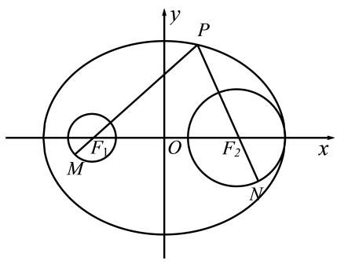
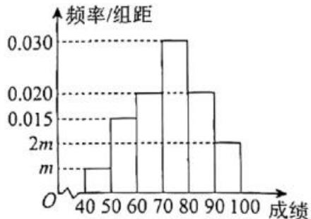
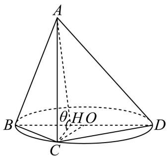
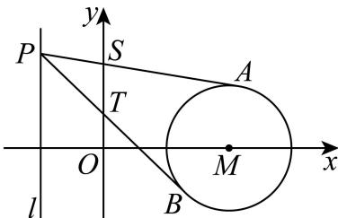

# 2026届上海高三一模 · 徐汇卷

> 按原卷题号整理；题面、图片和解答未全卷逐页终核。

## 第 1 题

设复数 $z = 2 + i$ （其中 i 为虚数单位），则 $|z| =$ \_\_\_\_ .

【答案】 $\sqrt{5}$

【解析】

【分析】利用复数模的计算公式求解即可.

【详解】复数 $z = 2 + \mathrm{i}$ （其中i为虚数单位），所以 $\left|z\right| = \sqrt{2^2 + 1^2} = \sqrt{5}$

故答案为： $\sqrt{5}$

## 第 2 题

设集合 $A = (-2, 2), B = (1, +\infty)$ ，则 $A \cap B =$ \_\_\_\_.

【答案】(1,2)

【解析】

【分析】利用集合交集的定义求解即可.

【详解】由于集合 $A=(-2,2)$ , $B=(1,+\infty)$ ，则 $A\cap B=(1,2)$ ;

故答案为：(1,2)

## 第 3 题

函数 $f(x)=\sin x+\cos x$ 的值域为 \_\_\_\_.

【答案】 $[- \sqrt{2}, \sqrt{2}]$

【解析】

【分析】化简得 $f(x)=\sqrt{2}\sin\left(x+\frac{\pi}{4}\right)$ ，即得解.

【详解】由题得 $f(x)=\sqrt{2}\sin\left(x+\frac{\pi}{4}\right)$ ,

所以当 $\sin (x + \frac{\pi}{4}) = -1$ 时， $f(x)_{min} = -\sqrt{2}$

当 $\sin (x + \frac{\pi}{4}) = 1$ 时， $f(x)_{max} = \sqrt{2}$

所以函数的值域为 $[- \sqrt{2}, \sqrt{2}]$ .

故答案为： $[- \sqrt{2}, \sqrt{2}]$

## 第 4 题

若幂函数 $y = x^a$ 的图象经过 $\left(\sqrt[3]{3}, 3\right)$ ，则此幂函数的表达式为 \_\_\_\_.

【答案】 $y = x^{3}$

【解析】

【分析】将点的坐标代入函数表达式算出参数 a 即可得解.

【详解】由题意得 $\left(\sqrt[3]{3}\right)^{a}=3^{\frac{a}{3}}=3^{1}=3$ ，所以 $\frac{a}{3}=1$ ，解得a=3，

所以此幂函数的表达式为 $y = x^{3}$ .

故答案为： $y = x^{3}$ .

## 第 5 题

设向量 $\vec{a}=(-1,-2)$ , $\vec{b}=(-3,4)$ ，则 $\vec{a}$ 在 $\vec{b}$ 上的数量投影为 \_\_\_\_.

【答案】-1

【解析】

【分析】根据给定条件，利用数量投影的意义求解即得.

【详解】由向量 $\vec{a}=(-1,-2)$ , $\vec{b}=(-3,4)$ ，得 $\vec{a}\cdot\vec{b}=-1\times(-3)-2\times4=-5$

$|\vec{b}| = \sqrt{(-3)^2 + 4^2} = 5$

所以 $\vec{a}$ 在 $\vec{b}$ 上的数量投影为 $\frac{\vec{a} \cdot \vec{b}}{|\vec{b}|} = -1$ .

故答案为：-1

## 第 6 题

相关部门在上海市随机调查了 10 户居民六月份的用电量（单位： $\mathrm{kW} \cdot \mathrm{h}$ ），从小到大排列依次为 31、74、78、99、101、107、127、131、208、223，则这 10 户居民用电量的第 75

百分位数为______。

【答案】131

【解析】

【分析】由百分位数的计算公式即可求解.

【详解】因为 $10 \times 75\% = 7.5$ ，

所以第8个数131是第75百分位数，

故答案为：131

## 第 7 题

已知 $(1+2x)^{10}=a_{0}+a_{1}x+a_{2}x^{2}+\cdots+a_{10}x^{10}$ ，则 $a_{3}=$ \_\_\_\_.

【答案】960

【解析】

【分析】利用二项式展开式的通项公式求解即可.

【详解】二项式 $\left(1 + 2x\right)^{10}$ 展开式的通项公式为： $T_{r + 1} = \mathrm{C}_{10}^{r}\cdot 1^{10 - r}\cdot (2x)^{r} = \mathrm{C}_{10}^{r}\cdot 2^{r}\cdot x^{r},$

由于 $(1+2x)^{10}=a_{0}+a_{1}x+a_{2}x^{2}+\cdots+a_{10}x^{10}$

则当 r=3 时， $a_{3}=C_{10}^{3}\times2^{3}=960$ ;

故答案为：960

## 第 8 题

一个底面积为1的正四棱柱的所有顶点都在同一球面上, 若该球的表面积为 $4 \pi$ , 则该正四棱柱的高为 \_\_\_\_.

【答案】 $\sqrt{2}$

【解析】

【分析】求出正四棱柱底边的边长以及外接球半径，分析可知该正四棱柱的外接球直径即为该正四棱柱的体对角线长，即可得解.

【详解】设该正四棱柱底边的边长为 $a$ ，高为 $h$ ，则 $a^2 = 1$ ，可得 $a = 1$

设该正四棱柱的外接球的半径为 R，则 $4\pi R^{2} = 4\pi$ ，解得 R = 1，

由题意可知，该正四棱柱的外接球直径即为该正四棱柱的体对角线长，

即 $2R=\sqrt{a^{2}+a^{2}+h^{2}}=\sqrt{2+h^{2}}=2$ ，解得 $h=\sqrt{2}$ ，

因此该正四棱柱的高为 $\sqrt{2}$

故答案为： $\sqrt{2}$

## 第 9 题

从 20 名男生和 18 名女生中选取 5 人组成一个宣传小组, 其中男生和女生都不少于 2 人的选法有\_\_\_\_种.

【答案】329460

【解析】

【分析】从男女共38中选出5人组成一个宣传小组，要求男生和女生均不少于2人，分选出的5人为2男3女，和3男2女两种情况讨论即可.

【详解】从男女共 38 中选出 5 人组成一个宣传小组，要求女生和男生均不少于 2 人，分为以下两类情况：

当选出的 5 人为 2 男 3 女时，不同选法共为 $C_{20}^{2}C_{18}^{3}=\frac{20\times19}{2\times1}\times\frac{18\times17\times16}{3\times2\times1}=155040$ 种，
当选出的 5 人为 3 男 2 女时，不同选法共为 $C_{20}^{3}C_{18}^{2}=\frac{20\times19\times18}{3\times2\times1}\times\frac{18\times17}{2\times1}=174420$ 种，
即从中选出 5 人组成一个宣传小组，要求女生和男生均不少于 2 人的选法共有 $155040+174420=329460$ 种，

故答案为：329460.

## 第 10 题

> 核对提醒：源题块函数题后混入其他几何题答案与向量解析，原向量分类误收，已撤出；函数专题回源清理

设 $f(x) = \begin{cases} |x - 2|, & x \geq 0 \\ -\frac{1}{x}, & x < 0 \end{cases}$ ，若实数 $x_1, x_2, x_3$ 满足 $x_1 < x_2 < x_3$ ，且 $f(x_1) = f(x_2) = f(x_3)$ ，则 $\frac{\sqrt{x_2x_3}}{x_1}$ 的最小值为 \_\_\_\_.

【答案】-2

【解析】

【分析】根据题目条件，令 $f(x_{1}) = f(x_{2}) = f(x_{3}) = k(k > 0)$ ，用 $k$ 替换 $x_{1}, x_{2}, x_{3}$ ，构造函数结合基本不等式求值.

【详解】已知分段函数 $f(x) = \begin{cases} |x - 2|, & x \geq 0 \\ -\frac{1}{x}, & x < 0 \end{cases}$ ，且实数 $x_{1}, x_{2}, x_{3}$ 满足 $x_{1} < x_{2} < x_{3}$ ，

令 $f(x_{1})=f(x_{2})=f(x_{3})=k(k>0)$ ,

对于 $x_{1} < 0$ ，由 $f(x_{1}) = -\frac{1}{x_{1}} = k$ ， $x_{1} = -\frac{1}{k}$

对于 $x \geq 0, f(x) = |x - 2| = k, \quad x = 2 \pm k,$

因 $x_{2}<x_{3}$ ，故 $x_{2}=2-k, x_{3}=2+k$ ， $k\leq2$ ，否则 $x_{2}=2-k<0$ 不满足 $x\geq0$ ，

$$
x _ {2} x _ {3} = (2 - k) (2 + k) = 4 - k ^ {2} \Rightarrow \sqrt {x _ {2} x _ {3}} = \sqrt {4 - k ^ {2}}
$$

故 $\frac{\sqrt{x_2x_3}}{x_1} = \frac{\sqrt{4 - k^2}}{-\frac{1}{k}} = -k\sqrt{4 - k^2}$

设 $g(k) = -k\sqrt{4 - k^{2}} (0 < k \leq 2)$ ，令 $g(k) = -h(k)$ ，等价于求 $h(k) = k\sqrt{4 - k^{2}}$ 的最大值， $h(k)=\sqrt{k^{2}\left(4-k^{2}\right)}\leq\sqrt{\left(\frac{k^{2}+4-k^{2}}{2}\right)^{2}}=2$ ，当且仅当 $k^{2}=4-k^{2}$ 即 $k=\sqrt{2}$ 时取等号，
此时 $h(k)_{\max}=2$ ，故 $g(k)_{\min}=-2$ ，

综上， $\frac{\sqrt{x_{2}x_{3}}}{x_{1}}$ 的最小值为 -2.

故答案为：-2

## 第 11 题

> 核对提醒：解析为既有独立校订稿，不是原解逐字转录。

某城市核心区域可看作一个平面，市中心为点 $O$，城市有两个交通枢纽站点 $A,B$，其中站点 $A$ 在市中心 $O$ 的正东方向，距离 $O$ 点 $4$ 公里，站点 $B$ 在市中心 $O$ 的正北方向，距离 $O$ 点也是 $4$ 公里。为了动态调整交通信号，相关部门计划在距离中心 $O$ 点 $2$ 公里的位置，设置一个移动数据采集点 $C$，通过监测 $\angle ACB$ 的大小来优化信号。当 $\angle ACB$ 最大时，$\sin\angle ACB=$______（结果精确到 $0.01$）。

【答案】0.54

#### 解析

取 $A=(4,0)$、$B=(0,4)$、$C=(x,y)$，则 $x^2+y^2=4$。记 $t=x+y\in[-2\sqrt2,2\sqrt2]$，$\alpha=\angle ACB$。
有
$$\overrightarrow{CA}\cdot\overrightarrow{CB}=4-4t,\qquad |\det(\overrightarrow{CA},\overrightarrow{CB})|=16-4t>0.$$
因此 $\cot\alpha=(1-t)/(4-t)$。该式关于 $t$ 的导数为 $-3/(4-t)^2<0$，而余切在 $(0,\pi)$ 递减，故 $\alpha$ 随 $t$ 严格增大。最大值对应 $t=2\sqrt2$，即 $C=(\sqrt2,\sqrt2)$。
此时
$$\sin\alpha=\frac{16-8\sqrt2}{20-8\sqrt2}=\frac{12-2\sqrt2}{17}\approx0.54.$$
> 校订说明：改用数量积和行列式，补足原解“最大角必在第一象限”的论证，并清除错误展开式。

## 第 12 题

> 核对提醒：已视觉确认标答整理版第2页同样写“对任意的正整数n”并引用a_(n-1)，不是本次OCR漏条件；保留原文，解析按n≥2理解，原题下标瑕疵。

已知数列 $\{a_n\}$ 满足：$a_1=0$，对任意的正整数 $n$ 均有 $a_n-a_{n-1}\in\{1,2\}$，若存在正整数 $k$（$1\le k\le9$），使得所有数列 $\{a_n\}$ 均满足 $a_1+a_2+\cdots+a_k\le a_{k+1}+a_{k+2}+\cdots+a_{10}$，则 $k$ 的最大值为______。

【答案】6

#### 解析

先按递推条件应为 $n\ge2$ 的通常题意解释。设 $d_j=a_j-a_{j-1}\in\{1,2\}$（$2\le j\le10$），则 $a_i=\sum_{j=2}^id_j$。

记 $D_k=\sum_{i=k+1}^{10}a_i-\sum_{i=1}^ka_i$。当 $k=6$ 时，各 $d_j$ 的系数依次为 $-1,0,1,2,3,4,3,2,1$，故其最小值为 $-2+0+1+2+3+4+3+2+1=14>0$，所以 $k=6$ 恒满足。

当 $k=7$，取 $(a_1,\ldots,a_{10})=(0,2,4,6,8,10,11,12,13,14)$，则前7项和为 $41$，后3项和为 $39$，不满足。又 $a_i\ge0$，故 $D_k$ 随 $k$ 不增，$k\ge7$ 也不可能恒满足。因此最大值为 $6$。

> 原题从 $n=1$ 开始引用未定义的 $a_0$，应核对递推范围；上述答案基于 $n\ge2$ 的解释。

## 第 13 题

已知 $x$ 为实数，则 “ $x^{2}$ 是有理数” 是 “ $x$ 是有理数” 的（）条件.
A. 充分非必要
B. 必要非充分
C. 充要
D. 既非充分又非必要

【答案】B

【解析】
【分析】利用充分条件、必要条件的定义结合特殊值法判断可得出结论.
【详解】若 $x^{2}$ 是有理数，不妨取 $x = \sqrt{2}$ ，则 $x^{2} = 2$ ，但 $x$ 是无理数，即 “ $x^{2}$ 是有理数” 不能推出 “x 是有理数”，
若 x 为有理数，则存在 p、 $q \in Z$ 且 $q \neq 0$ ，使得 $x = \frac{p}{q}$ ，则 $x^{2} = \frac{p^{2}}{q^{2}}$ 为有理数，
故 “ $x^{2}$ 是有理数” $\Leftarrow$ “x 是有理数”，
所以 “ $x^{2}$ 是有理数” 是 “x 是有理数” 的必要非充分条件，
故选：B.

## 第 14 题

用简单随机抽样的方法抽取某个品种的小麦样本13株，测得麦穗长度（单位：cm），以其整数部分作为“茎”，小数部分作为“叶”绘制茎叶图如图所示。用该样本数据估计此品种小麦麦穗长度平均为（）（结果精确到0.1cm）
7 | 8
8 | 69
9 | 16778
10 | 026
11 | 27
A. 9.9cm    B. 9.8cm    C. 9.7cm    D. 9.6cm

【答案】B

【解析】

【分析】利用平均数公式可求得结果.

【详解】由题意可知，抽取的13株小麦的麦穗长度分别为：7.8、8.6、8.9、9.1、9.6、9.7、9.7、9.8、10、10.2、10.6、11.2、11.7，单位：cm，

用该样本数据估计此品种小麦麦穗长度平均为 $\overline{x}=\frac{7.8+8.6+8.9+9.1+9.6+9.7\times2+9.8+10+10.2+10.6+11.2+11.7}{13}\approx9.8(\text{cm})$ .

故选：B.

## 第 15 题

设 $P$ 为椭圆 $\frac{x^2}{25}+\frac{y^2}{16}=1$ 上一动点，$M,N$ 分别为圆 $C_1:(x+3)^2+y^2=1$ 和圆 $C_2:(x-3)^2+y^2=4$ 上的动点，则 $|PM|+|PN|$ 不可能为（　）。

A. $7.5$　 B. $9.5$　 C. $11.5$　 D. $13.5$

【答案】D

#### 解析

由题可得两个圆心恰好是椭圆的焦点，结合椭圆的定义，再根据圆外一点到圆上点的距离最小值为点到圆心距离减半径，圆外一点到圆上点的距离最大值为点到圆心距离加半径，求出 $| P M | + | P N |$ 的取值范围，即可得到答案

椭圆的两个焦点坐标为 $F _ { 1 } \left( - 3 , 0 \right) , F _ { 2 } \left( 3 , 0 \right)$ ，恰好为两个圆的圆心坐标，

圆 $C _ { 1 }$ 的半径 $r _ { 1 } = 1$ ，圆 $C_2\text{的}$ 半径 $r _ { 2 } = 2 ,$

由椭圆的定义可得 $| P F _ { 1 } | + | P F _ { 2 } | = 10 .$

当椭圆上动点P与焦点连线与圆相交于M,N时， $| P M | + | P N |$ 最小，最小值为

$$
| P F _ { 1 } | + | P F _ { 2 } | - r _ { 1 } - r _ { 2 } = 7 ,
$$

当椭圆上动点P与焦点连线的反向延长线与圆相交于M,N时， $| P M | + | P N |$ 最大，最大值为$| P F _ { 1 } | + | P F _ { 2 } | + r _ { 1 } + r _ { 2 } = 13$

所以7 $\leq | P M | + | P N | \leq 13 .$

故选：D.

## 第 16 题

已知 $n \in N$ ，集合 $P_{n} = \left\{\vec{x} \mid \vec{x} = (x_{1}, x_{2}, x_{3}, \cdots, x_{n}), x_{i} \in \{0, 1\}, 1 \leq i \leq n, i \in N\right\}$ （ $\vec{x}$ 为 n 维

向量）若 $\vec{a}=(a_{1},a_{2},a_{3},\cdots,a_{n})\in P_{n}$ ，其中

$a_{i}=1(1\leq i\leq n,i\in\mathbb{N}),\vec{b}=(b_{1},b_{2},b_{3},\cdots,b_{n})\in P_{n}$ ，定义 $\vec{a}\cdot\vec{b}=\sum_{i=1}^{n}a_{i}b_{i}$ ，设满足 $\vec{a}\cdot\vec{b}=m$ 的 $\vec{b}$ 的个数为 $f(m)$ . 关于下列两个命题的判断: ①当 n=3 时, 则 $\sum_{m=0}^{3}f(m)=8$ ; ②当 n=2k,
k 是正整数时, 则 $\sum_{m=0}^{n-1}f(m)=2^{n-1}$ . 说法正确的是（）

A. ①和②均为真命题

B. ①和②均为假命题

C. ①为真命题，②为假命题

D. ①为假命题，②为真命题

【答案】C

【解析】

【分析】先通过 $\vec{a}$ 的全 1 结构，确定 $\vec{a}\cdot\vec{b}$ 对应 $\vec{b}$ 中 1 的个数，得 $f(m)=C_{n}^{m}$ ；验证命题①时代入 n=3 满足和为 8，命题②利用二项式定理计算和并举例验证其不成立.

【详解】由 $\vec{a}=(1,1,\ldots,1)\in P_{n}$ ，得 $\vec{a}\cdot\vec{b}=\sum_{i=1}^{n}a_{i}b_{i}=\sum_{i=1}^{n}b_{i}$ ，即 $\vec{a}\cdot\vec{b}$ 的值为向量 $\vec{b}$ 中分量 1 的个数，

故 $f(m)$ 为 $P_{n}$ 中分量 1 的个数为 m 的向量个数，即 $f(m)=C_{n}^{m}$ .

对于命题①：当 n=3 时， $\sum_{m=0}^{3}f(m)=C_{3}^{0}+C_{3}^{1}+C_{3}^{2}+C_{3}^{3}=1+3+3+1=8$ . 故命题①成立.

对于命题②：当 n=2k （k 为正整数）时， $\sum_{m=0}^{n-1}f(m)=\sum_{m=0}^{2k-1}C_{2k}^{m}$ .

由二项式定理， $\sum_{m=0}^{2k}C_{2k}^{m}=2^{2k}$ ，故 $\sum_{m=0}^{2k-1}C_{2k}^{m}=2^{2k}-C_{2k}^{2k}=2^{2k}-1$ .

而 $2^{n-1}=2^{2k-1}$ ，取 k=1 （即 n=2），左边 =1+2=3，右边 =2， $3\neq2$ ，故命题②不成立.

故选：C

## 第 17 题

在 $\triangle ABC$ 中，角 $A$ 、 $B$ 、 $C$ 的对边分别为 $a$ 、 $b$ 、 $c$ ，已知 $a = 4$ ， $b = 5$ ：

（1）若 $\cos 2C = \frac{4}{5}$ ，求 $\triangle ABC$ 的面积；

（2）若内角 C 的对边 c=6 ，求角 A 的正弦值及 $\triangle ABC$ 外接圆的半径 R .

【答案】(1) $\sqrt{10}$

(2) $\sin A = \frac{\sqrt{7}}{4}, R = \frac{8\sqrt{7}}{7}$

【解析】

【分析】(1) 利用二倍角的余弦公式求出 $\sin C$ 的值，再结合三角形的面积公式可求得结果；

（2）利用余弦定理结合同角三角函数的平方关系可得出 $\sin A$ 的值，再利用正弦定理可求得 $R$ 的值.

【小问 1 详解】

由二倍角余弦公式可得 $\cos 2C = 1 - 2\sin^2 C = \frac{4}{5}$ ，可得 $\sin^2 C = \frac{1}{10}$ ，

因为 $C \in (0, \pi)$ ，所以 $\sin C > 0$ ，故 $\sin C = \frac{\sqrt{10}}{10}$ ，

故 $\triangle ABC$ 的面积为 $S_{\triangle ABC} = \frac{1}{2} ab\sin C = \frac{1}{2}\times 4\times 5\times \frac{\sqrt{10}}{10} = \sqrt{10}$

【小问 2 详解】

在 $\triangle ABC$ 中， $a = 4$ ， $b = 5$ ， $c = 6$

由余弦定理可得 $\cos A = \frac{b^{2} + c^{2} - a^{2}}{2bc} = \frac{25 + 36 - 16}{2 \times 5 \times 6} = \frac{3}{4}$ ,

故 $A$ 为锐角，且 $\sin A = \sqrt{1 - \cos^2 A} = \sqrt{1 - \left(\frac{3}{4}\right)^2} = \frac{\sqrt{7}}{4}$

由正弦定理可得 $2R = \frac{a}{\sin A} = 4 \times \frac{4}{\sqrt{7}} = \frac{16\sqrt{7}}{7}$ ，故 $R = \frac{8\sqrt{7}}{7}$ .

## 第 18 题

某校高三年级学生参加了一次时政知识竞赛，为了了解本次竞赛的成绩情况，从所有答卷中随机抽取100份作为样本进行统计，将样本的成绩（满分100分，成绩均为不低于40分的整数）分成六段： $[40,50)$ 、 $[50,60)$ 、…、 $[90,100]$ 得到如图所示的频率分布直方图.

(1) 求实数 $m$ 的值; 若年级准备选取 80 分及以上的学生进入下一轮竞赛, 已知该校高三年级有 1000 名学生, 估计该校高三年级参加下一轮竞赛的人数;

（2）王老师抽取了10名参加竞赛的学生，他们的分数为： $x_{1}$ 、 $x_{2}$ 、 $x_{3}$ 、 $\cdots$ 、 $x_{10}$ ．已知这10个分数的平均数x=91，标准差s=5，若剔除其中的96和86这2个分数，求剩余8个分数的平均数与方差.

【答案】（1）m=0.005；300人

（2）平均数为91，方差为25

【解析】

【分析】（1）在频率分布直方图中，所有矩形的面积之和为1，可求得 $m$ 的值；结合频率分布直方图可计算得出该校高三年级参加下一轮竞赛的人数；

（2）利用平均数和方差公式可求得剩余8个分数的平均数与方差.

【小问 1 详解】

在频率分布直方图中，所有矩形的面积之和为1，

即 $(m+2m+0.015+0.02\times2+0.03)\times10=1$ ，解得m=0.005，

80分及以上的学生所占的比例为 $(0.02+0.005\times2)\times10=0.3$ ，

故估计该校高三年级参加下一轮竞赛的人数为 $1000 \times 0.3 = 300$ 人.

【小问 2 详解】

不妨设 $x_{9}=96$ ， $x_{10}=86$ ，根据题意可得 $\sum_{i=1}^{8}x_{i}=10\times91-96-86=728$ ，

故剩余8个分数的平均数为 $\bar{x}=\frac{728}{8}=91$ ，

因为原数据的方差为

$$
s ^ {2} = \frac {\left(x _ {1} - 9 1\right) ^ {2} + \left(x _ {2} - 9 1\right) ^ {2} + \cdots + \left(x _ {8} - 9 1\right) ^ {2} + (9 6 - 9 1) ^ {2} + (8 6 - 9 1) ^ {2}}{1 0} = 2 5,
$$

所以 $\left(x_{1}-91\right)^{2}+\left(x_{2}-91\right)^{2}+\cdots+\left(x_{8}-91\right)^{2}=25\times10-5^{2}-5^{2}=200$

故剩余8个分数的方差为 $s^{\prime 2} = \frac{(x_1 - 91)^2 + (x_2 - 91)^2 + \cdots + (x_8 - 91)^2}{8} = \frac{200}{8} = 25$ .

## 第 19 题

如图，已知 $BD$ 是 $\odot O$ 的直径，点 $C$ 是 $\odot O$ 上异于 $B$ 、 $D$ 的一点．设过点 $C$ 的直线 $AC$ 垂直于 $\odot O$ 所在的平面，且 $AC = BD = 2$ ：

(1) 若 C 为 $\widehat{BD}$ 中点，E 为线段 AC 的中点，F 为线段 AD 上一点，且 $EF \parallel$ 平面 BCD. 求证：F 为线段 AD 中点，并求三棱锥 F-BCD 的体积；

（2）记二面角 $A - BD - C$ 的平面角为 $\theta$ ，求 $\theta$ 的最小值，并指出其取得最小值时点 $C$ 的位置.

【答案】（1）证明见解析， $\frac{1}{3}$

(2) $\theta_{\min} = \arctan 2$ , C 为 $\widehat{BD}$ 中点.

【解析】

【分析】（1）由线面平行的性质定理得到 $EF // CD$ ，即可求证，由 $EF // \text{平面 } BCD$ ，得到 $F$ 到平面 $BCD$ 的距离即为 $E$ 到平面 $BCD$ 的距离，结合体积公式即可求解；

（2）过 $C$ 作 $CH \perp BD$ ，垂足为 $H$ ，确定 $\angle AHC$ 即为二面角 $A - BD - C$ 的平面角 $\theta$ ，结合 $\tan \theta = \frac{|AC|}{|CH|}$ ，通过确定 $|CH|$ 最大值即可求解.

【小问 1 详解】

$EF//$ 平面 BCD，

CD 在平面 BCD 内，所以 EF, CD 没有交点，

又 EF, CD 都在平面 ACD 内，

所以 $EF // CD$ ，

在三角形 ACD 中，因为 E 为线段 AC 的中点，

所以 $F$ 为线段 $AD$ 中点，

因为 $EF / /$ 平面 $BCD$ ，

所以 F 到平面 BCD 的距离即为 E 到平面 BCD 的距离，

又 $AC \perp$ 平面 BCD，AC = 2，

所以 E 到平面 BCD 的距离为 1，

又 $\triangle BCD$ 为等腰直角三角形，

所以 $S_{\triangle BCD} = \frac{1}{2}\times 2\times 1 = 1$

所以三棱锥 F-BCD 的体积 $V=\frac{1}{3}\times1\times1=\frac{1}{3}$ ;

【小问 2 详解】

过 C 作 $CH \perp BD$ ，垂足为 H，

因为 $AC \perp$ 平面 BCD，BD 在平面 BCD 内，

所以 $BD \perp AC$ ，又 AC, CH 为平面 ACH 内两条相交直线，

所以 $BD \perp$ 平面 ACH，又 AH 在平面 ACH 内，

所以 $BD \perp AH$ ，

所以 $\angle AHC$ 即为二面角 A-BD-C 的平面角 $\theta$ ，

在直角三角形 ACH 中，

$$
\tan \theta = \frac {| A C |}{| C H |} = \frac {2}{| C H |},
$$

又 $CH$ 为 $C$ 到 $BD$ 距离，

所以 $\left|CH\right|\leq\left|CO\right|=1$ ，当C为 $\widehat{BD}$ 中点时取得最大值，

所以 $\tan \theta = \frac{2}{|CH|} \geq 2$ ，当 $C$ 为 $\widehat{BD}$ 中点时取得最小值，

即 $\theta_{\min} = \arctan 2$ ，当且仅当 C 为 $\widehat{BD}$ 中点时取得最小值.

## 第 20 题

已知抛物线 $\Gamma: y^2 = 2px(p > 0)$ 的焦点为 $F$ ，准线为 $l$ .

（1）若点 $E(4,4)$ 在抛物线 $\Gamma$ 上，求 EF 所在直线的斜率；

（2）若准线 l: x = -1，点 P 为抛物线 $\Gamma$ 准线 l 上的一个动点，过点 P 作圆

$M:x^{2}-4x+y^{2}+3=0$ 的两条切线，切点分别为 A、B．若两条切线 PA、PB 与 y 轴分别交于点 S、T，求 $|ST|$ 的最小值；

（3）若点 F 到准线 l 的距离为 2，过抛物线 $\Gamma$ 的准线 l 上一点 Q 作圆

$N:(x-m)^{2}+y^{2}=1(m>0)$ 的两条切线 $l_{1}$ 、 $l_{2}$ ，且 $l_{1}$ 、 $l_{2}$ 分别与 $\Gamma$ 交于 $C(s_{1},t_{1})$ 、 $D(s_{2},t_{2})$ 两点和 $G(s_{3},t_{3})$ 、 $H(s_{4},t_{4})$ 两点．问：是否存在某个圆 N，使得当点 Q 运动时， $t_{1}t_{2}t_{3}t_{4}$ 为定值？若存在，求出该定值；若不存在，请说明理由.

【答案】(1) $\frac{4}{3}$

(2) $\frac{\sqrt{2}}{2}$

（3）存在，且定值为16

【解析】

【分析】（1）将点 E 的坐标代入抛物线 $\Gamma$ 的方程，求出 p 的值，可得出该抛物线的标准方程，可求出其焦点 F 的坐标，再利用斜率的斜率公式可求出直线 EF 的斜率；

(2) 设点 $P(-1, t)$ , 由题意可知, 切线 $PA$ 、 $PB$ 的斜率都存在, 设这两条切线的斜率分别为 $k_{1}$ 、 $k_{2}$ , 设过点 $P$ 的切线方程为 $y - t = k(x + 1)$ , 利用圆心到切线的距离等于半径得出 $8k^{2} + 6tk + t^{2} - 1 = 0$ , 结合韦达定理得出 $k_{1} + k_{2} = -\frac{3t}{4}$ , $k_{1}k_{2} = \frac{t^{2} - 1}{8}$ , 求出 S、T 的坐标, 结合韦达定理可求出 $|ST|$ 的最小值;

（3）设点 $Q(-1, q)$ ，设过点 $Q$ 的切线的方程为 $y - q = k(x + 1)$ ，因为圆心 $N(m, 0)$ 到切线的距离为 1，可得出 $\left[(m + 1)^2 - 1\right]k^2 + 2q(m + 1)k + q^2 - 1 = 0$ ，设切线 $l_1$ 、 $l_2$ 的斜率分别为 $k_3$ 、 $k_4$ ，则 $k_3$ 、 $k_4$ 为该方程的两根，利用韦达定理得出 $k_3 + k_4 = -\frac{2q(m + 1)}{m(m + 2)}$ ， $k_3k_4 = \frac{q^2 - 1}{m(m + 2)}$ ，将直线 $l_1$ 的方程与抛物线的方程联立，可得出 $t_1t_2$ ，同理可得出 $t_3t_4$ ，化简 $t_1t_2t_3t_4$ 的表达式，根据韦达定理结合 $t_1t_2t_3t_4$ 为定值可求得 $m$ 的值，即可得出结论.

【小问 1 详解】

将点 E 的坐标代入抛物线 $\Gamma$ 的方程可得 $2p \times 4 = 4^{2}$ ，解得 p = 2，

故抛物线 $\Gamma$ 的标准方程为 $y^{2}=4x$ ，其焦点为 $F(1,0)$ ，

故直线 EF 的斜率为 $k_{EF} = \frac{4 - 0}{4 - 1} = \frac{4}{3}$ .

【小问 2 详解】

圆 $M$ 的标准方程为 $\left(x - 2\right)^2 + y^2 = 1$ ，则圆心为 $M(2,0)$ ，半径为 $r = 1$ ，

因为抛物线 $\Gamma$ 的准线方程为 $x = -1$ ，即 $-\frac{p}{2} = -1$ ，可得 $p = 2$ ，故抛物线 $\Gamma$ 的方程为 $y^{2} = 4x$ ，

设点 $P(-1, t)$ ，由题意可知，切线 $PA$ 、 $PB$ 的斜率都存在，设它们的斜率分别为 $k_{1}$ 、 $k_{2}$ ，不妨设过点 $P$ 的切线方程为 $y - t = k(x + 1)$ ，即 $kx - y + k + t = 0$ ，

由题意知，圆心 M 到直线 $kx - y + k + t = 0$ 的距离为 1，即 $\frac{|3k + t|}{\sqrt{k^{2} + 1}} = 1$ ，

整理可得 $8k^{2}+6tk+t^{2}-1=0$ ，

依题意， $k_{1}$ 、 $k_{2}$ 是关于 $k$ 的方程 $8k^{2} + 6tk + t^{2} - 1 = 0$ 的两根，

所以 $\Delta = 36t^{2} - 32\left(t^{2} - 1\right) = 4t^{2} + 32 > 0$ ，且 $k_{1} + k_{2} = -\frac{3t}{4}$ ， $k_{1}k_{2} = \frac{t^{2} - 1}{8}$ ，

易知直线 PA 的方程为 $y-t=k_{1}(x+1)$ ，令 x=0 可得 $y=k_{1}+t$ ，即得点 $S(0,k_{1}+t)$ ，同理点 $T(0,k_{2}+t)$ ，

$$
\left| S T \right| = \left| k _ {1} - k _ {2} \right| = \sqrt {\left(k _ {1} + k _ {2}\right) ^ {2} - 4 k _ {1} k _ {2}} = \sqrt {\frac {9 t ^ {2}}{1 6} - \frac {t ^ {2} - 1}{2}} = \frac {\sqrt {t ^ {2} + 8}}{4} \geq \frac {2 \sqrt {2}}{4} = \frac {\sqrt {2}}{2}
$$

当且仅当 $t = 0$ 时，等号成立，故 $\left|ST\right|$ 的最小值为 $\frac{\sqrt{2}}{2}$ .

【小问 3 详解】

若点 $F$ 到准线 $l$ 的距离为2，即 $p = 2$ ，故抛物线 $\Gamma$ 的方程为 $y^{2} = 4x$

其准线 l 的方程为 x = -1 ，设点 $Q(-1, q)$ ,

圆 N 的圆心为 $N(m,0)$ ，半径为 1，

由题意可知，过点 $Q$ 的切线的斜率存在，设过点 $Q$ 的切线方程为 $y - q = k(x + 1)$ ，即 $kx - y + k + q = 0$ ，

因为圆心 $N(m,0)$ 到切线的距离为1，则 $\frac{|k(m+1)+q|}{\sqrt{k^{2}+1}}=1$ ，

整理可得 $\left[\left(m+1\right)^{2}-1\right]k^{2}+2q\left(m+1\right)k+q^{2}-1=0$ ，

设切线 $l_{1}$ 、 $l_{2}$ 的斜率分别为 $k_{3}$ 、 $k_{4}$ ，

则 $k_{3}$ 、 $k_{4}$ 为关于 $k$ 的方程 $\left[(m + 1)^2 - 1\right]k^2 + 2q(m + 1)k + q^2 - 1 = 0$ 的两根，

故 $k_{3} + k_{4} = -\frac{2q(m + 1)}{m(m + 2)}, k_{3}k_{4} = \frac{q^{2} - 1}{m(m + 2)},$

将直线 $l_{1}$ 的方程与抛物线 $\Gamma$ 的方程联立 $\left\{ \begin{array}{l} y = k_3(x + 1) + q \\ y^2 = 4x \end{array} \right.$ ，可得 $k_{3}y^{2} - 4y + 4k_{3} + 4q = 0$ ，

由韦达定理可得 $t_1t_2 = \frac{4(k_3 + q)}{k_3}$ ，同理可得 $t_3t_4 = \frac{4(k_4 + q)}{k_4}$ ，

$$
\text {故} t _ {1} t _ {2} t _ {3} t _ {4} = \frac {1 6 (k _ {3} + q) (k _ {4} + q)}{k _ {3} k _ {4}} = \frac {1 6 [ k _ {3} k _ {4} + q (k _ {3} + k _ {4}) + q ^ {2} ]}{k _ {3} k _ {4}}
$$

$$
= \frac {1 6 \left[ \frac {q ^ {2} - 1}{m (m + 2)} - \frac {2 q ^ {2} (m + 1)}{m (m + 2)} + q ^ {2} \right]}{\frac {q ^ {2} - 1}{m (m + 2)}} = \frac {1 6 \left[ q ^ {2} (m ^ {2} - 1) - 1 \right]}{q ^ {2} - 1} \text {为定值，则} m ^ {2} - 1 = 1,
$$

因为 $m > 0$ ，解得 $m = \sqrt{2}$

故当 $m = \sqrt{2}$ 时，即存在定圆 $N: \left(x - \sqrt{2}\right)^2 + y^2 = 1$ ，使得当点 $Q$ 运动时， $t_1 t_2 t_3 t_4$ 为定值16.

## 第 21 题

已知函数 $y = f(x)$ 的定义域为 D，若其导函数 $y = f'(x)$ 在 D 上是严格减函数，则称 $f(x)$ 是一个 “S 函数”.

（1）设 $f_{1}(x)=\ln x$ ， $f_{2}(x)=\mathrm{e}^{x}$ ，分别判断 $y=f_{1}(x)$ 、 $y=f_{2}(x)$ 是否为“S函数”，并说明理由；

（2）已知数列 $\{b_{n}\}$ 是公差为 $d(d > 0)$ 的等差数列，且 $\{b_{n}\}$ 的各项都为正数，若定义在 $(0, +\infty)$ 上的函数 $y = g(x)$ 是“S函数”，求证： $g(b_{n+3}) - g(b_{n+2}) < g(b_{n+1}) - g(b_{n})$ 。

（3）已知“S函数” $y = F(x)$ 的定义域为R，不等式 $F(x) > 0$ 的解集为 $(-\infty, 0)$ 。证明：函数 $y = F(x)$ 在R上是严格减函数。

【答案】（1）函数 $y = f_{1}(x)$ 为 “S 函数”，函数 $y = f_{2}(x)$ 不是 “S 函数”

(2) 证明见解析 (3) 证明见解析

【解析】

【分析】（1）根据 “S 函数” 的定义判断即可；

(2) 要证 $g(b_{n+3}) - g(b_{n+2}) < g(b_{n+1}) - g(b_n)$ ，即证

$g(b_{n}+3d)-g(b_{n}+2d)<g(b_{n}+d)-g(b_{n})$ ，构造函数 $h(x)=g(x+d)-g(x)$ ，其中x>0，利用“S函数”的定义结合导数分析函数 $h(x)$ 在 $(0,+\infty)$ 上的单调性，即可得出结论；

（3）利用反证法，假设 $F(x)$ 不是减函数，分两种情况讨论， $F(x)$ 为增函数、 $F(x)$ 不单调，结合 “S 函数” 的定义分析函数 $F(x)$ 的单调性，分析函数 $F(x)$ 的函数值变化，对不等式 $F(x) > 0$ 的解集进行分析，推出矛盾，即可证得结论成立.

【小问 1 详解】

函数 $f_{1}(x) = \ln x$ 的定义域为 $(0, +\infty)$ ，其导函数 $f_{1}^{\prime}(x) = \frac{1}{x}$ 在 $(0, +\infty)$ 上为减函数，

函数 $f_{2}(x) = \mathrm{e}^{x}$ 的定义域为 $\mathbf{R}$ ，其导函数 $f_{2}^{\prime}(x) = \mathrm{e}^{x}$ 在 $\mathbf{R}$ 上为增函数，

故函数 $y = f_{1}(x)$ 为 “S 函数”，函数 $y = f_{2}(x)$ 不是 “S 函数”.

【小问 2 详解】

因为数列 $\{b_n\}$ 是公差为 $d(d > 0)$ 的等差数列，

所以 $b_{n+1}=b_{n}+d$ ， $b_{n+2}=b_{n}+2d$ ， $b_{n+3}=b_{n}+3d$ ，

要证 $g(b_{n + 3}) - g(b_{n + 2}) <   g(b_{n + 1}) - g(b_n)$ ，即证

$$
g \left(b _ {n} + 3 d\right) - g \left(b _ {n} + 2 d\right) <   g \left(b _ {n} + d\right) - g \left(b _ {n}\right),
$$

设函数 $h(x)=g(x+d)-g(x)$ ，其中 x>0，则 $h'(x)=g'(x+d)-g'(x)$ ，

因为函数 $g(x)$ 为 “S 函数”，则函数 $g'(x)$ 在 $(0, +\infty)$ 上为减函数，且 $x + d > x$ ，

所以 $g'(x+d)<g'(x)$ ，故 $h'(x)=g'(x+d)-g'(x)<0$ 对任意的 x>0 恒成立，

故函数 $h(x)$ 在 $(0, +\infty)$ 上为减函数，

又因为对任意的 $n \in \mathbf{N}^*$ ， $b_n > 0$ ，所以 $h(b_n + 2d) < h(b_n)$ ，

即 $g(b_{n} + 3d) - g(b_{n} + 2d) <   g(b_{n} + d) - g(b_{n})$ ，故

$$
g \left(b _ {n + 3}\right) - g \left(b _ {n + 2}\right) <   g \left(b _ {n + 1}\right) - g \left(b _ {n}\right).
$$

【小问 3 详解】

假设函数 $F(x)$ 不是减函数，因为不等式 $F(x)>0$ 的解集为 $(-∞,0)$ ,

若函数 $F(x)$ 在R上为增函数，则不等式 $F(x)>0$ 的解集中必包含正无穷大，不合乎题意，

所以函数 $F(x)$ 在 R 上存在极值点，即存在 $x_{0} \in R$ ，使得 $F'(x_{0}) = 0$ ，

因为函数 $F(x)$ 为 “S 函数”，所以函数 $F'(x)$ 为减函数，

故当 $x \in (-\infty, x_0)$ 时， $F'(x) > 0$ ，即函数 $F(x)$ 在 $(- \infty, x_0)$ 上单调递增，

当 $x \in (x_0, +\infty)$ 时， $F'(x) < 0$ ，即函数 $F(x)$ 在 $(x_0, +\infty)$ 上单调递减，

取 $x_{1} < x_{0}$ ，则 $F^{\prime}(x_1) > F^{\prime}(x_0) = 0$

所以函数 $F(x)$ 在 $x = x_{1}$ 处的切线方程为 $y - F(x_{1}) = F'(x_{1})(x - x_{1})$ ，即

$$
y = F ^ {\prime} \left(x _ {1}\right) \left(x - x _ {1}\right) + F \left(x _ {1}\right)
$$

令 $\varphi (x) = F^{\prime}(x_{1})(x - x_{1}) + F(x_{1})$ ，令 $\varphi (x) = 0$ ，可得 $x = -\frac{F(x_1)}{F'(x_1)} +x_1$ ，记

$$
x _ {2} = - \frac {F \left(x _ {1}\right)}{F ^ {\prime} \left(x _ {1}\right)} + x _ {1},
$$

构造函数 $p(x)=\varphi(x)-F(x)=F'(x_{1})(x-x_{1})+F(x_{1})-F(x)$ ，则 $p(x_{1})=0$ ，

所以 $p'(x)=F'(x_{1})-F'(x)$ ,

因为函数 $F'(x)$ 在 R 上为减函数，当 $x > x_1$ 时， $p'(x) = F'(x_1) - F'(x) > 0$ ，即 $p(x)$ 在 $(x_1, +\infty)$ 上为增函数，

当 $x < x_{1}$ 时， $p^{\prime}(x) = F^{\prime}(x_{1}) - F^{\prime}(x) < 0$ ，即函数 $p(x)$ 在 $(- \infty, x_{1})$ 上为减函数，

所以 $p(x) \geq p(x_{1}) = 0$ ，即 $\varphi(x) - F(x) \geq 0$ ，即 $\varphi(x) \geq F(x)$ ，当且仅当 $x = x_{1}$ 时，等号成立，

而 $p\left(x_{2}\right) = 0$ ，结合 $F^{\prime}(x) > 0$ ，可知函数 $\varphi (x)$ 为增函数，

故当 $x < x_{2}$ 时， $F(x) \leq \varphi(x) < \varphi(x_{2}) = 0$

与不等式 $F(x)>0$ 的解集为 $(-∞,0)$ 矛盾，假设不成立，

故函数 $F(x)$ 在 R 上为减函数.
