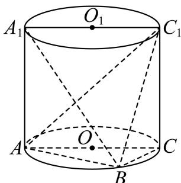
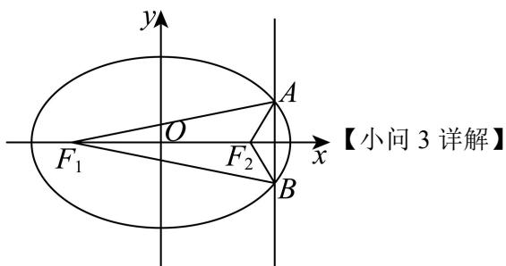

# 2026届上海高三一模 · 普陀卷

> 按原卷题号整理；题面、图片和解答未全卷逐页终核。

## 第 1 题

已知集合 $A = \{x \| x| \leq 1\}$ , $B = \{-2, -1, 0, 1, 2\}$ , 则 $A \cap B =$ \_\_\_\_.

【答案】 $\{-1,0,1\}$

【解析】

【分析】由交集运算即可求解.

【详解】解不等式 $|x|\leq 1$ 得 $-1\leq x\leq 1$ ，则 $A = \{x| - 1\leq x\leq 1\}$

则 $A \cap B = \{-1, 0, 1\}$ .

故答案为： $\{-1,0,1\}$ .

## 第 2 题

不等式 $\frac{x}{1-x} > 0$ 的解集为 \_\_\_\_.

【答案】(0,1)

【解析】

【分析】把分式不等式转化为二次不等式来求解即可.

【详解】由不等式 $\frac{x}{1 - x} > 0 \Leftrightarrow x(1 - x) > 0$

所以解得 $0 < x < 1$

即不等式 $\frac{x}{1-x}>0$ 的解集为 $(0,1)$ ,

故答案为：(0,1)

## 第 3 题

若复数 $z$ 是纯虚数，且 $\left|z\right| = 1$ ，则 $\frac{1}{1 - z}$ 的实部为

【答案】 $\frac{1}{2}$ ##0.5

【解析】

【分析】由纯虚数定义设 $z = bi(b \neq 0)$ ，再根据复数的模及复数的概念即可求解.

【详解】由复数 z 是纯虚数，设 $z = bi(b \neq 0)$ ,

由 $|z| = 1$ ，得 $\sqrt{b^2} = 1$ ， $\therefore b^2 = 1$

$$
\frac {1}{1 - z} = \frac {1}{1 - b \mathrm{i}} = \frac {1 + b \mathrm{i}}{(1 - b \mathrm{i}) (1 + b \mathrm{i})} = \frac {1 + b \mathrm{i}}{1 + b ^ {2}} = \frac {1}{2} + \frac {b}{2} \mathrm{i},
$$

所以 $\frac{1}{1 - z}$ 的实部为 $\frac{1}{2}$ .

故答案为： $\frac{1}{2}$ .

## 第 4 题

若 x > 1，则 $x + \frac{4}{x - 1}$ 的最小值是 \_\_\_\_.

【答案】5

【解析】

【分析】 $x+\frac{4}{x-1}=x-1+\frac{4}{x-1}+1$ ，利用基本不等式可得最值.

【详解】∵x>1，

$$
\therefore x + \frac {4}{x - 1} = x - 1 + \frac {4}{x - 1} + 1 \geq 2 \sqrt {(x - 1) \times \frac {4}{x - 1}} + 1 = 5,
$$

当且仅当 $x - 1 = \frac{4}{x - 1}$ 即 $x = 3$ 时取等号，

∴当 x=3 时， $x+\frac{4}{x-1}$ 取得最小值 5.

故答案为：5.

## 第 5 题

设 $n \geq 1, n \in \mathbf{N}, S_n$ 是等差数列 $\{a_n\}$ 的前 $n$ 项和，若 $a_3 = 1, S_7 = 3a_6$ ，则该等差数列的公差为 \_\_\_\_.

【答案】2

【解析】

【分析】设出基本量，根据已知条件列方程组即可求解.

【详解】设等差数列 $\{a_{n}\}$ 的公差为 $d$ ，

由 $a_{3} = 1, S_{7} = 3a_{6}$ 得 $\left\{ \begin{array}{l} a_{3} = a_{1} + 2d = 1 \\ 7a_{1} + \frac{7 \times 6}{2} d = 3(a_{1} + 5d) \end{array} \right.$ ,

即 $\left\{ \begin{array}{l}a_{1} + 2d = 1\\ 2a_{1} + 3d = 0 \end{array} \right.$ ，解得 $\left\{ \begin{array}{l}a_1 = -3\\ d = 2 \end{array} \right.$

故答案为：2.

## 第 6 题

$\left(1-\frac{x}{y}\right)\left(x+2y\right)^{7}$ 的展开式中含 $x^{4}y^{3}$ 项的系数是 \_\_\_\_.

【答案】-280

【解析】

【分析】先写出二项展开式的通项，根据通项公式，即可写出展开式中含 $x^{4}y^{3}$ 的项，进而可得结果.

【详解】因为 $(x+2y)^{7}$ 的展开式的通项公式为 $T_{r+1}=C_{7}^{r}x^{7-r}(2y)^{r}=2^{r}C_{7}^{r}x^{7-r}y^{r}$

所以 $\left(1-\frac{x}{y}\right)\left(x+2y\right)^{7}$ 的展开式中含 $x^{4}y^{3}$ 的项为

$$
1 \cdot 2 ^ {3} \mathrm{C} _ {7} ^ {3} x ^ {4} y ^ {3} - \frac {x}{y} \cdot 2 ^ {4} \mathrm{C} _ {7} ^ {4} x ^ {3} y ^ {4} = 2 8 0 x ^ {4} y ^ {3} - 5 6 0 x ^ {4} y ^ {3} = - 2 8 0 x ^ {4} y ^ {3},
$$

因此 $\left(1-\frac{x}{y}\right)\left(x+2y\right)^{7}$ 的展开式中含 $x^{4}y^{3}$ 项的系数为-280.

故答案为：-280

## 第 7 题

设 $m \in R$ ，同时抛掷两枚质地均匀的骰子一次，事件 A 表示“第一枚骰子向上的点数为奇数”，事件 B 表示“两枚骰子向上的点数之和为 m”，若事件 A 与事件 B 相互独立，则 m 的一个可取值为 \_\_\_\_.

【答案】3（或5、7、9、11其中之一）

【解析】

【分析】设第一次的点数为 $a$ ，第二次的点数为 $b$ ，进而依次讨论

$m = 2,3,4,5,6,7,8,9,10,11,12$ 的情况即可得答案.

【详解】设第一次的点数为a，第二次的点数为b，

则两次抛掷两枚质地均匀的骰子的结果记为 $(a,b)$ ，其中 $a,b\in \{1,2,3,4,5,6\}$ ，共36种基

本事件，

故由题知， $P(A)=\frac{3}{6}=\frac{1}{2}$ ,

当 $m = 2$ 时， $B$ 的基本事件为 $(1,1)$ ， $AB$ 的基本事件为 $(1,1)$ ，故 $P(B) = \frac{1}{36}$ ， $P(AB) = \frac{1}{36}$ ， $P(AB) \neq P(A)P(B)$ ，事件 $A$ 与事件 $B$ 不独立；

当 $m = 3$ 时， $B$ 的基本事件为 $(1,2), (2,1)$ ， $AB$ 的基本事件为 $(1,2)$ ，故 $P(B) = \frac{2}{36} = \frac{1}{18}$ ， $P(AB) = \frac{1}{36}$ ，

$$
P (A B) = P (A) P (B)
$$

当 $m = 4$ 时， $B$ 的基本事件为 $(1,3), (3,1), (2,2)$ ， $AB$ 的基本事件为 $(1,3), (3,1)$ ，

故 $P(B) = \frac{3}{36} = \frac{1}{12}$ , $P(AB) = \frac{2}{36} = \frac{1}{18}$ , $P(AB) \neq P(A)P(B)$ 事件 $A$ 与事件 $B$ 不独立; 当 $m = 5$ 时, $B$ 的基本事件为 $(1,4),(4,1),(2,3),(3,2)$ , $AB$ 的基本事件为 $(1,4),(3,2)$ , 故 $P(B) = \frac{4}{36} = \frac{1}{9}$ , $P(AB) = \frac{2}{36} = \frac{1}{18}$ , $P(AB) = P(A)P(B)$ 事件 $A$ 与事件 $B$ 相互独立; 当 $m = 6$ 时, $B$ 的基本事件为 $(1,5),(5,1),(2,4),(4,2),(3,3)$ , $AB$ 的基本事件为 $(1,5),(5,1),(3,3)$ ,

故 $P(B) = \frac{5}{36}$ , $P(AB) = \frac{3}{36} = \frac{1}{12}$ , $P(AB) \neq P(A)P(B)$ 事件 $A$ 与事件 $B$ 不独立;

当 $m = 7$ 时， $B$ 的基本事件为 $(1,6), (6,1), (2,5), (5,2), (3,4), (4,3)$ ， $AB$ 的基本事件为 $(1,6), (5,2), (3,4)$ ，

故 $P(B) = \frac{6}{36} = \frac{1}{6}$ , $P(AB) = \frac{3}{36} = \frac{1}{12}$ , $P(AB) = P(A)P(B)$ 事件 $A$ 与事件 $B$ 相互独立; 当 $m = 8$ 时, $B$ 的基本事件为 $(2,6),(6,2),(3,5),(5,3),(4,4)$ , $AB$ 的基本事件为 $(3,5),(5,3)$ ,

故 $P(B) = \frac{5}{36}$ ， $P(AB) = \frac{2}{36} = \frac{1}{18}$ ， $P(AB) \neq P(A)P(B)$ 事件 $A$ 与事件 $B$ 不独立；

$$
P (B) = \frac {4}{3 6} = \frac {1}{9}, P (A B) = \frac {2}{3 6} = \frac {1}{1 8}, P (A B) = P (A) P (B)
$$

当 $m = 10$ 时， $B$ 的基本事件为 $(4,6), (6,4), (5,5)$ ， $AB$ 的基本事件为 $(5,5)$ ，故 $P(B) = \frac{3}{36} = \frac{1}{12}$ ， $P(AB) = \frac{1}{36}$ ， $P(AB) \neq P(A)P(B)$ ，事件 $A$ 与事件 $B$ 不独立；当 $m = 11$ 时， $B$ 的基本事件为 $(5,6), (6,5)$ ， $AB$ 的基本事件为 $(5,6)$ ，故 $P(B) = \frac{2}{36} = \frac{1}{18}$ ， $P(AB) = \frac{1}{36}$ ， $P(AB) = P(A)P(B)$ ，事件 $A$ 与事件 $B$ 相互独立；当 $m = 12$ 时， $B$ 的基本事件为 $(6,6)$ ， $AB$ 的基本事件为 $\varnothing$ ，故 $P(B) = \frac{1}{36}$ ， $P(AB) = 0$ ， $P(AB) \neq P(A)P(B)$ ，事件 $A$ 与事件 $B$ 不独立；综上， $m$ 的可能取值为 $3,5,7,9,11$

故答案为：3（或5、7、9、11其中之一）

## 第 8 题

在 $\triangle ABC$ 中, $A = \frac{\pi}{3}$ , $AB = 2$ , $AC = 5$ , $D$ 为 $AC$ 边上的一点, 且 $AD = 2$ , 现将 $\triangle ABD$ 沿 $BD$ 边折起, 使得点 $A$ 至点 $P$ 的位置, 且满足平面 $PBD \perp$ 平面 $BDC$ , 如图所示, 则直线 $PC$ 与平面 $BDC$ 所成的角的正弦值为 \_\_\_\_.

【答案】 $\frac{\sqrt{3}}{4}$

【解析】

【分析】由 A、AB、AD 得到 $\triangle ABD$ 为等边三角形，取 AD 的中点 O，BD 的中点 H，得到 $AH \perp BD, BO \perp AD$ ，从而得到 $PH \perp BD$ ，由平面 $PBD \perp$ 平面 BDC 得到 $PH \perp$ 平面 BDC，过 O 作 PH 的平行线作为 z 轴，以 O 为原点，OB 为 x 轴，OD 为 y 轴，建系，写坐标，求出 $\overrightarrow{PC}$ 和平面 BDC 的法向量 $\vec{n}$ ，设直线 PC 与平面 BDC 所成的角为 $\alpha$ ，利用数量积求出 $\sin \alpha = \left| \cos \left\langle \overrightarrow{PC}, \vec{n} \right\rangle \right|$ 即可得解.

【详解】∵ $A=\frac{\pi}{3}$ ，AB=2，AD=2，∴△ABD为等边三角形，

取 AD 的中点 O，BD 的中点 H，连接 AH, BO，则 $AH \perp BD, BO \perp AD$ ，现将 $\triangle ABD$ 沿 $BD$ 边折起，使得点 $A$ 至点 $P$ 的位置，则 $PH \perp BD$ ， $\because$ 平面 $PBD \perp$ 平面 $BDC$ ，平面 $PBD \cap$ 平面 $BDC = BD$ ， $PH \perp BD$ ， $\therefore PH \perp$ 平面 $BDC$ ，

过 O 作 PH 的平行线作为 z 轴，以 O 为原点，OB 为 x 轴，OD 为 y 轴，建立空间直角坐标系，如图所示，

∵△ABD为等边三角形，AB=2，∴AH= $\sqrt{3}$ ,BO= $\sqrt{3}$ ,

$$
\because A C = 5, \therefore O D = 1, O C = 4
$$

$\therefore D(0,1,0), B(\sqrt{3},0,0), C(0,4,0), H(\frac{\sqrt{3}}{2}, \frac{1}{2}, 0), P(\frac{\sqrt{3}}{2}, \frac{1}{2}, \sqrt{3})$

$\therefore \overrightarrow{PC} = (-\frac{\sqrt{3}}{2}, \frac{7}{2}, -\sqrt{3}), \therefore |\overrightarrow{PC}| = 4$

∵平面 BDC 的法向量为 $\vec{n}=(0,0,1)$ ， $|\vec{n}|=1$ ，

设直线 $PC$ 与平面 $BDC$ 所成的角为 $\alpha$ ，

$$
\sin \alpha = \left| \cos \left\langle \overrightarrow {P C}, \vec {n} \right\rangle \right| = \frac {\left| \overrightarrow {P C} \cdot \vec {n} \right|}{\left| \overrightarrow {P C} \right| \cdot | \vec {n} |} = \frac {\sqrt {3}}{4}
$$

故直线 $PC$ 与平面 $BDC$ 所成的角的正弦值 $\frac{\sqrt{3}}{4}$ .

## 第 9 题

设 $m \in R$ ，直线 $l: 2x + y + m = 0$ 经过点 P，若向量 $\overrightarrow{PQ} = (1, 3)$ ，则点 Q 到直线 l 的距离为 \_\_\_\_.

【答案】 $\sqrt{5}$

【解析】

【分析】设出点 P 的坐标，并求出点 Q 的坐标，再利用点到直线距离公式求解.

【详解】由直线 $l:2x+y+m=0$ 经过点 P，设 $P(t,-2t-m)$ ，

由向量 $\overrightarrow{PQ}=(1,3)$ ，得 $Q(1+t,3-2t-m)$ ，

所以点 $Q$ 到直线 $l$ 的距离 $h = \frac{|2(1 + t) + 3 - 2t - m + m|}{\sqrt{2^2 + 1^2}} = \sqrt{5}$ .

故答案为： $\sqrt{5}$

## 第 10 题

> 核对提醒：向量仅作编码背景，主任务为组合计数，后续排列组合专题待归类

某人工智能模型在自然语言处理中, 使用位置编码表示词序, 每个位置编码需用一个 6 维向量表示. 若某位置编码可以写成 $(a, b, c, d, e, f)$ 的形式, 其中 $a, b, c \in \{1, 2, 4\}$ , 则在仅考虑前 3 个位置的情况下, $a, b, c$ 恰好取 2 个不同值的编码共有 \_\_\_\_ 个.

【答案】18

【解析】

【分析】先选出数值，再把它们分配到三个位置上，结合乘法计数原理可得答案.

【详解】先从 $\{1,2,4\}$ 这3个数中选2个，有 $C_{3}^{2}$ 种选法；

再分配 2 个数到 3 个位置，必有 2 个位置的数是相同的，

选择出现 1 次的数：从选中的 2 个数中选 1 个，有 $C_{2}^{1}$ 种选法，

选择出现 1 次的数的位置：有 $C_{3}^{1}$ 种选择；

共有 $C_{3}^{2}C_{2}^{1}C_{3}^{1}=18$ 种编码.

故答案为：18

## 第 11 题

设 $P$ 是边长为 1 的正六边形 $A_{1}A_{2}A_{3}A_{4}A_{5}A_{6}$ 所在平面上的一点，若点 $A_{1}, A_{2}, P$ 满足 $\overrightarrow{PA_1} \cdot \overrightarrow{PA_2} = 0$ ，则 $\left|\sum_{i=1}^{6} \overrightarrow{PA_i}\right|$ 的最小值是 \_\_\_\_.

【答案】 $3\sqrt{3}-3$

【解析】

【分析】根据给定条件，建立平面直角坐标系，由 $\overrightarrow{PA_{1}}\cdot\overrightarrow{PA_{2}}=0$ 可得点 P 的轨迹，再利用中点向量公式可得 $\sum_{i=1}^{6}\overrightarrow{PA_{i}}=6\overrightarrow{PO}$ ，并利用圆的性质求出最小值.

【详解】以正六边形 $A_{1}A_{2}A_{3}A_{4}A_{5}A_{6}$ 的中心 O 为原点，直线 $A_{3}A_{6}$ 为 x 轴建立平面直角坐标系，

由 $A_{1}A_{2} = 1$ ，得 $\gamma$ 轴交 $A_{1}A_{2}$ 于点 $B_{1}(0, - \frac{\sqrt{3}}{2})$ ，交 $A_{4}A_{5}$ 于点 $B_{2}(0,\frac{\sqrt{3}}{2})$

由 $\overrightarrow{PA_1} \cdot \overrightarrow{PA_2} = 0$ ，得 $P$ 在以线段 $A_1A_2$ 为直径的圆上，圆心为 $B_1$ ，半径为 $\frac{1}{2}$ ，

因此 $\sum_{i=1}^{6}\overrightarrow{PA_i} = (\overrightarrow{PA_1} +\overrightarrow{PA_2}) + (\overrightarrow{PA_3} +\overrightarrow{PA_6}) + (\overrightarrow{PA_4} +\overrightarrow{PA_5}) = 2\overrightarrow{PB_1} +2\overrightarrow{PO} +2\overrightarrow{PB_2}$

$$
= 2 \left(\overrightarrow {P B _ {1}} + \overrightarrow {P B _ {2}}\right) + 2 \overrightarrow {P O} = 6 \overrightarrow {P O}
$$

则 $|\sum_{i=1}^{6}\overrightarrow{PA_{i}}|=6|\overrightarrow{PO}|\geq6(\frac{\sqrt{3}}{2}-\frac{1}{2})=3\sqrt{3}-3$

当且仅当 $P$ 是圆 $B_{1}$ 与线段 $OB_{1}$ 的交点时取等号，

所以 $|\sum_{i=1}^{6}\overrightarrow{PA_{i}}|$ 的最小值是 $3\sqrt{3}-3$

故答案为： $3\sqrt{3} - 3$

## 第 12 题

设 $k \in \mathbb{R}$ , 函数 $y = f(x)$ 和 $y = g(x)$ 的表达式分别为

$f(x)=\mathrm{e}^{x}-kx,\quad g(x)=x^{2}+(k-2)x+\frac{1}{4}$ ，若对任意的实数 $x_{0}$ ，皆有 $f(x_{0})\cdot g(x_{0})\geq0$ 成立，则k的取值范围是______.

【答案】 $[1, e]$

【解析】

【分析】利用二次函数不等式恒大于等于零，通过判别式可求得参数范围 $1 \leq k \leq 3$ ，再利用分离参变量来求不等式 $f(x) = e^{x} - kx \geq 0$ 恒成立的参数范围 $0 \leq k \leq e$ ，最后可得充分条件是 $1 \leq k \leq e$ ，接下来分析必要性，即对k的补集范围进行分类讨论，利用二次不等式的最小值小于0，来分析此时的 $f(x_{0}) = e^{x_{0}} - kx_{0} > 0$ ，从而找到矛盾，最后可得充要条件是 $[1, e]$ .

【详解】由 $g(x) = x^2 + (k - 2)x + \frac{1}{4} \geq 0$ 恒成立可得：

$$
\Delta = (k - 2) ^ {2} - 1 \leq 0 \Rightarrow (k - 3) (k - 1) \leq 0,
$$

解得 $1 \leq k \leq 3$ ，

再由 $f(x) = \mathrm{e}^{x} - kx\geq 0\Rightarrow k\leq \frac{\mathrm{e}^{x}}{x} (x > 0)$ 或 $k\geq \frac{\mathrm{e}^x}{x} (x <   0)$

令 $h(x) = \frac{\mathrm{e}^x}{x}$ ，则 $h'(x) = \frac{\mathrm{e}^x(x - 1)}{x^2}$ ，

当 $x \in (-\infty, 0) \cup (0, 1)$ 时， $h'(x) = \frac{\mathrm{e}^x(x - 1)}{x^2} < 0$ ，所以 $h(x) = \frac{\mathrm{e}^x}{x}$ 在 $(- \infty, 0)$ 和 $(0, 1)$ 上单调递减，

当 $x \in (1, +\infty)$ 时， $h'(x) = \frac{\mathrm{e}^x(x - 1)}{x^2} > 0$ ，所以 $h(x) = \frac{\mathrm{e}^x}{x}$ 在 $x \in (1, +\infty)$ 上单调递增，

所以当 $x \in (-\infty, 0)$ 时，恒有 $h(x) = \frac{\mathrm{e}^x}{x} < 0$ ，则 $k \geq 0$ ，

当 $x \in (0, +\infty)$ 时， $h(x)_{\min} = h(1) = e$ ，则 $k \leq e$ ，

即可得 $0 \leq k \leq e$ ，

综上可得，当 $1 \leq k \leq \mathsf{e}$ 时，对任意实数 $x_0$ ，恒有 $f(x_0) \geq 0, g(x_0) \geq 0$ ，即满足题意 $f(x_0) \cdot g(x_0) \geq 0$ ，即这是充分条件.

当 $0 \leq k < 1$ ，由 $\Delta > 0$ ，可知不等式 $g(x) = x^2 + (k - 2)x + \frac{1}{4} \geq 0$ 的解集不为 $\mathbb{R}$ ，此时对称轴为 $x = \frac{2 - k}{2} > 0$ ，必存在 $x_0 = \frac{2 - k}{2}$ ，满足 $g(x_0) < 0$ ，

而此时 $f(x_{0}) \geq 0$ ，所以不满足 $f(x_{0}) \cdot g(x_{0}) \geq 0$ ;

又当 $\mathbf{e} < k \leq 3$ ，可知不等式 $f(x) = \mathbf{e}^x - kx \geq 0$ 不恒成立，此时必存在 $f(x_0) < 0$ ，而在 $\mathbf{e} < k \leq 3$ 时， $\Delta \leq 0$ ，不等式 $g(x) \geq 0$ 恒成立，即此时 $g(x_0) \geq 0$ ，

所以不满足 $f(x_{0})\cdot g(x_{0})\geq0$ ;

当 $k > 3$ ，由 $\Delta >0$ ，可知不等式 $g(x) = x^{2} + (k - 2)x + \frac{1}{4}\geq 0$ 的解集不为R，此时对称轴为 $x = \frac{2 - k}{2} < 0$ ，必存在 $x_0 = \frac{2 - k}{2}$ ，使得 $g(x_0) < 0$ 而此时因为 $x_0 < 0$ ， $k > 3$ ，必有 $f(x_0) = \mathrm{e}^{x_0} - kx_0 > 0$ ，所以不满足 $f(x_0)\cdot g(x_0)\geq 0$ 当 $k < 0$ 时，由 $\Delta >0$ ，可知不等式 $g(x) = x^2 +(k - 2)x + \frac{1}{4}\geq 0$ 的解集不为R，此时对称轴为 $x = \frac{2 - k}{2} >0$ ，必存在 $x_0 = \frac{2 - k}{2}$ ，使得 $g(x_0) < 0$ 而此时因为 $x_0 > 0$ ， $k < 0$ ，必有 $f(x_0) = \mathrm{e}^{x_0} - kx_0 > 0$ 所以不满足 $f(x_0)\cdot g(x_0)\geq 0$ 综上分析可得： $1\leq k\leq \mathbf{e}$ 是对任意的实数 $x_0$ ，都有 $f(x_0)\cdot g(x_0)\geq 0$ 成立的充要条件，故答案为：[1,e]

## 第 13 题

下列函数中，周期为 $\pi$ 的奇函数是（）
A. $y = \left| \sin x \right|$ B. $y = \cos^{2}x - \sin^{2}x$ C. $y = \cos\left(\frac{\pi}{2} - x\right)$ D. $y = \frac{\sin 2x}{1 + \cos 2x}$

【答案】D

【解析】

【分析】利用三角函数的周期公式及奇函数的定义，结合诱导公式和二倍角公式逐项分析即可求解.

【详解】对于 A，根据 $y = f(x) = |\sin x|$ 图象可知 $T = \pi$ ，函数的定义域为 R， $f(-x)=\left|\sin(-x)\right|=\left|\sin x\right|=f(x)$ ,

所以 $f(x)$ 以 $\pi$ 为周期的偶函数，故A错误；

对于 B， $y = f(x) = \cos^{2}x - \sin^{2}x = \cos 2x,\quad T = \frac{2\pi}{2} = \pi$ ，函数的定义域为 R， $f(-x)=\cos^{2}(-x)-\sin^{2}(-x)=\cos^{2}x-\sin^{2}x=f(x)$ ，所以 $f(x)$ 以 $\pi$ 为周期的偶函数，故B错误；

对于 C， $y = f(x) = \cos\left(\frac{\pi}{2} - x\right) = \sin x,\quad T = \frac{2\pi}{1} = 2\pi$ ，函数的定义域为 R， $f(-x)=\sin(-x)=-\sin x=-f(x)$ ,

所以 $f(x)$ 以 $2\pi$ 为周期的奇函数，故 C 错误；

对于D， $y = f(x) = \frac{\sin 2x}{1 + \cos 2x} = \frac{2\sin x\cos x}{1 + 2\cos^2x - 1} = \frac{2\sin x\cos x}{2\cos^2x} = \tan x$ ，函数的定义域为 $\left\{x\mid x\neq k\pi +\frac{\pi}{2},k\in \mathbf{Z}\right\}$ 关于原点对称，
且 $f(-x) = \tan (-x) = -\tan x = -f(x)$

所以 $f(x)$ 以 $\pi$ 为周期的奇函数，故D正确.

故选：D

## 第 14 题

已知直线 $m$ 、 $l$ 和平面 $\alpha$ 、 $\beta$ ，且 $l \subset \alpha$ ， $\alpha // \beta$ ，则下列命题中正确的是（）
A. 若 $m // \beta$ ，则 $m // l$ B. 若 $m // l$ ，则 $m // \alpha$ C. 若 $m \perp \beta$ ，则 $m \perp l$ D. 若 $m \perp l$ ，则 $m \perp \alpha$

【答案】C

【解析】

【分析】由空间线面、线线位置关系逐项判断即可.

【详解】由 $l\subset\alpha,\quad\alpha\parallel\beta$ ，可得 $l\parallel\beta$ ，

对于 A， $m // \beta$ ， $l \parallel \beta$ ，则直线 m、l 可能相交、平行或异面，故错误；

对于 B，若 $m \parallel l$ ，则 $m \parallel \alpha$ 或 $m \subset \alpha$ ，故错误；

对于 C，因为 $m \perp \beta$ ， $\alpha \parallel \beta$ ，所以 $m \perp \alpha$ ，又 $l \subset \alpha$ ，

所以 $m \perp l$ ，正确；

对于 D，要证明 $m \perp \alpha$ ，需 m 垂直平面 $\alpha$ 内两条相交直线，现在只有 $m \perp l$ ，条件不够，

故错误；

故选：C

## 第 15 题

设点 $M$ 是抛物线 $x^{2} = 8\sqrt{5} y$ 的焦点，点 $F$ 是双曲线 $\Gamma: x^{2} - \frac{y^{2}}{4} = 1$ 的左焦点，点 $Q$ 是

Γ上在第一象限内的一动点，则下列结论中正确的是（）
A. $\left|QF\right|-\left|QM\right|$ 的最大值是 5
B. $\left|QF\right|+\left|QM\right|$ 的最小值是 5
C. $\left|QF\right|-\left|QM\right|$ 的最大值是 7
D. $\left|QF\right|+\left|QM\right|$ 的最小值是 7

【答案】D

【解析】

【分析】作出图象，根据图象利用两边之和、差与第三边的关系分析最大值与最小值即可得解.

【详解】如图，

由点 M 是抛物线 $x^{2}=8\sqrt{5}y$ 的焦点，故 $M(0,2\sqrt{5})$ ,

由双曲线 $\Gamma: x^{2} - \frac{y^{2}}{4} = 1$ 知， $a = 1, b = 2, c = \sqrt{1 + 4} = \sqrt{5}$ ，

故 $F\left(-\sqrt{5},0\right)$ ，右焦点 $F'\left(\sqrt{5},0\right)$ ,

所以 $k_{FM}=\frac{2\sqrt{5}-0}{0+\sqrt{5}}=2$ ，又双曲线的渐近线方程为 $y=\pm2x$

所以直线 FM 与双曲线右支无交点，故 $\left|QF\right|-\left|QM\right|<\left|FM\right|=\sqrt{\left(\sqrt{5}\right)^{2}+\left(2\sqrt{5}\right)^{2}}=5$ ，故 AC 错误；

由双曲线的定义， $\left|QF\right|=2a+\left|QF'\right|=2+\left|QF'\right|$

所以 $\left|QF\right|+\left|QM\right|=2+\left|QF'\right|+\left|QM\right|\geq2+\left|MF'\right|=2+\sqrt{\left(\sqrt{5}\right)^{2}+\left(2\sqrt{5}\right)^{2}}=7$

即点 $Q$ 运动到点 $N$ ， $M,N,F'$ 三点共线时， $\left|QF\right| + \left|QM\right|$ 有最小值7，故B错误D正确.故选：D

## 第 16 题

设 $n \geq 1, n \in \mathbf{N}$ ，数列 $\{a_n\}$ 和 $\{b_n\}$ 满足 $a_1 = b_1 = 1$ ，且 $a_{n+1} \in \{0, 1\}$ ，

$b_{n+1}=\left|a_{n+1}-2a_{n}\right|b_{n}$ ，现有如下两个命题：

①若数列 $\{b_{n}\}$ 是等比数列，则数列 $\{a_{n}\}$ 是常数列：

②设 $S_{n}$ 是数列 $\left\{b_{n}\right\}$ 的前 n 项和，若 $b_{2026}$ 取得最大值时，则 $S_{2026}-2$ 能被 7 整除.

则下列结论中正确的是（）
A. ①为真 ②为真
B. ①为真 ②为假
C. ①为假 ②为真
D. ①为假 ②为假

【答案】A

【解析】

【分析】对于①：结合等比数列的定义，采用反证法证明；

对于②分析 $a_{n}, a_{n+1}$ 的取值，可得 $b_{n+2}, b_{n}$ 的关系，得出 $b_{n+2} \leq 2b_{n}$ ，据此可求出 $b_{2026}$ 的最大值时的 $S_{2026}-2$ ，再根据二项式定理处理整除问题。

【详解】假设 $\{b_{n}\}$ 为等比数列，而 $\{a_{n}\}$ 不为常数列，

则 $\{a_{n}\}$ 中存在等于 0 的项，设项数最小的等于 0 的项为 $a_{k}$ ，其中 $k > 1$ ，

所以 $b_{k} = |a_{k} - 2a_{k-1}|b_{k-1} = 2b_{k-1}$ ,

则等比数列 $\{b_{n}\}$ 的公比为 $\frac{b_k}{b_{k-1}} = 2(*)$ .

又 $b_{k+1} = |a_{k+1}|b_k$ ，得等比数列 $\{b_n\}$ 的公比为 $|a_{k+1}| \leq 1$ ，与 $(*)$ 式矛盾，

所以假设不成立，所以当 $\{b_n\}$ 为等比数列时， $\{a_n\}$ 为常数列，故①为真命题；

当 $a_{n} = 1, a_{n+1} = 1$ 时， $b_{n+1} = b_n$ ，当 $a_{n} = 1, a_{n+1} = 0$ 时， $b_{n+1} = 2b_n$ ，

当 $a_{n} = 0, a_{n+1} = 1$ 时， $b_{n+1} = b_n$ ，当 $a_{n} = 0, a_{n+1} = 0$ 时， $b_{n+1} = 0$ ，

综上所述， $b_{n+2} = b_n$ 或 $b_{n+2} = 2b_n$ 或 $b_{n+2} = 0$ （上述四种情形每种中 $a_{n+2} = 0$ 或 1）.

又由题意可知 $b_n \geq 0$ ，所以 $b_{n+2} \leq 2b_n$ ，

所以 $b_{2026} \leq 2b_{2024} \leq \cdots \leq 2^{1012} \cdot b_2$ ，而 $b_2 = |a_2 - 2a_1|b_1 = |a_2 - 2| \leq 2$ ，

故 $b_{2026} \leq 2^{1013}$ ，所以 $b_{2026}$ 取得最大值时为 $b_{2026} = 2^{1013}$ ，

此时 $b_{n + 2} = 2b_n$ ， $b_{1} = 1,b_{2} = 2$

$$
S _ {2 0 2 6} - 2 = (1 + 2 + 4 + \dots + 2 ^ {1 0 1 2}) + (2 + 4 + 8 + \dots 2 ^ {1 0 1 3}) - 2
$$

$$
= \frac {1 (1 - 2 ^ {1 0 1 3})}{1 - 2} + \frac {2 (1 - 2 ^ {1 0 1 3})}{1 - 2} - 2 = 3 \times 2 ^ {1 0 1 3} - 5
$$

$$
= 1 2 \times 2 ^ {1 0 1 1} - 5 = 1 2 \times (1 + 7) ^ {3 3 7} - 5,
$$

根据二项式定理可知 $(1+7)^{337}=C_{337}^{0}1^{337}7^{0}+C_{337}^{1}1^{336}7^{1}+\cdots C_{337}^{337}1^{0}7^{337}$

故 $(1+7)^{337}$ 除以7余数为1，所以 $12\times(1+7)^{337}-5$ 可以被7整除，故②为真命题.
故选：A.

## 第 17 题

如图所示, 过圆柱的轴 $O O_{1}$ 的平面与该圆柱相截所形成的截面是边长为 2 的正方形 $A A_{1} C_{1} C$ , $B$ 是该圆柱底面圆周上异于 $A 、 C$ 两点的点.

（1）设平面 $A_{1}AB \cap$ 平面 $C_{1}CB = l$ ，求证： $l / / AA_{1}$

(2) 当三棱锥 $C_{1} - ABC$ 的体积最大时, 求二面角 $C_{1} - AB - C$ 的余弦值.

【答案】（1）证明见解析

(2) $\frac{\sqrt{3}}{3}.$

【解析】

【分析】（1）由 $AA_{1}$ // 平面 $C_{1}CB$ ，结合线面平行的性质定理即可求解；

(2) 由线面垂直得到 $\angle C_{1}BC$ 是二面角 $C_{1}-AB-C$ 的平面角, 进而可求解.

【小问 1 详解】

由已知得 $AA_{1} \parallel CC_{1}$ ，又 $CC_{1} \subset$ 平面 $C_{1}BC$ ， $AA_{1}$ 在平面 $C_{1}CB$ 外，

则 $AA_{1}$ // 平面 $C_{1}CB$ ,

又平面 $A_{1}AB \cap$ 平面 $C_{1}CB = l, AA_{1} \subset$ 平面 $A_{1}AB$

则 $l \parallel AA_{1}$ .

【小问 2 详解】

设 $\triangle ABC$ 的边 $AC$ 上的高为 $0 < h \leq 1$ ，则 $V_{C_1 - ABC} = \frac{1}{3} S_{\triangle ABC} \cdot CC_1 = \frac{2}{3} h$

当三棱锥 $C_{1}-ABC$ 的体积最大时，h=1，即 B 为 $\widehat{AC}$ 的中点，

又 $CC_{1} \perp$ 平面 ABC, AB 在平面 ABC 上，所以 $CC_{1} \perp AB$

又 $CB \perp AB$ ， $CC_{1}, CB$ 为平面 $CC_{1}B$ 内两条相交直线，

所以 $AB \perp$ 平面 $CC_{1}B$ ，又 $C_{1}B$ 在平面 $CC_{1}B$ 内，

所以 $C_1B \perp AB$ ，

则 $\angle C_{1}BC$ 是二面角 $C_1 - AB - C$ 的平面角，

在直角三角形 $CBC_{1}$ 中， $BC = \sqrt{2}$ ， $BC_{1} = \sqrt{6}$ ，则 $\cos\angle CBC_{1} = \frac{\sqrt{3}}{3}$ ，

即所求的二面角 $C_1 - AB - C$ 的余弦值为 $\frac{\sqrt{3}}{3}$

## 第 18 题

在 $\triangle ABC$ 中，内角 $A, B, C$ 所对的边分别为 $a, b, c$ ，且 $a = \frac{\sqrt{3}}{3}, b \sin 2A = \sin B$ .

(1) 求角 A 的大小;

（2）设 $m \in \mathbf{R}$ ， $0 < \varphi < \frac{\pi}{2}$ ，函数 $y = f(x)$ 的表达式为 $f(x) = \tan (2x + \varphi)$ ，且$f(A) = -\sqrt{3}$ , 若在区间 $\left(-\frac{5\pi}{6}, m\right)$ 上恰有 3 次使得函数 $f(x)$ 的值能取遍区间 $[2025, +\infty)$ 内的所有值，求 $m$ 的取值范围.

【答案】(1) $A = \frac{\pi}{6}$

(2) $\left[\frac{7\pi}{12}, \frac{13\pi}{12}\right)$

【解析】

【分析】（1）由二倍角正弦公式和正弦定理得 $\frac{a}{\sin A} = \frac{1}{2\sin A\cos A}$ ，结合 $\sin A > 0$ 得 $\cos A = \frac{\sqrt{3}}{2}$ ，结合角 $A$ 的范围即可求解；

（2）先求得 $\varphi = \frac{\pi}{3}$ ，然后利用整体法，结合正切函数性质列不等式求解即可.

【小问 1 详解】

由已知条件得 $\frac{b}{\sin B} = \frac{1}{\sin 2A} = \frac{1}{2\sin A\cos A}$

由正弦定理 $\frac{a}{\sin A} = \frac{b}{\sin B}$ 得 $\frac{a}{\sin A} = \frac{1}{2\sin A\cos A}$ ,

又 $\sin A > 0$ ，则 $\cos A = \frac{1}{2a} = \frac{\sqrt{3}}{2}$ ，因为 $0 < A < \pi$ ，所以 $A = \frac{\pi}{6}$

【小问 2 详解】

由 $f(A) = -\sqrt{3}$ 得， $\tan \left(\frac{\pi}{3} +\varphi\right) = -\sqrt{3},$

又 $\varphi \in \left(0, \frac{\pi}{2}\right)$ ，则 $\varphi = \frac{\pi}{3}$ ，又 $x \in \left(-\frac{5\pi}{6}, m\right)$ ，则 $2x + \frac{\pi}{3} \in \left(-\frac{4\pi}{3}, 2m + \frac{\pi}{3}\right)$ ，

要在区间 $\left(-\frac{5\pi}{6}, m\right)$ 上恰有3次使得函数 $f(x) = \tan \left(2x + \frac{\pi}{3}\right)$ 的值能取遍[2025, +∞)内的所有值，则 $\frac{3\pi}{2} \leq 2m + \frac{\pi}{3} < \frac{5\pi}{2}$ ，即 $\frac{7\pi}{12} \leq m < \frac{13\pi}{12}$ ，

则所求的 $m$ 的取值范围是 $\left[\frac{7\pi}{12}, \frac{13\pi}{12}\right)$ .

## 第 19 题

人工智能生成内容（AIGC）是引领未来的新兴战略性产业。根据国家工信部发布的《人工智能产业发展年报（2025）》及国家统计局相关数据显示，中国 AIGC 产业已形成完整产业链结构，截至 2025 年 10 月，产业链核心层企业分布及核心市场规模分别如表一、表二所示.

（1）根据表二所提供的数据，请判断“2021-2025年我国AIGC市场规模年增长率持续提高”这一说法是否正确，并基于你对整体变化趋势的分析，试选用平均增长率模型预测2026年我国AIGC的市场规模（结果精确到1亿元）；

（2）赫希曼指数（HHI）是衡量产业集中程度的综合指标，计算公式为

$\mathrm{HHI} = \sum_{i=1}^{n}\left(\frac{T_i}{T}\right)^2 \times 10000$ ，其中 $T_i$ 为第 $i$ 个层级的企业数量， $T$ 为企业总数。请根据表一所提供的数据，计算我国 AIGC 产业链的 HHI 指数（结果保留整数），并参照“HHI < 1500 为竞争型， $1500 \leq \mathrm{HHI} \leq 2500$ 为低集中寡占型， $\mathrm{HHI} > 2500$ 为高集中寡占型”的标准，判断其产业分布结构类型；

（3）为制定产业支持政策，现计划从表一所提供的 AIGC 核心企业中随机抽取 4 家进行深度调研，求抽到的这 4 家企业中来自第二层和第三层的企业总数之和不少于 2 家的概率（结果精确到 0.001）.

【答案】（1）该说法不正确；5062亿元

（2）3351；目前我国AIGC产业分布结构为高集中寡占型

(3) 0.880

【解析】

【分析】（1）先计算出 2021-2025 年市场规模逐年增长率，指出五年内的变化趋势，即可得出说法不正确的结论；再求出五年的平均增长率，即可依据此模型预测 2026 年我国 AIGC 的市场规模；

（2）由表一中的数据以及赫希曼指数的计算公式，求出我国AIGC产业链的赫希曼指数为 $3351 > 2500$ ，即可判断其产业分布结构类型；

（3）先求出抽到的这4家企业全来自第一层的概率 $P_{1}$ 和来自第一层的有3家，来自第二或第三层的有1家的概率 $P_{2}$ ，用 $1 - (P_{1} + P_{2})$ 即可得解.

【小问 1 详解】

2021-2025年市场规模逐年增长率分别为：

$$
\frac{1200.3 - 800.2}{800.2} = 50\%, \frac{1848.5 - 1200.3}{1200.3}\approx 54\%
$$

$$
\frac {2 6 0 0 . 6 - 1 8 4 8 . 5}{1 8 4 8 . 5} \approx 40.69 \%, \frac {3 5 0 0 . 4 - 2 6 0 0 . 6}{2 6 0 0 . 6} \approx 34.60 \%,
$$

由此可看出：2021-2023年增长率加快，2023-2025年市场规模增长逐年放缓，

所以 “2021-2025 年我国 AIGC 市场规模年增长率持续提高” 这一说法不正确；

五年的平均增长率为 $\sqrt[4]{\frac{3500.4}{800.2}} - 1 \approx 44.62\%$

则按照该模型预测2026年我国AIGC市场规模约 $3500.4 \times \sqrt[4]{\frac{3500.4}{800.2}} \approx 5062$ 亿元.

（说明：若按照最后一年增长规模估计， $3500.4 \times (1 + 34.62\%) \approx 4712$ 亿元；

若按照最后两年增长规模估计， $3500.4 \times \sqrt{\frac{3500.4}{1848.5}} \approx 4817$ 亿元）

【小问 2 详解】

由表一中的数据以及赫希曼指数的计算公式得，我国 AIGC 产业链的赫希曼指数为：

$$
\mathrm{HHI} = \left[ \left(\frac {1 8 2 0}{5 3 0 0}\right) ^ {2} + \left(\frac {1 5 9 0}{5 3 0 0}\right) ^ {2} + \left(\frac {1 8 9 0}{5 3 0 0}\right) ^ {2} \right] \times 1 0 0 0 0 \approx 3 3 5 1 > 2 5 0 0,
$$

所以目前我国 AIGC 产业分布结构为高集中寡占型；

【小问3详解】

抽到的这 4 家企业全来自第一层的概率为： $P_{1}=\frac{C_{1820}^{4}}{C_{5300}^{4}}$ ;

抽到的这 4 家企业中来自第一层的有 3 家，来自第二或第三层的有 1 家的概率为：

$$
P _ {2} = \frac {\mathrm{C} _ {1 8 2 0} ^ {3} \mathrm{C} _ {3 4 8 0} ^ {1}}{\mathrm{C} _ {5 3 0 0} ^ {4}};
$$

则抽到的这 4 家企业中来自第二层和第三层的企业总数之和不少于 2 家的概率为:

$$
P = 1 - \left(P _ {1} + P _ {2}\right) = 1 - \frac {\mathrm{C} _ {1 8 2 0} ^ {4} + \mathrm{C} _ {1 8 2 0} ^ {3} \mathrm{C} _ {3 4 8 0} ^ {1}}{\mathrm{C} _ {5 3 0 0} ^ {4}} \approx 0. 8 8 0.
$$

## 第 20 题

设 $a > 2, m \in \mathbb{R}, k, t$ 是不全为零的实数，椭圆 $\Gamma: \frac{x^2}{a^2} + \frac{y^2}{4} = 1, F_1, F_2$ 分别为 $\Gamma$ 的左、右两个焦点，直线 $l: kx + ty + m = 0$ 与 $\Gamma$ 交于 $A, B$ 两点， $O$ 为坐标原点.

（1）若 $k=0, t+m=0$ ，且四边形 $ABF_{1}F_{2}$ 为矩形，求 $\Gamma$ 的离心率；

（2）若 t=0，且 $\triangle F_{1}AB$ 的周长的最大值为 12，求 $\Gamma$ 的方程；

（3）若 $a = 4, t = -1, \lambda > 0$ ，直线 $OA$ 与 $OB$ 的斜率之积为 $-\frac{1}{4}$ ， $C$ 为 $OA$ 上的一点，且 $\overrightarrow{OA} = \overrightarrow{AC}$ ，直线 $BC$ 与椭圆 $\Gamma$ 交于点 $D$ ，且 $\overrightarrow{BD} = \lambda \overrightarrow{DC}$ ，求 $\lambda$ 的值以及 $\triangle ABD$ 的面积 $S$ 的值.

【答案】(1) $\frac{\sqrt{3}}{2}$

(2) $\frac{x^{2}}{9}+\frac{y^{2}}{4}=1.$

(3) $\lambda = \frac{2}{3}, S_{\triangle ABD} = \frac{8}{5}$

【解析】

【分析】（1）求出 $\left|AB\right|=\sqrt{3}a$ ，根据题意得到 $\sqrt{3}a=2c$ ，从而求出离心率；

（2）根据 $\left|AF_1\right| + \left|BF_1\right| + \left|AB\right|\leq \left|AF_1\right| + \left|BF_1\right| + \left|AF_2\right| + \left|BF_2\right|$ ，再由题意可求出 $a = 3$ ，即可求出方程；

（3）设 $A(x_{1},y_{1}),B(x_{2},y_{2}),D(x_{0},y_{0})$ ，根据题目信息求出 $D\left(\frac{x_2 + 2\lambda x_1}{1 + \lambda},\frac{y_2 + 2\lambda y_1}{1 + \lambda}\right)$

将点 D 代入椭圆方程并化简得到

$4\lambda^{2}\left(\frac{x_{1}^{2}}{16}+\frac{y_{1}^{2}}{4}\right)+\left(\frac{x_{2}^{2}}{16}+\frac{y_{2}^{2}}{4}\right)+\frac{\lambda}{4}\left(x_{1}x_{2}+4y_{1}y_{2}\right)=\left(1+\lambda\right)^{2}$ ，根据点A,B均在 $\Gamma$ 上以及 $k_{OA}\cdot k_{OB}=-\frac{1}{4}$ 得到 $4\lambda^{2}+1=\left(1+\lambda\right)^{2}$ ，解方程即可求出 $\lambda$ ；根据题目信息及求出的 $\lambda$ 可得 $S_{\triangle ABD}=\frac{2}{5}S_{\triangle OAB}$ ，求出 $|AB|$ 的长及原点O到直线l的距离，利用三角形面积公式即可求出答案.

【小问 1 详解】

由 $k = 0$ ， $t + m = 0$ 得， $l:y = 1$

将 $y = 1$ 代入椭圆方程得 $\frac{x^2}{a^2} +\frac{1}{4} = 1$ ，解得 $x = \pm \frac{\sqrt{3}}{2} a$ ，则 $\left|AB\right| = \sqrt{3} a$

又四边形 $ABF_{1}F_{2}$ 是矩形，则 $\sqrt{3}a = 2c$ ，即离心率 $e = \frac{c}{a} = \frac{\sqrt{3}}{2}$ .

【小问 2 详解】

由 $t = 0$ 得， $l: x = -\frac{m}{k}$ ，即 $AB \perp x$ 轴，

则 $\left|AF_1\right| + \left|BF_1\right| + \left|AB\right|\leq \left|AF_1\right| + \left|BF_1\right| + \left|AF_2\right| + \left|BF_2\right| = 4a$

当且仅当 $AB$ 过右焦点 $F_{2}$ 时等号成立，即 $\triangle F_{1}AB$ 的周长的最大值为 $4a$ 即 $4a = 12$ ，即 $a = 3$

则 $\Gamma$ 方程为 $\frac{x^{2}}{9} + \frac{y^{2}}{4} = 1$ .

设 $A(x_{1},y_{1}),B(x_{2},y_{2}),D(x_{0},y_{0})$ ,

由 $\overrightarrow{OA} = \overrightarrow{AC}$ 得，点 $C(2x_{1}, 2y_{1})$ ，又 $\overrightarrow{BD} = \lambda \overrightarrow{DC}$ ，

则 $x_0 = \frac{x_2 + 2\lambda x_1}{1 + \lambda}, y_0 = \frac{y_2 + 2\lambda y_1}{1 + \lambda}$ 因为点 $D$ 在 $\Gamma$ 上，所以 $\frac{\left(\frac{x_2 + 2\lambda x_1}{1 + \lambda}\right)^2}{16} + \frac{\left(\frac{y_2 + 2\lambda y_1}{1 + \lambda}\right)^2}{4} = 1$ 则 $4\lambda^2\left(\frac{x_1^2}{16} + \frac{y_1^2}{4}\right) + \left(\frac{x_2^2}{16} + \frac{y_2^2}{4}\right) + \frac{\lambda}{4}(x_1x_2 + 4y_1y_2) = (1 + \lambda)^2,$ 又点 $A, B$ 均在 $\Gamma$ 上，则 $\frac{x_1^2}{16} + \frac{y_1^2}{4} = 1, \frac{x_2^2}{16} + \frac{y_2^2}{4} = 1,$ 由 $k_{OA} \cdot k_{OB} = -\frac{1}{4}$ 得 $\frac{y_1y_2}{x_1x_2} = -\frac{1}{4}$ ，即 $x_1x_2 + 4y_1y_2 = 0$ ，则 $4\lambda^2 + 1 = (1 + \lambda)^2$ ，又 $\lambda > 0$ ，即 $\lambda = \frac{2}{3}$ . 由 $\overrightarrow{BD} = \frac{2}{3}\overrightarrow{DC}, \overrightarrow{OA} = \overrightarrow{AC}$ 得， $S_{\triangle ABD} = \frac{2}{5} S_{\triangle ABC} = \frac{2}{5} S_{\triangle OAB}$ ，又 $a = 4, t = -1$ ，即直线 $l: y = kx + m$ ，由 $\left\{ \begin{array}{l} y = kx + m \\ \frac{x^2}{16} + \frac{y^2}{4} = 1 \end{array} \right.$ 得， $(1 + 4k^2)x^2 + 8kmx + 4m^2 - 16 = 0,$ 则 $x_1 + x_2 = \frac{-8km}{1 + 4k^2}, x_1x_2 = \frac{4m^2 - 16}{1 + 4k^2}$ ，则 $|AB| = \sqrt{1 + k^2}|x_1 - x_2|$ $= \sqrt{1 + k^2}\sqrt{(x_1 + x_2)^2 - 4x_1x_2}$ $= \sqrt{1 + k^2}\sqrt{\left(\frac{-8km}{1 + 4k^2}\right)^2 - 4 \cdot \frac{4m^2 - 16}{1 + 4k^2}}$ $= \frac{4\sqrt{1 + k^2}}{1 + 4k^2}\sqrt{4 + 16k^2 - m^2}$ 由 $x_1x_2 + 4y_1y_2 = 0$ 得， $x_1x_2 + 4y_1y_2 = x_1x_2 + 4(kx_1 + m)(kx_2 + m) = 0$ 即 $(1 + 4k^2)x_1x_2 + 4km(x_1 + x_2) + 4m^2 = 0$ ，即 $(1 + 4k^2)\frac{4m^2 - 16}{1 + 4k^2} - \frac{32k^2m^2}{1 + 4k^2} + 4m^2 = 0$

化简整理得， $m^2 = 8k^2 +2$ ，则 $\left|AB\right| = \frac{4\sqrt{2\left(1 + k^2\right)}}{\sqrt{1 + 4k^2}}$

又原点 $O$ 到直线 $l$ 的距离为 $d = \frac{|m|}{\sqrt{1 + k^2}} = \frac{\sqrt{2(1 + 4k^2)}}{\sqrt{1 + k^2}}$

$$
S _ {\triangle O A B} = \frac {1}{2} \times \frac {4 \sqrt {2 (1 + k ^ {2})}}{\sqrt {1 + 4 k ^ {2}}} \times \frac {\sqrt {2 (1 + 4 k ^ {2})}}{\sqrt {1 + k ^ {2}}} = 4.
$$

则 $S_{\triangle ABD} = \frac{2}{5} S_{\triangle OAB} = \frac{8}{5}$

## 第 21 题

设函数 $y = f(x)$ 的定义域为 D，导函数为 $y = f'(x)$ ，对于实数 t，若存在 $x_0 \in D$ ，使得 $f(tx_0) = tf'(x_0)$ 成立，则称函数 $y = f(x)$ 具有性质 $P(t)$ .

（1）若函数 $f(x)=\ln x$ ，请判断该函数是否具有性质 $P(1)$ ，并说明理由；

（2）设 $a \in \mathbb{R}$ ，若函数 $f(x) = x^3 + a$ 具有性质 $P(2)$ ，且 $x_0$ 的值恰有三个，求 $a$ 的取值范围；

（3）若函数 $f(x)=\mathrm{e}^{x}+x$ ，求证：该函数具有性质 $P(t)$ 的充要条件是 t>0.

【答案】（1）函数 $f(x)=\ln x$ 具有性质，理由见解析

(2) $\left(0,\frac{1}{2}\right)$

（3）证明见解析

【解析】

【分析】（1）求导，将问题转化为函数 $p(x)=f(x)-f'(x)=\ln x-\frac{1}{x}$ ，x>0 的零点问题，进而结合单调性与零点存在性定理求解即可；

（2）根据 $P(2)$ 函数定义，将问题转化为存在实数 $x_{0}$ ，使得 $a = -8x_{0}^{3} + 6x_{0}^{2}$ 有三个实数根问题，再构造函数求解即可.

（3）由题将问题转化为 $g(x) = \mathrm{e}^{tx} - t\mathrm{e}^x + t(x - 1)$ 存在实数根的充要条件为 $t > 0$ . 充分性的证明方面，先验证当 $t = 1$ 时，函数 $f(x)$ 具有性质 $P(1)$ ，再讨论当 $t > 0$ 且 $t \neq 1$ 时，结合函数隐零点得存在 $x_0 \in (-\infty, 1)$ 满足 $g(x_0) = 0$ ，即 $f(tx_0) = tf'(x_0)$ 成立；再证必要性：先说明 $t = 0$ 不成立，再研究 $t < 0$ 的性质得函数 $g(x)$ 在 $x \in (-\infty, m)$ 严格减函数， $x \in (m, +\infty)$ 严格增函数，进而得 $g(x) \geq g(m) > 0$ 得矛盾即可证明.

【小问 1 详解】

解：由 $f(x) = \ln x$ 得， $f'(x) = \frac{1}{x}$

设 $p(x) = f(x) - f'(x) = \ln x - \frac{1}{x}, x > 0$

当 $x > 0$ 时， $p'(x) = \frac{1}{x} + \frac{1}{x^2} > 0$

又 $p(1) = \ln 1 - \frac{1}{1} = -1\left\langle 0, p(\mathrm{e}) = \ln \mathrm{e} - \frac{1}{\mathrm{e}} = 1 - \frac{1}{\mathrm{e}}\right\rangle 0,$

则存在 $x_0 \in (1, \mathbf{e})$ ，使得 $p(x_0) = 0$ ，即 $f(x_0) = f'(x_0)$

故函数 $f(x)=\ln x$ 具有性质 $P(1)$ .

【小问 2 详解】

解：由 $f(x) = x^3 + a$ 得， $f'(x) = 3x^2$ ，

因为函数 $f(x)=x^{3}+a$ 具有性质 $P(2)$ ,

所以存在实数 $x_0$ ，使得 $f(2x_0) = 2f'(x_0)$

即 $\left(2x_0\right)^3 + a = 2\left(3x_0^2\right)$ ，即 $a = -8x_0^3 + 6x_0^2$

即存在实数 $x_0$ ，使得 $a = -8x_0^3 + 6x_0^2$ 有三个实数根

设 $h(x) = -8x^{3} + 6x^{2}$ ，则 $h'(x) = -24x^{2} + 12x = -12x(2x - 1)$ ，

令 $h^\prime (x) = 0$ ，解得 $x = 0$ 或 $x = \frac{1}{2}$ ，列表如下：

因为函数 $f(x) = x^3 + a$ 具有性质 $P(2)$ 时， $x_0$ 的值恰有三个，

所以满足条件的 $a$ 的取值范围是 $\left(0, \frac{1}{2}\right)$ .

【小问 3 详解】

证明：由 $f(x) = \mathrm{e}^x + x$ 得， $f'(x) = \mathrm{e}^x + 1$

由 $f(tx) = tf'(x)$ 得， $\mathbf{e}^{tx} + tx = t\left(\mathbf{e}^x +1\right),$

设 $g(x) = \mathrm{e}^{tx} - t\mathrm{e}^x +t(x - 1)$

先证充分性：当 t > 0 时， $g(1) = e^{t} - te$ ，

考虑函数 $y = e^{x} - xe$ ，则 $y' = e^{x} - e$ ，

当0<x<1时， $y^{\prime}<0$ ，当x=1时， $y^{\prime}=0$ ，当x>1时， $y^{\prime}>0$ ，

所以函数 $y = e^{x} - xe$ 在 $(0,1)$ 上严格单调递减，在 $(1,+\infty)$ 上严格单调递增，在 x = 1 时有极小值 0，

所以，当 $t = 1$ 时， $g(1) = \mathrm{e}^t - te = 0$ ，函数 $f(x)$ 具有性质 $P(1)$ ，

当 $t > 0$ 且 $t \neq 1$ 时， $g(1) = e^t - te > e^1 - 1 \cdot e = 0$

且当 $x \to -\infty$ 时， $\mathrm{e}^{tx} \to 0, -\mathrm{e}^x \to 0, t(x - 1) \to -\infty$ ，则 $g(x) \to -\infty$ ，

则存在 $x_0 \in (-\infty, 1)$ 满足 $g(x_0) = 0$ ，即 $f(tx_0) = tf'(x_0)$ 成立，

所以函数 $y = f(x)$ 具有性质 $P(t)$

再证必要性：即证函数 $f(x)=\mathrm{e}^{x}+x$ 具有性质 $P(t)$ ，则 t>0.

由 $g(x)=\mathrm{e}^{tx}-t\mathrm{e}^{x}+t(x-1)$ 得 $g'(x)=t\left(\mathrm{e}^{tx}-\mathrm{e}^{x}+1\right)$ ,

若 t=0，则 $g(x)=1$ ，与已知矛盾；

若 t<0，设 $h(x)=\mathrm{e}^{tx}-\mathrm{e}^{x}+1$ ，则 $h'(x)=te^{tx}-\mathrm{e}^{x}<0$ ，即函数 $h(x)$ 是严格减函数，
所以函数 $g'(x)=t\left(\mathrm{e}^{tx}-\mathrm{e}^{x}+1\right)$ 是严格增函数，

又 $g^{\prime}(0) = t\left(\mathrm{e}^{0} - \mathrm{e}^{0} + 1\right) = t <   0$ ， $g^{\prime}(1) = t\left(\mathrm{e}^{t} - \mathrm{e} + 1\right) > t(2 - \mathrm{e}) > 0$

则存在 $m \in (0,1)$ 使得 $g'(m) = 0$ ，即 $\mathrm{e}^{tm} - \mathrm{e}^m + 1 = 0$ ，

当 $x \in (-\infty, m)$ 时， $g'(x) < 0$ ，即函数 $g(x)$ 严格减函数，

当 $x \in (m, +\infty)$ 时， $g'(x) > 0$ ，即函数 $g(x)$ 严格增函数，

所

以

$$
g (x) \geq g (m) = \mathrm{e} ^ {t m} - t \mathrm{e} ^ {m} + t (m - 1) = \mathrm{e} ^ {m} - 1 - t \mathrm{e} ^ {m} + t (m - 1) = (1 - t) \mathrm{e} ^ {m} + t (m - 1) - 1,
$$

需证 $\mathbf{e}^m\geq m + 1$

令 $y=e^{x}-x-1, x\in(0,1)$ ，则 $y' = e^{x} - 1 > 0$ ， $y=e^{x}-x-1$ 在 $(0,1)$ 单调递增，

所以 $y=e^{x}-x-1>e^{0}-1=0$ ,

所以 $g(x) \geq g(m) > (1 - t)(m + 1) + t(m - 1) - 1 = m - 2t > 0$ ,

则不存在 $x_0 \in D$ ，使得 $f(tx_0) = tf'(x_0)$ 成立，与 $y = f(x)$ 具有性质 $P(t)$ 矛盾；综上，函数 $y = f(x)$ 具有性质 $P(t)$ 的充要条件为 $t > 0$ 。
