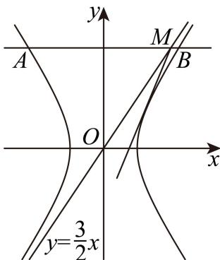

# 2026届上海高三一模 · 杨浦卷

> 按原卷题号整理；题面、图片和解答未全卷逐页终核。

## 第 1 题

不等式 $\frac{x - 2}{x + 3} < 0$ 的解集为 \_\_\_\_.

【答案】 $(-3,2)$

【解析】

【分析】根据题意，转化为 $(x-2)(x+3)<0$ ，结合一元二次不等式的解法，即可求解.

【详解】由不等式 $\frac{x - 2}{x + 3} < 0$ ，可得 $(x - 2)(x + 3) < 0$ ，解得 $-3 < x < 2$

所以不等式 $\frac{x-2}{x+3}<0$ 的解集为 $(-3,2)$ .

故答案为： $(-3,2)$ .

## 第 2 题

函数 $y = 3 \sin \left( 2x + \frac{\pi}{6} \right)$ 的最小正周期为 \_\_\_\_.

【答案】 $\pi$

【解析】

【分析】利用正弦型函数的最小正周期公式 $T=\frac{2\pi}{|\omega|}$ 即可得解.

【详解】函数 $y=3\sin(2x+\frac{\pi}{6})$ 的最小正周期 $T=\frac{2\pi}{2}=\pi$

故答案为： $\pi$ .

## 第 3 题

已知向量 $\vec{a}=(2,3)$ ， $\vec{b}=(3,x)$ ，且 $\vec{a} \perp \vec{b}$ ，则实数 x = \_\_\_\_.

【答案】-2

【解析】

【分析】由向量垂直坐标表示可得答案.

【详解】因 $\vec{a} \perp \vec{b}$ ，则 $\vec{a} \cdot \vec{b} = 6 + 3x = 0 \Rightarrow x = -2$ .

故答案为：-2

## 第 4 题

若复数 $z$ 满足: $\frac{z}{\mathrm{i}} = 1 - 2\mathrm{i}$ , 则 $\left|z\right| =$ \_\_\_\_.

【答案】 $\sqrt{5}$

【解析】

【分析】先根据复数的运算求出复数 z，再根据复数的模的计算公式即可求出答案.

【详解】由 $\frac{z}{\mathrm{i}} = 1 - 2\mathrm{i}$ 得， $z = \mathrm{i}(1 - 2\mathrm{i}) = 2 + \mathrm{i}$

则 $|z| = \sqrt{2^2 + 1^2} = \sqrt{5}$

故答案为： $\sqrt{5}$

## 第 5 题

$(x-2)^{6}$ 的展开式中 $x^{2}$ 的系数为 \_\_\_\_.

【答案】240

【解析】

【分析】先求得 $(x-2)^{6}$ 的展开式的通项公式，再令x次数为2求解.

【详解】 $(x-2)^{6}$ 的展开式的通项公式为 $T_{r+1}=C_{6}^{r}\cdot(-2)^{r}\cdot x^{6-r}$

令 6-r=2，求得 r=4，

所以 $(x - 2)^{6}$ 的展开式中 $x^{2}$ 的系数为 $C_6^4\cdot (-2)^4 = 240$

故答案为：240

【点睛】本题主要考查二项式定理展开式的项的系数，属于基础题.

## 第 6 题

已知圆锥底面半径为 1，高为 $\sqrt{3}$ ，则该圆锥的侧面积为 \_\_\_\_.

【答案】 $2\pi$

【解析】

【分析】由已知求得母线长，代入圆锥侧面积公式求解.

【详解】由已知可得 $r=1,\quad h=\sqrt{3}$ ，则圆锥的母线长 $1=\sqrt{1+3}=2$ ，

∴圆锥的侧面积 $S=\pi r1=2\pi$ .

故答案为 $2\pi$ ：

【点睛】本题考查圆锥侧面积的求法, 侧面积公式 S= $\pi rl$ .

## 第 7 题

圆 $C: (x - 5)^2 + (y - 3)^2 = 10$ 的圆心到直线 $l: x - y + 2 = 0$ 的距离为 \_\_\_\_.

【答案】 $2\sqrt{2}$

【解析】

【分析】利用点到直线的距离公式计算即得.

【详解】圆 $C:(x-5)^{2}+(y-3)^{2}=10$ 的圆心 $C(5,3)$ 到直线 $l: x-y+2=0$ 的距离为 $d=\frac{\left|5-3+2\right|}{\sqrt{2}}=2\sqrt{2}$ .

故答案为： $2\sqrt{2}$

## 第 8 题

已知甲、乙两个篮球运动员罚球的命中率分别为 $\frac{2}{3}$ 、 $\frac{3}{4}$ , 两人各投一次, 假设事件“甲命中”与“乙命中”是独立的, 则至少有一个人命中的概率为 \_\_\_\_.

【答案】 $\frac{11}{12}$

【解析】

【分析】正难则反，先求其对立事件的概率，即两人都未命中的概率即可.

【详解】记事件 A=“甲和乙至少一人命中”，则其对立事件为 $\overline{A}=$ “甲和乙两人都未命中”，

由相互独立事件同时发生的概率乘法公式得 $P\left(\overline{A}\right) = \left(1 - \frac{2}{3}\right)\times \left(1 - \frac{3}{4}\right) = \frac{1}{12},$

所以 $P(A) = 1 - \frac{1}{12} = \frac{11}{12}$ .

故答案为： $\frac{11}{12}$ .

## 第 9 题

等差数列 $\left\{a_{n}\right\}$ 的公差不为 0，前 n 项和为 $S_{n}$ ，若 $a_{3}$ ， $a_{5}$ ， $a_{8}$ 成等比数列，则 $\frac{S_{11}}{a_{10}} =$ \_\_\_\_ .

【答案】7

【解析】

【分析】设等差数列 $\{a_{n}\}$ 的公差为 $d(d\neq 0)$ ，根据条件得 $a_1 = 2d$ ，再利用等差数列的前 $n$ 项和公式及等差数列的通项公式，即可求解.

【详解】设等差数列 $\left\{a_{n}\right\}$ 的公差为 $d(d\neq0)$ ，因为 $a_{3}$ ， $a_{5}$ ， $a_{8}$ 成等比数列，

则 $a_5^2 = a_3a_8$ ，所以 $\left(a_{1} + 4d\right)^{2} = \left(a_{1} + 2d\right)\left(a_{1} + 7d\right)$ ，整理得到 $a_1 = 2d$

所以 $\frac{S_{11}}{a_{10}} = \frac{11a_1 + \frac{11\times 10}{2}d}{a_1 + 9d} = \frac{77d}{11d} = 7$

故答案为：7.

## 第 10 题

已知定义在 $\mathbf{R}$ 上的函数 $y = f(x)$ 为奇函数，且 $g(x) = \begin{cases} 2^x, & x \geq 0 \\ f(x), & x < 0 \end{cases}$ 为偶函数，则 $f(\log_2 3) =$ \_\_\_\_.

【答案】-3

【解析】

【分析】先根据 $f(x)$ 为奇函数，得 $f(\log_{2}3) = -f(-\log_{2}3)$ ，再根据 $g(x)$ 解析式及偶函数性质可得所求函数值.

【详解】因为函数 $y = f(x)$ 为 R 上的奇函数，所以 $f(-x) = -f(x)$ ，得

$$
f \left(\log_ {2} 3\right) = - f (- \log_ {2} 3)
$$

又因为 $g(x) = \begin{cases} 2^x, & x \geq 0 \\ f(x), & x < 0 \end{cases}$ 为偶函数，所以 $g(-x) = g(x)$ ， $g(-\log_2 3) = g(\log_2 3)$ . 因为 $\log_2 3 > 0$ ，所以

$$
f \left(\log_ {2} 3\right) = - f \left(- \log_ {2} 3\right) = - g \left(- \log_ {2} 3\right) = - g \left(\log_ {2} 3\right) = - 2 ^ {\log_ {2} 3} = - 3.
$$

故答案为：-3.

## 第 11 题

某数学建模活动小组在开展主题为“空中不可到达两点的测距问题”的探究活动中，抽象并构建了如图所示的几何模型，该模型中 $MA$ ， $NB$ 均与水平面 $ABC$ 垂直，在已测得可直接到达的两点间距离 $AC$ ， $BC$ ，且 $AC < BC$ ，用测角仪测得 $\angle MCA$ ， $\angle NCB$ 的情况下，四名同学用测角仪各自测得下面一个角：① $\angle ABC$ ；② $\angle ACB$ ；③ $\angle BAC$ ；④ $\angle MCN$ ，其中一定能唯一确定 $M, N$ 之间的距离有\_\_\_\_。（写出所有正确的序号）

【答案】②③④

【解析】

【分析】结合题目给出条件以及直角三角形的边角关系，可知 $MA, MC, NB, NC$ 均已确定，对于①②③，可先根据余弦定理判断 $AB$ 是否确定，再根据勾股定理判断 $MN$ 是否确定；对于④，可直接根据余弦定理进行判断.

【详解】设

$$
A B = c, A C = b, B C = a, M A = h _ {1}, N B = h _ {2}, C M = m, C N = n, \angle M C A = \theta , \angle N C B = \alpha
$$

在 $\mathrm{Rt}_{\triangle}MAC$ 中， $CM = m = \frac{CA}{\cos\angle MCA} = \frac{b}{\cos\theta}, MA = h_1 = CA \cdot \tan \theta = b\tan \theta$

同理可得 $CN = n = \frac{a}{\cos\alpha}, NB = h_2 = a\tan \alpha$

由于 $a, b, \theta, \alpha$ 均为已知量，故 $m, n, h_1, h_2$ 均为定值.

对于①：在 $\triangle ABC$ 中，由余弦定理可得 $b^{2} = a^{2} + c^{2} - 2ac\cos \angle ABC$ ，且 $a, b, \cos \angle ABC$ 均为定值，故该方程为关于 $c$ 的一元二次方程， $c$ 可能有两解.

例如，若 $a = \sqrt{3}, b = 1, \cos \angle ABC = \frac{\sqrt{3}}{2}$ ，

则可得 $c^2 + 3 - 1 = 2 \cdot \sqrt{3} \cdot c \cdot \frac{\sqrt{3}}{2}$ ，即 $c^2 - 3c + 2 = 0$ ，解得 $c = 1$ 或 $2$ ，

由勾股定理可得 $MN = \sqrt{AB^{2} + (NB - MA)^{2}} = \sqrt{c^{2} + (h_{2} - h_{1})^{2}}$ ，由于 $h_{1}, h_{2}$ 为定值，而 c 有两解，故 MN 也有两解，故①错误；

对于②：在 $\triangle ABC$ 中，由余弦定理可得 $c^2 = a^2 + b^2 - 2ab\cos \angle ACB$ ，且 $a, b, \cos \angle ACB$ 均为定值，故 $c$ 也为定值，

又因为 $MN = \sqrt{c^2 + (h_2 - h_1)^2}$ ，其中 $c, h_1, h_2$ 均为定值，故 $MN$ 为定值，故②正确；

对于③：在 $\triangle ABC$ 中，由余弦定理可得 $a^2 = b^2 + c^2 - 2bc\cos \angle BAC$ ，整理得

$c^{2}-2bc\cos\angle BAC+b^{2}-a^{2}=0$ 且 a,b, $\cos\angle BAC$ 均为定值，

故该方程为关于 c 的一元二次方程. 又 $\because 0 < b < a, \therefore b^{2} - a^{2} < 0$ ,

故 $\Delta = 4b^{2}(\cos \angle BAC)^{2} - 4(b^{2} - a^{2}) > 0$ ，即 $c$ 有两解，设两解分别为 $c_{1}, c_{2}$ 由韦达定理可知， $c_{1}c_{2}=b^{2}-a^{2}<0$ ，即 $c_{1},c_{2}$ 异号，因此该方程仅有1个正数解，即c有唯一确定解，

又因为 $MN = \sqrt{c^2 + (h_2 - h_1)^2}$ ，其中 $c, h_1, h_2$ 均为定值，故 $MN$ 为定值，故③正确；对于④：在 $\triangle MCN$ 中，由余弦定理可知， $MN^2 = m^2 + n^2 - 2mn\cos \angle MCN$ ，因为 $m, n, \cos \angle MCN$ 均为定值，故 $MN$ 也为定值，故④正确，

故答案为：②③④.

## 第 12 题

数列 A: $a_{1}, a_{2}, \cdots, a_{100}$ 满足: $a_{i} \in \mathbf{N}(1 \leq i \leq 100)$ ，且 $1 = a_{1} < a_{2} < \cdots < a_{100} = 2025$ ，记 集 合

$M(A)=\left\{(b_{1},b_{2},\cdots,b_{100})\mid b_{1}=1,b_{100}=2025,b_{i}=a_{i-1}+1\text{或}b_{i}=a_{i+1}-1,i=2,3,\cdots,99\right\}$ . 若数列 A 满足：对任意 $(b_{1},b_{2},\cdots,b_{100})\in M(A)$ ，均有 $b_{1}<b_{2}<\cdots<b_{100}$ ，则称数列 A 是“好的”。“好的”数列 A 的个数为 ______.

【答案】1926

【解析】

【分析】由题意，要 $b_{i}<b_{i+1}$ ，则要满足 $\max(b_{i})<\min(b_{i+1}),(2\leq i\leq98)$ ，可得 $a_{i+1}-a_{i}=1(2\leq i\leq98)$ ，设 $a_{2}=k$ ，则 $a_{99}=k+97$ ，分析可得k的范围，进而得到答案.
【详解】由题意，要 $b_{i}<b_{i+1}$ ，则需满足 $\max(b_{i})<\min(b_{i+1}),(2\leq i\leq98)$ ，

即 $a_{i + 1} - 1 < a_i + 1$ ，即 $a_{i + 1} - a_i < 2$

由已知数列 A 为递增数列， $a_{i+1}-a_{i}\geq1$ ，

则有 $a_{i + 1} - a_i = 1(2\leq i\leq 98)$

设 $a_{2}=k$ ，则 $a_{99}=k+97$ ，

又 $a_1 < a_2$ ，则 $k > 1$ ，则 $k \geq 2$ ；

$a_{99} < a_{100}$ ，则 $k + 97 < 2025$ ，则 $k \leq 1927$

所以 $k \in [2,1927]$ ，则整数个数为 $1927 - 2 + 1 = 1926$ ，

则“好的”数列 A 的个数为 1926.

故答案为：1926.

## 第 13 题

已知实数 $a, b, c, d$ 满足: $a > b > c > d$ , 则下列不等式恒成立的是 ( )
A. $a - c > b - d$ B. $a + c > b + d$ C. $ab > cd$ D.

$$
a c > b d
$$

【答案】B

【解析】

【分析】举出反例可判断 ACD，根据不等式的基本性质，可判断 B，进而得到答案.

【详解】对于 A，令 a=4, b=3, c=2, d=1，满足 a>b>c>d，

此时 a-c=2, b-d=2，a-c=b-d，故 A 错误；

对于 B，由 a > b, c > d ，两式相加得 $a + c > b + d$ ，故 B 正确；

对于 C，令 a=1, b=0, c=-1, d=-2，满足 a>b>c>d，

此时 ab = 0, cd = 2，ab < cd，故 C 错误；

对于D，令 $a = 1, b = -1, c = -2, d = -3$ ，满足 $a > b > c > d$

此时 $ac = -2, bd = 3$ ， $ac < bd$ ，故D错误.

故选：B

## 第 14 题

若 m, n 为两条不同直线， $\alpha, \beta$ 为两个不同平面，则下列结论中正确的是（）

A. 若 $m // \alpha$ ， $n \subset \alpha$ ，则 $m // n$ B. 若 $m // n$ ， $n \subset \alpha$ ，则 $m // \alpha$ C. 若 $m \subset \alpha$ ， $m \perp \beta$ ，则 $\alpha \perp \beta$ D. 若 $m \subset \alpha$ ， $\alpha \perp \beta$ ，则 $m \perp \beta$

【答案】C

【解析】

【分析】利用线面平行的判定定理和性质定理可判断 AB，利用面面垂直的判定定理和性质定理可判断 CD.

【详解】若 $m // \alpha$ ， $n \subset \alpha$ ，则 $m // n$ 或 m, n 为异面直线，故 A 错误；

若 $m / / n$ ， $n\subset \alpha$ ，则 $m / / \alpha$ 或 $m\subset \alpha$ ，故B错误；

若 $m \subset \alpha$ ， $m \perp \beta$ ，则 $\alpha \perp \beta$ ，满足面面垂直的判定定理，故C正确；
若 $m \subset \alpha$ ， $\alpha \perp \beta$ ，这缺少了2个条件，即 $\alpha \cap \beta = l, m \perp l$ ，才可以得到 $m \perp \beta$ ，故D错误；
故选：C.

## 第 15 题

已知双曲线 $C: \frac{x^2}{4} - \frac{y^2}{9} = 1$ ，点 $M(4,6)$ ，点 $A$ 、 $B$ 分别在双曲线 $C$ 的左、右两支上，则向量 $\overrightarrow{MA}$ 、 $\overrightarrow{MB}$ 的夹角 $\theta$ （）
A. 有最大值，但无最小值 B. 无最大值，但有最小值
C. 既有最大值，又有最小值 D. 既无最大值，又无最小值

【答案】A

【解析】

【分析】根据题意，得到点 M 在双曲线的渐近线 $y=\frac{3}{2}x$ 上，结合双曲线的几何性质，以及向量的夹角的定义，即可求解.
【详解】由双曲线 $C:\frac{x^{2}}{4}-\frac{y^{2}}{9}=1$ ，可得 a=2, b=3，所以双曲线的其中一条渐近线方程为 $y=\frac{3}{2}x$ 则点 $M(4,6)$ 满足渐近线 $y=\frac{3}{2}x$ ，所以点 M 在双曲线的渐近线 $y=\frac{3}{2}x$ 上，
所以过点 M 存在双曲线右支的切线，但不存在与左支相切的直线，
所以向量 $\overrightarrow{MA}, \overrightarrow{MB}$ 的夹角 $\theta$ 不存在最小值，
过点 M 作 x 轴的平行线，交双曲线的左右两支分别为 A, B 两点，此时 $\overrightarrow{MA}, \overrightarrow{MB} = \pi$ ，
因为 $\theta \in [0, \pi]$ ，所以向量 $\overrightarrow{MA}, \overrightarrow{MB}$ 的夹角 $\theta$ 存在最大值，最大值为 $\pi$ ，
综上可得，向量 $\overrightarrow{MA}, \overrightarrow{MB}$ 的夹角 $\theta$ 存在最大值，不存在最小值.
故选：A.

## 第 16 题

函数 $y = f(x)$ 的定义域、值域均为 R，定义集合 $M_{a} = \left\{ t \mid t = f(x) - f(a), x \geq a \right\}$ . 给出如下两个结论：①存在函数 $y = f(x)$ ，使得对任意实数 a 均有 $M_{a} = [0, +\infty)$ ；②对任意函数 $y = f(x)$ ，都存在实数 b，使得对任意实数 a 均有 $M_{b} \subseteq M_{a}$ . 下面判断正确的是（）A. ①正确，②正确 B. ①正确，②错误 C. ①错误，②正确 D. ①错误，②错误

【答案】B

【解析】

【分析】对于①，根据定义找到满足条件的一个函数进行说明即可；对于②，假设 $f(x)=\left\{\begin{aligned}&0,x=0\\ &\frac{1}{x},x\neq0\end{aligned}\right.$ ，分b>0,b=0,b<0讨论即可说明②不成立.

【详解】假设 $f(x)=x$ ， $f(x)$ 在 R 上单调递增函数，

对于任意实数 $a$ ， $t = f(x) - f(a) = x - a, x \geq a$

$\because x \geq a, \therefore f(x) \geq f(a), \therefore t \geq 0, \therefore M_a = [0, +\infty)$ ，故①正确；

设 $f(x) = \begin{cases} 0, & x = 0 \\ \frac{1}{x}, & x \neq 0 \end{cases}$ ，当 $b = 0$ 时， $t = f(x), x \geq 0$ ， $M_b = \{t | t \geq 0\}$ ，

此时取 $a = 2$ ，则 $M_{a} = \left\{t\Big|t = f(x) - \frac{1}{2},x\geq 2\right\} = \left\{t\Big| - \frac{1}{2} < t\leq 0\right\}$ ，不满足 $M_{b}\subseteq M_{a}$ 当 $b > 0$ 时， $M_{b} = \left\{t\Big| - f(b) < t\leq 0\right\}$ ，取 $a > b$ ，则 $M_{a} = \left\{t\Big| - f(a) < t\leq 0\right\}$ 因为 $a > b > 0$ ，所以 $f(a) < f(b)$ ，所以 $-f(a) > - f(b)$

此时 $M_{b} \supseteq M_{a}$ ，不满足 $M_{b} \subseteq M_{a}$ ；

当 $b < 0$ 时， $M_{b} = (-\infty, 0] \cup [-f(b), +\infty)$ ，

取 $a = 2$ ，则 $M_{a} = \left\{t\left| - \frac{1}{2} < t \leq 0\right.\right\}$ ，不满足 $M_{b} \subseteq M_{a}$

综上，不存在实数 $b$ ，使得对任意 $a \in \mathbf{R}$ 均有 $M_b \subseteq M_a$ . 故②错误.

故选：B.

## 第 17 题

如图，在长方体 $ABCD - A_{1}B_{1}C_{1}D_{1}$ 中， $M$ 为 $BB_{1}$ 上一动点，已知 $AD = CD = 2$ ， $AA_{1} = 4$ .

(1) 求直线 $A_{1} C$ 与平面 $A B C D$ 所成角的大小; (用反三角表示)

(2) 求三棱锥 $M - AA_{1}C$ 的体积.

【答案】(1) $\arcsin \frac{\sqrt{6}}{3}$

(2) $\frac{8}{3}$

【解析】

【分析】（1）先找出 $\angle ACA_{1}$ 即为直线 $A_{1}C$ 与平面 ABCD 所成角，再求 $\angle ACA_{1}$ 的大小即可；

（2）根据 $V_{M-AA_{1}C}=V_{B-AA_{1}C}=V_{A_{1}-ABC}$ ，再利用三棱锥的体积公式即可求解.

【小问 1 详解】

连接 $AC$ ，由题意得 $AA_{1} \perp$ 平面ABCD，

则 $\angle ACA_{1}$ 即为直线 $A_{1}C$ 与平面ABCD所成角，

又 $AD = CD = 2$ ， $AA_{1} = 4$

在直角 $\triangle ACA_{1}$ 中， $AC = 2\sqrt{2}$ ， $A_{1}C = \sqrt{AA_{1}^{2} + AC^{2}} = \sqrt{4^{2} + (2\sqrt{2})^{2}} = 2\sqrt{6}$

$\sin \angle ACA_{1} = \frac{AA_{1}}{A_{1}C} = \frac{4}{2\sqrt{6}} = \frac{\sqrt{6}}{3}$ 则 $\angle ACA_{1} = \arcsin \frac{\sqrt{6}}{3}$

所以直线 $A_{1}C$ 与平面ABCD所成角的大小为 $\arcsin \frac{\sqrt{6}}{3}$

【小问 2 详解】

由题意得， $BB_{1}$ // 平面 $AA_{1}C$ ，

$$
V _ {M - A A _ {1} C} = V _ {B - A A _ {1} C} = V _ {A _ {1} - A B C} = \frac {1}{3} S _ {\triangle A B C} \cdot A A _ {1} = \frac {1}{3} \times \frac {1}{2} \times 2 \times 2 \times 4 = \frac {8}{3}
$$

所以三棱锥 $M - AA_{1}C$ 的体积为 $\frac{8}{3}$ .

## 第 18 题

已知函数 $f(x) = \sin x + \cos x, x \in \mathbf{R}$ .

（1）记 $g(x) = f(x) + f\left(x + \frac{\pi}{2}\right)$ ，求证：函数 $y = g(x)$ 为偶函数；

（2）在 $\triangle ABC$ 中， $A$ ， $B$ ， $C$ 所对的边分别为 $a$ ， $b$ ， $c$ ，已知 $f\left(C + \frac{\pi}{4}\right) = -\frac{\sqrt{2}}{4}, a = 3,$ $c = 2b$ ，求 $\triangle ABC$ 的面积.

【答案】（1）证明见解析

(2) $\frac{3\sqrt{15}}{4}$

【解析】

【分析】（1）利用诱导公式得 $g(x)=2\cos x$ ，再根据偶函数的定义证明即可；

（2）利用辅助角公式整理 $f(x)$ ，根据已知求出 $\cos C = -\frac{1}{4}$ ，利用余弦定理结合已知可得 $b$ 的值，最后由三角形面积公式求解.

【小问 1 详解】

根据题意， $g(x)=f(x)+f\left(x+\frac{\pi}{2}\right)=\sin x+\cos x+\sin\left(x+\frac{\pi}{2}\right)+\cos\left(x+\frac{\pi}{2}\right)$

$$
= \sin x + \cos x + \cos x - \sin x = 2 \cos x
$$

则 $g(-x) = 2\cos (-x) = 2\cos x = g(x)$

所以函数 $y = g(x)$ 为偶函数；

【小问 2 详解】

由辅助角公式得 $f(x)=\sin x+\cos x=\sqrt{2}\sin\left(x+\frac{\pi}{4}\right)$ ,

$$
f \left(C + \frac {\pi}{4}\right) = \sqrt {2} \sin \left[ \left(C + \frac {\pi}{4}\right) + \frac {\pi}{4} \right] = \sqrt {2} \sin \left(C + \frac {\pi}{2}\right) = \sqrt {2} \cos C = - \frac {\sqrt {2}}{4}
$$

所以 $\cos C = -\frac{1}{4}$ ，可得 $C \in \left(\frac{\pi}{2}, \pi\right)$ ，

由余弦定理可得 $c^2 = a^2 + b^2 - 2ab\cos C$ ，由于 $a = 3$ ， $c = 2b$ ，

则 $3b^{2} - \frac{3}{2} b - 9 = 0$ ，解得 $b = 2$ （舍去负根），

由已知得 $C \in \left(\frac{\pi}{2}, \pi\right)$ ，则 $\sin C = \sqrt{1 - \cos^2 C} = \frac{\sqrt{15}}{4}$ ，

所以 $S_{\triangle ABC} = \frac{1}{2} ab\sin C = \frac{1}{2}\times 3\times 2\times \frac{\sqrt{15}}{4} = \frac{3\sqrt{15}}{4}.$

## 第 19 题

为了了解某校高三年级学生的体育成绩，随机选取100名学生参加考核，将考核的成绩（满分100分，成绩均为不低于40分的整数）分成六组： $[40,50)$ ， $[50,60)$ ， $[60,70)$ ， $[70,80)$ ， $[80,90)$ ， $[90,100]$ ，得到如图所示的频率分布直方图.

（1）求频率分布直方图中 $a$ 的值；

(2) 在考核成绩为 $[70,80)$ , $[80,90)$ , $[90,100]$ 的三组学生中, 用分层抽样的方法抽取 13 人, 则考核成绩在 $[70,80)$ 中的学生应抽取多少人?

(3) 若落在 $[50,60)$ 学生的平均成绩是 54.4，方差是 5.2，落在 $[60,70)$ 学生的平均成绩为 66.4，方差是 9.2，求这两组学生成绩的平均数和方差。（结果精确到 0.1）

【答案】（1） $a = 0.03$

(2) 6

（3）平均数为62.4，方差为39.9

【解析】

【分析】（1）利用频率之和为1结合频率分布直方图列式求出 $a$ ；

（2）利用频率分布直方图求出成绩为 $[70,80)$ ， $[80,90)$ ， $[90,100]$ 的学生人数，再根据分层抽样的概念求解即可；

（3）先利用频率分布直方图求出 $[50,60)$ 和 $[60,70)$ 的学生人数，再根据平均数和方差公式计算求解即可.

【小问 1 详解】

由频率分布直方图可得 $10\times(0.005+0.01+0.02+a+0.025+0.01)=1$ ，

解得 $a = 0.03$

【小问 2 详解】

由频率分布直方图知，样本考核成绩在 $[70,80)$ ， $[80,90)$ ， $[90,100]$ 的三组学生有 $100 \times 10 \times (0.03 + 0.025 + 0.01) = 65$ （人），

其中样本考核成绩在 $[70,80)$ 的市民人数为 $100\times 10\times 0.03 = 30$

用分层抽样的方法应从考核成绩在 $[70,80)$ 的市民中抽取 $\frac{30}{65} \times 13 = 6$ （人）.

【小问 3 详解】

由频率分布直方图知，成绩在 $\left[50,60\right)$ 的学生人数为 $100\times0.1=10$ ，

成绩在 $[60,70)$ 的市民人数为 $100 \times 0.2 = 20$ ，

所以总平均数 $\overline{z} = \frac{10\times 54.4 + 20\times 66.4}{10 + 20} = 62.4$

$$
s ^ {2} = \frac {1 0}{1 0 + 2 0} \left[ 5. 2 + (5 4. 4 - 6 2. 4) ^ {2} \right] + \frac {2 0}{1 0 + 2 0} \left[ 9. 2 + (6 6. 4 - 6 2. 4) ^ {2} \right] = \frac {5 9 8}{1 5} \approx 3 9. 9
$$

## 第 20 题

已知椭圆 $C: \frac{x^2}{a^2} + \frac{y^2}{2} = 1(a > \sqrt{2})$ ，过动点 $M(0, m)$ 的直线交 $x$ 轴于点 $N$ ，交椭圆 $C$ 于 $A$ ， $P$ （点 $P$ 在第一象限），过点 $P$ 作 $x$ 轴的垂线交椭圆 $C$ 于另一点 $Q$ ，延长 $QM$ 交椭圆 $C$ 于点 $B$ .

（1）若椭圆 $C$ 的离心率为 $\frac{\sqrt{3}}{2}$ ，求 $a$ 的值；

（2）已知 $m = \frac{\sqrt{3}}{3}$ ，且 $BQ$ 是线段 $PN$ 的垂直平分线，求 $a$ 的值；

（3）已知 $a=2$ ，点 M 是线段 PN 的中点，且 $\overrightarrow{QM}=2\overrightarrow{MB}$ ，求直线 AB 的斜率.

【答案】(1) $2 \sqrt{2}$

(2) $\sqrt{3}$

(3) $\frac{\sqrt{6}}{2}$

【解析】

【分析】（1）根据离心率的概念列式求 a 即可.

（2）根据题意，设 $P\left(x_0, \frac{2\sqrt{3}}{3}\right)$ ，则 $N(-x_0, 0)$ ， $Q\left(x_0, -\frac{2\sqrt{3}}{3}\right)$ ，根据 $\overrightarrow{NP} \perp \overrightarrow{MQ}$ 列式可求 $x_0$ 的值，在根据 $P$ 点在椭圆上，可求 $a$ 的值.

（3）根据题意，可求出 P, M, B, A 的坐标，进而求直线 AB 的斜率.

【小问 1 详解】

因为 $a > \sqrt{2} = b$ ，所以 $e^2 = \frac{c^2}{a^2} = \frac{a^2 - b^2}{a^2} = 1 - \frac{2}{a^2}$

因为 $e = \frac{\sqrt{3}}{2}$ ，所以 $1 - \frac{2}{a^2} = \frac{3}{4} \Rightarrow a^2 = 8$ ，又 $a > \sqrt{2}$ ，所以 $a = 2\sqrt{2}$ 。

【小问 2 详解】

因为 $m = \frac{\sqrt{3}}{3}$ ，且 $BQ$ 是线段 $NP$ 的垂直平分线，

所以 $M\left(0, \frac{\sqrt{3}}{3}\right)$ 是线段 $NP$ 的中点.

所以可设 $P\left(x_0, \frac{2\sqrt{3}}{3}\right)$ ，则 $N(-x_0, 0)$ ， $Q\left(x_0, -\frac{2\sqrt{3}}{3}\right)$ .

所以 $\overrightarrow{NP} = \left(2x_0, \frac{2\sqrt{3}}{3}\right)$ , $\overrightarrow{MQ} = (x_0, -\sqrt{3})$ .

由 $\overrightarrow{NP} \perp \overrightarrow{MQ} \Rightarrow \overrightarrow{NP} \cdot \overrightarrow{MQ} = 2x_0^2 - 2 = 0$ .

又点 $P$ 在第一象限，所以 $x_0 > 0$ ，所以 $x_0 = 1$ ，即 $P\left(1, \frac{2\sqrt{3}}{3}\right)$ .

又点 P 在椭圆 $\frac{x^{2}}{a^{2}} + \frac{y^{2}}{2} = 1$ 上，所以 $\frac{1}{a^{2}} + \frac{2}{3} = 1 \Rightarrow a^{2} = 3$ .

又 $a > 0$ ，所以 $a = \sqrt{3}$

【小问 3 详解】

因为 a=2 ，所以椭圆 C： $\frac{x^{2}}{4}+\frac{y^{2}}{2}=1$ .

如图，作出符合题意的图形，

因为点 $M(0,m)$ 是线段 PN 的中点，可设 $P(x_{0},2m)$ ， $N(-x_{0},0)$ ，则 $Q(x_{0},-2m)$ .

设 $B(x_{1},y_{1})$ ，因为 $\overrightarrow{QM} = 2\overrightarrow{MB}\Rightarrow (-x_0,3m) = 2(x_1,y_1 - m)\Rightarrow \left\{ \begin{array}{l}x_{1} = -\frac{x_{0}}{2}\\ y_{1} = \frac{5m}{2} \end{array} \right.$

因为 P, B 都在椭圆 C 上，所以 $\left\{\begin{aligned}\frac{x_{0}^{2}}{4}+\frac{(2m)^{2}}{2}&=1\\ \frac{\left(-\frac{x_{0}}{2}\right)^{2}}{4}+\frac{\left(\frac{5m}{2}\right)^{2}}{2}&=1\end{aligned}\right.\Rightarrow\left\{\begin{aligned}x_{0}^{2}&=\frac{12}{7}\\ m^{2}&=\frac{2}{7}\end{aligned}\right.$

因为点 $P$ 在第一象限，所以 $\left\{ \begin{array}{l} x_0 = \frac{2\sqrt{21}}{7} \\ m = \frac{\sqrt{14}}{7} \end{array} \right.$

所以 $P\left(\frac{2\sqrt{21}}{7}, \frac{2\sqrt{14}}{7}\right)$ , $M\left(0, \frac{\sqrt{14}}{7}\right)$ , $B\left(-\frac{\sqrt{21}}{7}, \frac{5\sqrt{14}}{14}\right)$ .

因为 $k_{MP} = \frac{\frac{\sqrt{14}}{7}}{\frac{2\sqrt{21}}{7}} = \frac{\sqrt{6}}{6}$ ，所以直线 $MP$ 的方程为： $y = \frac{\sqrt{6}}{6} x + \frac{\sqrt{14}}{7}$ .

$$
\left\{ \begin{array}{l} y = \frac {\sqrt {6}}{6} x + \frac {\sqrt {1 4}}{7} \\ \frac {x ^ {2}}{4} + \frac {y ^ {2}}{2} = 1 \end{array} \Rightarrow \frac {1}{3} x ^ {2} + \frac {\sqrt {2 1}}{2 1} x - \frac {6}{7} = 0. \right.
$$

由 $\frac{2\sqrt{21}}{7} \cdot x_A = -\frac{18}{7} \Rightarrow x_A = -\frac{3\sqrt{21}}{7}$ .

所以 $y_{A} = \frac{\sqrt{6}}{6}\times \left(-\frac{3\sqrt{21}}{7}\right) + \frac{\sqrt{14}}{7} = -\frac{\sqrt{14}}{14}.$

可得 $k_{AB} = \frac{\frac{5\sqrt{14}}{14} + \frac{\sqrt{14}}{14}}{-\frac{\sqrt{21}}{7} + \frac{3\sqrt{21}}{7}} = \frac{\sqrt{6}}{2}$ ，即直线 $AB$ 的斜率为 $\frac{\sqrt{6}}{2}$ .

## 第 21 题

已知区间 $I \subseteq \mathbf{R}$ ，函数 $y = f(x)$ 的定义域为 $I$ ，若函数 $y = f(x)$ 满足：对任意 $x_{1}, x_{2} \in I$ ，均有 $\left|f(x_{1}) - f(x_{2})\right| \leq \left|x_{1} - x_{2}\right|$ ，则称函数 $y = f(x)$ 为压缩函数.

（1）判断函数 $f(x) = x^2$ ， $x \in \left[-\frac{1}{2}, \frac{1}{2}\right]$ ，是否为压缩函数？并说明理由；

（2）若函数 $f(x) = \mathrm{e}^{x} + kx$ ， $x \in [0,1]$ 为压缩函数，求实数 $k$ 的取值范围；

（3）已知函数 $y = f(x)$ ， $x \in I$ 为压缩函数，求证： $y = f(x)$ ， $x \in I$ 为单调函数的充要条件是：对任意 $x_{1}, x_{2} \in I$ ，均有 $\left(f(x_{1}) - f\left(\frac{x_{1} + x_{2}}{2}\right)\right) \cdot \left(f(x_{2}) - f\left(\frac{x_{1} + x_{2}}{2}\right)\right) \leq 0$ .

【答案】（1）是压缩函数.

(2) $[-2, 1 - e]$

（3）证明过程详见解析.

【解析】

【分析】（1）根据压缩函数的定义，判断对于任意 $x_{1}, x_{2} \in \left[-\frac{1}{2}, \frac{1}{2}\right]$ ，是否都有 $\left|f(x_{1}) - f(x_{2})\right| \leq \left|x_{1} - x_{2}\right|$ 成立.

（2）根据压缩函数的定义，得到关于 $k$ 的不等式，进而求出 $k$ 的取值范围.

（3）结合压缩函数的定义，分充分性和必要性进行证明.

【小问1详解】

已知函数 $f(x) = x^2$ ，则 $\left|f(x_1) - f(x_2)\right| = \left|x_1^2 - x_2^2\right| = \left|x_1 + x_2\right|\left|x_1 - x_2\right|$ .

因为 $x \in \left[-\frac{1}{2}, \frac{1}{2}\right]$ ，所以 $\left|x_{1} + x_{2}\right| \leq \left|x_{1}\right| + \left|x_{2}\right| \leq \frac{1}{2} + \frac{1}{2} = 1$ ，

那么 $\left|f\left(x_1\right) - f\left(x_2\right)\right| = \left|x_1 + x_2\right|\left|x_1 - x_2\right|\leq \left|x_1 - x_2\right|$

所以函数 $f(x) = x^2$ ， $x \in \left[-\frac{1}{2}, \frac{1}{2}\right]$ ，是压缩函数.

【小问 2 详解】

因为函数 $f(x)=\mathrm{e}^{x}+kx,\quad x\in[0,1]$ 为压缩函数，

所以对于任意 $x_{1}, x_{2} \in [0,1]$ ，均有 $\left|f(x_1) - f(x_2)\right| \leq \left|x_1 - x_2\right|$ .

不妨设 $x_{1} > x_{2}$ ，则不等式可化为： $-\left(x_{1} - x_{2}\right)\leq f\left(x_{1}\right) - f\left(x_{2}\right)\leq x_{1} - x_{2},$

即 $-1 \leq \frac{f(x_{1}) - f(x_{2})}{x_{1} - x_{2}} \leq 1.$

有导数的定义，当 $x_{1}\rightarrow x_{2}$ ， $\frac{f(x_1) - f(x_2)}{x_1 - x_2}\rightarrow f'(x)$

因此需满足 $-1 \leq f'(x) \leq 1$ 对任意 $x \in [0,1]$ 恒成立.

$f^{\prime}(x) = \mathrm{e}^{x} + k$ ，则

① $f'(x) \leq 1$ 对任意 $x \in [0,1]$ 恒成立，即 $e^{x} + k \leq 1$ ，所以 $k \leq 1 - e^{x}$

又 $e^x\in [1,\mathbf{e}]$ ，故 $1 - \mathrm{e}^{x}\in [1 - \mathrm{e},0]$ ，因此 $k\leq 1 - \mathrm{e}$

② $f'(x) \geq -1$ 对任意 $x \in [0,1]$ 恒成立，即 $e^x + k \geq -1$ ，所以 $k \geq -1 - e^x$ ，

又 $e^x\in [1,\mathbf{e}]$ ，故 $-1 - \mathbf{e}^x\in [-1 - \mathbf{e}, - 2]$ ，因此 $k\geq -2$

综上， $k$ 的取值范围为 $[-2,1 - e]$

【小问 3 详解】

必要性证明

设 $f(x)$ 单调，不妨设 $f(x)$ 单调递增（单调递减同理），

任取 $x_{1}, x_{2} \in I$ ，不妨设 $x_{1} \leq x_{2}$ ，则 $x_{1} \leq \frac{x_{1} + x_{2}}{2} \leq x_{2}$ ，

所以 $f(x_{1})\leq f\left(\frac{x_{1} + x_{2}}{2}\right)\leq f(x_{2}),$

故 $\left(f(x_{1})-f\left(\frac{x_{1}+x_{2}}{2}\right)\right)\cdot\left(f(x_{2})-f\left(\frac{x_{1}+x_{2}}{2}\right)\right)\leq0.$

充分性证明

假设 $f(x)$ 不单调，则存在 $a, b, c \in I$ ， $a < b < c$ ，使得 $f(a) \langle f(b) \rangle f(c)$ （或

$$
f (a) > f (b) <   f (c)),
$$

不妨设 $f(a)\langle f(b)\rangle f(c)$ ，取实数 $\lambda_1 < \lambda_2$ 满足 $f(a), f(c) < \lambda_1, f(b) > \lambda_2$

记 $I_{1} = \left[a_{1},c_{1}\right] = \left[a,c\right]$ ，由于 $\left(f(x_1) - f\left(\frac{x_1 + x_2}{2}\right)\right)\cdot \left(f(x_2) - f\left(\frac{x_1 + x_2}{2}\right)\right)\leq 0,$

可知： $f\left(\frac{a+c}{2}\right)<\lambda_{1}$ ，所以 $\frac{a+c}{2}\neq b$ ，

若 $\frac{a + c}{2} < b$ ，记 $I_{2} = [a_{2},c_{2}] = \left[a,\frac{a + c}{2}\right]$ （若 $\frac{a + c}{2} >b$ ，记 $I_{2} = [a_{2},c_{2}] = \left[\frac{a + c}{2},c\right]$ ）

重复上面的操作，可得到区间 $I_{n} = \left[a_{n},c_{n}\right]$ 满足： $a_{n} < b < c_{n}\left(n\in \mathbb{N}^{*}\right)$ ，且区间 $I_{n}$ 的长度 $I_{n} = c_{n} - a_{n} = \frac{1}{2^{n - 1}} (c - a),f(a_{n}),f(c_{n}) <   \lambda_{1},$

因为函数 $y = f(x)$ ， $x \in I$ 为压缩函数，

可得： $\left|f(b)-f(a_{n})\right|\leq\left|b-a_{n}\right|\leq\left|c_{n}-a_{n}\right|=\frac{1}{2^{n-1}}(c-a)$

又 $\left|f(b)-f(a_{n})\right|=f(b)-f(a_{n})>\lambda_{2}-\lambda_{1}$ ，记 $\lambda>\lambda_{2}-\lambda_{1}>0$ ，

所以 $\lambda < \frac{1}{2^{n - 1}} (c - a)$ 对任意 $n\in \mathbf{N}^*$ 恒成立.

取 $n_0 > 1 + \log_2\left(\frac{c - a}{\lambda}\right), n_0 \in \mathbb{N}^*$ ，则与 $\lambda > \frac{1}{2^{n_0 - 1}}(c - a)$ 矛盾，

所以 $y = f(x)$ ， $x \in I$ 为单调函数.

综上， $y = f(x)$ ， $x \in I$ 为单调函数的充要条件是：对任意 $x_{1}, x_{2} \in I$ ，均有

$\left(f(x_{1}) - f\left(\frac{x_{1} + x_{2}}{2}\right)\right) \cdot \left(f(x_{2}) - f\left(\frac{x_{1} + x_{2}}{2}\right)\right) \leq 0$ 成立.
