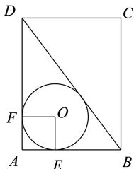
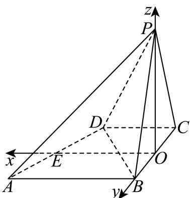
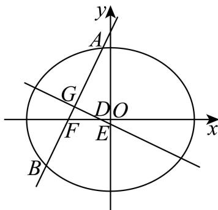

# 2026届上海高三一模 · 松江卷

> 按原卷题号整理；题面、图片和解答未全卷逐页终核。

## 第 1 题

已知集合 $A = (-1, 5), B = \{x \mid -2 < x < 2\}$ ，则 $A \cap B =$ \_\_\_\_.

【答案】 $\{x\mid -1 <   x <   2\}$

【解析】

【分析】根据集合的交集运算，即可求解.

【详解】由题意，集合 $A=(-1,5)$ ， $B=\left\{x\mid-2<x<2\right\}$ ，

所以 $A \cap B = \{x \mid -1 < x < 2\}$ .

故答案为： $\left\{x\mid-1<x<2\right\}$

## 第 2 题

抛物线 $y^{2}=8x$ 的焦点到其准线的距离为 \_\_\_\_.

【答案】4

【解析】

【分析】根据给定条件，求出抛物线的焦点坐标及准线方程即可.

【详解】抛物线 $y^{2}=8x$ 的焦点坐标为 $(2,0)$ ，准线方程为 x=-2，

所以所求距离为 $|2-(-2)|=4$ .

故答案为：4

## 第 3 题

不等式 $\frac{1}{x}<-2$ 的解集为\_\_\_\_.

【答案】 $(- \frac{1}{2}, 0)$

【解析】

【分析】将分式不等式化为一元二次不等式，进而求解解集即可.

【详解】因为 $\frac{1}{x}<-2$ ，所以 $\frac{1}{x}+2<0$ ，即 $\frac{1+2x}{x}<0$ ，

可得 $\left\{\begin{aligned}x(1+2x)<0\\ x\neq0\end{aligned}\right.$ ，解得 $x\in(-\frac{1}{2},0)$ .

故答案为： $(- \frac{1}{2}, 0)$

## 第 4 题

复数 $z = \frac{1 + 3\mathrm{i}}{1 + \mathrm{i}}$ （其中 $\mathrm{i}$ 是虚数单位）在复平面内对应点的坐标为 \_\_\_\_.

【答案】(2,1)

【解析】

【分析】先利用复数的除法法则将 $z = \frac{1 + 3\mathrm{i}}{1 + \mathrm{i}}$ 化简，再利用复数的几何意义即可得解.

【详解】 $\because z=\frac{1+3i}{1+i}=\frac{(1+3i)(1-i)}{(1+i)(1-i)}=\frac{4+2i}{2}=2+i$ ，

∴ 复数 z 在复平面内对应点的坐标为 $(2,1)$ .

故答案为：(2,1).

## 第 5 题

某运动员在某次男子 10 米气手枪射击比赛中的得分数据（单位：环）如茎叶图所示，则这组数据的平均数为 \_\_\_\_.

$$
\left| \begin{array}{c c c c c c} 8 & 6 & & & \\ 9 & 1 & 6 & 7 & 7 & 8 \\ 1 0 & 0 & 0 & 2 & 7 \end{array} \right.
$$

【答案】9.74

【解析】

【分析】先读取茎叶图得到数据，再利用平均数公式求解平均数即可.

【详解】由题意得得分数据分别为8.6,9.1,9,6,9.7,9.7,9.8,10.0,10.0,10.2,10.7,

则平均数为 $\frac{8.6 + 9.1 + 9.6 + 9.7 + 9.7 + 9.8 + 10.0 + 10.0 + 10,2 + 10.7}{10} = 9.74$

故答案为：9.74

## 第 6 题

已知二项式 $(x^{2} + \frac{1}{x})^{n}$ 的展开式的二项式系数之和为32，则展开式中含 $x$ 项的系数是 \_\_\_\_.

【答案】10

【解析】

【分析】

根据二项式系数和为 $2^{n}=32$ 得到 n=5 ，再利用二项式定理得到答案.

【详解】二项式 $(x^{2} + \frac{1}{x})^{n}$ 的展开式的二项式系数之和为 $2^{n} = 32$ ，故 $n = 5$

$(x^{2} + \frac{1}{x})^{5}$ 展开式的通项为： $T_{r + 1} = C_5^r (x^2)^{5 - r}\left(\frac{1}{x}\right)^r = C_5^r\cdot x^{10 - 3r},$

取 r=3 得到 x 项的系数是 $C_{5}^{3}=10$ .

故答案为：10.

【点睛】本题考查了二项式定理，意在考查学生的计算能力和转化能力.

## 第 7 题

比较两数的大小: $2025^{2026}$ \_\_\_\_ $2026^{2025}$ .

【答案】>

【解析】

【分析】构造函数，利用函数导数与单调性分析即可.

【详解】设函数 $f(x)=\frac{\ln x}{x}$ ,

由 $f'(x)=\frac{1-\ln x}{x^{2}}$ ，令 $f'(x)=0$ ，解得： $x=e$

当 $x > \mathrm{e}\Rightarrow f'(x) < 0$

当 $0 < x < \mathrm{e} \Rightarrow f'(x) > 0$

所以函数 $f(x)$ 在 $(e, +\infty)$ 单调递减，在 $(0, e)$ 上单调递增，

所以 $f(2025) > f(2026)$ ,

即 $\frac{\ln 2025}{2025} >\frac{\ln 2026}{2026}$

$$
2 0 2 5 \times 2 0 2 6 \times \frac {\ln 2 0 2 5}{2 0 2 5} > \frac {\ln 2 0 2 6}{2 0 2 6} \times 2 0 2 5 \times 2 0 2 6
$$

所以 $\ln 2025^{2026} > \ln 2026^{2025}$ ,

因为函数 $y=\ln x$ 在 $(0,+\infty)$ 单调递增，

所以 $2025^{2026} > 2026^{2025}$ ,

故答案为：>.

## 第 8 题

设 $\alpha \in \left(0, \frac{\pi}{2}\right)$ ，若 $\sin^2\alpha - \sin\alpha\sin\left(\frac{\pi}{2} - \alpha\right) = \frac{2}{5}$ ，则 $\tan\alpha$ 的值为 \_\_\_\_.

【答案】2

【解析】

【分析】根据题意利用诱导公式结合弦化切可得 $\frac{\tan^2\alpha - \tan\alpha}{\tan^2\alpha + 1} = \frac{2}{5}$ ，运算求解即可.

【详解】因为 $\alpha \in \left(0, \frac{\pi}{2}\right)$ ，则 $\cos \alpha > 0, \tan \alpha > 0$

可得

$$
\sin^ {2} \alpha - \sin \alpha \sin \left(\frac {\pi}{2} - \alpha\right) = \sin^ {2} \alpha - \sin \alpha \cos \alpha = \frac {\sin^ {2} \alpha - \sin \alpha \cos \alpha}{\sin^ {2} \alpha + \cos^ {2} \alpha} = \frac {\tan^ {2} \alpha - \tan \alpha}{\tan^ {2} \alpha + 1},
$$

即 $\frac{\tan^2\alpha - \tan\alpha}{\tan^2\alpha + 1} = \frac{2}{5}$ ，整理可得 $3\tan^2\alpha - 5\tan \alpha - 2 = 0$ ，解得 $\tan \alpha = 2$ 或 $\tan \alpha = -\frac{1}{3}$ （舍去），

所以 $\tan \alpha$ 的值为2.

故答案为：2.

## 第 9 题

已知平面内两个非零向量 $\vec{a}$ 、 $\vec{b}$ 相互垂直， $|\vec{a}| = 2 |\vec{b}|$ ，若 $\cos\langle\vec{a} - k\vec{b}, \vec{b}\rangle = \frac{\sqrt{2}}{2}$ ，则实数 k 的值为 \_\_\_\_.

【答案】-2

【解析】

【分析】根据给定条件，利用向量数量积运算律及夹角公式列式求解.

【详解】由两个非零向量 $\vec{a}$ 、 $\vec{b}$ 相互垂直，得 $\vec{a} \cdot \vec{b} = 0$ ，而 $|\vec{a}| = 2|\vec{b}|$

则 $\left|\vec{a} - k\vec{b}\right| = \sqrt{\vec{a}^2 + k^2\vec{b}^2 - 2k\vec{a}\cdot\vec{b}} = \sqrt{\left(2\vec{b}\right)^2 + k^2\vec{b}^2} = \sqrt{k^2 + 4}\left|\vec{b}\right|$

$\left(\vec{a} - k\vec{b}\right) \cdot \vec{b} = \vec{a} \cdot \vec{b} - k\vec{b}^2 = -k |\vec{b}|^2$

因此 $\cos \langle \vec{a} - k\vec{b},\vec{b}\rangle = \frac{(\vec{a} - k\vec{b})\cdot\vec{b}}{|\vec{a} - k\vec{b}||\vec{b}|} = \frac{-k|\vec{b}|^2}{\sqrt{k^2 + 4}|\vec{b}|^2} = -\frac{k}{\sqrt{k^2 + 4}} = \frac{\sqrt{2}}{2},$

解得 k = -2 ，经验证符合题意，

所以实数 k 的值为 -2.

故答案为：-2

## 第 10 题

将 3 名男生和 3 名女生排成一排, 若从左边第一个学生开始依次往右数, 无论数到几人, 男生人数都大于或等于女生人数, 则有\_\_\_\_种不同的排法. (结果用数值表示)

【答案】180

【解析】

【分析】根据分类加法与分步乘法原理将第二位分为男生和女生两种情况，结合排列组合数逐步计算即可得结论.

【详解】由题可知，从左边开始第一个学生为男生有 $C_{3}^{1}=3$ 种安排方法：

①若第二位为男生：

第三位为男生时的方法数为 $C_{2}^{1}A_{3}^{3}=2\times6=12$ 种，

第三位为女生时第四位为男生时有 $\mathrm{C}_2^1\mathrm{C}_3^1\mathrm{C}_1^1\mathrm{A}_2^2 = 2\times 3\times 1\times 2 = 12$ 种，第四位为女生时

$$
\mathrm{C} _ {2} ^ {1} \mathrm{C} _ {3} ^ {1} \mathrm{C} _ {2} ^ {1} \mathrm{C} _ {1} ^ {1} \mathrm{C} _ {1} ^ {1} = 2 \times 3 \times 2 \times 1 \times 1 = 1 2
$$

综上，第二位为男生的方法总数为 $12+12+12=36$ ；

②若第二位为女生:

第三位必为男生，则第四位为男生时有 $C_{3}^{1}C_{2}^{1}C_{1}^{1}A_{2}^{2}=3\times2\times1\times2=12$ 种，第四位为女生时 $C_{3}^{1}C_{2}^{1}C_{2}^{1}C_{1}^{1}C_{1}^{1}=3\times2\times2\times1\times1=12$ 种，

综上，第二位为女生的方法总数为 $12+12=24$ ；

根据分类分步计数原理可得总方法数为 $3 \times (36 + 24) = 180$ 种不同的排法.

故答案为：180.

## 第 11 题

某社区为扩大居民的活动区域, 计划将社区内原有的半径为 $10 \mathrm{~m}$ 的圆形花坛扩建成一个矩形花园. 若要求扩建前的圆与扩建后矩形的两邻边和一条对角线都相切, 则矩形花园占地面积的最小值为 \_\_\_\_. (结果精确到 $1 \mathrm{~m}^{2}$ )

【答案】 $1166\mathrm{m}^2$

【解析】

【分析】设 AB = a m，AD = b m，可得圆 O 的半径 $r = \frac{ab}{a + b + \sqrt{a^{2} + b^{2}}} = 10 \, m$ ，利用基本不等式运算求解即可.

【详解】如图，在矩形 ABCD 中，设 AB = a m，AD = b m，a > 0, b > 0，

则 $BD = \sqrt{a^2 + b^2}\mathrm{m}$ ，圆 $O$ 的半径 $r = \frac{ab}{a + b + \sqrt{a^2 + b^2}} = 10\mathrm{m}$ ，

因为 $a + b \geq 2\sqrt{ab}$ ， $a^2 + b^2 \geq 2ab$ ，即 $\sqrt{a^2 + b^2} \geq \sqrt{2ab}$ ，

当且仅当 $a = b = 10\left(2 + \sqrt{2}\right)$ 时，等号成立，

可得 $\frac{ab}{a + b + \sqrt{a^2 + b^2}}\leq \frac{ab}{2\sqrt{ab} + \sqrt{2ab}} = \frac{\sqrt{ab}}{2 + \sqrt{2}},$

即 $10 \leq \frac{\sqrt{ab}}{2 + \sqrt{2}}$ ，解得 $ab \geq 200(3 + 2\sqrt{2}) \approx 1166$ ，

所以矩形花园占地面积的最小值为 $1166m^{2}$ .

故答案为： $1166m^{2}$

## 第 12 题

在三棱锥 P-ABC 中，PA=6，PB=8， $PC=BC=8\sqrt{2}$ ， $\angle APB=60^{\circ}$ ， $\angle APC=45^{\circ}$ ，则此三棱锥的体积为 \_\_\_\_。

【答案】 $32\sqrt{3}$

【解析】

【分析】过 $B$ 作 $BH \perp AP$ 于 $H$ ，连接 $HC$ ，利用余弦定理与勾股定理可证得 $CH \perp BH$ ，结合线面垂直判定定理得 $BH \perp$ 平面 $PAC$ ，则用等体积法即可得此三棱锥的体积.

【详解】如下图：过 B 作 $BH \perp AP$ 于 H，连接 HC，

因为 $\angle APB = 60^{\circ}$ ，所以 $BH = BP\sin \angle APB = 8\times \frac{\sqrt{3}}{2} = 4\sqrt{3}$

$$
P H = B P \cos \angle A P B = 8 \times \frac {2}{2} = 4,
$$

在 $\triangle PCH$ 中，由余弦定理得：

$$
C H ^ {2} = P H ^ {2} + P C ^ {2} - 2 P H \cdot P C \cdot \cos \angle A P C = 1 6 + 1 2 8 - 2 \times 4 \times 8 \sqrt {2} \times \frac {\sqrt {2}}{2} = 8 0,
$$

则 $CH = \sqrt{80} = 4\sqrt{5}$ ，于是 $CH^2 + BH^2 = BC^2$ ，故 $CH \perp BH$ ，

又 $CH \cap PA = H, CH, PA \subset$ 平面 PAC，所以 $BH \perp$ 平面 PAC，

故此三棱锥的体积为

$$
V _ {P - A B C} = V _ {B - P A C} = \frac {1}{3} S _ {\triangle P A C} \cdot B H = \frac {1}{3} \times \frac {1}{2} \times 6 \times 8 \sqrt {2} \times \frac {\sqrt {2}}{2} \times 4 \sqrt {3} = 3 2 \sqrt {3}.
$$

故答案为： $32\sqrt{3}$

## 第 13 题

若空间中三条不同的直线 $a, b, c$ 满足 $a \perp c, b \perp c$ , 则 $a // b$ 是 $a, b, c$ 共面的 ( )

A. 充分不必要条件

B. 必要不充分条件

C. 充要条件

D. 既不充分也不必要条件

【答案】B

【解析】

【分析】通过特例说明 $a / / b$ 不能推出 $a, b, c$ 共面，即充分性不成立；再由平面几何知识得出同一平面内的直线不平行必相交，推出 $a / / b$ 一定成立，即必要条件成立，两者综合

即可得出结果.

【详解】

如图所示：满足 $a \perp c$ ， $b \perp c$ ，且 $a // b$ ，但是 $a \subset \alpha, b \subset \alpha, c \subset \beta$ ，

所以可知 a // b 是 a，b，c 共面的不充分条件；

当 $a, b, c$ 共面时，由平面几何知识可知同一平面内的直线不平行必相交，

又因为 $a \perp c$ ， $b \perp c$ ，所以必然有 $a // b$

即 $a / / b$ 是 $a, b, c$ 共面的必要条件，

综上可知 a // b 是 a, b, c 共面的必要不充分条件.

故选：B.

## 第 14 题

> 核对提醒：已视觉确认4页学生卷第2页未给x1≠x2；x1=x2时左侧为0，与严格大于0矛盾。原题字面无正确选项；源答案C须额外按x1≠x2理解。不是OCR漏识别。

下列函数 $y = f(x)$ 中，对任意的 $x_{1}$ 、 $x_{2} \in (0, +\infty)$ 时，均有 $(x_{1}-x_{2})[f(x_{1})-f(x_{2})]>0$ 的是（）
A. $f(x)=x^{-2}$ B. $f(x)=x^{2}-4x+4$ C. $f(x)=2^{x}$ D. $f(x)=\log_{\frac{1}{2}}x$

【答案】C

【解析】

【分析】先确定函数的单调性，再对所给函数进行判断即可.

【详解】因为，对任意的 $x_{1}$ 、 $x_{2} \in (0, +\infty)$ 时，均有 $(x_{1} - x_{2})[f(x_{1}) - f(x_{2})] > 0$ ，所以函数 $y = f(x)$ 在 $(0, +\infty)$ 上单调递增.

对 A：因为 -2 < 0，所以幂函数 $f(x) = x^{-2}$ 在 $(0, +\infty)$ 上单调递减，不合题意；

对 B: 因为函数 $f(x) = x^{2} - 4x + 4$ 的图象是开口向上的抛物线，对称轴为 $x = 2$ ，所以函数 $f(x)$ 在 $(0,2)$ 上单调递减，在 $(2,+\infty)$ 上单调递增，不合题意；

对 C：因为 2 > 1，所以指数函数 $f(x) = 2^{x}$ 在 $(-∞, +∞)$ 上单调递增，在 $(0, +∞)$ 上就是单

调递增，符合题意；

对 D: 因为 $0 < \frac{1}{2} < 1$ ，所以对数函数 $f(x) = \log_{\frac{1}{2}} x$ 在 $(0, +\infty)$ 上单调递减，不合题意.
故选：C

## 第 15 题

已知函数 $y = f(x)$ 其表达式为 $f(x) = 6(x - 2k)^{2}$ ， $x \in [2k - 1, 2k + 1](k \in Z)$ ，函数 $y = g(x)$ 其表达式为 $g(x) = ax^{2} + x + c$ ，若对任意 $x_{1}, x_{2} \in R$ ，都有 $g(x_{1} + x_{2}) = g(x_{1}) + g(x_{2}) + 4$ ，则方程 $f(x) = g(x)$ 的解的个数为（）A. 6 B. 7 C. 8 D. 9

【答案】B

【解析】

【分析】由题意可求得 $g(x) = x - 4$ ，将函数 $y = f(x)$ 写成分段函数，得出其值域为[0,6]，作出两函数的图象，将原方程解的个数转化为两函数图象交点的个数即可.
【详解】因为对任意 $x_1, x_2 \in \mathbb{R}$ ，都有 $g(x_1 + x_2) = g(x_1) + g(x_2) + 4$ ，令 $x_1 = x_2 = 0$ ，则有 $g(0) = 2g(0) + 4$ ，解得 $g(0) = -4$ ，从而得 $c = -4$ ；令 $x_1 = -x_2$ ，则有 $g(0) = g(-x_2) + g(x_2) + 4$ ，所以 $g(-x_2) + g(x_2) = -8$ ，即 $ax_2^2 - x_2 - 4 + ax_2^2 + x_2 - 4 = 2ax_2^2 - 8 = -8$ ，所以 $ax_2^2 = 0$ 对任意 $x_2 \in \mathbb{R}$ 恒成立，所以 $a = 0$ ，所以 $g(x) = x - 4$ ，所以当 $x < 4$ 时， $g(x) = x - 4 < 0$ ，又因为 $f(x) = 6(x - 2k)^2 \geq 0$ ，所以当 $x < 4$ 时，方程 $f(x) = g(x)$ 无解：

所以 $f(x)=6(x-2k)^{2}=\left\{\begin{aligned}&\cdots\\ &6(x-4)^{2},x\in[3,5]\\ &6(x-6)^{2},x\in(5,7]\\ &6(x-8)^{2},x\in(7,9]\\ &6(x-10)^{2},x\in(9,11]\\ &\cdots\end{aligned}\right.$

所以 $y = f(x)$ 的值域为 $[0,6]$ ,

当 $x \geq 10$ 时， $g(x) = x - 4 \geq 6$

此时方程 $f(x)=g(x)$ 无解;

作出 $y = f(x)$ 和 $y = g(x)$ 的部分图象，如图所示：

当 $x \in [3,5]$ 时，令 $6(x - 4)^2 = x - 4$ ，解得 $x = 4$ 或 $x = \frac{25}{6} \in [3,5]$ ，

此时方程 $f(x)=g(x)$ 有 2 个解.

由此可得两函数图象有 7 个交点，

即方程 $f(x)=g(x)$ 有 7 个解.

故选：B.

## 第 16 题

> 核对提醒：D选项已恢复，原题没有配图；现有解析图应留在答案折叠区域。

定义：一个平面封闭区域内任意两点之间的距离的最大值称为该区域的“直径”。在 $\triangle ABC$ 中，$BC=1$，$BC$ 边上的高等于 $\tan A$，以 $\triangle ABC$ 的各边为直径向 $\triangle ABC$ 外分别作三个半圆，记三个半圆围成的平面区域的“直径”为 $d$，则以下两个结论：

① 当 $\angle ABC=\frac\pi2$ 时，$d=\frac{\sqrt2+2}{2}$；

② $d$ 的最大值为 $\frac{\sqrt6+1}{2}$。（ ）

A. ①正确，②错误

B. ①②都正确

C. ①错误，②正确

D. ①②都错误

【答案】B

【解析·参考原解整理】

【分析】根据“直径”的定义，找出“直径”与三角形边长之间的关系，分别对两个结论进行分析判断即可.

【详解】结论①：∵ $\angle ABC = \frac{\pi}{2}$ ，BC 边上的高等于 tan A，

$$
\therefore A B = \tan A
$$

在 $\mathbf{Rt}_{\triangle}ABC$ 中， $\tan A = \frac{BC}{AB}$ ，又 $BC = 1$

所以 $AB=\frac{1}{AB}$ ，即 $AB^{2}=1$ ，解得 $AB=1(AB>0)$ ，

因此， $AC = \sqrt{AB^2 + BC^2} = \sqrt{1^2 + 1^2} = \sqrt{2}$

当封闭区域内两点位于在同一半圆上时，

以在 $\widehat{AC}$ 上任取两点 $M$ ， $N$ 为例，连接 $MN$

则 $MN \leq AC$ ，又 $AB + BC > AC$ ，所以 $MN < \frac{1}{2}(AC + AB + BC)$ ，

当封闭区域内两点位于在不同半圆上时，

以在 $\widehat{AB}$ 上取一点 M，在 $\widehat{AC}$ 上取一点 N 为例，设 AB，AC 的中点分别为 E，F，连接 ME，EF，FN，MN，

由两点间线段最短可得 $MN \leq ME + EF + FN = \frac{1}{2} (AB + BC + AC)$ ，当且仅当 $M$ ， $N$ ， $E$ ， $F$ 四点共线时取等号，

综上， $MN\leq \frac{1}{2}\bigl (AB + BC + AC\bigr) = \frac{1}{2}\Bigl (1 + 1 + \sqrt{2}\Bigr) = \frac{2 + \sqrt{2}}{2},$

所以 $d=\frac{2+\sqrt{2}}{2}$ ,

故结论①正确.

结论②：设 $\triangle ABC$ 中角 $A, B, C$ 所对的边长分别为 $a, b, c$ ，设 $BC$ 边上的高为 $AD$ ，即 $a = 1$ ， $AD = \tan A$ .

由三角形面积公式可得 $S = \frac{1}{2} bc\sin A = \frac{1}{2} a\cdot AD = \frac{1}{2}\tan A$

所以 $\cos A=\frac{1}{bc}$ ,

由余弦定理可得 $\cos A=\frac{b^{2}+c^{2}-a^{2}}{2bc}$ ，即 $\frac{1}{bc}=\frac{b^{2}+c^{2}-a^{2}}{2bc}$ ，

所以 $b^{2}+c^{2}=3$ .

$$
(b + c) ^ {2} = b ^ {2} + c ^ {2} + 2 b c \leq 2 (b ^ {2} + c ^ {2}) = 6,
$$

即 $b + c \leq \sqrt{6}$ ，当且仅当 $b = c = \frac{\sqrt{6}}{2}$ 时取等号.

由①知， $MN\leq ME + EF + FN = \frac{1}{2}\bigl (AB + BC + AC\bigr) = \frac{1}{2}\bigl (a + b + c\bigr)$

将 $a = 1$ ， $b + c\leq \sqrt{6}$ 代入可得 $MN\leq ME + EF + FN\leq \frac{1}{2}\big(a + b + c\big) = \frac{1 + \sqrt{6}}{2},$

当且仅当 $M$ ， $N$ ， $E$ ， $F$ 四点共线， $b = c = \frac{\sqrt{6}}{2}$ 时取等号，

所以 $d = \frac{1 + \sqrt{6}}{2}$ ，故结论②正确.

故选：B

【独立复核补充】设 $E,F$ 分别是 $AB,AC$ 的中点，沿直线 $EF$ 向两端延长至两个外侧半圆的极点，可同时达到半周长上界。最终结论是 $d$ 的最大值为 $\frac{1+\sqrt6}{2}$，不是任意三角形都取此值。

## 第 17 题

已知函数 $y = A \sin (\omega x + \varphi)$ （ $A$ 、 $\omega > 0$ ， $0 < \varphi < \pi$ ）的周期为 $\pi$ ，在 $x = \frac{\pi}{6}$ 时取到最大值4，记 $y = f(x)$ .

（1）求函数 $y = f(x)$ 的表达式；

（2）若数列 $\{a_{n}\}$ 为等差数列， $a_2 = f(0)$ ， $a_4 = f\left(\frac{\pi}{6}\right)$ ，记 $b_{n} = 2^{a_{n}}$ ，求数列 $\{b_n\}$ 的前 $n$ 项和 $T_{n}$ ：

【答案】（1） $y=4\sin\left(2x+\frac{\pi}{6}\right)$ ;

(2) $T_{n} = 2^{n + 1} - 2.$

【解析】

【分析】（1）根据正弦函数的性质，结合已知条件求出 A、 $\omega$ 、 $\varphi$ 的值，进而得到函数 $y = f(x)$ 的表达式；

(2)先根据函数表达式求出 $a_2$ 和 $a_4$ 的值, 再利用等差数列的通项公式求出 $a_n$ , 进而得到 $b_n$ , 最后根据等比数列的前 $n$ 项和公式求出 $T_n$ .

【小问 1 详解】

由题意，函数 $y = A \sin (\omega x + \varphi)$ （A、 $\omega > 0$ ， $0 < \varphi < \pi$ ）的周期为 $\pi$ ，

所以 $T = \frac{2\pi}{|\omega|}$ ，即 $\pi = \frac{2\pi}{|\omega|}$ ，解得 $\omega = 2$

又函数 $f(x)$ 在 $x = \frac{\pi}{6}$ 时取到最大值4，所以 $\left\{ \begin{array}{l}A = 4\\ A\sin \left(2\times \frac{\pi}{6} +\varphi\right) = 4 \end{array} \right.$

解得 A=4， $\varphi=\frac{\pi}{6}+2k\pi(k\in\mathbf{Z})$

又 $0 < \varphi < \pi$ ，所以当 $k = 0$ 时， $\varphi = \frac{\pi}{6}$

所以函数 $y = f(x)$ 的表达式为 $y = 4\sin\left(2x + \frac{\pi}{6}\right)$ ;

【小问 2 详解】

由（1）知，函数 $y = f(x)$ 的表达式为 $y = 4\sin \left(2x + \frac{\pi}{6}\right)$ ，

所以 $a_2 = f(0) = 4\sin \left(2\times 0 + \frac{\pi}{6}\right) = 4\times \frac{1}{2} = 2$

$$
a _ {4} = f \left(\frac {\pi}{6}\right) = 4 \sin \left(2 \times \frac {\pi}{6} + \frac {\pi}{6}\right) = 4 \times 1 = 4,
$$

又数列 $\{a_{n}\}$ 为等差数列，则 $\left\{ \begin{array}{l} a_{2} = a_{1} + d = 2 \\ a_{4} = a_{1} + 3d = 4 \end{array} \right.$ ，解得 $a_{1} = 1$ ， $d = 1$ ，

所以 $a_{n} = n$ ，

又 $b_{n}=2^{a_{n}}$ ，所以 $b_{n}=2^{n}$ ，即数列 $\left\{b_{n}\right\}$ 为首项是2，公比为2的等比数列，

所以数列 $\{b_n\}$ 的前 $n$ 项和 $T_{n} = \frac{2(1 - 2^{n})}{1 - 2} = 2^{n + 1} - 2.$

## 第 18 题

已知四棱锥 $P - ABCD$ 的底面 $ABCD$ 是直角梯形， $AB // CD$ ， $AB = 2CD = 2$ ， $\angle ABC = 90^\circ$ ， $\triangle PBC$ 是边长为 2 的正三角形，侧面 $PBC \perp$ 底面 $ABCD$ .

（1）证明： $PA \perp BD$ ;

(2) 求点 D 到平面 PAB 的距离.

【答案】（1）证明见解析

(2) $\sqrt{3}$

【解析】

【分析】（1）建立空间直角坐标系，利用空间向量证明线线垂直.

(2) 利用空间向量求点到平面的距离.

【小问 1 详解】

取 BC 中点 O，AD 中点 E，连接 OP，OE。

因为 $\triangle PBC$ 为等边三角形，所以 $OP \perp BC$

又平面 $PBC \perp$ 平面 ABCD，平面 $PBC \cap$ 平面 ABCD = BC， $OP \subset$ 平面 PBC，

所以 $OP \perp$ 平面ABCD.

$OE \subset$ 平面 $ABCD$ , 所以 $OP \perp OE$ ,

又底面 ABCD 是直角梯形， $\angle ABC = 90^{\circ}$ ，所以 $AB \perp BC$ .

又 O, E 分别为 BC，AD 中点，所以 OE // AB，所以 $OE \perp BC$ .

所以 OE, OB, OP 两两垂直.

故以 $O$ 为原点，建立如图空间直角坐标系，

因为 $AB = BC = 2CD = 2$ ，所以 $P(0,0,\sqrt{3})$ ， $A(2,1,0)$ ， $B(0,1,0)$ ， $D(1, - 1,0)$

所以 $\overrightarrow{PA} = (2,1, - \sqrt{3})$ ， $\overrightarrow{BD} = (1, - 2,0)$

因为 $\overrightarrow{PA} \cdot \overrightarrow{BD} = 2 \times 1 + 1 \times (-2) + (-\sqrt{3}) \times 0 = 0$ .

所以 $\overrightarrow{PA} \perp \overrightarrow{BD}$ ，所以 $PA \perp BD$ .

【小问 2 详解】

由（1）得， $\overrightarrow{BA} = (2,0,0)$ ， $\overrightarrow{BP} = (0, - 1,\sqrt{3})$ ， $\overrightarrow{BD} = (1, - 2,0)$

设平面 PAB 的一个法向量为 $\vec{n}=(x,y,z)$ ,

则 $\left\{ \begin{array}{l} \vec{n} \perp \overrightarrow{BA} \\ \vec{n} \perp \overrightarrow{BP} \end{array} \right. \Rightarrow \left\{ \begin{array}{l} \vec{n} \cdot \overrightarrow{BA} = 2x = 0 \\ \vec{n} \cdot \overrightarrow{BP} = -y + \sqrt{3}z = 0 \end{array} \right.$ ，令 $z = \sqrt{3}$ ，可得 $\vec{n} = (0,3,\sqrt{3})$ 。

所以点 $D$ 到平面 $PAB$ 的距离为： $d = \frac{\left|\vec{n} \cdot \overrightarrow{BD}\right|}{\left|\vec{n}\right|} = \frac{6}{\sqrt{9 + 3}} = \sqrt{3}$ .

## 第 19 题

在乒乓球比赛中，一个发球回合时长是指从运动员发球开始，到其中一方得分为止的时间．现记录一场比赛中运动员连续 10 个发球回合时长（单位：秒），数据如下：3.2，4.7，5.3，4.1，5.8，9.6，12.4，6.5，7.2，8.9.

（1）求这组数据的极差和中位数；

（2）如果定义一个发球回合时长超过 5.0 秒为 “长发球回合”，那么从这 10 个发球回合时长中随机抽取 3 个，求至少有 2 个是 “长发球回合” 的概率；

(3) 假设甲乙运动员相约进行一次比赛, 比赛有两种赛制可选: ①一局定胜负: 只打一局, 胜者赢得比赛; ②三局两胜: 先赢得两局者为胜, 最多打三局. 若甲在一局中获胜的概率为 $p (0 < p < 0.5)$ . 从甲的角度考虑, 哪种赛制对他更有利? 请说明理由.

【答案】(1) 9.2, 6.15

(2) $\frac{49}{60}$

（3）一局定胜负对甲更有利

【解析】

【分析】（1）根据极差和中位数的计算公式即可求解；

（2）根据古典概型的概率的计算公式结合组合数公式即可求解；

（3）分别计算一局定输赢和三局两胜情况下甲获胜的概率，比较大小.

【小问 1 详解】

将题中数据按从小到大的排序排列得:

故极差为 $12.4 - 3.2 = 9.2$ ；中位数为 $\frac{5.8 + 6.5}{2} = 6.15$ .

【小问 2 详解】

因为长发球回合数 m=7 ，短发球回合数 n=3 ，

所以从 10 个中随机抽取 3 个，至少有 2 个是长发球回合的概率为：

$$
P = \frac {\mathrm{C} _ {7} ^ {3} \mathrm{C} _ {3} ^ {0} + \mathrm{C} _ {3} ^ {1} \mathrm{C} _ {7} ^ {2}}{\mathrm{C} _ {1 0} ^ {3}} = \frac {4 9}{6 0};
$$

【小问 3 详解】

对于甲来说，一局定胜负的情况下，赢得比赛的概率为 p，

三局两胜的情况下，赢得比赛的概率为 $p^{2} + 2p^{2}(1 - p)$ ,

$$
p ^ {2} + 2 p ^ {2} (1 - p) - p = 3 p ^ {2} - 2 p ^ {3} - p = 2 p ^ {2} - 2 p ^ {3} + p ^ {2} - p = (1 - p) p (2 p - 1)
$$

因为 $0 < p < \frac{1}{2}$ ，所以 $(1 - p)p(2p - 1) < 0$ ，即 $p^2 + 2p^2(1 - p) < p$

所以一局定胜负对甲更有利.

## 第 20 题

已知椭圆 $\frac{x^2}{a^2} + \frac{y^2}{b^2} = 1 (a > b > 0)$ 的左焦点为 $F$ ，过点 $F$ 的直线交椭圆于 $A, B$ 两点。 $\left|AF\right|$ 的最大值是 $M$ ， $\left|BF\right|$ 的最小值是 $m$ ，满足 $M \cdot m = \frac{3a^2}{4}$ 。

（1）求该椭圆的离心率；

（2）若 $a = 2$ ，点 $P$ 在椭圆上，且在 $x$ 轴上方，线段 $\left|PF\right|$ 的中点 $Q$ 在以原点 $O$ 为圆心， $\left|OF\right|$ 为半径的圆上，求直线 $PF$ 的斜率；

（3）设线段 $AB$ 的中点为 $G, AB$ 的垂直平分线与 $x$ 轴和 $y$ 轴分别交于 $D, E$ 两点， $O$ 是坐标原点．记 $\triangle GFD$ 的面积为 $S_{1}$ ， $\triangle OED$ 的面积为 $S_{2}$ ，求 $\frac{2S_{1}S_{2}}{S_{1}^{2} + S_{2}^{2}}$ 的取值范围.

【答案】(1) $\frac{1}{2}$

(2) $\sqrt{3}$

(3) $\left(0,\frac{9}{41}\right)$

【解析】

【分析】（1）过点 F 的直线交椭圆于 A, B 两点，由椭圆性质得 $M = a + c, m = a - c$ ，结合题意得到 a = 2c，即可求出离心率；

（2）若 a=2，结合（1）得到 c=1 和椭圆的方程，设点 $P(x_{1},y_{1})(y_{1}>0)$ ，线段 $\left|PF\right|$ 的中点 $Q\left(\frac{x_{1}-1}{2},\frac{y_{1}}{2}\right)$ ，列方程组计算得到点 $P(0,\sqrt{3})$ ，再根据直线的斜率公式计算即可.

(3) 根据题意, 设出椭圆方程和直线方程, 两方程联立, 消参, 利用韦达定理, 得到 $x_{1} + x_{2}$ 和 $x_{1}x_{2}$ , 利用三角形相似得到所求的比例值, 最后求范围.

【小问 1 详解】

设 $F(-c,0)(c>0)$ ，则根据椭圆性质得 $M=a+c,m=a-c$ ，

而 $M \cdot m = \frac{3a^2}{4}$ ，所以有 $a^2 - c^2 = \frac{3a^2}{4}$ ，即 $a^2 = 4c^2, a = 2c$ ，

因此椭圆的离心率为 $e = \frac{c}{a} = \frac{1}{2}$ .

【小问 2 详解】

若 $a = 2$ ，因为 $a = 2c$ ，所以 $c = 1$ ，且 $b = \sqrt{a^2 - c^2} = \sqrt{3}$ ， $F(-1,0)$

以原点 O 为圆心， $\left|OF\right|$ 为半径的圆的方程为 $x^{2} + y^{2} = 1$ ，

设点 $P(x_{1},y_{1})(y_{1} > 0)$ ，线段 $\left|PF\right|$ 的中点 $Q\left(\frac{x_1 - 1}{2},\frac{y_1}{2}\right),$

则 $\left\{ \begin{array}{l} \left( \frac{x_1 - 1}{2} \right)^2 + \left( \frac{y_1}{2} \right)^2 = 1 \\ \frac{x_1^2}{4} + \frac{y_1^2}{3} = 1 \end{array} \right.$ ，消 $y_1$ 化简可得 $x_1(x_1 - 8) = 0$ ，解得 $x_1 = 0$ 或 $x_1 = 8$ ，

因为 $x_{1} \in [-2, 2]$ ，所以 $x_{1} = 0$ ，计算得 $y_{1} = \sqrt{3}$ ，点 $P(0, \sqrt{3})$

所以直线 PF 的斜率为 $\frac{\sqrt{3}-0}{0+1}=\sqrt{3}$ ;

【小问 3 详解】

由（1）可知， $a = 2c, b = \sqrt{a^2 - c^2} = \sqrt{3} c$ ，椭圆的方程为 $\frac{x^2}{4c^2} + \frac{y^2}{3c^2} = 1$ .

根据条件直线 AB 的斜率一定存在且不为零，设直线 AB 的方程为 $y = k(x + c)$ ,

并设 $A(x_{1},y_{1}),B(x_{2},y_{2})$ 则由 $\left\{ \begin{array}{l} \frac{x^2}{4c^2} +\frac{y^2}{3c^2} = 1\\ y = k(x + c) \end{array} \right.$ 消去 $y$ 并整理得

$$
\left(4 k ^ {2} + 3\right) x ^ {2} + 8 c k ^ {2} x + 4 k ^ {2} c ^ {2} - 1 2 c ^ {2} = 0
$$

从而有 $x_{1} + x_{2} = -\frac{8ck^{2}}{4k^{2} + 3},y_{1} + y_{2} = k(x_{1} + x_{2} + 2c) = \frac{6ck}{4k^{2} + 3}$

所以 $G\left(-\frac{4ck^{2}}{4k^{2}+3},\frac{3ck}{4k^{2}+3}\right)$ .

因为 $DG \perp AB$ ，所以 $\frac{\frac{3ck}{4k^2 + 3}}{-\frac{4ck^2}{4k^2 + 3} - x_D} \cdot k = -1, x_D = -\frac{ck^2}{4k^2 + 3}$ ，.

由 Rt△FGD 与 Rt△EOD 相似，

$$
\frac {S _ {1}}{S _ {2}} = \frac {G D ^ {2}}{O D ^ {2}} = \frac {\left(- \frac {4 c k ^ {2}}{4 k ^ {2} + 3} + \frac {c k ^ {2}}{4 k ^ {2} + 3}\right) ^ {2} + \left(\frac {3 c k}{4 k ^ {2} + 3}\right) ^ {2}}{\left(- \frac {c k ^ {2}}{4 k ^ {2} + 3}\right) ^ {2}} = 9 + \frac {9}{k ^ {2}} > 9
$$

令 $\frac{S_1}{S_2} = t$ ，则 $t > 9$ ，从而 $\frac{2S_1S_2}{S_1^2 + S_2^2} = \frac{2}{t + \frac{1}{t}} < \frac{2}{9 + \frac{1}{9}} = \frac{9}{41}$

即 $\frac{2S_1S_2}{S_1^2 + S_2^2}$ 的取值范围是 $\left(0, \frac{9}{41}\right)$ .

## 第 21 题

已知函数 $y = x - 1 - a \ln x$ ，正常数 $a \in R$ ，记 $y = f(x)$ .

（1）当 $a = 1$ 时，试判断函数 $y = f(x)$ 在区间 $[1, +\infty)$ 上的单调性，并说明理由；

（2）若函数 $g(x)=x^{2}-f(x)$ 既存在极小值也存在极大值，求实数 a 的取值范围；

（3）求证：对于任意正整数 n，都有 $1+\frac{1}{3}+\frac{1}{5}+\cdots+\frac{1}{2n+1}>\frac{1}{2}\ln\left[2(n+1)\right]$ .

【答案】（1）函数 $y = f(x)$ 在区间 $[1, +\infty)$ 上单调递增，理由见详解

(2) $\left(0, \frac{1}{8}\right)$

（3）证明见详解

【解析】

【分析】（1）利用导数判断函数的单调性即可；

（2）对 $g(x)$ 求导得 $g'(x) = 2x - 1 + \frac{a}{x} = \frac{2x^2 - x + a}{x}$ ，将 $g(x)$ 既存在极小值也存在极大值转化为方程 $h(x) = 0$ 在 $(0, +\infty)$ 上有两个不同的正实数根即可求解；

（3）利用（1）的结论得到 $x-1>\ln x$ ，再令 $x=\frac{2k+1}{2k-1}(k=1,2,3,\cdots,n+1)$ 进行累加，即可得证.

【小问 1 详解】

函数 $y = f(x)$ 在区间 $[1, +\infty)$ 上单调递增，理由如下：

当 $a = 1$ 时， $f(x) = x - 1 - \ln x$ ，定义域为 $(0, +\infty)$ ，则 $f'(x) = 1 - \frac{1}{x} = \frac{x - 1}{x}$ ，

$\because x \in [1, +\infty)$ ， $\therefore x - 1 \geq 0$ 且 $x > 0$ ， $\therefore f'(x) \geq 0$ ，当且仅当 $x = 1$ 时取等号，

∴函数 $y = f(x)$ 在区间 $[1, +\infty)$ 上单调递增；

【小问 2 详解】

$g(x)=x^{2}-f(x)=x^{2}-x+1+a\ln x$ ，定义域为 $(0,+\infty)$ ,

则 $g'(x)=2x-1+\frac{a}{x}=\frac{2x^{2}-x+a}{x}$ ，设 $h(x)=2x^{2}-x+a(x>0)$ ,

$\because x>0,\therefore g'(x)$ 的符号由分子 $2x^{2}-x+a$ 决定，

函数 $g(x)$ 既存在极小值也存在极大值等价于方程 $h(x)=0$ 在 $(0,+\infty)$ 上有两个不同的正实数根，

$\therefore \left\{ \begin{array}{l} \Delta = 1 - 8a > 0 \\ \frac{1}{2} > 0 \\ \frac{a}{2} > 0 \end{array} \right.$ ，解得 $0 < a < \frac{1}{8}$ ， $\therefore$ 实数 $a$ 的取值范围是 $\left(0, \frac{1}{8}\right)$ ；

【小问 3 详解】

由（1）知，当 $x > 1$ 时， $f(x) = x - 1 - \ln x > f(1) = 0$ ，即 $x - 1 > \ln x$

令 $x=\frac{2k+1}{2k-1}(k=1,2,3,\cdots,n+1)$ ,

则 $\frac{2k + 1}{2k - 1} - 1 = \frac{2}{2k - 1} > \ln \frac{2k + 1}{2k - 1}$ ，即 $\frac{1}{2k - 1} > \frac{1}{2} \ln \frac{2k + 1}{2k - 1}$

将 $k = 1$ 到 $k = n + 1$ 累加得，

$$
1 + \frac {1}{3} + \frac {1}{5} + \dots + \frac {1}{2 n + 1} > \frac {1}{2} \left(\ln \frac {3}{1} + \ln \frac {5}{3} + \ln \frac {7}{5} + \dots + \ln \frac {2 n + 3}{2 n + 1}\right),
$$

$$
\text {即} 1 + \frac {1}{3} + \frac {1}{5} + \dots + \frac {1}{2 n + 1} > \frac {1}{2} \left[ \ln \left(\frac {3}{1} \times \frac {5}{3} \times \frac {7}{5} \times \dots \times \frac {2 n + 3}{2 n + 1}\right) \right] = \frac {1}{2} \ln (2 n + 3) > \frac {1}{2} \ln 2 (n + 1),
$$

$$
\therefore 1 + \frac {1}{3} + \frac {1}{5} + \dots + \frac {1}{2 n + 1} > \frac {1}{2} \ln \left[ 2 (n + 1) \right], \text {得证.}
$$
