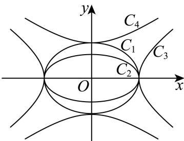
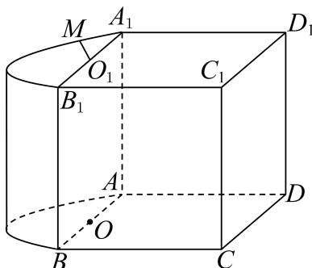

# 2026届上海高三一模 · 浦东卷

> 按原卷题号整理；题面、图片和解答未全卷逐页终核。

## 第 1 题

> 核对提醒：规范稿伪第1题已排除，规范题号减1

已知集合 $A = \{x \mid x > 1\}$ , $B = \{1, 2, 3\}$ , 则 $A \cap B = \_$ .

【答案】 $\{2,3\}$

【解析】

【分析】

根据集合交集的定义和运算，即可求解.

【详解】由题意，集合 $A=\left\{x\mid x>1\right\}$ ， $B=\left\{1,2,3\right\}$ ，

根据集合交集的定义和运算，可得 $A \cap B = \{2, 3\}$ .

故答案为： $\{2,3\}$ .

【点睛】本题主要考查了集合交集的定义及运算，其中熟记集合交集的定义是解答的关键，属于容易题.

## 第 2 题

> 核对提醒：规范稿伪第1题已排除，规范题号减1

函数 $y=\lg(x+1)$ 的定义域为 \_\_\_\_

【答案】 $(-1,+\infty)$

【解析】

【分析】根据对数函数的定义域列不等式求解即可.

【详解】由 $x+1>0$ 得x>-1，

所以函数 $y=\lg(x+1)$ 的定义域为 $(-1,+\infty)$ .

故答案为： $(-1,+\infty)$ .

## 第 3 题

> 核对提醒：规范稿伪第1题已排除，规范题号减1

已知向量 $\vec{a} = (1, -3)$ 、 $\vec{b} = (1, k)$ ，若 $\vec{a} // \vec{b}$ ，则实数 k 的值为 \_\_\_\_.

【答案】-3

【解析】

【分析】根据平面向量共线求参数即可.

【详解】因为 $\vec{a}//\vec{b}$ ，所以 $1\cdot k=(-3)\times1\Rightarrow k=-3$ .

故答案为：-3

## 第 4 题

> 核对提醒：规范稿伪第1题已排除，规范题号减1

在 $\left(x + \frac{1}{x}\right)^6$ 的二项展开式中，常数项为 \_\_\_\_.

【答案】20

【解析】

【分析】根据二项式展开式的通项特征即可求解.

【详解】 $\left(x + \frac{1}{x}\right)^6$ 的二项展开式中，常数项为 $C_6^3 x^3\left(\frac{1}{x}\right)^3 = 20$

故答案为：20

## 第 5 题

> 核对提醒：规范稿伪第1题已排除，规范题号减1

已知正数 $a, b$ 满足 $a + 2b = 2$ ，则 $ab$ 的最大值为 \_\_\_\_.

【答案】 $\frac{1}{2}$ ##0.5

【解析】

【分析】直接利用基本不等式求解即可.

【详解】因为正数 a, b 满足 $a + 2b = 2$ ，所以 $2 = a + 2b \geq 2\sqrt{a \times 2b}$ ，平方化简得 $ab \leq \frac{1}{2}$ ，当且仅当 a = 2b = 1 时，等号成立，所以 ab 的最大值为 $\frac{1}{2}$ .

故答案为： $\frac{1}{2}$

## 第 6 题

> 核对提醒：规范稿伪第1题已排除，规范题号减1

设 $x \in R$ ，求方程 $\left|x + 2\right| + \left|x - 2\right| = 4$ 的解集为 \_\_\_\_.

【答案】 $[-2,2]$

【解析】

【分析】根据绝对值三角不等式求解 $\left|x+2\right|+\left|x-2\right|$ 的最值，根据取等条件即可得方程的解集.

【详解】因为 $|x+2|+|2-x|\geq|x+2+2-x|=4$ ，

当且仅当 $(x+2)(2-x)\geq0$ 时取等，

解得 $x \in [-2, 2]$ ,

所以方程 $\left|x+2\right|+\left|x-2\right|=4$ 的解集为 $[-2,2]$ .

故答案为： $[-2,2]$ .

## 第 7 题

> 核对提醒：规范稿伪第1题已排除，规范题号减1

$\triangle ABC$ 中， $A = \frac{2\pi}{3}$ ， $b = 1$ ， $\sin C = 2\sin B$ ，则 $a = \_$ .

【答案】 $\sqrt{7}$

【解析】

【分析】根据正弦定理以及余弦定理，可得答案.

【详解】由题意可得 $\sin C = 2\sin B \Rightarrow c = 2b \Rightarrow c = 2$ ,

因为 $A = \frac{2\pi}{3}$ ，所以 $\cos A = \frac{b^2 + c^2 - a^2}{2bc} \Rightarrow -\frac{1}{2} = \frac{1^2 + 2^2 - a^2}{2 \times 1 \times 2} \Rightarrow a = \sqrt{7}$ .

故答案为： $\sqrt{7}$

## 第 8 题

> 核对提醒：规范稿伪第1题已排除，规范题号减1

如图, 等腰直角 $\triangle APB$ 的斜边 $AB$ 长为 $2R$ , 将 $\triangle APB$ 绕斜边 $AB$ 所在直线旋转一周形成的旋转体的体积为 \_\_\_\_.

【答案】 $\frac{2}{3}\pi R^3$

【解析】

【分析】旋转体为两个同底等高的圆锥的组合体，利用体积公式求解即可

【详解】由题意，将 $\triangle APB$ 绕斜边 $AB$ 所在直线旋转一周形成的旋转体是以 $R$ 为底面半径， $R$ 为高的两个共底面圆锥，

所以旋转体的体积为 $V = 2 \times \frac{1}{3} \pi R^2 \cdot R = \frac{2}{3} \pi R^3$ .

故答案为： $\frac{2}{3}\pi R^3$

## 第 9 题

> 核对提醒：规范稿伪第1题已排除，规范题号减1

已知奇函数 $y = f(x)$ 的定义域为 R，当 x < 0 时， $f(x) = x^{3} + e^{x} - 1$ ，则函数 $y = f(x)$ 在 x = 1 处的导数 $f'(1) =$ \_\_\_\_ .

【答案】 $3+e^{-1}$

【解析】

【分析】先根据奇函数的定义求出 x > 0 时的函数的解析式，再求导即可求出导数值.

【详解】因为奇函数 $y = f(x)$ 的定义域为 R，

令 $x > 0$ ，则 $-x < 0$ ，所以 $f(x) = -f(-x) = -\left(-x^3 + e^{-x} - 1\right) = x^3 - e^{-x} + 1$

所以当 $x > 0$ 时， $f(x) = x^3 - \mathrm{e}^{-x} + 1$

所以 $f'(x)=3x^{2}+e^{-x}\Rightarrow f'(1)=3+e^{-1}$ .

故答案为： $3 + e^{-1}$ .

## 第 10 题

> 核对提醒：规范稿伪第1题已排除，规范题号减1

已知复数 $z_{1}, z_{2}$ 是实系数一元二次方程的两个根，若 $z_{1} = i z_{2}$ ，则 $\left| z_{1} - i \right|$ 的最小值为 \_\_\_\_。

【答案】 $\frac{\sqrt{2}}{2}$

【解析】

【分析】分一元二次方程的判别式大于等于0与小于0，两种情况讨论，利用实系数一元二次方程的虚根成对的性质，计算可求得 $\left|z_{1}-i\right|$ 的最小值.

【详解】若一元二次方程的判别式大于等于0，则方程有两个实数根，即 $z_{1},z_{2}$ 为实数，

由 $z_{1} = \mathrm{i}z_{2}$ ，则 $z_{1} = 0,z_{2} = 0$ ，此时 $\left|z_1 - \mathrm{i}\right| = \left|0 - \mathrm{i}\right| = 1$

若一元二次方程的判别式小于0，则 $z_{1},z_{2}$ 为两虚数根，

设 $z_{1} = a + bi$ 、 $z_{2} = a - bi$

又因为 $z_{1} = \mathrm{i}z_{2}$ ，所以 $a + b\mathrm{i} = \mathrm{i}(a - b\mathrm{i}) = b + a\mathrm{i}$ ，所以 $a = b$

$$
\left| z _ {1} - \mathrm{i} \right| = \left| a + (a - 1) \mathrm{i} \right| = \sqrt {a ^ {2} + (a - 1) ^ {2}} = \sqrt {2 a ^ {2} - 2 a + 1} = \sqrt {2 \left(a - \frac {1}{2}\right) ^ {2} + \frac {1}{2}}
$$

当 $a = \frac{1}{2}$ 时， $\left|z_1 - \mathrm{i}\right|_{\min} = \sqrt{2\left(\frac{1}{2} - \frac{1}{2}\right)^2 + \frac{1}{2}} = \frac{\sqrt{2}}{2}.$

综上所述： $\left|z_{1}-i\right|$ 的最小值为 $\frac{\sqrt{2}}{2}$

故答案为： $\frac{\sqrt{2}}{2}$ .

## 第 11 题

> 核对提醒：表格来自解析版OCR，尚未对学生原卷或PDF页面视觉核验。

某城市交通系统采用数智技术记录城市道路口的信号灯状态，每个时段的信号灯状态对应一个数字（见下表）.

| 信号灯状态 | 正常绿波协调 | 非正常绿波协调：道路施工临时黄灯 | 非正常绿波协调：突发事故临时红灯 |
| --- | --- | --- | --- |
| 对应数字 | 0 | 1 | -1 |

现需要按顺序记录某个道路口 5 个时段的信号灯状态，例如，记号 $(1,0,-1,0,1)$ 表示 5 个时段中有 3 个时段是“非正常绿波协调”状态，分别发生在第 1、3、5 时段。问：该路口 5 个时段所有可能的记录中，“非正常绿波协调”的时段数不少于 1 个且不多于 3 个的记录共有 \_\_\_\_ 种。

【答案】130

【解析】

【分析】按照“非正常绿波协调”的时段个数进行分类，结合计数原理和组合数知识求解.

【详解】按照“非正常绿波协调”的时段个数进行分类，

每类情况均先从 5 个时段中选取“非正常绿波协调”的时段个数，且因 “非正常绿波协调”有两种情况，

则“非正常绿波协调”的时段数1个的记录有 $2C_{5}^{1}=10$ 种；

“非正常绿波协调”的时段数 2 个的记录有 $2^{2}C_{5}^{2}=40$ 种；

“非正常绿波协调”的时段数3个的记录有 $2^{3}C_{5}^{3}=80$ 种；

故 “非正常绿波协调”的时段数不少于 1 个且不多于 3 个的记录共有: $10 + 40 + 80 = 130$ 种;
故答案为：130

## 第 12 题

> 核对提醒：规范稿伪第1题已排除，规范题号减1

已知 $f(x)=\left\{\begin{aligned}&8x^{2}+3x-1,x<\frac{1}{4}\\ &x+\frac{7}{8},x\geq\frac{1}{4}\end{aligned}\right.$ ，若等差数列 $\left\{a_{n}\right\}$ 为无穷数列，且均满足递推关系 $a_{n+1}=f(a_{n})$ ，则该数列首项 $a_{1}$ 的取值范围为 \_\_\_\_.

【答案】 $\left\{-\frac{1}{2},-\frac{5}{8}\right\}\cup\left[\frac{1}{4},+\infty\right]$ .

【解析】

【分析】由递推关系 $a_{n+1} = f(a_n)$ ，则 $f(a_n) = a_{n+1} = a_n + d$ ，根据分段函数的解析式，分三种情况讨论，列出关系式，即可求解.

【详解】由函数 $f(x) = \begin{cases} 8x^2 + 3x - 1, & x < \frac{1}{4} \\ x + \frac{7}{8}, & x \geq \frac{1}{4} \end{cases}$ ，可得函数 $f(x)$ 的图像，如图所示，

因为等差数列 $\{a_n\}$ 为无穷数列，且均满足递推关系 $a_{n+1} = f(a_n)$ ，则 $f(a_n) = a_{n+1} = a_n + d$ ，

当 $a_n \in \left[\frac{1}{4}, +\infty\right)$ 时， $f(a_n) = a_{n+1} = a_n + \frac{7}{8} = a_n + d$ ，

可得 $d = \frac{7}{8}$ ，符合题意，此时 $a_1 \in \left[\frac{1}{4}, +\infty\right)$ ;

当 $a_n \in \left(-\infty, \frac{1}{4}\right)$ 时，则 $a_{n+1} \in \left(-\infty, \frac{1}{4}\right)$ ，可得 $f(a_n) = 8a_n^2 + 3a_n - 1 = a_n + d$ ， $f(a_{n+1}) = 8a_{n+1}^2 + 3a_{n+1} - 1 = a_{n+1} + d$ ，

两式相减，可得 $8(a_{n+1}^2 - a_n^2) + 2(a_{n+1} - a_n) = 0$ ，即 $(a_{n+1} - a_n)[4(a_{n+1} + a_n) + 1] = 0$ ，

所以 $a_{n+1} - a_n = 0$ ，所以 $d = 0$ ，此时数列 $\{a_n\}$ 为常数列，

可得 $8a_1^2 + 3a_1 - 1 = a_1$ ，解得 $a_1 = -\frac{1}{2}$ 或 $a_1 = \frac{1}{4}$ （舍去）；

若 $a_1 \in \left(-\infty, \frac{1}{4}\right)$ ， $a_2 \in \left[\frac{1}{4}, +\infty\right)$ ，则 $f(a_1) = 8a_1^2 + 3a_1 - 1 = a_1 + \frac{7}{8}$ ，解得 $a_1 = -\frac{5}{8}$ 综上可得：首项 $a_1$ 的取值范围为 $\left\{-\frac{1}{2}, -\frac{5}{8}\right\} \cup \left[\frac{1}{4}, +\infty\right)$ .

故答案为： $\left\{-\frac{1}{2}, -\frac{5}{8}\right\} \cup \left[\frac{1}{4}, +\infty\right)$ .

## 第 13 题

> 核对提醒：原题约定存在歧义。这不是转录缺字。原文没有明确排除两平面重合；整理卷标答C依赖不同平面的约定，需在教师版说明，不能静默添加原题条件。；原卷未明确两个平面是否不同；标答C依赖不同平面约定，若允许重合则为B。

已知直线 $a,b$ 和平面 $\alpha,\beta$，且 $a\subseteq\alpha$、$b\subseteq\beta$，则“$a$ 与 $b$ 相交”是“$\alpha$ 与 $\beta$ 相交”的（ ）。

A. 充分必要条件

B. 既不充分又不必要条件

C. 充分不必要条件

D. 必要不充分条件

【答案】整理卷标答为C（按两个不同平面理解）；若允许两平面重合，则为B。

【解析·参考原解整理】

**以下保留源解析，前提是两个平面不同；原题未显式给出此前提。**

【分析】根据直线与平面的位置关系判断.

【详解】直线 a 、 b 和平面 $\alpha$ 、 $\beta$ ，且 $a \subseteq \alpha$ 、 $b \subseteq \beta$ ，

若 $a$ 与 $b$ 相交，记 $a \cap b = O$ ，由于 $a \subseteq \alpha$ 、 $b \subseteq \beta$

所以 $O \in \alpha$ 、 $O \in \beta$ ，则 $\alpha$ 与 $\beta$ 相交，

所以 “a 与 b 相交” 能得到 $\alpha$ 与 $\beta$ 相交，

但 “ $\alpha$ 与 $\beta$ 相交”，则 a 与 b 可能异面，如图，

平面 ABCD 为 $\alpha$ ，平面 ABEF 为 $\beta$ ， $\alpha \cap \beta = AB$ ，

$$
a \subseteq \alpha , b \subseteq \beta , a \cap A B = P, b \cap A B = Q,
$$

若 $P$ 与 $Q$ 不重合，则直线 $a$ 、 $b$ 为异面直线，所以 “a 与 b 相交” 是 “ $\alpha$ 与 $\beta$ 相交” 的充分不必要条件.
故选：C.

【约定边界】若允许两平面重合，取同一平面内两条相交直线，不能推出两平面相交，充分性失效；必要性也不成立，此时选B。

## 第 14 题

> 核对提醒：规范稿伪第1题已排除，规范题号减1

某班一次数学小测验（百分制）后，老师为了奖励同学们平时认真学习，决定给每位同学的成绩加上5分作为过程性评价奖励.加分后，与原始分数相比，不会发生改变的是( )

A. 平均数    B. 中位数    C. 第80百分位数    D. 方差

【答案】D

【解析】
【分析】根据平均值、中位数、百分位数的概念判断ABC，根据方差性质判断D.
【详解】加分后，与原始分数相比，平均值，中位数，第80百分位数的数值都会发生改变，但根据方差的性质，一组数据同时加上相同的数后，方差大小不变.
故选：D.

## 第 15 题

> 核对提醒：规范稿伪第1题已排除，规范题号减1

如图，椭圆 $C_1$ 、 $C_2$ 的离心率分别为 $\pmb{e}_1$ 、 $\pmb{e}_2$ ，双曲线 $C_3$ 、 $C_4$ 的离心率分别为 $\pmb{e}_3$ 、 $\pmb{e}_4$ 则下列结论正确的是（）

A. $e_3 > e_4 > e_2 > e_1$ B. $e_4 > e_3 > e_1 > e_2$ C. $e_3 > e_4 > e_1 > e_2$ D.

$$
e _ {4} > e _ {3} > e _ {2} > e _ {1}
$$

【答案】D

【解析】

【分析】根据双曲线离心率： $e=\frac{c}{a}=\sqrt{1+\frac{b^{2}}{a^{2}}}$ ，椭圆离心率 $e=\frac{c}{a}=\sqrt{1-\frac{b^{2}}{a^{2}}}$ ，比较大小即可判断.
【详解】双曲线离心率： $e=\frac{c}{a}=\sqrt{1+\frac{b^{2}}{a^{2}}}$ ，椭圆离心率 $e=\frac{c}{a}=\sqrt{1-\frac{b^{2}}{a^{2}}}$ 如图可知椭圆 $C_{1}, C_{2}$ 中 $a_{1}=a_{2}, b_{2}<b_{1}$ ，所以 $e_{1}<e_{2}<1$ ，

双曲线 $C_3$ 、 $C_4$ 中 $a_3 > a_4$ ， $b_{3} < b_{4}$ ，所以 $1 < e_{3} < e_{4}$

综上： $e_4 > e_3 > e_2 > e_1$

故选：D.

## 第 16 题

> 核对提醒：规范稿伪第1题已排除，规范题号减1

已知函数 $y = f(x)$ ，其中 $f(x) = x - \frac{1}{x}, x > 0$ . 集合 $A = \{1, a, b\}$ ，其中 $1 < a < b$ ，集合 $B = \left\{z \mid z = xy + \frac{x}{y} + f\left(\frac{y}{x}\right), x, y \in A, x \neq y\right\}$ ，现有以下两个命题：

①存在实数 a 、 b ，使得集合 B 中恰好有 5 个元素；

②若实数 a 、 b 是方程 $f(x)=kx+t$ 的两个不同实根，则存在实数 k 、 t ，使得集合 B 中恰好有 4 个元素.

那么（）
A. ①是真命题，②是真命题
B. ①是假命题，②是假命题
C. ①是真命题，②是假命题
D. ①是假命题，②是真命题

【答案】A

【解析】

【分析】先化简集合 $B$ 的元素，通过构造具体数值验证命题①中元素的合并情况；结合韦达定理与函数零点存在性，验证命题②中元素的合并可行性。
【详解】 $B = \left\{z\mid z = xy + \frac{x}{y} +f\left(\frac{y}{x}\right),x,y\in A,x\neq y\right\} = \left\{z\mid z = xy + \frac{y}{x},x,y\in A,x\neq y\right\}$ 集合 $A = \{1,a,b\}$ ，其中 $1 < a < b$ ， $x,y$ 取不同元素时，
集合 $B$ 的元素可能为 $2a,2b,a + \frac{1}{a},b + \frac{1}{b},ab + \frac{b}{a},ab + \frac{a}{b}$ ，共6个可能. $①$ 若集合 $B$ 中恰好有5个元素，则当 $2a = b + \frac{1}{b}$ 时， $1 < a < b$ 必然能找到 $a,b,$ 例如：当 $a = \frac{5}{4}$ ，可取 $b = 2$ ，此时 $B = \left\{\frac{5}{2},4,\frac{41}{20},\frac{41}{10},\frac{25}{8}\right\}$ ，共5个元素.
所以 $①$ 是真命题. $②$ 依题意，若存在实数 $a,b$ 是方程 $f(x) = kx + t$ 的两个不同实根， $x - \frac{1}{x} = kx + t\Rightarrow (k - 1)x^2 +tx + 1 = 0$

所以 $a + b = \frac{-t}{k - 1}, ab = \frac{1}{k - 1}$ .

因为 $1 < a < b$ ， $a + \frac{1}{a} < b + \frac{1}{b} < 2b$ ， $a + \frac{1}{a} < a\left(b + \frac{1}{b}\right)$ ， $b + \frac{1}{b} < a\left(b + \frac{1}{b}\right)$

若 $\left\{ \begin{array}{l} 2a = b + \frac{1}{b} \\ 2b = ab + \frac{b}{a} \end{array} \right. \Rightarrow \left\{ \begin{array}{l} a = 1 \\ b = 1 \end{array} \right.$ 不符；

若 $\left\{ \begin{array}{l} 2a = b + \frac{1}{b} \\ 2b = ab + \frac{a}{b} \end{array} \right. \Rightarrow a^4 - 2a^3 + 1 = 0$ (\*),

设 $h(x) = x^4 - 2x^3 + 1$ ， $x \in (1, +\infty)$

$$
h \left(\frac {3}{2}\right) = - \frac {1 1}{1 6}, h (2) = 1
$$

$$
h \left(\frac {3}{2}\right) \times h (2) <   0
$$

所以 $h(x)=x^{4}-2x^{3}+1,\quad x\in(1,+\infty)$ 有零点，即（\*）有解，

即存在 $a, b$ ，满足 $\left\{ \begin{array}{l} 2a = b + \frac{1}{b} \\ 2b = ab + \frac{a}{b} \end{array} \right.$ ，使得 $B$ 中恰好有4个元素.

所以实数 k、t，使得集合 B 中恰好有 4 个元素，②是真命题.

故选：A.

## 第 17 题

> 核对提醒：规范稿伪第1题已排除，规范题号减1

已知函数 $y = f(x)$ ，其中 $f(x) = \cos \left(2x - \frac{\pi}{3}\right)$ .

（1）求函数 $y = f(x)$ 的最小正周期及单调减区间.

（2）求函数 $y = 2\sin^{2}x + f(x)$ ， $x \in [-\frac{\pi}{6}, \frac{\pi}{3}]$ 的最大值，并求出取得最大值时 x 的值.

【答案】（1） $T=\pi,\left[k\pi+\frac{\pi}{6},k\pi+\frac{2\pi}{3}\right](k\in\mathbf{Z})$ ;

(2) 2, $x = \frac{\pi}{3}$ .

【解析】

【分析】（1）利用余弦函数的周期公式及单调性列式求解.

（2）利用三角函数恒等变换化简函数，再利用正弦函数的性质求出指定区间上的最大值.【小问1详解】

函数 $y = f(x)$ 的最小正周期 $T = \frac{2\pi}{2} = \pi$ ,

由 $2k\pi \leq 2x - \frac{\pi}{3} \leq 2k\pi + \pi, k \in \mathbf{Z}$ ，得 $k\pi + \frac{\pi}{6} \leq x \leq k\pi + \frac{2\pi}{3}, k \in \mathbf{Z}$ ，

所以函数 $f(x)$ 单调减区间为 $\left[k\pi +\frac{\pi}{6},k\pi +\frac{2\pi}{3}\right]\big(k\in \mathbf{Z}\big)$

【小问 2 详解】

依题意， $y = 2\sin^2 x + \cos (2x - \frac{\pi}{3}) = 1 - \cos 2x + \cos 2x\cos \frac{\pi}{3} +\sin 2x\sin \frac{\pi}{3}$

所以 $= \frac{\sqrt{3}}{2}\sin 2x - \frac{1}{2}\cos 2x + 1 = \sin (2x - \frac{\pi}{6}) + 1$

由 $x \in [-\frac{\pi}{6}, \frac{\pi}{3}]$ ，得 $2x - \frac{\pi}{6} \in [-\frac{\pi}{2}, \frac{\pi}{2}]$ ，则当 $2x - \frac{\pi}{6} = \frac{\pi}{2}$ ，即 $x = \frac{\pi}{3}$ 时，函数取得最大值 2，所以最大值为 2，此时 $x = \frac{\pi}{3}$ .

## 第 18 题

> 核对提醒：规范稿伪第1题已排除，规范题号减1

如图, 该几何体由一个棱长为 4 的正方体 $ABCD - A_{1}B_{1}C_{1}D_{1}$ 与一个半圆柱拼接而成, 圆心 $O$ 、 $O_{1}$ 分别为线段 $AB$ 、 $A_{1}B_{1}$ 的中点, 动点 $M$ 在弧 $\widehat{A_{1}B_{1}}$ 上滑动.

（1）若点 M 为弧 $\widehat{A_{1}B_{1}}$ 的中点，求直线 MD 与平面 $BDD_{1}B_{1}$ 所成角的大小；

（2）若弧 $\widehat{A_1M}$ 的长度为 $\frac{\pi}{2}$ ，求证：平面 $OO_{1}M //$ 平面 $ACC_{1}A_{1}$ .

【答案】(1) $\arcsin \frac{\sqrt{7}}{7}$

(2) 证明见解析

【解析】

【分析】（1）建立空间直角坐标系，求得 $\overrightarrow{MD}$ 与平面 $BDD_{1}B_{1}$ 的法向量，通过向量夹角公式求线面角；

（2）由弧长可求得 M 点坐标，进而求得平面 $OO_{1}M$ 和平面 $ACC_{1}A_{1}$ 的法向量，计算即可得到结果.

【小问 1 详解】

建立如图所示空间直角坐标系:

则： $A(0,0,0)$ ， $B(4,0,0)$ ， $D(0,4,0)$ ， $C(4,4,0)$ ， $O(2,0,0)$ ， $O_{1}(2,0,4)$

若点 M 为弧 $\widehat{A_{1}B_{1}}$ 的中点，则 $M(2,-2,4)$

所以 $\overrightarrow{MD} = (-2,6, - 4)$

平面 $BDD_{1}B_{1}$ 的一个法向量为 $\vec{m} = \overrightarrow{AC} = (4,4,0)$

所以 $\sin \theta = \cos \vec{m},\overrightarrow{MD} = \left|\frac{\vec{m}\cdot\overrightarrow{MD}}{|\vec{m}|\cdot|\overrightarrow{MD}|}\right| = \left|\frac{16}{4\sqrt{2}\times 2\sqrt{14}}\right| = \frac{\sqrt{7}}{7}$

所以直线 MD 与平面 $BDD_{1}B_{1}$ 所成角的大小 $\arcsin\frac{\sqrt{7}}{7}$

【小问 2 详解】

若弧 $\widehat{A_1M}$ 的长度为 $\frac{\pi}{2}$ ，由弧长得 $\angle MO_{1}A_{1} = \frac{\frac{\pi}{2}}{2} = \frac{\pi}{4}$ ，则 $M(2 - \sqrt{2}, -\sqrt{2}, 4)$

$\overrightarrow{OO_1} = (0,0,4)$ , $\overrightarrow{OM} = (-\sqrt{2}, -\sqrt{2}, 4)$

设平面 $OO_{1}M$ 的一个法向量为 $\vec{n}_{1} = (x,y,z)$ ，平面 $ACC_{1}A_{1}$ 的一个法向量为 $\vec{n}_{2} = \overrightarrow{BD} = (-4,4,0)$

$$
\left\{ \begin{array}{l} \vec {n} _ {1} \cdot \overrightarrow {O O _ {1}} = 0 \\ \vec {n} _ {1} \cdot \overrightarrow {O M} = 0 \end{array} \Rightarrow \left\{ \begin{array}{c} z = 0 \\ x + y = 0 \end{array} \text {令} x = - 1 \right. \right.
$$

$$
\vec {n} _ {1} = (- 1, 1, 0)
$$

所以 $\vec{n}_1 / / \vec{n}_2$

所以平面 $OO_{1}M \parallel$ 平面 $ACC_{1}A_{1}$

## 第 19 题

> 核对提醒：规范稿伪第1题已排除，规范题号减1

小明和小李要进行一系列的比赛，假设每局比赛的结果互不影响.

（1）若比赛没有平局，且小明每局获胜的概率为0.4.

①如果共有三局比赛，求小明的比赛结果依次为赢、输、赢的概率；

②小明作为实力较弱的一方，他可以优先选择“一局定胜负”或“三局两胜”的赛制（“三局两胜”指先赢两局者为胜，最多三局结束）。请帮助小明分析，选择哪种赛制对他更有利，并说明理由。

(2)如果小明每局获胜的概率为 $p(0 < p < 1)$ ，他和小李要进行一场“五局三胜”的比赛（“五局三胜”指先赢三局者为胜，最多五局结束）。记小明最终获胜的概率为 $f(p)$ ，请给出 $f(p)$ 的表达式，判断并说明函数 $y = f(p)$ 在 $(0,1)$ 上的单调性，并指出现实意义。

【答案】（1）① $\frac{12}{125}$ ；②一局定胜负对小明更有利，理由见解析

(2) $f(p) = 6p^{5} - 15p^{4} + 10p^{3}$ ，函数 $y = f(p)$ 在 $(0,1)$ 上的单调递增；意义见解析
【解析】

【分析】(1) ①根据独立事件概率的乘法公式即可计算小明比赛结果依次为“赢、输、赢”的概率;

②分别计算 “一局定胜负” 和 “三局两胜” 赛制下小明获胜的概率, 比较大小来确定哪种赛制对小明更有利;

（2）先根据 “五局三胜” 的规则，分情况讨论小明获胜的情况，利用独立事件概率的乘法公式和互斥事件概率的加法公式，求出 $f(p)$ 的表达式，再通过求导判断函数的单调性，并分析现实意义.

【小问 1 详解】

①根据题意，比赛没有平局，且小明每局获胜的概率为 0.4，所以三局比赛相互独立，且小明每局输的概率为 0.6，

所以小明的比赛结果依次为赢、输、赢的概率为 $P = \frac{2}{5} \times \frac{3}{5} \times \frac{2}{5} = \frac{12}{125}$ ;

②根据题意，一局定胜负时，小明赢得比赛的概率为 $p=\frac{2}{5}$ ，

三局两胜时，小明赢得比赛有两种情况：

情况一：前两局获胜，概率为 $\frac{2}{5}\times\frac{2}{5}=\frac{4}{25}$ ，

情况二：前两局胜一局，输一局，第三局获胜，其概率为 $C_{2}^{1}\left(\frac{2}{5}\right)^{2}\left(\frac{3}{5}\right)=\frac{24}{125}$

根据互斥事件的加法公式，所以在“三局两胜”的赛制下，

小明获胜的概率为 $\frac{4}{25}+\frac{24}{125}=\frac{44}{125}$ ,

因为 $\frac{2}{5}>\frac{44}{125}$ ，所以从小明的角度考虑，一局定胜负对小明更有利；

【小问 2 详解】

“五局三胜”的赛制下，小明获胜有以下几种情况：

情况一：前三局获胜，概率为 $P_{1}=p^{3}$ ，

情况二：前三局胜两局输一局，第四局获胜，则 $P_{2}=C_{3}^{2}p^{3}(1-p)$ ,

情况三：前四局胜两局输两局，第五局获胜，则 $P_{3} = \mathrm{C}_{4}^{2}p^{3}(1 - p)^{2}$

所以小明赢的概率为:

$$
P = P _ {1} + P _ {2} + P _ {3} = p ^ {3} + 3 p ^ {3} (1 - p) + 6 p ^ {3} (1 - p) ^ {2} = p ^ {3} (6 p ^ {2} - 1 5 p + 1 0),
$$

所以 $f(p)=6p^{5}-15p^{4}+10p^{3}$ ,

所以 $f'(p)=30p^{4}-60p^{3}+30p^{2}=30p^{2}(p-1)^{2}$ ,

因为 $0 < p < 1$ ，所以 $f^{\prime}(p) = 30p^{2}(p - 1)^{2} > 0$

所以函数 $y = f(p)$ 在 $(0,1)$ 上的单调递增；

现实意义: 在 “五局三胜” 的比赛中, 小明每局获胜的概率 p 越大, 他最终获胜的概率 $f(p)$

就越大，即小明实力越强，他获胜的可能性就越大.

## 第 20 题

> 核对提醒：规范稿伪第1题已排除，规范题号减1

已知椭圆 $C: \frac{x^2}{9} + \frac{y^2}{8} = 1$ ，点 $O$ 为坐标原点，椭圆的右顶点为 $A$ ，左右焦点分别为 $F_1$ 、 $F_2$ ，点 $E$ 为椭圆在 $x$ 轴上方的一动点.

（1）求椭圆 C 的焦距与 $\triangle EF_{1}F_{2}$ 的周长；

（2）若 $\overrightarrow{EA} \cdot \overrightarrow{EF_1} = \frac{9}{4}$ ，求点 $E$ 到 $x$ 轴的距离；

（3）过点 $F_{1}$ 作斜率为 $k$ 的直线 $l$ 交 $y$ 轴正半轴于点 $P$ ，点 $P$ 位于椭圆内. 直线 $l$ 与椭圆 $C$ 交于 $G$ 、 $H$ 两点，记 $\triangle OGH$ 、 $\triangle OF_{1}P$ 的面积分别为 $S_{1}$ 、 $S_{2}$ ，求 $\frac{S_{1}}{S_{2}}$ 的取值范围.

【答案】（1）焦距为2， $\triangle EF_{1}F_{2}$ 的周长8；

(2) $\sqrt{6}$ ;

(3) $(\frac{9}{5}, 6)$ .

【解析】

【分析】（1）求出椭圆 C 的长短半轴长及半焦距，再结合椭圆定义求解.

（2）由（1）求出点 $A, F_{1}$ 坐标，设出点 $E$ 坐标，再利用数量积的坐标表示列式求解.

（3）设直线 l 的方程为 x=my-1，求出 m 范围，联立直线与椭圆方程，结合韦达定理表示出 $\frac{S_{1}}{S_{2}}$ ，再利用对勾函数单调性求出范围.

【小问 1 详解】

椭圆 $C: \frac{x^2}{9} + \frac{y^2}{8} = 1$ 的长短半轴长分别为 $a = 3, b = 2\sqrt{2}$ ，则半焦距 $c = \sqrt{a^2 - b^2} = 1$ ，所以椭圆 $C$ 的焦距 $2c = 2$ ， $\triangle EF_1F_2$ 的周长 $2a + 2c = 8$ 。

【小问 2 详解】

由（1）得 $A(3,0)$ , $F_{1}(-1,0)$ ，设 $E(x_{0},y_{0})$ , $y_{0}>0$ ，则 $\frac{x_{0}^{2}}{9}+\frac{y_{0}^{2}}{8}=1$ ，即 $y_{0}^{2}=8-\frac{8x_{0}^{2}}{9}$ ， $\overrightarrow{EA}=(3-x_{0},-y_{0}),\overrightarrow{EF_{1}}=(-1-x_{0},-y_{0})$ ，由 $\overrightarrow{EA}\cdot\overrightarrow{EF_{1}}=\frac{9}{4}$ 得 $\overrightarrow{EA}\cdot\overrightarrow{EF_{1}}=(3-x_{0})(-1-x_{0})+y_{0}^{2}=x_{0}^{2}-2x_{0}-3+y_{0}^{2}=\frac{1}{9}x_{0}^{2}-2x_{0}+5=\frac{9}{4}$ 整理得 $4x_{0}^{2}-72x_{0}+99=0$ ，而 $-3<x_{0}<3$ ，解得 $x_{0}=\frac{3}{2}$ ， $y_{0}=\sqrt{6}$ ，点 $E(\frac{3}{2},\sqrt{6})$

所以点 E 到 x 轴的距离为 $\sqrt{6}$ .

【小问3详解】

设直线 $l$ 的方程为 $x = my - 1$ ，因为直线 $l$ 与 $y$ 轴正半轴相交，故 $m \neq 0$ ，

则 $P(0, \frac{1}{m})$ ，由点 $P$ 在 $y$ 轴正半轴上，且位于椭圆内，

得 $0 < \frac{1}{m} < 2\sqrt{2}$ ，即 $m > \frac{\sqrt{2}}{4}$ ，

由 $\left\{\begin{aligned}x&=my-1\\ 8x^{2}&+9y^{2}=72\end{aligned}\right.$ ，消去x得 $(8m^{2}+9)y^{2}-16my-64=0$ ，

$\Delta = 256m^{2} + 256(8m^{2} + 9) > 0$ ，设 $G(x_{1},y_{1}),H(x_{2},y_{2})$ ，则

$$
y _ {1} + y _ {2} = \frac {1 6 m}{8 m ^ {2} + 9}, y _ {1} y _ {2} = \frac {- 6 4}{8 m ^ {2} + 9},
$$

$$
\left| y _ {1} - y _ {2} \right| = \sqrt {\left(y _ {1} + y _ {2}\right) ^ {2} - 4 y _ {1} y _ {2}} = \sqrt {\left(\frac {1 6 m}{8 m ^ {2} + 9}\right) ^ {2} + \frac {2 5 6}{8 m ^ {2} + 9}} = \frac {4 8 \sqrt {m ^ {2} + 1}}{8 m ^ {2} + 9},
$$

$$
S _ {1} = S _ {\triangle O G H} = \frac {1}{2} | O F _ {1} | \cdot | y _ {1} - y _ {2} | = \frac {1}{2} | y _ {1} - y _ {2} |, S _ {2} = S _ {\triangle O F _ {1} P} = \frac {1}{2} | O F _ {1} | \cdot \frac {1}{m} = \frac {1}{2 m},
$$

因此 $\frac{S_1}{S_2} = m|y_1 - y_2| = \frac{48m\sqrt{m^2 + 1}}{8m^2 + 9} = 48\sqrt{\frac{m^2(m^2 + 1)}{(8m^2 + 9)^2}}$ ，令 $m^2 = t > \frac{1}{8}$ ， $\frac{S_1}{S_2} = 48\sqrt{\frac{t(t + 1)}{(8t + 9)^2}}$

而 $f(t) = \frac{t(t + 1)}{(8t + 9)^2} = \frac{1 + \frac{1}{t}}{(8 + \frac{9}{t})^2}$ ，令 $1 + \frac{1}{t} = u \in (1,9)$ ，则 $f(t) = \frac{u}{(9u - 1)^2} = \frac{1}{81u + \frac{1}{u} - 18}$ ，

函数 $y = 81u + \frac{1}{u} - 18$ 在(1,9)上单调递增， $64 < 81u + \frac{1}{u} - 18 < \frac{6400}{9}$ ，

因此 $\frac{9}{6400} < \frac{t(t + 1)}{(8t + 9)^2} < \frac{1}{64}$ , $\frac{3}{80} < \sqrt{\frac{t(t + 1)}{(8t + 9)^2}} < \frac{1}{8}$ , 则 $\frac{9}{5} < \frac{S_1}{S_2} < 6$ ,

所以 $\frac{S_1}{S_2}$ 的取值范围是 $(\frac{9}{5}, 6)$ .

## 第 21 题

> 核对提醒：规范稿伪第1题已排除，规范题号减1；第（3）问原解析把分段函数视为连续，但在相关分段点左右极限不一致；后续证明待核，不能据此判定最终答案错误。

已知函数 $y = f(x)$ 的定义域为 D. 若对任意区间 $I \subseteq D$ ，存在正整数 k，使得 $I_k \cap I \neq \varnothing$ ，则称函数 $y = f(x)$ 为“回归函数”，k 为回归指数. 其中 $I_n = \left\{ f^{(n)}(x) | x \in I \right\}$ ， $f^{(1)}(x)=f(x),\quad f^{(2)}(x)=f(f(x)),\quad\ldots\ldots,\quad f^{(n+1)}(x)=f\left(f^{(n)}(x)\right).$

（1）若 $f(x) = \frac{1}{x}$ ， $g(x) = x^2$ . 请分别判断函数 $y = f(x)$ 、 $y = g(x)$ 是否为回归指数为 2 的“回归函数”；

（2）若 $f(x) = \frac{x + 1}{1 - x}$ ， $D = \{x \mid x \in \mathbf{R}, \text{且} x \neq 0, x \neq 1, x \neq -1\}$ . 求证：函数 $y = f(x)$ 是“回归函数”，并求满足条件的回归指数 $k$ 的最小值.

(3) 若 $y = f(x)$ 是定义域为 $(0,1]$ 的函数，且 $f(x) = \begin{cases} \frac{x}{a}, & 0 < x \leq a, \\ \frac{x - a}{1 - a}, & a < x \leq 1. \end{cases}$ ，其中 $a \in (0,1)$ .

请判断函数 $y = f(x)$ 是否为“回归函数”? 若是，请写出证明过程；若不是，请说明理由.

【答案】（1） $y = f(x)$ 是回归指数为2的"回归函数"， $y = g(x)$ 不是回归指数为2的"回归函数"；

（2）证明见解析，k 的最小值为 4;

（3）函数 $y = f(x)$ 是 “回归函数”，证明见解析.

【解析】

【分析】（1）计算出 $f^{(1)}(x) = \frac{1}{x}, f^{(2)}(x) = x$ ，从而得到 $I_2 \cap I \neq \emptyset$ 即可判断 $y = f(x)$ ，再计算 $g^{(2)}(x) = x^4$ ，取 $I = [2,3]$ 即可判断；

（2）计算得 $f^{(5)}(x)=f^{(1)}(x),\cdots,f^{(k+4)}(x)=f^{(k)}(x)$ ，再取 $I=(2,3)$ ，分析得

$I_{4m - 3}\cap I = \emptyset ,I_{4m - 2}\cap I = \emptyset ,I_{4m - 1}\cap I = \emptyset$ ，则得到 $k$ 的最小值；

（3）首先求出函数 $y = f(x)$ 的值域为(0,1]，再分区间求出对应直线斜率，再设区间 $I$ 的长度为 $L, L > 0$ ，根据变换则区间长度也会变化，最后分析得总存在这样的正整数 $k$ ，使得 $I_{k} \cap I \neq \emptyset$ .

【小问 1 详解】

由题意， $y = f(x)$ 的定义域 $D = (-\infty, 0) \cup (0, +\infty)$ .

$$
f ^ {(1)} (x) = f (x) = \frac {1}{x}, f ^ {(2)} (x) = f (f (x)) = f \left(\frac {1}{x}\right) = x,
$$

故对任意区间 $I \subseteq (-\infty, 0) \cup (0, +\infty)$ ，必有 $I_{2} = I$ ，即 $I_{2} \cap I \neq \varnothing$ .

因此 $y = f(x)$ 是回归指数为 2 的 "回归函数".

又 $y = g(x)$ 的定义域 $D = \mathrm{R},g^{(2)}(x) = \left(x^2\right)^2 = x^4$

取区间 $I = [2,3]$ ，则 $I_{2} = [16,81]$ 。显然， $I \cap I_{2} = \varnothing$ 。

显然， $y = g(x)$ 不是回归指数为 2 的 "回归函数".

【小问 2 详解】

由题意，对任意 $x \in D, f^{(1)}(x) = \frac{x + 1}{1 - x}$ ， $f^{(2)}(x) = \frac{\frac{x + 1}{1 - x} + 1}{1 - \frac{x + 1}{1 - x}} = \frac{2}{-2x} = -\frac{1}{x}$ ，

$$
f ^ {(3)} (x) = \frac {- \frac {1}{x} + 1}{1 - \left(- \frac {1}{x}\right)} = \frac {x - 1}{x + 1}, f ^ {(4)} (x) = \frac {\frac {x - 1}{x + 1} + 1}{1 - \frac {x - 1}{x + 1}} = \frac {2 x}{2} = x,
$$

$$
f ^ {(5)} (x) = f ^ {(1)} (x), \dots , f ^ {(k + 4)} (x) = f ^ {(k)} (x).
$$

显然，对任意区间 $I \subseteq D$ ，都存在正整数 $m$ ，使得 $I_{4m} = I$ ，即 $I_{4m} \cap I \neq \emptyset$

若取区间 $I = (2,3)$ ，则 $I_{1} = (-3, - 2), I_{2} = \left(\frac{1}{3},\frac{1}{2}\right), I_{3} = \left(-\frac{1}{2}, - \frac{1}{3}\right)$ .

$$
I _ {4 m - 3} = I _ {1} = (- 3, - 2), I _ {4 m - 2} = I _ {2} = \left(\frac {1}{3}, \frac {1}{2}\right), I _ {4 m - 1} = I _ {3} = \left(- \frac {1}{2}, - \frac {1}{3}\right).
$$

故 $I_{4m-3} \cap I = \varnothing, I_{4m-2} \cap I = \varnothing, I_{4m-1} \cap I = \varnothing$ .

综上，函数 $y = f(x)$ 是 "回归函数"，且满足条件的回归指数 k 的最小值为 4.

【小问 3 详解】

当 $x \in (0, a]$ 时， $f(x) = \frac{x}{a}, f(x) \in (0, 1]$ .

当 $x \in (a,1]$ 时， $f(x) = \frac{x - a}{1 - a}, f(x) \in (0,1]$ .

因此，函数 $y = f(x)$ 的值域为(0,1]，即对任意 $y \in (0,1]$ ，总存在 $x \in (0,1]$ 使得 $f(x) = y$ .

在区间 $(0, a]$ 上，函数为 $f(x) = \frac{x}{a}$ ，对应直线的斜率 $k = \frac{1}{a} > 1$ 。

在区间 $(a,1]$ 上， $f(x) = \frac{x - a}{1 - a}$ ，对应直线的斜率 $k = \frac{1}{1 - a} > 1$ 。

显然，对任意区间 $I \subseteq D$ ，作用函数 $y = f(x)$ 后，区间长度必然会变大.

假设常数 $c = \min \left\{\frac{1}{a},\frac{1}{1 - a}\right\}$ ，必有 $c > 1$ ，即每次变换后区间长度至少放大 $c$ 倍.

设区间 I 的长度为 L, L > 0 。则经过 k 次变换后， $I_{k}$ 的长度至少为 $L \cdot c^{k}$

当 k 足够大时，必有 $L \cdot c^{k} > 1$ 。又函数 $y = f(x)$ 的值域为 $(0,1]$ ，

即 $I_{k} \subseteq (0,1]$ ，所以 $I_{k}$ 的长度不能超过1，矛盾.

实际上，由于 $y = f(x)$ 的图像是分段线性且连续的，变换过程中 $I_{k}$ 会覆盖(0,1]的每个非空开区间子集.

必存在正整数 $k$ ，使得 $I_{k} \cap I \neq \emptyset$

否则，如果所有 $I_{k}$ 都与 I 不相交，则 $I_{k}$ 始终停留在区间 $(0,1]$ 或区间 I 中，

但区间长度作用函数 $y = f(x)$ 后会变大，即 $I_{k}$ 长度的不断增长，最终必须与区间 I 相交.

因此，总存在这样的正整数 $k$ ，使得 $I_{k} \cap I \neq \emptyset$

综上所述，函数 $y = f(x)$ 是 "回归函数".
