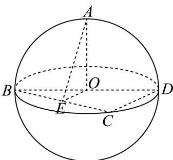
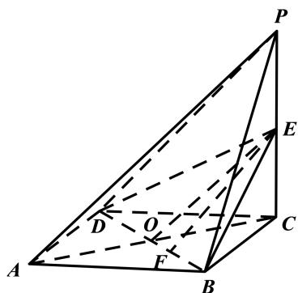
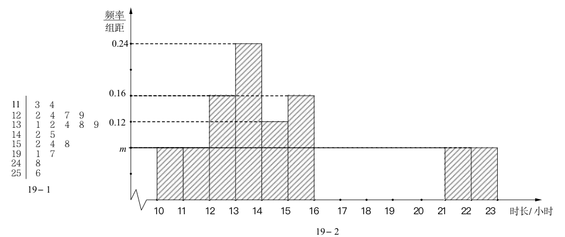

# 2026届上海高三一模 · 虹口卷

> 按原卷题号整理；题面、图片和解答未全卷逐页终核。

## 第 1 题

已知集合 $A = \{x \| x - 1| < 2\}$ , $B = \{x | x > 0\}$ , 则 $A \cap B =$

【答案】 $\left\{x\mid0<x<3\right\}$

【解析】

【分析】解绝对值不等式，再求交集即可.

【详解】由 $A=\left\{x\mid|x-1|<2\right\}=\left\{x|-1<x<3\right\}$ ， $B=\left\{x|x>0\right\}$

则 $A \cap B = \{x \mid 0 < x < 3\}$ ,

故答案为： $\{x\mid 0 <   x <   3\}$

## 第 2 题

函数 $y = \sqrt{\frac{x + 1}{x - 2}}$ 的定义域为 \_\_\_\_

【答案】 $(-∞,-1]∪(2,+∞)$

【解析】

【分析】根据偶数根式被开方数非负，结合分式不等式的解法，即可得答案.

【详解】由题意得 $\frac{x + 1}{x - 2} \geq 0$ ，即 $\left\{ \begin{array}{l} (x + 1)(x - 2) \geq 0 \\ x - 2 \neq 0 \end{array} \right.$ ，解得 $x > 2$ 或 $x \leq -1$ ，

所以定义域为 $(-∞,-1]∪(2,+∞)$

故答案为： $(-∞,-1]∪(2,+∞)$

## 第 3 题

$\left(x - \frac{3}{x}\right)^9$ 的二项展开式中 $x^7$ 的系数是

【答案】-27

【解析】

【分析】根据二项展开式通项公式求 $x^{7}$ 的系数.

【详解】根据二项式定理， $\left(x-\frac{3}{x}\right)^{9}$ 的通项为 $T_{r+1}=C_{9}^{r}\cdot(-3)^{r}\cdot x^{9-2r}$ ，

$$
9 - 2 r = 7
$$

$$
r = 1
$$

将 r=1 代入系数部分得： $C_{9}^{1}\cdot(-3)^{1}=9\times(-3)=-27$ .

故答案为：-27.

## 第 4 题

> 核对提醒：原卷第1页的候选指数与规范化稿不同，题面据原卷修正，旧解析未沿用。

已知 $a\in\left\{-\frac13,\frac23,\frac32\right\}$，若幂函数 $y=x^a$ 为偶函数，则实数 $a=$ ________。

【答案】$\frac23$。

【核对说明】按照实数范围内的幂函数定义，$x^{2/3}$ 为偶函数，$x^{-1/3}$ 为奇函数，$x^{3/2}$ 的定义域不关于原点对称。

## 第 5 题

> 核对提醒：规范稿缺独立题干；只能由解析识别主题，题面待PDF核对

若事件 A、B 互斥，且 $P(A)=0.4$ ， $P(A \cup B)=0.6$ ，则 $P(B)=$ \_\_\_\_

【答案】 $0.2 \# \frac{1}{5}$
【解析】
【分析】利用互斥事件的加法公式列方程求概率即可.

【详解】由互斥事件的概率加法有 $P(A \cup B) = P(A) + P(B)$ ,

所以 $P(B)=P(A\cup B)-P(A)=0.6-0.4=0.2$ .

故答案为：0.2

## 第 6 题

已知复数 $z$ 是实系数一元二次方程 $x^{2} + bx + 2 = 0$ 的一个虚数根，则 $\left|\overline{z}\right| =$ \_\_\_\_.

【答案】 $\sqrt{2}$

【解析】

【分析】利用实系数方程复数根的性质及根与系数关系得 $z\overline{z}=2$ ，再由共轭复数的运算性质求结果.

【详解】由实系数一元二次方程复数根的性质知 $z\overline{z}=|\overline{z}|^{2}=2$

故 $|\overline{z}| = \sqrt{2}$

故答案为： $\sqrt{2}$

## 第 7 题

已知某圆锥的底面半径为 2, 侧面积为 $6 \pi$ , 则该圆锥的体积为 \_\_\_\_ (结果保留 $\pi$ )

【答案】 $\frac{4\sqrt{5}\pi}{3}$

【解析】

【分析】根据圆锥体积公式、侧面积公式，结合圆锥的性质进行求解即可.

【详解】设圆锥的母线为 $l$ ，因为圆锥侧面积为 $6\pi$ ，

所以 $\pi\cdot2\cdot l=6\pi\Rightarrow l=3$

所以该圆锥的高为 $\sqrt{3^2 - 2^2} = \sqrt{5}$ ，

因此该圆锥的体积为 $\frac{\pi}{3}\times2^{2}\times\sqrt{5}=\frac{4\sqrt{5}\pi}{3}$ ，

故答案为： $\frac{4\sqrt{5}\pi}{3}$

## 第 8 题

甲、乙、丙3人站到共有7级的台阶上, 若每级台阶最多站2人, 同一级台阶上的人不区分站的位置, 则不同的站法种数是\_\_\_\_。(用数字作答)

【答案】336

【解析】

【分析】对每个台阶上所站的人数进行分类讨论，结合分类加法计数原理可得结果.

【详解】当每个台阶上各站1人时有 $A_{7}^{3}=210$ 种，

当两个人站在同一个台阶上时，有 $C_3^2 A_7^2 = 126$ 种，

综上所述，共有 $210 + 126 = 336$ 种不同的站法.

故答案为：336.

## 第 9 题

已知双曲线 C 的焦点分别为 $F_{1}(-1,0)$ 和 $F_{2}(1,0)$ ，若点 P 为 C 上的点，且满足 $PF_{2} \perp F_{1}F_{2}$ ， $\sin\angle PF_{1}F_{2} = \frac{3}{5}$ ，则点 $F_{1}$ 到 C 的一条渐近线的距离为 \_\_\_\_。

【答案】 $\frac{\sqrt{3}}{2}$

【解析】

【分析】利用勾股定理和双曲线的定义及 $a, b, c$ 的关系，先求出双曲线的方程及渐近线的方程，再根据点到直线的距离公式计算即可.

【详解】因为双曲线 C 的焦点分别为 $F_{1}(-1,0)$ 和 $F_{2}(1,0)$ ,

所以 $2c = \left|F_{1}F_{2}\right| = 2$ ，所以 $c = 1$

因为 $PF_{2} \perp F_{1}F_{2}$ ， $\sin\angle PF_{1}F_{2}=\frac{3}{5}$ ，所以在 Rt $\triangle PF_{1}F_{2}$ 中，有 $\frac{|PF_{2}|}{|PF_{1}|}=\frac{3}{5}$ .

设 $\left|PF_{1}\right|=5k,\left|PF_{2}\right|=3k(k>0)$ ，则由勾股定理可得

$\left|F_{1}F_{2}\right| = \sqrt{\left|PF_{1}\right|^{2} - \left|PF_{2}\right|^{2}} = \sqrt{(5k)^{2} - (3k)^{2}} = 4k = 2$ ，所以 $k = \frac{1}{2}$

所以 $2a = \left\| PF_1\right| - \left|PF_2\right| = \left|5k - 3k\right| = \left|\frac{5}{2} -\frac{3}{2}\right| = 1$ ，所以 $a = \frac{1}{2}$

又由 $c^2 = a^2 + b^2$ ，可得 $b^2 = c^2 - a^2 = 1 - \left(\frac{1}{2}\right)^2 = \frac{3}{4}$ ，

所以双曲线的方程为 $\frac{x^{2}}{\frac{1}{4}}-\frac{y^{2}}{\frac{3}{4}}=1$ .

其渐近线方程为 $y = \pm \frac{b}{a} x = \pm \sqrt{3} x$ ，即 $\sqrt{3} x \pm y = 0$ .

取渐近线 $\sqrt{3} x - y = 0$ ，则点 $F_{1}(-1,0)$ 到该直线的距离为

$$
d = \frac {\left| \sqrt {3} \times (- 1) - 0 \right|}{\sqrt {(\sqrt {3}) ^ {2} + 1 ^ {2}}} = \frac {\left| \sqrt {3} \right|}{2} = \frac {\sqrt {3}}{2}.
$$

故答案为： $\frac{\sqrt{3}}{2}$

## 第 10 题

> 核对提醒：题图参照已有补源材料恢复，仍需结合原卷核验。

小虹同学要在边长为10的正方形纸片 $RSNM$ 上剪出一个等腰梯形 $ABCD$ 的图案，如图所示，腰 $AB$、$CD$ 与正方形内的抛物线 $\Gamma$ 分别相切于 $E$、$F$ 两点，其中 $\Gamma$ 的顶点 $O$ 为 $RM$ 的中点。若当点 $E$ 到 $RM$ 的距离为4.5时，$EF=6$，则当等腰梯形 $ABCD$ 的面积取到最小值时，$EF=\underline{\qquad}$。（结果保留2位小数）

【答案】6.32

## 第 11 题

若 $\{x \mid \lg \left(x^{2} + 2x\right) - \lg \left(a \cdot e^{x} - 1\right) = 0\} \neq \emptyset$ ，则实数 $a$ 的取值范围是：

【答案】 $\left(0,\frac{4}{e}\right]\cup\left(e^{2},+\infty\right)$

【解析】

【分析】将问题转化为函数 $f(x) = \frac{x^2 + 2x + 1}{\mathrm{e}^x}$ 在 $(- \infty, 0) \cup (2, +\infty)$ 上的值域，利用导数结合函数图像即可求解.

【详解】由题意可知：方程 $\lg\left(x^{2}+2x\right)-\lg\left(a\cdot e^{x}-1\right)=0$ 有解，可化为

$$
x ^ {2} + 2 x = a \mathrm{e} ^ {x} - 1 \Rightarrow a = \frac {x ^ {2} + 2 x + 1}{\mathrm{e} ^ {x}},
$$

并且 $x^{2} + 2x > 0 \Rightarrow x > 0$ 或 $x < -2$ ，令 $f(x) = \frac{x^2 + 2x + 1}{\mathrm{e}^x}$ ， $x \in (-\infty, -2) \cup (0, +\infty)$ ，

$$
f ^ {\prime} (x) = \frac {(2 x + 2) \mathrm{e} ^ {x} - (x ^ {2} + 2 x + 1) \mathrm{e} ^ {x}}{\mathrm{e} ^ {2 x}} = \frac {- x ^ {2} + 1}{\mathrm{e} ^ {x}}
$$

当0<x<1时， $f'(x)>0$ ， $f(x)$ 单调递增，

当 $x > 1$ 或 $x < -2$ 时， $f(x)$ 在 $(- \infty, -2), (1, +\infty)$ 上单调递减，

且当 $x \to -\infty$ 时， $f(x) \to +\infty$ ， $x \to +\infty$ ， $f(x) \to 0$ ，

所以 $f(x)$ 的大致图像如图所示，因为 $f(0)=1,\quad f(1)=\frac{4}{e},\quad f(-2)=e^{2}>1,$

所以 $f(x)$ 在 $(- \infty, -2) \cup (0, +\infty)$ 上的值域为 $\left(0, \frac{4}{e}\right] \cup (e^2, +\infty)$ ,

即 $a$ 的取值范围是 $\left(0, \frac{4}{\mathbf{e}}\right] \cup \left(\mathbf{e}^2, +\infty\right)$ .

故答案为： $\left(0,\frac{4}{\mathrm{e}}\right]\cup \left(\mathrm{e}^2, + \infty\right)$

## 第 12 题

> 核对提醒：规范稿和MinerU均误写题意与答案；题面据PDF第2页修复；下列答案与解析为本次独立补解，经独立复核，不是源解析

已知空间中四个单位向量 $\vec a,\vec b,\vec c,\vec d$ 满足 $|\vec a-\vec b|=|\vec c-\vec d|=|\vec a+\vec b+\vec c+\vec d|=1$，则 $\vec a$ 在 $\vec c$ 方向上的数量投影的最大值为____。

【答案（本次独立补解）】$\dfrac{\sqrt{33}-5}{12}$。

【解析（本次独立补解，非源解析）】为利用两对向量的条件，设 $\vec u=\vec a+\vec b$，$\vec v=\vec c+\vec d$。

由四个向量均为单位向量，且 $|\vec a-\vec b|=|\vec c-\vec d|=1$，得
$$
\vec a\cdot\vec b=\vec c\cdot\vec d=\frac12,\qquad |\vec u|=|\vec v|=\sqrt3.
$$
由 $|\vec u+\vec v|=1$，得 $\vec u\cdot\vec v=-\dfrac52$。记 $\varphi=\langle\vec u,\vec v\rangle$，则
$$
\cos\varphi=-\frac56,\qquad\sin\varphi=\frac{\sqrt{11}}6,\qquad \frac{2\pi}3<\varphi<\pi.
$$
又 $\vec a\cdot\vec u=\vec c\cdot\vec v=\dfrac32$，故 $\langle\vec a,\vec u\rangle=\langle\vec c,\vec v\rangle=\dfrac\pi6$。

空间中射线夹角满足三角不等式，因此 $\langle\vec a,\vec c\rangle\ge\varphi-\dfrac\pi3$。数量投影等于 $\vec a\cdot\vec c$，从而
$$
\vec a\cdot\vec c\le\cos\left(\varphi-\frac\pi3\right)
=-\frac56\cdot\frac12+\frac{\sqrt{11}}6\cdot\frac{\sqrt3}2
=\frac{\sqrt{33}-5}{12}.
$$
为验证上界可达，在同一平面内分别取方向角为 $\dfrac\pi6,-\dfrac\pi6,\varphi-\dfrac\pi6,\varphi+\dfrac\pi6$ 的单位向量 $\vec a,\vec b,\vec c,\vec d$。两对向量的夹角均为 $\dfrac\pi3$，故两差的模均为1；两和向量的模均为 $\sqrt3$、夹角为 $\varphi$，其和的模平方为 $6+6\cos\varphi=1$。此时 $\langle\vec a,\vec c\rangle=\varphi-\dfrac\pi3$，等号成立。

所以所求最大值为 $\dfrac{\sqrt{33}-5}{12}$。

> 夹角三角不等式的依据：将两个单位向量分解为沿中间单位向量和垂直于它的分量，由数量积不等式得 $\cos\gamma\ge\cos\alpha\cos\beta-\sin\alpha\sin\beta=\cos(\alpha+\beta)$；当 $\alpha+\beta\le\pi$ 时即得 $\gamma\le\alpha+\beta$，超过 $\pi$ 时结论自然成立。连续应用于三段夹角即得本题所用不等式。

## 第 13 题

已知 $x$ 、 $y$ 为实数，则 “ $x^{3} > y^{3}$ ” 是 “ $2^{x} > 2^{y+1}$ ” 的（）条件.

A. 充分非必要    B. 必要非充分    C. 充要    D. 非充分

又非必要

【答案】B

【解析】

【详解】因为 $x^{3}>y^{3}$ ，则x>y，又 $2^{x}>2^{y+1}$ ，则 $x>y+1$ ，命题“若 $x>y+1$ ，则 $x>y$ ”为真命题，即 $2^{x}>2^{y+1}\Rightarrow x^{3}>y^{3}$ ，命题“若x>y，则 $x>y+1$ ”为假命题，即 $x^{3}>y^{3}\not\Rightarrow2^{x}>2^{y+1}$ 所以“ $x^{3}>y^{3}$ ”是“ $2^{x}>2^{y+1}$ ”的必要非充分条件.

故选：B.

## 第 14 题

已知 $f(x)=\left\{\begin{aligned}\tan x,x>0\\ -f(x+\pi),x<0\end{aligned}\right.$ ，若 $f(\alpha)=\sqrt{3}$ ，则实数 $\alpha$ 的取值可以是（）
A. $-\frac{2\pi}{3}$ B. $-\frac{\pi}{3}$ C. $\frac{\pi}{6}$ D. $\frac{2\pi}{3}$

【答案】B

【解析】

【分析】将选项中的自变量代入对应解析式中，结合特殊角三角函数值可确定结果.

【详解】对于 A， $f\left(-\frac{2\pi}{3}\right)=-f\left(\frac{\pi}{3}\right)=-\tan\frac{\pi}{3}=-\sqrt{3}$ ， $\therefore\alpha\neq-\frac{2\pi}{3}$ ，A 错误；

对于 B， $f\left(-\frac{\pi}{3}\right)=-f\left(\frac{2\pi}{3}\right)=-\tan\frac{2\pi}{3}=\sqrt{3}$ ，∴ $\alpha$ 可以取 $-\frac{\pi}{3}$ ，B 正确；

对于 C， $f\left(\frac{\pi}{6}\right)=\tan\frac{\pi}{6}=\frac{\sqrt{3}}{3}$ ，∴ $\alpha\neq\frac{\pi}{6}$ ，C 错误；

对于 D， $f\left(\frac{2\pi}{3}\right)=\tan\frac{2\pi}{3}=-\sqrt{3}$ ，∴ $\alpha\neq\frac{2\pi}{3}$ ，D 错误.

故选：B.

## 第 15 题

如图，已知点 $A, B, C, D$ 在表面积为 $12\pi$ 的球 $O$ 的球面上，且 $O \in BD$ ， $OA \perp$ 平面 $BCD$ ，点 $E$ 为 $BC$ 中点，当二面角 $A - BC - D$ 的大小为 $\frac{\pi}{3}$ 时，则有（）

A. 异面直线 $AE$ 和 $CD$ 所成角的大小为 $\frac{\pi}{6}$

B. 直线 $EA$ 与平面 $ABD$ 所成角的大小为 $\frac{\pi}{6}$

C. $\sin (2\angle ABE) = \frac{\sqrt{2}}{3}$

D. $\triangle BED$ 的面积为 $\sqrt{2}$

【答案】D

【解析】

【分析】设球 O 的半径为 r，求得 $r = \sqrt{3}$ ，证得 $BC \perp$ 平面 AOE，得到 $BC \perp AE$ ，得到 $\angle AEO = \frac{\pi}{3}$ ，进而得到 AE = 2, OE = 1，把异面直线 AE 和 CD 所成角转化为直线 AE 和 OE 所成角，可判定 A 不正确；作 $EF \perp BD$ ，证得 $EF \perp$ 平面 ABD，得到 $\angle EAF$ 即为直线 EA 与平面 ABD 所成角，可判定 B 不正确；在直角 $\triangle ABE$ 中，求得 $\sin \angle ABE \frac{2}{\sqrt{6}}$ ，

结合二倍角公式，可得判定 C 不正确；结合面积公式，可判定 D 正确.

【详解】设球 O 的半径为 r，因为球的表面积为 $12\pi$ ，可得 $4\pi r^{2} = 12\pi$ ，可得 $r = \sqrt{3}$ ，

因为O和E分别为BD,BC的中点，所以OE//CD，所以OE⊥BC，

又因为 $OA \perp$ 平面 BCD， $BC \subset$ 平面 BCD，所以 $BC \perp OA$ ，

因为 $OA \cap OE = O$ ，且 $OA, OE \subset$ 平面 AOE，所以 $BC \perp$ 平面 AOE，

又因为 $AE \subset$ 平面 AOE，所以 $BC \perp AE$ ，

所以 $\angle AEO$ 为二面角 A-BC-D 的平面角，所以 $\angle AEO = \frac{\pi}{3}$ ,

在直角 $\triangle AOE$ 中，可得 $AE = \frac{AO}{\sin\angle AEO} = 2, OE = \frac{AO}{\tan\angle AEO} = 1$

对于 A，由 OE // CD，可得异面直线 AE 和 CD 所成角，即为直线 AE 和 OE 所成角，

因为 $\angle AEO = \frac{\pi}{3}$ ，所以异面直线 $AE$ 和 $CD$ 所成角的大小为 $\frac{\pi}{3}$ ，所以A不正确；

对于 B，过点 E 作 $EF \perp BD$ ，垂足为 F，

因为 $OA \perp$ 平面 $BCD$ ， $EF \subset$ 平面 $BCD$ ，所以 $EF \perp OA$ ，

又因为 $OA \cap BD = O$ ，且 $OA, BD \subset$ 平面 ABD，所以 $EF \perp$ 平面 ABD，

所以 $\angle EAF$ 即为直线 $EA$ 与平面 $ABD$ 所成角，

在直角 $\triangle BOE$ 中， $OB = \sqrt{3},OE = 1$ ，可得 $BE = \sqrt{2}$ ，则 $EF = \frac{OE\cdot BE}{OB} = \frac{\sqrt{2}}{\sqrt{3}}$

所以 $\sin\angle EAF=\frac{EF}{AE}=\frac{\sqrt{6}}{6}$ ，所以 B 不正确；

对于 C，在直角 $\triangle ABE$ 中， $AE = 2, BE = \sqrt{2}$ ，可得 $AE = \sqrt{AE^{2} + BE^{2}} = \sqrt{6}$ ，

所以 $\sin \angle ABE = \frac{AE}{AB} = \frac{2}{\sqrt{6}}$ ，则 $\cos \angle ABE = \sqrt{1 - \sin^2 \angle ABE} = \frac{\sqrt{2}}{\sqrt{6}}$

所以 $\sin (2\angle ABE) = 2\sin \angle ABE\cos \angle ABE = 2\times \frac{2}{\sqrt{6}}\times \frac{\sqrt{2}}{\sqrt{6}} = \frac{2\sqrt{2}}{3}$ ，所以C不正确；

对于D，由 $\triangle BED$ 的面积为 $S = \frac{1}{2} BD\cdot EF = \frac{1}{2}\times 2\sqrt{3}\times \frac{\sqrt{2}}{\sqrt{3}} = \sqrt{2}$ ，所以D正确.故选：D.

## 第 16 题

若每一项均为正数的数列 $\{a_{n}\}$ 的前 $n$ 项和为 $S_{n}$ ，若对于任意的正整数 $n$ ，均存在正整数 $m$ 使得 $\frac{a_{n} - S_{m}}{a_{n} - S_{m + 1}} \leq 0$ ，则称 $\{a_{n}\}$ 具有“ $P$ 性质”。对于以下两个命题，说法正确的是（）①存在等比数列 $\{a_{n}\}$ ，使得 $\{a_{n}\}$ 具有“ $P$ 性质”；

②若 $\left\{a_{n}\right\}$ 具有“P 性质”，记 $\Delta_{n}=S_{m+1}-a_{n}$ 且 $\left\{\Delta_{n}\right\}$ 为等差数列，则 $S_{n}\leq2^{n}a_{1}$ .
A. ①和②都为真命题
B. ①和②都为假命题
C. ①为真命题，②为假命题
D. ①为假命题，②为真命题

【答案】A

【解析】

【分析】对于①，举出实例 $a_{n} = 2^{n}$ 即可验证；对于②，先得到 $a_{1} = a_{2}$ ， $\Delta_{n} = a_{2} = a_{1}$ 为常数列，依次类推可得，当 $n \geq 3$ 时，每一个 $a_{n}$ 的最大值为 $2^{n-3}a_{1}$ ，求和可得 $S_{n} = (2^{n-2} + 1)a_{1} \leq 2^{n}a_{1}$ .

【详解】对于①，因为数列 $\{a_{n}\}$ 每一项均为正数，故 $S_{m} \leq S_{m+1}$ ，又对于任意的正整数 $n$ ，均存在正整数 $m$ 使得 $\frac{a_{n} - S_{m}}{a_{n} - S_{m+1}} \leq 0$ ，

故存在正整数 $m$ 使得 $S_{m} \leq a_{n} < S_{m+1}$ ，即 $a_{n} \in [S_{m}, S_{m+1})$ ，

设 $a_{n} = 2^{n}$ ，则 $S_{n} = \frac{2 - 2^{n+1}}{1 - 2} = 2^{n+1} - 2$

其中 $\frac{a_n - S_m}{a_n - S_{m+1}} = \frac{2^n - (2^{m+1} - 2)}{2^n - (2^{m+2} - 2)} = \frac{2^n + 2 - 2^{m+1}}{2^n + 2 - 2^{m+2}} \leq 0$ ，故 $2^{m+1} \leq 2^n + 2 < 2^{m+2}$ ，解得 $2^m - 1 \leq 2^{n-1} < 2^{m+1} - 1$ ，当 $n = 1$ 时，取 $m = 1$ ，满足要求，对任意的正整数 $n \geq 2$ ，均存在正整数 $m = n - 1$ ，使得上式成立， $a_n = 2^n$ 具有“ $P$ 性质”，故存在等比数列 $\{a_n\}$ ，使得 $\{a_n\}$ 具有“ $P$ 性质”；①正确；对于②，当 $n = 1$ 时， $S_m \leq a_1 < S_{m+1}$ ，故 $m$ 只能等于 1，即 $\Delta_1 = S_2 - a_1 = a_2$ ，当 $n = 2$ 时， $S_m \leq a_2 < S_{m+1}$ ，故 $m$ 只能等于 1，即 $a_1 \leq a_2$ ， $\Delta_2 = S_2 - a_2 = a_1$ ， $\{\Delta_n\}$ 为等差数列，故公差为 $a_1 - a_2$ ，所以 $\Delta_n = a_2 + (n - 1)(a_1 - a_2)$ ，假设 $a_1 < a_2$ ，则当 $n \to +\infty$ 时， $\Delta_n < 0$ ，这与 $\Delta_n = S_{m+1} - a_n > 0$ 矛盾，故 $a_1 = a_2$ ，所以 $\Delta_n = a_2 = a_1$ 为常数列，易知 $a_3 < S_3$ ，若 $a_3 \in [S_2, S_3)$ ，则 $\Delta_3 = S_3 - a_3 = a_1 + a_2 > \Delta_1$ ，舍去，若 $a_3 \in [S_1, S_2)$ ，则 $\Delta_3 = S_2 - a_3 = a_1 + a_2 - a_3$ ，令 $\Delta_3 = a_1 + a_2 - a_3 = \Delta_1$ 可得 $a_3 = a_1$ ，同理易知 $a_4 < S_4$ ，若 $a_4 \in [S_3, S_4)$ ，则 $\Delta_4 = S_4 - a_4 = a_1 + a_2 + a_3 > \Delta_1$ ，舍去，所以 $a_4 < S_3$ ， $\Delta_4 = S_3 - a_4 = 3a_1 - a_4$ ，令 $3a_1 - a_4 = \Delta_1$ ，可得 $a_4 = 2a_1$ ，或 $\Delta_4 = S_2 - a_4 = 2a_1 - a_4$ ，令 $2a_1 - a_4 = \Delta_1$ ，可得 $a_4 = a_1$ ，同理 $a_5 < S_4$ ， $\Delta_5 = S_4 - a_5 = a_1$ 可得 $a_5 = 3a_1$ 或 $4a_1$ ，或 $\Delta_5 = S_3 - a_5 = a_1$ 可得 $a_5 = 2a_1$ ，或 $\Delta_5 = S_2 - a_5 = a_1$ 可得 $a_5 = a_1$ ，依次类推可得，当 $n \geq 3$ 时，每一个 $a_n$ 的最大值为 $2^{n-3}a_1$ ，当 $n \geq 3$ 时， $S_n = a_1 + a_2 + 2^0a_1 + 2a_1 + \dots + 2^{n-3}a_1 = 2a_1 + \frac{1 - 2^{n-2}}{1 - 2}a_1 = (2^{n-2} + 1)a_1 \leq 2^n a_1$ ，②正确。

故选：A

## 第 17 题

如图，已知四棱锥 $P - ABCD$ 的底面是边长为 2 的菱形，点 $E$ 为 $PC$ 中点.

（1）若点 F 是线段 BD 上的动点，求证：直线 EF 与直线 PA 不相交；

（2）若 $PC \perp$ 平面 ABCD，AC = BD，EC = 1，求点 A 到平面 EBD 的距离.

【答案】（1）证明见详解

(2) $\frac{\sqrt{6}}{3}$

【解析】

【分析】（1）先证明 PA// 平面 BDE，然后分析直线 EF 与直线 PA 交点情况即可证明；

(2) 利用等体积法求解即可.

【小问1详解】

连接 AC 交 BD 于点 O，连接 OE，

如图所示:

因为四边形 ABCD 为菱形，所以 O 为 AC 的中点，

所以在 $\triangle PAC$ 中有，由 $O, E$ 分别是 $AC, PC$ 的中点，

所以 PA // OE，

又 $OE \subset$ 平面 $BDE$ ， $PA \not\subset$ 平面 $BDE$ ，

所以 PA // 平面 BDE，

又因为 $EF \subset$ 平面 $BDE$ ，

所以直线 $EF$ 与直线 $EF$ 没有公共点，

即直线 EF 与直线 EF 不相交.

【小问 2 详解】

因为 $PC \perp$ 平面ABCD，点 $E$ 为 $PC$ 中点，

所以 $EC \perp$ 平面 ABCD 即 $EC \perp$ 平面 ABD，

所以 EC 为三棱锥 E-ABD 的高，且 EC=1，

因为四边形 ABCD 为菱形，且 AC = BD，

所以菱形 ABCD 为边长是 2 正方形，

所以 $S_{\triangle ABD} = \frac{1}{2}\times 2\times 2 = 2$

且 $AC = BD = 2\sqrt{2}$ ，即 $OC = \sqrt{2}$

又 $BE = DE = \sqrt{EC^2 + BC^2} = \sqrt{1^2 + 2^2} = \sqrt{5}$

在 $\mathbf{Rt}_{\triangle}OCE$ 中， $OE = \sqrt{EC^2 + OC^2} = \sqrt{1^2 + (\sqrt{2})^2} = \sqrt{3}$

即为 $\triangle DBE$ 的高，

所以 $S_{\triangle DBE} = \frac{1}{2}\times 2\sqrt{2}\times \sqrt{3} = \sqrt{6},$

设点 A 到平面 EBD 的距离为 h，

由等体积法得： $V_{E-ABD}=V_{A-EBD}$ ，

即 $\frac{1}{3} \times 2 \times 1 = \frac{1}{3} \times \sqrt{6} \times h$

解得： $h=\frac{\sqrt{6}}{3}$ ，

所以点 A 到平面 EBD 的距离为 $\frac{\sqrt{6}}{3}$ .

## 第 18 题

> 核对提醒：源解析第1问以单个函数值直接判定非偶不成立；附独立补解，源解析不应无提示照搬。

已知$\omega > 0$ ， $|\varphi| \leq \pi$ ，设 $f(x) = \cos (\omega x + \varphi)$ .

（1）当 $\omega = 2$ ， $\varphi = \frac{\pi}{4}$ 时，试判断函数 $y = f(x)$ 的奇偶性，并说明理由；

（2）当 $\varphi = -\frac{\pi}{2}$ 且函数 $y = f(x)$ 的最小正周期为 $2\pi$ 时，若在 $\triangle ABC$ 中，

$\sin^2 A + \sin^2 C - \sin^2 B = \sin A\sin C$ ，求 $f(A) + f(C)$ 的取值范围.

【答案】（1）函数 $y = f(x)$ 是非奇非偶函数，理由见解析

(2) $\left(\frac{\sqrt{3}}{2},\sqrt{3}\right]$

【解析】

【分析】（1）由 $f(0) = \frac{\sqrt{2}}{2}$ 可得 $f(x)$ 的奇偶性；

（2）先求出函数 $y = f(x)$ 的解析式，再由正弦定理和余弦定理得到 $B = \frac{\pi}{3}$ ，再利用三角恒等变换对 $f(A) + f(C)$ 进行化简并结合三角函数的图象性质得到结果.

【小问 1 详解】

当 $\omega = 2$ ， $\varphi = \frac{\pi}{4}$ 时， $f(x) = \cos \left(2x + \frac{\pi}{4}\right)$ ，由 $f(0) = \cos \frac{\pi}{4} = \frac{\sqrt{2}}{2}\neq 1$

所以 $y = f(x)$ 既不关于 $y$ 轴对称，也不关于原点对称，

所以函数 $y = f(x)$ 是非奇非偶函数.

【小问 2 详解】

当 $\varphi = -\frac{\pi}{2}$ 且函数 $y = f(x)$ 的最小正周期为 $2\pi$ 时， $\omega = \frac{2\pi}{2\pi} = 1$

$$
f (x) = \cos \left(x - \frac {\pi}{2}\right) = \sin x,
$$

由在 $\triangle ABC$ 中， $\sin^2 A + \sin^2 C - \sin^2 B = \sin A \sin C$ ，利用正弦定理可得 $a^2 + c^2 - b^2 = ac$ ，

再利用余弦定理可得 $\cos B = \frac{a^{2} + c^{2} - b^{2}}{2ac} = \frac{ac}{2ac} = \frac{1}{2}$ ，所以 $B = \frac{\pi}{3}$ ，

$$
f (A) + f (C) = \sin A + \sin C = \sin A + \sin \left(\frac {2 \pi}{3} - A\right) = \sin A + \frac {\sqrt {3}}{2} \cos A + \frac {1}{2} \sin A = \frac {3}{2} \sin A + \frac {\sqrt {3}}{2} \cos A = \sqrt {3} \sin \left(A + \frac {\pi}{6}\right)
$$

由于 $A \in \left(0, \frac{2\pi}{3}\right)$ ， $A + \frac{\pi}{6} \in \left(\frac{\pi}{6}, \frac{5\pi}{6}\right)$ ， $\sin \left(A + \frac{\pi}{6}\right) \in \left(\frac{1}{2}, 1\right]$ ，所以

$$
\sqrt {3} \sin \left(A + \frac {\pi}{6}\right) \in \left(\frac {\sqrt {3}}{2}, \sqrt {3} \right]
$$

即 $f(A)+f(C)$ 的取值范围是 $\left(\frac{\sqrt{3}}{2},\sqrt{3}\right]$ .

## 独立补解第一问
$f(0)=\sqrt2/2\ne0$，故不是奇函数。取 $x=\pi/4$，则 $f(\pi/4)=-\sqrt2/2$，而 $f(-\pi/4)=\sqrt2/2$，故不是偶函数。

## 第 19 题

> 核对提醒：依据虹口原卷及已有回源补充恢复完整题面与题图；解析含补解，未将全卷视为逐题终审。

班主任小明为了解本班每位学生每周平均手机使用时长（单位：小时），在某一学期每周对全班45名学生进行问卷调查，收集了全部数据并计算出每位学生每周平均手机使用时长，绘制了相应的统计图表，全班用时最长的为25.6小时。其中，男生每周平均手机使用时长的茎叶图如图19-1所示，女生每周平均手机使用时长的频率分布直方图如图19-2所示。

（1）求该班男生每周平均手机使用时长的第25百分位数；

（2）小明老师想从本班每周平均手机使用时长小于12小时的学生中任选2人在班会课上做经验分享。设事件 $A$ 表示“2人中至多1名男生”，事件 $B$ 表示“2人中恰有1名学生的每周平均手机使用时长位于区间 $[11,12)$”。试判断事件 $A$ 和事件 $B$ 是否独立，并说明理由；

（3）小明老师发现本班有 $t$ 位学生的每周平均手机使用时长超过20小时，这 $t$ 位学生的数据平均数为23小时。当去掉这 $t$ 位学生中用时最长和用时最短的数据后，平均数变为22.7小时，且这 $t$ 位学生中女生的数据从小到大依次排序成等差数列。那么这 $t$ 位学生每周平均手机使用时长的方差是否超过3？请说明理由。

【答案】（1）12.8小时；（2）不独立；（3）方差不超过3。

【补解】

（1）男生共有20人，按从小到大顺序，第5、6个数据为12.7和12.9，所以第25百分位数为 $\frac{12.7+12.9}{2}=12.8$。

（2）女生直方图面积为1，故 $4m+0.16+0.24+0.12+0.16=1$，得 $m=0.08$。女生共25人，时长小于12小时的女生有4人，男生有2人，其中位于 $[11,12)$ 的女生有2人、男生有2人。于是 $P(A)=1-\frac{C_2^2}{C_6^2}=\frac{14}{15}$，$P(B)=\frac{C_4^1C_2^1}{C_6^2}=\frac8{15}$。满足B时必满足A，故 $P(A\cap B)=\frac8{15}\ne P(A)P(B)$，两事件不独立。

（3）时长超过20小时的男生有24.8、25.6两人，女生有4人，故 $t=6$，六人的总时长为138。设四名女生时长从小到大为 $u,u+d,u+2d,u+3d$。去掉最长25.6和最短u后，剩余四人总时长为 $4\times22.7=90.8$，所以 $u=138-25.6-90.8=21.6$。又四名女生总时长为 $138-24.8-25.6=87.6$，可得 $4u+6d=87.6$，所以 $d=0.2$。六人的数据为21.6、21.8、22、22.2、24.8、25.6，均值为23，方差为 $\frac{(21.6-23)^2+(21.8-23)^2+(22-23)^2+(22.2-23)^2+(24.8-23)^2+(25.6-23)^2}{6}=\frac{188}{75}\approx2.507<3$。

## 第 20 题

已知椭圆 $\Gamma: \frac{x^2}{2} + y^2 = 1$ 的左、右焦点分别为 $F_1$ 和 $F_2$ ，点 $P$ 是 $\Gamma$ 的长轴上的动点，点 $Q$ 为 $\Gamma$ 上的动点，且异于点 $P$ .

（1）当点 P 位于椭圆 $\Gamma$ 的左焦点，且 Q、P、 $F_{2}$ 能构成三角形时，求 $\triangle QPF_{2}$ 的周长；

（2）当点 $P$ 位于椭圆 $\Gamma$ 的左顶点时，直线 $PQ$ 与 $y$ 轴交于点 $B\left(0, \frac{1}{2}\right)$ ， $\overrightarrow{PB} = \lambda \overrightarrow{BQ}$ ，求实数 $\lambda$ 的值；

（3）当点 $P$ 与椭圆 $\Gamma$ 的左、右顶点均不重合时，记直线 $PQ$ 与椭圆 $\Gamma$ 的另一个交点为S，过点 $P$ 作直线 $l$ 与椭圆 $\Gamma$ 交于 $C$ 、 $D$ 两点，设 $M$ 和 $N$ 分别为弦 $QS$ 和弦 $CD$ 的中点，若 $P$ 、 $Q$ 、

$M$ 、 $N$ 为四个相异的点， $\left|\overrightarrow{PM} +\overrightarrow{PN}\right| = \left|\overrightarrow{MN}\right|$ ，且直线 $MN$ 恒过定点 $\left(-\frac{1}{3},0\right)$ ，求点 $P$ 的坐标.

【答案】(1) $2\sqrt{2}+2$

(2) $\frac{3}{5}$

(3) $P\left(-\frac{1}{2},0\right)$

【解析】

【分析】（1）根据焦点三角形的周长计算公式求解出结果；

（2）联立直线 $PB$ 与椭圆方程，求得 $Q$ 点坐标，然后根据纵坐标求得 $\lambda$ 的值；

（3）先判断出 $QS, CD$ 的位置关系，然后通过联立直线与椭圆方程求得中点 $M, N$ 的坐标，由此可表示出直线 $MN$ 的方程，根据直线 $MN$ 过定点可求解出结果.

【小问1详解】

由椭圆方程可知， $a = \sqrt{2}, c = \sqrt{2 - 1} = 1$

所以 $\triangle QPF_{2}$ 的周长为 $C_{\triangle QPF_2} = |QP| + |QF_2| + |PF_2| = 2a + 2c = 2\sqrt{2} +2$

【小问 2 详解】

因为 $P\left(-\sqrt{2},0\right),Q\left(0,\frac{1}{2}\right)$ ，所以 $k_{PQ} = \frac{\frac{1}{2} - 0}{0 - (-\sqrt{2})} = \frac{\sqrt{2}}{4}$ ，则 $PQ:x + \sqrt{2} = 2\sqrt{2} y$ ，即 $PQ:x = 2\sqrt{2} y - \sqrt{2}$

联立 $\left\{ \begin{array}{l} x = 2\sqrt{2} y - \sqrt{2} \\ x^2 + 2y^2 = 2 \end{array} \right.$ ，可得 $10y^{2} - 8y = 0$ ，解得 $y = 0$ 或 $y = \frac{4}{5}$ ，所以 $y_{Q} = \frac{4}{5}$ ，

因为 $\overrightarrow{PB} = \lambda \overrightarrow{BQ}$ ，所以 $y_{B} - y_{P} = \lambda (y_{Q} - y_{B})$

所以 $\lambda=\frac{y_{Q}-y_{B}}{y_{B}-y_{P}}=\frac{\frac{4}{5}-\frac{1}{2}}{\frac{1}{2}-0}=\frac{3}{5}$ ;

【小问 3 详解】

因为 $\left|\overrightarrow{PM}+\overrightarrow{PN}\right|=\left|\overrightarrow{MN}\right|$ ，所以 $\left|\overrightarrow{PM}+\overrightarrow{PN}\right|=\left|\overrightarrow{PN}-\overrightarrow{PM}\right|$ ,

所以 $\overrightarrow{PM}^{2} + \overrightarrow{PN}^{2} + 2\overrightarrow{PM} \cdot \overrightarrow{PN} = \overrightarrow{PM}^{2} + \overrightarrow{PN}^{2} - 2\overrightarrow{PM} \cdot \overrightarrow{PN}$ ,

所以 $\overrightarrow{PM} \cdot \overrightarrow{PN} = 0$ ，所以 $PM \perp PN$ ，所以 $PQ \perp CD$ ;

当 PQ, CD 中有一条直线斜率不存在时，此时一定有一条弦的中点和 P 点重合，故不符合条件；

当 P 为坐标原点时，此时 M, N 均与 P 点重合，故不符合条件；

由上可知， $PQ, CD$ 的斜率都存在，设 $P(m,0)\left(m\in\left[-\sqrt{2},0\right)\cup\left(0,\sqrt{2}\right]\right)$

$$
P Q: y = k (x - m), C D: y = - \frac {1}{k} (x - m),
$$

联立 $\left\{\begin{aligned}y&=k(x-m)\\ x^{2}&+2y^{2}=2\end{aligned}\right.$ ，可得 $\left(1+2k^{2}\right)x^{2}-4k^{2}mx+2k^{2}m^{2}-2=0$ ，

所以 $x_{Q} + x_{S} = \frac{4k^{2}m}{1 + 2k^{2}}$ ，所以 $\frac{x_Q + x_S}{2} = \frac{2k^2m}{1 + 2k^2}$ ，所以$\frac{y_Q + y_S}{2} = k \cdot \left( \frac{2k^2m}{1 + 2k^2} - m \right) = \frac{-km}{1 + 2k^2}$ ，所以 $M\left( \frac{2k^2m}{1 + 2k^2}, \frac{-km}{1 + 2k^2} \right)$ ，
同理可得 $N\left( \frac{2\left(-\frac{1}{k}\right)^2m}{1 + 2\left(-\frac{1}{k}\right)^2}, \frac{-\left(-\frac{1}{k}\right)m}{1 + 2\left(-\frac{1}{k}\right)^2} \right)$ ，即 $N\left( \frac{2m}{k^2 + 2}, \frac{km}{k^2 + 2} \right)$ ，
所以 $k_{MN} = \frac{\frac{km}{k^2 + 2} - \frac{-km}{1 + 2k^2}}{\frac{2m}{k^2 + 2} - \frac{2k^2m}{1 + 2k^2}} = \frac{3k}{2(1 - k^2)}$ ，所以 $MN: y - \left( -\frac{mk}{1 + 2k^2} \right) = \frac{3k}{2(1 - k^2)} \left( x - \frac{2k^2m}{1 + 2k^2} \right)$ ，
令 $y = 0$ ，解得 $x = \frac{mk}{1 + 2k^2} \cdot \frac{2(1 - k^2)}{3k} + \frac{2k^2m}{1 + 2k^2} = \frac{2m + 4mk^2}{3(1 + 2k^2)} = \frac{2m}{3}$ ，
因为直线 $MN$ 恒过定点 $\left(-\frac{1}{3}, 0\right)$ ，所以 $\frac{2m}{3} = -\frac{1}{3}$ ，所以 $m = -\frac{1}{2}$ ，
所以 $P\left(-\frac{1}{2}, 0\right)$ .

## 第 21 题

> 核对提醒：第（3）问原证明仅对固定步长比较增量，不能直接推出任意两点间严格递增；充分性证明待补。

已知函数 $y = f(x)$ 的定义域为 $D$ （ $D \subseteq \mathbf{R}$ ），记 $g(x) = f(x + a) - f(x)$ ，其中 $a \in D$ ，且 $x + a \in D$ .

（1）当 $D = \mathbf{R}$ ， $f(x) = x^{2}$ ， $a = 1$ ，求函数 $y = g(x)$ 的零点；

（2）当 $D = \left[-1, + \infty\right)$ ， $f(x) = x^3 -3x$ ，若恒有 $g(x) > 0$ ，求实数 $a$ 的取值范围；

(3) 当 $D = \mathbf{Q}$ , 求证: “对于任意的正有理数 $a$ , 函数 $y = g(x)$ 在 $D$ 上均是严格增函数”的充要条件是“任取 $D$ 中两个不相同的元素 $x_{1}$ 和 $x_{2}$ , 均有

$$
f \left(\frac {x _ {1} + x _ {2}}{2}\right) <   \frac {1}{2} \left(f \left(x _ {1}\right) + f \left(x _ {2}\right)\right),
$$

【答案】(1) $-\frac{1}{2}$

(2) $(3, +\infty)$

（3）证明见解析

【解析】

【分析】（1）求出 $g(x)$ ，令 $g(x)=0$ 解方程即可得到答案；

(2) 求出 $g(x)$ 并根据题意化简得到 $3x^{2} + 3ax + a^{2} - 3 > 0$ ，令 $h(x) = 3x^{2} + 3ax + a^{2} - 3$ ，
根据题意得到 $h(-1)=a^{2}-3a>0$ ，解得 a>3，再结合二次函数图象即可求得答案；

（3）利用充要条件的定义，结合函数严格递增的概念进行证明.

【小问 1 详解】

当 $D = \mathbf{R}$ ， $f(x) = x^2$ ， $a = 1$ 时， $g(x) = f(x + 1) - f(x) = (x + 1)^2 -x^2 = 2x + 1$ ，令 $g(x) = 0$ ，解得 $x = -\frac{1}{2}$ 所以函数 $y = g(x)$ 的零点为 $-\frac{1}{2}$

【小问 2 详解】

$$
g (x) = (x + a) ^ {3} - 3 (x + a) - x ^ {3} + 3 x = 3 a x ^ {2} + 3 a ^ {2} x + a ^ {3} - 3 a > 0, x \geq - 1,
$$

若 $a \leq 0$ ，当 a < 0 时 $g(x)$ 的二次项系数为负导致当 $x \to +\infty$ 时， $g(x) \to -\infty$ ，

$$
g (x) > 0
$$

$$
a > 0
$$

所以 $3x^{2} + 3ax + a^{2} - 3 > 0$ ，设 $h(x) = 3x^{2} + 3ax + a^{2} - 3$

则 $h(-1) = a^2 - 3a > 0$ ，解得 $a > 3$ 或 $a < 0$ （舍去），即 $a > 3$ ，

此时 $-\frac{a}{2} < -\frac{3}{2} < -1$ ，所以 $h(x) = 3x^{2} + 3ax + a^{2} - 3$ 在 $[-1, +\infty)$ 上单调递增，

所以 $x \in [-1, +\infty)$ ， $h(x) \geq h(-1) > 0$

所以实数 a 的取值范围为 $(3, +\infty)$ .

【小问 3 详解】

必要性：对于 $x_{1} < x_{2}$ ，取 $a = \frac{x_2 - x_1}{2}$

因为函数 $y = g(x)$ 在 $D$ 上是严格增函数且 $x_{1} < \frac{x_{1} + x_{2}}{2}$ ，所以 $g(x_{1}) < g\left(\frac{x_{1} + x_{2}}{2}\right)$ ，

即 $f(x_{1}+a)-f(x_{1})<f\left(\frac{x_{1}+x_{2}}{2}+a\right)-f\left(\frac{x_{1}+x_{2}}{2}\right)$ ,

即 $f\left(\frac{x_1 + x_2}{2}\right) - f(x_1) <   f(x_2) - f\left(\frac{x_1 + x_2}{2}\right),$

所以 $f\left(\frac{x_1 + x_2}{2}\right) < \frac{1}{2}\left[f(x_1) + f(x_2)\right]$ .

充分性： $\forall x_{1}\in \mathbf{Q}$ ， $\forall a\in \mathbf{Q}$ 且 $a > 0$

因为 $f\left(\frac{x_1 + (x_1 + 2a)}{2}\right) < \frac{1}{2}\left[f(x_1) + f(x_1 + 2a)\right]$ ,

所以 $f(x_{1} + 2a) - f(x_{1} + a) > f(x_{1} + a) - f(x_{1})$

即 $g(x_{1} + a) > g(x_{1})$ ，又 $x_{1} + a > x_{1}$

所以函数 $y = g(x)$ 在 $D$ 上是严格增函数.
