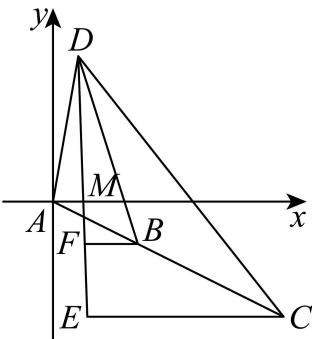
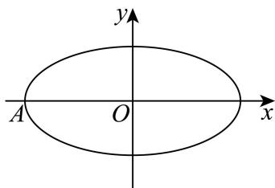

# 2026届上海高三一模 · 金山卷

> 按原卷题号整理；题面、图片和解答未全卷逐页终核。

## 第 1 题

已知集合 $A = (-2, 1), B = (0, 3)$ ，则 $A \cap B =$ \_\_\_\_.

【答案】(0,1)

【解析】

【分析】由集合的交集运算即可得解.

【详解】∵ $A=(-2,1)$ , $B=(0,3)$ ，∴ $A\cap B=(0,1)$ .

故答案为：(0,1).

## 第 2 题

若 $\alpha$ 是第二象限角， $\sin \alpha = \frac{3}{5}$ ，则 $\cos \alpha = \underline{\quad}$ .

【答案】 $-\frac{4}{5}$ ##-0.8

【解析】

【分析】根据同角三角函数关系求出余弦值.

【详解】 $\alpha$ 是第二象限角， $\sin\alpha=\frac{3}{5}$ ，故 $\cos\alpha=-\sqrt{1-\sin^{2}\alpha}=-\frac{4}{5}$ .

故答案为： $-\frac{4}{5}$

## 第 3 题

若复数 $z$ 满足 $z \cdot \mathrm{i} = \frac{2}{1 + \mathrm{i}}$ ，则 $|z| =$ \_\_\_\_.

【答案】 $\sqrt{2}$

【解析】

【分析】借助复数运算法则结合模长定义计算即可得.

【详解】 $z=\frac{2}{(1+i)\cdot i}=\frac{2}{-1+i}=\frac{2(1+i)}{(-1+i)(1+i)}=\frac{2+2i}{-2}=-1-i$

故 $\left|z\right|=\sqrt{\left(-1\right)^{2}+\left(-1\right)^{2}}=\sqrt{2}$ .

故答案为： $\sqrt{2}$ .

## 第 4 题

函数 $y=\sqrt{x^{2}-2x-3}$ 的定义域为 \_\_\_\_.

【答案】 $(-∞,-1]∪[3,+∞)$

【解析】

【分析】根据题意列出一元二次不等式，求解即得函数的定义域.

【详解】要使函数 $y=\sqrt{x^{2}-2x-3}$ 有意义，需使 $x^{2}-2x-3\geq0$

解得 $x \leq -1$ 或 $x \geq 3$ .

故函数的定义域为 $(-∞,-1]∪[3,+∞)$ .

故答案为： $(-∞,-1]∪[3,+∞)$ .

## 第 5 题

$(1 + 2x)^{5} = a_{0} + a_{1}x + a_{2}x^{2} + a_{3}x^{3} + a_{4}x^{4} + a_{5}x^{5}$ ，则 $a_3 =$

【答案】80

【解析】

【分析】由二项式定理可得.

【详解】由题意 $a_{3}=C_{5}^{3}\times2^{3}=80$ .

故答案为：80.

## 第 6 题

已知 $\lg 2 = a, \lg 3 = b$ ，则 $\log_4 6 =$ \_\_\_\_.（用 $a$ 和 $b$ 表示）

【答案】 $\frac{a + b}{2a}$

【解析】

【分析】根据题意，利用对数的运算公式，准确化简、运算，即可求解.

【详解】因为 $\lg 2 = a, \lg 3 = b$ ，可得 $\log_4 6 = \frac{\lg 6}{\lg 4} = \frac{\lg 2 + \lg 3}{2 \lg 2} = \frac{a + b}{2a}$ .

故答案为： $\frac{a + b}{2a}$

## 第 7 题

已知 $\triangle ABC$ 的三个顶点 $A(-5,0)$ 、 $B(3,-3)$ 、 $C(0,2)$ ，则 $AC$ 边上的高所在的直线方程为 \_\_\_\_.

【答案】 $5x+2y-9=0$

【解析】

【分析】根据斜率公式，先求出直线 $AC$ 的斜率，根据两直线垂直，斜率的关系，可得 $AC$ 边上的高的斜率，代入点斜式方程，化简整理，即可得答案.

【详解】由题意直线 $AC$ 的斜率 $k_{AC} = \frac{2 - 0}{0 - (-5)} = \frac{2}{5}$

所以 AC 边上的高的斜率 $k=\frac{-1}{k_{AC}}=-\frac{5}{2}$ ,

所以 AC 边上的高所在的直线方程为 $y-(-3)=-\frac{5}{2}(x-3)$ ，即 $5x+2y-9=0$ 。

故答案为： $5x + 2y - 9 = 0$

## 第 8 题

某学校读书节活动中, 甲、乙、丙 3 个班级各有 2 位同学获奖, 现将这 6 人排成一排拍照, 则同一班级的两位同学均站在一起的排法共有\_\_\_\_种.

【答案】48

【解析】

【分析】用 “捆绑法” 以及全排列即可求解.

【详解】将每个班的 2 人捆绑，然后全排列，故总的排法有 $A_{3}^{3}A_{2}^{2}A_{2}^{2}A_{2}^{2}=48$ ，

故答案为：48

## 第 9 题

在公差不为 0 的等差数列 $\{a_{n}\}$ 中，若 $a_{3}$ 是 $a_{x}$ 与 $a_{y}$ 的等差中项，则 $\frac{1}{x} + \frac{4}{y}$ 的最小值为 \_\_\_\_.

【答案】 $\frac{3}{2}$

【解析】

【分析】根据等差中项性质可得 $x + y = 6$ ，再利用基本不等式中“1”的应用计算可得结果.

【详解】因为在公差不为0的等差数列 $\{a_{n}\}$ 中， $a_3$ 是 $a_{x}$ 与 $a_{y}$ 的等差中项，

所以 $2a_{3}=a_{x}+a_{y}$ ，所以 $x+y=6$ ，

因此 $\frac{1}{x} +\frac{4}{y} = \frac{1}{6}\big(x + y\big)\left(\frac{1}{x} +\frac{4}{y}\right) = \frac{1}{6}\left(5 + \frac{y}{x} +\frac{4x}{y}\right)\geq \frac{1}{6}\left(5 + 2\sqrt{\frac{y}{x}\cdot\frac{4x}{y}}\right) = \frac{3}{2},$

当且仅当 $\frac{y}{x} = \frac{4x}{y}$ ，即 $x = 2, y = 4$ 时等号成立，

所以 $\frac{1}{x} +\frac{4}{y}$ 的最小值为 $\frac{3}{2}$

故答案为: $\frac{3}{2}$

## 第 10 题

已知非零向量 $\vec{a}$ 、 $\vec{b}$ 的夹角为 $\theta$ ，若 $\frac{\left|\vec{b}\right|}{\left|\vec{a}\right|} = \cos \theta, \left|\vec{a} - \vec{b}\right| = 3$ ，则 $\left|\vec{a} - t\vec{b}\right| (t \in \mathbb{R})$ 的最小值为 \_\_\_\_.

【答案】3

【解析】

【分析】将 $\left|\vec{a}-t\vec{b}\right|$ 平方后利用二次函数的性质可求其最小值.

【详解】因为 $\frac{\left|\vec{b}\right|}{\left|\vec{a}\right|}=\cos\theta,\left|\vec{a}-\vec{b}\right|=3$ ，

故 $9 = |\vec{a} -\vec{b}|^2 = \vec{a}^2 -2\vec{a}\cdot \vec{b} +\vec{b}^2 = \vec{a}^2 -2|\vec{a} |\cdot |\vec{b} |\cos \theta +\vec{b} ^2$

$$
= \vec {a} ^ {2} - 2 | \vec {a} | \cdot | \vec {b} | \cdot \frac {| \vec {b} |}{| \vec {a} |} + \vec {b} ^ {2} = \vec {a} ^ {2} - \vec {b} ^ {2},
$$

$$
\left| \vec {a} - t \vec {b} \right| ^ {2} = \vec {a} ^ {2} - 2 t \vec {a} \cdot \vec {b} + t ^ {2} \vec {b} ^ {2} = \vec {a} ^ {2} - 2 t | \vec {a} | \cdot | \vec {b} | \cdot \frac {| \vec {b} |}{| \vec {a} |} + t ^ {2} \vec {b} ^ {2} = \vec {a} ^ {2} - 2 t | \vec {b} | ^ {2} + t ^ {2} \vec {b} ^ {2}
$$

$$
= \vec {b} ^ {2} (t - 1) ^ {2} + \vec {a} ^ {2} - \vec {b} ^ {2} = \vec {b} ^ {2} (t - 1) ^ {2} + 9
$$

故当 $t = 1$ 时， $\left|\vec{a} - t\vec{b}\right|^2$ 的最小值为9，

故 $\left|\vec{a}-t\vec{b}\right|$ 最小值为3.

故答案为：3.

## 第 11 题

上海护珠塔，俗称斜塔，始建于北宋元丰年间（1078-1085年），是世界上倾斜程度最大的佛塔之一，其倾斜角（塔身所在直线与铅垂线的夹角）超过意大利比萨斜塔。如图，护珠塔前有一条笔直的山路，山路所在直线与水平面夹角为 $34^{\circ}$ 。康同学为了测量护珠塔的倾斜程度，实施如下方案：从塔底 $A$ 沿着山路往下走至 $B$ ，此时测得 $AB$ 长度为10米，观察塔顶 $D$ 的仰角（视线与水平面的夹角）为 $76^{\circ}$ ，继续往下走至 $C$ ，测得 $AC$ 长度为25.9米，观察塔顶 D 的仰角为 $60^{\circ}$ 。根据康同学的数据，可得该塔的倾斜角为 \_\_\_\_。（精确到 $0.1^{\circ}$ ）

（参考数值： $\tan76^{\circ}\approx4.0108,\tan60^{\circ}\approx1.732,\sin34^{\circ}\approx0.5592,\cos34^{\circ}\approx0.8290,\tan6.5^{\circ}\approx0.1147$ ）

【答案】6.5°

【解析】

【分析】以 A 为原点，建立直角坐标系，根据题意，得到 B, C 的坐标，设塔高 AD = h

倾斜角为 $\theta$ ，则 $D(h\sin \theta ,h\cos \theta)$ ，求得 $\tan 76^{\circ} = \frac{h\cos\theta + 10\sin34^{\circ}}{10\cos34^{\circ} - h\sin\theta}$ ，且

$\tan 60^{\circ} = \frac{h\cos\theta + 25.9\sin34^{\circ}}{25.9\cos34^{\circ} - h\sin\theta}$ ，代入数值，列出方程组，求得 $h\sin\theta, h\cos\theta$ 的值，结合 $\tan\theta = \frac{h\sin\theta}{h\cos\theta}$ ，即可求解.

【详解】以 A 为坐标原点，以水平线为 x 轴，建立如图所示的平面直角坐标系，

因为 AB = 10, AC = 25.9，且山路所在直线与水平面夹角为 $34^{\circ}$ ，

可得 $B(10\cos34^{\circ},-10\sin34^{\circ}),C(25.9\cos34^{\circ},-25.9\sin34^{\circ})$

设塔高 AD 的长为 h，倾斜角为 $\theta$ ，则 $D(h\sin\theta, h\cos\theta)$ ,

因为在 B 处观察塔顶 D 的仰角为 $76^{\circ}$ ，可得 $\tan 76^{\circ} = \frac{DF}{BF} = \frac{h \cos \theta + 10 \sin 34^{\circ}}{10 \cos 34^{\circ} - h \sin \theta}$ ，

在 $C$ 处观察塔顶 $D$ 的仰角为 $60^{\circ}$ ，可得 $\tan 60^{\circ} = \frac{DE}{BE} = \frac{h\cos\theta + 25.9\sin 34^{\circ}}{25.9\cos 34^{\circ} - h\sin\theta}$ ，

代入 $\tan 76^{\circ} \approx 4.0108, \tan 60^{\circ} \approx 1.732, \sin 34^{\circ} \approx 0.5592, \cos 34^{\circ} \approx 0.8290$ 整理得 $\left\{ \begin{array}{l} h\cos \theta + 4.0108h\sin \theta = 27.66 \\ h\cos \theta + 1.732h\sin \theta = 22.71 \end{array} \right.$ ，解得 $h\sin \theta \approx 2.17, h\cos \theta \approx 18.95$ ，又由 $\tan \theta = \frac{h\sin \theta}{h\cos \theta} = \frac{2.17}{18.95} \approx 0.1147$ ，所以 $\theta = \arctan(0.1147) \approx 6.5^\circ$ 。故答案为： $6.5^\circ$ 。

## 第 12 题

> 核对提醒：原解析只证明上界，未说明上界可达到；取等构造待补。

已知四边形 $A_{1} A_{2} A_{3} A_{4}$ 为平行四边形，集合

$\Omega=\left\{\overrightarrow{A_{i}A_{j}}\mid i\neq j,i,\quad j\in\left\{1,2,3,4\right\}\right\},\quad M_{1},M_{2},\cdots,M_{k}$ 均为集合 $\Omega$ 的四元子集，若对于任意 $m,n\in\left\{1,2,\cdots,k\right\}$ ，当 $m\neq n$ 时， $M_{m}\cap M_{n}$ 中的元素个数都不超过 2 个，则正整数 k 的最大值为 ______.

【答案】14

【解析】

【分析】由题意可得 $\Omega$ 中共 8 个元素，记为 $\Omega = \{a_{1}, a_{2}, a_{3}, a_{4}, a_{5}, a_{6}, a_{7}, a_{8}\}$ ，假设 $M_{m} \cap M_{n}$ 中最大交集为 $\{a_{1}, a_{2}\}$ ，从而可得含 $\{a_{1}, a_{2}\}$ 的四元集合最多有 $\frac{6}{2} = 3$ 个，

且对 $\{a_{1},a_{2}\}$ 在 $M_{1},M_{2},\cdots,M_{k}$ 中最多出现 3 次，求得一个四元集中出现 $C_{4}^{2}=6$ 个二元数对，从而可得 $6k\leq28\times3$ ，求解即可.

【详解】由题意可知 $\Omega=\left\{\overrightarrow{A_{1}A_{2}},\overrightarrow{A_{1}A_{3}},\overrightarrow{A_{1}A_{4}},\overrightarrow{A_{2}A_{1}},\overrightarrow{A_{2}A_{4}},\overrightarrow{A_{3}A_{1}},\overrightarrow{A_{3}A_{2}},\overrightarrow{A_{4}A_{2}}\right\}$ 共8个元素，

记为 $\Omega = \{a_{1}, a_{2}, a_{3}, a_{4}, a_{5}, a_{6}, a_{7}, a_{8}\}$

假设 $M_{m} \cap M_{n}$ 中最大交集为 $\{a_1, a_2\}$ ,

所以含 $\{a_{1}, a_{2}\}$ 的四元集合中剩下的两个元素不能相同，

因为 $\Omega$ 中共8个元素，则还剩下6个元素，

所以 $M_{1}, M_{2}, \cdots, M_{k}$ 中，含 $\{a_{1}, a_{2}\}$ 的四元集合最多有 $\frac{6}{2} = 3$ 个，即数对 $\{a_{1},a_{2}\}$ 在 $M_{1},M_{2},\cdots,M_{k}$ 中最多出现 3 次，
同理任何一个二元数对 $\{a_{1},a_{2}\}$ 可在 $M_{1},M_{2},\cdots,M_{k}$ 中最多出现 3 次，
所以一个四元集中出现 $C_{4}^{2}=6$ 个二元数对，
所以 k 个四元集中共出现 6k 次，
因为 $\{a_{1},a_{2},a_{3},a_{4},a_{5},a_{6},a_{7},a_{8}\}$ 中最多有 $C_{8}^{2}=28$ 种不同的二元数对，每个最多出现 3 次，
所以 $6k \leq 28 \times 3$ ，解得 $k \leq 14$ .
所以正整数 k 的最大值为 14.

故答案为：14

## 第 13 题

已知 $a < b < 0$ ，则下列不等式成立的是（）
A. $a^2 < b^2$ B. $\frac{1}{a} < \frac{1}{b}$ C. $ab < b^2$ D. $\frac{b}{a} < 1$

【答案】D

【解析】

【分析】利用不等式的性质，结合作差比较法逐一判断各选项即可.

【详解】对于 A，因 a < b < 0，由 $a^{2} - b^{2} = (a + b)(a - b) > 0$ ，可得 $a^{2} > b^{2}$ ，故 A 错误；对于 B，因 a < b < 0，则 ab > 0，利用不等式的性质，可得 $\frac{1}{b} < \frac{1}{a}$ ，即 $\frac{1}{a} > \frac{1}{b}$ ，故 B 错误；对于 C，因 a < b < 0，由 $ab - b^{2} = b(a - b) > 0$ ，可得 $ab > b^{2}$ ，故 C 错误；对于 D，因 a < b < 0，利用不等式的性质，可得 $1 > \frac{b}{a}$ ，即 $\frac{b}{a} < 1$ ，故 D 正确。故选：D.

## 第 14 题

已知某正四棱锥的高为 2，体积为 24，则该正四棱锥的底面边长为（）
A. 9
B. 8
C. 6
D. $2\sqrt{3}$

【答案】C
【解析】
【分析】设底面边长为 $a$ ，代入体积公式，即可得答案.

【详解】设底面边长为 $a$ ，则正四棱锥的体积 $V = \frac{1}{3} \times a^2 \times 2 = 24$ ，解得 $a = 6$ . 故选：C

## 第 15 题

已知正整数 $a_1,a_2,a_3$，满足 $1\leq a_1<a_2<a_3\leq10$，且

$$ (a_1^2+a_2^2)(a_2^2+a_3^2)=(a_1a_2+a_2a_3)^2, $$

则有序数对 $(a_1,a_2,a_3)$ 有（　）个。

A. 5　　B. 4　　C. 3　　D. 2

【答案】B

【解析】

【分析】根据题设条件可得 $a_{2}^{2}=a_{1}a_{3}$ ，利用枚举法可求有序数对 $(a_{1},a_{2},a_{3})$ 的个数.
【详解】因为 $\left(a_{1}^{2}+a_{2}^{2}\right)\left(a_{2}^{2}+a_{3}^{2}\right)=\left(a_{1}a_{2}+a_{2}a_{3}\right)^{2}$ 故 $a_{1}^{2}a_{2}^{2}+a_{2}^{2}a_{3}^{2}+a_{1}^{2}a_{3}^{2}+a_{2}^{4}=\left(a_{1}a_{2}\right)^{2}+\left(a_{2}a_{3}\right)^{2}+2a_{1}a_{2}^{2}a_{3}$ 所以 $a_{1}^{2}a_{3}^{2}+a_{2}^{4}=2a_{1}a_{2}^{2}a_{3}$ ，故 $\left(a_{2}^{2}-a_{1}a_{3}\right)^{2}=0$ 即 $a_{2}^{2}=a_{1}a_{3}$ 因为 $1\leq a_{1}<a_{2}<a_{3}\leq10$ ，故 $2\leq a_{2}\leq9$ 若 $a_{2}=2$ ，则 $a_{1}a_{3}=4$ ，而 $1\leq a_{1}<2<a_{3}\leq10$ ，故 $a_{1}=1,a_{3}=4$ 若 $a_{2}=3$ ，则 $a_{1}a_{3}=9$ ，而 $1\leq a_{1}<3<a_{3}\leq10$ ，故 $a_{1}=1,a_{3}=9$ 若 $a_{2}=4$ ，则 $a_{1}a_{3}=16$ ，而 $1\leq a_{1}<4<a_{3}\leq10$ ，故 $a_{1}=2,a_{3}=8$ 若 $a_{2}=5$ ，则 $a_{1}a_{3}=25$ ，而 $1\leq a_{1}<5<a_{3}\leq10$ ，此时无正整数解；
若 $a_{2}=6$ ，则 $a_{1}a_{3}=36$ ，而 $1\leq a_{1}<6<a_{3}\leq10$ ，故 $a_{1}=4,a_{3}=9$ 若 $a_{2}=7$ ，则 $a_{1}a_{3}=49$ ，而 $1\leq a_{1}<7<a_{3}\leq10$ ，此时无正整数解；
若 $a_{2}=8$ ，则 $a_{1}a_{3}=64$ ，而 $1\leq a_{1}<8<a_{3}\leq10$ ，此时无正整数解；
若 $a_{2}=9$ ，则 $a_{1}a_{3}=81$ ，而 $1\leq a_{1}<9<a_{3}\leq10$ ，此时无正整数解；
故有序数对 $(a_{1},a_{2},a_{3})$ 的个数为4，

故选：B.

## 第 16 题

记曲线 $C:\dfrac{|x|^n}{a}+\dfrac{|y|^n}{b}=1$（$a>0$ 且 $b>0$，$n>0$ 且 $n\in\mathbb R$）为 $C_{(a,b)}^n$，称其为“超椭圆”。命题 $p$：直线 $l:2x+9y-12=0$ 与超椭圆 $C_{(3,2)}^{\frac12}$ 有3个不同交点；命题 $q$：超椭圆 $C_{(9,1)}^8$ 上的点到坐标原点距离的取值范围为 $[1,2^{5/8}]$，则下列说法正确的是（　）

A. 命题 $p$ 为真命题，命题 $q$ 为假命题

B. 命题 $p$ 为假命题，命题 $q$ 为真命题

C. 命题 $p,q$ 均为真命题

D. 命题 $p,q$ 均为假命题

【答案】A

【解析】

【分析】命题 $p$ ：代入 $a, b, n$ ，移项由绝对值范围求解 $x, y$ 的范围，分情况与直线列方程组求解，根据结果可判断命题 $p$ ；命题 $q$ ：由图形的对称性将方程降幂，写成平方和的形式，三角换元，根据权方和不等式可得出距离范围的最大值，从而判断命题 $q$ ．

【详解】命题 $p: C_{(3,2)}^{\frac{1}{2}}: \frac{\sqrt{|x|}}{3} + \frac{\sqrt{|y|}}{2} = 1$ ，由 $\frac{\sqrt{|y|}}{2} = 1 - \frac{\sqrt{|x|}}{3} \geq 0$ 可得： $|x| \leq 9$ ，同理 $|y| \leq 4$ ， $1^\circ$ 当 $x \geq 0, y \geq 0$ 时， $C_{(3,2)}^{\frac{1}{2}}$ 方程可化简为 $y = \frac{4}{9} x - \frac{8}{3} \sqrt{x} + 4$ ，
联立 $\left\{ \begin{array}{l} y = \frac{4}{9} x - \frac{8}{3} \sqrt{x} + 4 \\ 2x + 9y - 12 = 0 \end{array} \right.$ ，解得： $\left\{ \begin{array}{l} x = 4 \\ y = \frac{4}{9} \end{array} \right.$ $2^\circ$ 当 $x < 0, y \geq 0$ 时， $C_{(3,2)}^{\frac{1}{2}}$ 方程可化简为 $y = -\frac{4}{9} x - \frac{8}{3} \sqrt{-x} + 4$ ，
联立 $\left\{ \begin{array}{l} y = -\frac{4}{9} x - \frac{8}{3} \sqrt{-x} + 4 \\ 2x + 9y - 12 = 0 \end{array} \right.$ ，解得： $\left\{ \begin{array}{l} x = -60 - 24\sqrt{6} \\ y = \frac{44 + 16\sqrt{6}}{3} \end{array} \right.$ （舍）或 $\left\{ \begin{array}{l} x = -60 + 24\sqrt{6} \\ y = \frac{44 - 16\sqrt{6}}{3} \end{array} \right.$ ； $3^\circ$ 当 $x < 0, y < 0$ 时， $l: 2x + 9y - 12 = 0$ 不过第三象限，所以第三象限无交点； $4^\circ$ 当 $x \geq 0, y < 0$ 时， $C_{(3,2)}^{\frac{1}{2}}$ 方程可化简为 $y = -\frac{4}{9} x + \frac{8}{3}\sqrt{x} - 4$ ，
联立 $\left\{ \begin{array}{l} y = -\frac{4}{9} x + \frac{8}{3}\sqrt{x} - 4 \\ 2x + 9y - 12 = 0 \end{array} \right.$ ，解得： $\left\{ \begin{array}{l} x = 48 - 24\sqrt{3} \\ y = \frac{-28 + 16\sqrt{3}}{3} \end{array} \right.$ 或 $\left\{ \begin{array}{l} x = 48 + 24\sqrt{3} \\ y = \frac{-28 - 16\sqrt{3}}{3} \end{array} \right.$ （舍）

综上： $C_{(3,2)}^{\frac{1}{2}}$ 与直线 $l: 2x + 9y - 12 = 0$ 共3个交点，所以命题 $p$ 正确；

命题 $q: C_{(9,1)}^{8}: \frac{x^8}{9} + y^8 = 1$ ，由图形的对称性，不妨考虑 $x \geq 0, y \geq 0$ .

即 $\left(\frac{x^4}{3}\right)^2 +\left(y^4\right)^2 = 1$ ，令 $\left\{ \begin{array}{l} \frac{x^4}{3} = \cos \alpha \\ y^4 = \sin \alpha \end{array} \right.$ ，则 $\left\{ \begin{array}{l} x^{2} = \sqrt{3\cos\alpha}\\ y^{2} = \sqrt{\sin\alpha} \end{array} \right.$

则 $x^{2} + y^{2} = \sqrt{3\cos\alpha} +\sqrt{\sin\alpha}$

由权方和不等式可得： $\frac{\left(\sqrt{3\cos\alpha} + \sqrt{\sin\alpha}\right)^4}{\left(\sqrt[3]{9} + 1\right)^3}\leq \frac{9\cos^2\alpha}{9} +\sin^2\alpha = 1,$

所以 $\sqrt{3\cos\alpha} +\sqrt{\sin\alpha}\leq \left(\sqrt[3]{9} +1\right)^{\frac{3}{4}} <   2^{\frac{5}{4}}$ ，所以命题 $q$ 错误

## 第 17 题

核桃有很多品种. 小何购买了其中 4 种品类的核桃: $A$ 类核桃 100 个, $B$ 类核桃 120 个, $C$ 类核桃 80 个和 $D$ 类核桃 200 个.

（1）小何决定采用分层抽样的方法，从所有核桃中抽出25个核桃，请问应抽取 $C$ 类核桃多少个？

(2) 小何以随机抽样的方式, 从 $D$ 类核桃中抽取 20 个进行克重测量, 以下是这些核桃的克重数据: (单位: 克)

①从该20个核桃中任取2个，则所取2个核桃的克重均大于20克的概率为多少？②记 $\overline{x}$ 为该20个核桃的平均克重， $s$ 为该20个核桃克重的标准差，则该20个核桃中有多

少个核桃的克重位于 $\overline{X} - S$ 与 $\overline{X} + S$ 之间？

【答案】（1）4； (2) ① $\frac{18}{95}$ ； ②13个.

【解析】

【分析】（1）根据分层抽样的特点计算即可‘

(2) ①先求出克重大于 20 克的核桃共 9 个, 再利用组合公式和古典概型即可得到答案;

②利用方差公式求出方差，则得到范围，再对照表格即可.

【小问 1 详解】

$$
\frac {8 0}{1 0 0 + 1 2 0 + 8 0 + 2 0 0} \times 2 5 = 4 \text {个}
$$

则应抽取 C 类核桃 4 个.

【小问 2 详解】

①因为克重大于 20 克的核桃共 9 个，

则所取2个核桃的克重均大于20克的概率为 $\frac{\mathrm{C}_9^2}{\mathrm{C}_{20}^2} = \frac{18}{95}$ .

② $\overline{x}=\frac{14.4+14.7+\cdots+22.6}{20}=\frac{380}{20}=19$ ,

则标准差 $s=\sqrt{\frac{(14.4-19)^{2}+(14.7-19)^{2}+\cdots+(22.6-19)^{2}}{20}}\approx2.42$

$$
\bar {x} - s \approx 1 9 - 2. 4 2 = 1 6. 5 8, \quad \bar {x} + s \approx 1 9 + 2. 4 2 = 2 1. 4 2.
$$

对照表格可知则该 20 个核桃中有 13 个核桃的克重位于 $\overline{X} - S$ 与 $\overline{X} + S$ 之间.

## 第 18 题

如图，已知圆锥 $A - O$ ，点 $B$ 、 $C$ 在底面圆周上， $OA = OB = 4$ ，且 $\angle BOC = 90^{\circ}$ ，动点 $P$ 落在劣弧 $BC$ 上.

（1）求证：平面 $AOB \perp$ 平面 AOC；

(2) 若点 $P$ 平分劣弧 $BC$ , 过点 $P$ 分别作 $PD \perp OC$ 、 $PE \perp OB$ , 垂足分别为 $D$ 、 $E$ 两点,

求二面角 $D - AP - E$ 的大小.

【答案】（1）证明见解析.

(2) $\arccos \frac{1}{3}$ .

【解析】

【分析】（1）先证明线面垂直，然后得出面面垂直；

(2) 先建立空间直角坐标系, 通过求平面的法向量解决二面角问题.

【小问 1 详解】

证明：在圆锥 A-O 中， $AO \perp$ 平面 BOC， $\therefore AO \perp OC$

$$
\because \angle B O C = 9 0 ^ {\circ}, \therefore B O \perp O C
$$

∵ $AO \cap BO = O$ , $AO, BO \subset$ 平面 AOC, ∴ OC ⊥ 平面 AOB,

$\because OC \subset$ 平面 AOC

∴平面 $AOB \perp$ 平面 AOC

【小问 2 详解】

以 O 为原点，OC 为 x 轴，OB 为 y 轴，OA 为 z 轴，如图建立空间直角坐标系

由题意， $D(2\sqrt{2},0,0)$ ， $A(0,0,4)$ ， $P(2\sqrt{2},2\sqrt{2},0)$ ， $E(0,2\sqrt{2},0)$

则 $\overrightarrow{DA} = (-2\sqrt{2},0,4)$ ， $\overrightarrow{DP} = (0,2\sqrt{2},0)$ ， $\overrightarrow{EP} = (2\sqrt{2},0,0)$ ， $\overrightarrow{EA} = (0, - 2\sqrt{2},4)$

设 $\overrightarrow{n_1} = (x_1, y_1, z_1)$ 是平面 $DAP$ 的一个法向量，

则 $\left\{ \begin{array}{l} \overrightarrow{DA} \cdot \overrightarrow{n_1} = -2\sqrt{2} x_1 + 4z_1 = 0 \\ \overrightarrow{DP} \cdot \overrightarrow{n_1} = 2\sqrt{2} y_1 = 0 \end{array} \right.$ ，取 $x_1 = \sqrt{2}$ ，则 $\overrightarrow{n_1} = (\sqrt{2}, 0, 1)$ ，

设 $\overrightarrow{n_2} = (x_2, y_2, z_2)$ 是平面 $APE$ 的一个法向量，

则 $\left\{ \begin{array}{l} \overrightarrow{EP} \cdot \overrightarrow{n_2} = 2\sqrt{2} x_2 = 0 \\ \overrightarrow{EA} \cdot \overrightarrow{n_2} = -2\sqrt{2} y_2 + 4z_2 = 0 \end{array} \right.$ ，取 $y_2 = \sqrt{2}$ ，则 $\overrightarrow{n_2} = (0, \sqrt{2}, 1)$ ，

设平面 DAP 与平面 APE 夹角为 $\theta$ ，

则 $\cos \theta = |\cos < \overrightarrow{n_1},\overrightarrow{n_2} >| = \frac{|\vec{n}_1\cdot\vec{n}_2|}{|\vec{n}_1||\vec{n}_2|} = \frac{1}{\sqrt{3}\cdot\sqrt{3}} = \frac{1}{3},$

∴平面 DAP 与平面 APE 夹角的余弦值为 $\frac{1}{3}$ .

则根据法向量朝向可知二面角 D - AP - E 的大小为 $\arccos\frac{1}{3}$ .

## 第 19 题

已知 $f(x)=2\sin(\omega x+\varphi)$ （其中 $\omega>0,|\varphi|<\frac{\pi}{2}$ ），函数 $y=f(x)$ 相邻的极小值点和极大值点分别为 $-\frac{\pi}{3}$ 和 $\frac{2\pi}{3}$ ．直线 l 为函数 $y=f(x)$ 在 y 轴右侧与 y 轴距离最近的对称轴，且分别交函数 $y=f(x)$ 的图象和 x 轴于 A, B 两点，点 C 为线段 AB 上一动点.

（1）求函数 $y = f(x)$ 的表达式，并写出其严格增区间；

（2）设 $\angle BOC = \theta$ ，记 $L = AC + 2OC$ ，请写出 L 关于 $\theta$ 的函数表达式，并求 L 的最小值.

【答案】（1） $f(x)=2\sin(x-\frac{\pi}{6})$ ， $\left[-\frac{\pi}{3}+2k\pi,\frac{2\pi}{3}+2k\pi\right](k\in\mathbf{Z})$ .

(2) $2+\frac{2\sqrt{3}}{3}\pi$

【解析】

【分析】(1)由两个相邻的极值点的距离可求得函数的最小正周期, 进而确定 $\omega$ , 再由 $x=\frac{2}{3}\pi$ 时取得极大值, 且 $\left|\varphi\right|<\frac{\pi}{2}$ , 可解得 $\varphi$ , 则 $f(x)$ 确定, 再根据正弦型函数的单调区间, 运用整体代入法求解即可;

（2）先确定 $A, B$ 两点坐标，再根据 $\theta$ 以及直角三角形中的边长关系，求得 $AC, OC$ ，进而表示出 $L = 2 + \frac{2\pi}{3} \cdot \frac{2 - \sin \theta}{\cos \theta}$ ，再令 $g(\theta) = \frac{2 - \sin \theta}{\cos \theta}$ ，通过求导研究其在区间内的单调性，求出 $\frac{2 - \sin\theta}{\cos\theta}$ 的最小值，即可得到 $L$ 的最小值.

【小问 1 详解】

设 $f(x) = 2\sin (\omega x + \varphi)$ 的最小正周期为 $T = \frac{2\pi}{\omega}$

则由题可知， $\frac{T}{2} = |\frac{2\pi}{3} - (-\frac{\pi}{3})| = \pi$ ，而 $\frac{T}{2} = \frac{\pi}{\omega}$ ，解得 $\omega = 1$ ，则 $f(x) = 2\sin (x + \varphi)$

∵ $f(x)$ 在 $x=\frac{2}{3}\pi$ 处取得极大值，∴ $\frac{2\pi}{3}+\varphi=\frac{\pi}{2}+2k\pi(k\in\mathbf{Z})$ ， $\varphi=-\frac{\pi}{6}+2k\pi(k\in\mathbf{Z})$ ，

又因为 $|\varphi| < \frac{\pi}{2}$ ，故 $k = 0, \varphi = -\frac{\pi}{6}$ ，

则 $f(x) = 2\sin \left(x - \frac{\pi}{6}\right)$ .

令 $-\frac{\pi}{2} + 2k\pi \leq x - \frac{\pi}{6} \leq \frac{\pi}{2} + 2k\pi, k \in \mathbf{Z}$ ,

解得 $x \in \left[-\frac{\pi}{3} + 2k\pi, \frac{2\pi}{3} + 2k\pi\right](k \in \mathbf{Z})$ ，即 $y = f(x)$ 的严格增区间为 $\left[-\frac{\pi}{3} + 2k\pi, \frac{2\pi}{3} + 2k\pi\right](k \in \mathbf{Z})$ .

【小问 2 详解】

由题可知， $x = \frac{2}{3}\pi$ 为 $y$ 轴右侧最接近 $y$ 轴的极大值点，而正弦型函数的极值点同时也是其对称轴，

因此易知 $B(\frac{2\pi}{3},0)$ ，故 $OB = \frac{2\pi}{3}$ ，则 $OC = \frac{2\pi}{3\cos\theta}, CB = \frac{2\pi}{3}\tan \theta .$

$$
\because f \left(\frac {2 \pi}{3}\right) = 2 \sin \left(\frac {2}{3} \pi - \frac {\pi}{6}\right) = 2 \sin \frac {\pi}{2} = 2, \therefore B A = 2, A C = A B - C B = 2 - \frac {2 \pi}{3} \tan \theta .
$$

$$
L = A C + 2 O C = 2 - \frac {2 \pi}{3} \tan \theta + \frac {4 \pi}{3 \cos \theta} = 2 + \frac {2 \pi}{3} \cdot \frac {2 - \sin \theta}{\cos \theta}
$$

设 $\angle AOB = \alpha$ ， $\tan \alpha = \frac{AB}{OB} = \frac{2}{\frac{2\pi}{3}} = \frac{3}{\pi}$ ， $\because \frac{\sqrt{2}}{3} <  \tan \alpha = \frac{3}{\pi} <  1,\quad \therefore \frac{\pi}{6} <  \alpha <  \frac{\alpha}{4}.$

设 $g(\theta) = \frac{2 - \sin\theta}{\cos\theta},\theta \in [0,\alpha ]$

$$
g ^ {\prime} (\theta) = \frac {- \cos \theta \cdot \cos \theta - (2 - \sin \theta) (- \sin \theta)}{\cos^ {2} \theta} = \frac {2 \sin \theta - 1}{\cos^ {2} \theta}
$$

当 $\theta \in [0, \frac{\pi}{6})$ 时， $2\sin \theta - 1 < 0, \cos^2 \theta > 0$ ，即 $g'(\theta) < 0$ ，因此 $g(\theta)$ 在 $[0, \frac{\pi}{6})$ 上单调递减；当 $\theta \in (\frac{\pi}{6}, \alpha]$ 时， $2\sin \theta - 1 > 0, \cos^2 \theta > 0$ ，即 $g'(\theta) > 0$ ，因此 $g(\theta)$ 在 $(\frac{\pi}{6}, \alpha]$ 上单调递增，

因此 $g(\theta)$ 在 $\theta=\frac{\pi}{6}$ 时取到最小值， $g(\theta)_{\min}=g(\frac{\pi}{6})=\frac{2-\frac{1}{2}}{\frac{\sqrt{3}}{2}}=\sqrt{3}$

故 $L$ 的最小值 $L_{\mathrm{min}} = 2 + \frac{2\pi}{3}\cdot \sqrt{3} = 2 + \frac{2\sqrt{3}}{3}\pi .$

## 第 20 题

已知椭圆 $\Gamma: \frac{x^2}{16} + \frac{y^2}{4} = 1$ ，点 $O$ 为坐标原点，点 $M$ 为椭圆 $\Gamma$ 上一点.

（1）求椭圆 $\Gamma$ 的离心率；

（2）已知点 $F_{2}$ 为椭圆 $\Gamma$ 的右焦点，直线 $l_{0}: x = \frac{8\sqrt{3}}{3}$ ，证明：点 $M$ 到点 $F_{2}$ 的距离与到直线 $l_{0}$ 的距离之比为定值；

（3）过线段 OM 中点 N 的直线 l 交椭圆 $\Gamma$ 于 P、Q 两点，求 $S_{\triangle PMQ}$ 的最大值.

【答案】(1) $\frac{\sqrt{3}}{2}$ ;

(2) 证明见解析; (3) $2 \sqrt{3}$ .

【解析】

【分析】（1）根据离心率公式即可求解；

（2）根据两点距离以及点到直线的距离公式，化简即可求解；

（3）联立直线与椭圆方程，根据弦长公式以及点到直线的距离公式，可得面积的表达式，进而根据中点关系以及三角换元，根据判别式求解 $t$ 的范围，利用二次函数的性质即可求解最值.

【小问 1 详解】

$\Gamma : \frac{x^2}{16} + \frac{y^2}{4} = 1$ 中， $a = 4, b = 2, c = \sqrt{a^2 - b^2} = 2\sqrt{3}$ ，故离心率为 $e = \frac{c}{a} = \frac{2\sqrt{3}}{4} = \frac{\sqrt{3}}{2}$ ，

【小问 2 详解】

设 $M\left(x_0,y_0\right)$ ，则 $\frac{x_0^2}{16} +\frac{y_0^2}{4} = 1$ ，则 $y_{0}^{2} = 4\left(1 - \frac{x_{0}^{2}}{16}\right),F_{2}\left(2\sqrt{3},0\right)$

故

$$
\left| M F _ {2} \right| = \sqrt {\left(x _ {0} - 2 \sqrt {3}\right) ^ {2} + y _ {0} ^ {2}} = \sqrt {\left(x _ {0} - 2 \sqrt {3}\right) ^ {2} + 4 \left(1 - \frac {x _ {0} ^ {2}}{1 6}\right)} = \sqrt {\frac {3}{4} x _ {0} ^ {2} - 4 \sqrt {3} x _ {0} + 1 6} = \sqrt {\left(\frac {\sqrt {3}}{2} x _ {0} - 4\right) ^ {2}} = \left| \frac {\sqrt {3}}{2} x _ {0} - 4 \right|
$$

$M\left(x_{0},y_{0}\right)$ 到直线 $l_0$ : $x = \frac{8\sqrt{3}}{3}$ 的距离 $d = \left|x_0 - \frac{8\sqrt{3}}{3}\right|$ ,

所以 $\frac{|MF_2|}{d} = \frac{\left|\frac{\sqrt{3}}{2}x_0 - 4\right|}{\left|x_0 - \frac{8\sqrt{3}}{3}\right|} = \frac{\sqrt{3}}{2}\frac{\left|x_0 - \frac{8\sqrt{3}}{3}\right|}{\left|x_0 - \frac{8\sqrt{3}}{3}\right|} = \frac{\sqrt{3}}{2}$ 为定值.

设 $M(4\cos \theta ,2\sin \theta)$ ，则 $N(2\cos \theta ,\sin \theta)$

由于 N 是线段 OM 的中点，故 M 到直线 PQ 的距离与 O 到直线 PQ 的距离 d 相等，

故 $S_{\triangle PMQ} = S_{\triangle POQ} = \frac{1}{2}\big|PQ\big|d$

设直线 PQ: $y = kx + m$ ,

联立其与椭圆的方程可得 $\left(4k^2 + 1\right)x^2 + 8kmx + 4m^2 - 16 = 0$

设 $P\big(x_1,y_1\big),Q\big(x_2,y_2\big)$ ，则 $x_{1} + x_{2} = \frac{-8km}{4k^{2} + 1},x_{1}x_{2} = \frac{4m^{2} - 16}{4k^{2} + 1}$

故

$$
\left| P Q \right| = \sqrt {1 + k ^ {2}} \sqrt {\left(x _ {1} + x _ {2}\right) ^ {2} - 4 x _ {1} x _ {2}} = \sqrt {1 + k ^ {2}} \sqrt {\left(\frac {- 8 k m}{4 k ^ {2} + 1}\right) ^ {2} - 4 \frac {4 m ^ {2} - 1 6}{4 k ^ {2} + 1}} = 4 \sqrt {1 + k ^ {2}} \frac {\sqrt {4 (4 k ^ {2} + 1) - m ^ {2}}}{4 k ^ {2} + 1}
$$

$d=\frac{|m|}{\sqrt{1+k^{2}}}$ ，故

$$
S _ {\triangle P M Q} = S _ {\triangle P O Q} = \frac {1}{2} | P Q | d = \frac {1}{2} \times 4 \sqrt {1 + k ^ {2}} \frac {\sqrt {4 (4 k ^ {2} + 1) - m ^ {2}}}{4 k ^ {2} + 1} \cdot \frac {| m |}{\sqrt {1 + k ^ {2}}} = 2 \frac {| m | \sqrt {4 (4 k ^ {2} + 1) - m ^ {2}}}{4 k ^ {2} + 1}
$$

$$
S _ {\triangle P M Q} = 2 \sqrt {\frac {4 m ^ {2} (4 k ^ {2} + 1) - m ^ {4}}{(4 k ^ {2} + 1) ^ {2}}} = 2 \sqrt {- \frac {m ^ {4}}{(4 k ^ {2} + 1) ^ {2}} + 4 \frac {m ^ {2}}{4 k ^ {2} + 1}},
$$

令 $\frac{m^2}{4k^2 + 1} = t$ ，由于 $N(2\cos \theta ,\sin \theta)$ 在直线 $PQ$ 上，所以 $\sin \theta = 2k\cos \theta +m$

由于 $m^2 = (4k^2 + 1)t$ ，故 $(\sin \theta - 2k\cos \theta)^2 = (4k^2 + 1)t$

化简可得 $4\left(\cos^2\theta -t\right)k^2 -4\sin \theta \cos \theta k + \sin^2\theta -t = 0$

由于该关于 $k$ 的方程在 $\mathbf{R}$ 上有解，故

$\Delta = (-4\sin \theta \cos \theta)^2 - 4\times 4(\cos^2\theta -t)(\sin^2\theta -t) = 16(t - t^2)\geq 0$ ，解得 $0\leq t\leq 1$ 则 $S_{\triangle PMQ} = 2\sqrt{-t^2 + 4t}$ ，故当 $t = 1$ 时，此时 $S_{\triangle PMQ}$ 取到最大值 $2\sqrt{3}$

## 第 21 题

> 核对提醒：题面已对照本地整理版PDF第6页核实；源解析按正确条件整理，非完整独立数学终审。

现给出“U函数”的定义与性质。

定义：若函数 $y=f(x)$ 在区间 $D$ 上连续，且对于区间 $D$ 内任意两数 $x_1,x_2$，如果都有 $f\left(\frac{x_1+x_2}{2}\right)\leq\frac{f(x_1)+f(x_2)}{2}$ 成立，则称函数 $y=f(x)$ 为区间 $D$ 上的“U函数”；

性质：若函数 $y=f(x)$ 为区间 $D$ 上的“U函数”，则对于任意 $x_1,x_2,\ldots,x_n\in D$ 和满足 $\lambda_1+\lambda_2+\cdots+\lambda_n=1$ 的正数 $\lambda_1,\lambda_2,\ldots,\lambda_n$，有

$$f\left[\sum_{i=1}^{n}(\lambda_i x_i)\right]\leq\sum_{i=1}^{n}[\lambda_i f(x_i)]\quad(n\geq2,\ n\in\mathbb N)$$

成立。

（1）判断下列两个函数是否为其定义域上的“U函数”（不需要说明理由）：

① $y=\sin x,\ x\in(0,\frac{\pi}{2})$；② $y=x^2+2x$。

（2）若函数 $y=x-\frac ax$ 为区间 $(0,+\infty)$ 上的“U函数”，求实数 $a$ 的取值范围；

（3）若 $g_i(x)=\begin{cases}1-|x-1|,&0\leq x<2,\\a_i\cdot g_i(x-2),&x\geq2,\end{cases}$（$1\leq i\leq2025$ 且 $i\in\mathbb N$），记 $S_i$ 为函数 $y=g_i(x)$ 的图像与 $x$ 轴所围成的图形面积，当 $a_i>0$ 且 $\sum_{i=1}^{2025}a_i=1$ 时，求 $\sum_{i=1}^{2025}S_i$ 的最小值。

【答案】（1）①不是；②是；

(2) $a \leq 0$ ;

(3) $\frac{2025^{2}}{2024}$ .

【解析】

【分析】（1）设 $f(x) = \sin x, x \in \left(0, \frac{\pi}{2}\right), s(x) = x^2 + 2x$ ，由“ $U$ 函数”定义，比较 $f\left(\frac{x_1 + x_2}{2}\right) - \frac{f(x_1) + f(x_2)}{2}$ 以及 $\frac{s(x_1) + s(x_2)}{2} - s\left(\frac{x_1 + x_2}{2}\right)$ 与 0 的大小关系，可完成判断；

（2）设 $t(x) = x - \frac{a}{x}, x \in (0, +\infty)$ ，由题可得 $\frac{t(x_1) + t(x_2)}{2} - t\left(\frac{x_1 + x_2}{2}\right) \geq 0$ ，据此可得答案；

（3）由题可得 $2n - 2 \leq x \leq 2n - 1, n \in \mathbb{N}^*$ ， $g_i(x) = a_i^{n-1}(x - 2n + 2)$ ， $2n - 1 < x < 2n, n \in \mathbb{N}^*$ ， $g_i(x) = a_i^{n-1}(2n - x)$ ，据此可得 $g_i(x)$ 大致图像以及

$S_{i}=\frac{1}{1-a_{i}}$ ，设 $h(x)=\frac{1}{1-x}$ ， $x\in(0,1)$ ，由题可得 $h(x)=\frac{1}{1-x}$ 为区间 $(0,1)$ 上的 “U 函数”。然后由题干提供信息结合取 $\lambda_{1}=\lambda_{2}=\cdots=\lambda_{2025}=\frac{1}{2025}$ 可得答案。

【小问 1 详解】

设 $f(x) = \sin x, x \in \left(0, \frac{\pi}{2}\right)$ ，取 $x_{1}, x_{2} \in \left(0, \frac{\pi}{2}\right)$ 则 $f\left(\frac{x_{1} + x_{2}}{2}\right) = \sin \frac{x_{1} + x_{2}}{2}$ ， $\frac{f(x_{1}) + f(x_{2})}{2} = \frac{1}{2} (\sin x_{1} + \sin x_{2}) = \frac{1}{2} \times 2 \sin \frac{x_{1} + x_{2}}{2} \cos \frac{x_{1} - x_{2}}{2} = \sin \frac{x_{1} + x_{2}}{2} \cos \frac{x_{1} - x_{2}}{2}$

$$
f \left(\frac {x _ {1} + x _ {2}}{2}\right) - \frac {f (x _ {1}) + f (x _ {2})}{2} = \sin \frac {x _ {1} + x _ {2}}{2} \left(1 - \cos \frac {x _ {1} - x _ {2}}{2}\right)
$$

因 $x_{1}, x_{2} \in \left(0, \frac{\pi}{2}\right)$ ，则 $\frac{x_{1} + x_{2}}{2} \in \left(0, \frac{\pi}{2}\right), \frac{x_{1} - x_{2}}{2} \in \left(-\frac{\pi}{4}, \frac{\pi}{4}\right)$ ，

从而 $\sin \frac{x_1 + x_2}{2} > 0$ ， $\cos \frac{x_1 - x_2}{2} \in \left(\frac{\sqrt{2}}{2}, 1\right]$ ，则 $\sin \frac{x_1 + x_2}{2} \left(1 - \cos \frac{x_1 - x_2}{2}\right) \geq 0$ ，

即 $f\left(\frac{x_1 + x_2}{2}\right) \geq \frac{f(x_1) + f(x_2)}{2}$ ，当且仅当 $x_1 = x_2$ 时取等号，

则 $y = \sin x, \quad x \in \left(0, \frac{\pi}{2}\right)$ 不是定义域上的 “U 函数”；

设 $s(x) = x^2 + 2x$ ， $x_1, x_2 \in \mathbb{R}$ ，

$$
s \left(\frac {x _ {1} + x _ {2}}{2}\right) = \left(\frac {x _ {1} + x _ {2}}{2}\right) ^ {2} + x _ {1} + x _ {2}, \quad \frac {s (x _ {1}) + s (x _ {2})}{2} = \frac {x _ {1} ^ {2} + x _ {2} ^ {2}}{2} + x _ {1} + x _ {2},
$$

$$
\frac {s \left(x _ {1}\right) + s \left(x _ {2}\right)}{2} - s \left(\frac {x _ {1} + x _ {2}}{2}\right) = \frac {x _ {1} ^ {2} + x _ {2} ^ {2}}{2} - \frac {x _ {1} ^ {2} + x _ {2} ^ {2} + 2 x _ {1} x _ {2}}{4} = \frac {\left(x _ {1} - x _ {2}\right) ^ {2}}{4} \geq 0,
$$

当且仅当 $x_{1} = x_{2}$ 时取等号，则 $y = x^{2} + 2x$ 是定义域上的“ $U$ 函数”；

【小问 2 详解】

设 $t(x) = x - \frac{a}{x}$ ， $x \in (0, +\infty)$ ，因 $y = x - \frac{a}{x}$ 是 $(0, +\infty)$ 上的“ $U$ 函数”，

$$
\forall x _ {1}, x _ {2} \in (0,+\infty), \frac {t \left(x _ {1}\right) + t \left(x _ {2}\right)}{2} - t \left(\frac {x _ {1} + x _ {2}}{2}\right) \geq 0 \Rightarrow a \left(\frac {2}{x _ {1} + x _ {2}} - \frac {x _ {1} + x _ {2}}{2 x _ {1} x _ {2}}\right) \geq 0,
$$

注意到 $\frac{2}{x_1 + x_2} -\frac{x_1 + x_2}{2x_1x_2} = \frac{4x_1x_2 - (x_1 + x_2)^2}{2x_1x_2(x_1 + x_2)} = \frac{-(x_1 - x_2)^2}{2x_1x_2(x_1 + x_2)}\leq 0$ ，则 $a\leq 0$

【小问 3 详解】

由题可得 $g_{i}(x)=\left\{\begin{aligned}x,0&\leq x\leq1\\ 2-x,1&<x<2\end{aligned}\right.$

当 $2 \leq x \leq 3$ 时， $0 \leq x - 2 \leq 1$ ，则 $g_{i}(x) = a_{i} g_{i}(x - 2) = a_{i}(x - 2)$ ；

当 $3 < x < 4$ ， $1 < x - 2 < 2$ ，则 $g_{i}(x) = a_{i}g(x - 2) = a_{i}[2 - (x - 2)] = a_{i}(4 - x)$

当 $4 \leq x \leq 5$ 时， $2 \leq x - 2 \leq 3$ ，则 $g_{i}(x) = a_{i} g_{i}(x - 2) = a_{i}^{2}(x - 4)$ ;

当 $5 < x < 6$ ， $3 < x - 2 < 4$ ，则 $g_{i}(x) = a_{i}g(x - 2) = a_{i}^{2}[4 - (x - 2)] = a_{i}^{2}(6 - x)$

依次类推可得： $2n-2\leq x\leq2n-1,\quad n\in\mathbb{N}^{*},\quad g_{i}(x)=a_{i}^{n-1}(x-2n+2)$

$2n - 1 < x < 2n, n \in \mathbf{N}^{*}, g_{i}(x) = a_{i}^{n - 1}(2n - x).$

据此可得 $g_{i}(x)$ 大致图像如下：

$$
S _ {i} = \frac {1}{2} \times 2 \times \left(1 + a _ {i} + a _ {i} ^ {2} + \dots + a _ {i} ^ {n} + \dots\right) = \lim _ {n \rightarrow + \infty} \frac {1 - a _ {i} ^ {n}}{1 - a _ {i}} = \frac {1}{1 - a _ {i}},
$$

则 $\sum_{i=1}^{2025} S_i = \sum_{i=1}^{2025} \frac{1}{1 - a_i}$ .

设 $h(x) = \frac{1}{1 - x}, x \in (0,1)$ ，则 $\sum_{i=1}^{2025} S_i = \sum_{i=1}^{2025} h(a_i)$

取 $\forall x_{1},\quad x_{2}\in(0,1)$ ,

$$
\frac {h \left(x _ {1}\right) + h \left(x _ {2}\right)}{2} - h \left(\frac {x _ {1} + x _ {2}}{2}\right) = \frac {2 - \left(x _ {1} + x _ {2}\right)}{2 \left(1 - x _ {1}\right) \left(1 - x _ {2}\right)} - \frac {2}{2 - \left(x _ {1} + x _ {2}\right)}
$$

$$
= \frac {\left[ 2 - \left(x _ {1} + x _ {2}\right) \right] ^ {2} - 4 \left(1 - x _ {1}\right) \left(1 - x _ {2}\right)}{2 \left(1 - x _ {1}\right) \left(1 - x _ {2}\right) \left[ 2 - \left(x _ {1} + x _ {2}\right) \right]} = \frac {\left(x _ {1} - x _ {2}\right) ^ {2}}{2 \left(1 - x _ {1}\right) \left(1 - x _ {2}\right) \left[ 2 - \left(x _ {1} + x _ {2}\right) \right]}
$$

因 $x_{1}, x_{2} \in (0,1)$ ，则 $1 - x_{1} > 0$ ， $1 - x_{2} > 0$ ， $2 - (x_{1} + x_{2}) > 0$ ，

$2(1-x_{1})(1-x_{2})\left[2-(x_{1}+x_{2})\right]>0$ ，从而 $\frac{h(x_{1})+h(x_{2})}{2}\geq h\left(\frac{x_{1}+x_{2}}{2}\right)$ ,

即 $h(x)=\frac{1}{1-x}$ 为区间 $(0,1)$ 上的 “U 函数”.

由题干提供信息可得：取 $\lambda_{1}=\lambda_{2}=\cdots=\lambda_{2025}=\frac{1}{2025}$

$$
\frac {1}{2 0 2 5} \sum_ {i = 1} ^ {2 0 2 5} h \left(a _ {i}\right) \geq h \left(\frac {1}{2 0 2 5} \sum_ {i = 1} ^ {2 0 2 5} a _ {i}\right) \Rightarrow
$$

$$
\sum_ {i = 1} ^ {2 0 2 5} S _ {i} = \sum_ {i = 1} ^ {2 0 2 5} h \left(a _ {i}\right) \geq 2 0 2 5 \times h \left(\frac {1}{2 0 2 5}\right) = 2 0 2 5 \times \frac {1}{1 - \frac {1}{2 0 2 5}} = \frac {2 0 2 5 ^ {2}}{2 0 2 4}
$$

当且仅当 $a_1=a_2=\cdots=a_{2025}=\frac1{2025}$ 时取等。

