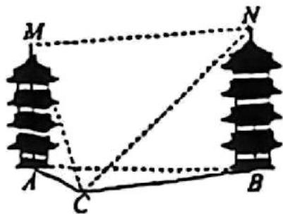
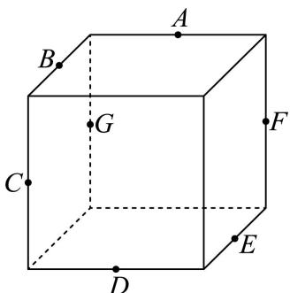

# 2026届上海高三一模 · 长宁卷

> 按原卷题号整理；题面、图片和解答未全卷逐页终核。

## 第 1 题

集合 $A = (0, +\infty)$ ，集合 $B = \{-2, -1, 0, 1, 2\}$ ，则 $A \cap B =$ \_\_\_\_.

答案】 $\{1,2\}$

【解析】

【分析】由交集的定义运算.

【详解】由题意得， $A \cap B = \{1, 2\}$ .

故答案为： $\{1,2\}$

## 第 2 题

不等式 $|x-2|<1$ 的解集为 \_\_\_\_.

【答案】(1,3)

【解析】

【分析】根据绝对值的意义即可求解.

【详解】由 $|x-2|<1$ ，

得-1<x-2<1，

解得1<x<3，

即不等式的解集为 $(1,3)$ ,

故答案为：(1,3)

## 第 3 题

在等差数列 $\left\{a_{n}\right\}$ 中， $a_{2}=1$ ，公差 $d=2$， $a_{n}=11$ ，则 $n=$ \_\_\_\_.

【答案】7

【解析】

【分析】利用已知求得等差数列 $\{a_{n}\}$ 的通项公式，进而求得 $n$ ：

【详解】因为等差数列 $\{a_{n}\}$ 中， $a_2 = 1$ ，公差 $d = 2$

所以数列 $\{a_{n}\}$ 的通项公式 $a_{n} = a_{2} + (n - 2)d = 1 + 2(n - 2) = 2n - 3$

又 $a_{n} = 11$ ，所以 $2n - 3 = 11$ ，解得 $n = 7$

故答案为：7.

## 第 4 题

在 $(x-1)^{6}$ 的展开式中， $x^{2}$ 项的系数为\_\_\_\_。

【答案】15

【解析】

【分析】利用二项展开式的通项公式求指定项的系数即可.

【详解】 $(x-1)^{6}$ 二项展开式的通项公式为 $T_{r+1}=C_{6}^{r}x^{6-r}(-1)^{r}=(-1)^{r}C_{6}^{r}x^{6-r}$ ，

令 $6 - r = 2$ ，可得 $r = 4$

所以， $x^{2}$ 项的系数为 $(-1)^{4}C_{6}^{2}=15$ .

故答案为：15.

## 第 5 题

如果圆锥的底面圆半径为 1，母线长为 2，则该圆锥的侧面积为 \_\_\_\_.

【答案】 $2\pi$

【解析】

【分析】由圆锥的侧面积公式即可求解.

【详解】由圆锥的侧面积公式 $S=\frac{1}{2}lR=\frac{1}{2}\times(2\pi r)\times R=\frac{1}{2}\times2\pi\times1\times2=2\pi.$

故答案为： $2\pi$

## 第 6 题

设 $\vec{a}=(2,3),\vec{b}=(1,0)$ ，则向量 $\vec{a}$ 在 $\vec{b}$ 方向上的投影向量的坐标为 \_\_\_\_.

【答案】(2,0)

【解析】

【分析】先利用坐标计算 $\vec{a}\cdot\vec{b}$ ， $\left|\vec{b}\right|$ ，再利用公式 $\frac{\vec{a}\cdot\vec{b}}{\left|\vec{b}\right|^{2}}\cdot\vec{b}$ 计算.

【详解】因 $\vec{a} = (2,3),\vec{b} = (1,0)$ ，则 $\vec{a}\cdot \vec{b} = 2$ ， $|\vec{b}| = 1$

则向量 $\vec{a}$ 在 $\vec{b}$ 方向上的投影向量的坐标为 $\frac{\vec{a} \cdot \vec{b}}{|\vec{b}|^2} \cdot \vec{b} = 2\vec{b} = (2,0)$ .

故答案为： $(2,0)$

## 第 7 题

已知 $3^{x} = 2$ ， $y = \log_{6} 2$ ，则 $\frac{1}{x} - \frac{1}{y} =$ \_\_\_\_

【答案】-1

【解析】

【分析】由指对数的关系得 $x = \log_{3} 2$ ，再有 $\frac{1}{x} - \frac{1}{y} = \log_{2} 3 - \log_{2} 6$ ，即可求值.

【详解】由题设 $x = \log_32$ ， $y = \log_62$

根据换底公式，则 $\frac{1}{x} -\frac{1}{y} = \frac{1}{\log_32} -\frac{1}{\log_62} = \log_23 - \log_26 = \log_2\frac{1}{2} = -1.$

故答案为：-1

## 第 8 题

函数 $y=\frac{1}{x-1}, x \in D$ 的值域为 $(-1,0) \cup (0,+\infty)$ ，则集合 $D=$ \_\_\_\_.

【答案】 $(-∞,0)∪(1,+∞)$

【解析】

【分析】利用函数的值域求解不等式，进而得到函数的定义域即可.

【详解】令 $\frac{1}{x - 1} \in (0, +\infty)$ ，解得 $x \in (1, +\infty)$ ，

令 $\frac{1}{x-1}\in(-1,0)$ ，解得 $x\in(-\infty,0)$ ，

则集合 $D = (-\infty, 0) \cup (1, +\infty)$ .

故答案为： $(-\infty ,0)\cup (1, + \infty)$

## 第 9 题

已知 $a, b, c$ 均为正实数，且 $a(b + c) = 1$ ，则 $\frac{1}{a} + \frac{1}{b + c} + \frac{4}{a + b + c}$ 的最小值为 \_\_\_\_.

【答案】4

【解析】

【分析】由 $a(b + c) = 1$ 可得 $b + c = \frac{1}{a}$ ，所以原式可化为 $\frac{1}{a} + a + \frac{4}{a + \frac{1}{a}}$ ①，令 $t = a + \frac{1}{a}$ ，利用基本不等式求出 $t$ 的范围，则①式可化为 $y = t + \frac{4}{t}$ ，再次利用基本不等式求出 $y$ 的范围即可得解。（注意两次应用基本不等式，等号成立的条件必须相同）

【详解】由 $a(b+c)=1$ 可得 $b+c=\frac{1}{a}$ ，所以原式 $=\frac{1}{a}+a+\frac{4}{a+\frac{1}{a}}$ ①.

令 $t = a + \frac{1}{a}$ ，当 $a > 0$ 时， $a + \frac{1}{a}\geq 2\sqrt{a\times\frac{1}{a}} = 2$

当且仅当 $a = \frac{1}{a}$ ，即 $a = 1$ 时等号成立，所以 $t\geq 2$

所以①式可化为原式 $= t + \frac{4}{t}$

令 $y = t + \frac{4}{t}$ ，则 $t + \frac{4}{t} \geq 2\sqrt{t \times \frac{4}{t}} = 4$ ，

当且仅当 $t = \frac{4}{t}$ ，即 $t = 2$ ，即 $a = 1$ 时等号成立，所以 $y \geq 4$

所以 $\frac{1}{a} +\frac{1}{b + c} +\frac{4}{a + b + c}$ 的最小值为4.

故答案为：4

## 第 10 题

在复平面上, 复数 2 和 $2 \mathrm{i}$ 所对应的点分别为 $A 、 B$ , 复数 $z_{1}$ 所对应的点在线段 $A B$ 上移动, 若 $\left| z_{1} - z_{2} \right| = 1$ , 则复数 $z_{2}$ 对应点所构成图形的面积为 \_\_\_\_.

【答案】 $4\sqrt{2}+\pi$

【解析】

【分析】设复数 $z_{1}$ 所对应的点为 $C$ ，设复数 $z_{2}$ 所对应的点为 $D$ ，由 $\left|z_1 - z_2\right| = 1$ 得到点 $D$ 的轨迹为：以线段 $AB$ 为中线，宽度为2的矩形，加上两端 $A, B$ 为圆心，半径为1的两个半圆，利用矩形和圆的面积公式求解即可.

∵ 复数 2 和 2i 所对应的点分别为 A、B，∴ $A(2,0)$ , $B(0,2)$ ,

设复数 $z_{1}$ 所对应的点为 C，设复数 $z_{2}$ 所对应的点为 D，

$\because \left|z_{1} - z_{2}\right| = 1, \therefore \left|DC\right| = 1, \therefore$ 点 $D$ 轨迹是以点 $C$ 为圆心，半径为1的圆，

∵ 点 C 在线段 AB 上移动，∴ 点 D 的轨迹为：以线段 AB 上的点为圆心，半径为 1 的圆的并集，

即点 D 的轨迹为：以线段 AB 为中线，宽度为 2 的矩形，加上两端 A, B 为圆心，半径为 1 的两个半圆，

$\because A(2,0),B(0,2), \therefore |AB| = 2\sqrt{2},$

∴ 复数 $z_{2}$ 对应点所构成图形的面积为 $2\sqrt{2} \times 2 + \pi \times 1^{2} = 4\sqrt{2} + \pi$ .

故答案为： $4\sqrt{2}+\pi$ .

## 第 11 题

如图, 两塔的塔尖分别为 $M 、 N$ , 塔底分别为 $A 、 B$ , 塔身 $M A 、 N B$ 均垂直水平面 $A B C$ . 已测得 $C$ 与 $A 、 B$ 的距离, 4 名同学分别测得如下 4 组数据:

① $\angle MCA$ , $\angle NCB$ , $\angle ACB$ ; ② $\angle MCA$ , $\angle ACB$ , $\angle MCN$ ;

③ $\angle MCA, \angle NCB, \angle MCN;$ ④ $\angle MCA, \angle ACB, \angle NCA.$

其中不能唯一确定 M 与 N 之间距离的数据的序号有 ______.

【答案】④

【解析】

【分析】将空间几何问题转化为确定塔高 $h_{1}$ 与 $h_{2}$ 的过程，对于每个数据组，首先判断能否由已知角度和已知边长唯一确定水平距离 AB 与两个塔高；若能，则两塔尖的空间坐标唯一确定，距离随之唯一确定，若给出的角度条件不足以唯一确定所有未知的塔高或位置，则存在多解，从而无法唯一确定两塔尖距离.

【详解】①: $\angle MCA, \angle NCB, \angle ACB$

$\angle ACB$ 与 CA, CB 的长度，用余弦定理确定 AB 唯一，

$\angle MCA$ 与 CA 的值，在 $Rt_{\triangle MCA}$ 中 $MA = CA \cdot \tan \angle MCA$ 可确定 MA 唯一，

$\angle NCB$ 与 $CB$ 的值，在 $\mathbf{Rt}_{\triangle}NCB$ 中 $NB = CB \cdot \tan \angle NCB$ 可确定 $NB$ 唯一，

由 $MN = \sqrt{AB^2 + (NB - MA)^2}$ 知 $MN$ 唯一确定.

②: $\angle MCA, \angle ACB, \angle MCN$

$\angle ACB$ 与 CA, CB 的长度，用余弦定理确定 AB 唯一，

$\angle MCA$ 与 $CA$ 的值，在 $\mathbf{Rt}_{\triangle}MCA$ 中 $MA = CA \cdot \tan \angle MCA$ 可确定 $MA$ 唯一， $\angle MCN$ 是点 $C$ 处观测 $M$ 与 $N$ 的夹角，

在 $\triangle MCN$ 中：边 $CM = \sqrt{CA^2 + MA^2}$ （已知）

边 $CN = \sqrt{CB^2 + NB^2}$ （含未知量 $NB$ ）

∠MCN 已知

由余弦定理： $MN^2 = CM^2 +CN^2 -2\cdot CM\cdot CN\cdot \cos \angle MCN$

同时又有： $MN^2 = AB^2 + (MA - NB)^2$

联立 $MN^{2}$ 的表达式，建立关于 NB 的方程，

因函数单调性及物理意义（塔高＞0），通常有且仅有一个正实数解

故可确定 $MN$ 唯一.

③: $\angle MCA, \angle NCB, \angle MCN$

$\angle MCA$ 与 CA 的值，在 $Rt_{\triangle MCA}$ 中 $MA = CA \cdot \tan \angle MCA$ 可确定 MA 唯一，

$\angle NCB$ 与 $CB$ 的值，在 $\mathbf{Rt}_{\triangle}NCB$ 中 $NB = CB \cdot \tan \angle NCB$ 可确定 $NB$ 唯一，

由 $MN^{2}=CM^{2}+CN^{2}-2\cdot CM\cdot CN\cdot\cos\angle MCN$ ，及 $\angle MCN$ 已知，可确定 MN 唯一.

④：由 $\angle MCA, AC$ 可求得 MA；再由 AC, BC, $\angle ACB$ ，可求得 AB；

而 $\left(\overrightarrow{MN}\right)^2 = \left(\overrightarrow{MA} +\overrightarrow{AB} +\overrightarrow{BN}\right)^2 = \left|\overrightarrow{MA}\right|^2 +\left|\overrightarrow{AB}\right|^2 +\left|\overrightarrow{BN}\right|^2 -2\left|\overrightarrow{MA}\right|\left|\overrightarrow{BN}\right|$

故 $MN$ 长度不确定.

故答案为: ④

## 第 12 题

已知集合 $\Omega = \left\{\vec{w} \mid \vec{w} = \lambda \vec{e}_1 + \mu \vec{e}_2 + \gamma \vec{e}_3, \lambda, \mu, \gamma \in \{-1, 1\}\right\}$ ，若对于空间中任意单位向量 $\vec{e}_1, \vec{e}_2, \vec{e}_3$ ，都存在 $\vec{d} \in \Omega$ ，使得 $|\vec{d}| \geq r$ ，则实数 $r$ 的最大值为 \_\_\_\_.

【答案】 $\sqrt{3}$

【解析】

【分析】根据存在性问题分析可知 $\left|\vec{d}\right|_{\max} \geq r$ ，结合题意以及空间向量的数量积运算可得 $\left|\vec{d}\right|_{\max} = \sqrt{3 + 2\cos\alpha + 2\cos\beta + 2\cos\theta}$ ，结合任意性分析可知 $\left(\left|\vec{d}\right|_{\max}\right)_{\min} \geq r$ ，进而分析求解.

【详解】若存在 $\vec{d} \in \Omega$ ，使得 $|\vec{d}| \geq r$ ，则 $\left|\vec{d}\right|_{\max} \geq r$ ，

设 $\left\langle \overrightarrow{e_1},\overrightarrow{e_2}\right\rangle = \alpha ,\left\langle \overrightarrow{e_2},\overrightarrow{e_3}\right\rangle = \beta ,\left\langle \overrightarrow{e_1},\overrightarrow{e_3}\right\rangle = \theta$ ，且 $\alpha ,\beta ,\theta \in [0,\pi ]$

则 $\left|\overrightarrow{e_1}\right| = \left|\overrightarrow{e_2}\right| = \left|\overrightarrow{e_3}\right| = 1$ ， $\vec{e}_1\cdot \vec{e}_2 = \cos \alpha ,\vec{e}_2\cdot \vec{e}_3 = \cos \beta ,\vec{e}_1\cdot \vec{e}_3 = \cos \theta$

因为 $\vec{d} \in \Omega$ ，可设 $\vec{d} = \lambda \vec{e}_1 + \mu \vec{e}_2 + \gamma \vec{e}_3, \lambda, \mu, \gamma \in \{-1, 1\}$ ，

则 $\vec{d}^2 = (\lambda \vec{e}_1 + \mu \vec{e}_2 + \gamma \vec{e}_3)^2 = \lambda^2\vec{e}_1^2 +\mu^2\vec{e}_2^2 +\gamma^2\vec{e}_3^2 +2\lambda \mu \vec{e}_1\cdot \vec{e}_2 + 2\mu \gamma \vec{e}_2\cdot \vec{e}_3 + 2\lambda \gamma \vec{e}_1\cdot \vec{e}_3$ $= 3 + 2\lambda \mu \cos \alpha +2\mu \gamma \cos \beta +2\lambda \gamma \cos \theta ,$

因为 $\lambda \mu, \mu \gamma, \lambda \gamma \in \{-1, 1\}$ , $\cos \alpha, \cos \beta, \cos \theta \in [-1, 1]$ ,

注意到符号性不妨设 $\alpha, \beta, \theta \in \left[0, \frac{\pi}{2}\right]$ ，则 $\cos \alpha, \cos \beta, \cos \theta \in [0,1]$ ，

可得 $\vec{d}^2 = 3 + 2\lambda \mu \cos \alpha + 2\mu \gamma \cos \beta + 2\lambda \gamma \cos \theta \leq 3 + 2\cos \alpha + 2\cos \beta + 2\cos \theta$

当且仅当 $\lambda \mu = \mu \gamma = \lambda \gamma = 1$ 时，等号成立，

可知 $\left|\vec{d}\right|_{\max}=\sqrt{3+2\cos\alpha+2\cos\beta+2\cos\theta}$

又因为对于空间中任意单位向量 $\overrightarrow{e_1},\overrightarrow{e_2},\overrightarrow{e_3}$ ，都存在 $\vec{d}\in \Omega$ ，使得 $\left|\vec{d}\right|\geq r$

则 $\left(\left|\vec{d}\right|_{\max}\right)_{\min} \geq r$ ，即 $\left(\sqrt{3 + 2\cos\alpha + 2\cos\beta + 2\cos\theta}\right)_{\min} \geq r$

且 $\cos \alpha, \cos \beta, \cos \theta \in [0,1]$ ，可得 $\sqrt{3 + 2\cos\alpha + 2\cos\beta + 2\cos\theta} \geq \sqrt{3}$ ，

当且仅当 $\cos\alpha=\cos\beta=\cos\theta=0$ 时，等号成立，即 $\left(\left|\vec{d}\right|_{\max}\right)_{\min}=\sqrt{3}$

可得 $r \leq \sqrt{3}$ ，所以实数 $r$ 的最大值为 $\sqrt{3}$ .

故答案为： $\sqrt{3}$

## 第 13 题

如图, 已知 $A 、 B 、 C 、 D 、 E 、 F 、 G$ 分别是正方体所在棱的中点, 则下列直线中与直线 $E F$ 异面的是 ( )

A. 直线 $AB$ B. 直线 $AC$ C. 直线 $AD$ D. 直线 $AG$

【答案】BD

【解析】

【分析】本题考查正方体的结构特征，利用异面直线的判断法若 $a \subset \alpha, AB \cap \alpha = B, A \notin \alpha, B \notin a$ 则直线 $AB$ 与 $a$ 互为异面直线依次分析选项即可

【详解】如图取中点 H, 和顶点 M, N, P, Q 连接 EF, AB, AC, AD, AG, BE, AF, GH, MN, PQ在正方体中有 $AF // PQ, PQ // BE$ ，所以 $AF // BE$ ，所以点 $A, B, E, F$ 四点共面，所以直线 $EF$ 与直线 $AB$ 共面，选项 A 不对；
直线 $GH \subset$ 平面 $BCG$ ，直线 $AC \cap$ 平面 $BCG = C, C \notin GH$ ，所以直线 $GH$ 与直线 $AC$ 是异面直线，又因为 $EF // GH$ ，所以直线 $EF$ 与直线 $AC$ 是异面直线，选项 B 正确；
在正方体中有 $EF // MN, MN // AD$ ，所以 $EF // AD$ ，选项 C 不对；
直线 $AG \subset$ 平面 $AFG$ ，直线 $EF \cap$ 平面 $AFG = F, F \notin AG$ ，所以直线 $AG$ 与直线 $EF$ 是异面直线，选项 D 正确；
故选：BD

A. 充分不必要条件
B. 必要不充分条件
C. 充要条件
D. 既不充分也不必要条件

【解析】
【分析】由独立事件概率公式和充要条件的概念即可求解.
【详解】由甲、乙两人投篮的命中率分别为 0.7 和 0.6，

若“事件 $A, B$ 互相独立”，则 $P(AB) = P(A)P(B) = 0.42$ ，
若 $P(AB) = 0.42 = P(A)P(B)$ ，则事件 $A, B$ 互相独立，
即“甲、乙两人均投中的概率为0.42”是“事件 $A, B$ 互相独立”的充要条件，故选：C

## 第 14 题

> 核对提醒：规范稿漏第14题，采用MinerU原稿；未核PDF

14. 甲、乙两人投篮的命中率分别为 0.7 和 0.6，两人各投篮一次，事件 A 为甲投中，事件 B 为乙投中。“甲、乙两人均投中的概率为 0.42”是“事件 A, B 互相独立”的（）
A. 充分不必要条件
B. 必要不充分条件
C. 充要条件
D. 既不充分也不必要条件

【解析】
【分析】由独立事件概率公式和充要条件的概念即可求解.
【详解】由甲、乙两人投篮的命中率分别为 0.7 和 0.6，

若“事件 $A, B$ 互相独立”，则 $P(AB) = P(A)P(B) = 0.42$ ，  
若 $P(AB) = 0.42 = P(A)P(B)$ ，则事件 $A, B$ 互相独立，  
即“甲、乙两人均投中的概率为0.42”是“事件 $A, B$ 互相独立”的充要条件，故选：C

## 第 15 题

已知 $A(-2,0), B(2,0)$ ，若曲线 $\left(\frac{x}{a} + \frac{y}{b}\right)\left(\frac{x}{a} - \frac{y}{b}\right) = 0 (a > 0, b > 0)$ 上存在点 $P$ 满足：

$\left|PB\right| = \left|PA\right| + 2$ ，则 $\frac{b}{a}$ 的取值范围是（ ）A. $(0,\sqrt{3})$ B. $(\sqrt{3}, + \infty)$ C. $\left(0,\frac{\sqrt{3}}{3}\right)$ D.

$$
\left(\frac {\sqrt {3}}{3}, + \infty\right)
$$

【答案】A

【解析】

【分析】根据双曲线的定义及直线与双曲线相交求解 $\frac{b}{a}$ 的取值范围.

【详解】由 $A(-2,0)$ ， $B(2,0)$ 知， $|AB|=4$ .

因为点 $P$ 满足： $\left|PB\right| = \left|PA\right| + 2$ ，即 $\left|PB\right| - \left|PA\right| = 2$ ，且 $\left|PB\right| - \left|PA\right| < \left|AB\right|$

所以点 P 在以 A, B 为焦点的双曲线的左支上，设其方程为 $\frac{x^{2}}{a'^{2}} - \frac{y^{2}}{b'^{2}} = 1 (x < 0)$ ,

$$
2 c = 4
$$

$$
2 a ^ {\prime} = 2
$$

$$
c = 2, a ^ {\prime} = 1
$$

$$
b ^ {2} = c ^ {2} - a ^ {2} = 3
$$

所以点 $P$ 在双曲线 $x^{2} - \frac{y^{2}}{3} = 1$ 的左支上，其渐近线方程为 $y = \pm \sqrt{3} x$

由曲线方程 $\left(\frac{x}{a} +\frac{y}{b}\right)\left(\frac{x}{a} -\frac{y}{b}\right) = 0(a > 0,b > 0)$ 得 $y = \pm \frac{b}{a} x$

因为曲线 $\left(\frac{x}{a} +\frac{y}{b}\right)\left(\frac{x}{a} -\frac{y}{b}\right) = 0(a > 0,b > 0)$ 上存在点 $P$ 满足： $\left|PB\right| = \left|PA\right| + 2$

所以直线 $y = \pm \frac{b}{a} x$ 与双曲线 $x^{2} - \frac{y^{2}}{3} = 1$ 的左支有交点，所以 $0 < \frac{b}{a} < \sqrt{3}$ .

故选：A.

## 第 16 题

将正整数 $1 \sim 10$ 按一定次序排列得到排列 $a_{1}, a_{2}, \cdots, a_{10}$ , 若排列 $a_{1}, a_{2}, \cdots, a_{10}$ 中的任意一项 $a_{i} (1 \leq i \leq 10)$ 都满足: $-1 \leq a_{i} - i \leq 1$ , 则满足题意的排列 $a_{1}, a_{2}, \cdots, a_{10}$ 的个数为( ) A. 36 B. 55 C. 89 D. 144

【答案】A

【解析】

【分析】设 $1,2,3,\cdots,n$ 满足题意的排列个数为 $T_{n}$ ，将排列按照 $a_{1}=1$ 与 $a_{1}=2$ 两种情况分类，可得 $T_{n}=T_{n-1}+T_{n-2}$ ，据此可得答案.

【详解】设 $1,2,3,\cdots,n$ 满足题意的排列个数为 $T_{n}$ ，本题所求为 $T_{10}$ 。

由题可得 $1\leq a_{1}\leq2$ ， $i-1\leq a_{i}\leq i+1(2\leq i\leq n-1, i\in\mathbb{N}^{*})$ ， $n-1\leq a_{n}\leq n$ 。

当 $a_{1}=1$ ，此时 $2\leq a_{2}\leq3$ ， $i-1\leq a_{i}\leq i+1(3\leq i\leq n-1, i\in\mathbb{N}^{*})$ ， $n-1\leq a_{n}\leq n$ ，则 $1,2,3,\cdots,n$ 满足题意的排列个数为 $T_{n-1}(n\geq2, n\in\mathbb{N}^{*})$ ；

当 $a_{1}=2$ ， $a_{2}=1$ ，此时 $3\leq a_{3}\leq4$ ， $i-1\leq a_{i}\leq i+1(4\leq i\leq n-1, i\in\mathbb{N}^{*})$ ， $n-1\leq a_{n}\leq n$ ，则 $1,2,3,\cdots,n$ 满足题意的排列个数为 $T_{n-2}(n\geq3, n\in\mathbb{N}^{*})$ ；

当 $a_{1}=2$ ， $a_{2}=3$ ，则 $a_{3}=4$ ， $a_{4}=5$ ， $\cdots$ ， $a_{n-2}=n-1$ ， $a_{n-1}=n$ ，此时没有整数使 $a_{n}$ 满足题意，即当 $a_{1}=2$ ， $a_{2}=3$ 时，满足题意的排列不存在。

综上可得， $T_{n}=T_{n-1}+T_{n-2}(n\geq3, n\in\mathbb{N}^{*})$ 。

注意到 $T_{1}=1$ ， $T_{2}=2$ ，则 $T_{3}=1+2=3$ ， $T_{4}=2+3=5$ ， $T_{5}=3+5=8$ ， $T_{6}=5+8=13$ ， $T_{7}=8+13=21$ ， $T_{8}=13+21=34$ ， $T_{9}=21+34=55$ ， $T_{10}=34+55=89$ 。

故选：C

## 第 17 题

> 核对提醒：题目数据依据长宁一模解析版原卷补齐；未对整卷逐题终审。

小明有自觉体锻的习惯，某运动软件记录了其每天运动的时长（单位：min），小明从最近90天的记录中随机选取了10天的记录，具体数据如下：

68、34、70、45、74、126、108、66、36、72.

(1) 求这组数据的第 60 百分位数:

（2）运动时长不超过 60min 为不达标，估算从 90 天记录中随机抽取 1 天，该天运动时长不达标的概率：

(3)从这10个数中随机删除2个数得到一组新的数据,求前后两组数据的极差相同的概率.

【答案】(1) 71; (2) 0.3;

$$
\begin{array}{c} \frac {2 8}{4 5} \end{array}
$$

【解析】

【分析】（1）根据计算百分位数的步骤求解；

（2）计算样本频率，利用频率估计概率；

（3）根据古典概型的概率公式计算.

【小问1详解】

把 10 天的记录按照从小到大排列为：34,36,45,66,68,70,72,74,108,126，

因为 $10 \times 60\% = 6$ 是整数，所以第60百分位数为第6个数与第7个数的平均数，

因为 $\frac{70 + 72}{2} = 71$ ，这组数据的第60百分位数为71；

【小问 2 详解】

因为选取的样本中运动时长不达标的频率为 $\frac{3}{10}=0.3$ ，

所以估计该天运动时长不达标的概率为 0.3;

【小问3详解】

因为前后两组数据的极差相同，所以随机删除的 2 个数为 36,45,66,68,70,72,74,108 中的两个，

则概率 $P=\frac{C_{8}^{2}}{C_{10}^{2}}=\frac{28}{45}$

## 第 18 题

已知函数 $f(x) = \cos \omega x (\omega > 0)$ .

（1）若函数 $y = f(x)$ 的最小正周期为 $\pi$ ，求 $\omega$ 的值及 $y = f(x)$ 的单调递减区间；

（2）设 $\omega = 1$ ， $g(x) = f(2x) - 2f(x)f\left(x + \frac{\pi}{2}\right)$ ，求函数 $y = g(x)$ 在区间 $\left[0,\frac{\pi}{2}\right]$ 上的值域.

【答案】（1）2； $\left[k\pi,\frac{\pi}{2}+k\pi\right],k\in\mathbf{Z}.$

(2) $\left[-1, \sqrt{2}\right]$ .

【解析】

【分析】（1）根据余弦型函数的最小正周期公式求得 $\omega$ 的值，得到 $f(x)$ 的解析式，进而由整体法求得单调递减区间；

（2）首先化简得到 $g(x)$ 的解析式，再由 x 的范围求得 $g(x)$ 的值域.

【小问 1 详解】

因为函数 $f(x) = \cos \omega x(\omega >0)$ 的最小正周期为 $\pi$

所以 $T=\frac{2\pi}{\omega}=\pi$ ，解得 $\omega=2$ 。

所以 $f(x)=\cos2x$ .

要求 $f(x)$ 的单调递减区间，令 $2k\pi \leq 2x \leq \pi + 2k\pi, k \in Z$ ,

解得 $k\pi \leq x \leq \frac{\pi}{2} + k\pi, k \in \mathbf{Z}$ ，即 $y = f(x)$ 的单调递减区间为 $\left[k\pi, \frac{\pi}{2} + k\pi\right], k \in \mathbf{Z}$ .

【小问 2 详解】

因为 $\omega=1$ ，所以 $f(x)=\cos x$ ，

所以

$$
\begin{array}{l} g (x) = f (2 x) - 2 f (x) f \left(x + \frac {\pi}{2}\right) \\ = \cos 2 x - 2 \cos x \cos \left(x + \frac {\pi}{2}\right) = \cos 2 x - 2 \cos x (- \sin x) = \cos 2 x + \sin 2 x \\ = \sqrt {2} \sin \left(2 x + \frac {\pi}{4}\right). \end{array}
$$

由 $0 \leq x \leq \frac{\pi}{2}$ 得 $\frac{\pi}{4} \leq 2x + \frac{\pi}{4} \leq \frac{5\pi}{4}$ ,

由正弦函数的性质可得 $-\frac{\sqrt{2}}{2} \leq \sin \left( 2x + \frac{\pi}{4} \right) \leq 1$ ，所以 $-1 \leq g(x) \leq \sqrt{2}$ ，

所以函数 $y = g(x)$ 在区间 $\left[0, \frac{\pi}{2}\right]$ 上的值域为 $\left[-1, \sqrt{2}\right]$ .

## 第 19 题

如图，在四棱锥 $P - ABCD$ 中， $PA \perp$ 平面 $ABCD$ ， $AB \perp AD$ ， $AD // BC$ ， $AB = BC = 1$ ， $AD = 2$ ，直线 $PC$ 与平面 $ABCD$ 所成的角的大小为 $\arctan\sqrt{2}$ .

（1）求四棱锥 P-ABCD 的体积；

(2) 点 $Q$ 在线段 $PD$ 上, 直线 $PB //$ 平面 $AQC$ , 求二面角 $Q - AC - D$ 的余弦值.

【答案】(1) 1

(2) $\frac{1}{3}$

【解析】

【分析】（1）根据棱锥的体积公式，结合线面角的定义进行求解即可；

（2）建立空间直角坐标系，利用线面平行的性质、空间向量夹角公式进行求解即可.

【小问 1 详解】

因为 $AB \perp AD$ ，AD // BC，

所以 $AB \perp BC$ ，因此 $AC = \sqrt{AB^2 + BC^2} = \sqrt{1 + 1} = \sqrt{2}$ ，

因为 $PA \perp$ 平面 ABCD，直线 PC 与平面 ABCD 所成的角的大小为 $\arctan\sqrt{2}$ ，

所以 $\tan \left(\arctan \sqrt{2}\right) = \frac{PA}{AC} \Rightarrow PA = \sqrt{2} \times \sqrt{2} = 2$ ，

四棱锥 P-ABCD 的体积为 $\frac{1}{3}\cdot PA\cdot\frac{(BC+AD)}{2}\cdot AB=\frac{1}{3}\times2\times\frac{(1+2)}{2}\times1=1$ ;

【小问 2 详解】

因为 $PA \perp$ 平面 ABCD，AB, AD ⊂ 平面 ABCD,

所以 $PA \perp AB$ ， $PA \perp AD$ ，又因为 $AB \perp AD$ ，

所以可以建立如图所示的空间直角坐标系，

$A(0,0,0),B(1,0,0),C(1,1,0),D(0,2,0),P(0,0,2)$

显然平面 ACD 的法向量为 $\overrightarrow{AP} = (0, 0, 2)$ ,

因为点 $Q$ 在线段 $PD$ 上，所以设

$\overrightarrow{PQ} = \lambda \overrightarrow{PD} \Rightarrow \overrightarrow{PA} + \overrightarrow{AQ} = \lambda (0,2, - 2)(\lambda \in [0,1]) \Rightarrow (0,0, - 2) + \overrightarrow{AQ} = (0,2\lambda , - 2\lambda)$ $\Rightarrow \overrightarrow{AQ} = (0,2\lambda ,2 - 2\lambda)$ ,

设平面 $AQC$ 的法向量为 $\vec{m} = (x,y,z)$ ，又 $\overrightarrow{AC} = (1,1,0)$ ， $\overrightarrow{PB} = (1,0,-2)$ ，

因为直线 $PB \cap$ 平面 ABCD = B，

所以当直线 $PB //$ 平面 $AQC$ ，显然点 $Q$ 不与点 $D$ 重合，

则当 $\lambda \in [0,1)$ 时， $\left\{ \begin{array}{l} \vec{m}\cdot \overrightarrow{AQ} = 0\\ \vec{m}\cdot \overrightarrow{AC} = 0 \end{array} \right.\Rightarrow \left\{ \begin{array}{l} 2\lambda y + (2 - 2\lambda)z = 0\\ x + y = 0 \end{array} \right.$ ，取 $\vec{m} = \left(1, - 1,\frac{\lambda}{1 - \lambda}\right)$

因为直线 $PB //$ 平面 $AQC$ ，

所以 $\overrightarrow{PB}\cdot\overrightarrow{m}=0\Rightarrow1-\frac{2\lambda}{1-\lambda}=0\Rightarrow\lambda=\frac{1}{3}$ ，即 $\vec{m}=\left(1,-1,\frac{1}{2}\right)$ ,

$$
\cos \vec {m}, \overrightarrow {A P} = \frac {\vec {m} \cdot \overrightarrow {A P}}{| \vec {m} | \cdot | \overrightarrow {A P} |} = \frac {1}{\sqrt {1 ^ {2} + (- 1) ^ {2} + \left(\frac {1}{2}\right) ^ {2}} \times 2} = \frac {1}{3},
$$

由图可知二面角 $Q - AC - D$ 是锐二面角，

所以二面角 $Q - AC - D$ 的余弦值为 $\frac{1}{3}$ .

## 第 20 题

已知抛物线 $\Gamma: y^{2} = 4x$ 的焦点为 F，经过点 F 的直线 l 与抛物线 $\Gamma$ 交于 A、B 两点.

（1）设 $|AF|=5$ ，求点A的横坐标；

（2）设 $O$ 为坐标原点，线段 $AB$ 中点的纵坐标为 $\frac{3}{2}$ ，求 $\triangle OAB$ 的面积；

（3）设线段 $AB$ 的垂直平分线与抛物线 $\Gamma$ 交于点 $M$ 、 $N$ ，若以线段 $MN$ 为直径的圆经过点 $A$ 、 $B$ ，求直线 $l$ 的方程.

【答案】(1) 4

(2) $\frac{5}{2}$

(3) $x = \pm y + 1$

【解析】

【分析】（1）根据抛物线的定义及 $\left|AF\right|=5$ ，求出 $x_{1}=4$ ；

（2）设 $A(x_{1},y_{1}),B(x_{2},y_{2})$ ，设直线 $l$ 的直线方程为 $x = my + 1$ ，与抛物线方程联立，根据韦达定理得到 $y_{1} + y_{2} = 4m$ ， $y_{1}y_{2} = -4$ ，再根据中点的纵坐标为 $\frac{3}{2}$ ，可解得结果；

（2）设 $MN:y - 2m = -m(x - 2m^2 -1)$ ， $M(x_{3},y_{3}),N(x_{4},y_{4})$ ，求出

$y_{3}+y_{4}=-\frac{4}{m}\ y_{3}y_{4}=-8m^{2}-12$ ，利用 $\overrightarrow{AN}\cdot\overrightarrow{AM}=0$ 可得结果.

【小问 1 详解】

由抛物线方程知： $F(1,0)$ ，设 $A(x_{1},y_{1})$ ，

由 $\left|AF\right|=5$ 得： $x_{1}+1=5,\therefore x_{1}=4$ .

【小问 2 详解】

由题意知：直线 l 斜率不为零，可设 $l: x = my + 1$ ， $A(x_{1}, y_{1}), B(x_{2}, y_{2})$ ，

由 $\left\{\begin{aligned}y^{2}&=4x\\ x&=my+1\end{aligned}\right.$ 得： $y^{2}-4my-4=0$ ，则 $\Delta=16m^{2}+16>0$ ，

$$
\therefore y _ {1} + y _ {2} = 4 m, \quad y _ {1} y _ {2} = - 4
$$

$\because F(1,0)$ ，又因为 $A,B$ 中点的纵坐标为 $\frac{3}{2}$ ，所以 $y_{1} + y_{2} = 4m = 3$

所以 $\triangle OAB$ 的面积为 $\frac{1}{2} |OF| \times |y_1 - y_2| = \frac{1}{2} \times 1 \times \sqrt{3^2 - 4 \times (-4)} = \frac{1}{2} \times 5 = \frac{5}{2}$ ;

【小问 3 详解】

由题意知：直线 l 斜率不为零，可设 $l: x = my + 1$ ， $A(x_{1}, y_{1}), B(x_{2}, y_{2})$ ，

由 $\left\{ \begin{array}{l} y^{2} = 4x \\ x = my + 1 \end{array} \right.$ 得： $y^{2} - 4my - 4 = 0$ ，则 $\Delta = 16m^2 + 16 > 0$

$\therefore y_{1} + y_{2} = 4m, y_{1}y_{2} = -4$ ，所以 $AB$ 中点为 $(2m^{2} + 1,2m)$

因为线段 $AB$ 的垂直平分线与抛物线 $\Gamma$ 交于点 $M$ 、 $N$ ，设 $MN:y - 2m = -m(x - 2m^2 -1),M(x_3,y_3),N(x_4,y_4)$ 联立 $\left\{ \begin{array}{l}y - 2m = -m(x - 2m^2 -1)\\ y^2 = 4x \end{array} \right.$ 可得 $y^{2} + \frac{4}{m} y - 8m^{2} - 12 = 0$ ，由韦达定理可得 $y_{3} + y_{4} = -\frac{4}{m},y_{3}y_{4} = -8m^{2} - 12,$ 若以线段MN为直径的圆经过点A、B， $\overrightarrow{AM} = (x_3 - x_1,y_3 - y_1),\overrightarrow{AN} = (x_4 - x_1,y_4 - y_1)$ $\therefore \overrightarrow{AM}\cdot \overrightarrow{AN} = (x_3 - x_1)(x_4 - x_1) + (y_3 - y_1)(y_4 - y_1)$ $= \frac{(y_3 - y_1)(y_4 - y_1)}{16}\times [(y_3 + y_1)(y_4 + y_1) + 16] = 0,\quad y_1,y_2$ 不相等， $y_{3},y_{4}$ 不相等，所以 $y_{3}y_{4} + y_{1}(y_{3} + y_{4}) + y_{1}^{2} + 16 = 0$ ，同理 $y_{3}y_{4} + y_{2}(y_{3} + y_{4}) + y_{2}^{2} + 16 = 0$ 可得 $(y_{1} - y_{2})(y_{3} + y_{4}) + y_{1}^{2} - y_{2}^{2} = (y_{1} - y_{2})(y_{3} + y_{4} + y_{1} + y_{2}) = 0,\quad y_{1},y_{2}$ 不相等，所以 $(y_{1} + y_{2}) + (y_{3} + y_{4}) = 4m - \frac{4}{m} = 0$ 即 $m^2 = 1$ ，解得 $m = \pm 1$

所以直线 l 的方程为 $x = \pm y + 1$ .

## 第 21 题

已知 $a \in \mathbb{R}$ , $f(x) = 2x - \ln x + a$ .

（1）求函数 $y = f(x)$ 的驻点；

（2）设 $g(x) = \begin{cases} f(x), & x > 0 \\ g(x + 1), & x < 0 \end{cases}$ ，若关于 $x$ 的方程 $g(x) + g(-x) = 0$ 在区间 $(-1, 0)$ 内有解，求 $a$ 的取值范围：

（3）定义 $\operatorname{sgn}(x) = \begin{cases} 1, & x > 0 \\ 0, & x = 0 \\ -1, & x < 0 \end{cases}$ ，设

$h(x)=2x-\left(2x-f(x)\right)\mathrm{sgn}\left(2x-f(x)\right),\quad h(x_{0})=\frac{t}{a}$ ，若存在实数a，使得 $\left\{x\mid h(x)\geq\frac{t}{a}\right\}\neq\left[x_{0},+\infty\right)$ ，求实数t的最小值.

【答案】（1） $x=\frac{1}{2}$

(2) $a \leq -1 - \ln 2$

(3) $-\frac{2}{e}$

【解析】

【分析】（1）确定函数定义域，根据驻点定义求解即可；

（2）先根据函数推出 $g(x) + g(-x) = 2 + 2a - \ln (x + 1) - \ln (-x)$ ，再根据参变分离确定参数范围即可；

（3）根据题意可得 $h(x) = \left\{ \begin{array}{l} 2x - \ln x + a, x > \mathrm{e}^a \\ 2x + \ln x - a, 0 < x \leq \mathrm{e}^a \end{array} \right.$ ，再由题意可得 $\frac{t}{a} \leq h(\mathrm{e}^a) = 2\mathrm{e}^a$ ，则 $t \geq 2a\mathrm{e}^a$ ，令 $\varphi(a) = 2a\mathrm{e}^a$ ，求导，利用导数求函数 $\varphi(a)$ 最值即可.

【小问 1 详解】

函数 $f(x)$ 定义域为 $(0, +\infty)$ ， $f'(x) = 2 - \frac{1}{x}$ ，

令 $f'(x)=2-\frac{1}{x}=0$ ，解得 $x=\frac{1}{2}$ ，

所以函数 $y = f(x)$ 的驻点为 $x = \frac{1}{2}$ ;

【小问 2 详解】

$$
\because x \in (- 1, 0), \therefore - x \in (0, 1), x + 1 \in (0, 1),
$$

则 $g(x) = g(x + 1) = f(x + 1) = 2(x + 1) - \ln (x + 1) + a$

$$
g (- x) = f (- x) = - 2 x - \ln (- x) + a,
$$

$$
\therefore g (x) + g (- x) = 2 + 2 a - \ln (x + 1) - \ln (- x),
$$

又关于 $x$ 的方程 $g(x) + g(-x) = 0$ 在区间 $(-1,0)$ 内有解，

所以 $2 + 2a - \ln (x + 1) - \ln (-x) = 0$ 在区间 $(-1,0)$ 内有解，

即 $2 + 2a = \ln(x + 1) + \ln(-x) = \ln(-x^{2} - x)$ ,

$$
\because x \in (- 1, 0), \therefore - x ^ {2} - x = - \left(x + \frac {1}{2}\right) ^ {2} + \frac {1}{4} \in \left(0, \frac {1}{4} \right],
$$

$$
\therefore \ln (- x ^ {2} - x) \in (- \infty , - 2 \ln 2 ],
$$

即 $2 + 2a \leq -2\ln 2$

解得 $a \leq -1 - \ln 2$ ；

【小问 3 详解】

由题意可得 $2x - f(x) = \ln x - a$ ,

$$
h (x) = \left\{ \begin{array}{l} 2 x - (\ln x - a), \ln x - a > 0 \\ 2 x, \ln x - a = 0, \\ 2 x + \ln x - a, \ln x - a <   0 \end{array} \right.
$$

即 $h(x)=\left\{\begin{aligned}&2x-\ln x+a,x>\mathrm{e}^{a}\\ &2x+\ln x-a,0<x\leq\mathrm{e}^{a}\end{aligned}\right.$

又∵ $y=2x+\ln x-a$ 是增函数，

由（1）知 $y = 2x - \ln x + a$ 在 $\left(0, \frac{1}{2}\right)$ 单调递减，在 $\left(\frac{1}{2}, +\infty\right)$ 单调递增，

又∵ $h(x_{0})=\frac{t}{a}$ ，且存在实数a，使得 $\left\{x\mid h(x)\geq\frac{t}{a}\right\}\neq\left[x_{0},+\infty\right)$ ，

所以 $h(x)$ 不单调， $\therefore \mathrm{e}^a <  \frac{1}{2}$ ，解得 $a <   \ln \frac{1}{2} = -\ln 2$

即 $h(x)$ 在 $\left(0, \mathrm{e}^a\right)$ 单调递增，在 $\left(\mathrm{e}^a, \frac{1}{2}\right)$ 单调递减，在 $\left(\frac{1}{2}, +\infty\right)$ 单调递增，

$\therefore \frac{t}{a} \leq h\left(\mathrm{e}^{a}\right) = 2\mathrm{e}^{a}$ ，又 $a < -\ln 2$

$\therefore t \geq 2a\mathrm{e}^{a}$

令 $\varphi(a)=2a\mathrm{e}^{a}$ ， $\varphi'(a)=2\mathrm{e}^{a}(a+1)$

当 $a < -1$ 时， $\varphi'(a) < 0$ ， $\varphi(a)$ 单调递减；

当 $a > -1$ 时， $\varphi^{\prime}(a) > 0$ ， $\varphi (a)$ 单调递增；

$$
\therefore \varphi (a) _ {\min} = \varphi (- 1) = - \frac {2}{\mathrm{e}}
$$

故 $t \geq -\frac{2}{e}$ ,

即实数 $t$ 的最小值为 $-\frac{2}{\mathrm{e}}$
