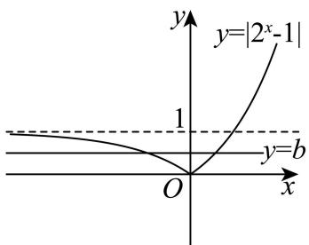
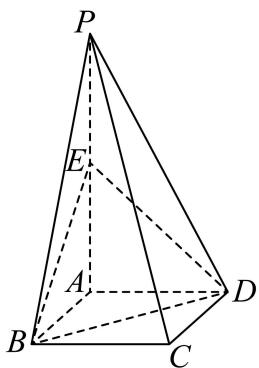
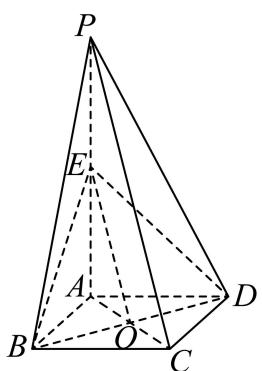

# 2026届上海高三一模 · 青浦卷

> 按原卷题号整理；题面、图片和解答未全卷逐页终核。

## 第 1 题

已知集合 $A = \{x \mid -1 \leq x \leq 3\}$ , $B = \{x \mid x \leq 0\}$ , 则 $A \cap B =$ \_\_\_\_.

【答案】 $\{x\mid -1\leq x\leq 0\}$

【解析】

【分析】根据交集的知识求得正确答案.

【详解】依题意， $A=\left\{x\mid-1\leq x\leq3\right\},B=\left\{x\mid x\leq0\right\}$

所以 $A \cap B = \{x \mid -1 \leq x \leq 0\}$ .

故答案为： $\{x\mid -1\leq x\leq 0\}$

## 第 2 题

不等式 $\frac{x + 2}{x - 1} < 0$ 的解集为 \_\_\_\_.

【答案】 $(-2,1)$

【解析】

【分析】首先将分式不等式转化为二次不等式，利用一元二次不等式的解法，求得其解集即可.

【详解】分式不等式 $\frac{x + 2}{x - 1} < 0$ 可以转化为 $(x + 2)(x - 1) < 0$ ，解得 $-2 < x < 1$

所以原不等式的解集为 $(-2,1)$ .

故答案为： $(-2,1)$ .

## 第 3 题

若复数 $z = \frac{3 - 5\mathrm{i}}{1 - \mathrm{i}}$ ，则 $|z| =$ \_\_\_\_.

【答案】 $\sqrt{17}$

【解析】

【分析】先利用复数的除法运算化简，再结合复数的模的定义计算.

【详解】 $z=\frac{3-5i}{1-i}=\frac{(3-5i)(1+i)}{(1-i)(1+i)}=\frac{8-2i}{2}=4-i$

则 $|z| = \sqrt{16 + 1} = \sqrt{17}$

故答案为： $\sqrt{17}$

## 第 4 题

$\left(x^{3} + \frac{1}{x^{2}}\right)^{5}$ 的展开式中的常数项为 \_\_\_\_.（用数字作答）

【答案】10

【解析】

【分析】 $\left(x^{3}+\frac{1}{x^{2}}\right)^{5}$ 的展开式的通项公式为 $T_{r+1}=C_{5}^{r}(x^{3})^{5-r}\left(\frac{1}{x^{2}}\right)^{r}=C_{5}^{r}x^{15-5r}$ ，求常数项即令 15-15r=0，解得 r=3，然后可得答案.

【详解】 $\left(x^{3} + \frac{1}{x^{2}}\right)^{5}$ 的展开式的通项公式为 $T_{r + 1} = C_5^r (x^3)^{5 - r}(\frac{1}{x^2})^r = C_5^rx^{15 - 5r}$

则 $\left(x^{3} + \frac{1}{x^{2}}\right)^{5}$ 的展开式中的常数项，令 $15 - 15r = 0$

解得 r=3 ，即常数项为 $T_{4}=C_{5}^{3}=10$

故答案为：10.

【点睛】本题考查二项式定理中的指定项，考查二项式的通项公式，属于基础题.

## 第 5 题

设等差数列 $\{a_{n}\}$ 的前 $n$ 项和为 $S_{n}$ ，若 $S_{5} = 5, a_{2} = 0$ ，则 $a_{8} = \underline{\quad}$ .

【答案】6

【解析】

【分析】设公差为 d，由条件，根据等差数列的项与前 n 项和的基本量运算，求出 $a_{1}, d$ ，即可求得答案.

【详解】设等差数列 $\{a_{n}\}$ 的公差为 $d$ ，

由 $S_{5} = 5, a_{2} = 0$ ，可得 $\left\{ \begin{array}{l} 5a_{1} + 10d = 5 \\ a_{1} + d = 0 \end{array} \right.$ ，解得 $a_{1} = -1, d = 1$ ，

则 $a_{8} = a_{1} + 7d = -1 + 7 = 6$

故答案为：6.

## 第 6 题

现有 5 名学生站成一排, 若学生甲不站两端, 则不同站法共有\_\_\_\_种 (用数字作答).

【答案】72

【解析】

【分析】由题意先安排学生甲，再对另外四名学生进行全排即得.

【详解】根据题意，可分两步完成：第一步，先在中间三个位置上安排学生甲，有3种方法；第二步，在留下的四个位置上安排另外4名学生，有 $A_{4}^{4}$ 种方法.

由分步乘法计数原理，不同站法数为 $3\mathrm{A}_4^4 = 72$ 种

故答案为：72.

## 第 7 题

若曲线 $y=\left|2^{x}-1\right|$ 与直线 $y=b$ 有两个公共点，则 b 的取值范围是 \_\_\_\_.

【答案】(0,1)

【解析】

【分析】画出曲线 $y=\left|2^{x}-1\right|$ 与直线 y=b 的图象，由条件结合图象求 b 的范围.

【详解】画出曲线 $y=\left|2^{x}-1\right|$ 与直线 y=b 的图象如图所示，

由图象可得，如果曲线 $y = \left|2^{x} - 1\right|$ 与直线 $y = b$ 有两个公共点，则 $b$ 的取值范围是(0,1).

故答案为： $(0,1)$ .

## 第 8 题

如图，在四面体 $OABC$ 中， $D$ 为 $BC$ 的中点， $3\overrightarrow{AG} = 2\overrightarrow{AD}$ ，且 $P$ 为 $OG$ 的中点，设 $\overrightarrow{OA} = \vec{a}, \overrightarrow{OB} = \vec{b}, \overrightarrow{OC} = \vec{c}$ ，用 $\vec{a}, \vec{b}, \vec{c}$ 表示 $\overrightarrow{OP}$ ，则 $\overrightarrow{OP} = \underline{\hspace{2cm}}$ .

【答案】 $\frac{1}{6}\vec{a} +\frac{1}{6}\vec{b} +\frac{1}{6}\vec{c}$

【解析】

【分析】根据向量的线性运算法则求解.

【详解】因为 $3\overrightarrow{AG} = 2\overrightarrow{AD}$ ，所以 $\overrightarrow{AG} = \frac{2}{3}\overrightarrow{AD}$

所以 $\overrightarrow{OP} = \frac{1}{2}\overrightarrow{OG} = \frac{1}{2}\overrightarrow{OA} +\frac{1}{2}\overrightarrow{AG} = \frac{1}{2}\overrightarrow{OA} +\frac{1}{2}\times \frac{2}{3}\overrightarrow{AD} = \frac{1}{2}\overrightarrow{OA} +\frac{1}{3}\overrightarrow{AD}$ $= \frac{1}{2}\overrightarrow{OA} +\frac{1}{3}\left(\overrightarrow{OD} -\overrightarrow{OA}\right) = \frac{1}{6}\overrightarrow{OA} +\frac{1}{3}\overrightarrow{OD} = \frac{1}{6}\overrightarrow{OA} +\frac{1}{3}\times \frac{1}{2}\left(\overrightarrow{OB} +\overrightarrow{OC}\right)$ $= \frac{1}{6}\overrightarrow{OA} +\frac{1}{6}\overrightarrow{OB} +\frac{1}{6}\overrightarrow{OC} = \frac{1}{6}\vec{a} +\frac{1}{6}\vec{b} +\frac{1}{6}\vec{c}$ 故答案为： $\frac{1}{6}\vec{a} +\frac{1}{6}\vec{b} +\frac{1}{6}\vec{c}$

## 第 9 题

已知圆柱和圆锥的底面半径相同, 侧面积也相等, 且它们的高均为 $\sqrt{2}$ , 则圆锥的体积为 \_\_\_\_.

【答案】 $2\sqrt{2}\pi$

【解析】

【分析】设圆柱的底面半径为 $r$ ，根据圆锥和圆柱的侧面积相等可得半径 $r$ 的方程，求出解后可求圆锥的体积.

【详解】设圆柱的底面半径为 $r$ ，则圆锥的母线长为 $\sqrt{r^2 + 2}$

圆柱和圆锥的侧面积相等，所以 $2\pi \mathrm{r}\cdot \sqrt{2} = \frac{1}{2}\cdot 2\pi \mathrm{r}\cdot \sqrt{r^2 + 2}$ ，即 $2\sqrt{2} = \sqrt{r^2 + 2}$ ，故 $r = \sqrt{6}$

故圆锥的体积为 $\frac{1}{3}\pi r^2\cdot \sqrt{2} = \frac{1}{3}\pi \cdot 6\times \sqrt{2} = 2\sqrt{2}\pi .$

故答案为： $2\sqrt{2}\pi$

## 第 10 题

设 A 为圆 $x^{2} + (y + 1)^{2} = 1$ 上的动点，PA 是圆的切线，且 $\left|PA\right| = 1$ ，则点 P 的轨迹方程是 \_\_\_\_.

【答案】 $x^{2} + (y + 1)^{2} = 2$

【解析】

【分析】根据给定条件，利用圆的切线性质可得 $|PC|=\sqrt{2}$ ，再利用圆的定义求出轨迹方程.
【详解】圆 $x^{2}+(y+1)^{2}=1$ 的圆心为 $C(0,-1)$ ，半径 r=1，

由 $PA$ 切圆 $C$ 于点 $A$ ，得 $CA \perp PA$ ，而 $\left|PA\right| = 1$ ，则 $\left|PC\right|^2 = \left|PA\right|^2 + \left|CA\right|^2 = 1^2 + r^2 = 2$ 即 $\left|PC\right| = \sqrt{2}$ ，因此点 $P$ 的轨迹是以点 $C(0, -1)$ 为圆心， $\sqrt{2}$ 为半径的圆，

所以点 P 的轨迹方程是 $x^{2}+(y+1)^{2}=2$ .

故答案为： $x^{2} + (y + 1)^{2} = 2$

## 第 11 题

已知函数 $f(x) = \mathrm{e}^{x - 1} - ax + a (a > 0)$ ，若 $f(x) < 0$ 仅存在唯一整数解，则 $a$ 的取值范围为 \_\_\_\_.

【答案】 $\left(\mathrm{e},\frac{\mathrm{e}^{2}}{2}\right]$

【解析】

【分析】由题意知，原题等价于函数 $g(x)=\mathrm{e}^{x-1}$ 在直线 $h(x)=a(x-1)(a>0)$ 下方的图象中只有一个点的横坐标为整数，进而研究函数的图象与性质，数形结合即可求出结果.

【详解】根据题意，令 $g(x)=\mathrm{e}^{x-1}$ ， $h(x)=a(x-1)(a>0)$ ，

$f(x)<0$ 仅存在唯一整数解 $\Leftrightarrow g(x)$ 的图象在 $h(x)$ 的图象下方的部分有且只有一个横坐标为整数的点，

当 $h(x)$ 与 $g(x)$ 相切时，设切点 $\left(x_0, \mathrm{e}^{x_0 - 1}\right)$ ，

由于 $g^{\prime}(x) = \mathrm{e}^{x - 1}$ ，故切线斜率 $a = \mathrm{e}^{x_0 - 1}$

切线方程为： $y - e^{x_0 - 1} = e^{x_0 - 1}(x - x_0)$ ,

代入 $(1,0)$ 得 $-\mathrm{e}^{x_{0}-1}=\mathrm{e}^{x_{0}-1}(1-x_{0})$ ，解得 $x_{0}=2$ ，此时a=e，切点为 $(2,\mathrm{e})$ ，
又当 $x \leq 1$ 时， $h(x) \leq 0$ ， $g(x) > 0$ ，

所以符合要求的条件为 $\left\{ \begin{array}{l} g(2) < h(2) \\ g(3) \geq h(3) \end{array} \right.$ ，解得 $e < a \leq \frac{e^2}{2}$ .

即 a 的取值范围为 $\left(\mathrm{e},\frac{\mathrm{e}^{2}}{2}\right]$ .

故答案为： $\left(\mathrm{e},\frac{\mathrm{e}^{2}}{2}\right]$

## 第 12 题

在平面直角坐标系中，O 为坐标原点. 已知点 $A(0,2)$ , $B(2,0)$ , $C(-2,0)$ ，若 $|PC| - |PB| = 2\sqrt{2}$ , $|QA| = 1$ ，则向量 $\overrightarrow{OQ}$ 在向量 $\overrightarrow{OP}$ 方向上的数量投影的取值范围是 \_\_\_\_.

【答案】 $(- \sqrt{2} - 1, \sqrt{2} + 1)$

【解析】

【分析】根据条件，结合双曲线的定义、圆的定义，可得点 P、Q 的轨迹方程，由题意，即求 $\overrightarrow{OA}$ 在向量 $\overrightarrow{OP}$ 方向上的数量投影再加减半径即可，设 $P(x,y)$ ，根据数量投影的公式，代入化简，分析计算，即可得答案.

【详解】因为 $|BC|=4$ ， $|PC|-|PB|=2\sqrt{2}<4$ ，

所以点 P 的轨迹为双曲线的右支，且 $2a = 2\sqrt{2}, c = 2$ ，

所以 $b^{2}=c^{2}-a^{2}=2$ ，则点P的方程为 $\frac{x^{2}}{2}-\frac{y^{2}}{2}=1(x\geq\sqrt{2})$

因为 $A(0,2)$ ，且 $\left|QA\right|=1$ ，

所以点 $Q$ 的轨迹是以 $A$ 为圆心，1为半径的圆，

所以 Q 的方程为 $x^{2}+(y-2)^{2}=1$ ，

要求向量 $\overrightarrow{OQ}$ 在向量 $\overrightarrow{OP}$ 方向上的数量投影，

只需求 $\overrightarrow{OA}$ 在向量 $\overrightarrow{OP}$ 方向上的数量投影再加减半径即可，

设 $P(x,y)$ ， $x^{2} - y^{2} = 2,(x\geq \sqrt{2})$

所以 $\overrightarrow{OA}$ 在向量 $\overrightarrow{OP}$ 方向上的数量投影为 $\frac{\overrightarrow{OA} \cdot \overrightarrow{OP}}{|\overrightarrow{OP}|} = \frac{2y}{\sqrt{x^2 + y^2}} = \frac{2y}{\sqrt{2 + 2y^2}} = \frac{\sqrt{2}y}{\sqrt{1 + y^2}}$

令 $t = \frac{\sqrt{2}y}{\sqrt{1 + y^2}}$ ，则当 $y = 0$ 时， $t = 0$

当 $y \neq 0$ 时， $t^2 = \frac{2y^2}{1 + y^2} = \frac{2}{\frac{1}{y^2} + 1} \in (0, 2)$ ，则 $t \in (-\sqrt{2}, 0) \cup (0, \sqrt{2})$

综上 $t\in (-\sqrt{2},\sqrt{2})$ ，即 $\frac{\overrightarrow{OA}\cdot\overrightarrow{OP}}{\left|\overrightarrow{OP}\right|}\in (-\sqrt{2},\sqrt{2})$

所以 $\overrightarrow{OQ}$ 在向量 $\overrightarrow{OP}$ 方向上的数量投影的取值范围是 $(- \sqrt{2} - 1, \sqrt{2} + 1)$ .

故答案为： $(- \sqrt{2} - 1, \sqrt{2} + 1)$

## 第 13 题

在空间中，“两条直线平行”是“这两条直线没有公共点”的（）
A. 充分非必要条件
B. 必要非充分条件
C. 充要条件
D. 既非充分也非必要

【答案】A

【解析】

【分析】直接由平行直线及异面直线的定义判断充分性及必要性即可.

【详解】“两条直线平行”能推出“这两条直线没有公共点”，满足充分性；“两条直线没有公共点”不能推出“两条直线平行”，

两条直线可能异面，不满足必要性，故“两条直线平行”是“这两条直线没有公共点”的充分非必要条件.
故选：A.

## 第 14 题

抛掷一枚质地均匀的骰子一次，设“出现的点数为偶数”为事件 A，“出现的点数大于 4”为事件 B，则下述正确的是（）
A. A 与 B 对立
B. A 与 B 互斥
C. A 与 B 相互独立
D. $P(A \cup B) = P(A) + P(B)$

【答案】C

【解析】

【分析】抛掷一枚骰子的所有可能结果是： $\{1,2,3,4,5,6\}$ ；事件 A 包含的结果是： $\{2,4,6\}$ ；事件 B 包含的结果是： $\{5,6\}$ ，由对立互斥独立的概念逐一判断各个选项即可求解.

【详解】抛掷一枚骰子的所有可能结果是： $\{1,2,3,4,5,6\}$ ;

事件 A 包含的结果是： $\{2,4,6\}$ ;

事件 B 包含的结果是： $\{5,6\}$ .

因为 $A \cup B$ 未包含所有可能结果（如 1, 3 没包含在内），A 与 B 不对立，故 A 错误；

因为 $A \cap B = \{6\} \neq \emptyset$ ， $A$ 与 $B$ 不互斥，故 B 错误；

因为 $P(AB) = \frac{1}{6}$ , $P(A) \cdot P(B) = \frac{1}{2} \times \frac{1}{3} = \frac{1}{6} = P(AB)$ ,

因此 $A$ 与 $B$ 相互独立，故C正确；

$$
P (A) = \frac {3}{6} = \frac {1}{2}, \quad P (B) = \frac {2}{6} = \frac {1}{3}, \quad P (A) + P (B) = \frac {5}{6},
$$

而 $P(A \cup B) = \frac{4}{6} = \frac{2}{3}$ ，故D错误.

故选：C.

## 第 15 题

对于实数 $m \in [-1, 1]$ ，定义集合 $A_{m} = \left\{x \mid x = \sin \frac{\alpha}{2}, \sin \alpha = m\right\}$ ，集合 $A_{m}$ 的元素个数为 $\left|A_{m}\right|$ ，给出下列说法：

①存在 $m$ ，使得 $\left|A_m\right| = 1$

②存在 $m$ ，使得 $\left|A_m\right| = 2$

③存在 $m$ ，使得 $\left|A_m\right| = 3$

④存在 $m$ ，使得 $\left|A_m\right| = 4$

其中正确的说法有（）个. A.1 B.2 C.3 D.4

【答案】C

【解析】

【分析】根据同角三角函数的关系及半角公式，可得 $\sin\frac{\alpha}{2}=\pm\sqrt{\frac{1-\sqrt{1-m^{2}}}{2}}$ 或 $\pm\sqrt{\frac{1+\sqrt{1-m^{2}}}{2}}$ ，对 m 赋值分析，逐一检验，即可得答案。
【详解】因为 $\sin\alpha=m,\quad m\in[-1,1]$ ，所以 $\cos\alpha=\pm\sqrt{1-m^{2}}$ 所以 $\sin\frac{\alpha}{2}=\pm\sqrt{\frac{1-\cos\alpha}{2}}=\pm\sqrt{\frac{1-\sqrt{1-m^{2}}}{2}}$ 或 $\pm\sqrt{\frac{1+\sqrt{1-m^{2}}}{2}}$ ;
当 $m = \pm 1$ 时， $x = \sin \frac{\alpha}{2} = \pm \frac{\sqrt{2}}{2}$ ，此时 $\left| A_{m} \right| = 2$ ，
所以存在 m，使得 $\left| A_{m} \right| = 2$ ，故②正确；
当 m=0 时， $x=\sin\frac{\alpha}{2}=0$ 或 $\pm1$ ，此时 $\left| A_{m}\right|=3$ ，
所以存在 m，使得 $\left| A_{m}\right|=3$ ，故③正确；
当 $m \neq \pm 1$ 且 $m \neq 0$ 时，不妨取 $m = \sin \alpha = \frac{\sqrt{3}}{2}$ 此时 $\alpha=\frac{\pi}{3}+2k\pi,k\in Z$ 或 $\alpha=\frac{2\pi}{3}+2k\pi,k\in Z$ 则 $\frac{\alpha}{2}=\frac{\pi}{6}+k\pi,k\in Z$ 或 $\alpha=\frac{\pi}{3}+k\pi,k\in Z$ 所以 $x=\sin\frac{\alpha}{2}=\pm\frac{1}{2}$ 或 $\pm\frac{\sqrt{3}}{2}$ ，此时 $\left| A_{m}\right| = 4$ ，即存在 m，使得 $\left| A_{m}\right| = 4$ ，故④正确，
综上，无论 m 在 $[-1,1]$ 上取任何实数， $x=\sin\frac{\alpha}{2}$ 都不可能只有一个解，故①错误.

故选：C

## 第 16 题

> 核对提醒：规范化稿第16题解析错置，已采用MinerU原稿完整题块，待PDF复核

16. 如图所示, 水平地面上插有两根杆子 $AB$ 和 $CD$ , $AB$ 所在直线垂直于地面且 $AB = 2$ 米, $CD$ 所在直线与地面斜交. 小明有一把卷尺. 他在某时刻分别测出杆子 $AB$ 和 $CD$ 在阳光下影子的长度, 称为一次操作. 小明可以在白天的不同时刻进行多次操作. 假设阳光为平行光, 正午时分 $AB$ 的影子长度为 0. 则下列说法正确的是 ( )

A. 为求出 $CD$ 的长度, 小明至少需要进行 2 次操作  
B. 为求出 $CD$ 的长度, 小明至少需要进行 3 次操作  
C. 为求出 $CD$ 的长度, 小明至少需要进行 4 次操作  
D. 无论进行多少次操作, 小明都不能求出 $CD$ 的长度

【答案】B

【解析】

【分析】建立坐标系，得到 $\left|CD\right|=\sqrt{a^{2}+b^{2}+h^{2}}$ ，根据条件列出方程 $n^{2}=\left(a+\frac{hm}{2}\right)^{2}+b^{2}$ 其中 m, n 分别已知量，a, b, h 是三个未知量，需要列三元三次方程组才可求解，所以需要测量三次.
【详解】设点 B 在地面的影子为 $B_{1}$ ，点 C 在地面的影子为 $C_{1}$ ，杆子 AB 影子的长度为 m，杆子 CD 影子的长度为 n；
因为 AB 垂直于地面，如图以 A 为原点，地面为 xoy 平面， $AB_{1}$ 为 x 轴，AB 为 z 轴建立空间直角坐标系，则 $A(0,0,0), B(0,0,2), B_{1}(m,0,0)$ ，设 $D(x_{1},y_{1},0), C(x_{2},y_{2},h)$ ，其中 h 为 C 到地面的高度.
定义 CD 的水平分量：令 $a = x_{2} - x_{1}$ （x 方向水平距离）， $b = y_{2} - y_{1}$ （y 方向水平距离）
由题可知 a, b, h 为 3 个定值，则 $\left|CD\right|=\sqrt{a^{2}+b^{2}+h^{2}}$

设点 $C_1(x,y,0)$ ，则 $\overrightarrow{BB_1} = (m,0, - 2),\overrightarrow{CC_1} = (x - x_2,y - y_2, - h)$

由于阳光为平行光，所以 $\overrightarrow{BB_{1}}//\overrightarrow{CC_{1}}$ ，所以 $C_{1}\left(x_{2}+\frac{hm}{2},y_{2},0\right)$ ,

$$
n = \left| C _ {1} D \right| = \sqrt {\left(x _ {2} + \frac {h m}{2} - x _ {1}\right) ^ {2} + \left(y _ {2} - y _ {1}\right) ^ {2} + (0 - 0) ^ {2}}
$$

即 $n^2 = \left(x_2 + \frac{hm}{2} - x_1\right)^2 + (y_2 - y_1)^2$ ，即 $n^2 = \left(a + \frac{hm}{2}\right)^2 + b^2$

方程 $n^2 = \left(a + \frac{hm}{2}\right)^2 + b^2$ 中 $a, b, h$ 为3个未知数，需要列三个方程才可求解，则需要测量三次.

故选：B

## 第 17 题

已知直线 $x = \frac{\pi}{6}$ 是函数 $f(x) = \sin (2x + \varphi)\left(\left|\varphi\right| < \frac{\pi}{2}\right)$ 的一条对称轴.

（1）求函数 $f(x)$ 的解析式；

（2）设函数 $g(x) = f\left(x - \frac{\pi}{12}\right) + f\left(x + \frac{\pi}{6}\right)$ ，求 $g(x)$ 在 $\left[-\frac{\pi}{4}, \frac{\pi}{4}\right]$ 上的最大值和最小值.

【答案】（1） $f(x)=\sin\left(2x+\frac{\pi}{6}\right)$

（2）最大值为 $\sqrt{2}$ ，最小值为-1

【解析】

【分析】（1）根据给定的对称轴，结合正弦函数的图象与性质列式求解即得.

（2）化简 $g(x)=\sqrt{2}\sin\left(2x+\frac{\pi}{4}\right)$ ，再利用正弦函数的性质求出最值即可.

【小问 1 详解】

直线 $x = \frac{\pi}{6}$ 是函数 $f(x) = \sin (2x + \varphi)\left(\left|\varphi\right| < \frac{\pi}{2}\right)$ 的一条对称轴，

所以 $2 \times \frac{\pi}{6} + \varphi = \frac{\pi}{2} + k\pi, k \in \mathbf{Z}$ ,

解得 $\varphi = \frac{\pi}{6} + k\pi, k \in \mathbf{Z}$ ，由 $|\varphi| < \frac{\pi}{2}$ 可得 $\varphi = \frac{\pi}{6}$ ，

所以 $f(x)=\sin\left(2x+\frac{\pi}{6}\right)$ .

【小问 2 详解】

$$
g (x) = f \left(x - \frac {\pi}{1 2}\right) + f \left(x + \frac {\pi}{6}\right) = \sin \left[ 2 \left(x - \frac {\pi}{1 2}\right) + \frac {\pi}{6} \right] + \sin \left[ 2 \left(x + \frac {\pi}{6}\right) + \frac {\pi}{6} \right]
$$

$= \sin 2x + \cos 2x = \sqrt{2}\sin \left(2x + \frac{\pi}{4}\right)$ 令 $t = 2x + \frac{\pi}{4}$ ，由 $x \in \left[-\frac{\pi}{4}, \frac{\pi}{4}\right]$ ， $t \in \left[-\frac{\pi}{4}, \frac{3\pi}{4}\right]$

因为函数 $y = \sqrt{2}\sin t$ 在 $\left[-\frac{\pi}{4},\frac{\pi}{2}\right]$ 上单调递增，在 $\left[\frac{\pi}{2},\frac{3\pi}{4}\right]$ 上单调递减，

又 $\sqrt{2}\sin \left(-\frac{\pi}{4}\right) = -1$ ， $\sqrt{2}\sin \frac{\pi}{2} = \sqrt{2}$ ， $\sqrt{2}\sin \frac{3\pi}{4} = 1$

所以 $g(x)_{\max} = \sqrt{2}$ ， $g(x)_{\min} = -1$ ，

即 $g(x)$ 在 $\left[-\frac{\pi}{4}, \frac{\pi}{4}\right]$ 上的最大值为 $\sqrt{2}$ ，最小值为-1.

## 第 18 题

如图，四棱锥 $P - ABCD$ 的底面是边长为 1 的正方形，侧棱 $PA \perp$ 底面 $ABCD$ ，且 $PA = 2$ ， $E$ 是侧棱 $PA$ 的中点.

（1）求证： $PC / /$ 平面BDE；

(2) 求证: 平面 $PCD \perp$ 平面 $PAD$ .

【答案】（1）证明见解析 （2）证明见解析

【解析】

【分析】（1）连接 AC 交 BD 于 O，连接 OE，利用中位线定理可得 PC // OE，进而可证结论；

（2）由面面垂直的判定定理可得平面 $PAD \perp$ 底面ABCD，进而利用面面垂直的性质可得 $CD \perp$ 平面PAD，进而可证结论.

【小问 1 详解】

连接 AC 交 BD 于 O，连接 OE，

因为四边形 ABCD 是正方形，所以 O 是 AC 的中点，

又 E 是侧棱 PA 的中点，所以 PC // OE，

又因为 $OE \subset$ 平面 $BDE$ ， $PC \not\subset$ 平面 $BDE$ ，

所以 $PC / /$ 平面BDE；

【小问 2 详解】

因为侧棱 $PA \perp$ 底面 ABCD， $PA \subset$ 平面 PAD，所以平面 $PAD \perp$ 底面 ABCD，

又因为 $CD \subset$ 底面 ABCD， $CD \perp AD$ ，平面 $PAD \cap$ 底面 ABCD = AD，

所以 $CD \perp$ 平面 PAD，又 $CD \subset$ 平面 PCD，所以平面 $PCD \perp$ 平面 PAD.

## 第 19 题

随着手机和网络的普及, 外卖行业得到迅速发展. 某外卖平台为了解某地区用户对其提供的服务的满意度，随机调查了 40 个用户，得到用户的满意度评分，系统自动将评分按从大到小顺序排列如下：

（1）求这组数据的极差和第95百分位数.

（2）若从这40个用户中抽取一个容量为10的样本，有一个数据不小心丢失了，抽到的其他9个用户的评分分别为92,84,86,78,89,74,78,77,89，且这10个数据的平均数 $\overline{x} = 83$ 记这10个数据的方差为 $s^2$ ，若用户的满意度评分在区间 $(\overline{x} - s, \overline{x} + s)$ ，则满意度等级为“A级”.从这10个数据里面任取3个，求恰有2个满意度等级为“A级”的概率.

(3) 平台为拓展客流, 开发了一个新的评价系统. 把 (2) 中样本的平均数和方差作为老评价系统的数据, 且老系统的样本容量占两个系统所有样本容量的 $\frac{1}{3}$ , 新系统得出的评分平均数为 89 分, 方差为 12. 据此计算新老系统所有评分的方差.

【答案】（1）极差为34，第95百分位数为95.5

(2) $\frac{5}{12}$

(3) 27

【解析】

【分析】（1）根据极差与百分位数的定义求解即可；

(2) 先根据平均数据的计算公式求出丢失的数据, 再计算方差, 进而求得满意度等级为 “A 级” 的数据个数, 进而利用古典概型概率公式求解即可;

（3）根据两组数据合并后平均数与方差的计算公式求解即可.

【小问 1 详解】

由表中可得这 40 个用户的评分从小到大排列如下：63，66，72，73，74，74，75，76，76，76，77，78，78，78，79，79，80，81，81，81，82，82，83，83，84，84，85，85，86，86，88，88，89，89，91，92，93，95，96，97.

所以极差为97-63=34， $40\times95\%=38$ ，

所以第95百分位数为第38与第39个数据的平均数，即 $\frac{95 + 96}{2} = 95.5$

【小问 2 详解】

设丢失的数据为 $m$ ，

$$
\bar {x} = \frac {1}{1 0} (9 2 + 8 4 + 8 6 + 7 8 + 8 9 + 7 4 + 7 8 + 7 7 + 8 9 + m) = 8 3
$$

$$
m = 8 3
$$

$$
s ^ {2} = \frac {1}{1 0} \left[ (9 2 - 8 3) ^ {2} + (8 4 - 8 3) ^ {2} + (8 6 - 8 3) ^ {2} + (7 8 - 8 3) ^ {2} + (8 9 - 8 3) ^ {2} \right.
$$

$$
+ (7 4 - 8 3) ^ {2} + (7 8 - 8 3) ^ {2} + (7 7 - 8 3) ^ {2} + (8 9 - 8 3) ^ {2} + (8 3 - 8 3) ^ {2} = 3 3,
$$

由题意知评分在 $\left(83 - \sqrt{33}, 83 + \sqrt{33}\right)$ ，即 $(77.26, 88.74)$ 的满意度等级为“ $A$ 级”，

样本中评分在(77.26,88.74)内的数据有5个，

所以从这 10 个数据里面任取 3 个有 $C_{10}^{3}$ ，恰有 2 个满意度等级为 “A 级” 的取法有 $C_{5}^{2}C_{5}^{1}$ ，
所以恰有 2 个满意度等级为 “A 级” 的概率为 $\frac{C_{5}^{2}C_{5}^{1}}{C_{10}^{3}}=\frac{5}{12}$ .

【小问 3 详解】

由（2）可知，老系统的平均分为 $\overline{x_1} = 83, s_1^2 = 33$ ，新系统的平均分为 $\overline{x_2} = 89, s_2^2 = 12$ ，因为老系统的样本容量10占两个系统所有样本容量的 $\frac{1}{3}$ ，所以新系统的样本容量为20，所以 $\overline{x} = \frac{10\overline{x_1} + 20\overline{x_2}}{30} = \frac{10 \times 83 + 20 \times 89}{30} = 87$ ， $s^2 = \frac{1}{10 + 20}\left\{10\left[33 + (83 - 87)^2\right] + 20\left[12 + (89 - 87)^2\right]\right\} = 27.$

所以新老系统所有评分的方差为27.

## 第 20 题

已知椭圆 $\Gamma: \frac{x^2}{a^2} + \frac{y^2}{a^2 - 4} = 1 (a > 2)$ 的左、右焦点分别为 $F_1, F_2, A, B$ 为 $\Gamma$ 上两个不同的点，记 $\triangle ABF_1$ 的周长和面积分别为 $C$ 和 $S$ .

（1）若 $\Gamma$ 的离心率为 $\frac{1}{2}$ ，求 $a$ 的值；

（2）若满足 $\left|AF_{1}\right|=10$ 的点A有且仅有两个，求a的取值范围；

（3）若 $a = \sqrt{5}$ ，是否存在点 $A, B$ 使得 $C$ 和 $S$ 同时取到最大值？若存在，求出直线 $AB$ 的方程；若不存在，说明理由.

【答案】(1) $a = 4$

(2) $(8,12)$

（3）不存在，理由见解析.

【解析】

【分析】（1）根据离心率的定义计算；

（2）根据椭圆的对称性以及 $a - 2 \leq \left|AF_{1}\right| \leq a + 2$ 即可求出；

（3）根据椭圆的定义得出 $C = 4\sqrt{5} + |AB| - \left(|AF_2| + |BF_2|\right)$ ，得出当 $A, B, F_2$ 三点共线时 $C$ 最大，进而设 $AB: x = my + n$ ，与椭圆方程联立，再分别令 $n = 2$ ， $n = \sqrt{3}$ ，结合基本不等式分别求面积的最大值，再作比较即可.

【小问1详解】

由题意知， $b^{2}=a^{2}-4$ ，则 $c^{2}=a^{2}-b^{2}=4$ ，

因 $a > 2$ ，则离心率为 $\frac{2}{a} = \frac{1}{2}$ ，得 $a = 4$

【小问 2 详解】

对于椭圆上任意一点 A，有 $a-2 \leq \left|AF_{1}\right| \leq a+2$ ，

因满足 $\left|AF_{1}\right|=10$ 的点A有且仅有两个且椭圆为对称图形，则 $a-2<10<a+2$ ，

得 $8 < a < 12$

故 $a$ 的取值范围为 $(8,12)$ ；

【小问 3 详解】

若 $a = \sqrt{5}$ ，则 $\Gamma : \frac{x^2}{5} + y^2 = 1$ ， $F_1(-2,0), F_2(2,0)$ ，

由椭圆的定义可知， $\left|AF_{1}\right|+\left|AF_{2}\right|=\left|BF_{1}\right|+\left|BF_{2}\right|=2\sqrt{5}$

则 $C = \left|AF_{1}\right| + \left|BF_{1}\right| + \left|AB\right| = 4\sqrt{5} +\left|AB\right| - \left(\left|AF_{2}\right| + \left|BF_{2}\right|\right)\leq 4\sqrt{5},$

等号成立时 $A, B, F_{2}$ 三点共线，

故当 $A, B, F_{2}$ 三点共线时， $C$ 取得最大值；

因直线 AB 的斜率不为 0，则可设直线 $AB: x = my + n, n \neq -2, A(x_{1}, y_{1}), B(x_{2}, y_{2})$ ,

联立 $\left\{\begin{aligned}x&=my+n\\ x^{2}&+5y^{2}=5\end{aligned}\right.$ ，得 $(m^{2}+5)y^{2}+2mny+n^{2}-5=0$ ，

则 $\Delta = 4m^2 n^2 - 4(m^2 + 5)(n^2 - 5) = 20(m^2 - n^2 + 5) > 0$ ，得 $m^2 - n^2 + 5 > 0$

由韦达定理可知， $y_{1} + y_{2} = -\frac{2mn}{m^{2} + 5}, y_{1}y_{2} = \frac{n^{2} - 5}{m^{2} + 5}$

$$
\left| y _ {1} - y _ {2} \right| = \sqrt {\left(- \frac {2 m n}{m ^ {2} + 5}\right) ^ {2} - 4 \cdot \frac {n ^ {2} - 5}{m ^ {2} + 5}} = \frac {2 \sqrt {5} \cdot \sqrt {m ^ {2} - n ^ {2} + 5}}{m ^ {2} + 5},
$$

$$
S = \frac {1}{2} \left| F _ {1} H \right| \left| y _ {1} - y _ {2} \right| = \frac {1}{2} \times | n + 2 | \times \frac {2 \sqrt {5} \cdot \sqrt {m ^ {2} - n ^ {2} + 5}}{m ^ {2} + 5} = \frac {\sqrt {5} \cdot | n + 2 | \cdot \sqrt {m ^ {2} - n ^ {2} + 5}}{m ^ {2} + 5},
$$

令 $t = \sqrt{m^2 - n^2 + 5} > 0$ ，则 $S = \frac{\sqrt{5} \cdot |n + 2| \cdot t}{t^2 + n^2} = \frac{\sqrt{5} \cdot |n + 2|}{t + \frac{n^2}{t}}$

若 $n = 2$ ，则 $t = \sqrt{m^2 + 1}\geq 1$ ，则 $S = \frac{4\sqrt{5}}{t + \frac{4}{t}}\leq \frac{4\sqrt{5}}{4} = \sqrt{5}$ ，等号成立时 $t = 2$

若 $n = \sqrt{3}$ ，则 $t = \sqrt{m^2 + 2} \geq \sqrt{2}$

则 $S = \frac{\sqrt{5} \cdot (\sqrt{3} + 2)}{t + \frac{3}{t}} \leq \frac{\sqrt{5} \cdot (\sqrt{3} + 2)}{2\sqrt{3}} = \sqrt{5}\left(\frac{1}{2} + \frac{1}{\sqrt{3}}\right)$ ，等号成立时 $t = \sqrt{3}$ ；

因 $\sqrt{5}\left(\frac{1}{2} +\frac{1}{\sqrt{3}}\right) > \sqrt{5}$

则不存在点 A, B 使得 C 和 S 同时取到最大值.

## 第 21 题

> 核对提醒：原解析第（3）问的对称性质及充分必要性表述存在跳步，证明待核。

已知函数 $y = f(x)$ 定义域为 R，对于实数 a，定义集合 $R_{a} = \left\{ x \mid x \geq a, f(x) \geq f(a) \right\}$ ， $L_{a}=\left\{x\mid x\leq a,f(x)\geq f(a)\right\}$ .

(1) 若 $f(x)=x^{2}$ ，求 $R_{1}$ 和 $L_{1}$ ;

（2）给定实数 $a$ ，若 $f(x) = x^{2}(x - 3)$ 满足对任意 $b > a$ ，均有 $R_{b} \subseteq R_{a}$ ，求 $a$ 的取值范围；

（3）若集合 A、B 满足： $x \in A \Leftrightarrow -x \in B$ ，则称 A 和 B 互为对称集。证明：“函数 $y = f(x)$ 为偶函数”的充要条件是“对任意实数 a, $R_{a}$ 与 $L_{-a}$ 互为对称集”。

【答案】（1） $R_{1} = \{x|x\geq 1\}$ ， $L_{1} = \{x|x\leq -1$ 或 $x = 1\}$

(2) $\left(-\infty, -1\right] \cup [2, +\infty)$

（3）证明见解析

【解析】

【分析】（1）根据题设定义求解即可；

（2）根据题设定义得到对于任意 $b > a$ ，都有 $f(b) \geq f(a)$ ，分析函数 $f(x)$ 的单调性，结合图象求解即可；

（3）根据偶函数的定义和对称集的定义即可证明必要性和充分性.

【小问 1 详解】

由 $f(x) = x^2$ 在 $(- \infty, 0]$ 上单调递减，在 $[0, +\infty)$ 上单调递增，

则 $x \geq 1$ 时， $f(x) \geq f(1) = 1$ ，即 $R_{1} = \{x | x \geq 1, f(x) \geq f(1)\} = \{x | x \geq 1\}$ ，

而 $L_{1} = \left\{x\mid x\leq 1,f(x)\geq 1\right\} = \left\{x\mid x\leq 1,x^{2}\geq 1\right\} = \left\{x\mid x\leq -1\text{或} x = 1\right\}.$

【小问 2 详解】

因为对于任意 b > a ，均有 $R_{b} \subseteq R_{a}$ ，

若 $x \in R_b$ ，则 $x \in R_a$ ，即若 $f(x) \geq f(b)$ ，则 $f(x) \geq f(a)$ ，所以 $f(b) \geq f(a)$ ，

由 $f(x) = x^{2}(x - 3) = x^{3} - 3x^{2}$ ，则 $f'(x) = 3x^{2} - 6x = 3x(x - 2)$ ，

令 $f'(x) < 0$ ，得 $0 < x < 2$ ，令 $f'(x) > 0$ ，得 $x < 0$ 或 $x > 2$ ，

所以函数 $f(x)$ 在 $(0,2)$ 上单调递减，在 $(-∞,0)$ 和 $(2,+∞)$ 上单调递增，

又 $f(0)=0,f(-1)=f(2)=-4$ ,

作出函数 $f(x)$ 的图象，

由于对于任意 $b > a$ ，都有 $f(b)\geq f(a)$ ，则 $a\leq -1$ 或 $a\geq 2$

所以 a 的取值范围为 $(-∞, -1] ∪ [2, +∞)$ .

【小问 3 详解】

若函数 $y = f(x)$ 是偶函数，

则对任意 $x \in R$ ， $f(x) = f(-x)$ ，

对任意 $a \in \mathbb{R}$ ，若 $x \in R_{a}$ ，即 $x \geq a$ 且 $f(x) \geq f(a)$ ，

则 $f(-x) = f(x)\geq f(a) = f(-a)$

由 $x \geq a$ ，得 $-x \leq -a$ ，而 $L_{-a} = \left\{ x \mid x \leq -a, f(x) \geq f(-a) \right\}$ ，则 $-x \in L_{-a}$ ；

若 $-x\in L_{-a}$ ，则 $-x\leq -a$ 且 $f(-x)\geq f(-a)$

则 $f(x) = f(-x)\geq f(-a) = f(a)$

由 $-x\leq -a$ ，得 $x\geq a$ ，而 $R_{a} = \left\{x\mid x\geq a,f(x)\geq f(a)\right\}$ ，则 $x\in R_a$

所以对任意实数 $a, R_{a}$ 与 $L_{-a}$ 互为对称集，充分性成立；

若对任意实数 $a, R_{a}$ 与 $L_{-a}$ 互为对称集，则 $x \in R_{a} \Leftrightarrow -x \in L_{-a}$ ，

而 $R_{a} = \left\{x\mid x\geq a,f(x)\geq f(a)\right\} ,L_{-a} = \left\{x\mid x\leq -a,f(x)\geq f(-a)\right\} ,$

由 $x \geq a$ ，等价于 $-x \leq -a$ ，

对任意 $x \in R$ ， $x \in R_{a}$ ，则 $-x \in L_{-a}$ ，则 $f(a) \geq f(-a)$ ，

对任意 $x \in R$ ， $-x \in L_{-a}$ ，则 $x \in R_{a}$ ，则 $f(-a) \geq f(a)$ ，

所以 $f(a)=f(-a)$ ，则函数 $y=f(x)$ 是偶函数，必要性成立.

综上所述，“函数 $y = f(x)$ 为偶函数”的充要条件是“对任意实数 a, $R_{a}$ 与 $L_{-a}$ 互为对称集”.
