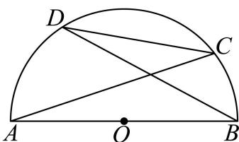
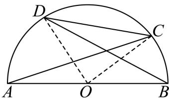
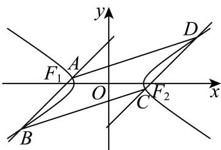

# 2026届上海高三一模 · 静安卷

> 按原卷题号整理；题面、图片和解答未全卷逐页终核。

## 第 1 题

已知全集是实数集 R，集合 $M = \left\{ x \mid (x - 3)(x + 2) \geq 0 \right\}$ ，则集合 M 的补集 $C_{R}M =$ \_\_\_\_ .

【答案】 $\{x\mid -2 <   x <   3\}$

【解析】

【分析】化简集合 M，根据补集概念求解.

【详解】由已知 $M=\left\{x\mid(x-3)(x+2)\geq0\right\}=\left\{x\mid x\geq3\right.$ 或 $x\leq-2\}$

所以 $\complement_{\mathrm{R}}M = \{x\mid -2 <   x <   3\}$

故答案为： $\{x\mid -2 <   x <   3\}$

## 第 2 题

已知椭圆的标准方程为 $\frac{x^{2}}{9} + \frac{y^{2}}{25} = 1$ ，则该椭圆的长轴的长等于 \_\_\_\_.

【答案】10

【解析】

【分析】根据椭圆方程，直接求解 2a.

【详解】由椭圆方程可知， $a^{2}=25$ ，2a=10，

所以椭圆的长轴长为10.

故答案为：10

## 第 3 题

已知直线 $l_{1}: 3x - \sqrt{3}y + 10 = 0$ 与 $l_{2}: x - \sqrt{3}y = 0$ ，则直线 $l_{1}$ 与 $l_{2}$ 的夹角大小是 \_\_\_\_.

【答案】 $\frac{\pi}{6}$ ##30°

【解析】

【分析】先根据直线的斜率求出直线的倾斜角，再利用两条直线倾斜角的大小求出两条直线的夹角.

【详解】直线 $l_{1}$ 的斜率为 $k_{1} = \sqrt{3}$ ，设直线 $l_{1}$ 的倾斜角为 $\alpha (\alpha \in [0,\pi))$ ，由 $\tan \alpha = \sqrt{3}$ ，可得 $\alpha = \frac{\pi}{3}$ ；

直线 $l_{2}$ 的斜率为 $k_{2} = \frac{\sqrt{3}}{3}$ ，设直线 $l_{2}$ 的倾斜角为 $\beta (\beta \in [0,\pi))$ ，由 $\tan \beta = \frac{\sqrt{3}}{3}$ ，可得 $\beta = \frac{\pi}{6}$ ；

所以直线 $l_{1}$ 与 $l_{2}$ 的夹角 $\theta = \alpha -\beta = \frac{\pi}{6}.$

故答案为： $\frac{\pi}{6}$

## 第 4 题

已知复数 z 满足 $(3 - \mathrm{i})z = 3 + \mathrm{i}$ （其中 i 为虚数单位），则复数 z = \_\_\_\_.

【答案】 $\frac{4}{5} +\frac{3}{5}\mathrm{i}$

【解析】

【分析】由已知得出 $z = \frac{3 + \mathrm{i}}{3 - \mathrm{i}}$ ，结合复数的除法化简可得复数 $z$ ：

【详解】因为 $(3-i)z=3+i$ ，所以 $z=\frac{3+i}{3-i}=\frac{(3+i)^{2}}{(3-i)(3+i)}=\frac{8+6i}{10}=\frac{4}{5}+\frac{3}{5}i$ .

故答案为： $\frac{4}{5}+\frac{3}{5}i$ .

## 第 5 题

已知 $\alpha$ 是第四象限角， $\cos \alpha = \frac{3}{5}$ ，则 $\tan 2\alpha =$ \_\_\_\_

【答案】 $\frac{24}{7}$

【解析】

【分析】根据同角三角函数关系得到 $\tan \alpha = -\frac{4}{3}$ ，再利用二倍角公式计算得到答案.

【详解】 $\alpha$ 是第四象限角， $\cos \alpha = \frac{3}{5}$ ，则 $\sin \alpha = -\sqrt{1 - \cos^2\alpha} = -\sqrt{1 - \frac{9}{25}} = -\frac{4}{5}$

故 $\tan \alpha = \frac{\sin\alpha}{\cos\alpha} = \frac{-\frac{4}{5}}{\frac{3}{5}} = -\frac{4}{3}$ 故 $\tan 2\alpha = \frac{2\tan\alpha}{1 - \tan^2\alpha} = \frac{2\times\left(-\frac{4}{3}\right)}{1 - \left(-\frac{4}{3}\right)^2} = \frac{24}{7}$ .

故答案为： $\frac{24}{7}$

【点睛】本题考查三角恒等变换，意在考查学生的计算能力和转化能力.

## 第 6 题

设等差数列 $\left\{a_{n}\right\}$ 的前 n 项和为 $S_{n}$ （n 为正整数），首项 $a_{1}=\frac{3}{2}$ ， $a_{6}=9$ ，则 $S_{7}=$ \_\_\_\_.

【答案】42

【解析】

【分析】设等差数列 $\{a_{n}\}$ 的公差为 $d$ ，根据题意，列出方程，求得 $d = \frac{3}{2}$ ，结合等差数列的求和公式，即可求解.

【详解】设等差数列 $\{a_{n}\}$ 的公差为 $d$ ，

因为 $a_1 = \frac{3}{2}$ ，且 $a_6 = 9$ ，可得 $a_1 + 5d = \frac{3}{2} + 5d = 9$ ，解得 $d = \frac{3}{2}$ ，

所以 $S_{7}=7a_{1}+\frac{7\times6}{2}d=7\times\frac{3}{2}+21\times\frac{3}{2}=42$

故答案为：42.

## 第 7 题

已知圆柱的底面圆的半径与球的半径相等, 若圆柱的表面积与球的表面积也相等, 则圆柱的体积 $V_{1}$ 与球的体积 $V_{2}$ 之比 $V_{1}: V_{2} =$ \_\_\_\_.

【答案】 $\frac{3}{4}$ ##0.75

【解析】

【分析】根据圆柱的侧面积公式和球的表面积公式得出半径等于圆柱的高，再根据体积公式化简即可.

【详解】设圆柱的底面圆和球的半径为 r，圆柱的高为 h，

则由题意得， $2\pi r^{2} + 2\pi rh = 4\pi r^{2}$ ，则 $h = r$

则 $\frac{V_1}{V_2} = \frac{\pi r^2h}{\frac{4}{3}\pi r^3} = \frac{3}{4}$

故答案为: $\frac{3}{4}$

## 第 8 题

已知函数 $f(x)=\left\{\begin{aligned}f(x+1),&x<4\\ \left(\frac{1}{3}\right)^{x},&x\geq4\end{aligned}\right.$ ，则 $f(\log_{3}5)=$ \_\_\_\_.

【答案】 $\frac{1}{135}$

【解析】

【分析】根据分段函数的解析式结合指、对数的运算性质求解即可.

【详解】因为 $1 < \log_3 5 < 2$ ，则 $f(\log_3 5) = f(\log_3 5 + 1) = f(\log_3 5 + 2) = f(\log_3 5 + 3)$ ，且 $f(\log_35 + 3) = \left(\frac{1}{3}\right)^{\log_35 + 3} = (3^{-1})^{\log_35 + 3} = (3^{\log_35 + 3})^{-1} = (3^{\log_35}\cdot 3^3)^{-1} = (5\cdot 27)^{-1} = \frac{1}{135},$ 所以 $f(\log_35) = \frac{1}{135}$ 故答案为： $\frac{1}{135}$

## 第 9 题

抛物线具有如下的光学性质: 所有平行于抛物线对称轴的入射光线经抛物线反射后都过这条抛物线的焦点; 设抛物线的方程为 $y^{2} = 12x$ , 一束光线从平行于其对称轴方向射向抛物线, 光线所在直线交抛物线 $y^{2} = 12x$ 于一点, 这点的纵坐标为 12, 则这束光线经过抛物线反射后所在直线的一个法向量为 \_\_\_\_.

【答案】(4,-3)，答案不唯一

【解析】

【分析】先求出反射光线所在直线的一个方向向量，然后设反射光线所在直线的法向量为 $\vec{m} = (x_0, y_0)$ ，建立等式求解即可得到答案.

【详解】设入射光线所在直线交抛物线 $y^{2}=12x$ 于点 P，由题意得点 P 坐标为 $(12,12)$ ，设抛物线 $y^{2}=12x$ 的焦点为 $F(3,0)$ ，所以反射光线所在直线的一个方向向量为 $\overrightarrow{FP}=(9,12)$ ，

设反射光线所在直线的法向量为 $\vec{m}=(x_{0},y_{0})$ ,

则 $\overrightarrow{FP}\cdot\overrightarrow{m}=9x_{0}+12y_{0}=0$ ，取 $x_{0}=4$ ，则 $y_{0}=-3$ ，

所以这束光线经过抛物线反射后所在直线的一个法向量为 $(4,-3)$ .

故答案为： $(4,-3)$ ，答案不唯一.

## 第 10 题

在 $\triangle ABC$ 中，将角 $A, B, C$ 所对边的边长分别记作 $a, b, c$ . 设 $b = \sqrt{2}c - a$ . 若 $c = 1$ , $\cos C = \frac{1}{5}$ ，则 $\triangle ABC$ 的面积为 \_\_\_\_.

【答案】 $\frac{\sqrt{6}}{12}$ ## $\frac{1}{12}\sqrt{6}$

【解析】

【分析】由余弦定理及已知条件，整理得到 $\sqrt{2}a - a^{2}$ 的值，然后求 $\sin C$ ，由三角形面积公式即可求得结果.

【详解】由余弦定理得 $\cos C = \frac{a^2 + b^2 - c^2}{2ab} = \frac{1}{5}$

$\because b = \sqrt{2} c - a, c = 1, \therefore \frac{a^2 + (\sqrt{2} - a)^2 - 1}{2a(\sqrt{2} - a)} = \frac{1}{5}$ , 即 $5a^2 + 5(\sqrt{2} - a)^2 - 5 = 2a(\sqrt{2} - a)$ , 整理得 $12a^2 - 12\sqrt{2} a + 5 = 0$ , 即 $\sqrt{2} a - a^2 = \frac{5}{12}$ , 所以 $ab = a(\sqrt{2} - a) = \sqrt{2} a - a^2 = \frac{5}{12}$ , $\because C \in (0, \pi), \therefore \sin C = \sqrt{1 - \cos^2 C} = \frac{2\sqrt{6}}{5},$ $\therefore S_{\triangle ABC} = \frac{1}{2} ab \sin C = \frac{1}{2} \times \frac{5}{12} \times \frac{2\sqrt{6}}{5} = \frac{\sqrt{6}}{12}$ . 故答案为: $\frac{\sqrt{6}}{12}$ .

## 第 11 题

如图, 已知 $AB$ 是半圆 $O$ 的直径, 直径长为 2 , 点 $C, D$ 均在半圆 $O$ 上, 且都不与点 $A, B$ 重合, $A, B, C, D$ 四点依次按照逆时针方向排列. 若 $CD$ 的长为 $\sqrt{2}$ , 则 $\overrightarrow{AC} \cdot \overrightarrow{BD}$ 的取值范围为 \_\_\_\_.

【答案】 $\left[-1 - \sqrt{2}, - 2\right)$

【解析】

【分析】连接 OC, OD，设 $\angle COB = \theta$ ，利用转化法结合辅助角公式及三角函数的性质计算即可.

【详解】

连接 OC, OD，由 $CD = \sqrt{2}$ , AB = 2，

$$
O D = 1 = O C, \therefore D O ^ {2} + C O ^ {2} = C D ^ {2}, \therefore \angle D O C = \frac {\pi}{2}
$$

设 $\angle COB = \theta$ ，则 $\theta$ 为锐角，且 $\angle DOA = \frac{\pi}{2} -\theta$

$$
\overrightarrow {A C} \cdot \overrightarrow {B D} = (\overrightarrow {O C} - \overrightarrow {O A}) \cdot (\overrightarrow {O D} - \overrightarrow {O B}) = 0 - \cos \theta - \cos \left(\frac {\pi}{2} - \theta\right) - 1
$$

$$
= - 1 - \sqrt {2} \sin \left(\theta + \frac {\pi}{4}\right)
$$

由于 $\theta +\frac{\pi}{4}\in \left(\frac{\pi}{4},\frac{3\pi}{4}\right)$ ，所以 $\sin \left(\theta +\frac{\pi}{4}\right)\in \left(\frac{\sqrt{2}}{2},1\right],$

即 $\overrightarrow{AC} \cdot \overrightarrow{BD}$ 的取值范围为 $\left[-1 - \sqrt{2}, -2\right)$ .

故答案为： $\left[-1 - \sqrt{2}, - 2\right)$

## 第 12 题

设 $y = f(x)$ 是定义在 R 上的偶函数，对任意的 $x \in R$ ，都有 $f(-x) = f(x + 4)$ ，且当 $x \in [-2, 0]$ 时， $f(x) = \left(\frac{1}{2}\right)^x - 1$ 。设 $g(x) = f(x) - \log_a (x + 2), (a > 1)$ ，若函数 $y = g(x)$ 在左开右闭区间 $(-2, 6]$ 上恰有 3 个不同的零点，则实数 a 的取值范围是 \_\_\_\_.

【答案】 $\left(\sqrt[3]{4},2\right)$

【解析】

【分析】首先根据对称性，周期性画出函数 $f(x)$ 在区间 $(-2,6]$ 的图象，再在同一坐标系下作出函数 $y=\log_{a}(x+2)$ 的图象，由函数 $y=g(x)$ 的零点个数，转化为两个函数图象的交点个数，列式求解.

【详解】因为 $f(x)$ 是定义在R上的偶函数，则 $f(-x) = f(x)$ ，函数 $f(x)$ 图象关于y轴对称，

且 $f(x + 4) = f(x)$ ，即 $f(x)$ 的周期为4.

作出函数 $f(x) = \left(\frac{1}{2}\right)^x - 1$ 在 $x \in [-2, 0]$ 上的图象，

根据 $f(x)$ 的对称性及周期性，可得出 $f(x)$ 在 $[-2,6]$ 上的图象，

若函数 $y = g(x)$ 在左开右闭区间 $(-2, 6]$ 上恰有 3 个不同的零点，

则在区间 $(-2,6]$ 上关于 $x$ 的方程 $f(x) - \log_a (x + 2) = 0 (a > 1)$ 恰有3个不同的实数根，

则函数 $f(x)$ 与函数 $y = \log_a (x + 2)(a > 1)$ 在 $(-2,6]$ 上恰有3个不同的交点；

所以 $\left\{ \begin{array}{l} \log_a(2 + 2) < 3 \\ \log_a(6 + 2) > 3 \end{array} \right.$ ，解得 $\sqrt[3]{4} < a < 2$ 。

故答案为： $\left(\sqrt[3]{4},2\right)$

## 第 13 题

在三维空间中，下列命题是真命题的一个是（ ）A. 垂直于同一条直线的两条直线平行B. 垂直于同一个平面的两个平面平行C. 若一条直线垂直于一个平面，另一条直线与这个平面平行，则这两条直线互相垂直D. 若两个平面分别平行于两条互相垂直的直线，则这两个平面互相垂直

【答案】C

【解析】

【分析】ABD 在正方体中找反例；C 利用线面线面平行的性质定理、线面垂直的性质定理

可判断.

【详解】如图为正方体，

$AA_{1} \perp AD, AB \perp AD$ ，但 $AA_{1} \perp AB$ ，故 A 错误；
平面 $ADD_{1}A_{1} \perp$ 平面 ABCD，平面 $ABB_{1}A_{1} \perp$ 平面 ABCD，
但平面 $ADD_{1}A_{1} \perp$ 平面 $ABB_{1}A_{1}$ ，故 B 错误；
AC⊥BD，与平面ABCD平行的所有平面均与AC,BD平行，故D错误；
如图，

$m \perp \alpha, n // \alpha$ ，由线面平行的性质定理可知，平面 $\alpha$ 内一定存在直线 $l$ 与 $n$ 平行，由线面垂直的性质定理可知， $m \perp l$ ，则有 $m \perp n$ ，故 C 正确.
故选：C

## 第 14 题

如图，已知某频率分布直方图形成“左偏峰右拖尾”形态，则下列结论正确的是（）

A.众数 $=$ 平均数 $=$ 中位数 B.众数 $<$ 中位数 $<$ 平均数C.众数 $<$ 平均数 $<$ 中位数 D.中位数 $<$ 平均数 $<$ 众数

【答案】B

【分析】根据平均数，中位数，众数的概念结合图形分析判断.

【详解】由频率直方图可得，单峰不对称且“右拖尾”，最高峰偏左，众数最小，平均数易受极端值的影响，与中位数相比，平均数总是在“拖尾”那边，故平均数大于中位数，所以众数 $<$ 中位数 $<$ 平均数.

故选：B

## 第 15 题

若数列 $\left\{a_{n}\right\}$ 满足 $a_{n+1}=\log_{m}a_{n}(m>1$ 且 $m\in Z)$ ，则称数列 $\left\{a_{n}\right\}$ 为“对数 m 底数列”. 已知正项数列 $\left\{a_{n}\right\}$ 是“对数 2 底数列”且 $a_{5}=1$ ，则当 $n\geqslant2$ 且 $n\in N^{*}$ 时， $\frac{4^{a_{2}+a_{3}+\cdots+a_{n}}}{a_{2}^{2}\cdots\cdots a_{n-1}^{2}}=(\quad)$ A. $2^{12}$ B. $2^{16}$ C. $2^{32}$ D. $2^{64}$

【答案】C

【解析】

【分析】根据定义 $a_{n+1}=\log_{2}a_{n}$ ，即 $2^{a_{n+1}}=a_{n}$ ，再利用累乘 $\frac{2^{a_{2}+a_{3}+\cdots+a_{n}}}{a_{2}\cdots a_{n-1}}=a_{1}$ ，平方后再由 $a_{5}=1$ 根据递推关系可得答案.

【详解】因为正项数列 $\left\{a_{n}\right\}$ 是“对数 2 底数列”，所以 $a_{n+1}=\log_{2}a_{n}$ ，所以 $2^{a_{n+1}}=2^{\log_{2}a_{n}}=a_{n}$ ，
所以 $2^{a_{2}} = a_{1}, 2^{a_{3}} = a_{2}, 2^{a_{4}} = a_{3}, \cdots, 2^{a_{n}} = a_{n-1} (n \geq 2 \text{ 且 } n \in \mathbb{N}^{*})$ ,

以上式子相乘得 $2^{a_2} \cdot 2^{a_3} \cdots 2^{a_n} = a_1 \cdot a_2 \cdots a_{n-1}$ ，所以 $2^{a_2 + a_3 + \cdots + a_n} = a_1 \cdot a_2 \cdots a_{n-1}$ ，

所以 $\frac{2^{a_2 + a_3 + \cdots + a_n}}{a_2\cdots a_{n - 1}} = a_1$ ，得 $\frac{2^{a_2 + a_3 + \cdots + a_n}\cdot 2^{a_2 + a_3 + \cdots + a_n}}{a_2\cdots a_{n - 1}\cdot a_2\cdots a_{n - 1}} = a_1^2,$

即 $\frac{2^{2a_2 + 2a_3 + \cdots + 2a_n}}{a_2^2\cdots a_{n - 1}^2} = a_1^2$ ，得 $\frac{4^{a_2 + a_3 + \cdots + a_n}}{a_2^2\cdots a_{n - 1}^2} = a_1^2$ ，因为 $a_5 = \log_2a_4,a_5 = 1$ ，所以 $a_4 = 2$

同理， $a_4 = \log_2a_3$ ，所以 $a_3 = 4;a_3 = \log_2a_2$ ，所以 $a_2 = 16;a_2 = \log_2a_1$

所以 $a_{1}=2^{16}$ . 故 $\frac{4^{a_{2}+a_{3}+\cdots+a_{n}}}{a_{2}^{2}\cdots a_{n-1}^{2}}=\left(2^{16}\right)^{2}=2^{32}$ .

故选：C.

## 第 16 题

已知函数 $f(x) = \ln (x + 1) + \frac{ax}{x + 1} (a \in \mathbb{R})$ ; 现有下述两个结论:

①若 $y = f(x)$ 在区间 $(-1,0)$ 内恰有一个零点，则 a 的取值范围是 $(-1,0)$ ;

②若 a > 0，则方程 $f'(x) - f(x) = \frac{\sqrt{5} - 1}{2} - \ln \frac{\sqrt{5} + 1}{2}$ 的解为 $x = \frac{-1 \pm \sqrt{5}}{2}$ ；则下列说法正确的是（）

A. 结论①和②均正确

B. 结论①正确，结论②错误

C. 结论①错误，结论②正确

D. 结论①和②均错误

【答案】B

【解析】

【分析】①求导，分 $a \geq 0$ 和 $a < 0$ 讨论函数单调性，再结合零点问题确定参数范围即可；
②令 $g(x) = f'(x) - f(x)$ ，求导，根据单调性即可判断.

【详解】① $f'(x)=\frac{1}{x+1}+\frac{a}{(x+1)^{2}}=\frac{x+1+a}{(x+1)^{2}}(x>-1)$ ,

当 $a \geq 0$ 时，因为 $x > -1$ ，所以 $x + 1 + a \geq x + 1 > 0$ ，即 $f'(x) > 0$ ， $f(x)$ 在定义域内 $(-1, +\infty)$ 单调递增；

当 $a < 0$ 时，由 $f'(x) < 0 \Rightarrow -1 < x < -1 - a$ ；由 $f'(x) > 0 \Rightarrow x > -1 - a$ .

所以 $f(x)$ 在 $(-1, -1 - a)$ 上单调递减，在 $(-1 - a, +\infty)$ 上单调递增.

综上，当 $a \geq 0$ 时， $f(x)$ 在定义域内单调递增；

当 $a < 0$ 时， $f(x)$ 在 $(-1, -1 - a)$ 上单调递减，在 $(-1 - a, +\infty)$ 上单调递增.

当 $a \geq 0$ 时， $f(x)$ 在 $(-1, +\infty)$ 内单调递增，且注意到 $f(0) = 0$ ，因此 $f(x)$ 在区间 $(-1, 0)$ 上无零点；

当 $a < 0$ 时，由 $\ln (x + 1) + \frac{ax}{x + 1} = 0, (x \in (-1,0))$ 可得 $(x + 1)\ln (x + 1) = -ax, (x \in (-1,0))$ 仅有一解，

所以 $x\ln x = -a(x - 1), (x \in (0,1))$ 仅有一解，

令 $p(x) = x\ln x, (x \in (0,1))$ ，则直线 $y = -a(x - 1)$ 与 $p(x)$ 的图象仅有一个交点，

因为 $p'(x)=\ln x+1,(x\in(0,1))$ ，且直线 $y=-a(x-1)$ 过点 $(1,0)$ ，

所以当 $x \in \left(0, \frac{1}{\mathbf{e}}\right)$ 时， $p'(x) < 0$ ， $p(x)$ 单调递减，当 $x \in \left(\frac{1}{\mathbf{e}}, 1\right)$ 时， $p'(x) > 0$ ， $p(x)$ 单

调递增，且 $p(1) = 0$ ， $p^{\prime}(1) = 1$

所以 $-a<1\Rightarrow a>-1$ ，结合 a<0 ，则 a 的取值范围为 $(-1,0)$ 。结论①正确

②由题， $f'(x)-f(x)=\frac{-ax^{2}+(1-a)x+1+a}{(x+1)^{2}}-\ln(x+1)$ ，记上式为 $g(x)$ ,

由 $a > 0, x > -1$ ，则

$g^{\prime}(x) = -\frac{(a + 1)x + 1 + 3a}{(x + 1)^{3}} -\frac{1}{x + 1}$ $= -\frac{x^2 + (a + 3)x + 2 + 3a}{(x + 1)^3} = -\frac{(x + a + 2)(x + 1) + 2a}{(x + 1)^3} < 0,$

所以函数 $g(x)$ 在定义域内单调递减，因此 $g(x) = \frac{\sqrt{5} - 1}{2} - \ln \frac{\sqrt{5} + 1}{2}$ ，仅有一个解，至此可以判断结论②错误.

注意到待求方程 $g(x) = \frac{\sqrt{5} - 1}{2} -\ln \frac{\sqrt{5} + 1}{2} = \frac{\sqrt{5} - 1}{2} +\ln \frac{\sqrt{5} - 1}{2}$ ，对 $g(x)$ 中含 $a$ 的部分单独考察，即 $a(-x^{2} - x + 1)$

其中关于 $x$ 的多项式的解为 $x = \frac{-1 + \sqrt{5}}{2}$ 或 $x = \frac{-1 - \sqrt{5}}{2}$ （舍去），

因此 $x = \frac{-1 + \sqrt{5}}{2}$ 时可消去 $a$

当 $x = \frac{\sqrt{5} - 1}{2}$ 时，有 $g\left(\frac{\sqrt{5} - 1}{2}\right) = \frac{\sqrt{5} - 1}{2} + \ln \frac{\sqrt{5} - 1}{2}$ ，满足题意；

综上，原方程的解为 $x = \frac{\sqrt{5} - 1}{2}$

故选：B.

## 第 17 题

为开展社区与学校教育共建活动，某地区教育系统从 A、B 两所学校的 5 名教师志愿者中随机抽调 2 人到某社区为居民开展“义务教育咨询”活动.

已知 A 、 B 两所学校中的志愿者学科分布如下:

(1) 假设 $A$ 学校语文 $a$ 老师、数学 $b$ 、 $c$ 老师, $B$ 学校语文 $d$ 老师、数学 $e$ 老师, 列出“从 $A$ , $B$ 两所学校的 5 名教师志愿者中随机抽调 2 人”的样本空间;

（2）求事件“抽到的 2 人恰好都是语文老师”的概率；

（3）求事件“抽到的2人中，恰好有1名语文老师1名数学老师，且这2人恰好来自同一所学校”的概率.

【答案】(1) $\{ab, ac, ad, ae, bc, bd, be, cd, ce, de\}$

(2) $\frac{1}{10}$

(3) $\frac{3}{10}$

【解析】

【分析】（1）由题意可列出其样本空间，即可求解；

（2）符合“抽到的2人恰好都是语文老师”只有ad一种可能，利用古典概率即可求解；

（3）由题符合题意的有：ab，ac，de 有 3 种可能，即可求解.

【小问 1 详解】

样本空间为： $\{ab,ac,ad,ae,bc,bd,be,cd,ce,de\}$ .

【小问 2 详解】

事件“抽到的2人恰好都是语文老师”只有ad一种可能，所以概率为 $\frac{1}{10}$ ，

【小问 3 详解】

事件“抽到的2人中，恰好有1名语文老师1名数学老师，且这2人恰好来自同一所学校”，来自A学校有两种可能：ab，ac，来自B学校一种可能de，总计结果有3种可能，所以概率为 $\frac{3}{10}$ .

## 第 18 题

已知函数 $f(x) = 4\sin \left( \omega x + \frac{\pi}{4} \right) \cdot \cos \omega x - \sqrt{2} (\omega > 0)$ .

（1）将函数 $y = f(x)$ 化为 $y = A\sin (kx + \varphi)\left(A > 0, k > 0, |\varphi| \leq \frac{\pi}{2}\right)$ 的形式，并指出这个函数的振幅和初始相位；

（2）若函数 $y = f(x)$ 的最小正周期为 $\pi$ ，求 $\omega$ 的值并求函数 $y = f(x)$ 的值域.

【答案】（1）答案见解析

(2) $\omega = 1, [-2,2]$

【解析】

【分析】（1）由三角恒等变换化简函数表达式即可得解；

（2）由周期公式求得 $\omega$ ，根据振幅求得值域.

【小问 1 详解】

$$
f (x) = 4 \sin \left(\omega x + \frac {\pi}{4}\right) \cdot \cos \omega x - \sqrt {2} = 2 \sqrt {2} \sin \omega x \cos \omega x + 2 \sqrt {2} \cos^ {2} \omega x - \sqrt {2},
$$

$$
= \sqrt {2} \sin 2 \omega x + \sqrt {2} \cos 2 \omega x = 2 \sin \left(2 \omega x + \frac {\pi}{4}\right)
$$

这个函数的振幅为2，初始相位为 $\frac{\pi}{4}$ .

【小问 2 详解】

由 $y = f(x)$ 的最小正周期为 $\pi$ ，且 $\omega > 0$ ，故 $\frac{2\pi}{2\omega} = \pi \Rightarrow \omega = 1$ .

函数 $y = f(x)$ 的值域为 $[-2, 2]$ .

## 第 19 题

已知正四棱柱 $ABCD - A_{1}B_{1}C_{1}D_{1}$ 的底面边长为 1，点 $E$ 、 $F$ 分别在边 $AD$ 、 $CD$ 上，且 $AE = \frac{2}{3}$ ， $CF = \frac{2}{3}$ .

（1）证明： $AC / /$ 平面 $B_{1}EF$

(2) 若 $AA_{1} = 2$ ，求直线 $BB_{1}$ 与平面 $B_{1}EF$ 所成角的正弦值.

【答案】（1）证明见解析

(2) $\frac{5\sqrt{97}}{97}$

【解析】

【分析】（1）根据平行线的性质可得 AC // EF，进而可证线面平行；

（2）方法一：建系标点，求平面 $B_{1}EF$ 的法向量，利用空间向量求线面夹角；方法二：利用等体积法求点 $B$ 到平面 $B_{1}EF$ 的距离，进而求线面夹角.

【小问 1 详解】

因为 $AE=\frac{2}{3}$ ，CF= $\frac{2}{3}$ ，则 $\frac{ED}{AE}=\frac{DF}{FC}=\frac{1}{2}$ ，可得 AC // EF，

且 $AC \not\subset$ 平面 $B_{1}EF$ ， $EF \subset$ 平面 $B_{1}EF$ ，所以 $AC //$ 平面 $B_{1}EF$

【小问 2 详解】

方法一：以 D 为坐标原点，以 DA，DC， $DD_{1}$ 所在直线分别为 x 轴，y 轴，z 轴建立空间直角坐标系，如图所示：

则 $B(1,1,0), B_1(1,1,2), E\left(\frac{1}{3}, 0, 0\right), F\left(0, \frac{1}{3}, 0\right)$ ,

可得 $\overrightarrow{BB_1} = (0,0,2),\overrightarrow{EB_1} = \left(\frac{2}{3},1,2\right),\overrightarrow{EF} = \left(-\frac{1}{3},\frac{1}{3},0\right),$

设平面 $B_{1}EF$ 的法向量为 $\vec{n} = (x,y,z)$ ，则 $\left\{ \begin{array}{l} \vec{n}\cdot \overrightarrow{EB_1} = \frac{2}{3} x + y + 2z = 0\\ \vec{n}\cdot \overrightarrow{EF} = -\frac{1}{3} x + \frac{1}{3} y = 0 \end{array} \right.$

令 $x = 3$ ，则 $y = 3$ ， $z = -\frac{5}{2}$ ，可得 $\vec{n} = \left(3,3, - \frac{5}{2}\right)$

$$
\cos \vec {n}, \overrightarrow {B B _ {1}} = \frac {\vec {n} \cdot \overrightarrow {B B _ {1}}}{| \vec {n} | \cdot | \overrightarrow {B B _ {1}} |} = \frac {- 5}{2 \times \frac {\sqrt {9 7}}{2}} = - \frac {5 \sqrt {9 7}}{9 7}
$$

所以直线 $BB_{1}$ 与平面 $B_{1}EF$ 所成角的正弦值是 $\frac{5\sqrt{97}}{97}$ .

方法二：由题意可知： $BE = BF = \frac{\sqrt{13}}{3}$ ， $EF = \frac{\sqrt{2}}{3}$ ， $B_{1}E = B_{1}F = \frac{7}{3}$

则 $S_{\triangle BEF} = \frac{1}{2}\times \frac{\sqrt{2}}{3}\times \sqrt{\left(\frac{\sqrt{13}}{3}\right)^2 - \left(\frac{\sqrt{2}}{6}\right)^2} = \frac{5}{18},$

$$
S _ {\triangle B _ {1} E F} = \frac {1}{2} \times \frac {\sqrt {2}}{3} \times \sqrt {\left(\frac {7}{3}\right) ^ {2} - \left(\frac {\sqrt {2}}{6}\right) ^ {2}} = \frac {\sqrt {9 7}}{1 8},
$$

设点 B 到平面 $B_{1}EF$ 的距离为 d，

因为三棱锥 $B_{1} - BEF$ 的体积即为三棱锥 $B - B_{1}EF$ 的体积，

则 $\frac{1}{3} \times 2 \times \frac{5}{18} = \frac{1}{3} d \times \frac{\sqrt{97}}{18}$ ，解得 $d = \frac{10\sqrt{97}}{97}$ ，

设直线 $BB_{1}$ 与平面 $B_{1}EF$ 所成角为 $\theta$ ，则 $\sin \theta = \frac{d}{BB_1} = \frac{\frac{10\sqrt{97}}{97}}{2} = \frac{5\sqrt{97}}{97}$

所以直线 $BB_{1}$ 与平面 $B_{1}EF$ 所成角的正弦值 $\frac{5\sqrt{97}}{97}$ .

## 第 20 题

在平面直角坐标系 $xOy$ 中，已知双曲线 $\Gamma: \frac{x^2}{a^2} - \frac{y^2}{b^2} = 1 (a > 0, b > 0)$ 的焦距为 4，点 $(\sqrt{6}, 1)$ 在 $\Gamma$ 上.

（1）求双曲线 $\Gamma$ 的方程；

（2）设直线 l 的斜率为 $\frac{1}{2}$ ，l 交双曲线 $\Gamma$ 于 P、Q 两点，且与圆 $x^{2} + y^{2} = 4$ 相切，切点位于 x 轴上方，求 $\overrightarrow{OP} \cdot \overrightarrow{OQ}$ 的值；

（3）如图，设过双曲线 $\Gamma$ 的左焦点 $F_{1}$ 的直线 $AB$ 交 $\Gamma$ 的左支于点 $A$ 、 $B$ ，过 $\Gamma$ 的右焦点 $F_{2}$ 的直线 $CD$ 交 $\Gamma$ 的右支于点 $C$ 、 $D$ ，若直线 $CD // AB$ ，且四边形 $ABCD$ 的面积为 $4\sqrt{6}$ ，求直线 $AB$ 的方程.

【答案】（1） $\frac{x^{2}}{3}-y^{2}=1$

(2) -55

(3) $x - y + 2 = 0$ 或 $x + y + 2 = 0$

【解析】

【分析】（1）根据双曲线 $\Gamma$ 的焦距为 4 及点 $(\sqrt{6},1)$ 在 $\Gamma$ 上，列方程即可求得结果；

（2）设直线 $l$ 的方程为 $y = \frac{1}{2} x + m$ ，利用直线 $l$ 与圆相切，求出直线的方程，将直线方程

与双曲线方程联立，利用韦达定理或求出两个交点坐标，从而求得 $\overrightarrow{OP}\cdot\overrightarrow{OQ}$ ;

（3）由双曲线的对称性，易知四边形 ABCD 为平行四边形，设直线 AB 的方程为 $y = k(x + 2)$ （或 x = ky - 2），求出直线 AB 和直线 CD 的距离，再将直线 AB 方程与双曲线方程联立，利用弦长公式求出 $\left|AB\right|$ 的长，根据平行四边形 ABCD 的面积为 $4\sqrt{6}$ 列出方程，求出 k，再根据直线 AB 与双曲线左支有两个交点对结果进行取舍，从而得到答案.

【小问 1 详解】

由双曲线 $\Gamma : \frac{x^2}{a^2} - \frac{y^2}{b^2} = 1 (a > 0, b > 0)$ 的焦距为4，点 $(\sqrt{6}, 1)$ 在 $\Gamma$ 上，

可得 $2c = 4$ ，所以 $c = 2$ ，且 $\frac{6}{a^2} -\frac{1}{b^2} = 1$ ，又因为 $c^2 = a^2 +b^2$ ，即 $a^2 +b^2 = 4$

联立方程组 $\left\{ \begin{array}{l}a^2 +b^2 = 4\\ \frac{6}{a^2} -\frac{1}{b^2} = 1 \end{array} \right.$ ，解得 $a^2 = 3$ ， $b^{2} = 1$ ，所以 $\Gamma$ 的方程为 $\frac{x^2}{3} -y^2 = 1$

【小问 2 详解】

设直线 l 方程为 $y=\frac{1}{2}x+m$ ，代入圆的方程整理得 $\frac{5}{4}x^{2}+mx+m^{2}-4=0$ ，直线与圆相切，
所以判别式 $\Delta = m^{2} - 5m^{2} + 20 = 0$ ，所以 $m^{2} = 5$ ，切点位于 x 轴上方，故 $m = \sqrt{5}$ .

将直线 $y = \frac{1}{2} x + \sqrt{5}$ 代入双曲线 $\Gamma$ 方程，整理得 $\frac{1}{12} x^2 - \sqrt{5} x - 6 = 0$ ，解得 $x = 6\left(\sqrt{5} \pm \sqrt{7}\right)$ ，

P、Q两点的坐标分别为 $(6\sqrt{5}-6\sqrt{7},4\sqrt{5}-3\sqrt{7})$ 、 $(6\sqrt{5}+6\sqrt{7},4\sqrt{5}+3\sqrt{7})$ ,

从而 $\overrightarrow{OP} \cdot \overrightarrow{OQ} = 180 - 252 + 80 - 63 = -55$ ;

另解：由题意设直线 $l$ 方程为 $y = \frac{1}{2} x + m$ ，该直线与圆 $x^{2} + y^{2} = 4$ 相切，

则圆心到直线 l 的距离 $d=\frac{|2m|}{\sqrt{5}}=2$ ，解得 $m=\sqrt{5}$ 。联立 $\left\{\begin{aligned}y&=\frac{1}{2}x+\sqrt{5}\\ \frac{x^{2}}{3}-y^{2}&=1\end{aligned}\right.$ 得

$$
x ^ {2} - 1 2 \sqrt {5} x - 7 2 = 0
$$

设 $P\big(x_1,y_1\big)$ ， $Q\big(x_{2},y_{2}\big)$ ，则 $x_{1} + x_{2} = 12\sqrt{5}$ ， $x_{1}\cdot x_{2} = -72$

$$
\overrightarrow {O P} \cdot \overrightarrow {O Q} = x _ {1} x _ {2} + y _ {1} y _ {2} = x _ {1} x _ {2} + \left(\frac {1}{2} x _ {1} + \sqrt {5}\right) \left(\frac {1}{2} x _ {2} + \sqrt {5}\right) = \frac {5}{4} x _ {1} x _ {2} + \frac {\sqrt {5}}{2} (x _ {1} + x _ {2}) + 5
$$

$$
= \frac {5}{4} \times (- 7 2) + \frac {\sqrt {5}}{2} \times 1 2 \sqrt {5} + 5 = - 5 5
$$

【小问 3 详解】

由题意直线 $AB$ 与 $CD$ 平行，由双曲线的对称性，易知 $AB = CD$ ，四边形ABCD为平行四边形.

当直线 $AB$ 垂直于 $x$ 轴时， $|AB| = \frac{2\sqrt{3}}{3}$ ，此时四边形 $ABCD$ 的面积为 $\frac{8\sqrt{3}}{3}$ ，不合题意，舍去；

设直线 AB 方程为 $y = k(x + 2)$ ，则直线 CD 方程为 $y = k(x - 2)$ ，

直线 AB 和 CD 的距离就是点 $F_{2}$ 到直线 AB 的距离 $d = \frac{|4k|}{\sqrt{1 + k^{2}}}$ ,

设 $A(x_{3},y_{3})$ ， $B(x_4,y_4)$ ，联立方程组 $\left\{ \begin{array}{l} \frac{x^2}{3} - y^2 = 1 \\ y = k(x + 2) \end{array} \right.$ ，整理的

$$
(1 - 3 k ^ {2}) x ^ {2} - 1 2 k ^ {2} x - 1 2 k ^ {2} - 3 = 0
$$

则 $\Delta = 12\left(k^2 + 1\right) > 0$ ，且 $x_3 + x_4 = \frac{12k^2}{1 - 3k^2}$ ， $x_3x_4 = \frac{-12k^2 - 3}{1 - 3k^2}$ ，

又由双曲线的渐近线的方程为 $y = \pm \frac{\sqrt{3}}{3} x$ ，

要使得过 $\Gamma$ 的左焦点 $F_{1}$ 的直线 AB 交 $\Gamma$ 的左支于点 A、B，可得 $k^{2} > \frac{1}{3}$ ， $(x_{1}x_{2} > 0)$ 则

$$
\mid A B \mid = \sqrt {1 + k ^ {2}} \mid x _ {3} - x _ {4} \mid = \sqrt {1 + k ^ {2}} \sqrt {\left(x _ {3} + x _ {4}\right) ^ {2} - 4 x _ {3} x _ {4}}
$$

$$
= \sqrt {1 + k ^ {2}} \sqrt {\left(\frac {1 2 k ^ {2}}{1 - 3 k ^ {2}}\right) ^ {2} + \frac {4 8 k ^ {2} + 2}{1 - 3 k ^ {2}}} = \frac {2 \sqrt {3} (1 + k ^ {2})}{3 k ^ {2} - 1},
$$

所以 $S_{ABCD} = |AB| \times d = \frac{2\sqrt{3}(1 + k^2)}{3k^2 - 1} \times \frac{|4k|}{\sqrt{1 + k^2}} = \frac{8\sqrt{3}|k|\sqrt{1 + k^2}}{3k^2 - 1} = 4\sqrt{6}$ ，化简可得 $7k^4 - 8k^2 + 1 = 0$ ，

解得 $k^2 = \frac{1}{7}$ ，或 $k^2 = 1$ ，因为 $k^2 > \frac{1}{3}$ ，所以 $k^2 = 1$ ，

故直线 AB 的方程为 $x - y + 2 = 0$ 或 $x + y + 2 = 0$ .

另解：设直线 AB 方程为 x = ky - 2，代入双曲线方程得 $\frac{(ky - 2)^{2}}{3} - y^{2} = 1$ ，整理得 $(k^{2} - 3)y^{2} - 4ky + 1 = 0$ ，(因为双曲线的渐近线斜率为 $\frac{\sqrt{3}}{3}$ ，直线 AB 与双曲线左支交于两点，所以 $k^{2} \neq 3$ )

$y_{3}+y_{4}=\frac{4k}{k^{2}-3},\quad y_{3}y_{4}=\frac{1}{k^{2}-3},$ 所以

$$
\left| A B \right| = \sqrt {1 + k ^ {2}} \sqrt {\left(y _ {3} - y _ {4}\right) ^ {2}} = \sqrt {1 + k ^ {2}} \sqrt {\left(y _ {3} + y _ {4}\right) ^ {2} - 4 y _ {3} y _ {4}}
$$

点 $F_{2}$ 到直线 $AB$ 的距离 $d = \frac{4}{\sqrt{1 + k^2}}$

$$
S _ {A B C D} = | A B | \times d = \frac {\sqrt {1 + k ^ {2}}}{| k ^ {2} - 3 |} \times \sqrt {1 2 k ^ {2} + 1 2} \times \frac {4}{\sqrt {1 + k ^ {2}}} = \frac {8 \sqrt {3} \sqrt {1 + k ^ {2}}}{| k ^ {2} - 3 |} = 4 \sqrt {6},
$$

化简可得 $k^{4}-8k^{2}+7=0$ ，解得 $k^{2}=7$ ，或 $k^{2}=1$ ，因为当 $k^{2}=7$ 时，直线 AB 斜率平方 $\frac{1}{k^{2}}<\frac{1}{7}$ ，

此时 AB 与双曲线左支只能交于一点，舍去，所以 $k^{2}=1$ ，

故直线 AB 的方程为 $x - y + 2 = 0$ ，或 $x + y + 2 = 0$ 。

## 第 21 题

已知函数 $y = f(x)$ （ $x \in \mathbb{R}$ ）的图象关于点 $(m, n)$ 成中心对称的充要条件是 $g(x) = f(x + m) - n$ （ $x \in \mathbb{R}$ ）是奇函数；如果一个函数 $y = f(x)$ 的图象关于点 $(m, n)$ 成中心对称，则称这个函数是点 $(m, n)$ 奇函数，其中点 $(m, n)$ 为对称中心；设函数

$f(x) = x(x - 1)(x - a), x\in \mathbb{R}.$

（1）若函数 $y = f(x)$ 是点 $(1,0)$ 奇函数，求实数 a 的值；

（2）证明：对于任意给定的实数 $a$ ，函数 $y = f(x)$ 存在两个极值点；若 $x = a$ 是 $y = f(x)$ 的极小值点，求出 $y = f(x)$ 的所有极值点；

（3）若 $x = a$ 是 $y = f(x)$ 的极大值点，函数 $y = f(x)$ 是否是点 $(m, n)$ 奇函数？若是，求出对称中心 $(m, n)$ ；若不是，请说明理由.

【答案】(1) a = 2;

(2) 证明见解析, 极小值点 1, 极大值点 $\frac{1}{3}$ ;

（3）是， $\left(\frac{1}{3},-\frac{2}{27}\right)$ .

【解析】

【分析】（1）法一：由题意可得 $y = f(x + 1)$ 是奇函数，由此计算可求得 a；法二：由题意可得 $f(x) + f(2 - x) = 0$ 对任意实数 x 恒成立，据此计算可求得 a；

（2）求导可得 $f'(x)$ ，可得 $f'(x)=0$ 有两个不等的解，进而可得有两个极值点，由题意可得 $f'(a)=0$ ，求得 a 的值，验证即可；

（3）法一：当 $a = 0$ 时，由题意有 $f(x + m) - n = -\left[f(-x + m) - n\right]$ ，可得 $6m - 2 = 0$ 求解即可. 法二：由题意可得 $2x^{2}(3m - 1) - 4m(3m - 1)x + 4m^{2}(2m - 1) = 2n$ 恒成立，求解即可.

【小问 1 详解】

法一：若函数 $y = f(x)$ 是点 $(1,0)$ 奇函数，则 $g(x) = f(x+1) - 0$ 是奇函数，得 $y=f(x+1)$ 是奇函数，

即 $f(x + 1) = -f(-x + 1)$ ，因为 $f(x + 1) = x(x + 1)(x + 1 - a)$ ，

$f(-x+1)=-x(-x+1)(-x+1-a)$ ，比较两式右边，由 $f(x+1)=-f(-x+1)$

所以 $1 - a = -1$ ，解得 $a = 2$

法二：若函数 $y = f(x)$ 是点 $(1,0)$ 奇函数，则 $y = f(x)$ 的图像关于点 $(1,0)$ 对称，

则 $f(x) + f(2 - x) = 0$ 对任意实数 $x$ 恒成立，

即 $x(x-1)(x-a)+(2-x)(2-x-1)(2-x-a)=0$ ，化简得 $(x-1)(2a-4)(1-x)=0$

所以 $2a - 4 = 0$ ，解得 $a = 2$ ：

【小问 2 详解】

$f(x) = x^3 - (a + 1)x^2 + ax$ ，从而 $f'(x) = 3x^2 - (2 + 2a)x + a$ ，其中

$$
\Delta = 4 \left(a - \frac {1}{2}\right) ^ {2} + 3 > 0,
$$

所以 $f'(x)=0$ 恰有两解，即函数 $y=f(x)$ 恰有两个驻点，设为 $x_{1}$ ， $x_{2}$ ， $x_{1}<x_{2}$ ，

则 $f'(x)=0$ 就是一元二次方程 $3(x-x_{1})(x-x_{2})=0$ ;

当 $x < x_{1}$ 时， $f'(x) > 0$ ，当 $x_{1} < x < x_{2}$ 时， $f'(x) < 0$ ，当 $x > x_{2}$ 时 $f'(x) > 0$

从而 $x = x_{1}$ 是 $f(x)$ 的极大值点， $x = x_{2}$ 是 $f(x)$ 的极小值点，所以函数 $y = f(x)$ 存在两个极值点，此外再无极值点.

因为 x = a 是 $f(x)$ 的极小值点，所以 $f'(a) = 0$ ，即 $3a^{2} - 2(1 + a)a + a = 0$ ，解得 a = 0 或 1.

当 $a = 0$ 时， $f'(x) = x(3x - 2)$ ，

当 $x \in (-\infty, 0)$ 时 $f'(x) > 0$ ， $f(x)$ 单调递增，

当 $x \in \left(0, \frac{2}{3}\right)$ 时 $f'(x) < 0$ ， $f(x)$ 单调递减，

因此 x=0 是 $f(x)$ 的极大值点(舍去);

当 $a = 1$ 时， $f'(x) = (3x - 1)(x - 1)$ ，

当 $x \in \left(\frac{1}{3}, 1\right)$ 时 $f'(x) < 0$ ， $f(x)$ 单调递减，

当 $x \in (1, +\infty)$ 时 $f'(x) > 0$ ， $f(x)$ 单调递增，

因此 x=1 是 $f(x)$ 的极小值点.

综上，可得 $a = 1$ ，极小值点 $x = 1$ ，极大值点 $x = \frac{1}{3}$

所以 $y = f(x)$ 的所有极值点为 x = 1 和 $x = \frac{1}{3}$ .

【小问 3 详解】

法一：由（2）可知，当 $a = 0$ 时， $x = 0$ 是 $f(x)$ 的极大值点，

$f(x) = x^{2}(x - 1), f'(x) = x(3x - 2)$ 极大值点 $x = 0$ ，极小值点 $x = \frac{2}{3}$

假设 $f(x) = x^{2}(x - 1)$ 是点 $(m, n)$ 奇函数，则满足： $f(x + m) - n = -\left[f(-x + m) - n\right]$ ，

即 $f(x + m) + f(-x + m) = 2n$

等式左边展开计算： $f(x + m) + f(-x + m) = 2m^3 - 2m^2 + (6m - 2)x^2$ ，

要求与 x 无关，所以 $x^{2}$ 的系数必须为 0，所以 6m - 2 = 0，解得 $m = \frac{1}{3}$ .

$$
n = \frac {f (x + m) + f (- x + m)}{2} = \frac {2 m ^ {3} - 2 m ^ {2}}{2} = - \frac {2}{2 7}.
$$

即函数的对称中心是 $\left(\frac{1}{3}, -\frac{2}{27}\right)$ ，函数 $y = f(x)$ 是点 $\left(\frac{1}{3}, -\frac{2}{27}\right)$ 奇函数.

法二：由（2）可知，当 $a = 0$ 时， $x = 0$ 是 $f(x)$ 的极大值点， $f(x) = x^2 (x - 1)$ ，

此时 $f'(x)=x(3x-2)$ 极大值点 x=0 ，极小值点 $x=\frac{2}{3}$ . 符合题意；

假设 $f(x) = x^{2}(x - 1)$ 存在对称中心 $(m, n)$ ，则满足 $f(x) + f(2m - x) = 2n$ 恒成立，

即 $x^{2}(x-1)+(2m-x)^{2}(2m-x-1)=2n$

化简得 $2x^{2}(3m - 1) - 4m(3m - 1)x + 4m^{2}(2m - 1) = 2n$ 恒成立，

所以 $\left\{ \begin{array}{l} 3m - 1 = 0 \\ 4m^2(2m - 1) = 2n \end{array} \right.$ ，解得 $m = \frac{1}{3}, n = -\frac{2}{27}$

所以函数 $y = f(x)$ 存在唯一的对称中心 $\left(\frac{1}{3}, -\frac{2}{27}\right)$ ,

所以函数 $y = f(x)$ 是点 $\left(\frac{1}{3}, -\frac{2}{27}\right)$ 奇函数.
