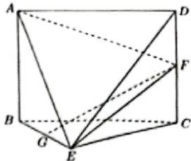
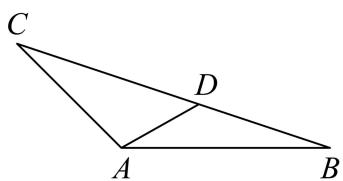

# 2026届上海高三一模 · 黄浦卷

> 按原卷题号整理；题面、图片和解答未全卷逐页终核。

## 第 1 题

函数 $y = \sqrt{x - 2}$ 的定义域是 \_\_\_\_.

【答案】 $[2, + \infty)$ 【解析】
【分析】

写出使函数有意义的表达式，求定义域.

【详解】 $y=\sqrt{x-2}$ 的定义域需满足 $x-2\geq0\Rightarrow x\geq2$ ，

所以函数的定义域 $[2, +\infty)$ .

故答案为： $\left[2,+\infty\right)$

## 第 2 题

若直线 $l_{1}: x + 2y - 1 = 0$ 与 $l_{2}: ax - 4y + 5 = 0$ 平行，则 a = \_\_\_\_.

【答案】-2

【解析】

【分析】根据直线平行列方程求解 a 的值，检验平行即可.

【详解】若直线 $l_{1}: x + 2y - 1 = 0$ 与 $l_{2}: ax - 4y + 5 = 0$ 平行，

则 $1 \times (-4) = 2a$ ，解得 $a = -2$ ，经检验 $a = -2$ 能使得直线 $l_1 // l_2$ .

故答案为：-2.

## 第 3 题

> 核对提醒：题干不等号依据黄浦解析版原卷第1页核正。

已知集合 $A = \{x \mid x < -1 \text{或} x > 4\}$ , $B = \{x \mid |x + 1| < 1, x \in \mathbf{R}\}$ , 则 $A \cap B =$ \_\_\_\_.

【答案】 $\left\{x\mid-2<x<-1\right\}$

【解析】

【分析】由绝对值不等式求出集合 B，再求交集可得.

【详解】由 $|x+1|<1\Leftrightarrow-1<x+1<1\Rightarrow-2<x<0$ ，所以 $B=\{x|-2<x<0\}$

所以 $A \cap B = \{x \mid -2 < x < -1\}$

故答案为： $\{x\mid -2 <   x <   - 1\}$

## 第 4 题

已知 i 是虚数单位，则 $\frac{5i}{2-i} =$ \_\_\_\_ .

【答案】 $-1 + 2\mathrm{i}$

【解析】

【分析】根据复数的除法运算即可求解.

【详解】由题意有： $\frac{5i}{2-i}=\frac{5i(2+i)}{(2-i)(2+i)}=-1+2i$

故答案为： $-1+2i$ .

## 第 5 题

在 $(x + a)^{6}$ 的展开式中的 $x^{3}$ 系数为160，则 $a =$ \_\_\_\_.

【答案】2

【解析】

【分析】

首先求出 $(x+a)^{6}$ 的展开项中 $x^{3}$ 的系数，然后根据 $x^{3}$ 系数为160即可求出a的取值.

【详解】由题知 $T_{r+1}=C_{6}^{r}x^{6-r}a^{r}$ ，

当 $r = 3$ 时有 $T_{4} = C_{6}^{3}x^{3}a^{3} = 160x^{3}\Rightarrow C_{6}^{3}a^{3} = 160$

解得 a=2.

故答案为：2.

【点睛】本题主要考查了二项式展开项的系数，属于简单题.

## 第 6 题

甲、乙两人独立破译某个密码，甲译出密码的概率为0.3，乙译出密码的概率为0.4，则该密码被破译的概率为\_\_\_\_。

【答案】0.58

【解析】

【分析】根据甲、乙两人破译某个密码为独立事件，利用独立事件概率公式求出甲、乙两人均未破译的概率，再利用对立事件概率公式求出该密码被破译的概率.

【详解】设甲破译某个密码为事件 A，乙破译某个密码为事件 B，

$\because$ 甲、乙两人独立破译某个密码，甲译出密码的概率为 $P(A) = 0.3$ ，乙译出密码的概率为

$$
P (B) = 0. 4,
$$

∴甲未破译的概率为 $P(\overline{A})=1-0.3=0.7$ ，乙未破译的概率为 $P(\overline{B})=1-0.4=0.6$ ，

∴ 甲、乙两人均未破译的概率为 $P(\overline{A}\overline{B}) = P(\overline{A}) \cdot P(\overline{B}) = 0.7 \times 0.6 = 0.42$ ,

∵“甲、乙两人均未破译”的对立事件为“密码被破译”，

∴该密码被破译的概率为 $P=1-P\left(\overline{A}\overline{B}\right)=1-0.42=0.58$ .

故答案为：0.58.

## 第 7 题

已知边长为 3 的正三角形 $ABC$ 的三个顶点都在球 $O$ 的球面上, 球心 $O$ 到平面 $ABC$ 的距离为 1 , 则球 $O$ 的体积为 \_\_\_\_.

【答案】 $\frac{32\pi}{3}$

【解析】

【分析】由正弦定理求得正三角形 ABC 的外接圆半径，结合球心 O 到平面 ABC 的距离，根据勾股定理可求得球 O 的半径，从而求得球 O 的体积.

【详解】设正三角形 ABC 的外接圆半径为 r .

根据正弦定理可得， $2r = \frac{3}{\sin 60^{\circ}} = 2\sqrt{3}$ ，所以 $r = \sqrt{3}$

设球 O 的半径为 R，则 $R^{2}=r^{2}+1^{2}=4$ ，R=2。

所以球 O 的体积为 $\frac{4}{3}\pi R^{3}=\frac{32\pi}{3}$ .

故答案为： $\frac{32\pi}{3}$ .

## 第 8 题

若正数 $m, n$ 满足 $\frac{4}{m} + \frac{9}{n} = 1$ ，则 $mn$ 的最小值为 \_\_\_\_.

【答案】144

【解析】

【分析】根据均值不等式求解.

【详解】因为 m, n 是正数，所以 $\frac{4}{m} + \frac{9}{n} \geq 2\sqrt{\frac{4}{m} \cdot \frac{9}{n}} = \frac{12}{\sqrt{mn}}$ ,

又 $\frac{4}{m} +\frac{9}{n} = 1$ ，所以 $\frac{12}{\sqrt{mn}}\leq 1$ ，即 $\sqrt{mn}\geq 12$

所以 $mn \geq 144$ ，当且仅当 $\frac{4}{m} = \frac{9}{n}$ ，即 $m = 8, n = 18$ 时， $mn$ 取得最小值144；

故答案为：144

## 第 9 题

已知角 $\alpha$ 的顶点与坐标原点重合, 始边与 $x$ 轴的正半轴重合, 终边与以坐标原点为圆心、1为半径的圆交于点 $P$ , 若点 $P$ 的横坐标与纵坐标之和为 $\frac{1}{2}$ , 则 $\tan \alpha + \cot \alpha$ 的值为 \_\_\_\_.

【答案】 $-\frac{8}{3}$ ##-2 $\frac{2}{3}$

【解析】

【分析】设 $P(x,y)$ ，根据条件求解出 $xy$ 的值，再根据 $\frac{x^2 + y^2}{xy} = \tan \alpha + \cot \alpha$ ，代入数值可求结果.

【详解】设 $P(x,y)$ ，由题意可知 $\left\{ \begin{array}{l}x^{2} + y^{2} = 1\\ x + y = \frac{1}{2} \end{array} \right.$ 所以 $xy = \frac{(x + y)^2 - (x^2 + y^2)}{2} = \frac{-\frac{3}{4}}{2} = -\frac{3}{8},$ 所以 $\frac{x^2 + y^2}{xy} = \frac{y}{x} +\frac{x}{y} = \tan \alpha +\cot \alpha = \frac{1}{-\frac{3}{8}} = -\frac{8}{3},$

故答案为： $-\frac{8}{3}$ .

## 第 10 题

已知数列 $\left\{a_{n}\right\}$ 是公差为 2 的等差数列，数列 $\lg a_{1}$ ， $\lg a_{k}$ ， $\lg a_{7}$ 也为等差数列，且 $k \in \{3,4,5\}$ ，则 $a_{1} =$ \_\_\_\_ .

【答案】4

【解析】

【分析】根据题意利用等差中项化简，可得关于 $a_{1}, k$ 的方程，分别取k求 $a_{1}$ 即可.

【详解】因为数列 $\lg a_{1}$ ， $\lg a_{k}$ ， $\lg a_{7}$ 为等差数列，

所以 $2\lg a_{k}=\lg a_{1}+\lg a_{7}=\lg a_{1}a_{7}$ ，即 $a_{k}^{2}=a_{1}a_{7}$ ，

所以 $\left[a_{1} + 2(k - 1)\right]^{2} = a_{1}(a_{1} + 6\times 2)$

化简可得 $(k - 1)^2 +(k - 1)a_1 = 3a_1$

当 $k = 3$ 时， $4 + 2a_{1} = 3a_{1}$ ，解得 $a_{1} = 4$ ；

当 $k = 4$ 时， $9 + 3a_{1} = 3a_{1}$ ，此时 $a_{1}$ 无解；

当 k=5 时， $16+4a_{1}=3a_{1}$ ，解得 $a_{1}=-16<0$ ，不合题意；

综上， $a_1 = 4$

故答案为：4

## 第 11 题

如图，在一块空地上有四棵树，若把它们所在的位置看成点，则这四个点 A, B, C, D 恰好是一个平行四边形的四个顶点，且 AB = 40 米，BC = 30 米， $\angle BAD = 60^{\circ}$ ，现要用挡板围出一个形状为矩形的展览区 EFGH，使得其边 EF, FG, GH, HE 分别经过点 A, B, C, D，则该展览区的最大面积约为 \_\_\_\_ 平方米（精确到 1 平方米）.

【答案】2136

【解析】

【分析】应用三角换元得出 $EF, FG$ ，再应用面积公式结合三角恒等变换化简，最后应用辅助角公式及正弦的值域计算求解.

【详解】设 $\angle FAB = \alpha, 30^{\circ} < \alpha < 90^{\circ}$ ，又因为 $\angle BAD = 60^{\circ}$ ，所以 $\angle DAE = 120^{\circ} - \alpha$ ，所以 $AF = 40\cos \alpha, BF = 40\sin \alpha$ ，所以

$$
A E = 3 0 \cos (1 2 0 ^ {\circ} - \alpha), D E = B G = 3 0 \sin (1 2 0 ^ {\circ} - \alpha),
$$

所以 $EF = 40\cos \alpha +30\cos (120^{\circ} - \alpha) = 15\sqrt{3}\sin \alpha +25\cos \alpha$

$$
F G = 4 0 \sin \alpha + 3 0 \sin (1 2 0 ^ {\circ} - \alpha) = 5 5 \sin \alpha + 1 5 \sqrt {3} \cos \alpha ,
$$

$$
\begin{array}{r l} & {\text {进而得出} S = E F \times F G = \Big (1 5 \sqrt {3} \sin \alpha + 2 5 \cos \alpha \Big) \Big (5 5 \sin \alpha + 1 5 \sqrt {3} \cos \alpha \Big)} \\ & {= 2 5 \Big (3 \sqrt {3} \sin \alpha + 5 \cos \alpha \Big) \Big (1 1 \sin \alpha + 3 \sqrt {3} \cos \alpha \Big)} \\ & {= 2 5 \Big (3 3 \sqrt {3} \sin^ {2} \alpha + 1 5 \sqrt {3} \cos^ {2} \alpha + 8 2 \sin \alpha \cos \alpha \Big)} \\ & {= 2 5 \Bigg (3 3 \sqrt {3} \times \frac {1 - \cos 2 \alpha}{2} + 1 5 \sqrt {3} \times \frac {1 + \cos 2 \alpha}{2} + 4 1 \sin 2 \alpha \Bigg)} \\ & {= 2 5 \Big (2 4 \sqrt {3} + 9 \sqrt {3} \cos 2 \alpha + 4 1 \sin 2 \alpha \Big)} \\ & {= 6 0 0 \sqrt {3} + 2 5 \Big (9 \sqrt {3} \sin 2 \alpha + 4 1 \sqrt {3} \cos 2 \alpha \Big)} \\ & {= 6 0 0 \sqrt {3} + 2 5 \sqrt {1 9 2 4} \sin (2   \alpha +   \beta),   \beta   \text {为锐角},} \end{array}
$$

当 $2\alpha + \beta = 90^{\circ}$ 时， $S_{\max} = 600\sqrt{3} + 25\sqrt{1924} \approx 2136$

故答案为：2136

## 第 12 题

若图形 $\Gamma$ 上的每个点都在圆 $C$ 上或在圆 $C$ 内部，则称圆 $C$ 为 $\Gamma$ 的一个覆盖圆．设 $\Gamma$ 由函数 $y = 2|x| - 4(-2 < x < 2)$ 与 $y = \sqrt{2|x| - x^2}$ 的图像所组成，则 $\Gamma$ 的最小覆盖圆的半径为 \_\_\_\_.

【答案】 $\frac{8}{3}$

【解析】

【分析】根据函数 $y=\sqrt{2|x|-x^{2}}$ 的奇偶性结合圆的方程得其图像构成，由函数 $y=2|x|-4(-2<x<2)$ 的奇偶性与一次函数关系得其图像构成，从而可确定最小覆盖圆的圆心位置，设覆盖圆的半径为 r，根据几何性质列不等式求解最小半径即可.

【详解】函数 $y = \sqrt{2|x| - x^2}$ 的定义域满足 $2|x| - x^2 \geq 0$ ，解得 $0 \leq |x| \leq 2$ ，即 $-2 \leq x \leq 2$ ，则函数 $y = \sqrt{2|x| - x^2}$ 为偶函数，

又 $y^{2} = 2|x| - x^{2}$ ，整理得 $\left(|x| - 1\right)^{2} + y^{2} = 1, y \geq 0$ ，则函数 $y = \sqrt{2|x| - x^2}$ 的图像为：

以 $C_1(1,0)$ 为圆心，1为半径的上半圆与以 $C_2(-1,0)$ 为圆心，1为半径的上半圆，函数 $y = 2|x| - 4(-2 < x < 2)$ 为偶函数，图象为先减后增的“V”型图，最低点为 $A(0, - 4)$ 则 $\Gamma$ 的图像大致如下：

由于 $\Gamma$ 的图像关于 $y$ 轴对称，要使得覆盖圆的半径最小，则覆盖圆的圆心 $M$ 在 $y$ 轴上，设 $M(0,m)$ ，且 $-4 < m < 0$ ，覆盖圆的半径为 $r$ ，

设 $P$ 点在半圆 $C_1$ 上，满足 $P, C_1, M$ 三点共线，

则 $\left\{ \begin{array}{l} |AM| \leq r \\ |PM| \leq r \end{array} \right. \Rightarrow \left\{ \begin{array}{l} m + 4 \leq r \\ 1 + \sqrt{m^2 + 1} \leq r \end{array} \right.$ 当 $m + 4 = 1 + \sqrt{m^2 + 1}$ 时，解得 $m = -\frac{4}{3}$ ，此时 $r \geq -\frac{4}{3} + 4 = \frac{8}{3}$ ;

当 $m + 4 < 1 + \sqrt{m^2 + 1}$ 时，解得 $-4 < m < -\frac{4}{3}$ ，此时 $r \geq 1 + \sqrt{m^2 + 1} > 1 + \sqrt{\left(-\frac{4}{3}\right)^2 + 1} = \frac{8}{3}$ ;

当 $m + 4 > 1 + \sqrt{m^2 + 1}$ 时，解得 $-\frac{4}{3} < m < 0$ ，此时 $r \geq m + 4 > -\frac{4}{3} + 4 = \frac{8}{3}$ ;

综上可得 $r \geq \frac{8}{3}$ ，故 $r$ 的最小值为 $\frac{8}{3}$ .

故答案为： $\frac{8}{3}$ .

## 第 13 题

下列函数中，既是偶函数、又在 $[0,1]$ 上严格减的函数是（）
A. $y = -x$ B. $y = -|x|$ C. $y = x^2$ D.

$$
y = 2 ^ {- x}
$$

【答案】B

【解析】

【分析】根据基本初等函数的奇偶性、单调性逐项判断 ACD，利用奇偶性定义及一次函数的单调性判断 B 即可.

【详解】对于 A，y = -x 为奇函数，不是偶函数，在 $[0,1]$ 上严格减，故 A 错误；

对于B， $f(x) = -|x|$ 定义域为R，关于原点对称，且 $f(-x) = -| - x| = -|x| = f(x)$ ，所

以函数 $y = -\left|x\right|$ 为偶函数，

当 $x \in [0,1]$ 时， $y = -|x| = -x$ ，显然在 $[0,1]$ 上严格减，故 B 正确；

对于 C，由幂函数性质知， $y = x^{2}$ 为偶函数，在 $[0,1]$ 上严格增，故 C 错误；

对于D，由指数函数性质知， $y = 2^{-x} = \left(\frac{1}{2}\right)^x$ 既不是奇函数也不是偶函数，故D错误.

故选：B

## 第 14 题

设 $\alpha$ 、 $\beta$ 是两个不同的平面，1是一条直线，以下命题正确的是

A. 若 $1 \perp \alpha, \alpha \perp \beta$ ，则 $1 \parallel \beta$

B. 若 $1 \parallel \alpha, \alpha \parallel \beta$ ，则 $1 \parallel \beta$

C. 若 $1 \perp \alpha, \alpha \parallel \beta$ ，则 $1 \perp \beta$

D. 若 $1 \parallel \alpha, \alpha \perp \beta$ ，则 $1 \perp \beta$

【答案】C

【解析】

【分析】根据空间线面平行、线面垂直、面面平行和面面垂直的判定与性质，对四个选项逐个加以判断，可得正确答案.

【详解】若 $l \perp \alpha$ ， $\beta \perp \alpha$ ，则 $l \parallel \beta$ 或者 $l \subset \beta$ ，故 A 错误；

若 $l\|\alpha$ ， $\alpha\parallel\beta$ 时， $l\parallel\beta$ 或者 $l\subset\beta$ ，故B错误；

若 $\alpha//\beta$ ， $\alpha$ 内必有两条相交直线 m，n 与平面 $\beta$ 内的两条相交直线 $m'$ ， $n'$ 平行，又 $l \perp \alpha$ ，

则 $l \perp m$ ， $l \perp n$ ，即 $l \perp m'$ ， $l \perp n'$ ，故 $l \perp \beta$ ，因此C正确；

若 $l\| \alpha$ ， $\alpha \perp \beta$ ，则 $l$ 与 $\beta$ 相交或 $l / / \beta$ 或 $l\subset \beta$ ，故D错误，故选C.

【点睛】本题主要考查空间中点、线、面的位置关系，解决此类问题的关键是熟练掌握空间中直线与平面的位置关系（平行关系与垂直关系），属于基础题.

## 第 15 题

若数列 $\left\{a_{n}\right\}$ 同时满足如下条件：（i） $\left\{a_{n}\right\}$ 是无穷数列；（ii） $\left\{a_{n}\right\}$ 是递增数列；（iii）存在正数 M，使得对任意的 $n \in N^{*}$ ，都有 $\left\{a_{n}\right\}$ 的前 n 项的和 $S_{n} \in [-M, M]$ ，则称 $\left\{a_{n}\right\}$ 具有性质 P．关于如下结论：①存在等差数列具有性质 P；②存在等比数列具有性质 P．其中正确的说法是（）

A. ①和②均正确    B. ①和②均错误    C. ①正确，②错误    D. ①错误，②正确

【答案】D

【解析】

【分析】利用等差和等比数列的性质以及前 $n$ 项和公式的性质结合题意推导可得.
【详解】对①，对于任意等差数列 $\{a_{n}\}$ ，若是递增数列，则 $a_{n} - a_{n-1} = d > 0$ ， $S_{n} = na_{1} + \frac{n(n-1)}{2}d$ ，当 $n \to +\infty$ 时， $S_{n} \to +\infty$ ，与 $\{a_{n}\}$ 的前 $n$ 项的和 $S_{n} \in [-M, M]$ 矛盾，故不存在；对于②，构造等比数列 $\{a_{n}\}$ ，令 $a_{1} = -1, q = \frac{1}{2}$ ，则 $a_{n} = -1 \times \left(\frac{1}{2}\right)^{n-1} = -\left(\frac{1}{2}\right)^{n-1}$ ， $a_{n} - a_{n-1} = -\left(\frac{1}{2}\right)^{n-1} - \left[-\left(\frac{1}{2}\right)^{n-2}\right] = \left(\frac{1}{2}\right)^{n-2} \left(-\frac{1}{2} + 1\right) = \left(\frac{1}{2}\right)^{n-1} > 0$ ，故 $\{a_{n}\}$ 为递增数列. 由等比数列前 $n$ 项和公式得 $S_{n} = \frac{-1 \times \left[1 - \left(\frac{1}{2}\right)^{n}\right]}{1 - \frac{1}{2}} = -2 + \left(\frac{1}{2}\right)^{n-1}$ ，因为 $0 < \left(\frac{1}{2}\right)^{n-1} \leq \left(\frac{1}{2}\right)^{0} = 1$ ，所以 $-2 < S_{n} \leq -1$ ，取 $M = 2 > 0$ ，则对于任意的 $n \in \mathbf{N}^{*}$ 都有 $S_{n} \in [-M, M]$ . 综上分析，可知①错误，②正确. 故选：D

## 第 16 题

已知点 $P(-5,0)$ ， $Q_1$ ， $Q_2 \in \{(x,y) | |x| \leq 1, |y| \leq 1\}$ ，则 $\overrightarrow{PQ_1} \cdot \overrightarrow{PQ_2}$ 的取值范围是（）A. [15,36] B. [15,37] C. [16,36] D.

[16,37]

【答案】B

【解析】

【分析】设 $Q_{1}(x_{1},y_{1}),Q_{2}(x_{2},y_{2})$ ，则 $\overrightarrow{PQ_{1}}\cdot\overrightarrow{PQ_{2}}=(x_{1}+5)(x_{2}+5)+y_{1}y_{2}$ .由题求出 $(x_{1}+5)(x_{2}+5)$ ， $y_{1}y_{2}$ 的取值范围，根据不等式的性质，可得 $\overrightarrow{PQ_{1}}\cdot\overrightarrow{PQ_{2}}$ 的取值范围.
【详解】设 $Q_{1}(x_{1},y_{1}),Q_{2}(x_{2},y_{2})$ ，则 $\overrightarrow{PQ_{1}}\cdot\overrightarrow{PQ_{2}}=(x_{1}+5,y_{1})\cdot(x_{2}+5,y_{2})=(x_{1}+5)(x_{2}+5)+y_{1}y_{2}$ 因为 $|x_{1}|\leq1,|x_{2}|\leq1,|y_{1}|\leq1,|y_{2}|\leq1$ ，所以 $-1\leq x_{1}\leq1,-1\leq x_{2}\leq1,-1\leq y_{1}\leq1,-1\leq y_{2}\leq1$ 所以 $4\leq x_{1}+5\leq6,4\leq x_{2}+5\leq6,-1\leq y_{1}y_{2}\leq1$ 所以 $16\leq(x_{1}+5)(x_{2}+5)\leq36$ .
所以 $15\leq(x_{1}+5)(x_{2}+5)+y_{1}y_{2}\leq37$

其中当 $(x_{1} + 5)(x_{2} + 5)$ 与 $y_{1}y_{2}$ 同时取最大值时，即 $x_{1} + 5 = x_{2} + 5 = 6$ 与 $y_{1}y_{2} = 1$ 时， $\overrightarrow{PQ_1}\cdot \overrightarrow{PQ_2}$ 取得最大值，最大值为37.此时，点 $Q_{1},Q_{2}$ 重合，坐标为 $(1,1)$ 或 $(1, - 1)$ . 当 $(x_{1} + 5)(x_{2} + 5)$ 与 $y_{1}y_{2}$ 同时取最小值时，即 $x_{1} + 5 = x_{2} + 5 = 4$ 与 $y_{1}y_{2} = -1$ 时， $\overrightarrow{PQ_1}\cdot \overrightarrow{PQ_2}$ 取得最小值，最小值为15.此时，点 $Q_{1},Q_{2}$ 的坐标分别为 $(-1,1),(-1,-1)$ 或 $(-1,-1),(-1,1)$ .

所以 $\overrightarrow{PQ_1} \cdot \overrightarrow{PQ_2}$ 的取值范围是[15,37].

故选：B.

## 第 17 题

一家水果店的店长为了解本店苹果的日销售情况，记录了过去20天苹果的日销售量（单位：kg），按从小到大的排序结果如下：62，74，75，84，84，85，85，85，86，87，89，92，93，94，97，99，101，104，107，117.

（1）求该水果店过去20天苹果日销售量的平均数；

（2）若以过去 20 天苹果的日销售量的第 80 百分位数作为下个月每日苹果的平均进货量，试确定下个月每日苹果的平均进货量；

(3) 若从过去 20 天中随机抽取 3 天, 分别求“3 天中每天的苹果销售量均超过 $90 \mathrm{~kg}$ ”与“3 天中恰有 2 天的苹果销售量超过 $90 \mathrm{~kg}$ ”的概率.

【答案】(1) 90kg

(2) 100kg

(3) $\frac{7}{95},\frac{33}{95}$

【解析】

【分析】（1）根据平均数的定义即可求解；

（2）根据百分位数的定义即可求解；

（3）根据古典概率公式即可求解.

【小问1详解】

该水果店过去 20 天苹果日销售量的平均数

$$
\overline {{x}} = \frac {6 2 + 7 4 + 7 5 + 8 4 \times 2 + 8 5 \times 3 + 8 6 + 8 7 + 8 9 + 9 2 + 9 3 + 9 4 + 9 7 + 9 9 + 1 0 1 + 1 0 4 + 1 0 7 + 1 1 7}{2 0} = 9 0 \mathrm{kg}
$$

【小问 2 详解】

因为 $20 \times 0.8 = 16$ ，所以第80百分位数为 $\frac{99 + 101}{2} = 100\mathrm{kg}$ ，所以下个月每日苹果的平均进货量为 $100\mathrm{kg}$ 。

【小问 3 详解】

20 天中苹果销售量超过 90kg 的有 9 天.

设 “3 天中每天的苹果销售量均超过 90kg” 为事件 A，“3 天中恰有 2 天的苹果销售量超

过90kg”为事件B，

则 $P(A) = \frac{C_9^3}{C_{20}^3} = \frac{7}{95}, P(B) = \frac{C_9^2C_{11}^1}{C_{20}^3} = \frac{33}{95}.$

## 第 18 题

如图，在几何体 ABCDE 中，四边形 ABCD 是矩形， $AB \perp$ 平面 BEC， $BE \perp EC$ ， $AB = BE = EC = 2$ ，G，F 分别是线段 BE，DC 的中点.

（1）求证：GF // 平面 ADE;

（2）设平面 AEF 与平面 BEC 的交线为 l，求二面角 A-l-B 的余弦值.

【答案】（1）证明见解析；

(2) $\frac{2}{3}.$

【解析】

【分析】（1）取 AE 的中点 H，通过平行的传递性得到 HG // FD，由题中条件得到四边形 HGFD 为平行四边形，得到 GF // DH，利用线面平行的判定定理得到 GF // 平面 ADE；（2）设平面 AEF 与平面 BEC 所成的锐二面角的大小为 $\theta$ ，由 AB ⊥ 平面 BEC 和 FC ⊥ 平面 BEC，得到 $\triangle AEF$ 在平面 BEC 上的射影为 $\triangle BEC$ ，利用余弦定理求出 $\cos \angle AEF$ ，利用同角关系式求 $\sin \angle AEF$ ，从而得到 $S_{\triangle AEF}$ 和 $S_{\triangle BEC}$ ，则 $\cos \theta = \frac{S_{\triangle BEC}}{S_{\triangle AEF}}$ ，代入数值求解，从而得到二面角 A - l - B 的余弦值.

【小问 1 详解】

取 AE 的中点 H，连接 HG, FG, HD，∵ HG // AB // CD，即 HG // FD，

∵ AB = BE = EC = 2，G，F 分别是线段 BE，DC 的中点，

∴ HG = FD = 1，∴ 四边形 HGFD 为平行四边形，∴ GF // DH，

又∵DH⊂平面ADE，GF∉平面ADE，∴GF//平面ADE；

【小问 2 详解】

设平面 AEF 与平面 BEC 所成的锐二面角的大小为 $\theta$ ，

∵ AB ⊥ 平面 BEC，FC ⊥ 平面 BEC，

$\therefore \triangle AEF$ 在平面 BEC 上的射影为 $\triangle BEC$ ，

$\because AB = BE = EC = 2, \angle ABE = 90^{\circ}, \therefore AE = 2\sqrt{2}$ ,

∵ G, F 分别是线段 BE, DC 的中点, ∴ FC = 1, ∵ ∠FCE = 90°,

$\therefore EF = \sqrt{5},\therefore \cos \angle AEF = \frac{8 + 5 - 9}{2\times 2\sqrt{2}\times\sqrt{5}} = \frac{1}{\sqrt{10}},$

$$
\therefore \sin \angle A E F = \sqrt {1 - (\cos \angle A E F) ^ {2}} = \sqrt {1 - \left(\frac {1}{\sqrt {1 0}}\right) ^ {2}} = \frac {3}{\sqrt {1 0}},
$$

$$
\therefore S _ {\triangle A E F} = \frac {1}{2} \times 2 \sqrt {2} \times \sqrt {5} \times \frac {3}{\sqrt {1 0}} = 3,
$$

又 $\because S_{\triangle BEC} = \frac{1}{2}\times 2\times 2 = 2$ ， $\therefore \cos \theta = \frac{S_{\triangle BEC}}{S_{\triangle AEF}} = \frac{2}{3},$

∴二面角 A-l-B 的余弦值为 $\frac{2}{3}$ .

## 第 19 题

在 $\triangle ABC$ 中， $\angle BAC = \frac{3\pi}{4}$ ， $AB = 6$ ， $AC = 3\sqrt{2}$ .

（1）求 $BC$ 的长和 $\angle B$ 的正弦值；

（2）若点 $D$ 在 $BC$ 边上，且 $\angle BAD = \theta$ ，设 $AD = f(\theta)$ ，求 $f(\theta)$ 的表达式，并判断是否存在 $\theta_0$ ，使得 $f(\theta)$ 在 $\theta = \theta_0$ 处的瞬时变化率等于 $-f(\theta_0)$ ：

【答案】（1） $3\sqrt{10}$ ， $\frac{\sqrt{10}}{10}$

(2) $f(\theta) = \frac{6}{3\sin\theta + \cos\theta}, \theta \in \left(0, \frac{3\pi}{4}\right)$ ; 存在

【解析】

【分析】（1）根据已知条件，利用余弦定理求出 BC，再利用正弦定理求出 $\sin \angle B$ ;

（2）利用正弦定理求出 $f(\theta)$ ，求导，假设命题成立求出 $\theta_{0}$ ，进而得出结论.

【小问 1 详解】

$$
\because \angle B A C = \frac {3 \pi}{4}, A B = 6, A C = 3 \sqrt {2},
$$

由余弦定理得

$$
B C ^ {2} = A B ^ {2} + A C ^ {2} - 2 A B \cdot A C \cdot \cos \angle B A C = 6 ^ {2} + (3 \sqrt {2}) ^ {2} - 2 \times 6 \times 3 \sqrt {2} \times \left(- \frac {\sqrt {2}}{2}\right) = 9 0,
$$

$\therefore BC = 3\sqrt{10}$

由正弦定理得 $\frac{BC}{\sin\angle BAC} = \frac{AC}{\sin\angle B}\Rightarrow \frac{3\sqrt{10}}{\sqrt{2}} = \frac{3\sqrt{2}}{\sin\angle B},$

$$
\therefore \sin \angle B = \frac {1}{\sqrt {1 0}} = \frac {\sqrt {1 0}}{1 0}
$$

【小问 2 详解】

在 $\triangle ABD$ 中， $\angle BAD = \theta$ ， $\angle ABD = \angle B$ ，

由正弦定理得 $\frac{AD}{\sin\angle B} = \frac{AB}{\sin(\pi - \theta - \angle B)} = \frac{AB}{\sin(\theta + \angle B)}$

$$
\therefore A D = f (\theta) = \frac {A B \cdot \sin \angle B}{\sin (\theta + \angle B)},
$$

$$
\because A C <   A B, \therefore 0 <   \angle B <   \frac {\pi}{2},
$$

$\because \sin \angle B = \frac{\sqrt{10}}{10}, \therefore \cos \angle B = \sqrt{1 - \frac{1}{10}} = \frac{3\sqrt{10}}{10}$ ,

$$
\therefore \sin (\theta + \angle B) = \sin \theta \cos \angle B + \cos \theta \sin \angle B = \frac {\sqrt {1 0}}{1 0} (3 \sin \theta + \cos \theta),
$$

$$
\therefore A D = \frac {A B \cdot \sin \angle B}{\sin (\theta + \angle B)} = \frac {6 \times \frac {\sqrt {1 0}}{1 0}}{\frac {\sqrt {1 0}}{1 0} (3 \sin \theta + \cos \theta)} = \frac {6}{3 \sin \theta + \cos \theta},
$$

即 $f(\theta) = \frac{6}{3\sin\theta + \cos\theta}, \theta \in \left(0, \frac{3\pi}{4}\right)$ ;

求导得 $f^{\prime}(\theta) = -\frac{6(3\cos\theta - \sin\theta)}{(3\sin\theta + \cos\theta)^{2}}$ ,

假设存在 $\theta_{0}$ ，使得 $f(\theta)$ 在 $\theta = \theta_{0}$ 处的瞬时变化率等于 $-f(\theta_{0})$ ，

则 $f^{\prime}\left(\theta_{0}\right) = -f\left(\theta_{0}\right)$ ，即 $-\frac{6(3\cos\theta_{0} - \sin\theta_{0})}{(3\sin\theta_{0} + \cos\theta_{0})^{2}} = -\frac{6}{3\sin\theta_{0} + \cos\theta_{0}}$ ①，

$$
\because \theta_ {0} \in \left(0, \frac {3 \pi}{4}\right), 3 \sin \theta_ {0} + \cos \theta_ {0} > 0,
$$

∴式①化简整理得 $3\cos\theta_{0}-\sin\theta_{0}=3\sin\theta_{0}+\cos\theta_{0}\Rightarrow2\cos\theta_{0}=4\sin\theta_{0}\Rightarrow\tan\theta_{0}=\frac{1}{2}$

$\because \tan \theta_0 = \frac{1}{2}$ 在 $\theta_0 \in \left(0, \frac{3\pi}{4}\right)$ 内有解，

∴存在这样的 $\theta_{0}$ （ $\tan\theta_{0}=\frac{1}{2}$ ）使得 $f(\theta)$ 在 $\theta=\theta_{0}$ 处的瞬时变化率等于 $-f(\theta_{0})$ .

## 第 20 题

> 核对提醒：原解析第二问中参数符号表述疑有笔误，需核对推导。

已知双曲线 $\Gamma$ 的中心位于坐标原点 $O$ ，焦点 $F_{2}$ ， $F_{1}$ 分别在 $x$ 轴的正、负半轴上， $\left|F_{1}F_{2}\right| = 2\sqrt{2}$ ，直线 $y = -x$ 是 $\Gamma$ 的一条渐近线，直线 $l_{1}: y = \sqrt{2} x + t (t < 0)$ 与 $\Gamma$ 有且只有一个公共点 $P$ 。

（1）求 $\Gamma$ 的方程；

(2) 若点 $Q$ 在 $y$ 轴上, 且 $\angle F_{1}QP$ 为直角, 求点 $Q$ 的坐标;

（3）设动直线 $l_{2}$ 平行于 OP，与 $\Gamma$ 交于点 A，B，与 $l_{1}$ 交于点 K，是否存在常数 $\lambda$ ，使得

$\left|KA\right|\cdot \left|KB\right| = \lambda \left|KP\right|^2$ 总成立？若存在，请求出 $\lambda$ 的值；若不存在，请说明理由.

【答案】（1） $x^{2} - y^{2} = 1$

(2) $(0,2)$ 或 $(0,-1)$

（3）存在 $\lambda=1$ 符合题意.

【解析】

【分析】（1）利用双曲线的焦距确定 c，渐近线斜率确定 $\frac{b}{a}$ ，结合 $c^{2}=a^{2}+b^{2}$ 求出 a, b，
进而得到双曲线方程.

（2）联立直线与双曲线，由判别式得 $t$ 以确定 $P$ 点坐标，设 $Q$ 点坐标后，利用向量垂直的数量积为0求解 $Q$ 的坐标.

（3）先确定直线 $l_{2}$ 的方程，联立 $l_{2}$ 与双曲线得韦达定理，联立 $l_{2}$ 与 $l_{1}$ 得 $K$ 点坐标，计算 $\left|KA\right|\cdot \left|KB\right|$ 和 $\left|KP\right|^2$ 并化简对比，得出常数 $\lambda$ 的值.

【小问 1 详解】

依题意， $\left\{ \begin{array}{l}2c = 2\sqrt{2}\\ \frac{b}{a} = 1\\ c^2 = a^2 +b^2 \end{array} \right.$ ，解得 $a = b = 1,c = \sqrt{2}$

所以 $\Gamma$ 的方程为 $x^{2}-y^{2}=1$ .

【小问 2 详解】

联立 $\left\{\begin{aligned}y&=\sqrt{2}x+t\\ x^{2}-y^{2}&=1\end{aligned}\right.$ ，消去y并化简得 $x^{2}+2\sqrt{2}tx+t^{2}+1=0$ ，

由题意可得 $\Delta = 8t^2 - 4(t^2 + 1) = 0$ ，解得 $t = \pm 1$ ，因为 $t > 0$ ，

所以 t = -1，代入上式，解得 $x = \sqrt{2}, y = 1$ ，

所以 $P\left(\sqrt{2},1\right)$ ，设 $Q(0,q)$

因为 $\angle F_{1}QP$ 为直角，

所以 $\overrightarrow{QF_1}\cdot \overrightarrow{QP} = (-\sqrt{2}, - q)\cdot (\sqrt{2},1 - q) = -\sqrt{2}\times \sqrt{2} -q(1 - q) = 0$

解得 q=2 或 -1，

所以 $Q(0,2)$ 或 $(0,-1)$ .

【小问 3 详解】

$k_{OP}=\frac{\sqrt{2}}{2}$ ，设 $A(x_{1},y_{1}),B(x_{2},y_{2})$ ， $l_{2}:y=\frac{\sqrt{2}}{2}x+m$ ，

联立 $\left\{ \begin{array}{l} y = \frac{\sqrt{2}}{2} x + m \\ x^2 - y^2 = 1 \end{array} \right.$ ，消去 $y$ 并化简得 $x^2 - 2\sqrt{2} mx - 2m^2 - 2 = 0$ ，

$$
\Delta = 8 m ^ {2} - 4 (- 2 m ^ {2} - 2) = 1 6 m ^ {2} + 8 > 0,
$$

$$
x _ {1} + x _ {2} = 2 \sqrt {2} m, x _ {1} x _ {2} = - 2 (m ^ {2} + 1)
$$

联立 $\left\{\begin{aligned}y&=\frac{\sqrt{2}}{2}x+m\\ y&=\sqrt{2}x-1\end{aligned}\right.$ ，解得 $\left\{\begin{aligned}x&=\sqrt{2}m+\sqrt{2}\\ y&=2m+1\end{aligned}\right.$

所以 $K\left(\sqrt{2} m + \sqrt{2}, 2m + 1\right)$ ,

$$
\left| K A \right| \cdot \left| K B \right| = \left[ 1 + \left(\frac {\sqrt {2}}{2}\right) ^ {2} \right] \cdot \left| \left(x _ {1} - x _ {K}\right) \left(x _ {2} - x _ {K}\right) \right| = \frac {3}{2} \left| x _ {1} x _ {2} - x _ {K} \left(x _ {1} + x _ {2}\right) + x _ {K} ^ {2} \right|,
$$

代入 K 点坐标及韦达定理得

$$
\left| K A \right| \cdot \left| K B \right| = \frac {3}{2} \left| - 2 (m ^ {2} + 1) - 2 \sqrt {2} m (\sqrt {2} m + \sqrt {2}) + (\sqrt {2} m + \sqrt {2}) ^ {2} \right| = 6 m ^ {2},
$$

$$
\left| K P \right| ^ {2} = (\sqrt {2} m + \sqrt {2} - \sqrt {2}) ^ {2} + (2 m + 1 - 1) ^ {2} = 6 m ^ {2},
$$

所以 $\exists \lambda = 1$ ，使得 $\left|KA\right|\cdot \left|KB\right| = \lambda \left|KP\right|^2.$

## 第 21 题

已知函数 $y = f(x)$ 的定义域为 $D$ ，对于给定实数 $t$ ，定义集合 $V_{f(t)} = \{x | f(x + t) \geq f(x)\}$ .

（1）若 $f(x) = x^3 - 13x$ ，求 $V_{f(2)}$

（2）若 $D = R$ ，求证：“ $y = f(x)$ 为周期函数”的充要条件是“存在非零常数 t ，使得 $V_{f(t)} = V_{f(-t)} = D$ ”.

（3）若 $f(x) = \frac{1}{2} a\left(x - \frac{\mathrm{e}}{\mathrm{e} - 1}\right)^2 - x\left(\ln x - \frac{\mathrm{e}}{\mathrm{e} - 1}\right), D = (0, +\infty)$ ，且对于任意的 $t \in D$ ，都有 $V_{f(t)} = D$ ，求实数 $a$ 的取值范围.

【答案】（1） $V_{f(2)}=\left(-\infty,-3\right]\cup\left[1,+\infty\right)$ ;

(2) 证明见解析; (3) $a \in \frac{1}{e}, 1$ .

【解析】

【分析】（1）根据函数新定义结合一元二次不等式计算求解；

（2）应用函数新定义结合周期定义及充要条件定义证明；

（3）根据 $\forall x, t > 0$ ， $f(x + t) \geq f(x)$ ，得出函数单调递增，再分 $a \leq 0$ 和 $a > 0$ 分类讨论单调性及值域计算求参.

【小问 1 详解】

$$
V _ {f (2)} = \left\{x \mid f (x + 2) \geq f (x) \right\},
$$

若 $f(x + 2) \geq f(x)$ ，则 $(x + 2)^{3} - 13(x + 2) \geq x^{3} - 13x$

所以 $6x^{2}+12x-18=6(x+3)(x-1)\geq0$

所以 $V_{f(2)} = (-\infty, - 3]\cup [1, + \infty)$

【小问 2 详解】

充分性：因为 $V_{f(t)} = V_{f(-t)} = \mathbf{R}$ ， $\forall x\in \mathbb{R},f(x + t)\geq f(x),f(x - t)\geq f(x)$

所以 $f(x) \geq f(x + t)$ ，所以 $f(x) = f(x + t)$ ，因为 $t \neq 0$ ，所以 $f(x)$ 是周期函数；

必要性：若 $f(x)$ 是周期函数，设 T 是 $f(x)$ 的周期，则 $f(x)=f(x\pm T)$ ,

所以 $V_{f(T)} = \{x | f(x + T) \geq f(x)\} = R$ ， $V_{f(-T)} = \{x | f(x - T) \geq f(x)\} = R$ ，

所以存在 $t = T \neq 0$ ，使 $V_{f(t)} = V_{f(-t)} = R$ .

## 【小问 3 详解】

因为 $\forall t > 0,\quad V_{f(t)} = (0, +\infty)$ ，所以 $\forall x, t > 0,\quad f(x + t) \geq f(x)$ ,

所以 $f(x)$ 在 $(0, +\infty)$ 上单调递增，所以 $f'(x) = a\left(x - \frac{e}{e-1}\right) - \ln x + \frac{1}{e-1} \geq 0$ ，

若 $a \leq 0$ ，则 $x \to +\infty, f'(x) \to -\infty$ ，则不满足 $f'(x) \geq 0$ ；

所以 $a > 0$ ，设 $f^{\prime}(x) = a\left(x - \frac{\mathrm{e}}{\mathrm{e} - 1}\right) - \ln x + \frac{1}{\mathrm{e} - 1} = h(x)$

因为 $h'(x)=\frac{ax-1}{x}$ ,

当 $x \in \left(0, \frac{1}{a}\right], h'(x) < 0, h(x)$ 单调递减；当 $x \in \left(\frac{1}{a}, +\infty\right), h'(x) > 0, h(x)$ 单调递增；

所以 $h\left(\frac{1}{a}\right) = f'\left(\frac{1}{a}\right) \geq 0$ ，即 $\ln a - \frac{\mathrm{e}}{\mathrm{e} - 1}(a - 1) \geq 0$

设 $g(x) = \ln x - \frac{\mathrm{e}}{\mathrm{e} - 1}(x - 1)$ ，则 $g'(x) = \frac{1}{x} - \frac{\mathrm{e}}{\mathrm{e} - 1}$ ，

当 $x \in \left(0, \frac{\mathrm{e} - 1}{\mathrm{e}}\right], g'(x) > 0, g(x)$ 单调递增；当 $x \in \left(\frac{\mathrm{e} - 1}{\mathrm{e}}, +\infty\right), g'(x) < 0, g(x)$ 单调递减；

又 $g\left(\frac{1}{\mathbf{e}}\right) = g(1) = 0, g(a) \geq 0$ ，所以 $\frac{1}{\mathbf{e}} \leq a \leq 1$ ；

所以 $a \in \left[\frac{1}{\mathrm{e}}, 1\right]$ .
