# 2026届上海高三一模数学 · 向量专题（教师阅读版）

> 以16区规范化转录稿为主，MinerU与可读PDF辅助。原题与源解析保留，不代表本次逐题独立重算；存在待核内容的题目在题前提示。旧汇编未用作本稿题目来源。

[返回阅读入口](阅读入口.md)

## 目录

- [1 坐标运算与向量位置关系](#class-1)（4题）
- [2 数量积、夹角与投影](#class-2)（4题）
- [3 向量线性表示与空间分点](#class-3)（2题）
- [4 平面几何中的数量积与最值](#class-4)（9题）
- [5 空间向量的模与夹角](#class-5)（2题）
- [6 向量集合、高维定义与综合判断](#class-6)（3题）
- [7 向量与直线、圆锥曲线综合](#class-7)（10题）
- [8 向量方法在其他专题中的应用](#class-8)（10题）

## 1 坐标运算与向量位置关系

### 杨浦 · 原卷第3题

**考点说明：** 平面向量垂直：利用坐标数量积为零建立方程。

来源：源文件（本地原卷）。原题ID：`2026一模-杨浦-03`。

已知向量 $\vec{a}=(2,3)$ ， $\vec{b}=(3,x)$ ，且 $\vec{a} \perp \vec{b}$ ，则实数 x = \_\_\_\_.

【答案】-2

【解析】

【分析】由向量垂直坐标表示可得答案.

【详解】因 $\vec{a} \perp \vec{b}$ ，则 $\vec{a} \cdot \vec{b} = 6 + 3x = 0 \Rightarrow x = -2$ .

故答案为：-2

---

### 浦东 · 原卷第3题

**考点说明：** 向量平行的坐标条件：利用对应坐标成比例或二维行列式为零确定参数。

来源：源文件（本地原卷）。原题ID：`2026一模-浦东-03`。

> 核对说明：规范稿伪第1题已排除，规范题号减1。

已知向量 $\vec{a} = (1, -3)$ 、 $\vec{b} = (1, k)$ ，若 $\vec{a} // \vec{b}$ ，则实数 k 的值为 \_\_\_\_.

【答案】-3

【解析】

【分析】根据平面向量共线求参数即可.

【详解】因为 $\vec{a}//\vec{b}$ ，所以 $1\cdot k=(-3)\times1\Rightarrow k=-3$ .

故答案为：-3

---

### 奉贤 · 原卷第4题

**考点说明：** 向量与直线：将已知垂直向量作为直线的法向量，再结合过点条件确定方程。

来源：源文件（本地原卷）。原题ID：`2026一模-奉贤-04`。

已知向量 $\vec{a}=(1,1)$ ，则经过点 $(1,0)$ 且与 $\vec{a}$ 垂直的直线方程为 \_\_\_\_.

【答案】 $x + y - 1 = 0$

【解析】

【分析】先根据向量垂直得出斜率，再点斜式得出直线方程进而得出一般式.

【详解】因为向量 $\vec{a}=(1,1)$ ，则与 $\vec{a}$ 垂直的直线方程斜率为 -1，

则经过点 $(1,0)$ 且与 $\vec{a}$ 垂直的直线方程为 $y-0=-\left(x-1\right)$ ,

即得 $x + y - 1 = 0$

故答案为： $x + y - 1 = 0$

---

### 宝山 · 原卷第13题

**考点说明：** 复数的几何意义：反向向量对应的复数互为相反数。

来源：源文件（本地原卷）；源文件（本地原卷）。原题ID：`2026一模-宝山-13`。

> 交叉收录：向量、复数。计作同一道原题。

> 核对说明：D选项据同题解析版PDF第7页补全，原答案A。

如果复平面上的向量 $\overrightarrow{AB}$ 所对应的复数是 $-1 + 2\mathrm{i}$ ，则向量 $\overrightarrow{BA}$ 所对应的复数是（）
A. $1 - 2\mathrm{i}$ B. $1 + 2\mathrm{i}$ C. $-1 + 2\mathrm{i}$ D. $-1 - 2\mathrm{i}$
【答案】A

【分析】根据复数的相反向量的性质得出 $-\overrightarrow{AB} = \overrightarrow{BA}$ 求出结果.
【详解】因为向量 $\overrightarrow{AB}$ 所对应的复数为 $-1 + 2\mathrm{i}$ ，所以 $\overrightarrow{BA} = -\overrightarrow{AB}$ 所对应的复数是 $1 - 2\mathrm{i}$ . 故选：A.

---

## 2 数量积、夹角与投影

### 徐汇 · 原卷第5题

**考点说明：** 平面向量的数量投影：由坐标计算数量积，再除以投影方向向量的模。

来源：源文件（本地原卷）。原题ID：`2026一模-徐汇-05`。

设向量 $\vec{a}=(-1,-2)$ , $\vec{b}=(-3,4)$ ，则 $\vec{a}$ 在 $\vec{b}$ 上的数量投影为 \_\_\_\_.

【答案】-1

【解析】

【分析】根据给定条件，利用数量投影的意义求解即得.

【详解】由向量 $\vec{a}=(-1,-2)$ , $\vec{b}=(-3,4)$ ，得 $\vec{a}\cdot\vec{b}=-1\times(-3)-2\times4=-5$

$|\vec{b}| = \sqrt{(-3)^2 + 4^2} = 5$

所以 $\vec{a}$ 在 $\vec{b}$ 上的数量投影为 $\frac{\vec{a} \cdot \vec{b}}{|\vec{b}|} = -1$ .

故答案为：-1

---

### 长宁 · 原卷第6题

**考点说明：** 向量投影：利用投影向量公式，将目标向量沿指定方向的分量写成坐标。

来源：源文件（本地原卷）。原题ID：`2026一模-长宁-06`。

设 $\vec{a}=(2,3),\vec{b}=(1,0)$ ，则向量 $\vec{a}$ 在 $\vec{b}$ 方向上的投影向量的坐标为 \_\_\_\_.

【答案】(2,0)

【解析】

【分析】先利用坐标计算 $\vec{a}\cdot\vec{b}$ ， $\left|\vec{b}\right|$ ，再利用公式 $\frac{\vec{a}\cdot\vec{b}}{\left|\vec{b}\right|^{2}}\cdot\vec{b}$ 计算.

【详解】因 $\vec{a} = (2,3),\vec{b} = (1,0)$ ，则 $\vec{a}\cdot \vec{b} = 2$ ， $|\vec{b}| = 1$

则向量 $\vec{a}$ 在 $\vec{b}$ 方向上的投影向量的坐标为 $\frac{\vec{a} \cdot \vec{b}}{|\vec{b}|^2} \cdot \vec{b} = 2\vec{b} = (2,0)$ .

故答案为： $(2,0)$

---

### 松江 · 原卷第9题

**考点说明：** 平面向量夹角与数量积：利用垂直关系及模长之比计算数量积，再由夹角余弦条件确定参数。

来源：源文件（本地原卷）。原题ID：`2026一模-松江-09`。

已知平面内两个非零向量 $\vec{a}$ 、 $\vec{b}$ 相互垂直， $|\vec{a}| = 2 |\vec{b}|$ ，若 $\cos\langle\vec{a} - k\vec{b}, \vec{b}\rangle = \frac{\sqrt{2}}{2}$ ，则实数 k 的值为 \_\_\_\_.

【答案】-2

【解析】

【分析】根据给定条件，利用向量数量积运算律及夹角公式列式求解.

【详解】由两个非零向量 $\vec{a}$ 、 $\vec{b}$ 相互垂直，得 $\vec{a} \cdot \vec{b} = 0$ ，而 $|\vec{a}| = 2|\vec{b}|$

则 $\left|\vec{a} - k\vec{b}\right| = \sqrt{\vec{a}^2 + k^2\vec{b}^2 - 2k\vec{a}\cdot\vec{b}} = \sqrt{\left(2\vec{b}\right)^2 + k^2\vec{b}^2} = \sqrt{k^2 + 4}\left|\vec{b}\right|$

$\left(\vec{a} - k\vec{b}\right) \cdot \vec{b} = \vec{a} \cdot \vec{b} - k\vec{b}^2 = -k |\vec{b}|^2$

因此 $\cos \langle \vec{a} - k\vec{b},\vec{b}\rangle = \frac{(\vec{a} - k\vec{b})\cdot\vec{b}}{|\vec{a} - k\vec{b}||\vec{b}|} = \frac{-k|\vec{b}|^2}{\sqrt{k^2 + 4}|\vec{b}|^2} = -\frac{k}{\sqrt{k^2 + 4}} = \frac{\sqrt{2}}{2},$

解得 k = -2 ，经验证符合题意，

所以实数 k 的值为 -2.

故答案为：-2

---

### 虹口 · 原卷第12题

**考点说明：** 空间向量数量投影：利用单位向量的和差关系与模长约束，求数量积上界并检查能否取到。

来源：源文件（本地原卷）；源文件（本地原卷）。原题ID：`2026一模-虹口-12`。

> 核对说明：规范稿和MinerU均误写题意与答案；题面据PDF第2页修复；下列答案与解析为本次独立补解，经独立复核，不是源解析。

已知空间中四个单位向量 $\vec a,\vec b,\vec c,\vec d$ 满足 $|\vec a-\vec b|=|\vec c-\vec d|=|\vec a+\vec b+\vec c+\vec d|=1$，则 $\vec a$ 在 $\vec c$ 方向上的数量投影的最大值为____。

【答案（本次独立补解）】$\dfrac{\sqrt{33}-5}{12}$。

【解析（本次独立补解，非源解析）】为利用两对向量的条件，设 $\vec u=\vec a+\vec b$，$\vec v=\vec c+\vec d$。

由四个向量均为单位向量，且 $|\vec a-\vec b|=|\vec c-\vec d|=1$，得
$$
\vec a\cdot\vec b=\vec c\cdot\vec d=\frac12,\qquad |\vec u|=|\vec v|=\sqrt3.
$$
由 $|\vec u+\vec v|=1$，得 $\vec u\cdot\vec v=-\dfrac52$。记 $\varphi=\langle\vec u,\vec v\rangle$，则
$$
\cos\varphi=-\frac56,\qquad\sin\varphi=\frac{\sqrt{11}}6,\qquad \frac{2\pi}3<\varphi<\pi.
$$
又 $\vec a\cdot\vec u=\vec c\cdot\vec v=\dfrac32$，故 $\langle\vec a,\vec u\rangle=\langle\vec c,\vec v\rangle=\dfrac\pi6$。

空间中射线夹角满足三角不等式，因此 $\langle\vec a,\vec c\rangle\ge\varphi-\dfrac\pi3$。数量投影等于 $\vec a\cdot\vec c$，从而
$$
\vec a\cdot\vec c\le\cos\left(\varphi-\frac\pi3\right)
=-\frac56\cdot\frac12+\frac{\sqrt{11}}6\cdot\frac{\sqrt3}2
=\frac{\sqrt{33}-5}{12}.
$$
为验证上界可达，在同一平面内分别取方向角为 $\dfrac\pi6,-\dfrac\pi6,\varphi-\dfrac\pi6,\varphi+\dfrac\pi6$ 的单位向量 $\vec a,\vec b,\vec c,\vec d$。两对向量的夹角均为 $\dfrac\pi3$，故两差的模均为1；两和向量的模均为 $\sqrt3$、夹角为 $\varphi$，其和的模平方为 $6+6\cos\varphi=1$。此时 $\langle\vec a,\vec c\rangle=\varphi-\dfrac\pi3$，等号成立。

所以所求最大值为 $\dfrac{\sqrt{33}-5}{12}$。

> 夹角三角不等式的依据：将两个单位向量分解为沿中间单位向量和垂直于它的分量，由数量积不等式得 $\cos\gamma\ge\cos\alpha\cos\beta-\sin\alpha\sin\beta=\cos(\alpha+\beta)$；当 $\alpha+\beta\le\pi$ 时即得 $\gamma\le\alpha+\beta$，超过 $\pi$ 时结论自然成立。连续应用于三段夹角即得本题所用不等式。

---

## 3 向量线性表示与空间分点

### 宝山 · 原卷第9题

**考点说明：** 平面向量线性表示：利用中点关系分解向量并比较基底系数。

来源：源文件（本地原卷）。原题ID：`2026一模-宝山-09`。

已知等腰 $\triangle ABC$ 中， $A = \frac{\pi}{2}, E, F$ 分别为 $AB, BC$ 的中点，若 $\overrightarrow{BC} = \lambda \overrightarrow{AF} + \mu \overrightarrow{CE}$ ，则 $\lambda =$ \_\_\_\_.

【答案】 $-\frac{2}{3}$

【解析】

【分析】根据平面向量的加减法结合平面向量基本定理列式计算求参即可.

【详解】如图，作出符合题意的图形，

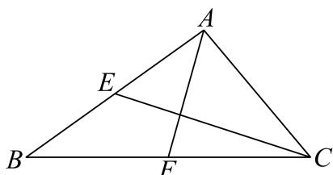

由题意得，在等腰 $\triangle ABC$ 中， $A = \frac{\pi}{2}$

且 $E, F$ 分别为 $AB, BC$ 的中点，

则 $\overrightarrow{AF} = \frac{1}{2}\left(\overrightarrow{AB} +\overrightarrow{AC}\right)$ ， $\overrightarrow{CE} = \overrightarrow{AE} -\overrightarrow{AC} = \frac{1}{2}\overrightarrow{AB} -\overrightarrow{AC}$

由平面向量的减法法则可得 $\overrightarrow{BC} = \overrightarrow{AC} - \overrightarrow{AB}$ ,

而 $\lambda\overrightarrow{AF}+\mu\overrightarrow{CE}=\frac{\lambda}{2}\left(\overrightarrow{AB}+\overrightarrow{AC}\right)+\mu\left(\frac{1}{2}\overrightarrow{AB}-\overrightarrow{AC}\right)=\left(\frac{\lambda}{2}+\frac{\mu}{2}\right)\overrightarrow{AB}+\left(\frac{\lambda}{2}-\mu\right)\overrightarrow{AC}$ 则 $\frac{\lambda}{2}+\frac{\mu}{2}=-1,\frac{\lambda}{2}-\mu=1$ ，所以解得 $\lambda=-\frac{2}{3}$ .
故答案为： $-\frac{2}{3}$ .

---

### 青浦 · 原卷第8题

**考点说明：** 空间向量线性表示：利用中点与定比分点逐层分解，化为指定向量的线性组合。

来源：源文件（本地原卷）。原题ID：`2026一模-青浦-08`。

如图，在四面体 $OABC$ 中， $D$ 为 $BC$ 的中点， $3\overrightarrow{AG} = 2\overrightarrow{AD}$ ，且 $P$ 为 $OG$ 的中点，设 $\overrightarrow{OA} = \vec{a}, \overrightarrow{OB} = \vec{b}, \overrightarrow{OC} = \vec{c}$ ，用 $\vec{a}, \vec{b}, \vec{c}$ 表示 $\overrightarrow{OP}$ ，则 $\overrightarrow{OP} = \underline{\hspace{2cm}}$ .

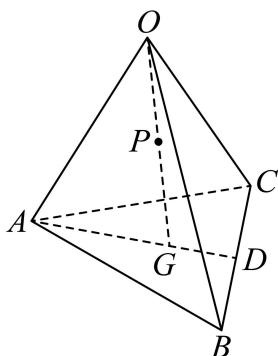

【答案】 $\frac{1}{6}\vec{a} +\frac{1}{6}\vec{b} +\frac{1}{6}\vec{c}$

【解析】

【分析】根据向量的线性运算法则求解.

【详解】因为 $3\overrightarrow{AG} = 2\overrightarrow{AD}$ ，所以 $\overrightarrow{AG} = \frac{2}{3}\overrightarrow{AD}$

所以 $\overrightarrow{OP} = \frac{1}{2}\overrightarrow{OG} = \frac{1}{2}\overrightarrow{OA} +\frac{1}{2}\overrightarrow{AG} = \frac{1}{2}\overrightarrow{OA} +\frac{1}{2}\times \frac{2}{3}\overrightarrow{AD} = \frac{1}{2}\overrightarrow{OA} +\frac{1}{3}\overrightarrow{AD}$ $= \frac{1}{2}\overrightarrow{OA} +\frac{1}{3}\left(\overrightarrow{OD} -\overrightarrow{OA}\right) = \frac{1}{6}\overrightarrow{OA} +\frac{1}{3}\overrightarrow{OD} = \frac{1}{6}\overrightarrow{OA} +\frac{1}{3}\times \frac{1}{2}\left(\overrightarrow{OB} +\overrightarrow{OC}\right)$ $= \frac{1}{6}\overrightarrow{OA} +\frac{1}{6}\overrightarrow{OB} +\frac{1}{6}\overrightarrow{OC} = \frac{1}{6}\vec{a} +\frac{1}{6}\vec{b} +\frac{1}{6}\vec{c}$ 故答案为： $\frac{1}{6}\vec{a} +\frac{1}{6}\vec{b} +\frac{1}{6}\vec{c}$

---

## 4 平面几何中的数量积与最值

### 嘉定 · 原卷第10题

**考点说明：** 平面向量数量积最值：设直线OP上动点的参数，展开数量积并求二次函数最小值。

来源：源文件（本地原卷）。原题ID：`2026一模-嘉定-10`。

已知向量 $\overrightarrow{OA} = (1, 7)$ ， $\overrightarrow{OB} = (5, 1)$ ， $\overrightarrow{OP} = (2, 1)$ ，K 为直线 OP 上的一个动点，当 $\overrightarrow{KA} \cdot \overrightarrow{KB}$ 取最小值时，向量 $\overrightarrow{OK}$ 的坐标为 \_\_\_\_.

【答案】(4,2)

【解析】

【分析】由题意设 $\overrightarrow{OK}=k\overrightarrow{OP}=(2k,k)$ ，根据数量积的坐标表示计算 $\overrightarrow{KA}\cdot\overrightarrow{KB}=5(k-2)^{2}-8$ ，即可求解.

【详解】因为 K 为直线 OP 上的一个动点，所以 $\overrightarrow{OK}$ 与 $\overrightarrow{OP}$ 共线，设 $\overrightarrow{OK}=k\overrightarrow{OP}=(2k,k)$ ，
所以 $\overrightarrow{KA}\cdot\overrightarrow{KB}=\left(\overrightarrow{OA}-\overrightarrow{OK}\right)\cdot\left(\overrightarrow{OB}-\overrightarrow{OK}\right)=\left(1-2k,7-k\right)\cdot\left(5-2k,1-k\right)$

$$
= (1 - 2 k) (5 - 2 k) + (7 - k) (1 - k) = 5 (k - 2) ^ {2} - 8,
$$

所以当 k=2 时， $\overrightarrow{KA}\cdot\overrightarrow{KB}$ 取最小值，此时 $\overrightarrow{OK}=(4,2)$ .

故答案为： $(4,2)$

---

### 奉贤 · 原卷第11题

**考点说明：** 向量模的几何意义：把两条模条件分别识别为圆和椭圆，再研究两图形上点的最大距离。

来源：源文件（本地原卷）。原题ID：`2026一模-奉贤-11`。

在平面中， $\vec{e}_1$ 和 $\vec{e}_2$ 是互相垂直的单位向量，向量 $\vec{a}$ 满足 $\left|\vec{a} - 6\vec{e}_1\right| = 1$ ，向量 $\vec{b}$ 满足 $\left|\vec{b} - 6\vec{e}_1\right| + \left|\vec{b} - 8\vec{e}_2\right| = 20$ ，则 $\left|\vec{a} - \vec{b}\right|$ 的最大值是 \_\_\_\_.

【答案】16

【解析】

【分析】根据模长值得出圆的轨迹，再根据模长关系得出椭圆，最后应用圆与椭圆的位置关系得出最值即可.

【详解】因为 $\overrightarrow{e_1}$ 和 $\overrightarrow{e_2}$ 是互相垂直的单位向量，所以设 $\overrightarrow{e_1} = (1,0),\overrightarrow{e_2} = (0,1)$

向量 $\vec{a}$ 满足 $\left|\vec{a} - 6\vec{e}_1\right| = 1$ ，表示以 $(6,0)$ 为圆心，半径为1的圆，

$\left|\overrightarrow{6e_1} - 8\overrightarrow{e_2}\right| = \sqrt{36 + 64 - 96\overrightarrow{e_1}\cdot\overrightarrow{e_2}} = 10$ ，向量 $\vec{b}$ 满足 $\left|\vec{b} -6\overrightarrow{e_1}\right| + \left|\vec{b} -8\overrightarrow{e_2}\right| = 20$

表示长轴为 $2a = 20$ ，焦距 $2c = 10$ 的椭圆，且 $(6,0)$ 为椭圆的一个焦点，

因为 $\left|\vec{a}-\vec{b}\right|$ 表示以 $(6,0)$ 为圆心，半径为1的圆上的点到椭圆上的点距离，

则 $\left|\vec{a} -\vec{b}\right|_{\max} = a + c + 1 = 10 + 5 + 1 = 16.$

故答案为：16.

---

### 崇明 · 原卷第11题

**考点说明：** 平面向量线性运算与轨迹最值：将目标向量转为中点相关向量，结合等边三角形条件研究定点到中点轨迹的最短距离。

来源：源文件（本地原卷）。原题ID：`2026一模-崇明-11`。

在平面直角坐标系 $xOy$ 中， $\left|\overrightarrow{OA}\right| = \left|\overrightarrow{OB}\right| = \left|\overrightarrow{AB}\right| = \sqrt{3}$ 。设 $C(1,2)$ ，则 $\left|2\overrightarrow{CA} + \overrightarrow{AB}\right|$ 的最小值是 \_\_\_\_.

【答案】 $2 \sqrt{5} - 3$

【解析】

【分析】根据条件，可得 $\triangle OAB$ 为等边三角形，设 AB 的中点为 D，可求出 $\left|OD\right|$ ，分析可得以 D 点轨迹是以 O 为圆心， $\frac{3}{2}$ 为半径的圆，根据线性运算法则，可得 $\left|2\overrightarrow{CA}+\overrightarrow{AB}\right|=2\left|\overrightarrow{CD}\right|$ ，根据点与圆的位置关系，分析求解，即可得答案.

【详解】因为 $\left|\overrightarrow{OA}\right|=\left|\overrightarrow{OB}\right|=\left|\overrightarrow{AB}\right|=\sqrt{3}$ ，所以 $\triangle OAB$ 为等边三角形，

设 $AB$ 的中点为 $D$ ，连接 $OD$ ，则 $\left|OD\right| = \sqrt{3}\cos \frac{\pi}{6} = \frac{3}{2}$

所以 $D$ 点轨迹是以 $O$ 为圆心， $\frac{3}{2}$ 为半径的圆，则方程为 $x^{2} + y^{2} = \frac{9}{4}$

所以 $\left|2\overrightarrow{CA}+\overrightarrow{AB}\right|=\left|\overrightarrow{CA}+\overrightarrow{CA}+\overrightarrow{AB}\right|=\left|\overrightarrow{CA}+\overrightarrow{CB}\right|=2\left|\overrightarrow{CD}\right|$

因为 $C(1,2)$ ，所以 $\left|CD\right|_{\min} = \left|CO\right| - \frac{3}{2} = \sqrt{1^2 + 2^2} - \frac{3}{2} = \sqrt{5} - \frac{3}{2}$ ，

所以 $\left|2\overrightarrow{CA} +\overrightarrow{AB}\right|$ 的最小值为 $2\sqrt{5} -3$

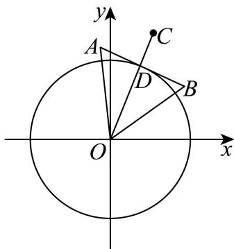

故答案为： $2 \sqrt{5} - 3$

---

### 普陀 · 原卷第11题

**考点说明：** 数量积约束与向量和：把垂直条件转化为圆轨迹，利用正六边形对称性化简向量和并求最值。

来源：源文件（本地原卷）。原题ID：`2026一模-普陀-11`。

设 $P$ 是边长为 1 的正六边形 $A_{1}A_{2}A_{3}A_{4}A_{5}A_{6}$ 所在平面上的一点，若点 $A_{1}, A_{2}, P$ 满足 $\overrightarrow{PA_1} \cdot \overrightarrow{PA_2} = 0$ ，则 $\left|\sum_{i=1}^{6} \overrightarrow{PA_i}\right|$ 的最小值是 \_\_\_\_.

【答案】 $3\sqrt{3}-3$

【解析】

【分析】根据给定条件，建立平面直角坐标系，由 $\overrightarrow{PA_{1}}\cdot\overrightarrow{PA_{2}}=0$ 可得点 P 的轨迹，再利用中点向量公式可得 $\sum_{i=1}^{6}\overrightarrow{PA_{i}}=6\overrightarrow{PO}$ ，并利用圆的性质求出最小值.

【详解】以正六边形 $A_{1}A_{2}A_{3}A_{4}A_{5}A_{6}$ 的中心 O 为原点，直线 $A_{3}A_{6}$ 为 x 轴建立平面直角坐标系，

由 $A_{1}A_{2} = 1$ ，得 $\gamma$ 轴交 $A_{1}A_{2}$ 于点 $B_{1}(0, - \frac{\sqrt{3}}{2})$ ，交 $A_{4}A_{5}$ 于点 $B_{2}(0,\frac{\sqrt{3}}{2})$

由 $\overrightarrow{PA_1} \cdot \overrightarrow{PA_2} = 0$ ，得 $P$ 在以线段 $A_1A_2$ 为直径的圆上，圆心为 $B_1$ ，半径为 $\frac{1}{2}$ ，

因此 $\sum_{i=1}^{6}\overrightarrow{PA_i} = (\overrightarrow{PA_1} +\overrightarrow{PA_2}) + (\overrightarrow{PA_3} +\overrightarrow{PA_6}) + (\overrightarrow{PA_4} +\overrightarrow{PA_5}) = 2\overrightarrow{PB_1} +2\overrightarrow{PO} +2\overrightarrow{PB_2}$

$$
= 2 \left(\overrightarrow {P B _ {1}} + \overrightarrow {P B _ {2}}\right) + 2 \overrightarrow {P O} = 6 \overrightarrow {P O}
$$

则 $|\sum_{i=1}^{6}\overrightarrow{PA_{i}}|=6|\overrightarrow{PO}|\geq6(\frac{\sqrt{3}}{2}-\frac{1}{2})=3\sqrt{3}-3$

当且仅当 $P$ 是圆 $B_{1}$ 与线段 $OB_{1}$ 的交点时取等号，

所以 $|\sum_{i=1}^{6}\overrightarrow{PA_{i}}|$ 的最小值是 $3\sqrt{3}-3$

故答案为： $3\sqrt{3} - 3$

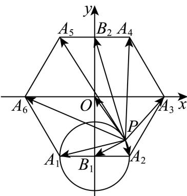

---

### 金山 · 原卷第10题

**考点说明：** 向量数量积与正交投影：由模和夹角关系识别垂直分量，求变参数向量模的最小值。

来源：源文件（本地原卷）。原题ID：`2026一模-金山-10`。

已知非零向量 $\vec{a}$ 、 $\vec{b}$ 的夹角为 $\theta$ ，若 $\frac{\left|\vec{b}\right|}{\left|\vec{a}\right|} = \cos \theta, \left|\vec{a} - \vec{b}\right| = 3$ ，则 $\left|\vec{a} - t\vec{b}\right| (t \in \mathbb{R})$ 的最小值为 \_\_\_\_.

【答案】3

【解析】

【分析】将 $\left|\vec{a}-t\vec{b}\right|$ 平方后利用二次函数的性质可求其最小值.

【详解】因为 $\frac{\left|\vec{b}\right|}{\left|\vec{a}\right|}=\cos\theta,\left|\vec{a}-\vec{b}\right|=3$ ，

故 $9 = |\vec{a} -\vec{b}|^2 = \vec{a}^2 -2\vec{a}\cdot \vec{b} +\vec{b}^2 = \vec{a}^2 -2|\vec{a} |\cdot |\vec{b} |\cos \theta +\vec{b} ^2$

$$
= \vec {a} ^ {2} - 2 | \vec {a} | \cdot | \vec {b} | \cdot \frac {| \vec {b} |}{| \vec {a} |} + \vec {b} ^ {2} = \vec {a} ^ {2} - \vec {b} ^ {2},
$$

$$
\left| \vec {a} - t \vec {b} \right| ^ {2} = \vec {a} ^ {2} - 2 t \vec {a} \cdot \vec {b} + t ^ {2} \vec {b} ^ {2} = \vec {a} ^ {2} - 2 t | \vec {a} | \cdot | \vec {b} | \cdot \frac {| \vec {b} |}{| \vec {a} |} + t ^ {2} \vec {b} ^ {2} = \vec {a} ^ {2} - 2 t | \vec {b} | ^ {2} + t ^ {2} \vec {b} ^ {2}
$$

$$
= \vec {b} ^ {2} (t - 1) ^ {2} + \vec {a} ^ {2} - \vec {b} ^ {2} = \vec {b} ^ {2} (t - 1) ^ {2} + 9
$$

故当 $t = 1$ 时， $\left|\vec{a} - t\vec{b}\right|^2$ 的最小值为9，

故 $\left|\vec{a}-t\vec{b}\right|$ 最小值为3.

故答案为：3.

---

### 闵行 · 原卷第9题

**考点说明：** 平面向量数量积最值：把动点在外接圆上的运动转化为指定方向的投影范围。

来源：源文件（本地原卷）。原题ID：`2026一模-闵行-09`。

若点P是边长为 1 的正三角形ABC外接圆上的一点，则 ${ \overrightarrow { P A } } { \cdot } { \overrightarrow { B C } }$ 的最大值为

【答案】$\frac { \sqrt { 3 } } { 3 }$
【解析】如图所示：以 O 为原点建立平面直角坐标系，

${ \cal A } \left( 0 , \frac { \sqrt { 3 } } { 3 } \right)$ 1 3 1 3 3 3 $\mathsf { D } \big ( 0 , \mathsf { \Omega } _ { 0 } \big )$ i ，B 2 6 C 2， 6 ，P 3 cosθ， 3 sinθ

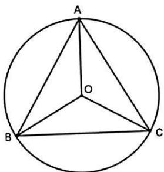

$\overrightarrow { \mathrm { P A } } = \left( - \frac { \sqrt { 3 } } { 3 } \mathrm { c o s } \theta , ~ \frac { \sqrt { 3 } } { 3 } - \frac { \sqrt { 3 } } { 3 } \mathrm { s i n } \theta \right)$ ，BC = 1，0 ，

所以， $\overrightarrow { \mathrm { P A } } \cdot \overrightarrow { \mathrm { B C } } = - \frac { \sqrt { 3 } } { 3 } \mathrm { c o s } \theta$ ，所以当 cosθ=-1 时， ${ \overrightarrow { P A } } { \cdot } { \overrightarrow { B C } }$ 的最大值为 $\frac { \sqrt { 3 } } { 3 }$

---

### 静安 · 原卷第11题

**考点说明：** 圆上动点与向量数量积：利用定弦长约束动点位置，参数化或分解向量求数量积范围。

来源：源文件（本地原卷）。原题ID：`2026一模-静安-11`。

如图, 已知 $AB$ 是半圆 $O$ 的直径, 直径长为 2 , 点 $C, D$ 均在半圆 $O$ 上, 且都不与点 $A, B$ 重合, $A, B, C, D$ 四点依次按照逆时针方向排列. 若 $CD$ 的长为 $\sqrt{2}$ , 则 $\overrightarrow{AC} \cdot \overrightarrow{BD}$ 的取值范围为 \_\_\_\_.

【答案】 $\left[-1 - \sqrt{2}, - 2\right)$

【解析】

【分析】连接 OC, OD，设 $\angle COB = \theta$ ，利用转化法结合辅助角公式及三角函数的性质计算即可.

【详解】

连接 OC, OD，由 $CD = \sqrt{2}$ , AB = 2，

$$
O D = 1 = O C, \therefore D O ^ {2} + C O ^ {2} = C D ^ {2}, \therefore \angle D O C = \frac {\pi}{2}
$$

设 $\angle COB = \theta$ ，则 $\theta$ 为锐角，且 $\angle DOA = \frac{\pi}{2} -\theta$

$$
\overrightarrow {A C} \cdot \overrightarrow {B D} = (\overrightarrow {O C} - \overrightarrow {O A}) \cdot (\overrightarrow {O D} - \overrightarrow {O B}) = 0 - \cos \theta - \cos \left(\frac {\pi}{2} - \theta\right) - 1
$$

$$
= - 1 - \sqrt {2} \sin \left(\theta + \frac {\pi}{4}\right)
$$

由于 $\theta +\frac{\pi}{4}\in \left(\frac{\pi}{4},\frac{3\pi}{4}\right)$ ，所以 $\sin \left(\theta +\frac{\pi}{4}\right)\in \left(\frac{\sqrt{2}}{2},1\right],$

即 $\overrightarrow{AC} \cdot \overrightarrow{BD}$ 的取值范围为 $\left-1 - \sqrt{2}, -2\right)$ .

故答案为： $\left[-1 - \sqrt{2}, - 2\right)$

---

### 黄浦 · 原卷第16题

**考点说明：** 平面向量数量积最值：对正方形内的两个动点设坐标，将数量积转为代数式，并结合坐标范围及取等条件求最值。

来源：[源文件（本地原卷）。原题ID：`2026一模-黄浦-16`。

已知点 $P(-5,0)$ ， $Q_1$ ， $Q_2 \in \{(x,y) | |x| \leq 1, |y| \leq 1\}$ ，则 $\overrightarrow{PQ_1} \cdot \overrightarrow{PQ_2}$ 的取值范围是（）A. [15,36] B. [15,37] C. [16,36] D.

[16,37]

【答案】B

【解析】

【分析】设 $Q_{1}(x_{1},y_{1}),Q_{2}(x_{2},y_{2})$ ，则 $\overrightarrow{PQ_{1}}\cdot\overrightarrow{PQ_{2}}=(x_{1}+5)(x_{2}+5)+y_{1}y_{2}$ .由题求出 $(x_{1}+5)(x_{2}+5)$ ， $y_{1}y_{2}$ 的取值范围，根据不等式的性质，可得 $\overrightarrow{PQ_{1}}\cdot\overrightarrow{PQ_{2}}$ 的取值范围.
【详解】设 $Q_{1}(x_{1},y_{1}),Q_{2}(x_{2},y_{2})$ ，则 $\overrightarrow{PQ_{1}}\cdot\overrightarrow{PQ_{2}}=(x_{1}+5,y_{1})\cdot(x_{2}+5,y_{2})=(x_{1}+5)(x_{2}+5)+y_{1}y_{2}$ 因为 $|x_{1}|\leq1,|x_{2}|\leq1,|y_{1}|\leq1,|y_{2}|\leq1$ ，所以 $-1\leq x_{1}\leq1,-1\leq x_{2}\leq1,-1\leq y_{1}\leq1,-1\leq y_{2}\leq1$ 所以 $4\leq x_{1}+5\leq6,4\leq x_{2}+5\leq6,-1\leq y_{1}y_{2}\leq1$ 所以 $16\leq(x_{1}+5)(x_{2}+5)\leq36$ .
所以 $15\leq(x_{1}+5)(x_{2}+5)+y_{1}y_{2}\leq37$

其中当 $(x_{1} + 5)(x_{2} + 5)$ 与 $y_{1}y_{2}$ 同时取最大值时，即 $x_{1} + 5 = x_{2} + 5 = 6$ 与 $y_{1}y_{2} = 1$ 时， $\overrightarrow{PQ_1}\cdot \overrightarrow{PQ_2}$ 取得最大值，最大值为37.此时，点 $Q_{1},Q_{2}$ 重合，坐标为 $(1,1)$ 或 $(1, - 1)$ . 当 $(x_{1} + 5)(x_{2} + 5)$ 与 $y_{1}y_{2}$ 同时取最小值时，即 $x_{1} + 5 = x_{2} + 5 = 4$ 与 $y_{1}y_{2} = -1$ 时， $\overrightarrow{PQ_1}\cdot \overrightarrow{PQ_2}$ 取得最小值，最小值为15.此时，点 $Q_{1},Q_{2}$ 的坐标分别为 $(-1,1),(-1,-1)$ 或 $(-1,-1),(-1,1)$ .

所以 $\overrightarrow{PQ_1} \cdot \overrightarrow{PQ_2}$ 的取值范围是[15,37].

故选：B.

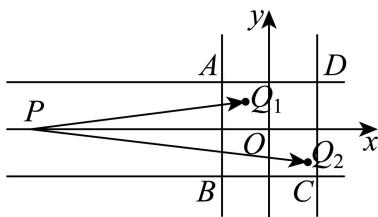

---

### 青浦 · 原卷第12题

**考点说明：** 双曲线轨迹与向量投影：由距离差识别动点轨迹，结合圆上点的投影范围求最值。

来源：源文件（本地原卷）。原题ID：`2026一模-青浦-12`。

在平面直角坐标系中，O 为坐标原点. 已知点 $A(0,2)$ , $B(2,0)$ , $C(-2,0)$ ，若 $|PC| - |PB| = 2\sqrt{2}$ , $|QA| = 1$ ，则向量 $\overrightarrow{OQ}$ 在向量 $\overrightarrow{OP}$ 方向上的数量投影的取值范围是 \_\_\_\_.

【答案】 $(- \sqrt{2} - 1, \sqrt{2} + 1)$

【解析】

【分析】根据条件，结合双曲线的定义、圆的定义，可得点 P、Q 的轨迹方程，由题意，即求 $\overrightarrow{OA}$ 在向量 $\overrightarrow{OP}$ 方向上的数量投影再加减半径即可，设 $P(x,y)$ ，根据数量投影的公式，代入化简，分析计算，即可得答案.

【详解】因为 $|BC|=4$ ， $|PC|-|PB|=2\sqrt{2}<4$ ，

所以点 P 的轨迹为双曲线的右支，且 $2a = 2\sqrt{2}, c = 2$ ，

所以 $b^{2}=c^{2}-a^{2}=2$ ，则点P的方程为 $\frac{x^{2}}{2}-\frac{y^{2}}{2}=1(x\geq\sqrt{2})$

因为 $A(0,2)$ ，且 $\left|QA\right|=1$ ，

所以点 $Q$ 的轨迹是以 $A$ 为圆心，1为半径的圆，

所以 Q 的方程为 $x^{2}+(y-2)^{2}=1$ ，

要求向量 $\overrightarrow{OQ}$ 在向量 $\overrightarrow{OP}$ 方向上的数量投影，

只需求 $\overrightarrow{OA}$ 在向量 $\overrightarrow{OP}$ 方向上的数量投影再加减半径即可，

设 $P(x,y)$ ， $x^{2} - y^{2} = 2,(x\geq \sqrt{2})$

所以 $\overrightarrow{OA}$ 在向量 $\overrightarrow{OP}$ 方向上的数量投影为 $\frac{\overrightarrow{OA} \cdot \overrightarrow{OP}}{|\overrightarrow{OP}|} = \frac{2y}{\sqrt{x^2 + y^2}} = \frac{2y}{\sqrt{2 + 2y^2}} = \frac{\sqrt{2}y}{\sqrt{1 + y^2}}$

令 $t = \frac{\sqrt{2}y}{\sqrt{1 + y^2}}$ ，则当 $y = 0$ 时， $t = 0$

当 $y \neq 0$ 时， $t^2 = \frac{2y^2}{1 + y^2} = \frac{2}{\frac{1}{y^2} + 1} \in (0, 2)$ ，则 $t \in (-\sqrt{2}, 0) \cup (0, \sqrt{2})$

综上 $t\in (-\sqrt{2},\sqrt{2})$ ，即 $\frac{\overrightarrow{OA}\cdot\overrightarrow{OP}}{\left|\overrightarrow{OP}\right|}\in (-\sqrt{2},\sqrt{2})$

所以 $\overrightarrow{OQ}$ 在向量 $\overrightarrow{OP}$ 方向上的数量投影的取值范围是 $(- \sqrt{2} - 1, \sqrt{2} + 1)$ .

故答案为： $(- \sqrt{2} - 1, \sqrt{2} + 1)$

---

## 5 空间向量的模与夹角

### 嘉定 · 原卷第5题

**考点说明：** 空间向量的模与数量积：利用两两垂直展开向量和的模平方。

来源：源文件（本地原卷）。原题ID：`2026一模-嘉定-05`。

已知空间向量 $\vec{a} \perp \vec{b}$ , $\vec{a} \perp \vec{c}$ , $\vec{b} \perp \vec{c}$ , 且 $|\vec{a}| = |\vec{b}| = |\vec{c}| = 1$ , 则 $|\vec{a} + \vec{b} + \vec{c}| =$ \_\_\_\_.

【答案】 $\sqrt{3}$

【解析】

【分析】首先利用向量的垂直得出 $\vec{a} \cdot \vec{b} = 0$ ， $\vec{a} \cdot \vec{c} = 0$ ， $\vec{b} \cdot \vec{c} = 0$ ，再将 $\left|\vec{a} + \vec{b} + \vec{c}\right|$ 平方即可求解.

【详解】 $\because \vec{a} \perp \vec{b}$ , $\vec{a} \perp \vec{c}$ , $\vec{b} \perp \vec{c}$ , $\therefore \vec{a} \cdot \vec{b} = 0$ , $\vec{a} \cdot \vec{c} = 0$ , $\vec{b} \cdot \vec{c} = 0$ ,

$$
\because \left| \vec {a} \right| = \left| \vec {b} \right| = \left| \vec {c} \right| = 1, \quad \therefore \left| \vec {a} + \vec {b} + \vec {c} \right| ^ {2} = \left| \vec {a} \right| ^ {2} + \left| \vec {b} \right| ^ {2} + \left| \vec {c} \right| ^ {2} + 2 \vec {a} \cdot \vec {b} + 2 \vec {a} \cdot \vec {c} + 2 \vec {b} \cdot \vec {c} = 3,
$$

$\therefore \left|\vec{a} +\vec{b} +\vec{c}\right| = \sqrt{3}.$

故答案为： $\sqrt{3}$

---

### 宝山 · 原卷第12题

**考点说明：** 空间向量数量积与点集最值：将内积约束解释为平面与球面，转化为点集距离问题。

来源：源文件（本地原卷）。原题ID：`2026一模-宝山-12`。

空间中，向量 $\vec{a}, \vec{b}, \vec{c}$ 满足： $|\vec{a}| = 2|\vec{b}| = 3|\vec{c}| = 6$ ，且 $\vec{a}, \vec{b}, \vec{c}$ 的两两夹角都是 $60^{\circ}$ ，对于向量 $\vec{e}_{1}, \vec{e}_{2}$ ，若 $\vec{c} \cdot \vec{e}_{1} = 12, (\vec{e}_{2} - \vec{a}) \cdot (\vec{e}_{2} - \vec{b}) = 0$ ，则 $|\vec{e}_{1} - \vec{e}_{2}|$ 的最小值是 \_\_\_\_.

【答案】 $\frac{15 - 6\sqrt{3}}{4}$

【解析】

【分析】先利用已知条件求出相关向量的模及数量积，分析可知点 M 的轨迹是与 OC 垂直的平面，记为平面 $\alpha$ ，点 N 的轨迹是以线段 AB 为直径的球，且 $\left|\overrightarrow{e_{1}}-\overrightarrow{e_{2}}\right|$ 即为平面 $\alpha$ 上的点 M 与球 $O_{1}$ 上的点 N 之间的距离，求球心 $O_{1}$ 到平面 $\alpha$ 的距离，结合球的性质运算求解即可.
【详解】设 $\vec{a}=\overrightarrow{OA},\vec{b}=\overrightarrow{OB},\vec{c}=\overrightarrow{OC},\vec{e}_{1}=\overrightarrow{OM},\vec{e}_{2}=\overrightarrow{ON}$

因为 $|\vec{a}| = 2|\vec{b}| = 3|\vec{c}| = 6$ ， $\vec{a},\vec{b},\vec{c}$ 的两两夹角都是 $60^{\circ}$

则 $\vec{a} \cdot \vec{b} = 9, \vec{a} \cdot \vec{c} = 6, \vec{b} \cdot \vec{c} = 3$

可得 $|\overrightarrow{BA}| = |\vec{a} -\vec{b}| = \sqrt{|\vec{a}|^2 + |\vec{b}|^2 - 2\vec{a}\cdot\vec{b}} = \sqrt{36 + 9 - 2\times 9} = 3\sqrt{3}$

若 $\vec{c} \cdot \vec{e}_1 = 12$ ，即 $\overrightarrow{OC} \cdot \overrightarrow{OM} = 12$

可知点 M 的轨迹是与 OC 垂直的平面，记为平面 $\alpha$ ，且向量 $\overrightarrow{OM}$ 在 $\overrightarrow{OC}$ 方向上的投影为 $\frac{\overrightarrow{OC}\cdot\overrightarrow{OM}}{\left|\overrightarrow{OC}\right|}=\frac{12}{2}=6,$ 又因为 $\bar{A}N = e_{2} - \vec{a}, \overrightarrow{BN} = e_{2} - \vec{b}$

若 $\left(\overrightarrow{e_2} -\overrightarrow{a}\right)\cdot \left(\overrightarrow{e_2} -\overrightarrow{b}\right) = 0$ ，即 $\overrightarrow{AN}\cdot \overrightarrow{BN} = 0$ ，则 $AN\bot BN$ 可知点 $N$ 的轨迹是以线段 $AB$ 为直径的球，设球心为 $AB$ 的中点 $O_{1}$ ，则 $\overrightarrow{OO_1} = \frac{1}{2}\Bigl (\overrightarrow{OA} +\overrightarrow{OB}\Bigr) = \frac{1}{2}\vec{a} +\frac{1}{2}\vec{b}$ ，半径 $r = \frac{1}{2}\big|AB\big| = \frac{3\sqrt{3}}{2}$ 可知平面 $\alpha$ 的法向量为 $\vec{c}$ ，且 $\left|\vec{e}_1 - \vec{e}_2\right| = \left|\overrightarrow{OM} -\overrightarrow{ON}\right| = \left|\overrightarrow{NM}\right|$ 则 $\left|\vec{e}_1 - \vec{e}_2\right|$ 即为平面 $\alpha$ 上的点 $M$ 与球 $O_{1}$ 上的点 $N$ 之间的距离，因为 $\overline{MO_1} = \overline{OO_1} -\overline{OM} = \frac{1}{2}\vec{a} +\frac{1}{2}\vec{b} -\vec{e}_1$ ，则 $\overline{MO_1}\cdot \overrightarrow{c} = \left(\frac{1}{2}\vec{a} +\frac{1}{2}\vec{b} -\vec{e}_1\right)\cdot \vec{c} = \frac{1}{2}\vec{a}\cdot \vec{c} +\frac{1}{2}\vec{b}\cdot \vec{c} -\vec{e}_1\cdot \vec{c} = 3 + \frac{3}{2} -12 = -\frac{15}{2},$ 可得球心 $O_{1}$ 到平面 $\alpha$ 的距离为： $d = \frac{\left|\overrightarrow{MO_1}\cdot\vec{c}\right|}{\left|\vec{c}\right|} = \frac{15}{4},$ 且 $d = \frac{15}{4} >r = \frac{3\sqrt{3}}{2}$ ，所以 $\left|\vec{e}_1 - \vec{e}_2\right|$ 的最小值为 $d - r = \frac{15}{4} -\frac{3\sqrt{3}}{2} = \frac{15 - 6\sqrt{3}}{4}.$ 故答案为： $\frac{15 - 6\sqrt{3}}{4}$

---

## 6 向量集合、高维定义与综合判断

### 徐汇 · 原卷第16题

**考点说明：** 高维向量与组合计数：将0-1向量的数量积解释为相应坐标位置的计数，利用组合数和二项式求和判断命题。

来源：源文件（本地原卷）。原题ID：`2026一模-徐汇-16`。

已知 $n \in N$ ，集合 $P_{n} = \left\{\vec{x} \mid \vec{x} = (x_{1}, x_{2}, x_{3}, \cdots, x_{n}), x_{i} \in \{0, 1\}, 1 \leq i \leq n, i \in N\right\}$ （ $\vec{x}$ 为 n 维

向量）若 $\vec{a}=(a_{1},a_{2},a_{3},\cdots,a_{n})\in P_{n}$ ，其中

$a_{i}=1(1\leq i\leq n,i\in\mathbb{N}),\vec{b}=(b_{1},b_{2},b_{3},\cdots,b_{n})\in P_{n}$ ，定义 $\vec{a}\cdot\vec{b}=\sum_{i=1}^{n}a_{i}b_{i}$ ，设满足 $\vec{a}\cdot\vec{b}=m$ 的 $\vec{b}$ 的个数为 $f(m)$ . 关于下列两个命题的判断: ①当 n=3 时, 则 $\sum_{m=0}^{3}f(m)=8$ ; ②当 n=2k,
k 是正整数时, 则 $\sum_{m=0}^{n-1}f(m)=2^{n-1}$ . 说法正确的是（）

A. ①和②均为真命题

B. ①和②均为假命题

C. ①为真命题，②为假命题

D. ①为假命题，②为真命题

【答案】C

【解析】

【分析】先通过 $\vec{a}$ 的全 1 结构，确定 $\vec{a}\cdot\vec{b}$ 对应 $\vec{b}$ 中 1 的个数，得 $f(m)=C_{n}^{m}$ ；验证命题①时代入 n=3 满足和为 8，命题②利用二项式定理计算和并举例验证其不成立.

【详解】由 $\vec{a}=(1,1,\ldots,1)\in P_{n}$ ，得 $\vec{a}\cdot\vec{b}=\sum_{i=1}^{n}a_{i}b_{i}=\sum_{i=1}^{n}b_{i}$ ，即 $\vec{a}\cdot\vec{b}$ 的值为向量 $\vec{b}$ 中分量 1 的个数，

故 $f(m)$ 为 $P_{n}$ 中分量 1 的个数为 m 的向量个数，即 $f(m)=C_{n}^{m}$ .

对于命题①：当 n=3 时， $\sum_{m=0}^{3}f(m)=C_{3}^{0}+C_{3}^{1}+C_{3}^{2}+C_{3}^{3}=1+3+3+1=8$ . 故命题①成立.

对于命题②：当 n=2k （k 为正整数）时， $\sum_{m=0}^{n-1}f(m)=\sum_{m=0}^{2k-1}C_{2k}^{m}$ .

由二项式定理， $\sum_{m=0}^{2k}C_{2k}^{m}=2^{2k}$ ，故 $\sum_{m=0}^{2k-1}C_{2k}^{m}=2^{2k}-C_{2k}^{2k}=2^{2k}-1$ .

而 $2^{n-1}=2^{2k-1}$ ，取 k=1 （即 n=2），左边 =1+2=3，右边 =2， $3\neq2$ ，故命题②不成立.

故选：C

---

### 金山 · 原卷第12题

**考点说明：** 向量集合与组合计数：先确定平行四边形产生的不同向量，再对四元子集的交集限制建立上界并构造。

来源：源文件（本地原卷）。原题ID：`2026一模-金山-12`。

已知四边形 $A_{1} A_{2} A_{3} A_{4}$ 为平行四边形，集合

$\Omega=\left\{\overrightarrow{A_{i}A_{j}}\mid i\neq j,i,\quad j\in\left\{1,2,3,4\right\}\right\},\quad M_{1},M_{2},\cdots,M_{k}$ 均为集合 $\Omega$ 的四元子集，若对于任意 $m,n\in\left\{1,2,\cdots,k\right\}$ ，当 $m\neq n$ 时， $M_{m}\cap M_{n}$ 中的元素个数都不超过 2 个，则正整数 k 的最大值为 ______.

【答案】14

【解析】

【分析】由题意可得 $\Omega$ 中共 8 个元素，记为 $\Omega = \{a_{1}, a_{2}, a_{3}, a_{4}, a_{5}, a_{6}, a_{7}, a_{8}\}$ ，假设 $M_{m} \cap M_{n}$ 中最大交集为 $\{a_{1}, a_{2}\}$ ，从而可得含 $\{a_{1}, a_{2}\}$ 的四元集合最多有 $\frac{6}{2} = 3$ 个，

且对 $\{a_{1},a_{2}\}$ 在 $M_{1},M_{2},\cdots,M_{k}$ 中最多出现 3 次，求得一个四元集中出现 $C_{4}^{2}=6$ 个二元数对，从而可得 $6k\leq28\times3$ ，求解即可.

【详解】由题意可知 $\Omega=\left\{\overrightarrow{A_{1}A_{2}},\overrightarrow{A_{1}A_{3}},\overrightarrow{A_{1}A_{4}},\overrightarrow{A_{2}A_{1}},\overrightarrow{A_{2}A_{4}},\overrightarrow{A_{3}A_{1}},\overrightarrow{A_{3}A_{2}},\overrightarrow{A_{4}A_{2}}\right\}$ 共8个元素，

记为 $\Omega = \{a_{1}, a_{2}, a_{3}, a_{4}, a_{5}, a_{6}, a_{7}, a_{8}\}$

假设 $M_{m} \cap M_{n}$ 中最大交集为 $\{a_1, a_2\}$ ,

所以含 $\{a_{1}, a_{2}\}$ 的四元集合中剩下的两个元素不能相同，

因为 $\Omega$ 中共8个元素，则还剩下6个元素，

所以 $M_{1}, M_{2}, \cdots, M_{k}$ 中，含 $\{a_{1}, a_{2}\}$ 的四元集合最多有 $\frac{6}{2} = 3$ 个，即数对 $\{a_{1},a_{2}\}$ 在 $M_{1},M_{2},\cdots,M_{k}$ 中最多出现 3 次，
同理任何一个二元数对 $\{a_{1},a_{2}\}$ 可在 $M_{1},M_{2},\cdots,M_{k}$ 中最多出现 3 次，
所以一个四元集中出现 $C_{4}^{2}=6$ 个二元数对，
所以 k 个四元集中共出现 6k 次，
因为 $\{a_{1},a_{2},a_{3},a_{4},a_{5},a_{6},a_{7},a_{8}\}$ 中最多有 $C_{8}^{2}=28$ 种不同的二元数对，每个最多出现 3 次，
所以 $6k \leq 28 \times 3$ ，解得 $k \leq 14$ .
所以正整数 k 的最大值为 14.

故答案为：14

---

### 长宁 · 原卷第12题

**考点说明：** 空间向量线性组合：通过不同符号组合的模平方估计最大值，再寻找达到界的向量配置。

来源：源文件（本地原卷）。原题ID：`2026一模-长宁-12`。

已知集合 $\Omega = \left\{\vec{w} \mid \vec{w} = \lambda \vec{e}_1 + \mu \vec{e}_2 + \gamma \vec{e}_3, \lambda, \mu, \gamma \in \{-1, 1\}\right\}$ ，若对于空间中任意单位向量 $\vec{e}_1, \vec{e}_2, \vec{e}_3$ ，都存在 $\vec{d} \in \Omega$ ，使得 $|\vec{d}| \geq r$ ，则实数 $r$ 的最大值为 \_\_\_\_.

【答案】 $\sqrt{3}$

【解析】

【分析】根据存在性问题分析可知 $\left|\vec{d}\right|_{\max} \geq r$ ，结合题意以及空间向量的数量积运算可得 $\left|\vec{d}\right|_{\max} = \sqrt{3 + 2\cos\alpha + 2\cos\beta + 2\cos\theta}$ ，结合任意性分析可知 $\left(\left|\vec{d}\right|_{\max}\right)_{\min} \geq r$ ，进而分析求解.

【详解】若存在 $\vec{d} \in \Omega$ ，使得 $|\vec{d}| \geq r$ ，则 $\left|\vec{d}\right|_{\max} \geq r$ ，

设 $\left\langle \overrightarrow{e_1},\overrightarrow{e_2}\right\rangle = \alpha ,\left\langle \overrightarrow{e_2},\overrightarrow{e_3}\right\rangle = \beta ,\left\langle \overrightarrow{e_1},\overrightarrow{e_3}\right\rangle = \theta$ ，且 $\alpha ,\beta ,\theta \in [0,\pi ]$

则 $\left|\overrightarrow{e_1}\right| = \left|\overrightarrow{e_2}\right| = \left|\overrightarrow{e_3}\right| = 1$ ， $\vec{e}_1\cdot \vec{e}_2 = \cos \alpha ,\vec{e}_2\cdot \vec{e}_3 = \cos \beta ,\vec{e}_1\cdot \vec{e}_3 = \cos \theta$

因为 $\vec{d} \in \Omega$ ，可设 $\vec{d} = \lambda \vec{e}_1 + \mu \vec{e}_2 + \gamma \vec{e}_3, \lambda, \mu, \gamma \in \{-1, 1\}$ ，

则 $\vec{d}^2 = (\lambda \vec{e}_1 + \mu \vec{e}_2 + \gamma \vec{e}_3)^2 = \lambda^2\vec{e}_1^2 +\mu^2\vec{e}_2^2 +\gamma^2\vec{e}_3^2 +2\lambda \mu \vec{e}_1\cdot \vec{e}_2 + 2\mu \gamma \vec{e}_2\cdot \vec{e}_3 + 2\lambda \gamma \vec{e}_1\cdot \vec{e}_3$ $= 3 + 2\lambda \mu \cos \alpha +2\mu \gamma \cos \beta +2\lambda \gamma \cos \theta ,$

因为 $\lambda \mu, \mu \gamma, \lambda \gamma \in \{-1, 1\}$ , $\cos \alpha, \cos \beta, \cos \theta \in [-1, 1]$ ,

注意到符号性不妨设 $\alpha, \beta, \theta \in \left[0, \frac{\pi}{2}\right]$ ，则 $\cos \alpha, \cos \beta, \cos \theta \in [0,1]$ ，

可得 $\vec{d}^2 = 3 + 2\lambda \mu \cos \alpha + 2\mu \gamma \cos \beta + 2\lambda \gamma \cos \theta \leq 3 + 2\cos \alpha + 2\cos \beta + 2\cos \theta$

当且仅当 $\lambda \mu = \mu \gamma = \lambda \gamma = 1$ 时，等号成立，

可知 $\left|\vec{d}\right|_{\max}=\sqrt{3+2\cos\alpha+2\cos\beta+2\cos\theta}$

又因为对于空间中任意单位向量 $\overrightarrow{e_1},\overrightarrow{e_2},\overrightarrow{e_3}$ ，都存在 $\vec{d}\in \Omega$ ，使得 $\left|\vec{d}\right|\geq r$

则 $\left(\left|\vec{d}\right|_{\max}\right)_{\min} \geq r$ ，即 $\left(\sqrt{3 + 2\cos\alpha + 2\cos\beta + 2\cos\theta}\right)_{\min} \geq r$

且 $\cos \alpha, \cos \beta, \cos \theta \in [0,1]$ ，可得 $\sqrt{3 + 2\cos\alpha + 2\cos\beta + 2\cos\theta} \geq \sqrt{3}$ ，

当且仅当 $\cos\alpha=\cos\beta=\cos\theta=0$ 时，等号成立，即 $\left(\left|\vec{d}\right|_{\max}\right)_{\min}=\sqrt{3}$

可得 $r \leq \sqrt{3}$ ，所以实数 $r$ 的最大值为 $\sqrt{3}$ .

故答案为： $\sqrt{3}$

---

## 7 向量与直线、圆锥曲线综合

### 崇明 · 原卷第15题

**考点说明：** 向量数量积与轨迹：以定点所在直线建立坐标，把垂足向量关系转化为二次曲线方程，按参数判断可能轨迹。

来源：源文件（本地原卷）。原题ID：`2026一模-崇明-15`。

已知 A, B 为平面内两定点, 过该平面内动点 M 作直线 AB 的垂线, 垂足为 N. 若$\overrightarrow{MN}^2 = \lambda \overrightarrow{AN} \cdot \overrightarrow{NB}$ ，其中 $\lambda$ 为常数，则动点 $\mathsf{M}$ 的轨迹不可能是（）A.圆 B.椭圆 C.抛物线 D.双曲线

【答案】C

【解析】

【详解】试题分析：以 AB 所在直线为 x 轴，AB 中垂线为 y 轴，建立坐标系，

设 M (x, y), A (-a, 0)、B (a, 0);

因为 $\overrightarrow{MN}^2 = \lambda \overrightarrow{AN} \cdot \overrightarrow{NB}$ ，所以 $y^2 = \lambda (x + a)(a - x)$ ，即 $\lambda x^2 + y^2 = \lambda a^2$ ，当 $\lambda = 1$ 时，轨迹是圆。当 $\lambda > 0$ 且 $\lambda \neq 1$ 时，是椭圆的轨迹方程；当 $\lambda < 0$ 时，是双曲线的轨迹方程；当 $\lambda = 0$ 时，是直线的轨迹方程；综上，方程不表示抛物线的方程。故选 C.

考点：轨迹方程的求法,圆锥曲线方程。

点评：中档题，判断轨迹是什么，一般有两种方法，一是定义法，二是求轨迹方程后加以判断。

---

### 崇明 · 原卷第20题

**考点说明：** 第（1）问：由椭圆标准方程求焦距与离心率。 第（2）问：平面向量数量积与椭圆方程：利用点坐标及焦点坐标确定动点和直线方程。 第（3）问：椭圆焦点弦与斜率定值：利用直线和椭圆联立、根与系数关系证明；注意斜率及分母的定义条件。

来源：源文件（本地原卷）。原题ID：`2026一模-崇明-20`。

已知椭圆 $\Gamma: \frac{x^2}{2} + y^2 = 1$ ， $F_1, F_2$ 分别是 $\Gamma$ 的左右焦点，点 $A, B, C, D$ 均在 $\Gamma$ 上，且点 $A$ 是第一象限点，直线 $AB$ 经过点 $F_1$ ，直线 $AC, BD$ 均经过点 $F_2$ .

（1）求椭圆 $\Gamma$ 的离心率；

(2) 若 $\overrightarrow{F_{1}A} \cdot \overrightarrow{F_{2}A} = \frac{1}{2}$ ，直线 AB 的方程；

（3）求证： $\frac{k_{CD}}{k_{AB}}$ 为定值.

【答案】(1) $\frac{\sqrt{2}}{2}$

(2) $\sqrt{2} x - 4y + \sqrt{2} = 0$

(3) 5

【解析】

【分析】（1）根据题意，求得 $a = \sqrt{2}, b = 1$ ，得到 $c = \sqrt{a^2 - b^2} = 1$ ，结合椭圆离心率的定义，即可求解；

(2) 设 $A(x_{1}, y_{1})$ ，得到 $\frac{x_{1}^{2}}{2} + y_{1}^{2} = 1$ ，由 $\overrightarrow{F_{1}A} \cdot \overrightarrow{F_{2}A} = \frac{1}{2}$ ，代入求得 $A(1, \frac{\sqrt{2}}{2})$ ，结合 $k_{AB} = k_{AF}$ ，结合直线的点斜式方程，即可求解；

（3）设 $AB$ 的方程为 $y = k(x + 1)$ ，联立方程组求得 $x_{1} + x_{2} = -\frac{4k^{2}}{1 + 2k^{2}}, x_{1}x_{2} = \frac{2(k^{2} - 1)}{1 + 2k^{2}}$ ，再设 $AC$ 的方程为 $x = ty + 1$ ，联立方程组，求得 $x_{3} = \frac{3x_{1} - 4}{2x_{1} - 3}$ ， $y_{3} = \frac{y_{1}}{2x_{1} - 3}$ ，同理求得 $x_{4} = \frac{3x_{2} - 4}{2x_{2} - 3}$ ， $y_{4} = \frac{y_{2}}{2x_{2} - 3}$ ，结合 $y_{1} = k(x_{1} + 1), y_{2} = k(x_{2} + 1)$ ，化简得到 $k_{CD} = 5k$ ，即可得证.

【小问 1 详解】

解：由椭圆 $\Gamma : \frac{x^2}{2} + y^2 = 1$ ，可得 $a^2 = 2, b^2 = 1$ ，则 $a = \sqrt{2}, b = 1$ ，

所以 $c = \sqrt{a^2 - b^2} = 1$ ，所以椭圆 $\Gamma$ 的离心率为 $e = \frac{c}{a} = \frac{\sqrt{2}}{2}$

【小问 2 详解】

解：由（1）知，椭圆 $\Gamma$ 的左焦点 $F_{1}(-1,0)$ , $F_{2}(1,0)$ ,

设 $A(x_{1},y_{1})$ ，其中 $x_{1} > 0,y_{1} > 0$ ，则 $\frac{x_1^2}{2} +y_1^2 = 1$

则向量 $\overrightarrow{F_{1}A}=(x_{1}+1,y_{1}),\overrightarrow{F_{2}A}=(x_{1}-1,y_{1})$ ，可得 $\overrightarrow{F_{1}A}\cdot\overrightarrow{F_{2}A}=x_{1}^{2}-1+y_{1}^{2}=\frac{1}{2}$

将 $y_{1}^{2} = 1 - \frac{x_{1}^{2}}{2}$ 代入得 $x_{1}^{2} - 1 + (1 - \frac{x_{1}^{2}}{2}) = \frac{1}{2}$ ，解得 $x_{1} = 1$ ，则 $y_{1} = \frac{\sqrt{2}}{2}$ ，即 $A(1, \frac{\sqrt{2}}{2})$ ，

可得 $k_{AB} = k_{AF} = \frac{\frac{\sqrt{2}}{2} - 0}{1 - (-1)} = \frac{\sqrt{2}}{4},$

又由 $AB$ 过点 $F_{1}$ ，所以 $AB$ 的方程为 $y - 0 = \frac{\sqrt{2}}{4} (x + 1)$ ，即 $\sqrt{2} x - 4y + \sqrt{2} = 0$ .

【小问 3 详解】

证明：设直线 AB 的斜率为 k，则方程为 $y = k(x + 1)$ ，联立方程组 $\left\{ \begin{array}{l} y = k(x + 1) \\ \frac{x^2}{2} + y^2 = 1 \end{array} \right.$ ，整理得 $(1 + 2k^2)x^2 + 4k^2x + 2k^2 - 2 = 0$ ，设 $A(x_1, y_1), B(x_2, y_2)$ ，可得 $x_1 + x_2 = -\frac{4k^2}{1 + 2k^2}, x_1x_2 = \frac{2(k^2 - 1)}{1 + 2k^2}$ ，由直线 $AC$ 过 $F_2(1,0)$ ，设其直线方程为 $x = ty + 1$ ，联立方程组 $\left\{ \begin{array}{l} x = ty + 1 \\ \frac{x^2}{2} + y^2 = 1 \end{array} \right.$ ，整理得 $(t^2 + 2)y^2 + 2ty - 1 = 0$ ，设 $C(x_3, y_3)$ ，可得 $y_1y_3 = -\frac{1}{t^2 + 2}$ ，因为 $A(x_1, y_1)$ 在直线 $AC$ 上，可得 $t = \frac{x_1 - 1}{y_1}$ ，化简得 $y_3 = \frac{y_1}{2x_1 - 3}$ ，则 $x_3 = \frac{3x_1 - 4}{2x_1 - 3}$ ，同理可得：设 $D(x_4, y_4)$ ，可得 $y_4 = \frac{y_2}{2x_2 - 3}$ ，则 $x_4 = \frac{3x_2 - 4}{2x_2 - 3}$ ，又因为 $y_1 = k(x_1 + 1), y_2 = k(x_2 + 1)$ ，又由 $k_{CD} = \frac{y_4 - y_3}{x_4 - x_3} = \frac{\frac{y_2}{2x_2 - 3} - \frac{y_1}{2x_1 - 3}}{\frac{3x_2 - 4}{2x_2 - 3} - \frac{3x_1 - 4}{2x_1 - 3}} = \frac{\frac{k(x_2 + 1)}{2x_2 - 3} - \frac{k(x_1 + 1)}{2x_1 - 3}}{\frac{3x_2 - 4}{2x_2 - 3} - \frac{3x_1 - 4}{2x_1 - 3}} = 5k$ ，即 $k_{CD} = 5k_{AB}$ ，所以 $\frac{k_{CD}}{k_{AB}} = 5$ 。

---

### 普陀 · 原卷第9题

**考点说明：** 向量坐标与点线距离：利用平移向量建立点的坐标关系，再用点到直线的距离公式。

来源：源文件（本地原卷）。原题ID：`2026一模-普陀-09`。

设 $m \in R$ ，直线 $l: 2x + y + m = 0$ 经过点 P，若向量 $\overrightarrow{PQ} = (1, 3)$ ，则点 Q 到直线 l 的距离为 \_\_\_\_.

【答案】 $\sqrt{5}$

【解析】

【分析】设出点 P 的坐标，并求出点 Q 的坐标，再利用点到直线距离公式求解.

【详解】由直线 $l:2x+y+m=0$ 经过点 P，设 $P(t,-2t-m)$ ，

由向量 $\overrightarrow{PQ}=(1,3)$ ，得 $Q(1+t,3-2t-m)$ ，

所以点 $Q$ 到直线 $l$ 的距离 $h = \frac{|2(1 + t) + 3 - 2t - m + m|}{\sqrt{2^2 + 1^2}} = \sqrt{5}$ .

故答案为： $\sqrt{5}$

---

### 普陀 · 原卷第20题

**考点说明：** 第（1）问：利用矩形几何关系、椭圆坐标与焦距关系求离心率。 第（2）问：运用椭圆定义和弦长表达周长，分析动弦周长最值并确定椭圆参数。 第（3）问：联立直线与椭圆，利用根与系数关系及向量共线比例求定比和三角形面积。

来源：源文件（本地原卷）。原题ID：`2026一模-普陀-20`。

设 $a > 2, m \in \mathbb{R}, k, t$ 是不全为零的实数，椭圆 $\Gamma: \frac{x^2}{a^2} + \frac{y^2}{4} = 1, F_1, F_2$ 分别为 $\Gamma$ 的左、右两个焦点，直线 $l: kx + ty + m = 0$ 与 $\Gamma$ 交于 $A, B$ 两点， $O$ 为坐标原点.

（1）若 $k=0, t+m=0$ ，且四边形 $ABF_{1}F_{2}$ 为矩形，求 $\Gamma$ 的离心率；

（2）若 t=0，且 $\triangle F_{1}AB$ 的周长的最大值为 12，求 $\Gamma$ 的方程；

（3）若 $a = 4, t = -1, \lambda > 0$ ，直线 $OA$ 与 $OB$ 的斜率之积为 $-\frac{1}{4}$ ， $C$ 为 $OA$ 上的一点，且 $\overrightarrow{OA} = \overrightarrow{AC}$ ，直线 $BC$ 与椭圆 $\Gamma$ 交于点 $D$ ，且 $\overrightarrow{BD} = \lambda \overrightarrow{DC}$ ，求 $\lambda$ 的值以及 $\triangle ABD$ 的面积 $S$ 的值.

【答案】(1) $\frac{\sqrt{3}}{2}$

(2) $\frac{x^{2}}{9}+\frac{y^{2}}{4}=1.$

(3) $\lambda = \frac{2}{3}, S_{\triangle ABD} = \frac{8}{5}$

【解析】

【分析】（1）求出 $\left|AB\right|=\sqrt{3}a$ ，根据题意得到 $\sqrt{3}a=2c$ ，从而求出离心率；

（2）根据 $\left|AF_1\right| + \left|BF_1\right| + \left|AB\right|\leq \left|AF_1\right| + \left|BF_1\right| + \left|AF_2\right| + \left|BF_2\right|$ ，再由题意可求出 $a = 3$ ，即可求出方程；

（3）设 $A(x_{1},y_{1}),B(x_{2},y_{2}),D(x_{0},y_{0})$ ，根据题目信息求出 $D\left(\frac{x_2 + 2\lambda x_1}{1 + \lambda},\frac{y_2 + 2\lambda y_1}{1 + \lambda}\right)$

将点 D 代入椭圆方程并化简得到

$4\lambda^{2}\left(\frac{x_{1}^{2}}{16}+\frac{y_{1}^{2}}{4}\right)+\left(\frac{x_{2}^{2}}{16}+\frac{y_{2}^{2}}{4}\right)+\frac{\lambda}{4}\left(x_{1}x_{2}+4y_{1}y_{2}\right)=\left(1+\lambda\right)^{2}$ ，根据点A,B均在 $\Gamma$ 上以及 $k_{OA}\cdot k_{OB}=-\frac{1}{4}$ 得到 $4\lambda^{2}+1=\left(1+\lambda\right)^{2}$ ，解方程即可求出 $\lambda$ ；根据题目信息及求出的 $\lambda$ 可得 $S_{\triangle ABD}=\frac{2}{5}S_{\triangle OAB}$ ，求出 $|AB|$ 的长及原点O到直线l的距离，利用三角形面积公式即可求出答案.

【小问 1 详解】

由 $k = 0$ ， $t + m = 0$ 得， $l:y = 1$

将 $y = 1$ 代入椭圆方程得 $\frac{x^2}{a^2} +\frac{1}{4} = 1$ ，解得 $x = \pm \frac{\sqrt{3}}{2} a$ ，则 $\left|AB\right| = \sqrt{3} a$

又四边形 $ABF_{1}F_{2}$ 是矩形，则 $\sqrt{3}a = 2c$ ，即离心率 $e = \frac{c}{a} = \frac{\sqrt{3}}{2}$ .

【小问 2 详解】

由 $t = 0$ 得， $l: x = -\frac{m}{k}$ ，即 $AB \perp x$ 轴，

则 $\left|AF_1\right| + \left|BF_1\right| + \left|AB\right|\leq \left|AF_1\right| + \left|BF_1\right| + \left|AF_2\right| + \left|BF_2\right| = 4a$

当且仅当 $AB$ 过右焦点 $F_{2}$ 时等号成立，即 $\triangle F_{1}AB$ 的周长的最大值为 $4a$ 即 $4a = 12$ ，即 $a = 3$

则 $\Gamma$ 方程为 $\frac{x^{2}}{9} + \frac{y^{2}}{4} = 1$ .

设 $A(x_{1},y_{1}),B(x_{2},y_{2}),D(x_{0},y_{0})$ ,

由 $\overrightarrow{OA} = \overrightarrow{AC}$ 得，点 $C(2x_{1}, 2y_{1})$ ，又 $\overrightarrow{BD} = \lambda \overrightarrow{DC}$ ，

则 $x_0 = \frac{x_2 + 2\lambda x_1}{1 + \lambda}, y_0 = \frac{y_2 + 2\lambda y_1}{1 + \lambda}$ 因为点 $D$ 在 $\Gamma$ 上，所以 $\frac{\left(\frac{x_2 + 2\lambda x_1}{1 + \lambda}\right)^2}{16} + \frac{\left(\frac{y_2 + 2\lambda y_1}{1 + \lambda}\right)^2}{4} = 1$ 则 $4\lambda^2\left(\frac{x_1^2}{16} + \frac{y_1^2}{4}\right) + \left(\frac{x_2^2}{16} + \frac{y_2^2}{4}\right) + \frac{\lambda}{4}(x_1x_2 + 4y_1y_2) = (1 + \lambda)^2,$ 又点 $A, B$ 均在 $\Gamma$ 上，则 $\frac{x_1^2}{16} + \frac{y_1^2}{4} = 1, \frac{x_2^2}{16} + \frac{y_2^2}{4} = 1,$ 由 $k_{OA} \cdot k_{OB} = -\frac{1}{4}$ 得 $\frac{y_1y_2}{x_1x_2} = -\frac{1}{4}$ ，即 $x_1x_2 + 4y_1y_2 = 0$ ，则 $4\lambda^2 + 1 = (1 + \lambda)^2$ ，又 $\lambda > 0$ ，即 $\lambda = \frac{2}{3}$ . 由 $\overrightarrow{BD} = \frac{2}{3}\overrightarrow{DC}, \overrightarrow{OA} = \overrightarrow{AC}$ 得， $S_{\triangle ABD} = \frac{2}{5} S_{\triangle ABC} = \frac{2}{5} S_{\triangle OAB}$ ，又 $a = 4, t = -1$ ，即直线 $l: y = kx + m$ ，由 $\left\{ \begin{array}{l} y = kx + m \\ \frac{x^2}{16} + \frac{y^2}{4} = 1 \end{array} \right.$ 得， $(1 + 4k^2)x^2 + 8kmx + 4m^2 - 16 = 0,$ 则 $x_1 + x_2 = \frac{-8km}{1 + 4k^2}, x_1x_2 = \frac{4m^2 - 16}{1 + 4k^2}$ ，则 $|AB| = \sqrt{1 + k^2}|x_1 - x_2|$ $= \sqrt{1 + k^2}\sqrt{(x_1 + x_2)^2 - 4x_1x_2}$ $= \sqrt{1 + k^2}\sqrt{\left(\frac{-8km}{1 + 4k^2}\right)^2 - 4 \cdot \frac{4m^2 - 16}{1 + 4k^2}}$ $= \frac{4\sqrt{1 + k^2}}{1 + 4k^2}\sqrt{4 + 16k^2 - m^2}$ 由 $x_1x_2 + 4y_1y_2 = 0$ 得， $x_1x_2 + 4y_1y_2 = x_1x_2 + 4(kx_1 + m)(kx_2 + m) = 0$ 即 $(1 + 4k^2)x_1x_2 + 4km(x_1 + x_2) + 4m^2 = 0$ ，即 $(1 + 4k^2)\frac{4m^2 - 16}{1 + 4k^2} - \frac{32k^2m^2}{1 + 4k^2} + 4m^2 = 0$

化简整理得， $m^2 = 8k^2 +2$ ，则 $\left|AB\right| = \frac{4\sqrt{2\left(1 + k^2\right)}}{\sqrt{1 + 4k^2}}$

又原点 $O$ 到直线 $l$ 的距离为 $d = \frac{|m|}{\sqrt{1 + k^2}} = \frac{\sqrt{2(1 + 4k^2)}}{\sqrt{1 + k^2}}$

$$
S _ {\triangle O A B} = \frac {1}{2} \times \frac {4 \sqrt {2 (1 + k ^ {2})}}{\sqrt {1 + 4 k ^ {2}}} \times \frac {\sqrt {2 (1 + 4 k ^ {2})}}{\sqrt {1 + k ^ {2}}} = 4.
$$

则 $S_{\triangle ABD} = \frac{2}{5} S_{\triangle OAB} = \frac{8}{5}$

---

### 杨浦 · 原卷第15题

**考点说明：** 双曲线上动点的向量夹角：结合双曲线两支及渐近线研究角度范围，并判断边界能否达到。

来源：源文件（本地原卷）。原题ID：`2026一模-杨浦-15`。

已知双曲线 $C: \frac{x^2}{4} - \frac{y^2}{9} = 1$ ，点 $M(4,6)$ ，点 $A$ 、 $B$ 分别在双曲线 $C$ 的左、右两支上，则向量 $\overrightarrow{MA}$ 、 $\overrightarrow{MB}$ 的夹角 $\theta$ （）
A. 有最大值，但无最小值 B. 无最大值，但有最小值
C. 既有最大值，又有最小值 D. 既无最大值，又无最小值
【答案】A

【解析】

【分析】根据题意，得到点 M 在双曲线的渐近线 $y=\frac{3}{2}x$ 上，结合双曲线的几何性质，以及向量的夹角的定义，即可求解.
【详解】由双曲线 $C:\frac{x^{2}}{4}-\frac{y^{2}}{9}=1$ ，可得 a=2, b=3，所以双曲线的其中一条渐近线方程为 $y=\frac{3}{2}x$ 则点 $M(4,6)$ 满足渐近线 $y=\frac{3}{2}x$ ，所以点 M 在双曲线的渐近线 $y=\frac{3}{2}x$ 上，
所以过点 M 存在双曲线右支的切线，但不存在与左支相切的直线，
所以向量 $\overrightarrow{MA}, \overrightarrow{MB}$ 的夹角 $\theta$ 不存在最小值，
过点 M 作 x 轴的平行线，交双曲线的左右两支分别为 A, B 两点，此时 $\overrightarrow{MA}, \overrightarrow{MB} = \pi$ ，
因为 $\theta \in [0, \pi]$ ，所以向量 $\overrightarrow{MA}, \overrightarrow{MB}$ 的夹角 $\theta$ 存在最大值，最大值为 $\pi$ ，
综上可得，向量 $\overrightarrow{MA}, \overrightarrow{MB}$ 的夹角 $\theta$ 存在最大值，不存在最小值.
故选：A.

---

### 杨浦 · 原卷第20题

**考点说明：** 第（1）问：根据椭圆焦距关系与离心率公式求半轴参数。 第（2）问：结合垂直平分线和椭圆对称性，建立点的坐标关系求参数。 第（3）问：利用中点和向量定比分别表示相关点，结合椭圆方程和共线关系求直线斜率。

来源：源文件（本地原卷）。原题ID：`2026一模-杨浦-20`。

已知椭圆 $C: \frac{x^2}{a^2} + \frac{y^2}{2} = 1(a > \sqrt{2})$ ，过动点 $M(0, m)$ 的直线交 $x$ 轴于点 $N$ ，交椭圆 $C$ 于 $A$ ， $P$ （点 $P$ 在第一象限），过点 $P$ 作 $x$ 轴的垂线交椭圆 $C$ 于另一点 $Q$ ，延长 $QM$ 交椭圆 $C$ 于点 $B$ .

（1）若椭圆 $C$ 的离心率为 $\frac{\sqrt{3}}{2}$ ，求 $a$ 的值；

（2）已知 $m = \frac{\sqrt{3}}{3}$ ，且 $BQ$ 是线段 $PN$ 的垂直平分线，求 $a$ 的值；

（3）已知 a=2 ，点 M 是线段 PN 的中点，且 $\overrightarrow{QM}=2\overrightarrow{MB}$ ，求直线 AB 的斜率.

【答案】(1) $2 \sqrt{2}$

(2) $\sqrt{3}$

(3) $\frac{\sqrt{6}}{2}$

【解析】

【分析】（1）根据离心率的概念列式求 a 即可.

（2）根据题意，设 $P\left(x_0, \frac{2\sqrt{3}}{3}\right)$ ，则 $N(-x_0, 0)$ ， $Q\left(x_0, -\frac{2\sqrt{3}}{3}\right)$ ，根据 $\overrightarrow{NP} \perp \overrightarrow{MQ}$ 列式可求 $x_0$ 的值，在根据 $P$ 点在椭圆上，可求 $a$ 的值.

（3）根据题意，可求出 P, M, B, A 的坐标，进而求直线 AB 的斜率.

【小问 1 详解】

因为 $a > \sqrt{2} = b$ ，所以 $e^2 = \frac{c^2}{a^2} = \frac{a^2 - b^2}{a^2} = 1 - \frac{2}{a^2}$

因为 $e = \frac{\sqrt{3}}{2}$ ，所以 $1 - \frac{2}{a^2} = \frac{3}{4} \Rightarrow a^2 = 8$ ，又 $a > \sqrt{2}$ ，所以 $a = 2\sqrt{2}$ 。

【小问 2 详解】

因为 $m = \frac{\sqrt{3}}{3}$ ，且 $BQ$ 是线段 $NP$ 的垂直平分线，

所以 $M\left(0, \frac{\sqrt{3}}{3}\right)$ 是线段 $NP$ 的中点.

所以可设 $P\left(x_0, \frac{2\sqrt{3}}{3}\right)$ ，则 $N(-x_0, 0)$ ， $Q\left(x_0, -\frac{2\sqrt{3}}{3}\right)$ .

所以 $\overrightarrow{NP} = \left(2x_0, \frac{2\sqrt{3}}{3}\right)$ , $\overrightarrow{MQ} = (x_0, -\sqrt{3})$ .

由 $\overrightarrow{NP} \perp \overrightarrow{MQ} \Rightarrow \overrightarrow{NP} \cdot \overrightarrow{MQ} = 2x_0^2 - 2 = 0$ .

又点 $P$ 在第一象限，所以 $x_0 > 0$ ，所以 $x_0 = 1$ ，即 $P\left(1, \frac{2\sqrt{3}}{3}\right)$ .

又点 P 在椭圆 $\frac{x^{2}}{a^{2}} + \frac{y^{2}}{2} = 1$ 上，所以 $\frac{1}{a^{2}} + \frac{2}{3} = 1 \Rightarrow a^{2} = 3$ .

又 $a > 0$ ，所以 $a = \sqrt{3}$

【小问 3 详解】

因为 a=2 ，所以椭圆 C： $\frac{x^{2}}{4}+\frac{y^{2}}{2}=1$ .

如图，作出符合题意的图形，

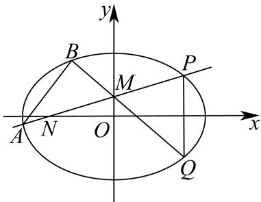

因为点 $M(0,m)$ 是线段 PN 的中点，可设 $P(x_{0},2m)$ ， $N(-x_{0},0)$ ，则 $Q(x_{0},-2m)$ .

设 $B(x_{1},y_{1})$ ，因为 $\overrightarrow{QM} = 2\overrightarrow{MB}\Rightarrow (-x_0,3m) = 2(x_1,y_1 - m)\Rightarrow \left\{ \begin{array}{l}x_{1} = -\frac{x_{0}}{2}\\ y_{1} = \frac{5m}{2} \end{array} \right.$

因为 P, B 都在椭圆 C 上，所以 $\left\{\begin{aligned}\frac{x_{0}^{2}}{4}+\frac{(2m)^{2}}{2}&=1\\ \frac{\left(-\frac{x_{0}}{2}\right)^{2}}{4}+\frac{\left(\frac{5m}{2}\right)^{2}}{2}&=1\end{aligned}\right.\Rightarrow\left\{\begin{aligned}x_{0}^{2}&=\frac{12}{7}\\ m^{2}&=\frac{2}{7}\end{aligned}\right.$

因为点 $P$ 在第一象限，所以 $\left\{ \begin{array}{l} x_0 = \frac{2\sqrt{21}}{7} \\ m = \frac{\sqrt{14}}{7} \end{array} \right.$

所以 $P\left(\frac{2\sqrt{21}}{7}, \frac{2\sqrt{14}}{7}\right)$ , $M\left(0, \frac{\sqrt{14}}{7}\right)$ , $B\left(-\frac{\sqrt{21}}{7}, \frac{5\sqrt{14}}{14}\right)$ .

因为 $k_{MP} = \frac{\frac{\sqrt{14}}{7}}{\frac{2\sqrt{21}}{7}} = \frac{\sqrt{6}}{6}$ ，所以直线 $MP$ 的方程为： $y = \frac{\sqrt{6}}{6} x + \frac{\sqrt{14}}{7}$ .

$$
\left\{ \begin{array}{l} y = \frac {\sqrt {6}}{6} x + \frac {\sqrt {1 4}}{7} \\ \frac {x ^ {2}}{4} + \frac {y ^ {2}}{2} = 1 \end{array} \Rightarrow \frac {1}{3} x ^ {2} + \frac {\sqrt {2 1}}{2 1} x - \frac {6}{7} = 0. \right.
$$

由 $\frac{2\sqrt{21}}{7} \cdot x_A = -\frac{18}{7} \Rightarrow x_A = -\frac{3\sqrt{21}}{7}$ .

所以 $y_{A} = \frac{\sqrt{6}}{6}\times \left(-\frac{3\sqrt{21}}{7}\right) + \frac{\sqrt{14}}{7} = -\frac{\sqrt{14}}{14}.$

可得 $k_{AB} = \frac{\frac{5\sqrt{14}}{14} + \frac{\sqrt{14}}{14}}{-\frac{\sqrt{21}}{7} + \frac{3\sqrt{21}}{7}} = \frac{\sqrt{6}}{2}$ ，即直线 $AB$ 的斜率为 $\frac{\sqrt{6}}{2}$ .

---

### 浦东 · 原卷第20题

**考点说明：** 第（1）问：椭圆标准方程及焦点定义：由半轴求焦距，再利用两焦半径和不变计算焦点三角形周长。 第（2）问：向量数量积的坐标化：将数量积条件与椭圆方程联立，依据上半平面限制确定纵坐标。 第（3）问：焦点弦的面积比与参数范围：由直线截距和椭圆内点条件限制斜率，结合弦长或根差表达面积比并求范围。

来源：源文件（本地原卷）。原题ID：`2026一模-浦东-20`。

> 核对说明：规范稿伪第1题已排除，规范题号减1。

已知椭圆 $C: \frac{x^2}{9} + \frac{y^2}{8} = 1$ ，点 $O$ 为坐标原点，椭圆的右顶点为 $A$ ，左右焦点分别为 $F_1$ 、 $F_2$ ，点 $E$ 为椭圆在 $x$ 轴上方的一动点.

（1）求椭圆 C 的焦距与 $\triangle EF_{1}F_{2}$ 的周长；

（2）若 $\overrightarrow{EA} \cdot \overrightarrow{EF_1} = \frac{9}{4}$ ，求点 $E$ 到 $x$ 轴的距离；

（3）过点 $F_{1}$ 作斜率为 $k$ 的直线 $l$ 交 $y$ 轴正半轴于点 $P$ ，点 $P$ 位于椭圆内. 直线 $l$ 与椭圆 $C$ 交于 $G$ 、 $H$ 两点，记 $\triangle OGH$ 、 $\triangle OF_{1}P$ 的面积分别为 $S_{1}$ 、 $S_{2}$ ，求 $\frac{S_{1}}{S_{2}}$ 的取值范围.

【答案】（1）焦距为2， $\triangle EF_{1}F_{2}$ 的周长8；

(2) $\sqrt{6}$ ;

(3) $(\frac{9}{5}, 6)$ .

【解析】

【分析】（1）求出椭圆 C 的长短半轴长及半焦距，再结合椭圆定义求解.

（2）由（1）求出点 $A, F_{1}$ 坐标，设出点 $E$ 坐标，再利用数量积的坐标表示列式求解.

（3）设直线 l 的方程为 x=my-1，求出 m 范围，联立直线与椭圆方程，结合韦达定理表示出 $\frac{S_{1}}{S_{2}}$ ，再利用对勾函数单调性求出范围.

【小问 1 详解】

椭圆 $C: \frac{x^2}{9} + \frac{y^2}{8} = 1$ 的长短半轴长分别为 $a = 3, b = 2\sqrt{2}$ ，则半焦距 $c = \sqrt{a^2 - b^2} = 1$ ，所以椭圆 $C$ 的焦距 $2c = 2$ ， $\triangle EF_1F_2$ 的周长 $2a + 2c = 8$ 。

【小问 2 详解】

由（1）得 $A(3,0)$ , $F_{1}(-1,0)$ ，设 $E(x_{0},y_{0})$ , $y_{0}>0$ ，则 $\frac{x_{0}^{2}}{9}+\frac{y_{0}^{2}}{8}=1$ ，即 $y_{0}^{2}=8-\frac{8x_{0}^{2}}{9}$ ， $\overrightarrow{EA}=(3-x_{0},-y_{0}),\overrightarrow{EF_{1}}=(-1-x_{0},-y_{0})$ ，由 $\overrightarrow{EA}\cdot\overrightarrow{EF_{1}}=\frac{9}{4}$ 得 $\overrightarrow{EA}\cdot\overrightarrow{EF_{1}}=(3-x_{0})(-1-x_{0})+y_{0}^{2}=x_{0}^{2}-2x_{0}-3+y_{0}^{2}=\frac{1}{9}x_{0}^{2}-2x_{0}+5=\frac{9}{4}$ 整理得 $4x_{0}^{2}-72x_{0}+99=0$ ，而 $-3<x_{0}<3$ ，解得 $x_{0}=\frac{3}{2}$ ， $y_{0}=\sqrt{6}$ ，点 $E(\frac{3}{2},\sqrt{6})$

所以点 E 到 x 轴的距离为 $\sqrt{6}$ .

【小问3详解】

设直线 $l$ 的方程为 $x = my - 1$ ，因为直线 $l$ 与 $y$ 轴正半轴相交，故 $m \neq 0$ ，

则 $P(0, \frac{1}{m})$ ，由点 $P$ 在 $y$ 轴正半轴上，且位于椭圆内，

得 $0 < \frac{1}{m} < 2\sqrt{2}$ ，即 $m > \frac{\sqrt{2}}{4}$ ，

由 $\left\{\begin{aligned}x&=my-1\\ 8x^{2}&+9y^{2}=72\end{aligned}\right.$ ，消去x得 $(8m^{2}+9)y^{2}-16my-64=0$ ，

$\Delta = 256m^{2} + 256(8m^{2} + 9) > 0$ ，设 $G(x_{1},y_{1}),H(x_{2},y_{2})$ ，则

$$
y _ {1} + y _ {2} = \frac {1 6 m}{8 m ^ {2} + 9}, y _ {1} y _ {2} = \frac {- 6 4}{8 m ^ {2} + 9},
$$

$$
\left| y _ {1} - y _ {2} \right| = \sqrt {\left(y _ {1} + y _ {2}\right) ^ {2} - 4 y _ {1} y _ {2}} = \sqrt {\left(\frac {1 6 m}{8 m ^ {2} + 9}\right) ^ {2} + \frac {2 5 6}{8 m ^ {2} + 9}} = \frac {4 8 \sqrt {m ^ {2} + 1}}{8 m ^ {2} + 9},
$$

$$
S _ {1} = S _ {\triangle O G H} = \frac {1}{2} | O F _ {1} | \cdot | y _ {1} - y _ {2} | = \frac {1}{2} | y _ {1} - y _ {2} |, S _ {2} = S _ {\triangle O F _ {1} P} = \frac {1}{2} | O F _ {1} | \cdot \frac {1}{m} = \frac {1}{2 m},
$$

因此 $\frac{S_1}{S_2} = m|y_1 - y_2| = \frac{48m\sqrt{m^2 + 1}}{8m^2 + 9} = 48\sqrt{\frac{m^2(m^2 + 1)}{(8m^2 + 9)^2}}$ ，令 $m^2 = t > \frac{1}{8}$ ， $\frac{S_1}{S_2} = 48\sqrt{\frac{t(t + 1)}{(8t + 9)^2}}$

而 $f(t) = \frac{t(t + 1)}{(8t + 9)^2} = \frac{1 + \frac{1}{t}}{(8 + \frac{9}{t})^2}$ ，令 $1 + \frac{1}{t} = u \in (1,9)$ ，则 $f(t) = \frac{u}{(9u - 1)^2} = \frac{1}{81u + \frac{1}{u} - 18}$ ，

函数 $y = 81u + \frac{1}{u} - 18$ 在(1,9)上单调递增， $64 < 81u + \frac{1}{u} - 18 < \frac{6400}{9}$ ，

因此 $\frac{9}{6400} < \frac{t(t + 1)}{(8t + 9)^2} < \frac{1}{64}$ , $\frac{3}{80} < \sqrt{\frac{t(t + 1)}{(8t + 9)^2}} < \frac{1}{8}$ , 则 $\frac{9}{5} < \frac{S_1}{S_2} < 6$ ,

所以 $\frac{S_1}{S_2}$ 的取值范围是 $(\frac{9}{5}, 6)$ .

---

### 虹口 · 原卷第20题

**考点说明：** 第（1）问：椭圆焦点三角形周长：将两焦半径之和与焦距相加，并注意三点构成三角形的条件。 第（2）问：直线与椭圆的交点及有向分点比：联立直线和椭圆，结合已知顶点确定另一交点，再由向量方向求比例参数。 第（3）问：椭圆弦中点、向量模等式与定点：将长度条件平方化为数量积关系，结合中点弦方程及定点条件限制动点位置。

来源：源文件（本地原卷）。原题ID：`2026一模-虹口-20`。

已知椭圆 $\Gamma: \frac{x^2}{2} + y^2 = 1$ 的左、右焦点分别为 $F_1$ 和 $F_2$ ，点 $P$ 是 $\Gamma$ 的长轴上的动点，点 $Q$ 为 $\Gamma$ 上的动点，且异于点 $P$ .

（1）当点 P 位于椭圆 $\Gamma$ 的左焦点，且 Q、P、 $F_{2}$ 能构成三角形时，求 $\triangle QPF_{2}$ 的周长；

（2）当点 $P$ 位于椭圆 $\Gamma$ 的左顶点时，直线 $PQ$ 与 $y$ 轴交于点 $B\left(0, \frac{1}{2}\right)$ ， $\overrightarrow{PB} = \lambda \overrightarrow{BQ}$ ，求实数 $\lambda$ 的值；

（3）当点 $P$ 与椭圆 $\Gamma$ 的左、右顶点均不重合时，记直线 $PQ$ 与椭圆 $\Gamma$ 的另一个交点为S，过点 $P$ 作直线 $l$ 与椭圆 $\Gamma$ 交于 $C$ 、 $D$ 两点，设 $M$ 和 $N$ 分别为弦 $QS$ 和弦 $CD$ 的中点，若 $P$ 、 $Q$ 、

$M$ 、 $N$ 为四个相异的点， $\left|\overrightarrow{PM} +\overrightarrow{PN}\right| = \left|\overrightarrow{MN}\right|$ ，且直线 $MN$ 恒过定点 $\left(-\frac{1}{3},0\right)$ ，求点 $P$ 的坐标.

【答案】(1) $2\sqrt{2}+2$

(2) $\frac{3}{5}$

(3) $P\left(-\frac{1}{2},0\right)$

【解析】

【分析】（1）根据焦点三角形的周长计算公式求解出结果；

（2）联立直线 $PB$ 与椭圆方程，求得 $Q$ 点坐标，然后根据纵坐标求得 $\lambda$ 的值；

（3）先判断出 $QS, CD$ 的位置关系，然后通过联立直线与椭圆方程求得中点 $M, N$ 的坐标，由此可表示出直线 $MN$ 的方程，根据直线 $MN$ 过定点可求解出结果.

【小问1详解】

由椭圆方程可知， $a = \sqrt{2}, c = \sqrt{2 - 1} = 1$

所以 $\triangle QPF_{2}$ 的周长为 $C_{\triangle QPF_2} = |QP| + |QF_2| + |PF_2| = 2a + 2c = 2\sqrt{2} +2$

【小问 2 详解】

因为 $P\left(-\sqrt{2},0\right),Q\left(0,\frac{1}{2}\right)$ ，所以 $k_{PQ} = \frac{\frac{1}{2} - 0}{0 - (-\sqrt{2})} = \frac{\sqrt{2}}{4}$ ，则 $PQ:x + \sqrt{2} = 2\sqrt{2} y$ ，即 $PQ:x = 2\sqrt{2} y - \sqrt{2}$

联立 $\left\{ \begin{array}{l} x = 2\sqrt{2} y - \sqrt{2} \\ x^2 + 2y^2 = 2 \end{array} \right.$ ，可得 $10y^{2} - 8y = 0$ ，解得 $y = 0$ 或 $y = \frac{4}{5}$ ，所以 $y_{Q} = \frac{4}{5}$ ，

因为 $\overrightarrow{PB} = \lambda \overrightarrow{BQ}$ ，所以 $y_{B} - y_{P} = \lambda (y_{Q} - y_{B})$

所以 $\lambda=\frac{y_{Q}-y_{B}}{y_{B}-y_{P}}=\frac{\frac{4}{5}-\frac{1}{2}}{\frac{1}{2}-0}=\frac{3}{5}$ ;

【小问 3 详解】

因为 $\left|\overrightarrow{PM}+\overrightarrow{PN}\right|=\left|\overrightarrow{MN}\right|$ ，所以 $\left|\overrightarrow{PM}+\overrightarrow{PN}\right|=\left|\overrightarrow{PN}-\overrightarrow{PM}\right|$ ,

所以 $\overrightarrow{PM}^{2} + \overrightarrow{PN}^{2} + 2\overrightarrow{PM} \cdot \overrightarrow{PN} = \overrightarrow{PM}^{2} + \overrightarrow{PN}^{2} - 2\overrightarrow{PM} \cdot \overrightarrow{PN}$ ,

所以 $\overrightarrow{PM} \cdot \overrightarrow{PN} = 0$ ，所以 $PM \perp PN$ ，所以 $PQ \perp CD$ ;

当 PQ, CD 中有一条直线斜率不存在时，此时一定有一条弦的中点和 P 点重合，故不符合条件；

当 P 为坐标原点时，此时 M, N 均与 P 点重合，故不符合条件；

由上可知， $PQ, CD$ 的斜率都存在，设 $P(m,0)\left(m\in\left[-\sqrt{2},0\right)\cup\left(0,\sqrt{2}\right]\right)$

$$
P Q: y = k (x - m), C D: y = - \frac {1}{k} (x - m),
$$

联立 $\left\{\begin{aligned}y&=k(x-m)\\ x^{2}&+2y^{2}=2\end{aligned}\right.$ ，可得 $\left(1+2k^{2}\right)x^{2}-4k^{2}mx+2k^{2}m^{2}-2=0$ ，

所以 $x_{Q} + x_{S} = \frac{4k^{2}m}{1 + 2k^{2}}$ ，所以 $\frac{x_Q + x_S}{2} = \frac{2k^2m}{1 + 2k^2}$ ，所以$\frac{y_Q + y_S}{2} = k \cdot \left( \frac{2k^2m}{1 + 2k^2} - m \right) = \frac{-km}{1 + 2k^2}$ ，所以 $M\left( \frac{2k^2m}{1 + 2k^2}, \frac{-km}{1 + 2k^2} \right)$ ，
同理可得 $N\left( \frac{2\left(-\frac{1}{k}\right)^2m}{1 + 2\left(-\frac{1}{k}\right)^2}, \frac{-\left(-\frac{1}{k}\right)m}{1 + 2\left(-\frac{1}{k}\right)^2} \right)$ ，即 $N\left( \frac{2m}{k^2 + 2}, \frac{km}{k^2 + 2} \right)$ ，
所以 $k_{MN} = \frac{\frac{km}{k^2 + 2} - \frac{-km}{1 + 2k^2}}{\frac{2m}{k^2 + 2} - \frac{2k^2m}{1 + 2k^2}} = \frac{3k}{2(1 - k^2)}$ ，所以 $MN: y - \left( -\frac{mk}{1 + 2k^2} \right) = \frac{3k}{2(1 - k^2)} \left( x - \frac{2k^2m}{1 + 2k^2} \right)$ ，
令 $y = 0$ ，解得 $x = \frac{mk}{1 + 2k^2} \cdot \frac{2(1 - k^2)}{3k} + \frac{2k^2m}{1 + 2k^2} = \frac{2m + 4mk^2}{3(1 + 2k^2)} = \frac{2m}{3}$ ，
因为直线 $MN$ 恒过定点 $\left(-\frac{1}{3}, 0\right)$ ，所以 $\frac{2m}{3} = -\frac{1}{3}$ ，所以 $m = -\frac{1}{2}$ ，
所以 $P\left(-\frac{1}{2}, 0\right)$ .

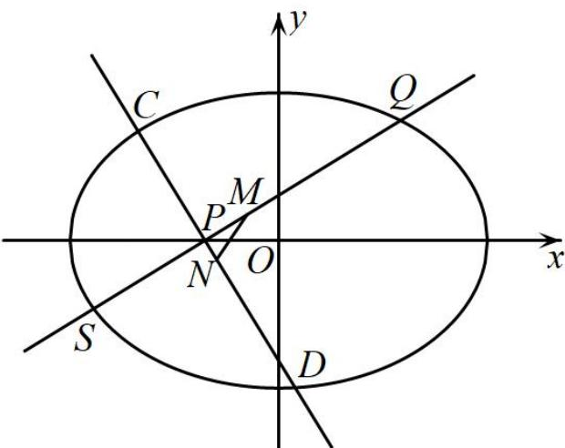

---

### 静安 · 原卷第9题

**考点说明：** 抛物线的焦点与反射性质：由反射点和焦点确定反射光线，再求其法向量。

来源：源文件（本地原卷）。原题ID：`2026一模-静安-09`。

抛物线具有如下的光学性质: 所有平行于抛物线对称轴的入射光线经抛物线反射后都过这条抛物线的焦点; 设抛物线的方程为 $y^{2} = 12x$ , 一束光线从平行于其对称轴方向射向抛物线, 光线所在直线交抛物线 $y^{2} = 12x$ 于一点, 这点的纵坐标为 12, 则这束光线经过抛物线反射后所在直线的一个法向量为 \_\_\_\_.

【答案】(4,-3)，答案不唯一

【解析】

【分析】先求出反射光线所在直线的一个方向向量，然后设反射光线所在直线的法向量为 $\vec{m} = (x_0, y_0)$ ，建立等式求解即可得到答案.

【详解】设入射光线所在直线交抛物线 $y^{2}=12x$ 于点 P，由题意得点 P 坐标为 $(12,12)$ ，设抛物线 $y^{2}=12x$ 的焦点为 $F(3,0)$ ，所以反射光线所在直线的一个方向向量为 $\overrightarrow{FP}=(9,12)$ ，

设反射光线所在直线的法向量为 $\vec{m}=(x_{0},y_{0})$ ,

则 $\overrightarrow{FP}\cdot\overrightarrow{m}=9x_{0}+12y_{0}=0$ ，取 $x_{0}=4$ ，则 $y_{0}=-3$ ，

所以这束光线经过抛物线反射后所在直线的一个法向量为 $(4,-3)$ .

故答案为： $(4,-3)$ ，答案不唯一.

---

### 静安 · 原卷第20题

**考点说明：** 第（1）问：联立焦距条件、双曲线半轴关系与点在曲线上条件，确定方程。 第（2）问：由圆的切线条件确定截距，联立双曲线并用根与系数关系求向量数量积。 第（3）问：利用平行焦点弦的对称关系表示四边形面积，结合交点存在范围确定直线。

来源：源文件（本地原卷）。原题ID：`2026一模-静安-20`。

在平面直角坐标系 $xOy$ 中，已知双曲线 $\Gamma: \frac{x^2}{a^2} - \frac{y^2}{b^2} = 1 (a > 0, b > 0)$ 的焦距为 4，点 $(\sqrt{6}, 1)$ 在 $\Gamma$ 上.

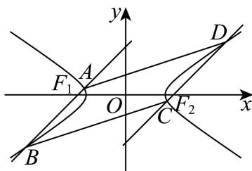

（1）求双曲线 $\Gamma$ 的方程；

（2）设直线 l 的斜率为 $\frac{1}{2}$ ，l 交双曲线 $\Gamma$ 于 P、Q 两点，且与圆 $x^{2} + y^{2} = 4$ 相切，切点位于 x 轴上方，求 $\overrightarrow{OP} \cdot \overrightarrow{OQ}$ 的值；

（3）如图，设过双曲线 $\Gamma$ 的左焦点 $F_{1}$ 的直线 $AB$ 交 $\Gamma$ 的左支于点 $A$ 、 $B$ ，过 $\Gamma$ 的右焦点 $F_{2}$ 的直线 $CD$ 交 $\Gamma$ 的右支于点 $C$ 、 $D$ ，若直线 $CD // AB$ ，且四边形 $ABCD$ 的面积为 $4\sqrt{6}$ ，求直线 $AB$ 的方程.

【答案】（1） $\frac{x^{2}}{3}-y^{2}=1$

(2) -55

(3) $x - y + 2 = 0$ 或 $x + y + 2 = 0$

【解析】

【分析】（1）根据双曲线 $\Gamma$ 的焦距为 4 及点 $(\sqrt{6},1)$ 在 $\Gamma$ 上，列方程即可求得结果；

（2）设直线 $l$ 的方程为 $y = \frac{1}{2} x + m$ ，利用直线 $l$ 与圆相切，求出直线的方程，将直线方程

与双曲线方程联立，利用韦达定理或求出两个交点坐标，从而求得 $\overrightarrow{OP}\cdot\overrightarrow{OQ}$ ;

（3）由双曲线的对称性，易知四边形 ABCD 为平行四边形，设直线 AB 的方程为 $y = k(x + 2)$ （或 x = ky - 2），求出直线 AB 和直线 CD 的距离，再将直线 AB 方程与双曲线方程联立，利用弦长公式求出 $\left|AB\right|$ 的长，根据平行四边形 ABCD 的面积为 $4\sqrt{6}$ 列出方程，求出 k，再根据直线 AB 与双曲线左支有两个交点对结果进行取舍，从而得到答案.

【小问 1 详解】

由双曲线 $\Gamma : \frac{x^2}{a^2} - \frac{y^2}{b^2} = 1 (a > 0, b > 0)$ 的焦距为4，点 $(\sqrt{6}, 1)$ 在 $\Gamma$ 上，

可得 $2c = 4$ ，所以 $c = 2$ ，且 $\frac{6}{a^2} -\frac{1}{b^2} = 1$ ，又因为 $c^2 = a^2 +b^2$ ，即 $a^2 +b^2 = 4$

联立方程组 $\left\{ \begin{array}{l}a^2 +b^2 = 4\\ \frac{6}{a^2} -\frac{1}{b^2} = 1 \end{array} \right.$ ，解得 $a^2 = 3$ ， $b^{2} = 1$ ，所以 $\Gamma$ 的方程为 $\frac{x^2}{3} -y^2 = 1$

【小问 2 详解】

设直线 l 方程为 $y=\frac{1}{2}x+m$ ，代入圆的方程整理得 $\frac{5}{4}x^{2}+mx+m^{2}-4=0$ ，直线与圆相切，
所以判别式 $\Delta = m^{2} - 5m^{2} + 20 = 0$ ，所以 $m^{2} = 5$ ，切点位于 x 轴上方，故 $m = \sqrt{5}$ .

将直线 $y = \frac{1}{2} x + \sqrt{5}$ 代入双曲线 $\Gamma$ 方程，整理得 $\frac{1}{12} x^2 - \sqrt{5} x - 6 = 0$ ，解得 $x = 6\left(\sqrt{5} \pm \sqrt{7}\right)$ ，

P、Q两点的坐标分别为 $(6\sqrt{5}-6\sqrt{7},4\sqrt{5}-3\sqrt{7})$ 、 $(6\sqrt{5}+6\sqrt{7},4\sqrt{5}+3\sqrt{7})$ ,

从而 $\overrightarrow{OP} \cdot \overrightarrow{OQ} = 180 - 252 + 80 - 63 = -55$ ;

另解：由题意设直线 $l$ 方程为 $y = \frac{1}{2} x + m$ ，该直线与圆 $x^{2} + y^{2} = 4$ 相切，

则圆心到直线 l 的距离 $d=\frac{|2m|}{\sqrt{5}}=2$ ，解得 $m=\sqrt{5}$ 。联立 $\left\{\begin{aligned}y&=\frac{1}{2}x+\sqrt{5}\\ \frac{x^{2}}{3}-y^{2}&=1\end{aligned}\right.$ 得

$$
x ^ {2} - 1 2 \sqrt {5} x - 7 2 = 0
$$

设 $P\big(x_1,y_1\big)$ ， $Q\big(x_{2},y_{2}\big)$ ，则 $x_{1} + x_{2} = 12\sqrt{5}$ ， $x_{1}\cdot x_{2} = -72$

$$
\overrightarrow {O P} \cdot \overrightarrow {O Q} = x _ {1} x _ {2} + y _ {1} y _ {2} = x _ {1} x _ {2} + \left(\frac {1}{2} x _ {1} + \sqrt {5}\right) \left(\frac {1}{2} x _ {2} + \sqrt {5}\right) = \frac {5}{4} x _ {1} x _ {2} + \frac {\sqrt {5}}{2} (x _ {1} + x _ {2}) + 5
$$

$$
= \frac {5}{4} \times (- 7 2) + \frac {\sqrt {5}}{2} \times 1 2 \sqrt {5} + 5 = - 5 5
$$

【小问 3 详解】

由题意直线 $AB$ 与 $CD$ 平行，由双曲线的对称性，易知 $AB = CD$ ，四边形ABCD为平行四边形.

当直线 $AB$ 垂直于 $x$ 轴时， $|AB| = \frac{2\sqrt{3}}{3}$ ，此时四边形 $ABCD$ 的面积为 $\frac{8\sqrt{3}}{3}$ ，不合题意，舍去；

设直线 AB 方程为 $y = k(x + 2)$ ，则直线 CD 方程为 $y = k(x - 2)$ ，

直线 AB 和 CD 的距离就是点 $F_{2}$ 到直线 AB 的距离 $d = \frac{|4k|}{\sqrt{1 + k^{2}}}$ ,

设 $A(x_{3},y_{3})$ ， $B(x_4,y_4)$ ，联立方程组 $\left\{ \begin{array}{l} \frac{x^2}{3} - y^2 = 1 \\ y = k(x + 2) \end{array} \right.$ ，整理的

$$
(1 - 3 k ^ {2}) x ^ {2} - 1 2 k ^ {2} x - 1 2 k ^ {2} - 3 = 0
$$

则 $\Delta = 12\left(k^2 + 1\right) > 0$ ，且 $x_3 + x_4 = \frac{12k^2}{1 - 3k^2}$ ， $x_3x_4 = \frac{-12k^2 - 3}{1 - 3k^2}$ ，

又由双曲线的渐近线的方程为 $y = \pm \frac{\sqrt{3}}{3} x$ ，

要使得过 $\Gamma$ 的左焦点 $F_{1}$ 的直线 AB 交 $\Gamma$ 的左支于点 A、B，可得 $k^{2} > \frac{1}{3}$ ， $(x_{1}x_{2} > 0)$ 则

$$
\mid A B \mid = \sqrt {1 + k ^ {2}} \mid x _ {3} - x _ {4} \mid = \sqrt {1 + k ^ {2}} \sqrt {\left(x _ {3} + x _ {4}\right) ^ {2} - 4 x _ {3} x _ {4}}
$$

$$
= \sqrt {1 + k ^ {2}} \sqrt {\left(\frac {1 2 k ^ {2}}{1 - 3 k ^ {2}}\right) ^ {2} + \frac {4 8 k ^ {2} + 2}{1 - 3 k ^ {2}}} = \frac {2 \sqrt {3} (1 + k ^ {2})}{3 k ^ {2} - 1},
$$

所以 $S_{ABCD} = |AB| \times d = \frac{2\sqrt{3}(1 + k^2)}{3k^2 - 1} \times \frac{|4k|}{\sqrt{1 + k^2}} = \frac{8\sqrt{3}|k|\sqrt{1 + k^2}}{3k^2 - 1} = 4\sqrt{6}$ ，化简可得 $7k^4 - 8k^2 + 1 = 0$ ，

解得 $k^2 = \frac{1}{7}$ ，或 $k^2 = 1$ ，因为 $k^2 > \frac{1}{3}$ ，所以 $k^2 = 1$ ，

故直线 AB 的方程为 $x - y + 2 = 0$ 或 $x + y + 2 = 0$ .

另解：设直线 AB 方程为 x = ky - 2，代入双曲线方程得 $\frac{(ky - 2)^{2}}{3} - y^{2} = 1$ ，整理得 $(k^{2} - 3)y^{2} - 4ky + 1 = 0$ ，(因为双曲线的渐近线斜率为 $\frac{\sqrt{3}}{3}$ ，直线 AB 与双曲线左支交于两点，所以 $k^{2} \neq 3$ )

$y_{3}+y_{4}=\frac{4k}{k^{2}-3},\quad y_{3}y_{4}=\frac{1}{k^{2}-3},$ 所以

$$
\left| A B \right| = \sqrt {1 + k ^ {2}} \sqrt {\left(y _ {3} - y _ {4}\right) ^ {2}} = \sqrt {1 + k ^ {2}} \sqrt {\left(y _ {3} + y _ {4}\right) ^ {2} - 4 y _ {3} y _ {4}}
$$

点 $F_{2}$ 到直线 $AB$ 的距离 $d = \frac{4}{\sqrt{1 + k^2}}$

$$
S _ {A B C D} = | A B | \times d = \frac {\sqrt {1 + k ^ {2}}}{| k ^ {2} - 3 |} \times \sqrt {1 2 k ^ {2} + 1 2} \times \frac {4}{\sqrt {1 + k ^ {2}}} = \frac {8 \sqrt {3} \sqrt {1 + k ^ {2}}}{| k ^ {2} - 3 |} = 4 \sqrt {6},
$$

化简可得 $k^{4}-8k^{2}+7=0$ ，解得 $k^{2}=7$ ，或 $k^{2}=1$ ，因为当 $k^{2}=7$ 时，直线 AB 斜率平方 $\frac{1}{k^{2}}<\frac{1}{7}$ ，

此时 AB 与双曲线左支只能交于一点，舍去，所以 $k^{2}=1$ ，

故直线 AB 的方程为 $x - y + 2 = 0$ ，或 $x + y + 2 = 0$ 。

---

## 8 向量方法在其他专题中的应用

### 普陀 · 原卷第8题

**考点说明：** 折叠几何中的线面角：利用两平面垂直确定垂线及斜线的射影，结合三角关系求角。

来源：源文件（本地原卷）。原题ID：`2026一模-普陀-08`。

在 $\triangle ABC$ 中, $A = \frac{\pi}{3}$ , $AB = 2$ , $AC = 5$ , $D$ 为 $AC$ 边上的一点, 且 $AD = 2$ , 现将 $\triangle ABD$ 沿 $BD$ 边折起, 使得点 $A$ 至点 $P$ 的位置, 且满足平面 $PBD \perp$ 平面 $BDC$ , 如图所示, 则直线 $PC$ 与平面 $BDC$ 所成的角的正弦值为 \_\_\_\_.

【答案】 $\frac{\sqrt{3}}{4}$

【解析】

【分析】由 A、AB、AD 得到 $\triangle ABD$ 为等边三角形，取 AD 的中点 O，BD 的中点 H，得到 $AH \perp BD, BO \perp AD$ ，从而得到 $PH \perp BD$ ，由平面 $PBD \perp$ 平面 BDC 得到 $PH \perp$ 平面 BDC，过 O 作 PH 的平行线作为 z 轴，以 O 为原点，OB 为 x 轴，OD 为 y 轴，建系，写坐标，求出 $\overrightarrow{PC}$ 和平面 BDC 的法向量 $\vec{n}$ ，设直线 PC 与平面 BDC 所成的角为 $\alpha$ ，利用数量积求出 $\sin \alpha = \left| \cos \left\langle \overrightarrow{PC}, \vec{n} \right\rangle \right|$ 即可得解.

【详解】∵ $A=\frac{\pi}{3}$ ，AB=2，AD=2，∴△ABD为等边三角形，

取 AD 的中点 O，BD 的中点 H，连接 AH, BO，则 $AH \perp BD, BO \perp AD$ ，现将 $\triangle ABD$ 沿 $BD$ 边折起，使得点 $A$ 至点 $P$ 的位置，则 $PH \perp BD$ ， $\because$ 平面 $PBD \perp$ 平面 $BDC$ ，平面 $PBD \cap$ 平面 $BDC = BD$ ， $PH \perp BD$ ， $\therefore PH \perp$ 平面 $BDC$ ，

过 O 作 PH 的平行线作为 z 轴，以 O 为原点，OB 为 x 轴，OD 为 y 轴，建立空间直角坐标系，如图所示，

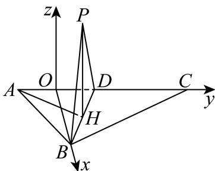

∵△ABD为等边三角形，AB=2，∴AH= $\sqrt{3}$ ,BO= $\sqrt{3}$ ,

$$
\because A C = 5, \therefore O D = 1, O C = 4
$$

$\therefore D(0,1,0), B(\sqrt{3},0,0), C(0,4,0), H(\frac{\sqrt{3}}{2}, \frac{1}{2}, 0), P(\frac{\sqrt{3}}{2}, \frac{1}{2}, \sqrt{3})$

$\therefore \overrightarrow{PC} = (-\frac{\sqrt{3}}{2}, \frac{7}{2}, -\sqrt{3}), \therefore |\overrightarrow{PC}| = 4$

∵平面 BDC 的法向量为 $\vec{n}=(0,0,1)$ ， $|\vec{n}|=1$ ，

设直线 $PC$ 与平面 $BDC$ 所成的角为 $\alpha$ ，

$$
\sin \alpha = \left| \cos \left\langle \overrightarrow {P C}, \vec {n} \right\rangle \right| = \frac {\left| \overrightarrow {P C} \cdot \vec {n} \right|}{\left| \overrightarrow {P C} \right| \cdot | \vec {n} |} = \frac {\sqrt {3}}{4}
$$

故直线 $PC$ 与平面 $BDC$ 所成的角的正弦值 $\frac{\sqrt{3}}{4}$ .

---

### 松江 · 原卷第18题

**考点说明：** 第（1）问：面面垂直与线线垂直：利用等边三角形的高和底面梯形关系构造垂直关系，也可建立空间坐标作数量积证明。 第（2）问：点到平面的距离：用三棱锥体积的等体积转化，或求平面法向量后计算点面距离。

来源：源文件（本地原卷）。原题ID：`2026一模-松江-18`。

已知四棱锥 $P - ABCD$ 的底面 $ABCD$ 是直角梯形， $AB // CD$ ， $AB = 2CD = 2$ ， $\angle ABC = 90^\circ$ ， $\triangle PBC$ 是边长为 2 的正三角形，侧面 $PBC \perp$ 底面 $ABCD$ .

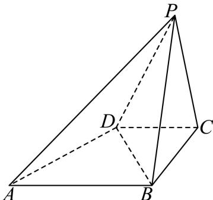

（1）证明： $PA \perp BD$ ;

(2) 求点 D 到平面 PAB 的距离.

【答案】（1）证明见解析

(2) $\sqrt{3}$

【解析】

【分析】（1）建立空间直角坐标系，利用空间向量证明线线垂直.

(2) 利用空间向量求点到平面的距离.

【小问 1 详解】

取 BC 中点 O，AD 中点 E，连接 OP，OE。

因为 $\triangle PBC$ 为等边三角形，所以 $OP \perp BC$

又平面 $PBC \perp$ 平面 ABCD，平面 $PBC \cap$ 平面 ABCD = BC， $OP \subset$ 平面 PBC，

所以 $OP \perp$ 平面ABCD.

$OE \subset$ 平面 $ABCD$ , 所以 $OP \perp OE$ ,

又底面 ABCD 是直角梯形， $\angle ABC = 90^{\circ}$ ，所以 $AB \perp BC$ .

又 O, E 分别为 BC，AD 中点，所以 OE // AB，所以 $OE \perp BC$ .

所以 OE, OB, OP 两两垂直.

故以 $O$ 为原点，建立如图空间直角坐标系，

因为 $AB = BC = 2CD = 2$ ，所以 $P(0,0,\sqrt{3})$ ， $A(2,1,0)$ ， $B(0,1,0)$ ， $D(1, - 1,0)$

所以 $\overrightarrow{PA} = (2,1, - \sqrt{3})$ ， $\overrightarrow{BD} = (1, - 2,0)$

因为 $\overrightarrow{PA} \cdot \overrightarrow{BD} = 2 \times 1 + 1 \times (-2) + (-\sqrt{3}) \times 0 = 0$ .

所以 $\overrightarrow{PA} \perp \overrightarrow{BD}$ ，所以 $PA \perp BD$ .

【小问 2 详解】

由（1）得， $\overrightarrow{BA} = (2,0,0)$ ， $\overrightarrow{BP} = (0, - 1,\sqrt{3})$ ， $\overrightarrow{BD} = (1, - 2,0)$

设平面 PAB 的一个法向量为 $\vec{n}=(x,y,z)$ ,

则 $\left\{ \begin{array}{l} \vec{n} \perp \overrightarrow{BA} \\ \vec{n} \perp \overrightarrow{BP} \end{array} \right. \Rightarrow \left\{ \begin{array}{l} \vec{n} \cdot \overrightarrow{BA} = 2x = 0 \\ \vec{n} \cdot \overrightarrow{BP} = -y + \sqrt{3}z = 0 \end{array} \right.$ ，令 $z = \sqrt{3}$ ，可得 $\vec{n} = (0,3,\sqrt{3})$ 。

所以点 $D$ 到平面 $PAB$ 的距离为： $d = \frac{\left|\vec{n} \cdot \overrightarrow{BD}\right|}{\left|\vec{n}\right|} = \frac{6}{\sqrt{9 + 3}} = \sqrt{3}$ .

---

### 浦东 · 原卷第18题

**考点说明：** 第（1）问：组合几何体中的线面角：由半圆弧中点确定空间位置，用正射影或法向量计算直线与对角截面所成角。 第（2）问：弧长定位与面面平行证明：由半径和弧长确定动点位置，再寻找两个平面内相应平行或同向的独立方向。

来源：源文件（本地原卷）。原题ID：`2026一模-浦东-18`。

> 核对说明：规范稿伪第1题已排除，规范题号减1。

如图, 该几何体由一个棱长为 4 的正方体 $ABCD - A_{1}B_{1}C_{1}D_{1}$ 与一个半圆柱拼接而成, 圆心 $O$ 、 $O_{1}$ 分别为线段 $AB$ 、 $A_{1}B_{1}$ 的中点, 动点 $M$ 在弧 $\widehat{A_{1}B_{1}}$ 上滑动.

（1）若点 M 为弧 $\widehat{A_{1}B_{1}}$ 的中点，求直线 MD 与平面 $BDD_{1}B_{1}$ 所成角的大小；

（2）若弧 $\widehat{A_1M}$ 的长度为 $\frac{\pi}{2}$ ，求证：平面 $OO_{1}M //$ 平面 $ACC_{1}A_{1}$ .

【答案】(1) $\arcsin \frac{\sqrt{7}}{7}$

(2) 证明见解析

【解析】

【分析】（1）建立空间直角坐标系，求得 $\overrightarrow{MD}$ 与平面 $BDD_{1}B_{1}$ 的法向量，通过向量夹角公式求线面角；

（2）由弧长可求得 M 点坐标，进而求得平面 $OO_{1}M$ 和平面 $ACC_{1}A_{1}$ 的法向量，计算即可得到结果.

【小问 1 详解】

建立如图所示空间直角坐标系:

则： $A(0,0,0)$ ， $B(4,0,0)$ ， $D(0,4,0)$ ， $C(4,4,0)$ ， $O(2,0,0)$ ， $O_{1}(2,0,4)$

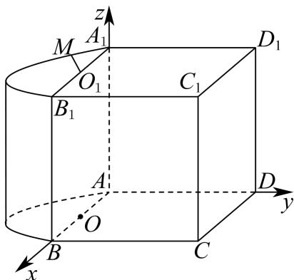

若点 M 为弧 $\widehat{A_{1}B_{1}}$ 的中点，则 $M(2,-2,4)$

所以 $\overrightarrow{MD} = (-2,6, - 4)$

平面 $BDD_{1}B_{1}$ 的一个法向量为 $\vec{m} = \overrightarrow{AC} = (4,4,0)$

所以 $\sin \theta = \cos \vec{m},\overrightarrow{MD} = \left|\frac{\vec{m}\cdot\overrightarrow{MD}}{|\vec{m}|\cdot|\overrightarrow{MD}|}\right| = \left|\frac{16}{4\sqrt{2}\times 2\sqrt{14}}\right| = \frac{\sqrt{7}}{7}$

所以直线 MD 与平面 $BDD_{1}B_{1}$ 所成角的大小 $\arcsin\frac{\sqrt{7}}{7}$

【小问 2 详解】

若弧 $\widehat{A_1M}$ 的长度为 $\frac{\pi}{2}$ ，由弧长得 $\angle MO_{1}A_{1} = \frac{\frac{\pi}{2}}{2} = \frac{\pi}{4}$ ，则 $M(2 - \sqrt{2}, -\sqrt{2}, 4)$

$\overrightarrow{OO_1} = (0,0,4)$ , $\overrightarrow{OM} = (-\sqrt{2}, -\sqrt{2}, 4)$

设平面 $OO_{1}M$ 的一个法向量为 $\vec{n}_{1} = (x,y,z)$ ，平面 $ACC_{1}A_{1}$ 的一个法向量为 $\vec{n}_{2} = \overrightarrow{BD} = (-4,4,0)$

$$
\left\{ \begin{array}{l} \vec {n} _ {1} \cdot \overrightarrow {O O _ {1}} = 0 \\ \vec {n} _ {1} \cdot \overrightarrow {O M} = 0 \end{array} \Rightarrow \left\{ \begin{array}{c} z = 0 \\ x + y = 0 \end{array} \text {令} x = - 1 \right. \right.
$$

$$
\vec {n} _ {1} = (- 1, 1, 0)
$$

所以 $\vec{n}_1 / / \vec{n}_2$

所以平面 $OO_{1}M \parallel$ 平面 $ACC_{1}A_{1}$

---

### 金山 · 原卷第18题

**考点说明：** 第（1）问：平面垂直的判定：结合圆锥轴线垂直底面与底面半径垂直关系。 第（2）问：二面角：构造平面角，或建立空间坐标利用相关向量求角。

来源：源文件（本地原卷）。原题ID：`2026一模-金山-18`。

如图，已知圆锥 $A - O$ ，点 $B$ 、 $C$ 在底面圆周上， $OA = OB = 4$ ，且 $\angle BOC = 90^{\circ}$ ，动点 $P$ 落在劣弧 $BC$ 上.

（1）求证：平面 $AOB \perp$ 平面 AOC；

(2) 若点 $P$ 平分劣弧 $BC$ , 过点 $P$ 分别作 $PD \perp OC$ 、 $PE \perp OB$ , 垂足分别为 $D$ 、 $E$ 两点,

求二面角 $D - AP - E$ 的大小.

【答案】（1）证明见解析.

(2) $\arccos \frac{1}{3}$ .

【解析】

【分析】（1）先证明线面垂直，然后得出面面垂直；

(2) 先建立空间直角坐标系, 通过求平面的法向量解决二面角问题.

【小问 1 详解】

证明：在圆锥 A-O 中， $AO \perp$ 平面 BOC， $\therefore AO \perp OC$

$$
\because \angle B O C = 9 0 ^ {\circ}, \therefore B O \perp O C
$$

∵ $AO \cap BO = O$ , $AO, BO \subset$ 平面 AOC, ∴ OC ⊥ 平面 AOB,

$\because OC \subset$ 平面 AOC

∴平面 $AOB \perp$ 平面 AOC

【小问 2 详解】

以 O 为原点，OC 为 x 轴，OB 为 y 轴，OA 为 z 轴，如图建立空间直角坐标系

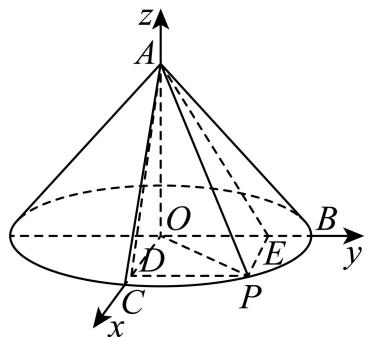

由题意， $D(2\sqrt{2},0,0)$ ， $A(0,0,4)$ ， $P(2\sqrt{2},2\sqrt{2},0)$ ， $E(0,2\sqrt{2},0)$

则 $\overrightarrow{DA} = (-2\sqrt{2},0,4)$ ， $\overrightarrow{DP} = (0,2\sqrt{2},0)$ ， $\overrightarrow{EP} = (2\sqrt{2},0,0)$ ， $\overrightarrow{EA} = (0, - 2\sqrt{2},4)$

设 $\overrightarrow{n_1} = (x_1, y_1, z_1)$ 是平面 $DAP$ 的一个法向量，

则 $\left\{ \begin{array}{l} \overrightarrow{DA} \cdot \overrightarrow{n_1} = -2\sqrt{2} x_1 + 4z_1 = 0 \\ \overrightarrow{DP} \cdot \overrightarrow{n_1} = 2\sqrt{2} y_1 = 0 \end{array} \right.$ ，取 $x_1 = \sqrt{2}$ ，则 $\overrightarrow{n_1} = (\sqrt{2}, 0, 1)$ ，

设 $\overrightarrow{n_2} = (x_2, y_2, z_2)$ 是平面 $APE$ 的一个法向量，

则 $\left\{ \begin{array}{l} \overrightarrow{EP} \cdot \overrightarrow{n_2} = 2\sqrt{2} x_2 = 0 \\ \overrightarrow{EA} \cdot \overrightarrow{n_2} = -2\sqrt{2} y_2 + 4z_2 = 0 \end{array} \right.$ ，取 $y_2 = \sqrt{2}$ ，则 $\overrightarrow{n_2} = (0, \sqrt{2}, 1)$ ，

设平面 DAP 与平面 APE 夹角为 $\theta$ ，

则 $\cos \theta = |\cos < \overrightarrow{n_1},\overrightarrow{n_2} >| = \frac{|\vec{n}_1\cdot\vec{n}_2|}{|\vec{n}_1||\vec{n}_2|} = \frac{1}{\sqrt{3}\cdot\sqrt{3}} = \frac{1}{3},$

∴平面 DAP 与平面 APE 夹角的余弦值为 $\frac{1}{3}$ .

则根据法向量朝向可知二面角 D - AP - E 的大小为 $\arccos\frac{1}{3}$ .

---

### 长宁 · 原卷第11题

**考点说明：** 空间测距与数据充分性：利用底面三角形与仰角恢复高度，判断各组条件是否唯一确定两点距离。

来源：源文件（本地原卷）。原题ID：`2026一模-长宁-11`。

如图, 两塔的塔尖分别为 $M 、 N$ , 塔底分别为 $A 、 B$ , 塔身 $M A 、 N B$ 均垂直水平面 $A B C$ . 已测得 $C$ 与 $A 、 B$ 的距离, 4 名同学分别测得如下 4 组数据:

① $\angle MCA$ , $\angle NCB$ , $\angle ACB$ ; ② $\angle MCA$ , $\angle ACB$ , $\angle MCN$ ;

③ $\angle MCA, \angle NCB, \angle MCN;$ ④ $\angle MCA, \angle ACB, \angle NCA.$

其中不能唯一确定 M 与 N 之间距离的数据的序号有 ______.

【答案】④

【解析】

【分析】将空间几何问题转化为确定塔高 $h_{1}$ 与 $h_{2}$ 的过程，对于每个数据组，首先判断能否由已知角度和已知边长唯一确定水平距离 AB 与两个塔高；若能，则两塔尖的空间坐标唯一确定，距离随之唯一确定，若给出的角度条件不足以唯一确定所有未知的塔高或位置，则存在多解，从而无法唯一确定两塔尖距离.

【详解】①: $\angle MCA, \angle NCB, \angle ACB$

$\angle ACB$ 与 CA, CB 的长度，用余弦定理确定 AB 唯一，

$\angle MCA$ 与 CA 的值，在 $Rt_{\triangle MCA}$ 中 $MA = CA \cdot \tan \angle MCA$ 可确定 MA 唯一，

$\angle NCB$ 与 $CB$ 的值，在 $\mathbf{Rt}_{\triangle}NCB$ 中 $NB = CB \cdot \tan \angle NCB$ 可确定 $NB$ 唯一，

由 $MN = \sqrt{AB^2 + (NB - MA)^2}$ 知 $MN$ 唯一确定.

②: $\angle MCA, \angle ACB, \angle MCN$

$\angle ACB$ 与 CA, CB 的长度，用余弦定理确定 AB 唯一，

$\angle MCA$ 与 $CA$ 的值，在 $\mathbf{Rt}_{\triangle}MCA$ 中 $MA = CA \cdot \tan \angle MCA$ 可确定 $MA$ 唯一， $\angle MCN$ 是点 $C$ 处观测 $M$ 与 $N$ 的夹角，

在 $\triangle MCN$ 中：边 $CM = \sqrt{CA^2 + MA^2}$ （已知）

边 $CN = \sqrt{CB^2 + NB^2}$ （含未知量 $NB$ ）

∠MCN 已知

由余弦定理： $MN^2 = CM^2 +CN^2 -2\cdot CM\cdot CN\cdot \cos \angle MCN$

同时又有： $MN^2 = AB^2 + (MA - NB)^2$

联立 $MN^{2}$ 的表达式，建立关于 NB 的方程，

因函数单调性及物理意义（塔高＞0），通常有且仅有一个正实数解

故可确定 $MN$ 唯一.

③: $\angle MCA, \angle NCB, \angle MCN$

$\angle MCA$ 与 CA 的值，在 $Rt_{\triangle MCA}$ 中 $MA = CA \cdot \tan \angle MCA$ 可确定 MA 唯一，

$\angle NCB$ 与 $CB$ 的值，在 $\mathbf{Rt}_{\triangle}NCB$ 中 $NB = CB \cdot \tan \angle NCB$ 可确定 $NB$ 唯一，

由 $MN^{2}=CM^{2}+CN^{2}-2\cdot CM\cdot CN\cdot\cos\angle MCN$ ，及 $\angle MCN$ 已知，可确定 MN 唯一.

④：由 $\angle MCA, AC$ 可求得 MA；再由 AC, BC, $\angle ACB$ ，可求得 AB；

而 $\left(\overrightarrow{MN}\right)^2 = \left(\overrightarrow{MA} +\overrightarrow{AB} +\overrightarrow{BN}\right)^2 = \left|\overrightarrow{MA}\right|^2 +\left|\overrightarrow{AB}\right|^2 +\left|\overrightarrow{BN}\right|^2 -2\left|\overrightarrow{MA}\right|\left|\overrightarrow{BN}\right|$

故 $MN$ 长度不确定.

故答案为: ④

---

### 长宁 · 原卷第19题

**考点说明：** 第（1）问：利用线面角确定棱锥高度，再由底面积与高求体积。 第（2）问：由线面平行确定动点位置，构造或计算二面角的余弦。

来源：源文件（本地原卷）。原题ID：`2026一模-长宁-19`。

如图，在四棱锥 $P - ABCD$ 中， $PA \perp$ 平面 $ABCD$ ， $AB \perp AD$ ， $AD // BC$ ， $AB = BC = 1$ ， $AD = 2$ ，直线 $PC$ 与平面 $ABCD$ 所成的角的大小为 $\arctan\sqrt{2}$ .

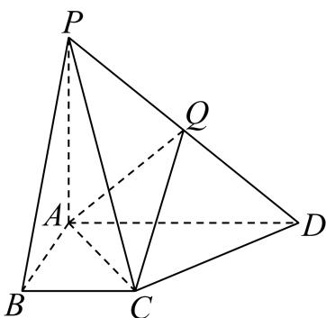

（1）求四棱锥 P-ABCD 的体积；

(2) 点 $Q$ 在线段 $PD$ 上, 直线 $PB //$ 平面 $AQC$ , 求二面角 $Q - AC - D$ 的余弦值.

【答案】(1) 1

(2) $\frac{1}{3}$

【解析】

【分析】（1）根据棱锥的体积公式，结合线面角的定义进行求解即可；

（2）建立空间直角坐标系，利用线面平行的性质、空间向量夹角公式进行求解即可.

【小问 1 详解】

因为 $AB \perp AD$ ，AD // BC，

所以 $AB \perp BC$ ，因此 $AC = \sqrt{AB^2 + BC^2} = \sqrt{1 + 1} = \sqrt{2}$ ，

因为 $PA \perp$ 平面 ABCD，直线 PC 与平面 ABCD 所成的角的大小为 $\arctan\sqrt{2}$ ，

所以 $\tan \left(\arctan \sqrt{2}\right) = \frac{PA}{AC} \Rightarrow PA = \sqrt{2} \times \sqrt{2} = 2$ ，

四棱锥 P-ABCD 的体积为 $\frac{1}{3}\cdot PA\cdot\frac{(BC+AD)}{2}\cdot AB=\frac{1}{3}\times2\times\frac{(1+2)}{2}\times1=1$ ;

【小问 2 详解】

因为 $PA \perp$ 平面 ABCD，AB, AD ⊂ 平面 ABCD,

所以 $PA \perp AB$ ， $PA \perp AD$ ，又因为 $AB \perp AD$ ，

所以可以建立如图所示的空间直角坐标系，

$A(0,0,0),B(1,0,0),C(1,1,0),D(0,2,0),P(0,0,2)$

显然平面 ACD 的法向量为 $\overrightarrow{AP} = (0, 0, 2)$ ,

因为点 $Q$ 在线段 $PD$ 上，所以设

$\overrightarrow{PQ} = \lambda \overrightarrow{PD} \Rightarrow \overrightarrow{PA} + \overrightarrow{AQ} = \lambda (0,2, - 2)(\lambda \in [0,1]) \Rightarrow (0,0, - 2) + \overrightarrow{AQ} = (0,2\lambda , - 2\lambda)$ $\Rightarrow \overrightarrow{AQ} = (0,2\lambda ,2 - 2\lambda)$ ,

设平面 $AQC$ 的法向量为 $\vec{m} = (x,y,z)$ ，又 $\overrightarrow{AC} = (1,1,0)$ ， $\overrightarrow{PB} = (1,0,-2)$ ，

因为直线 $PB \cap$ 平面 ABCD = B，

所以当直线 $PB //$ 平面 $AQC$ ，显然点 $Q$ 不与点 $D$ 重合，

则当 $\lambda \in [0,1)$ 时， $\left\{ \begin{array}{l} \vec{m}\cdot \overrightarrow{AQ} = 0\\ \vec{m}\cdot \overrightarrow{AC} = 0 \end{array} \right.\Rightarrow \left\{ \begin{array}{l} 2\lambda y + (2 - 2\lambda)z = 0\\ x + y = 0 \end{array} \right.$ ，取 $\vec{m} = \left(1, - 1,\frac{\lambda}{1 - \lambda}\right)$

因为直线 $PB //$ 平面 $AQC$ ，

所以 $\overrightarrow{PB}\cdot\overrightarrow{m}=0\Rightarrow1-\frac{2\lambda}{1-\lambda}=0\Rightarrow\lambda=\frac{1}{3}$ ，即 $\vec{m}=\left(1,-1,\frac{1}{2}\right)$ ,

$$
\cos \vec {m}, \overrightarrow {A P} = \frac {\vec {m} \cdot \overrightarrow {A P}}{| \vec {m} | \cdot | \overrightarrow {A P} |} = \frac {1}{\sqrt {1 ^ {2} + (- 1) ^ {2} + \left(\frac {1}{2}\right) ^ {2}} \times 2} = \frac {1}{3},
$$

由图可知二面角 $Q - AC - D$ 是锐二面角，

所以二面角 $Q - AC - D$ 的余弦值为 $\frac{1}{3}$ .

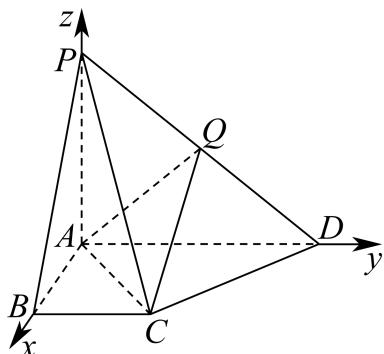

---

### 长宁 · 原卷第20题

**考点说明：** 第（1）问：应用抛物线定义及焦点、准线关系，将焦半径转化为横坐标。 第（2）问：设焦点弦所在直线并联立抛物线，利用根与系数关系及面积公式求解。 第（3）问：联立焦点弦和垂直平分线与抛物线，结合圆的直径所对圆周角条件求直线方程。

来源：源文件（本地原卷）。原题ID：`2026一模-长宁-20`。

已知抛物线 $\Gamma: y^{2} = 4x$ 的焦点为 F，经过点 F 的直线 l 与抛物线 $\Gamma$ 交于 A、B 两点.

（1）设 $|AF|=5$ ，求点A的横坐标；

（2）设 $O$ 为坐标原点，线段 $AB$ 中点的纵坐标为 $\frac{3}{2}$ ，求 $\triangle OAB$ 的面积；

（3）设线段 $AB$ 的垂直平分线与抛物线 $\Gamma$ 交于点 $M$ 、 $N$ ，若以线段 $MN$ 为直径的圆经过点 $A$ 、 $B$ ，求直线 $l$ 的方程.

【答案】(1) 4

(2) $\frac{5}{2}$

(3) $x = \pm y + 1$

【解析】

【分析】（1）根据抛物线的定义及 $\left|AF\right|=5$ ，求出 $x_{1}=4$ ；

（2）设 $A(x_{1},y_{1}),B(x_{2},y_{2})$ ，设直线 $l$ 的直线方程为 $x = my + 1$ ，与抛物线方程联立，根据韦达定理得到 $y_{1} + y_{2} = 4m$ ， $y_{1}y_{2} = -4$ ，再根据中点的纵坐标为 $\frac{3}{2}$ ，可解得结果；

（2）设 $MN:y - 2m = -m(x - 2m^2 -1)$ ， $M(x_{3},y_{3}),N(x_{4},y_{4})$ ，求出

$y_{3}+y_{4}=-\frac{4}{m}\ y_{3}y_{4}=-8m^{2}-12$ ，利用 $\overrightarrow{AN}\cdot\overrightarrow{AM}=0$ 可得结果.

【小问 1 详解】

由抛物线方程知： $F(1,0)$ ，设 $A(x_{1},y_{1})$ ，

由 $\left|AF\right|=5$ 得： $x_{1}+1=5,\therefore x_{1}=4$ .

【小问 2 详解】

由题意知：直线 l 斜率不为零，可设 $l: x = my + 1$ ， $A(x_{1}, y_{1}), B(x_{2}, y_{2})$ ，

由 $\left\{\begin{aligned}y^{2}&=4x\\ x&=my+1\end{aligned}\right.$ 得： $y^{2}-4my-4=0$ ，则 $\Delta=16m^{2}+16>0$ ，

$$
\therefore y _ {1} + y _ {2} = 4 m, \quad y _ {1} y _ {2} = - 4
$$

$\because F(1,0)$ ，又因为 $A,B$ 中点的纵坐标为 $\frac{3}{2}$ ，所以 $y_{1} + y_{2} = 4m = 3$

所以 $\triangle OAB$ 的面积为 $\frac{1}{2} |OF| \times |y_1 - y_2| = \frac{1}{2} \times 1 \times \sqrt{3^2 - 4 \times (-4)} = \frac{1}{2} \times 5 = \frac{5}{2}$ ;

【小问 3 详解】

由题意知：直线 l 斜率不为零，可设 $l: x = my + 1$ ， $A(x_{1}, y_{1}), B(x_{2}, y_{2})$ ，

由 $\left\{ \begin{array}{l} y^{2} = 4x \\ x = my + 1 \end{array} \right.$ 得： $y^{2} - 4my - 4 = 0$ ，则 $\Delta = 16m^2 + 16 > 0$

$\therefore y_{1} + y_{2} = 4m, y_{1}y_{2} = -4$ ，所以 $AB$ 中点为 $(2m^{2} + 1,2m)$

因为线段 $AB$ 的垂直平分线与抛物线 $\Gamma$ 交于点 $M$ 、 $N$ ，设 $MN:y - 2m = -m(x - 2m^2 -1),M(x_3,y_3),N(x_4,y_4)$ 联立 $\left\{ \begin{array}{l}y - 2m = -m(x - 2m^2 -1)\\ y^2 = 4x \end{array} \right.$ 可得 $y^{2} + \frac{4}{m} y - 8m^{2} - 12 = 0$ ，由韦达定理可得 $y_{3} + y_{4} = -\frac{4}{m},y_{3}y_{4} = -8m^{2} - 12,$ 若以线段MN为直径的圆经过点A、B， $\overrightarrow{AM} = (x_3 - x_1,y_3 - y_1),\overrightarrow{AN} = (x_4 - x_1,y_4 - y_1)$ $\therefore \overrightarrow{AM}\cdot \overrightarrow{AN} = (x_3 - x_1)(x_4 - x_1) + (y_3 - y_1)(y_4 - y_1)$ $= \frac{(y_3 - y_1)(y_4 - y_1)}{16}\times [(y_3 + y_1)(y_4 + y_1) + 16] = 0,\quad y_1,y_2$ 不相等， $y_{3},y_{4}$ 不相等，所以 $y_{3}y_{4} + y_{1}(y_{3} + y_{4}) + y_{1}^{2} + 16 = 0$ ，同理 $y_{3}y_{4} + y_{2}(y_{3} + y_{4}) + y_{2}^{2} + 16 = 0$ 可得 $(y_{1} - y_{2})(y_{3} + y_{4}) + y_{1}^{2} - y_{2}^{2} = (y_{1} - y_{2})(y_{3} + y_{4} + y_{1} + y_{2}) = 0,\quad y_{1},y_{2}$ 不相等，所以 $(y_{1} + y_{2}) + (y_{3} + y_{4}) = 4m - \frac{4}{m} = 0$ 即 $m^2 = 1$ ，解得 $m = \pm 1$

所以直线 l 的方程为 $x = \pm y + 1$ .

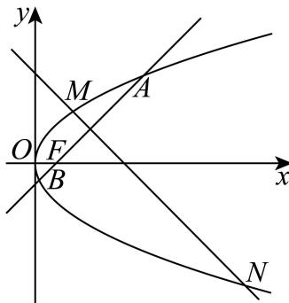

---

### 青浦 · 原卷第16题

**考点说明：** 空间测量与平行投影：根据不同时刻的日影建立长度与方向关系，判断测量信息是否足够。

来源：源文件（本地原卷）。原题ID：`2026一模-青浦-16`。

> 核对说明：规范化稿第16题解析错置，已采用MinerU原稿完整题块，待PDF复核。

16. 如图所示, 水平地面上插有两根杆子 $AB$ 和 $CD$ , $AB$ 所在直线垂直于地面且 $AB = 2$ 米, $CD$ 所在直线与地面斜交. 小明有一把卷尺. 他在某时刻分别测出杆子 $AB$ 和 $CD$ 在阳光下影子的长度, 称为一次操作. 小明可以在白天的不同时刻进行多次操作. 假设阳光为平行光, 正午时分 $AB$ 的影子长度为 0. 则下列说法正确的是 ( )

A. 为求出 $CD$ 的长度, 小明至少需要进行 2 次操作  
B. 为求出 $CD$ 的长度, 小明至少需要进行 3 次操作  
C. 为求出 $CD$ 的长度, 小明至少需要进行 4 次操作  
D. 无论进行多少次操作, 小明都不能求出 $CD$ 的长度

【答案】B

【解析】

【分析】建立坐标系，得到 $\left|CD\right|=\sqrt{a^{2}+b^{2}+h^{2}}$ ，根据条件列出方程 $n^{2}=\left(a+\frac{hm}{2}\right)^{2}+b^{2}$ 其中 m, n 分别已知量，a, b, h 是三个未知量，需要列三元三次方程组才可求解，所以需要测量三次.
【详解】设点 B 在地面的影子为 $B_{1}$ ，点 C 在地面的影子为 $C_{1}$ ，杆子 AB 影子的长度为 m，杆子 CD 影子的长度为 n；
因为 AB 垂直于地面，如图以 A 为原点，地面为 xoy 平面， $AB_{1}$ 为 x 轴，AB 为 z 轴建立空间直角坐标系，则 $A(0,0,0), B(0,0,2), B_{1}(m,0,0)$ ，设 $D(x_{1},y_{1},0), C(x_{2},y_{2},h)$ ，其中 h 为 C 到地面的高度.
定义 CD 的水平分量：令 $a = x_{2} - x_{1}$ （x 方向水平距离）， $b = y_{2} - y_{1}$ （y 方向水平距离）
由题可知 a, b, h 为 3 个定值，则 $\left|CD\right|=\sqrt{a^{2}+b^{2}+h^{2}}$

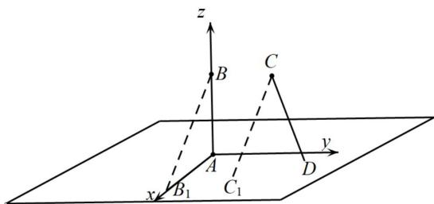

设点 $C_1(x,y,0)$ ，则 $\overrightarrow{BB_1} = (m,0, - 2),\overrightarrow{CC_1} = (x - x_2,y - y_2, - h)$

由于阳光为平行光，所以 $\overrightarrow{BB_{1}}//\overrightarrow{CC_{1}}$ ，所以 $C_{1}\left(x_{2}+\frac{hm}{2},y_{2},0\right)$ ,

$$
n = \left| C _ {1} D \right| = \sqrt {\left(x _ {2} + \frac {h m}{2} - x _ {1}\right) ^ {2} + \left(y _ {2} - y _ {1}\right) ^ {2} + (0 - 0) ^ {2}}
$$

即 $n^2 = \left(x_2 + \frac{hm}{2} - x_1\right)^2 + (y_2 - y_1)^2$ ，即 $n^2 = \left(a + \frac{hm}{2}\right)^2 + b^2$

方程 $n^2 = \left(a + \frac{hm}{2}\right)^2 + b^2$ 中 $a, b, h$ 为3个未知数，需要列三个方程才可求解，则需要测量三次.

故选：B

---

### 静安 · 原卷第19题

**考点说明：** 第（1）问：在底面内寻找与目标直线平行且属于目标平面的直线，证明线面平行。 第（2）问：利用线面角定义构造射影或建立空间坐标，通过法向量求正弦值。

来源：源文件（本地原卷）。原题ID：`2026一模-静安-19`。

已知正四棱柱 $ABCD - A_{1}B_{1}C_{1}D_{1}$ 的底面边长为 1，点 $E$ 、 $F$ 分别在边 $AD$ 、 $CD$ 上，且 $AE = \frac{2}{3}$ ， $CF = \frac{2}{3}$ .

（1）证明： $AC / /$ 平面 $B_{1}EF$

(2) 若 $AA_{1} = 2$ ，求直线 $BB_{1}$ 与平面 $B_{1}EF$ 所成角的正弦值.

【答案】（1）证明见解析

(2) $\frac{5\sqrt{97}}{97}$

【解析】

【分析】（1）根据平行线的性质可得 AC // EF，进而可证线面平行；

（2）方法一：建系标点，求平面 $B_{1}EF$ 的法向量，利用空间向量求线面夹角；方法二：利用等体积法求点 $B$ 到平面 $B_{1}EF$ 的距离，进而求线面夹角.

【小问 1 详解】

因为 $AE=\frac{2}{3}$ ，CF= $\frac{2}{3}$ ，则 $\frac{ED}{AE}=\frac{DF}{FC}=\frac{1}{2}$ ，可得 AC // EF，

且 $AC \not\subset$ 平面 $B_{1}EF$ ， $EF \subset$ 平面 $B_{1}EF$ ，所以 $AC //$ 平面 $B_{1}EF$

【小问 2 详解】

方法一：以 D 为坐标原点，以 DA，DC， $DD_{1}$ 所在直线分别为 x 轴，y 轴，z 轴建立空间直角坐标系，如图所示：

则 $B(1,1,0), B_1(1,1,2), E\left(\frac{1}{3}, 0, 0\right), F\left(0, \frac{1}{3}, 0\right)$ ,

可得 $\overrightarrow{BB_1} = (0,0,2),\overrightarrow{EB_1} = \left(\frac{2}{3},1,2\right),\overrightarrow{EF} = \left(-\frac{1}{3},\frac{1}{3},0\right),$

设平面 $B_{1}EF$ 的法向量为 $\vec{n} = (x,y,z)$ ，则 $\left\{ \begin{array}{l} \vec{n}\cdot \overrightarrow{EB_1} = \frac{2}{3} x + y + 2z = 0\\ \vec{n}\cdot \overrightarrow{EF} = -\frac{1}{3} x + \frac{1}{3} y = 0 \end{array} \right.$

令 $x = 3$ ，则 $y = 3$ ， $z = -\frac{5}{2}$ ，可得 $\vec{n} = \left(3,3, - \frac{5}{2}\right)$

$$
\cos \vec {n}, \overrightarrow {B B _ {1}} = \frac {\vec {n} \cdot \overrightarrow {B B _ {1}}}{| \vec {n} | \cdot | \overrightarrow {B B _ {1}} |} = \frac {- 5}{2 \times \frac {\sqrt {9 7}}{2}} = - \frac {5 \sqrt {9 7}}{9 7}
$$

所以直线 $BB_{1}$ 与平面 $B_{1}EF$ 所成角的正弦值是 $\frac{5\sqrt{97}}{97}$ .

方法二：由题意可知： $BE = BF = \frac{\sqrt{13}}{3}$ ， $EF = \frac{\sqrt{2}}{3}$ ， $B_{1}E = B_{1}F = \frac{7}{3}$

则 $S_{\triangle BEF} = \frac{1}{2}\times \frac{\sqrt{2}}{3}\times \sqrt{\left(\frac{\sqrt{13}}{3}\right)^2 - \left(\frac{\sqrt{2}}{6}\right)^2} = \frac{5}{18},$

$$
S _ {\triangle B _ {1} E F} = \frac {1}{2} \times \frac {\sqrt {2}}{3} \times \sqrt {\left(\frac {7}{3}\right) ^ {2} - \left(\frac {\sqrt {2}}{6}\right) ^ {2}} = \frac {\sqrt {9 7}}{1 8},
$$

设点 B 到平面 $B_{1}EF$ 的距离为 d，

因为三棱锥 $B_{1} - BEF$ 的体积即为三棱锥 $B - B_{1}EF$ 的体积，

则 $\frac{1}{3} \times 2 \times \frac{5}{18} = \frac{1}{3} d \times \frac{\sqrt{97}}{18}$ ，解得 $d = \frac{10\sqrt{97}}{97}$ ，

设直线 $BB_{1}$ 与平面 $B_{1}EF$ 所成角为 $\theta$ ，则 $\sin \theta = \frac{d}{BB_1} = \frac{\frac{10\sqrt{97}}{97}}{2} = \frac{5\sqrt{97}}{97}$

所以直线 $BB_{1}$ 与平面 $B_{1}EF$ 所成角的正弦值 $\frac{5\sqrt{97}}{97}$ .

---

### 黄浦 · 原卷第20题

**考点说明：** 第（1）问：由焦距及渐近线方程建立双曲线半轴关系，求标准方程。 第（2）问：利用直线与双曲线只有一个公共点确定点P，再由垂直关系求轴上点坐标。 第（3）问：设平行截线并联立双曲线，利用根与系数关系和距离比例检验是否存在定值。

来源：源文件（本地原卷）。原题ID：`2026一模-黄浦-20`。

已知双曲线 $\Gamma$ 的中心位于坐标原点 $O$ ，焦点 $F_{2}$ ， $F_{1}$ 分别在 $x$ 轴的正、负半轴上， $\left|F_{1}F_{2}\right| = 2\sqrt{2}$ ，直线 $y = -x$ 是 $\Gamma$ 的一条渐近线，直线 $l_{1}: y = \sqrt{2} x + t (t < 0)$ 与 $\Gamma$ 有且只有一个公共点 $P$ 。

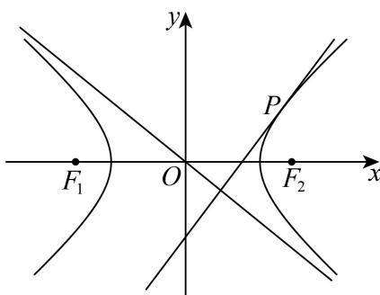

（1）求 $\Gamma$ 的方程；

(2) 若点 $Q$ 在 $y$ 轴上, 且 $\angle F_{1}QP$ 为直角, 求点 $Q$ 的坐标;

（3）设动直线 $l_{2}$ 平行于 OP，与 $\Gamma$ 交于点 A，B，与 $l_{1}$ 交于点 K，是否存在常数 $\lambda$ ，使得

$\left|KA\right|\cdot \left|KB\right| = \lambda \left|KP\right|^2$ 总成立？若存在，请求出 $\lambda$ 的值；若不存在，请说明理由.

【答案】（1） $x^{2} - y^{2} = 1$

(2) $(0,2)$ 或 $(0,-1)$

（3）存在 $\lambda=1$ 符合题意.

【解析】

【分析】（1）利用双曲线的焦距确定 c，渐近线斜率确定 $\frac{b}{a}$ ，结合 $c^{2}=a^{2}+b^{2}$ 求出 a, b，
进而得到双曲线方程.

（2）联立直线与双曲线，由判别式得 $t$ 以确定 $P$ 点坐标，设 $Q$ 点坐标后，利用向量垂直的数量积为0求解 $Q$ 的坐标.

（3）先确定直线 $l_{2}$ 的方程，联立 $l_{2}$ 与双曲线得韦达定理，联立 $l_{2}$ 与 $l_{1}$ 得 $K$ 点坐标，计算 $\left|KA\right|\cdot \left|KB\right|$ 和 $\left|KP\right|^2$ 并化简对比，得出常数 $\lambda$ 的值.

【小问 1 详解】

依题意， $\left\{ \begin{array}{l}2c = 2\sqrt{2}\\ \frac{b}{a} = 1\\ c^2 = a^2 +b^2 \end{array} \right.$ ，解得 $a = b = 1,c = \sqrt{2}$

所以 $\Gamma$ 的方程为 $x^{2}-y^{2}=1$ .

【小问 2 详解】

联立 $\left\{\begin{aligned}y&=\sqrt{2}x+t\\ x^{2}-y^{2}&=1\end{aligned}\right.$ ，消去y并化简得 $x^{2}+2\sqrt{2}tx+t^{2}+1=0$ ，

由题意可得 $\Delta = 8t^2 - 4(t^2 + 1) = 0$ ，解得 $t = \pm 1$ ，因为 $t > 0$ ，

所以 t = -1，代入上式，解得 $x = \sqrt{2}, y = 1$ ，

所以 $P\left(\sqrt{2},1\right)$ ，设 $Q(0,q)$

因为 $\angle F_{1}QP$ 为直角，

所以 $\overrightarrow{QF_1}\cdot \overrightarrow{QP} = (-\sqrt{2}, - q)\cdot (\sqrt{2},1 - q) = -\sqrt{2}\times \sqrt{2} -q(1 - q) = 0$

解得 q=2 或 -1，

所以 $Q(0,2)$ 或 $(0,-1)$ .

【小问 3 详解】

$k_{OP}=\frac{\sqrt{2}}{2}$ ，设 $A(x_{1},y_{1}),B(x_{2},y_{2})$ ， $l_{2}:y=\frac{\sqrt{2}}{2}x+m$ ，

联立 $\left\{ \begin{array}{l} y = \frac{\sqrt{2}}{2} x + m \\ x^2 - y^2 = 1 \end{array} \right.$ ，消去 $y$ 并化简得 $x^2 - 2\sqrt{2} mx - 2m^2 - 2 = 0$ ，

$$
\Delta = 8 m ^ {2} - 4 (- 2 m ^ {2} - 2) = 1 6 m ^ {2} + 8 > 0,
$$

$$
x _ {1} + x _ {2} = 2 \sqrt {2} m, x _ {1} x _ {2} = - 2 (m ^ {2} + 1)
$$

联立 $\left\{\begin{aligned}y&=\frac{\sqrt{2}}{2}x+m\\ y&=\sqrt{2}x-1\end{aligned}\right.$ ，解得 $\left\{\begin{aligned}x&=\sqrt{2}m+\sqrt{2}\\ y&=2m+1\end{aligned}\right.$

所以 $K\left(\sqrt{2} m + \sqrt{2}, 2m + 1\right)$ ,

$$
\left| K A \right| \cdot \left| K B \right| = \left[ 1 + \left(\frac {\sqrt {2}}{2}\right) ^ {2} \right] \cdot \left| \left(x _ {1} - x _ {K}\right) \left(x _ {2} - x _ {K}\right) \right| = \frac {3}{2} \left| x _ {1} x _ {2} - x _ {K} \left(x _ {1} + x _ {2}\right) + x _ {K} ^ {2} \right|,
$$

代入 K 点坐标及韦达定理得

$$
\left| K A \right| \cdot \left| K B \right| = \frac {3}{2} \left| - 2 (m ^ {2} + 1) - 2 \sqrt {2} m (\sqrt {2} m + \sqrt {2}) + (\sqrt {2} m + \sqrt {2}) ^ {2} \right| = 6 m ^ {2},
$$

$$
\left| K P \right| ^ {2} = (\sqrt {2} m + \sqrt {2} - \sqrt {2}) ^ {2} + (2 m + 1 - 1) ^ {2} = 6 m ^ {2},
$$

所以 $\exists \lambda = 1$ ，使得 $\left|KA\right|\cdot \left|KB\right| = \lambda \left|KP\right|^2.$

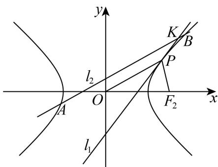

---
