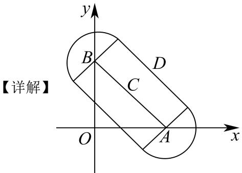

# 2026届上海高三一模数学 · 复数专题（教师阅读版）

> 以16区规范化转录稿为主，MinerU与可读PDF辅助。原题与源解析保留，不代表本次逐题独立重算；存在待核内容的题目在题前提示。旧汇编未用作本稿题目来源。

[返回阅读入口](阅读入口.md)

## 目录

- [1 复数运算、模与实虚部](#class-1)（10题）
- [2 共轭复数与实系数方程](#class-2)（3题）
- [3 复平面中的向量、轨迹与几何约束](#class-3)（3题）

## 1 复数运算、模与实虚部

### 徐汇 · 原卷第1题

**考点说明：** 复数的模：根据实部和虚部计算复数对应点到原点的距离。

来源：源文件（本地原卷）。原题ID：`2026一模-徐汇-01`。

设复数 $z = 2 + i$ （其中 i 为虚数单位），则 $|z| =$ \_\_\_\_ .

【答案】 $\sqrt{5}$

【解析】

【分析】利用复数模的计算公式求解即可.

【详解】复数 $z = 2 + \mathrm{i}$ （其中i为虚数单位），所以 $\left|z\right| = \sqrt{2^2 + 1^2} = \sqrt{5}$

故答案为： $\sqrt{5}$

---

### 闵行 · 原卷第3题

**考点说明：** 复数的代数形式与模：由实部和模确定虚部的绝对值，再利用虚部为正确定符号。

来源：2026届上海高三一模闵行卷，第3题。

若虚数 $z$ 的实部为 $1$，虚部为正数，且 $|z|=\sqrt{2}$，则 $z=$________。

【答案】$1+\mathrm{i}$

【解析·参考原解整理】

设 $z=1+bi$，其中 $b>0$。由 $|z|=\sqrt2$，得 $1+b^2=2$，故 $b=1$，$z=1+i$。

回源核对说明：逐题对照该PDF题面页面视觉核对；答案转录自第7或12页，非独立数学复核。

### 普陀 · 原卷第3题

**考点说明：** 纯虚数及复数运算：利用纯虚数与模的条件确定可能的复数，再求分式实部。

来源：源文件（本地原卷）。原题ID：`2026一模-普陀-03`。

若复数 $z$ 是纯虚数，且 $\left|z\right| = 1$ ，则 $\frac{1}{1 - z}$ 的实部为

【答案】 $\frac{1}{2}$ ##0.5

【解析】

【分析】由纯虚数定义设 $z = bi(b \neq 0)$ ，再根据复数的模及复数的概念即可求解.

【详解】由复数 z 是纯虚数，设 $z = bi(b \neq 0)$ ,

由 $|z| = 1$ ，得 $\sqrt{b^2} = 1$ ， $\therefore b^2 = 1$

$$
\frac {1}{1 - z} = \frac {1}{1 - b \mathrm{i}} = \frac {1 + b \mathrm{i}}{(1 - b \mathrm{i}) (1 + b \mathrm{i})} = \frac {1 + b \mathrm{i}}{1 + b ^ {2}} = \frac {1}{2} + \frac {b}{2} \mathrm{i},
$$

所以 $\frac{1}{1 - z}$ 的实部为 $\frac{1}{2}$ .

故答案为： $\frac{1}{2}$ .

---

### 嘉定 · 原卷第3题

**考点说明：** 复数的除法与模：利用模的乘除性质，也可先将复数化为代数形式。

来源：源文件（本地原卷）。原题ID：`2026一模-嘉定-03`。

已知复数 $z = \frac{3 - 4\mathrm{i}}{4 + 3\mathrm{i}}$ （i为虚数单位），则 $|z| =$ \_\_\_\_.

【答案】1

【解析】

【分析】根据复数的除法运算求得 z = -i，即可得模长.

【详解】因为复数 $z=\frac{3-4i}{4+3i}=\frac{(3-4i)(4-3i)}{(4+3i)(4-3i)}=\frac{12-9i-16i+12i^{2}}{16+9}=-i$

所以 $|z|=1$ .

故答案为：1.

---

### 青浦 · 原卷第3题

**考点说明：** 复数的模：应用商的模等于模的商，或先计算复数商。

来源：源文件（本地原卷）。原题ID：`2026一模-青浦-03`。

若复数 $z = \frac{3 - 5\mathrm{i}}{1 - \mathrm{i}}$ ，则 $|z| =$ \_\_\_\_.

【答案】 $\sqrt{17}$

【解析】

【分析】先利用复数的除法运算化简，再结合复数的模的定义计算.

【详解】 $z=\frac{3-5i}{1-i}=\frac{(3-5i)(1+i)}{(1-i)(1+i)}=\frac{8-2i}{2}=4-i$

则 $|z| = \sqrt{16 + 1} = \sqrt{17}$

故答案为： $\sqrt{17}$

---

### 金山 · 原卷第3题

**考点说明：** 复数运算及模：利用复数乘除的模的性质求未知复数的模。

来源：源文件（本地原卷）。原题ID：`2026一模-金山-03`。

若复数 $z$ 满足 $z \cdot \mathrm{i} = \frac{2}{1 + \mathrm{i}}$ ，则 $|z| =$ \_\_\_\_.

【答案】 $\sqrt{2}$

【解析】

【分析】借助复数运算法则结合模长定义计算即可得.

【详解】 $z=\frac{2}{(1+i)\cdot i}=\frac{2}{-1+i}=\frac{2(1+i)}{(-1+i)(1+i)}=\frac{2+2i}{-2}=-1-i$

故 $\left|z\right|=\sqrt{\left(-1\right)^{2}+\left(-1\right)^{2}}=\sqrt{2}$ .

故答案为： $\sqrt{2}$ .

---

### 杨浦 · 原卷第4题

**考点说明：** 复数运算与模：由复数等式求未知量，或直接利用乘除的模的性质。

来源：源文件（本地原卷）。原题ID：`2026一模-杨浦-04`。

若复数 $z$ 满足: $\frac{z}{\mathrm{i}} = 1 - 2\mathrm{i}$ , 则 $\left|z\right| =$ \_\_\_\_.

【答案】 $\sqrt{5}$

【解析】

【分析】先根据复数的运算求出复数 z，再根据复数的模的计算公式即可求出答案.

【详解】由 $\frac{z}{\mathrm{i}} = 1 - 2\mathrm{i}$ 得， $z = \mathrm{i}(1 - 2\mathrm{i}) = 2 + \mathrm{i}$

则 $|z| = \sqrt{2^2 + 1^2} = \sqrt{5}$

故答案为： $\sqrt{5}$

---

### 黄浦 · 原卷第4题

**考点说明：** 复数除法：乘以分母的共轭复数，将结果化为实部与虚部形式。

来源：源文件（本地原卷）。原题ID：`2026一模-黄浦-04`。

已知 i 是虚数单位，则 $\frac{5i}{2-i} =$ \_\_\_\_ .

【答案】 $-1 + 2\mathrm{i}$

【解析】

【分析】根据复数的除法运算即可求解.

【详解】由题意有： $\frac{5i}{2-i}=\frac{5i(2+i)}{(2-i)(2+i)}=-1+2i$

故答案为： $-1+2i$ .

---

### 静安 · 原卷第4题

**考点说明：** 复数除法：将分子分母同乘分母的共轭复数，化为代数形式。

来源：源文件（本地原卷）。原题ID：`2026一模-静安-04`。

已知复数 z 满足 $(3 - \mathrm{i})z = 3 + \mathrm{i}$ （其中 i 为虚数单位），则复数 z = \_\_\_\_.

【答案】 $\frac{4}{5} +\frac{3}{5}\mathrm{i}$

【解析】

【分析】由已知得出 $z = \frac{3 + \mathrm{i}}{3 - \mathrm{i}}$ ，结合复数的除法化简可得复数 $z$ ：

【详解】因为 $(3-i)z=3+i$ ，所以 $z=\frac{3+i}{3-i}=\frac{(3+i)^{2}}{(3-i)(3+i)}=\frac{8+6i}{10}=\frac{4}{5}+\frac{3}{5}i$ .

故答案为： $\frac{4}{5}+\frac{3}{5}i$ .

---

### 松江 · 原卷第4题

**考点说明：** 复数除法与复平面：通过分母有理化求实部、虚部，再写出对应点坐标。

来源：源文件（本地原卷）。原题ID：`2026一模-松江-04`。

复数 $z = \frac{1 + 3\mathrm{i}}{1 + \mathrm{i}}$ （其中 $\mathrm{i}$ 是虚数单位）在复平面内对应点的坐标为 \_\_\_\_.

【答案】(2,1)

【解析】

【分析】先利用复数的除法法则将 $z = \frac{1 + 3\mathrm{i}}{1 + \mathrm{i}}$ 化简，再利用复数的几何意义即可得解.

【详解】 $\because z=\frac{1+3i}{1+i}=\frac{(1+3i)(1-i)}{(1+i)(1-i)}=\frac{4+2i}{2}=2+i$ ，

∴ 复数 z 在复平面内对应点的坐标为 $(2,1)$ .

故答案为：(2,1).

---

## 2 共轭复数与实系数方程

### 虹口 · 原卷第6题

**考点说明：** 复数与实系数方程：利用非实根共轭及韦达定理，由根的乘积求复数的模。

来源：源文件（本地原卷）。原题ID：`2026一模-虹口-06`。

已知复数 $z$ 是实系数一元二次方程 $x^{2} + bx + 2 = 0$ 的一个虚数根，则 $\left|\overline{z}\right| =$ \_\_\_\_.

【答案】 $\sqrt{2}$

【解析】

【分析】利用实系数方程复数根的性质及根与系数关系得 $z\overline{z}=2$ ，再由共轭复数的运算性质求结果.

【详解】由实系数一元二次方程复数根的性质知 $z\overline{z}=|\overline{z}|^{2}=2$

故 $|\overline{z}| = \sqrt{2}$

故答案为： $\sqrt{2}$

---

### 浦东 · 原卷第10题

**考点说明：** 共轭复根与复平面最值：由实系数方程根的关系约束复数，再将复数模转为平面距离问题。

来源：源文件（本地原卷）。原题ID：`2026一模-浦东-10`。

> 核对说明：规范稿伪第1题已排除，规范题号减1。

已知复数 $z_{1}, z_{2}$ 是实系数一元二次方程的两个根，若 $z_{1} = i z_{2}$ ，则 $\left| z_{1} - i \right|$ 的最小值为 \_\_\_\_。
【答案】 $\frac{\sqrt{2}}{2}$

【解析】

【分析】分一元二次方程的判别式大于等于0与小于0，两种情况讨论，利用实系数一元二次方程的虚根成对的性质，计算可求得 $\left|z_{1}-i\right|$ 的最小值.

【详解】若一元二次方程的判别式大于等于0，则方程有两个实数根，即 $z_{1},z_{2}$ 为实数，

由 $z_{1} = \mathrm{i}z_{2}$ ，则 $z_{1} = 0,z_{2} = 0$ ，此时 $\left|z_1 - \mathrm{i}\right| = \left|0 - \mathrm{i}\right| = 1$

若一元二次方程的判别式小于0，则 $z_{1},z_{2}$ 为两虚数根，

设 $z_{1} = a + bi$ 、 $z_{2} = a - bi$

又因为 $z_{1} = \mathrm{i}z_{2}$ ，所以 $a + b\mathrm{i} = \mathrm{i}(a - b\mathrm{i}) = b + a\mathrm{i}$ ，所以 $a = b$

$$
\left| z _ {1} - \mathrm{i} \right| = \left| a + (a - 1) \mathrm{i} \right| = \sqrt {a ^ {2} + (a - 1) ^ {2}} = \sqrt {2 a ^ {2} - 2 a + 1} = \sqrt {2 \left(a - \frac {1}{2}\right) ^ {2} + \frac {1}{2}}
$$

当 $a = \frac{1}{2}$ 时， $\left|z_1 - \mathrm{i}\right|_{\min} = \sqrt{2\left(\frac{1}{2} - \frac{1}{2}\right)^2 + \frac{1}{2}} = \frac{\sqrt{2}}{2}.$

综上所述： $\left|z_{1}-i\right|$ 的最小值为 $\frac{\sqrt{2}}{2}$

故答案为： $\frac{\sqrt{2}}{2}$ .

---

### 崇明 · 原卷第14题

**考点说明：** 实系数二次方程与共轭复根：由共轭关系确定复根，再应用韦达定理求系数。

来源：源文件（本地原卷）。原题ID：`2026一模-崇明-14`。

已知 $a, b \in R$ ，且 $2 + ai, b + i$ （ $i$ 是虚数单位）是实系数一元二次方程 $x^2 + px + q = 0$ 的两个根，那么 $p, q$ 的值分别是
A. $p = 4, q = 5$ B. $p = -4, q = 3$ C. $p = -4, q = 5$ D.

$$
p = 4, q = 3
$$

【答案】C

【解析】

【分析】利用根与系数的关系列出方程组，根据复数相等运算即可得出所求结果.

【详解】因为 $2+ai,b+i$ （i是虚数单位）是实系数一元二次方程 $x^{2}+px+q=0$ 的两个根，所以 $\left\{\begin{aligned}&2+ai+b+i=-p\\ &(2+ai)(b+i)=q\end{aligned}\right.$ ，所以 $\left\{\begin{aligned}&2+b=-p\\ &a+1=0\\ &2b-a=q\\ &2+ab=0\end{aligned}\right.$ ，解得 $\left\{\begin{aligned}&a=-1\\ &b=2\\ &p=-4\\ &q=5\end{aligned}\right.$

故选：C

【点睛】本题主要考查复数的有关计算，解题的关键是熟练掌握复数相等的条件和一元二次方程根与系数的关系.

---

## 3 复平面中的向量、轨迹与几何约束

### 宝山 · 原卷第13题

**考点说明：** 复数的几何意义：反向向量对应的复数互为相反数。

来源：源文件（本地原卷）；源文件（本地原卷）。原题ID：`2026一模-宝山-13`。

> 交叉收录：向量、复数。计作同一道原题。

> 核对说明：D选项据同题解析版PDF第7页补全，原答案A。

如果复平面上的向量 $\overrightarrow{AB}$ 所对应的复数是 $-1 + 2\mathrm{i}$ ，则向量 $\overrightarrow{BA}$ 所对应的复数是（）
A. $1 - 2\mathrm{i}$ B. $1 + 2\mathrm{i}$ C. $-1 + 2\mathrm{i}$ D. $-1 - 2\mathrm{i}$
【答案】A

【分析】根据复数的相反向量的性质得出 $-\overrightarrow{AB} = \overrightarrow{BA}$ 求出结果.
【详解】因为向量 $\overrightarrow{AB}$ 所对应的复数为 $-1 + 2\mathrm{i}$ ，所以 $\overrightarrow{BA} = -\overrightarrow{AB}$ 所对应的复数是 $1 - 2\mathrm{i}$ . 故选：A.

---

### 奉贤 · 原卷第9题

**考点说明：** 复数的模与实部：设复数的实部、虚部，将模的条件转化为实数方程组。

来源：源文件（本地原卷）。原题ID：`2026一模-奉贤-09`。

若复数 $z$ 满足 $\left|z\right| = \sqrt{5}$ , $\left|z - 1\right| = \left|\mathbf{Re}z + 1\right|$ , 则复数 $z =$ \_\_\_\_.

【答案】 $z=1+2i$ 或 $z=1-2i$ .

【解析】

【分析】先设复数，再计算得出 a, b 即可求解.

【详解】设复数 $z = a + bi, a, b \in R$ ,

复数 $z$ 满足 $\left|z\right| = \sqrt{5}$ ， $\left|z - 1\right| = \left|\mathbf{Re}z + 1\right|$

所以 $\left\{ \begin{array}{l}a^{2} + b^{2} = 5\\ \sqrt{(a - 1)^{2} + b^{2}} = |a + 1| \end{array} \right.$

所以 $a^{2}+4a-5=0$ ，a=1 或 a=-5（当 a=-5 时， $b^{2}=4a=-20<0$ ，与 $b\in R$ 矛盾，故舍去），

所以 $\left\{\begin{aligned}a&=1\\ b&=\pm2\end{aligned}\right.$

则复数 $z = 1 + 2\mathrm{i}$ 或 $z = 1 - 2\mathrm{i}$

故答案为： $z = 1 + 2\mathrm{i}$ 或 $z = 1 - 2\mathrm{i}$

---

### 长宁 · 原卷第10题

**考点说明：** 复平面动点轨迹：将模条件解释为到线段上某点的距离，识别轨迹区域并求面积。

来源：源文件（本地原卷）。原题ID：`2026一模-长宁-10`。

在复平面上, 复数 2 和 $2 \mathrm{i}$ 所对应的点分别为 $A 、 B$ , 复数 $z_{1}$ 所对应的点在线段 $A B$ 上移动, 若 $\left| z_{1} - z_{2} \right| = 1$ , 则复数 $z_{2}$ 对应点所构成图形的面积为 \_\_\_\_.

【答案】 $4\sqrt{2}+\pi$

【解析】

【分析】设复数 $z_{1}$ 所对应的点为 $C$ ，设复数 $z_{2}$ 所对应的点为 $D$ ，由 $\left|z_1 - z_2\right| = 1$ 得到点 $D$ 的轨迹为：以线段 $AB$ 为中线，宽度为2的矩形，加上两端 $A, B$ 为圆心，半径为1的两个半圆，利用矩形和圆的面积公式求解即可.

∵ 复数 2 和 2i 所对应的点分别为 A、B，∴ $A(2,0)$ , $B(0,2)$ ,

设复数 $z_{1}$ 所对应的点为 C，设复数 $z_{2}$ 所对应的点为 D，

$\because \left|z_{1} - z_{2}\right| = 1, \therefore \left|DC\right| = 1, \therefore$ 点 $D$ 轨迹是以点 $C$ 为圆心，半径为1的圆，

∵ 点 C 在线段 AB 上移动，∴ 点 D 的轨迹为：以线段 AB 上的点为圆心，半径为 1 的圆的并集，

即点 D 的轨迹为：以线段 AB 为中线，宽度为 2 的矩形，加上两端 A, B 为圆心，半径为 1 的两个半圆，

$\because A(2,0),B(0,2), \therefore |AB| = 2\sqrt{2},$

∴ 复数 $z_{2}$ 对应点所构成图形的面积为 $2\sqrt{2} \times 2 + \pi \times 1^{2} = 4\sqrt{2} + \pi$ .

故答案为： $4\sqrt{2}+\pi$ .

---
