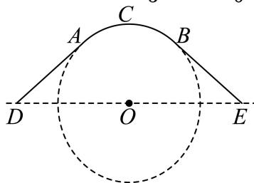
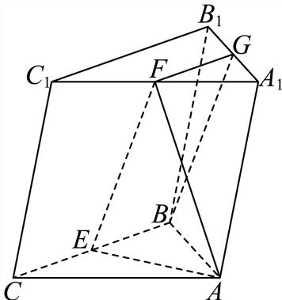

# 2025一模 嘉定区原卷 · 教师版

> 本地预览：题目、答案及分类尚未全部审定。校对使用的PDF为高中工作台解析版，尚未逐区确认区级印刷原卷。

## 填空题

按本区原卷题号顺序排列。

### 嘉定 · 第1题

函数 $y = \log _ { 2 } ( x ^ { 2 } - 1 )$ )的定义域为

**考点：** 对数真数限制与定义域；二次不等式求解

**难度依据：** 真数大于零后直接解二次不等式

**核查说明：** 题干与解析已用于人工归类，尚未完成整题公式校净与独立数学终审。

【答案】$( - \infty , - 1 ) \cup ( 1 , + \infty )$

【解析】

利用对数函数的定义，列出不等式求解即得.

函数 $\ { \cdot } y = \log _ { 2 } ( x ^ { 2 } - 1 )$ 有意义，则 $\ : x ^ { 2 } - 1 > 0 \ :$ ，解得x < −1或x > 1，

所以函数 $: y = \log _ { 2 } ( x ^ { 2 } - 1 )$ 的定义域为 $( - \infty , - 1 ) \cup ( 1 , + \infty )$

故答案为： $( - \infty , - 1 ) \cup ( 1 , + \infty )$

### 嘉定 · 第2题

直线3x − y + 1 = 0的倾斜角为 .（用反三角函数表示）

**考点：** 一般式求斜率与倾斜角；反正切表示倾斜角

**难度依据：** 斜率为正时直接反正切求角

**核查说明：** 题干与解析已用于人工归类，尚未完成整题公式校净与独立数学终审。

【答案】arctan 3.

【解析】

由直线的一般式方程求得斜率，根据倾斜角与斜率的关系，建立方程，可得答案.

由直线 $3 x - y + 1 = 0$ ，则该直线的斜率为3，设其倾斜角为θ，则 $\tan \theta = 3$

解得 $\theta = \arctan 3 .$

故答案为：arctan 3.

### 嘉定 · 第3题

如果复数 $z$ 满足 $\mathrm i\,\overline z=1+2\mathrm i$（$\mathrm i$ 为虚数单位），则 $z=$______。

> 本题资料或解析有待核事项，预览不可作为已审定成品。

**考点：** 共轭复数与复数除法

**难度依据：** 先除以虚数单位再取共轭

**核查说明：** 题干与解析已用于人工归类，尚未完成整题公式校净与独立数学终审。；题干共轭符号OCR写为上标短横，发布前须规范为共轭复数。

【答案】$2+\mathrm i$

【解析】

根据给定条件，利用复数除法求出 $\overline z$，进而求出复数 $z$。

依题意，

$$\overline z=\frac{1+2\mathrm i}{\mathrm i}=\frac{(1+2\mathrm i)(-\mathrm i)}{\mathrm i(-\mathrm i)}=2-\mathrm i.$$

所以 $z=2+\mathrm i$。

故答案为：$2+\mathrm i$。

### 嘉定 · 第4题

在 $\triangle A B C ^ { \prime }$ 中，若 $A B = 5 , B C = { \sqrt { 2 1 } } , C A = 4$ ，则∠A = .

> 本题资料或解析有待核事项，预览不可作为已审定成品。

**考点：** 三边已知用余弦定理求角

**难度依据：** 余弦定理直接代入

**核查说明：** 题干与解析已用于人工归类，尚未完成整题公式校净与独立数学终审。；题干三角形名称多出撇号，原解亦有残缺不等号，须校净。

【答案】$\frac { \pi } { 3 }$

【解析】

根据给定条件，利用余弦定理求解即得.

在 $\triangle A B C ^ { \prime }$ 中，由余弦定理得 $\cos A = { \frac { A B ^ { 2 } + C A ^ { 2 } - B C ^ { 2 } } { 2 A B \cdot C A } } = { \frac { 2 5 + 1 6 - 2 1 } { 2 \times 5 \times 4 } } = { \frac { 1 } { 2 } }$

$$
<   A <   \pi ,
$$

$$
A = \frac {\pi}{3}
$$

故答案为： $\frac { \pi } { 3 }$

### 嘉定 · 第5题

已知双曲线C： ${ \frac { x ^ { 2 } } { 3 } } - { \frac { y ^ { 2 } } { 2 } } = 1$ ，则双曲线C的离心率是

**考点：** 双曲线标准方程与离心率

**难度依据：** 识别实虚半轴后计算离心率

**核查说明：** 题干与解析已用于人工归类，尚未完成整题公式校净与独立数学终审。

【答案】$\frac { \sqrt { 1 5 } } { 3 }$

【解析】

利用双曲线方程求出实半轴长、半焦距，进而求出离心率.

双曲线C： ${ \frac { x ^ { 2 } } { 3 } } - { \frac { y ^ { 2 } } { 2 } } = 1$ 的实半轴长 $a = { \sqrt { 3 } } ,$ ，虚半轴长 $b = { \sqrt { 2 } }$

则半焦距 $c = { \sqrt { a ^ { 2 } + b ^ { 2 } } } = { \sqrt { 5 } }$ ，所以双曲线C的离心率 $e = { \frac { c } { a } } = { \frac { \sqrt { 1 5 } } { 3 } }$

故答案为： $\frac { \sqrt { 1 5 } } { 3 }$

### 嘉定 · 第6题

已知圆锥的母线长为2，底面半径为1，则圆锥的侧面积为

**考点：** 圆锥侧面积公式

**难度依据：** 半径与母线直接代入

**核查说明：** 题干与解析已用于人工归类，尚未完成整题公式校净与独立数学终审。

【答案】2π.

【解析】

利用圆锥的侧面积公式即可得解.

因为圆锥的母线长为l = 2，底面半径为 $\lceil r = 1$

所以圆锥的侧面积为 $\pi r l = 2 \pi$ .

故答案为：2π.

### 嘉定 · 第7题

在 $\left( x - { \frac { 1 } { x } } \right)$ 9 的二项展开式中， $x ^ { 3 }$ 的系数为

> 本题资料或解析有待核事项，预览不可作为已审定成品。

**考点：** 二项式通项中的指数配对

**难度依据：** 通项指数含正负幂需解指数方程

**核查说明：** 仅修复所列OCR公式及其定界符错位；原解数学疑点和其他可渲染错识未因此消除。；题干与解析已用于人工归类，尚未完成整题公式校净与独立数学终审。；题干幂9游离于公式外，原解通项存在严重坏TeX，须回源排版。

【答案】-84

【解析】

先求出展开式的通项公式为 $T _ { r + 1 } = ( - 1 ) ^ { r } \cdot C _ { 9 } ^ { r } \cdot x ^ { 9 - 2 r }$ ，再令x的幂指数等于3求出r的值，即可求得 $x ^ { 3 }$ 的系数．二项式 $\left(x-\frac1x\right)^9$ 的展开式的通项公式为

$$
T _ {r + 1} = C _ {9} ^ {r} \cdot x ^ {9 - r} \cdot (- 1) ^ {r} \cdot x ^ {- r} = (- 1) ^ {r} \cdot C _ {9} ^ {r} \cdot x ^ {9 - 2 r}
$$

${ \mathfrak { H } } { \mathfrak { g } } _ { - } { 2 r } = 3$ ，解得 $r = 3$

∴展开式中 $x ^ { 3 }$ 的系数为 $- C _ { 9 } ^ { 3 } = - 8 4$

故答案为-84

本题主要考查二项式定理的应用，二项式展开式的通项公式，求展开式中某项的系数，属于中档题

### 嘉定 · 第8题

已知数列 $\left\{ a _ { n } \right\}$ 的通项公式为 $\begin{array} { r } { | a _ { n } = - n + c , } \end{array}$ ，其中c为常数，设数列 $\left\{ a _ { n } \right\}$ 的前n项和为 $S _ { n }$ ，若 $S _ { 6 } > S _ { 5 }$ 且$S _ { 6 } > S _ { 7 }$ ，则c的取值范围为

**考点：** 相邻前缀和比较转化为项的符号；线性不等式组确定参数

**难度依据：** 将两次和的比较还原为第六与第七项符号

**核查说明：** 题干与解析已用于人工归类，尚未完成整题公式校净与独立数学终审。

【答案】(6,7)

【解析】

根据给定条件，可得 ${ \cdot } a _ { 6 } > 0$ 且 $a _ { 7 } < 0$ ，由此建立不等式组并求解即得.

数列 $\{ a _ { n } \}$ 的前n项和为 $S _ { n }$ ，由 $S _ { 6 } > S _ { 5 }$ 且 $S _ { 6 } > S _ { 7 }$ ，得 $a _ { 6 } = S _ { 6 } - S _ { 5 } > 0 \mathrm { E } a _ { 7 } = S _ { 7 } - S _ { 6 } < 0$

而 $a _ { n } = - n + c , $ ，因此 $\begin{array} { l } { c - 6 > 0 } \\ { c - 7 < 0 } \end{array}$ 解得 $6 < c < 7$

所以c的取值范围为(6,7).

故答案为：(6,7)

### 嘉定 · 第9题

已知 $f \left( x \right) = \ln { \left( x + 1 \right) } , g \left( x \right) = \left\{ { f \left( x \right) } , x \geq 0 \atop f \left( - x \right) , x < 0  , \right.$ 则 $\mid g ( x ) > x + 2 -$ e的解集为

**考点：** 分段对数函数比较与构造函数；按自变量符号分类解函数不等式

**难度依据：** 两段处理不同且正半轴需用导数判单调

**核查说明：** 题干与解析已用于人工归类，尚未完成整题公式校净与独立数学终审。

【答案】$( - \infty , \mathbf { e } - 1 )$

【解析】

根据分段函数的性质，分情况整理不等式，当x ≥ 0时，整理不等式，构造函数，利用导数研究新函数的单调性，当x < 0时，利用中间值法，可得答案.

当 $x \geq 0 \mathbb { H } \mathbf { f }$ ，可得ln $( x + 1 ) > x + 2 - \mathrm { e }$ ，整理可得 $\ln \left( x + 1 \right) - \left( x + 1 \right) > 1 - \mathrm { e }$

令 $\cdot t = 1 + x \geq 1$ ，令 $h \left( t \right) = \ln t - t ,$ 求导可得 $h ^ { \prime } \left( t \right) = \frac { 1 } { t } - 1 = \frac { 1 - t } { t } < 0 ,$

所以函数 $h \left( t \right) \mathcal { \left[ 1 , + \infty \right) }$ 单调递减，令 $\mathbf { \tilde { \rho } } _ { } h \left( t \right) = 1 - \mathbf { e }$ ，解得 $t = { \bf e } .$ ，则 $x = { \mathrm { e } } - 1$ 1

此时不等 $\pounds \hat { \boldsymbol { \rho } } ( \boldsymbol { x } ) > \boldsymbol { x } + 2 - \mathrm { e }$ 的解集为 $[ 0 , \mathrm { e } - 1 )$ ；

当 $x <$ 0时，可得ln $( 1 - x ) > x + 2 - \mathrm { e }$ ，由 $\mathbf { \Phi } _ { - } - x > 1$ ，则 $\mathrm { n } \left( 1 - x \right) > 0$

易知 $| x + 2 - \mathbf { e } < 0$ ，此时不等式 $\ ` g ( x ) > x + 2 - { \epsilon }$ e的解集为 $( - \infty , 0 )$

综上所述，不等式 $\left( g \left( x \right) \right) > x + 2 - \mathrm { e }$ 的解集为 $( - \infty , \mathbf { e } - 1 )$ ).

故答案为： $( - \infty , \mathbf { e } - 1 )$

### 嘉定 · 第10题

已知空间向量 $\overrightarrow { O B _ { 1 } } , \overrightarrow { O B _ { 2 } } , \overrightarrow { O B _ { 3 } }$ 两两垂直，若空间点A满足 $\left| \overrightarrow { A B _ { 1 } } \right| = \left| \overrightarrow { A B _ { 2 } } \right| = \left| \overrightarrow { A B _ { 3 } } \right| = 1$ ，记$\overrightarrow { O P } = \overrightarrow { O B _ { 1 } } + \overrightarrow { O B _ { 2 } } + \overrightarrow { O B _ { 3 } }$ ，且 $\left| \begin{array} { l } { \longrightarrow } \\ { \vec { A P } } \end{array} \right| \le 1$ ，则 $\overrightarrow { O A }$ 的取值范围为

> 本题资料或解析有待核事项，预览不可作为已审定成品。

**考点：** 空间正交向量数量积与模平方恒等式；等距点约束的空间度量

**难度依据：** 须将三组距离条件合并消去交叉项

**核查说明：** 题干与解析已用于人工归类，尚未完成整题公式校净与独立数学终审。；题干末尾将模长写成向量的取值范围；原PDF文字层及解析均有模长线，应回核后修复。

【答案】$\left[ 1 , { \frac { \sqrt { 6 } } { 2 } } \right]$

【解析】

根据给定条件，利用空间向量模的意义及数量积的运算律求得 $| \overrightarrow { O A } | ^ { 2 } = \frac { 3 - | \overrightarrow { A P } | ^ { 2 } } { 2 }$ 进而求出范围.

由空间向量 $\overrightarrow { { \cdot } O B _ { 1 } } , \overrightarrow { O B _ { 2 } } , \overrightarrow { O B _ { 3 } }$ 两两垂直，得 $\overrightarrow { O B _ { 1 } } \cdot \overrightarrow { O B _ { 2 } } = \overrightarrow { O B _ { 2 } } \cdot \overrightarrow { O B _ { 3 } } = \overrightarrow { O B _ { 3 } } \cdot \overrightarrow { O B _ { 1 } } = 0$

又 AB1 = AB2 = AB3 = 1，OP = OB1 + OB2 + OB3，

则3 = |AB1|2 + |AB2|2 + |AB3|2 = (OB1 − OA)2 + (OB2 − OA)2 + (OB3 − OA)2−−→ → → → → → → → →

$$
= 3 \overrightarrow {| O A |} ^ {2} - 2 \overrightarrow {O A} \cdot \left(\overrightarrow {O B _ {1}} + \overrightarrow {O B _ {2}} + \overrightarrow {O B _ {3}}\right) + \overrightarrow {| O B _ {1} |} ^ {2} + \overrightarrow {| O B _ {2} |} ^ {2} + \overrightarrow {| O B _ {3} |} ^ {2}
$$

$$
= 3 \overrightarrow {| O A | ^ {2}} - 2 \overrightarrow {O A} \cdot \overrightarrow {O P} + \left(\overrightarrow {O B _ {1}} + \overrightarrow {O B _ {2}} + \overrightarrow {O B _ {3}}\right) ^ {2} - 2 \left(\overrightarrow {O B _ {1}} \cdot \overrightarrow {O B _ {2}} + \overrightarrow {O B _ {2}} \cdot \overrightarrow {O B _ {3}} + \overrightarrow {O B _ {3}} \cdot \overrightarrow {O B _ {1}}\right)
$$

$$
= 3 | \overrightarrow {O A} | ^ {2} - 2 \overrightarrow {O A} \cdot \overrightarrow {O P} + | \overrightarrow {O P} | ^ {2} = 2 | \overrightarrow {O A} | ^ {2} + | \overrightarrow {O A} | ^ {2} - 2 \overrightarrow {O A} \cdot \overrightarrow {O P} + | \overrightarrow {O P} | ^ {2}
$$

$= 2 | \overrightarrow { O A } | ^ { 2 } + \left( \overrightarrow { O A } - \overrightarrow { O P } \right) ^ { 2 } = 2 | \overrightarrow { O A } | ^ { 2 } + | \overrightarrow { A P } | ^ { 2 }$ 而0 $\leq | { \overrightarrow { A P } } | \leq 1$

因此 $| \overrightarrow { O A } | ^ { 2 } = \frac { 3 - | \overrightarrow { A P } | ^ { 2 } } { 2 } \in \left[ 1 , \frac { 3 } { 2 } \right] , \overrightarrow { | O A } | \in \left[ 1 , \frac { \sqrt { 6 } } { 2 } \right]$

所以 $\overrightarrow { \ O A }$ |的取值范围为 $\left[ 1 , { \frac { \sqrt { 6 } } { 2 } } \right]$

故答案为： $\left[ 1 , { \frac { \sqrt { 6 } } { 2 } } \right]$

### 嘉定 · 第11题

某公园为了美化环境，计划建造一座拱桥 $DACBE$。已知该桥的剖面如图所示，共包括一段圆弧形桥面 $\widehat{ACB}$ 和两段长度相等的直线型桥面 $AD,BE$。圆弧形桥面 $\widehat{ACB}$ 所在圆的半径为4米，圆心 $O$ 在 $DE$ 上，且 $AD$ 和 $BE$ 所在直线与圆 $O$ 分别在连接点 $A$ 和 $B$ 处相切。已知直线型桥面的修建费用是每米0.4万元，弧形桥面 $\widehat{ACB}$ 的修建费用是每米2.5万元，设 $\angle ADO=\theta$。根据空间限制及桥面坡度的限制，$\theta$ 的范围为 $\arcsin\frac13\le\theta\le\frac\pi6$，则当桥面修建总费用最低时 $\theta$ 的值为______。

> 本题资料或解析有待核事项，预览不可作为已审定成品。

**考点：** 实际费用函数建模与导数最值；切线长度和圆弧长度的三角表示

**难度依据：** 几何建模后在受限角区间内求最小费用

**核查说明：** 题干与解析已用于人工归类，尚未完成整题公式校净与独立数学终审。；桥面线段和圆弧名称存在错识，不能直接按当前题干发布。

【答案】$\arcsin { \frac { 2 } { 5 } }$

【解析】

根据给定条件，结合弧长公式求出桥面修建总费用的函数关系f(θ)，再利用导数探讨函数最小值问题.

连接 $O A , O B$ ，依题意， $O A \bot A D , O B \bot B E$ ，则 $B E = A D = { \frac { O A } { \tan \theta } } = { \frac { 4 } { \tan \theta } }$

$\angle A O B = \pi - \left( \angle A O D + \angle B O E \right) = \pi - 2 \left( { \frac { \pi } { 2 } } - \theta \right) = 2 \theta$ AˆCB的长度为8θ，

则桥面修建总费用 $f \left( \theta \right) = 0 . 4 \times \frac { 8 } { \tan \theta } + 2 . 5 \times 8 \theta = \frac { 3 . 2 } { \tan \theta } + 2 0 \theta , \arcsin \frac { 1 } { 3 } \leq \theta \leq \frac { \pi } { 6 }$ ，

而 $f \left( \theta \right) = \frac { 3 . 2 \cos \theta } { \sin \theta } + 2 0 \theta$ ，求导得 $f ^ { \prime } \left( \theta \right) = \frac { 3 . 2 ( - \sin ^ { 2 } \theta - \cos ^ { 2 } \theta ) } { \sin ^ { 2 } \theta } + 2 0 = 2 0 - \frac { 3 . 2 } { \sin ^ { 2 } \theta } ,$

由 $\arcsin { \frac { 1 } { 3 } } \leq \theta \leq { \frac { \pi } { 6 } }$ ，得 $\frac { 1 } { 3 } \leq \sin \theta \leq \frac { 1 } { 2 }$ ，则 ${ \frac { 1 } { 9 } } \leq \sin ^ { 2 } \theta \leq { \frac { 1 } { 4 } }$ ，由 $f ^ { \prime } ( \theta ) = 0$ ，得 $\sin \theta = \frac { 2 } { 5 }$

当 $\frac { 1 } { 3 } \leq \sin \theta < \frac { 2 } { 5 }$ ，即 $\arcsin { \frac { 1 } { 3 } } \leq \theta < \arcsin { \frac { 2 } { 5 } }$ 时， $f ^ { \prime } ( \theta ) < 0$

当 $\frac { 2 } { 5 } < \sin \theta \leq \frac { 1 } { 2 }$ ，即 $\arcsin { \frac { 2 } { 5 } } < \theta \leq { \frac { \pi } { 6 } }$ 时， $f ^ { \prime } ( \theta ) > 0 .$

因此函数f(θ)在 $\left\lceil \arcsin { \frac { 1 } { 3 } } , \arcsin { \frac { 2 } { 5 } } \right)$ 上单调递减，在 $\left( \arcsin { \frac { 2 } { 5 } } , { \frac { \pi } { 6 } } \right)$ 上单调递增，

所以当且仅当 $\theta = \arcsin { \frac { 2 } { 5 } }$ 时，f(θ)取得最小值，即桥面修建总费用最低.

故答案为： $\arcsin { \frac { 2 } { 5 } }$

### 嘉定 · 第12题

已知实数 $\left[ x _ { 1 } , x _ { 2 } , y _ { 1 } , y _ { 2 } \right.$ 满足： $x _ { 1 } ^ { 2 } + y _ { 1 } ^ { 2 } = 1 , x _ { 2 } ^ { 2 } + y _ { 2 } ^ { 2 } = 1 , x _ { 1 } x _ { 2 } + y _ { 1 } y _ { 2 } = { \frac { 1 } { 2 } }$ ，则${ \frac { | x _ { 1 } + y _ { 1 } - 1 | } { \sqrt { 2 } } } + { \frac { | x _ { 2 } + y _ { 2 } - 1 | } { \sqrt { 2 } } }$ 的最小值为

> 本题资料或解析有待核事项，预览不可作为已审定成品。

**考点：** 点线距离和与单位圆弦的几何转化；数量积确定圆心角；定角弦及投影的距离最值

**难度依据：** 绝对值转点线距离并区分两点位于直线同异侧

**核查说明：** 题干与解析已用于人工归类，尚未完成整题公式校净与独立数学终审。；原解几处角区间及同侧讨论有乱码，完整分类不等于已核证明。

【答案】$\frac { { \sqrt { 6 } } - { \sqrt { 2 } } } { 4 }$

【解析】

设 $A ( x _ { 1 } , y _ { 1 } ) , B ( x _ { 2 } , y _ { 2 } )$ ，根据给定条件可得A,B为单位圆O上两点，且 $\angle A O B = 6 0 ^ { \circ }$ ，再利用${ \frac { | x _ { 1 } + y _ { 1 } - 1 | } { \sqrt { 2 } } } + { \frac { | x _ { 2 } + y _ { 2 } - 1 | } { \sqrt { 2 } } }$ 的几何意义转化为直线x $: + y - 1 = 0$ 与圆 $x ^ { 2 } + y ^ { 2 } = { \frac { 3 } { 4 } }$ 上点的距离最小值求解.

设 $A ( x _ { 1 } , y _ { 1 } ) , B ( x _ { 2 } , y _ { 2 } )$ ，则 $\overrightarrow { { O A } } = ( x _ { 1 } , y _ { 1 } ) , \overrightarrow { { O B } } = ( x _ { 2 } , y _ { 2 } )$ ，由 $x _ { 1 } ^ { 2 } + y _ { 1 } ^ { 2 } = 1 , x _ { 2 } ^ { 2 } + y _ { 2 } ^ { 2 } = 1$ $x _ { 1 } x _ { 2 } + y _ { 1 } y _ { 2 } = { \frac { 1 } { 2 } }$

得点A,B在单位圆 $x ^ { 2 } + y ^ { 2 } = 1 _ { - }$ 上，且 $\overrightarrow { O A } \cdot \overrightarrow { O B } = x _ { 1 } x _ { 2 } + y _ { 1 } y _ { 2 } = 1 \times 1 \times \cos \angle A O B = \frac { 1 } { 2 }$

即 $\angle A O B = 6 0 ^ { \circ }$ ，则 $\triangle A O B$ 为等边三角形， $| A B | = 1$ ，

${ \frac { | x _ { 1 } + y _ { 1 } - 1 | } { \sqrt { 2 } } } + { \frac { | x _ { 2 } + y _ { 2 } - 1 | } { \sqrt { 2 } } }$ 可视为点A,B到直线l： $x + y - 1 = 0$ 的距离 $d _ { 1 }$ 与 $d _ { 2 }$ 之和， 当点4 R在克线1同侧时

$$
(\cos \alpha , \sin \alpha), B \left(\cos \left(\alpha + \frac {\pi}{3}\right), \sin \left(\alpha + \frac {\pi}{3}\right)\right), 0 <   \alpha <   \frac {\pi}{6} \text {或} \frac {\pi}{2} <   \alpha <   \frac {5 \pi}{3}.
$$

当0 $< \alpha < \frac { \pi } { 6 }$ 时， $\frac { \pi } { 4 } < \alpha + \frac { \pi } { 4 } < \frac { 5 \pi } { 1 2 }$ ，则 $\sin \alpha + \cos \alpha = { \sqrt { 2 } } \sin \left( \alpha + { \frac { \pi } { 4 } } \right) > 1$

$$
\frac {7 \pi}{1 2} <   \alpha + \frac {\pi}{3} + \frac {\pi}{4} <   \frac {3 \pi}{4}, \sin \left(\alpha + \frac {\pi}{3}\right) + \cos \left(\alpha + \frac {\pi}{3}\right) = \sqrt {2} \sin \left(\alpha + \frac {\pi}{3} + \frac {\pi}{4}\right) > 1,
$$

$$
\cos {\frac {5 \pi}{1 2}} = \sin {\frac {\pi}{1 2}} = \sin \left(\frac {\pi}{3} - \frac {\pi}{4}\right) = \sin {\frac {\pi}{3}} \cos {\frac {\pi}{4}} - \cos {\frac {\pi}{3}} \sin {\frac {\pi}{4}} = \frac {\sqrt {6}}{4} - \frac {\sqrt {2}}{4} = \frac {\sqrt {6} - \sqrt {2}}{4},
$$

$$
\sin {\frac {5 \pi}{1 2}} = \cos {\frac {\pi}{1 2}} = \cos \left(\frac {\pi}{3} - \frac {\pi}{4}\right) = \cos {\frac {\pi}{3}} \cos {\frac {\pi}{4}} + \sin {\frac {\pi}{3}} \sin {\frac {\pi}{4}} = \frac {\sqrt {2}}{4} + \frac {\sqrt {6}}{4} = \frac {\sqrt {6} + \sqrt {2}}{4},
$$

$$
\text {是} d _ {1} + d _ {2} = \frac {\left| \sin \alpha + \cos \alpha - 1 \right|}{\sqrt {2}} + \frac {\left| \sin \left(\alpha + \frac {\pi}{3}\right) + \cos \left(\alpha + \frac {\pi}{3}\right) - 1 \right|}{\sqrt {2}}
$$

$$
= \frac {1}{\sqrt {2}} \left[ \sin \alpha + \cos \alpha + \sin \left(\alpha + \frac {\pi}{3}\right) + \cos \left(\alpha + \frac {\pi}{3}\right) - 2 \right] = \frac {1}{\sqrt {2}}
$$

$$
\left(\frac {3 - \sqrt {3}}{2} \sin \alpha + \frac {3 + \sqrt {3}}{2} \cos \alpha\right) - \sqrt {2}
$$

$$
= \frac {\sqrt {6}}{\sqrt {2}} \left(\frac {\sqrt {6} - \sqrt {2}}{4} \sin \alpha + \frac {\sqrt {6} + \sqrt {2}}{4} \cos \alpha\right) - \sqrt {2} = \sqrt {3} \sin \left(\alpha + \frac {5 \pi}{1 2}\right) - \sqrt {2},
$$

由0 $1 < \alpha < \frac { \pi } { 6 }$ ，得 $\frac { 5 \pi } { 1 2 } < \alpha + \frac { 5 \pi } { 1 2 } < \frac { 7 \pi } { 1 2 } , \frac { \sqrt { 6 } + \sqrt { 2 } } { 4 } < \sin \left( \alpha + \frac { 5 \pi } { 1 2 } \right) \le 1 ,$

$$
d _ {1} + d _ {2} > \frac {\sqrt {6} - \sqrt {2}}{4};
$$

当 π2 < α < 5π 时， $\frac { 3 \pi } { 4 } < \alpha + \frac { \pi } { 4 } < \frac { 2 3 \pi } { 1 2 }$ 则 $\sin \alpha + \cos \alpha = { \sqrt { 2 } } \sin \left( \alpha + { \frac { \pi } { 4 } } \right) < 1$

$$
\frac {1 3 \pi}{1 2} <   \alpha + \frac {\pi}{3} + \frac {\pi}{4} <   \frac {9 \pi}{4}, \sin \left(\alpha + \frac {\pi}{3}\right) + \cos \left(\alpha + \frac {\pi}{3}\right) = \sqrt {2} \sin \left(\alpha + \frac {\pi}{3} + \frac {\pi}{4}\right) <   1,
$$

$$
d _ {1} + d _ {2} = \frac {1}{\sqrt {2}} \Big [ 2 - \sin \alpha - \cos \alpha - \sin \left(\alpha + \frac {\pi}{3}\right) - \cos \left(\alpha + \frac {\pi}{3}\right) \Big ]
$$

$$
= \sqrt {2} - \frac {1}{\sqrt {2}} \left(\frac {3 - \sqrt {3}}{2} \sin \alpha + \frac {3 + \sqrt {3}}{2} \cos \alpha\right) = \sqrt {2} - \sqrt {3} \sin \left(\alpha + \frac {5 \pi}{1 2}\right),
$$

$$
\frac {1 1 \pi}{1 2} <   \alpha + \frac {5 \pi}{1 2} <   \frac {2 5 \pi}{1 2}, - 1 \leq \sin \left(\alpha + \frac {5 \pi}{1 2}\right) <   \frac {\sqrt {6} - \sqrt {2}}{4}, d _ {1} + d _ {2} > \frac {\sqrt {6} + \sqrt {2}}{4};
$$

当点A,B在直线l异侧时（包括点A,B之一在直线l上），

过A,B分别作 $A A ^ { \prime } \bot l , B B ^ { \prime } \bot l ,$ 垂足为A′,B′，令直线AB与直线l的夹角为θ $\left( { \frac { \pi } { 1 2 } } \leq \theta \leq { \frac { 5 \pi } { 1 2 } } \right)$ $d _ { 1 } + d _ { 2 } = | A B | \sin \theta = \sin \theta \geq \sin { \frac { \pi } { 1 2 } } = { \frac { { \sqrt { 6 } } - { \sqrt { 2 } } } { 4 } } ,$

所以 ${ \frac { | x _ { 1 } + y _ { 1 } - 1 | } { \sqrt { 2 } } } + { \frac { | x _ { 2 } + y _ { 2 } - 1 | } { \sqrt { 2 } } }$ 的最小值为 $\frac { { \sqrt { 6 } } - { \sqrt { 2 } } } { 4 }$

故答案为： $\frac { { \sqrt { 6 } } - { \sqrt { 2 } } } { 4 }$

关键点点睛：本题解题的关键是将 $\frac { | x _ { 1 } + y _ { 1 } - 1 | } { \sqrt { 2 } } + \frac { | x _ { 2 } + y _ { 2 } - 1 | } { \sqrt { 2 } }$ 的转化为点 $A ( x _ { 1 } , y _ { 1 } ) , B ( x _ { 2 } , y _ { 2 } )$ 两点到直线 $x + y - 1 = 0$ 的距离 $d _ { 1 } \mathscr { \varTheta } d _ { 2 }$ 之和.

## 二、选择题

## 选择题

按本区原卷题号顺序排列。

### 嘉定 · 第13题

已知a为正数，则 $^ { * } a > 3 ^ { * }$ 是 ${ } ^ {  } a ^ { a } > a ^ { 3 } { } ^ { , }$ 的（ ）.

A. 充分非必要条件

B. 必要非充分条件

C. 充要条件

D. 既非充分也非必要条件

**考点：** 指数不等式的充分必要条件；按指数函数底数分类讨论；变底数指数大小比较

**难度依据：** 底数在零一之间时不等方向变化

**核查说明：** 题干与解析已用于人工归类，尚未完成整题公式校净与独立数学终审。

【答案】A

【解析】

根据给定条件，当 $a > 3$ 时，利用指数函数的单调性即可判断，当 $a ^ { a } > a ^ { 3 }$ 时，分类讨论，最后利用充分条件、必要条件的定义判断作答.

当 $a >$ 3时，所以 $\langle y = a ^ { x }$ 为增函数，所以 $a ^ { a } > a ^ { 3 }$ ，

当 $a ^ { a } > a ^ { 3 }$ 时，当a > 1时，则 $a > 3 ,$ ，当0 $< a <$ 1时，则 $a < 3$ ，此时0 $< a < 1$ ；

所以 $^ { * } a > 3 ^ { * }$ 是 ${ } ^ { \cdot } a ^ { a } > a ^ { 3 } { } ^ { , }$ ”的充分非必要条件.

故选：A.

### 嘉定 · 第14题

已知α,β是两个不同的平面，a，b是两条不同的直线，下列条件中，一定得到直线l⊥α的是（ ）

A. $\alpha \perp \beta , l / / \beta$

B. $l \perp a , a / / \alpha$

C. $l / / a , a \bot \alpha$

D. $l \bot a , l \bot b , a \subset \alpha , b \subset \alpha$

**考点：** 线面垂直判定及反例辨析

**难度依据：** 区分平行传递与遗漏相交条件的伪判定

**核查说明：** 题干与解析已用于人工归类，尚未完成整题公式校净与独立数学终审。

【答案】C

【解析】

根据直线、平面的位置关系的判断可得结果.

对于A， $\alpha \perp \beta , l / / \beta ,$ ，则l与α相交、平行或l $\subset \alpha ,$ ，故A错误；

对于B， $l \perp a , a / / \alpha$ ，则l与α相交、平行或l $\subset \alpha ,$ ，故B错误；

对于C， $l / / a , a \bot \alpha$ ，由线面垂直的性质知l⊥α，故C正确；

对于D， $l \bot a , l \bot b , a \subset \alpha , b \subset \alpha$ ，则 $\varXi \alpha$ 相交、平行或l $\subset \alpha$ ，故D错误.

故选：C.

### 嘉定 · 第15题

假定生男生女是等可能的，设事件A：一个家庭中既有男孩又有女孩；事件B:一个家庭中最多有一个女孩.针对下列两种情形：①家庭中有2个小孩；②家庭中有3个小孩，下面说法正确是（ ）.

A. ①中事件A与事件B相互独立､②中的事件A与事件B相互独立

B. ①中事件A与事件B不相互独立､②中的事件A与事件B相互独立

C. ①中事件A与事件B相互独立､②中的事件A与事件B不相互独立

D. ①中事件A与事件B不相互独立､②中的事件A与事件B不相互独立

**考点：** 枚举样本空间与事件独立性判定

**难度依据：** 儿童数改变需分别计算交事件概率

**核查说明：** 题干与解析已用于人工归类，尚未完成整题公式校净与独立数学终审。

【答案】B

【解析】

分别写出①②对应的样本空间，再利用相互独立事件计算判断.

若家庭中有两个小孩，样本空间为Ω = {(男,男)，(男,女)，(女,男)，(女,女)}，共4种情况，

A = {(男,女)，(女,男)}，B = {(男,男)，(男,女)，(女,男)}，AB = {(男,女)，(女,男)}，

则 $P \left( A \right) = \frac { 2 } { 4 } = \frac { 1 } { 2 } , P \left( B \right) = \frac { 3 } { 4 } , P \left( A B \right) = \frac { 2 } { 4 } = \frac { 1 } { 2 } \neq P \left( A \right) P \left( B \right)$ 事件A与事件B不相互独立，AC错误；

若家庭中有三个小孩，样本空间为Ω = {(男,男,男)，(男,男,女)，(男,女,男)，(女,男,男)，

(男,女,女)，(女,男,女)，(女,女,男)，(女,女,女)}，共8种情况，

A = {(男,男,女)，(男,女,男)，(女,男,男)，(男,女,女)，(女,男,女)，(女,女,男)}，

B = {(男,男,男)，(男,男,女)，(男,女,男)，(女,男,男)}，AB = {(男,男,女)，(男,女,男)，(女,男,男)}，

$P \left( A \right) = \frac { 6 } { 8 } = \frac { 3 } { 4 } , P \left( B \right) = \frac { 4 } { 8 } = \frac { 1 } { 2 } , P \left( A B \right) = \frac { 3 } { 8 } = P \left( A \right) P \left( B \right)$ ，事件A与事件B相互独立B正确，D错误.

故选：B

### 嘉定 · 第16题

已知数列 $\left\{ a _ { n } \right\}$ 满足 $a _ { n + 1 } = r a _ { n } \left( 1 - a _ { n } \right) ( n = 1 , 2 , 3 , \cdot \cdot \cdot ) , a _ { 1 } \in ( 0 , 1 )$ ，给出以下四个结论：
①当r = 2时，存在有限个 $\mathbf { \dot { a } } _ { 1 }$ ，使得对任意正整数 $^ { \cdot _ { n , \cdot } }$ ，都有 $a _ { n + 1 } > a _ { n }$
②当r = 2时，存在 $\scriptstyle ( a _ { 1 }$ 和正整数P，当 $n > P \mathbb { H } ]$ ， $a _ { n + 1 } - a _ { n } < { \frac { 1 } { 2 0 2 5 } }$
③当r = 3时，存在a 和正整数 $P ,$ ，当 $n > P \mathbb { k }$ ， $a _ { n + 1 } = a _ { n }$
④当r = −3时，不存在a ，使得对任意正整数n，且 $. n \geq 3$ ，都有 $\dot { a } _ { n } > 0$
其中正确结论是（ ）.

A. ①②

B. ②③

C. ③④

D. ②④

> 本题资料或解析有待核事项，预览不可作为已审定成品。

**考点：** 二次迭代数列的不动点与单调性；二次迭代映射的区间不变性；递推命题的存在量词与反例构造

**难度依据：** 多参数迭代需结合不动点和首项反向构造

**核查说明：** 题干与解析已用于人工归类，尚未完成整题公式校净与独立数学终审。；原解由单调有界直接断言达到指定阈值未写明极限为1/2；④中a3又误写2/3，需补证校净。

【答案】B

【解析】

对于①②，利用作差法可得一元二次不等式，求得数列中的项的取值范围，可得其正误；

对于③④，根据递推公式，利用赋值法求得当数列为常数列时所取的数值，进而求得首项，结合举例，可得答案.

对于①，当r = 2时， $a _ { n + 1 } = 2 a _ { n } \left( 1 - a _ { n } \right) , a _ { n + 1 } - a _ { n } = 2 a _ { n } \left( 1 - a _ { n } \right) - a _ { n } = a _ { n } - 2 a _ { n } ^ { 2 } > 0$ ，解得0 $< a _ { n } < { \frac { 1 } { 2 } }$

当0 $< a _ { 1 } < \frac { 1 } { 2 }$ 时， $a _ { n + 1 } - a _ { n } > 0 ( n \in \mathrm { N } ^ { * } )$ 恒成立，故①错误；

对于②，当r = 2时， $a _ { n + 1 } = 2 a _ { n } ( 1 - a _ { n } ) , a _ { n + 1 } - a _ { n } = a _ { n } - 2 a _ { n } ^ { 2 } < { \frac { 1 } { 2 0 2 5 } }$ ，解得

$$
a _ {n} <   \frac {1 - \sqrt {\frac {2 0 1 7}{2 0 2 5}}}{4} \text {或} a _ {n} > \frac {1 + \sqrt {\frac {2 0 1 7}{2 0 2 5}}}{4},
$$

易知 $) < \frac { 1 - \sqrt { \frac { 2 0 1 7 } { 2 0 2 5 } } } { 4 } < \frac { 1 + \sqrt { \frac { 2 0 1 7 } { 2 0 2 5 } } } { 4 } < \frac { 1 } { 2 }$ 由①可知，当 $0 < a _ { 1 } < \frac { 1 } { 2 }$ 时，数列 $\{ a _ { n } \}$ 单调递增， $0 < a _ { n } < { \frac { 1 } { 2 } }$

所以一定存在 $P \in \mathbf { N } ^ { * }$ ，当n > P时， ${ \frac { 1 + { \sqrt { \frac { 2 0 1 7 } { 2 0 2 5 } } } } { 4 } } < a _ { n } < { \frac { 1 } { 2 } }$ ，故②正确；

对于③，当r = 3时， $a _ { n + 1 } = 3 a _ { n } ( 1 - a _ { n } ) , \widehat { \vec { \triangledown } } a _ { n + 1 } = a _ { n } = x _ { 1 }$ ，可得 ${ \boldsymbol { x } } = 3 x \left( 1 - x \right)$ ，解得 $\dot { \boldsymbol { x } } = 0$ 或 $\frac { 2 } { 3 }$ ，

令 $\cdot 3 a _ { 1 } \left( 1 - a _ { 1 } \right) = \frac { 2 } { 3 }$ ，解得 $\langle a _ { 1 } = \frac { 1 } { 3 }$ 或 $\frac { 2 } { 3 }$ ，

当 $a _ { 1 } = \frac { 1 } { 3 }$ 时，可得当 $n >$ 1时， $a _ { n } = { \frac { 2 } { 3 } }$ ，故③正确；

对于④，当r = −3时， $a _ { n + 1 } = - 3 a _ { n } \left( 1 - a _ { n } \right)$ 令 $a _ { n + 1 } = a _ { n } = x $ ，则 $x = - 3 x \left( 1 - x \right)$ ，解得x = 0或 $\frac { 4 } { 3 }$ ，

令 $\dot { \mathbf { \zeta } } a _ { 3 } = \frac { 2 } { 3 }$ ，可得 $- 3 a _ { 2 } \left( 1 - a _ { 2 } \right) = \frac { 4 } { 3 }$ ，解得 $\mathbf { \tilde { \rho } } a _ { 2 } = - \frac { 1 } { 3 }$ 或 $\frac { 4 } { 3 }$ ，

令 $\mathrm { { \dot { a } _ { 2 } } = - \frac { 1 } { 3 } }$ ，可得 $- 3 a _ { 1 } \left( 1 - a _ { 1 } \right) = - \frac { 1 } { 3 }$ ，解得 $a _ { 1 } = { \frac { 3 \pm { \sqrt { 5 } } } { 6 } }$

当 $a _ { 1 } = \frac { 3 - \sqrt { 5 } } { 6 } \in ( 0 , 1 )$ 时，当 $n \geq$ 3时， $a _ { n } = { \frac { 4 } { 3 } } > 0$ ，故④错误.故选：B.

## 三、解答题

## 解答题

按本区原卷题号顺序排列。

### 嘉定 · 第17题

如图所示，在三棱柱 $A B C - A _ { 1 } B _ { 1 } C _ { 1 }$ 中， $A B = A C$ ，侧面 $B B _ { 1 } C _ { 1 } C \bot$ 底面ABC，点E､F分别为梭BC和 $A _ { 1 } C _ { 1 }$ 的中点.

(1) (6分)若底面 $\triangle A B C$ 为边长为2的正三角形，且 $C C _ { 1 } = B C$ ，侧棱 $C C _ { 1 }$ 与底面ABC所成的角为$6 0 ^ { \circ }$ ，求三棱柱 $A B C - A _ { 1 } B _ { 1 } C _ { 1 }$ 的体积；
(2) (8分)求证： $E F / /$ 平面 $A A _ { 1 } B _ { 1 } B _ { \cdot }$

**考点：** （1）用线面角确定柱高并求体积；（2）辅助中点构造平行四边形证明线面平行

**难度依据：** （1）用线面角确定柱高并求体积；（2）辅助中点构造平行四边形证明线面平行

**核查说明：** 题干与解析已用于人工归类，尚未完成整题公式校净与独立数学终审。

【解析】

(1) 在三棱柱 $A B C - A _ { 1 } B _ { 1 } C _ { 1 }$ 中，平面 $B B _ { 1 } C _ { 1 } C \cap \mp \boxed { \boxplus } A B C = B C$ 由平面 $B B _ { 1 } C _ { 1 } C \bot \mp \nexists \overrightarrow { \mathbb { H } } A B C$ ，得点 $C _ { 1 }$ 在平面 $A B C .$ 上的射影在直线 $B C _ { - }$ 点 $C _ { 1 }$ 与其在平面 $A B C .$ 上的射影的距离h为点 $C _ { 1 }$ 到平面 $A B C$ 的距离，直线 $C C _ { 1 }$ 与直线CB的夹角即为侧棱 $C C _ { 1 }$ 与底面 $A B C$ 所成的角为 $6 0 ^ { \circ }$

因此 $\therefore h = C C _ { 1 } \sin 6 0 ^ { \circ } = { \frac { \sqrt { 3 } } { 2 } } B C = { \sqrt { 3 } } \quad$ ，而正 $\triangle A B C$ C的面积 $S = { \frac { \sqrt { 3 } } { 4 } } B C ^ { 2 } = { \sqrt { 3 } } $ 所以三棱柱 $A B C - A _ { 1 } B _ { 1 } C _ { 1 }$ 的体积 $V = S h = 3$

(2) 在三棱柱 $A B C - A _ { 1 } B _ { 1 } C _ { 1 }$ 中，取 $A _ { 1 } B _ { 1 }$ 的中点G，连接BG， $F G$

在 $\triangle A _ { 1 } B _ { 1 } C _ { 1 }$ 中，由F是 $A _ { 1 } C _ { 1 }$ 的中点，得 $F G / / B _ { 1 } C _ { 1 }$ ，且 $F G = \frac { 1 } { 2 } B _ { 1 } C _ { 1 }$

而 $B C / / B _ { 1 } C _ { 1 }$ 且 $B C = B _ { 1 } C _ { 1 }$ ，又E为棱BC的中点，则 $F G / / B E$ ，且 $F G = B E$

则四边形BEFG为平行四边形， $E F / / B G$ ，又 $B G \subset$ 平面 $A B B _ { 1 } A$ $E F \not \subset$ 平面 $A B B _ { 1 } A _ { 1 }$ 所以 $E F / /$ 平面 $A B B _ { 1 } A _ { 1 }$

### 嘉定 · 第18题

已知 $f \left( x \right) = 2 \cos { \left( \omega x + \frac { 3 \pi } { 4 } \right) }$ ，其中 $\iota _ { \omega } > 0$
(1) (6分)若ω = 2，求函数 $\langle y = f ( x ) , x \in \left[ - \frac { \pi } { 4 } , \frac { \pi } { 4 } \right]$ 的值域；
(2) (8分)若 $f \left( { \frac { \pi } { 4 } } \right) = 0$ ，且函数 $\{ y = f ( x )$ 在 $\left( { \frac { \pi } { 4 } } , { \frac { \pi } { 3 } } \right)$ 内有极小值，但无极大值，求ω的值.

> 本题资料或解析有待核事项，预览不可作为已审定成品。

**考点：** （1）相位区间求值域；（2）零点给出离散频率再以极值分布筛选

**难度依据：** （1）相位区间求值域；（2）零点给出离散频率再以极值分布筛选

**核查说明：** 题干与解析已用于人工归类，尚未完成整题公式校净与独立数学终审。；原解频率筛选步骤含错字和遗漏端点，须逐段检查整数参数。

【解析】

(1) 当ω = 2时， $f \left( x \right) = 2 \cos { \left( 2 x + \frac { 3 \pi } { 4 } \right) }$ ，由 $x \in \left[ - \frac { \pi } { 4 } , \frac { \pi } { 4 } \right]$ ，得 $2 x + { \frac { 3 \pi } { 4 } } \in \left\lceil { \frac { \pi } { 4 } } , { \frac { 5 \pi } { 4 } } \right\rceil$

$$
- 1 \leq \cos \left(2 x + \frac {3 \pi}{4}\right) \leq \frac {\sqrt {2}}{2}, - 2 \leq f (x) \leq \sqrt {2},
$$

所以函数 $\left[ { \mathfrak { y } } = { \mathfrak { f } } \left( x \right) , x \in \left[ - { \frac { \pi } { 4 } } , { \frac { \pi } { 4 } } \right] \right.$ 的值域是 $\left\lceil - 2 , { \sqrt { 2 } } \right\rceil$

(2) 由 $f \left( { \frac { \pi } { 4 } } \right) = 0 .$ ，得 $\frac { \pi } { 4 } \omega + \frac { 3 \pi } { 4 } = \frac { \pi } { 2 } + k \pi , k \in \mathrm { N } ^ { * }$ ，解得 $\omega = - 1 + 4 k , k \in \mathrm { N } ^ { \ast }$

当 $\frac { \pi } { 4 } < x < \frac { \pi } { 3 }$ 时， $\overrightarrow { \vert \vert \vert } \omega > 0$ ，则 $\frac { \overline { { ( \omega + 3 ) \pi } } } { 4 } < \omega x + \frac { 3 \pi } { 4 } < \frac { ( 4 \omega + 9 ) \pi } { 1 2 }$

又函数f(x)在 $\left( { \frac { \pi } { 4 } } , { \frac { \pi } { 3 } } \right)$ 内有极小值，无极大值，则

$$
\left\{ \begin{array}{l} 2 n \pi \leq \frac {(\omega + 3) \pi}{4} <   (2 n + 1) \pi \\ (2 n + 1) \pi <   \frac {(4 \omega + 9) \pi}{1 2} \leq (2 n + 2) \pi \end{array} , n \in \mathbf {Z}, \right.
$$

解得 $\left\{ \begin{array} { l l } { { 8 n - 3 \leq \omega < 8 n + 1 } } \\ { { 6 n + { \frac { 3 } { 4 } } < \omega \leq 6 n + { \frac { 1 5 } { 4 } } , n \in \mathrm { Z } , } } \end{array} \right.$ 于是 $8 n - 3 < 6 n + \frac { 3 } { 4 } < 8 n + 1 < 6 n + \frac { 1 5 } { 4 } \frac { \ d H } { \ d t }$ 或

$6 n + \frac { 3 } { 4 } < 8 n - 3 < 6 n + \frac { 1 5 } { 4 } < 8 n + 1 , n \in \mathrm { Z }$ ，解得 $- \frac { 1 } { 8 } < n < \frac { 1 1 } { 8 }$ 或 $\frac { 1 5 } { 8 } < n < \frac { 2 7 } { 8 } , n \in \mathrm { Z }$

当n = 0时， $\frac { 3 } { 4 } < \omega < 1$ ，又 $\angle \omega = - 1 + 4 k , k \in \mathrm { N } ^ { \ast }$ ∗，无解；

当 $\lvert n = 1$ 时， $\frac { \hat { 2 } 7 } { 4 } < \omega < 9$ ，又 $\omega = - 1 + 4 k , k \in \mathrm { N } ^ { \ast }$ ，则 $k = 2 , \omega = 7$

当n = 2时， $1 3 \leq \omega \leq \frac { 6 3 } { 4 }$ ，又 $\omega = - 1 + 4 k , k \in \mathbb { N } ^ { * }$ ，则 $k = 4 , \omega = 1 5$

当 $n = 3 \mathbb { H } ]$ ， $2 1 \leq \omega \leq \frac { 8 \dot { 7 } } { 4 }$ ，又 $\omega = - 1 + 4 k , k \in \mathrm { N } ^ { \ast }$ ，无解，

所以ω的值是7或15.

### 嘉定 · 第19题

在一场盛大的电竞比赛中，有两支实力强劲的队伍甲和乙进行对决.比赛采用5局3胜制，最终的胜者将赢得10万元奖金，比赛过程中，每局比赛双方获胜的概率相互独立且甲队每局获胜概率为0.4，乙队每局获胜概率为0.6.比赛开始后，甲队先连胜两局，此时，主办方记录了两队队员在这两局比赛中的一些数据.甲队队员的击杀数（单位：个）数据如下：24, 31, 31, 36, 36, 37, 39, 44, 49, 50；乙队队员的击杀数（单位：个）数据如下：8,13,14,16,23,26,28,33,38,39.然而此时比赛场地突发技术故障，比赛不得不中止.请回答以下问题：
(1) (4分)根据目前情况（甲队已连胜两局），写出甲､乙两队“采用5局3胜制”的比赛结果的样本空间；
(2) (4分)根据所给数据，绘制甲､乙两队队员的击杀数分布的茎叶图；
(3) (6分)在目前情况下（甲队已连胜两局），估算甲乙两队获胜概率，并据此分配10万元奖金.

**考点：** （1）列出比赛结束路径；（2）制作背靠背茎叶图；（3）用乙连胜补事件计算概率与奖金

**难度依据：** （1）列出比赛结束路径；（2）制作背靠背茎叶图；（3）用乙连胜补事件计算概率与奖金

**核查说明：** 题干与解析已用于人工归类，尚未完成整题公式校净与独立数学终审。

【解析】

(1) 用 $A _ { i } ( i = 1 , 2 , 3 , 4 , 5 )$ 表示甲队在第i局获胜，则 $\textstyle { \overline { { A _ { i } } } }$ 表示乙队第i局获胜，所以所求样本空间Ω = $\left\{ A _ { 1 } A _ { 2 } A _ { 3 } , A _ { 1 } A _ { 2 } \overline { { { A _ { 3 } } } } A _ { 4 } , A _ { 1 } A _ { 2 } \overline { { { A _ { 3 } } } } \overline { { { A _ { 4 } } } } A _ { 5 } , A _ { 1 } A _ { 2 } \overline { { { A _ { 3 } } } } \overline { { { A _ { 4 } } } } \overline { { { A _ { 5 } } } } \right\}$

(2) 甲､乙两队队员的击杀数分布的茎叶图，如图，

$$
\begin{array}{c c c c c c c c c} \text {乙队} & & & & \text {甲队} \\ \hline & & 8 & 0 & & & & & \\ 6 & 4 & 3 & 1 & & & & & \\ 8 & 6 & 3 & 2 & 4 & & & & \\ 9 & 8 & 3 & 3 & 1 & 1 & 6 & 6 & 7 & 9 \\ & & & 4 & 4 & 9 & & & \\ & & & 5 & 0 & & & & \end{array}
$$

(3) 乙队获胜的事件为B，则 $B = \overline { { A _ { 3 } } } \overline { { A _ { 4 } } } \overline { { A _ { 5 } } } , P \left( B \right) = P \left( \overline { { A _ { 3 } } } \right) P \left( \overline { { A _ { 4 } } } \right) P \left( \overline { { A _ { 5 } } } \right) = 0 \cdot 6 ^ { 3 } = 0 . 2 1 6 $ 因此甲队获胜的概率为 $P \left( { \overline { { B } } } \right) = 1 - P \left( B \right) = 0 . 7 8 4$

由此分配10万元奖金，甲队分得0 $. 7 8 4 \times 1 0 = 7 . 8 4 ~ ( \overline { { { \mathcal { H } } } } \overline { { { \mathcal { T } } } } )$ ），乙队分得2.16万元.

### 嘉定 · 第20题

在平面直角坐标系 $x O y \boxplus$ ，已知椭圆Γ: $\frac { x ^ { 2 } } { 5 } + \frac { y ^ { 2 } } { 4 } = 1 , F _ { 1 } , F _ { 2 }$ 是其左､右焦点，过椭圆Γ右焦点 $F _ { 2 }$ 的直线PQ交椭圆于P,Q两点
(1) (4分)若− $\overrightarrow { P F _ { 1 } } \cdot \overrightarrow { P F _ { 2 } } = 3$ ，求点P的坐标；
(2) (6分)若 $\triangle F _ { 1 } P Q$ 的面积为 $\frac { 4 0 } { 2 1 }$ ，求直线PQ的方程；
(3) (8分)设直线l与椭圆Γ交于A,B两点，M为线段AB的中点.当 $k _ { O M } \cdot k _ { A B } = k _ { O A } \cdot k _ { O B }$ 时，$\triangle O A$ B的面积是否为定值？如果是，请求出这个定值；如果不是，请说明理由.

**考点：** （1）数量积与椭圆联立求点；（2）韦达定理表示焦点弦面积；（3）点差法和斜率关系证明面积定值

**难度依据：** （1）数量积与椭圆联立求点；（2）韦达定理表示焦点弦面积；（3）点差法和斜率关系证明面积定值

**核查说明：** 题干与解析已用于人工归类，尚未完成整题公式校净与独立数学终审。

【解析】

(1) 易知 $F _ { 1 } \left( - 1 , 0 \right) , F _ { 2 } \left( 1 , 0 \right)$ ，设点 $P \left( x _ { 0 } , y _ { 0 } \right)$ ，

可得 $\frac { x _ { 0 } ^ { 2 } } { 5 } + \frac { y _ { 0 } ^ { 2 } } { 4 } = 1$ ，可得 $y _ { 0 } ^ { 2 } = 4 \left( 1 - { \frac { x _ { 0 } ^ { 2 } } { 5 } } \right)$ ，

则 $\overrightarrow { | P F _ { 1 } } = ( - 1 - x _ { 0 } , - y _ { 0 } ) , \overrightarrow { P F _ { 2 } } = ( 1 - x _ { 0 } , - y _ { 0 } ) _ { ; }$

所以 $\overrightarrow { P F _ { 1 } } \cdot \overrightarrow { P F _ { 2 } } = x _ { 0 } ^ { 2 } - 1 + y _ { 0 } ^ { 2 } = x _ { 0 } ^ { 2 } - 1 + 4 \left( 1 - \frac { x _ { 0 } ^ { 2 } } { 5 } \right) = \frac { x _ { 0 } ^ { 2 } } { 5 } + 3 = 3$ ，解得 $x _ { 0 } = 0$

可得 $y _ { 0 } = \pm 2$

即P (0, 2)或 $P \left( 0 , - 2 \right)$

(2) 设直线PQ的方程为x = my + 1， $P ( x _ { P } , y _ { P } ) , Q \left( x _ { Q } , y _ { Q } \right)$ ，

联立 $\left\{ { \frac { x ^ { 2 } } { 5 } } + { \frac { y ^ { 2 } } { 4 } } = 1 \right.$ 并整理可得 $\left( 4 m ^ { 2 } + 5 \right) y ^ { 2 } + 8 m y - 1 6 = 0$

所以 $y _ { P } + y _ { Q } = \frac { - 8 m } { 4 m ^ { 2 } + 5 } , y _ { P } y _ { Q } = \frac { - 1 6 } { 4 m ^ { 2 } + 5 } ,$

易知 $\triangle F _ { 1 } P Q$ 的面积为

$$
S _ {\triangle F _ {1} P Q} = \frac {1}{2} \left| F _ {1} F _ {2} \right| \left| y _ {P} - y _ {Q} \right| = \left| y _ {P} - y _ {Q} \right| = \sqrt {\left(y _ {P} + y _ {Q}\right) ^ {2} - 4 y _ {P} y _ {Q}} =
$$

$$
\begin{array}{l} \sqrt {\left(\frac {- 8 m}{4 m ^ {2} + 5}\right) ^ {2}} + \frac {6 4}{4 m ^ {2} + 5} \\ = \frac {8 \sqrt {5} \sqrt {m ^ {2} + 1}}{4 m ^ {2} + 5} = \frac {4 0}{2 1}, \end{array}
$$

解得 $m ^ { 2 } = 4$ ，即 $\mid m = \pm 2$ ；

所以直线PQ的方程为 $x - 2 y - 1 = 0 \not \equiv \not \{ x \} + 2 y - 1 = 0$

(3) 根据题意可知直线AB的斜率存在，

设直线AB的方程为 $\psi = k x + b , A ( x _ { 1 } , y _ { 1 } ) , B ( x _ { 2 } , y _ { 2 } )$ ，则M $\left( { \frac { x _ { 1 } + x _ { 2 } } { 2 } } , { \frac { y _ { 1 } + y _ { 2 } } { 2 } } \right)$ ，如下图所示：

易知 $\{ { \frac { x _ { 1 } ^ { 2 } } { 5 } } + { \frac { y _ { 1 } ^ { 2 } } { 4 } } = 1  \qquad \quad \quad \quad \quad \quad \quad \quad \quad \quad \quad \quad \quad \quad \quad \quad \quad \quad \quad \quad \quad \quad \quad \quad \quad \quad \quad  { }$ ，两式相减可得 ${ \frac { y _ { 1 } + y _ { 2 } } { x _ { 1 } + x _ { 2 } } } = - { \frac { 4 \left( x _ { 1 } - x _ { 2 } \right) } { 5 \left( y _ { 1 } - y _ { 2 } \right) } }$

由 $k _ { O M } = \frac { y _ { 1 } + y _ { 2 } } { x _ { 1 } + x _ { 2 } } , k _ { A B } = \frac { y _ { 1 } - y _ { 2 } } { x _ { 1 } - x _ { 2 } }$ ，所以可得 $\frac { y _ { 1 } + y _ { 2 } } { x _ { 1 } + x _ { 2 } } = k _ { O M } = - \frac { 4 \left( x _ { 1 } - x _ { 2 } \right) } { 5 \left( y _ { 1 } - y _ { 2 } \right) } = - \frac { 4 } { 5 k _ { A B } }$

； $k _ { O M } \cdot k _ { A B } = - \frac { 4 } { 5 }$ ，又 $k _ { O M } \cdot k _ { A B } = k _ { O A } \cdot k _ { O B }$ 可得 $k _ { O A } \cdot k _ { O B } = { \frac { y _ { 1 } } { x _ { 1 } } } \cdot { \frac { y _ { 2 } } { x _ { 2 } } } = { \frac { y _ { 1 } y _ { 2 } } { x _ { 1 } x _ { 2 } } } = - { \frac { 4 } { 5 } }$

$$
\frac {(k x _ {1} + b) (k x _ {2} + b)}{x _ {1} x _ {2}} = \frac {k ^ {2} x _ {1} x _ {2} + k b (x _ {1} + x _ {2}) + b ^ {2}}{x _ {1} x _ {2}} = - \frac {4}{5},
$$

联立 $\left\{ { \frac { x ^ { 2 } } { 5 } } + { \frac { y ^ { 2 } } { 4 } } = 1 \right.$ 整理可得 $\big ( 5 k ^ { 2 } + 4 \big ) x ^ { 2 } + 1 0 k b x + 5 b ^ { 2 } - 2 0 = 0 \mathrm { { , } }$

$\Delta = ( 1 0 k b ) ^ { 2 } - 4 \left( 5 k ^ { 2 } + 4 \right) \left( 5 b ^ { 2 } - 2 0 \right) = 4 0 0 k ^ { 2 } - 8 0 b ^ { 2 } + 3 2 0 > 0$ ，可得 $b ^ { 2 } < 5 k ^ { 2 } + 4$ ；

可得 $x _ { 1 } + x _ { 2 } = \frac { - 1 0 k b } { 5 k ^ { 2 } + 4 } , x _ { 1 } x _ { 2 } = \frac { 5 b ^ { 2 } - 2 0 } { 5 k ^ { 2 } + 4 } ;$

$$
\text {所以} \frac {k ^ {2} x _ {1} x _ {2} + k b (x _ {1} + x _ {2}) + b ^ {2}}{x _ {1} x _ {2}} = \frac {k ^ {2} \times \frac {5 b ^ {2} - 2 0}{5 k ^ {2} + 4} + k b \left(\frac {- 1 0 k b}{5 k ^ {2} + 4}\right) + b ^ {2}}{\frac {5 b ^ {2} - 2 0}{5 k ^ {2} + 4}} = - \frac {4}{5},
$$

整理可得 ${ \frac { 4 \left( b ^ { 2 } - 5 k ^ { 2 } \right) } { 5 \left( b ^ { 2 } - 4 \right) } } = - { \frac { 4 } { 5 } }$ ，即 $\begin{array} { r } { | 2 b ^ { 2 } = 5 k ^ { 2 } + 4 \rangle } \end{array}$

$$
\begin{array}{l} \text {易知} | A B | = \sqrt {1 + k ^ {2}} \sqrt {\left(x _ {1} + x _ {2}\right) ^ {2} - 4 x _ {1} x _ {2}} = \sqrt {1 + k ^ {2}} \sqrt {\left(\frac {- 1 0 k b}{5 k ^ {2} + 4}\right) ^ {2} - 4 \times \frac {5 b ^ {2} - 2 0}{5 k ^ {2} + 4}} \\ = \sqrt {1 + k ^ {2}} \frac {\sqrt {4 0 0 k ^ {2} - 8 0 b ^ {2} + 3 2 0}}{5 k ^ {2} + 4} = \sqrt {1 + k ^ {2}} \frac {\sqrt {4 0 (5 k ^ {2} + 4)}}{5 k ^ {2} + 4}; \end{array}
$$

原点O(0,0)到直线AB的距离为 $\mathsf { \Pi } \displaystyle d = \frac { | b | } { \sqrt { 1 + k ^ { 2 } } } $

所以△OAB的面积为

$$
S _ {\triangle O A B} = \frac {1}{2} | A B | d = \frac {1}{2} \times \sqrt {1 + k ^ {2}} \frac {\sqrt {4 0 (5 k ^ {2} + 4)}}{5 k ^ {2} + 4} \times \frac {| b |}{\sqrt {1 + k ^ {2}}} = \frac {| b | \sqrt {1 0 \times 2 b ^ {2}}}{2 b ^ {2}} = \sqrt {5};
$$

所以 $\triangle O A$ B的面积为定值，该定值为 ${ \sqrt { 5 } } .$

### 嘉定 · 第21题

设A为非空集合，函数f (x)的定义域为D.若存在 $\mathbf { \Phi } _ { \boldsymbol { x } _ { 0 } } \in \mathbf { D }$ 使得对任意的x ∈ D均有 $f \left( x \right) - f \left( x _ { 0 } \right) \in \mathrm { A }$ ，则称f(x0)为函数f(x)的一个A值，x0为相应的A值点.
(1) (4分)若 $A = [ - 2 , 0 ] , f ( x ) = \sin x$ .证明： $x _ { 0 } = 2 k \pi + \frac { 1 } { 2 } \pi , k \in { \bf Z }$ 是函数f (x)的一个A值点，并写出相应的A值；
(2) (6分)若 $A = [ 0 , + \infty ) , f ( x ) = - x , g ( x ) = x ^ { 2 } + x + 1$ .分别判断函数 ${ \bf \nabla } f \left( x \right) , g \left( x \right)$ 是否存在A值？
若存在，求出相应的A值点；若不存在，说明理由；
(3) (8分)若 $A = ( - \infty , 0 ]$ ，且函数 $f \left( x \right) = \ln x + a x ^ { 2 } \left( a \in \mathbf { R } \right)$ 存在A值，求函数f(x)的A值，并指出相应的A值点.

> 本题资料或解析有待核事项，预览不可作为已审定成品。

**考点：** （1）正弦值域验证A值；（2）线性与二次函数最小值辨析；（3）导数判定对数二次复合函数的最大值及取值点

**难度依据：** （1）正弦值域验证A值；（2）线性与二次函数最小值辨析；（3）导数判定对数二次复合函数的最大值及取值点

**核查说明：** 题干与解析已用于人工归类，尚未完成整题公式校净与独立数学终审。；原解声称列表但表格在MD缺失，需补单调性表或改为文字证明。

【解析】

(1) 函数f(x) = sin x的定义域为R.对 $x _ { 0 } = 2 k \pi + \frac { 1 } { 2 } \pi , k \in { \bf Z }$ ，以及任意 $\boldsymbol { x } \in \mathbf { R } .$

即 $f ( x ) - f \left( x _ { 0 } \right) \in A$ ，所以 $x _ { 0 } = 2 k \pi + \frac { 1 } { 2 } \pi$ ,k ∈ Z是函数f(x)的一个A值点， $f \left( x _ { 0 } \right) = 1$ 为相应的A值.

(2) 函数f(x) = −x的定义域为R.

对任意x0 ∈ R，取 $\scriptstyle { \mathscr { x } = { x _ { 0 } } + 2 }$ ，仍有 $x = x _ { 0 } + 2 \in \mathbf { R }$ ，但

f(x) − f (x0) = − (x0 + 2) − (−x0) = −2 ∉ A，

所以函数f(x)不存在A值.

函数 $\dot { \boldsymbol g } ( \boldsymbol x ) = \boldsymbol x ^ { 2 } + \boldsymbol x + \boldsymbol { \ O }$ 1的定义域为R.

$\forall g \left( x \right) = x ^ { 2 } + x + 1 = \left( x + { \frac { 1 } { 2 } } \right) ^ { 2 } + { \frac { 3 } { 4 } }$ 易知，

当 $x _ { 0 } = - \frac { 1 } { 2 }$ 时，对任意 $\mathbf { \boldsymbol { x } } \in \mathbf { \boldsymbol { R } } $ ，均有 $g \left( x \right) - g \left( x _ { 0 } \right) = \left( x + \frac { 1 } { 2 } \right) ^ { 2 } \geq 0$ ，即 $\begin{array} { r } { { { \mathfrak { l } } _ { g } } ( { x } ) - g \left( { { x } _ { 0 } } \right) \in A ; } \end{array}$

又对任意 $x _ { 0 } \neq - \frac { 1 } { 2 }$ $\mathbb { H } x = - \frac { 1 } { 2 }$

$$
\left. \right| g (x) - g \left(x _ {0}\right) = 0 - \left(x _ {0} + \frac {1}{2}\right) ^ {2} <   0,
$$

即 $\mathbb { J } _ { g ( x ) } - g \left( x _ { 0 } \right) \not \in A$ ，所以 $g \left( x _ { 0 } \right) = \frac { 3 } { 4 }$ 是函数g(x)仅有的一个A值，

$x _ { 0 } = - \frac { 1 } { 2 }$ 是相应的A值点.

(3) 函数 $f ( x ) = \ln x + a x ^ { 2 } ( a \in \mathbf { R } )$ 的定义域为 $( 0 , + \infty )$ ，

由题设，该函数存在A值，设相应A值点为 $x _ { 0 } \in ( 0 , + \infty )$ ，

则f(x) − f (x0) ∈ A即 $f ( x ) \leq f \left( x _ { 0 } \right)$ 对任意 $x \in ( 0 , + \infty )$ 成立，

故函数f(x)的A值即为最大值，A值点即最大值点.

$f ^ { \prime } \left( x \right) = \frac { 1 } { x } + 2 a x$ 令 ${ } ^ { \cdot } f ^ { \prime } ( x ) = 0 / { } _ { \mp } ^ { \boxplus } 2 a x ^ { 2 } + 1 = 0 ,$

显然当a ≥ 0时， $f ^ { \prime } ( x ) >$ 0恒成立，则函数f(x)在(0,+∞)上单调递增，此时f(x)无最大值，舍去，

所以 ${ a < 0 }$ ，解得 $x = { \sqrt { - { \frac { 1 } { 2 a } } } }$ ，列表如下：

所以若函数 $f ( x ) = \ln x + a x ^ { 2 }$ 存在A值，

则 $\begin{array} { r } { | a < 0 , } \end{array}$ A值为ln ${ \sqrt { - { \frac { 1 } { 2 a } } } } - { \frac { 1 } { 2 } }$ ，A值点为 $\sqrt { - \frac { 1 } { 2 a } }$

