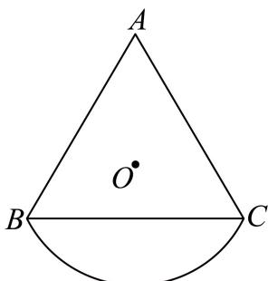
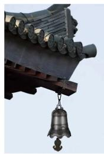
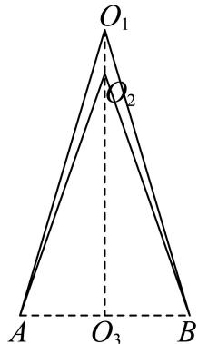
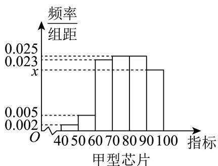
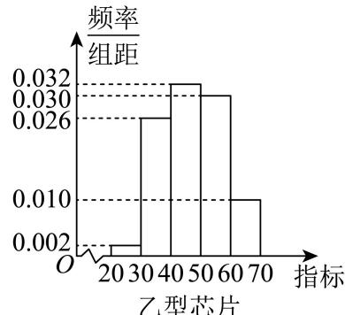
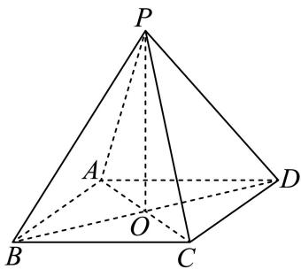
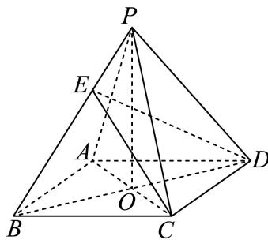
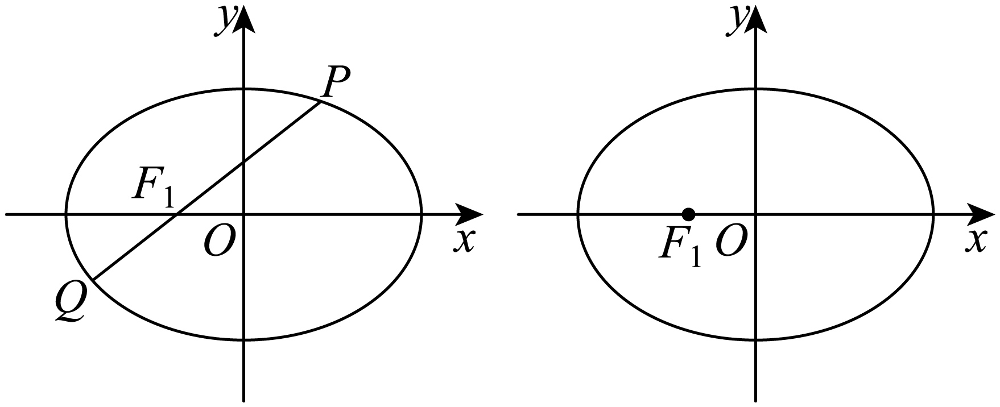

# 2025一模 奉贤区原卷 · 学生版

> 本地预览：题目、答案及分类尚未全部审定。校对使用的PDF为高中工作台解析版，尚未逐区确认区级印刷原卷。

## 填空题

按本区原卷题号顺序排列。

### 奉贤 · 第1题

设全集 $U=\{1,2,3,4\}$，集合 $A=\{2,4\}$，则 $\overline A=$ ______。

> 本题资料或解析有待核事项，预览不可作为已审定成品。

### 奉贤 · 第2题

若直线 $l_1:x+ay-2=0$ 与直线 $l_2:ax+y-2=0$ 互相垂直，则 $a=$______。

### 奉贤 · 第3题

已知 $x\in\mathbb R$，则不等式 $x^2-x+2>0$ 的解集为 $\underline{\qquad}$。

### 奉贤 · 第4题

设 $f(x)=\begin{cases}\ln x+1,&x>0,\\2^x+1,&x\leq 0.\end{cases}$ 若 $f(x_0)=1$，则 $x_0=$______。

> 本题资料或解析有待核事项，预览不可作为已审定成品。

### 奉贤 · 第5题

若 $A,B,C,D,E$ 五人站成一排，如果 $A,B$ 必须相邻，那么排法共 $\underline{\qquad}$ 种。

### 奉贤 · 第6题

$\left(x^6+\frac{1}{x\sqrt{x}}\right)^5$ 的二项展开式中的常数项为 $\underline{\qquad}$。（用数字作答）

### 奉贤 · 第7题

已知抛物线 $x^2=ay\left(a>0\right)$ 上有一点 $P$ 到准线的距离为 $6$，点 $P$ 到 $x$ 轴的距离为 $4$，则抛物线的焦点坐标为 $\underline{\qquad}$。

### 奉贤 · 第8题

在复平面内，$O$ 为坐标原点，复数 $z_1=\mathrm i(-4-3\mathrm i)$，$z_2=12+5\mathrm i$ 对应的点分别为 $Z_1,Z_2$，其中 $\mathrm i$ 为虚数单位，则 $\langle\overrightarrow{OZ_1},\overrightarrow{OZ_2}\rangle$ 的大小为 ______。

> 本题资料或解析有待核事项，预览不可作为已审定成品。

### 奉贤 · 第9题

甲乙两人下棋，每局两人获胜的可能性一样，某一天两人要进行一场三局两胜的比赛，最终胜者赢得100元奖金，第一局比赛甲获胜，后因为有其他事情而中止比赛，则甲应该分 $\underline{\qquad}$ 元奖金才公平？

### 奉贤 · 第10题

申辉中学高一（8）班设计了一个“水滴状”班徽的平面图（如图），徽章由等腰三角形 $ABC$ 及以弦 $BC$ 和劣弧 $BC$ 所围成的弓形所组成，其中 $AB=AC$，劣弧 $BC$ 所在的圆为三角形的外接圆，圆心为 $O$。

已知 $\angle BAC=\theta$，$\theta\in\left(0,\frac{\pi}{2}\right)$，外接圆的半径是 $2$，则该图形的面积为 $\underline{\qquad}$。（用含 $\theta$ 的表达式表示）

### 奉贤 · 第11题

上海市奉贤区奉城镇的古建筑万佛阁（图1）的屋檐下常系挂风铃（图2），风吹铃动，悦耳清脆，亦称惊鸟铃，一般一个惊鸟铃由铜铸造而成，由铃身和铃舌组成，为了知道一个惊鸟铃的质量，可以通过计算该惊鸟铃的体积，然后由物理学知识计算出该惊鸟铃的质量，因此我们需要作出一些合理的假设：
假设1：铃身且可近似看作由一个较大的圆锥挖去一个较小的圆锥；
假设2：两圆锥的轴在同一条直线上；
假设3：铃身内部有一个挂铃舌的部位的体积忽略不计。
截面图如下（图3），其中 $O_1O_3=20\,\mathrm{cm}$，$O_2O_3=18\,\mathrm{cm}$，$AB=16\,\mathrm{cm}$，则制作100个这样的惊鸟铃的铃身至少需要 $\underline{\qquad}$ 千克铜。（铜的密度为 $8.9\,\mathrm{g/cm^3}$）（结果精确到个位）

图1

图2

图3

### 奉贤 · 第12题

已知集合 $M=\{P_0,P_1,P_2,\cdots,P_n\}$，$n\geq2$，$n\in\mathbb N$，是由函数 $y=\cos x$，$x\in[0,2\pi]$ 的图象上两两不相同的点构成的点集，集合 $S=\{a\mid a=\overrightarrow{OP_0}\cdot\overrightarrow{OP_i},\ i=0,1,2,\cdots,n,\ n\geq2,\ n\in\mathbb N\}$，其中 $P_0(0,1)$、$P_1(\pi,-1)$。若集合 $S$ 中的元素按照从小到大的顺序排列能构成公差为 $d$ 的等差数列，当 $d\in\left\{\frac12,1\right\}$ 时，则符合条件的点集 $M$ 的个数为________。

> 本题资料或解析有待核事项，预览不可作为已审定成品。

## 选择题

按本区原卷题号顺序排列。

### 奉贤 · 第13题

在 $\triangle ABC$ 中，“$C=\frac{\pi}{2}$”是“$\sin^2A+\sin^2B=1$”的（　）

A. 充分不必要条件

B. 必要不充分条件

C. 充要条件

D. 既不充分也不必要条件

### 奉贤 · 第14题

函数 $y = \log _ { 2 } \sin x + \log _ { 2 } \cos x$ ，则下列命题正确的是（ ）

A. 函数是偶函数

B. 函数定义域是 $\left( 0 , { \frac { \pi } { 2 } } \right)$

C. 函数最大值−1

D. 函数的最小正周期为π

### 奉贤 · 第15题

在四棱锥 $S - A B C D$ 中，若 $\overrightarrow { S A } = x \overrightarrow { S B } + y \overrightarrow { S C } + z \overrightarrow { S D }$ ，则实数组(x, y, z)可能是（ ）

A. $( 1 , - 1 , 1 )$

B. $( 1 , 0 , - 1 )$

C. $( 1 , 0 , 0 )$

D. $( 1 , - 1 , - 1 )$

### 奉贤 · 第16题

已知数列 $\left\{ a _ { n } \right\}$ 不是常数列，前n项和为 $S _ { n } , \ a _ { n } > 0$ ．若对任意正整数n，存在正整数m，使得$| S _ { n } - a _ { m } | < a _ { 1 }$ ，则称 $\left\{ a _ { n } \right\}$ 是“可控数列”．现给出两个命题：
①若各项均为正整数的等差数列 $\left\{ a _ { n } \right\}$ 满足公差 $d = 3$ ，则 $\left\{ a _ { n } \right\}$ 是“可控数列”；
②若等比数列 $\left\{ a _ { n } \right\}$ 是“可控数列”，则其公比 $q \in \left( 0 , \frac { 1 } { 2 } \right]$
则下列判断正确的是（ ）

A. ①与②均为真命题

B. ①与②均为假命题

C. ①为假命题，②为真命题

D. ①为真命题，②为假命题

> 本题资料或解析有待核事项，预览不可作为已审定成品。

## 解答题

按本区原卷题号顺序排列。

### 奉贤 · 第17题

已知函数 $y=f(x)$，其中 $f(x)=a^x$（常数 $a>0$ 且 $a\ne1$）。

（1）（6分）若函数 $y=f(x)$ 的图象过点 $(2,9)$，求关于 $x$ 的不等式 $f(|2x-1|)>3$ 的解集；

（2）（8分）若存在 $x\in(0,1]$，使得数列 $f(1)$、$f(tx)$、$f(x^2+2)$ 是等比数列，求实数 $t$ 的取值范围。

> 本题资料或解析有待核事项，预览不可作为已审定成品。

### 奉贤 · 第18题

某芯片代工厂生产甲、乙两种型号的芯片，为了解芯片的某项指标，从这两种芯片中各抽取100件进行检测，获得该项指标的频率分布直方图，如图所示：

假设数据在组内均匀分布，以样本估计总体，以事件发生的频率作为相应事件发生的概率
(1) (6分)求频率分布直方图中x的值并估计乙型芯片该项指标的平均值（同一组中的数据用该组区间的中点值为代表）；
(2) (8分)已知甲型芯片指标在[80, 100)为航天级芯片，乙型芯片指标在[60, 70)为航天为航天级芯片．现分别采用分层抽样的方式，从甲型芯片指标在[70,90)内取2件，乙型芯片指标在[50,70)内取4件，再从这6件中任取2件，求至少有一件为航天级芯片的概率

> 本题资料或解析有待核事项，预览不可作为已审定成品。

### 奉贤 · 第19题

如图为正四棱锥 $P-ABCD$，$O$ 为底面 $ABCD$ 的中心。

（1）（6分）求证：$CD\parallel$ 平面 $PAB$，平面 $PAC\perp$ 平面 $PBD$；

（2）（8分）设 $E$ 为 $PB$ 上的一点，$\overrightarrow{BE}=\frac23\overrightarrow{BP}$。在下面两问中选一个：

①若 $AD=AP=3\sqrt2$，求直线 $EC$ 与平面 $BED$ 所成角的大小；

②已知平面 $ECD$ 与平面 $ABCD$ 所成锐二面角的大小为 $\arctan\frac{\sqrt2}{2}$，若 $AD=3\sqrt2$，求 $AP$ 的长。

> 本题资料或解析有待核事项，预览不可作为已审定成品。

### 奉贤 · 第20题

椭圆 $\Gamma:\dfrac{x^2}{a^2}+y^2=1\ (a>1)$ 的左右焦点分别为 $F_1,F_2$，设 $P(x_0,y_0)$ 是第一象限内椭圆上的一点，$PF_1$ 的延长线交椭圆于点 $Q(x_1,y_1)$。

（1）（4分）若椭圆的离心率为 $\dfrac{\sqrt2}{2}$，求 $a$ 的值；

（2）（6分）若 $a=\sqrt2$，$\overrightarrow{PQ}\cdot\overrightarrow{OF_1}=\dfrac{12}{5}$，求 $x_0$；

（3）（8分）若 $a=2$，过点 $T(0,t)$ 的直线 $l$ 与椭圆 $\Gamma$ 交于 $M,N$ 两点，且 $|MN|=2$，则当 $t\geqslant 0$ 时，判断符合要求的直线有几条，并说明理由。

### 奉贤 · 第21题

若函数 $\boldsymbol { \cdot } \boldsymbol { y } = \boldsymbol { f } \left( \boldsymbol { x } \right)$ 的图象上存在k个不同点 $P _ { 1 \setminus } \ P _ { 2 \setminus } \ \cdots \ P _ { k } \left( k \geq 2 , k \in \mathbf { N } \right)$ 处的切线重合，则称该切线为函数 $y = f \left( x \right)$ 的一条k点切线，该函数具有k点切线性质
(1) (4分)判断函数 $y = x ^ { 2 } - 2 | x | , x \in \mathbf { R }$ 的奇偶性并写出它的一条2点切线方程（无需理由）；
(2) (6分)设 $f \left( x \right) = \mathrm { e } ^ { x } - \ln x$ ，判断函数 $y = f \left( x \right)$ 是否具有k点切线性质，并说明理由；
(3) (8分)设 $y \left( x \right) = \cos x + 2 x$ ，证明：对任意的 $m \ge 3 , m \in \mathbf { N }$ ，函数 $y = g \left( x \right)$ 具有m点切线性质，并求出所有相应的切线方程

> 本题资料或解析有待核事项，预览不可作为已审定成品。

