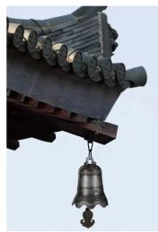
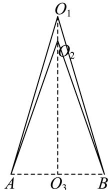
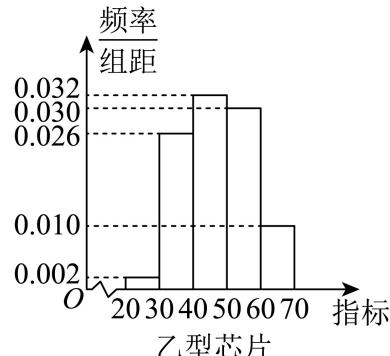

# 2025一模 奉贤区原卷 · 学生版

> 本地预览：题目、答案及分类尚未全部审定。校对使用的PDF为高中工作台解析版，尚未逐区确认区级印刷原卷。

## 填空题

按本区原卷题号顺序排列。

### 奉贤 · 第1题

设全集 $U=\{1,2,3,4\}$，集合 $A=\{2,4\}$，则 $\overline A=$ ______。

> 本题资料或解析有待核事项，预览不可作为已审定成品。

### 奉贤 · 第2题

若直线l1 $\ : \ : x + a y - 2 = 0 \ : \ !$ 与直线l2：ax + y − 2 = 0互相垂直，则a =

### 奉贤 · 第3题

已知x ∈ R，则不等式 $x ^ { 2 } - x + 2 >$ 0的解集为

### 奉贤 · 第4题

设 $f(x)=\begin{cases}\ln x+1,&x>0,\\2^x+1,&x\leq 0.\end{cases}$ 若 $f(x_0)=1$，则 $x_0=$______。

> 本题资料或解析有待核事项，预览不可作为已审定成品。

### 奉贤 · 第5题

若A, B, C, D, E五人站成一排，如果A, B必须相邻，那么排法共 种.

### 奉贤 · 第6题

$\left( x ^ { 6 } + { \frac { 1 } { x { \sqrt { x } } } } \right) ^ { ! }$ 5 的二项展开式中的常数项为 ．（用数字作答）

### 奉贤 · 第7题

已知抛物线 $x ^ { 2 } = a y \left( a > 0 \right)$ 上有一点P到准线的距离为6，点P到x轴的距离为4，则抛物线的焦点坐标为

### 奉贤 · 第8题

在复平面内，$O$ 为坐标原点，复数 $z_1=\mathrm i(-4-3\mathrm i)$，$z_2=12+5\mathrm i$ 对应的点分别为 $Z_1,Z_2$，其中 $\mathrm i$ 为虚数单位，则 $\langle\overrightarrow{OZ_1},\overrightarrow{OZ_2}\rangle$ 的大小为 ______。

> 本题资料或解析有待核事项，预览不可作为已审定成品。

### 奉贤 · 第9题

甲乙两人下棋，每局两人获胜的可能性一样，某一天两人要进行一场三局两胜的比赛，最终胜者赢得100元奖金，第一局比赛甲获胜，后因为有其他事情而中止比赛，则甲应该分 元奖金才公平？

### 奉贤 · 第10题

申辉中学高一（8）班设计了一个“水滴状”班徽的平面图（如图），徽章由等腰三角形ABC及以弦BC和劣弧BC所围成的弓形所组成，其中 $A B = A C$ ，劣弧BC所在的圆为三角形的外接圆，圆心为O

已知 $\angle B A C = \theta , \theta \in \left( 0 , \frac { \pi } { 2 } \right)$ ，外接圆的半径是2，则该图形的面积为 ．（用含θ的表达式表示）

### 奉贤 · 第11题

上海市奉贤区奉城镇的古建筑万佛阁（图1）的屋檐下常系挂风铃（图2），风吹铃动，悦耳清脆，亦称惊鸟铃，一般一个惊鸟铃由铜铸造而成，由铃身和铃舌组成，为了知道一个惊鸟铃的质量，可以通过计算该惊鸟铃的体积，然后由物理学知识计算出该惊鸟铃的质量，因此我们需要作出一些合理的假设：
假设1：铃身且可近似看作由一个较大的圆锥挖去一个较小的圆锥；
假设2：两圆锥的轴在同一条直线上；
假设3：铃身内部有一个挂铃舌的部位的体积忽略不计截面图如下（图3），其中 $\Im O _ { 1 } O _ { 3 } = 2 0 \mathrm { c m }$ 1 $O _ { 2 } O _ { 3 } = 1 8 \mathrm { { c m } }$ $A B = 1 6 \mathrm { c m }$ ，则制作100个这样的惊鸟铃的铃身至少需要 千克铜．（铜的密度为8 $. 9 \mathrm { { g } / \mathrm { { c m } ^ { 3 } ) } }$ （结果精确到个位）

图1

图2

图3

### 奉贤 · 第12题

已知集合 $\mathbf { \partial } M = \{ P _ { 0 } , P _ { 1 } , P _ { 2 } , \cdots , P _ { n } \} , n \geq 2 , n \in \mathbf { N }$ 是由函数 $y = \cos x , x \in [ 0 , 2 \pi ]$ 的图象上两两不相同的点构成的点集，集合 $S = \left\{ a | a = { \overrightarrow { O P _ { 0 } } } \cdot { \overrightarrow { O P _ { i } } } , i = 0 , 1 , 2 , \cdots , n , n \geq 2 , n \in \mathbf { N } \right\}$ ，其中 $P _ { 0 } \left( 0 , 1 \right)$ $P _ { 1 } \left( \pi , - 1 \right)$ ．若集合S中的元素按照从小到大的顺序排列能构成公差为d的等差数列，当 $d \in \left\{ { \frac { 1 } { 2 } } , 1 \right\}$ 时，则符合条件的点集M的个数为

> 本题资料或解析有待核事项，预览不可作为已审定成品。

## 选择题

按本区原卷题号顺序排列。

### 奉贤 · 第13题

在 $\triangle A B C ^ { \ r }$ 中， $^ { \ast } C = \frac { \pi } { 2 } ;$ ”是 $\ddot { } \sin ^ { 2 } A + \sin ^ { 2 } B = 1$ ”的（ ）

A. 充分不必要条件

B. 必要不充分条件

C. 充要条件

D. 既不充分也不必要条件

### 奉贤 · 第14题

函数 $y = \log _ { 2 } \sin x + \log _ { 2 } \cos x$ ，则下列命题正确的是（ ）

A. 函数是偶函数

B. 函数定义域是 $\left( 0 , { \frac { \pi } { 2 } } \right)$

C. 函数最大值−1

D. 函数的最小正周期为π

### 奉贤 · 第15题

在四棱锥 $S - A B C D$ 中，若 $\overrightarrow { S A } = x \overrightarrow { S B } + y \overrightarrow { S C } + z \overrightarrow { S D }$ ，则实数组(x, y, z)可能是（ ）

A. $( 1 , - 1 , 1 )$

B. $( 1 , 0 , - 1 )$

C. $( 1 , 0 , 0 )$

D. $( 1 , - 1 , - 1 )$

### 奉贤 · 第16题

已知数列 $\left\{ a _ { n } \right\}$ 不是常数列，前n项和为 $S _ { n } , \ a _ { n } > 0$ ．若对任意正整数n，存在正整数m，使得$| S _ { n } - a _ { m } | < a _ { 1 }$ ，则称 $\left\{ a _ { n } \right\}$ 是“可控数列”．现给出两个命题：
①若各项均为正整数的等差数列 $\left\{ a _ { n } \right\}$ 满足公差 $d = 3$ ，则 $\left\{ a _ { n } \right\}$ 是“可控数列”；
②若等比数列 $\left\{ a _ { n } \right\}$ 是“可控数列”，则其公比 $q \in \left( 0 , \frac { 1 } { 2 } \right]$
则下列判断正确的是（ ）

A. ①与②均为真命题

B. ①与②均为假命题

C. ①为假命题，②为真命题

D. ①为真命题，②为假命题

> 本题资料或解析有待核事项，预览不可作为已审定成品。

## 解答题

按本区原卷题号顺序排列。

### 奉贤 · 第17题

已知函数 $y = f \left( x \right)$ ，其中 $f \left( x \right) = a ^ { x }$ （常数 $[ a > 0$ 且 $. a \neq 1 )$ ）
(1) (6分)若函数 $\boldsymbol { \cdot } \boldsymbol { y } = \boldsymbol { f } \left( \boldsymbol { x } \right)$ 的图象过点(2,9)，求关于x的不等式 $f \left( \left| 2 x - 1 \right| \right) >$ 3的解集；
(2) (8分)若存在 ${ \bf \Phi } _ { : x } \in ( 0 , 1 ]$ ，使得数列f (1)、f (tx)、 $f \left( x ^ { 2 } + 2 \right)$ 是等比数列，求实数t的取值范围.

> 本题资料或解析有待核事项，预览不可作为已审定成品。

### 奉贤 · 第18题

某芯片代工厂生产甲、乙两种型号的芯片，为了解芯片的某项指标，从这两种芯片中各抽取100件进行检测，获得该项指标的频率分布直方图，如图所示：

假设数据在组内均匀分布，以样本估计总体，以事件发生的频率作为相应事件发生的概率
(1) (6分)求频率分布直方图中x的值并估计乙型芯片该项指标的平均值（同一组中的数据用该组区间的中点值为代表）；
(2) (8分)已知甲型芯片指标在[80, 100)为航天级芯片，乙型芯片指标在[60, 70)为航天为航天级芯片．现分别采用分层抽样的方式，从甲型芯片指标在[70,90)内取2件，乙型芯片指标在[50,70)内取4件，再从这6件中任取2件，求至少有一件为航天级芯片的概率

> 本题资料或解析有待核事项，预览不可作为已审定成品。

### 奉贤 · 第19题

如图为正四棱锥 $P - A B C D , O$ 为底面ABCD的中心

(1)图
(2)图
(1) (6分)求证： $C D / /$ 平面 $P A B ,$ 平面 $P A C \bot$ 平面PBD；
(2) (8分)设E为PB上的一点，− $\overrightarrow { B E } = \frac { 2 } { 3 } \overrightarrow { B P } .$
在下面两问中选一个，
①若 $A D = A P = 3 { \sqrt { 2 } } .$ ，求直线EC与平面BED所成角的大小
②已知平面ECD与平面ABCD所成锐二面角的大小为 $\arctan { \frac { \sqrt { 2 } } { 2 } }$ ，若 $A D = 3 { \sqrt { 2 } }$ ，求AP的长

> 本题资料或解析有待核事项，预览不可作为已审定成品。

### 奉贤 · 第20题

椭圆Γ: ${ \frac { x ^ { 2 } } { a ^ { 2 } } } + y ^ { 2 } = 1 ( a > 1 )$ 的左右焦点分别为 $F _ { 1 } , F _ { 2 }$ ，设 $P \left( x _ { 0 } , y _ { 0 } \right)$ 是第一象限内椭圆上的一点，$P F _ { 1 }$ 的延长线交椭圆于点 $Q \left( x _ { 1 } , y _ { 1 } \right)$

(1) (4分)若椭圆的离心率 $\frac { \sqrt { 2 } } { 2 }$ ，求a的值；
(2) (6分) $\overleftrightarrow { \boldsymbol { \mathrm { f } } } a = \sqrt { 2 } , \overrightarrow { P Q } \cdot \overrightarrow { O F _ { 1 } } = \frac { 1 2 } { 5 }$ ，求x0；
(3) (8分)若a = 2，过点 $T \left( 0 , t \right)$ 的直线l与椭圆Γ交于M、N两点，且 $\vert M N \vert = 2$ ，则当 $t \geq 0 \mathbb { H }$ 时，判 断符合要求的直线有几条，说明理由？

> 本题资料或解析有待核事项，预览不可作为已审定成品。

### 奉贤 · 第21题

若函数 $\boldsymbol { \cdot } \boldsymbol { y } = \boldsymbol { f } \left( \boldsymbol { x } \right)$ 的图象上存在k个不同点 $P _ { 1 \setminus } \ P _ { 2 \setminus } \ \cdots \ P _ { k } \left( k \geq 2 , k \in \mathbf { N } \right)$ 处的切线重合，则称该切线为函数 $y = f \left( x \right)$ 的一条k点切线，该函数具有k点切线性质
(1) (4分)判断函数 $y = x ^ { 2 } - 2 | x | , x \in \mathbf { R }$ 的奇偶性并写出它的一条2点切线方程（无需理由）；
(2) (6分)设 $f \left( x \right) = \mathrm { e } ^ { x } - \ln x$ ，判断函数 $y = f \left( x \right)$ 是否具有k点切线性质，并说明理由；
(3) (8分)设 $y \left( x \right) = \cos x + 2 x$ ，证明：对任意的 $m \ge 3 , m \in \mathbf { N }$ ，函数 $y = g \left( x \right)$ 具有m点切线性质，并求出所有相应的切线方程

> 本题资料或解析有待核事项，预览不可作为已审定成品。

