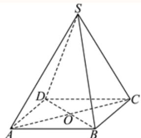

# 2025一模 奉贤区原卷 · 教师版

> 本地预览：题目、答案及分类尚未全部审定。校对使用的PDF为高中工作台解析版，尚未逐区确认区级印刷原卷。

## 填空题

按本区原卷题号顺序排列。

### 奉贤 · 第1题

设全集 $U=\{1,2,3,4\}$，集合 $A=\{2,4\}$，则 $\overline A=$ ______。

> 本题资料或解析有待核事项，预览不可作为已审定成品。

**考点：** 有限集合的补集运算

**难度依据：** 按全集删除集合已有元素

**核查说明：** 仅核本题所列字段及页面；不等于全卷终审。；题干与解析已用于人工归类，尚未完成整题公式校净与独立数学终审。；题干补集横线漏识；同名PDF第1页文字层确认是A的补集。

【答案】{1, 3}.

【解析】

利用补集的定义可得出结合A.–

因为全集U = {1, 2, 3, 4}，集合 $A = \{ 2 , 4 \}$ ，则 $\overline { { A } } = \{ 1 , 3 \}$

故答案为：{1, 3}.

### 奉贤 · 第2题

若直线l1 $\ : \ : x + a y - 2 = 0 \ : \ !$ 与直线l2：ax + y − 2 = 0互相垂直，则a =

**考点：** 一般式直线垂直的系数条件

**难度依据：** 用系数内积为零避免漏斜率不存在情形

**核查说明：** 题干与解析已用于人工归类，尚未完成整题公式校净与独立数学终审。

【答案】0

【解析】

根据直线互相垂直求出a的值.

由题意得 $1 \times a + a \times 1 = 0$ ，解得a = 0.

故答案为：0

### 奉贤 · 第3题

已知x ∈ R，则不等式 $x ^ { 2 } - x + 2 >$ 0的解集为

**考点：** 判别式判断二次不等式恒正

**难度依据：** 二次项正且判别式负

**核查说明：** 题干与解析已用于人工归类，尚未完成整题公式校净与独立数学终审。

【答案】R.

【解析】

利用二次函数的判别式的符号，判断不等式恒成立.

因为 $\Delta = 1 - 8 = - 7 < 0$ ，所以不等式 $x ^ { 2 } - x + 2 >$ 0的解集为R.

故答案为：R.

### 奉贤 · 第4题

设 $f(x)=\begin{cases}\ln x+1,&x>0,\\2^x+1,&x\leq 0.\end{cases}$ 若 $f(x_0)=1$，则 $x_0=$______。

> 本题资料或解析有待核事项，预览不可作为已审定成品。

**考点：** 分段指数对数函数的给值求自变量

**难度依据：** 须分别检查两段方程与区间

**核查说明：** 题干与解析已用于人工归类，尚未完成整题公式校净与独立数学终审。；题干分段函数缺少x>0时ln x+1这一整支；已定向下载同名PDF，第1页文字层确认两支为ln x+1(x>0)、2^x+1(x≤0)，本分类未改底稿。

【答案】1

【解析】

根据分段函数，分 $x _ { 0 } > 0$ 和 $\mathrm { { I } } x _ { 0 } \le 0$ 求解即可.

当 $x _ { 0 } > 0 \mathbb { H } \ b { \mathrm { J } }$ ， $f \left( x _ { 0 } \right) = \ln x _ { 0 } + 1 = 1$ ，解得： $x _ { 0 } = 1$ ，满足；

当 $x _ { 0 } \leq$ 0时， $f \left( x _ { 0 } \right) = 2 ^ { x _ { 0 } } + 1 = 1$ ，方程无解，

所以 $x _ { 0 } = 1$ ，

故答案为：1

### 奉贤 · 第5题

若A, B, C, D, E五人站成一排，如果A, B必须相邻，那么排法共 种.

**考点：** 相邻排列的捆绑法

**难度依据：** 整体排列后补内部排列

**核查说明：** 题干与解析已用于人工归类，尚未完成整题公式校净与独立数学终审。

【答案】48

【解析】

元素相邻问题运用捆绑法求解.

第一步：把A,B捆绑当作一个元素与C,D,E进行排列共有 $\mathrm { A } _ { 4 } ^ { 4 }$ 种；

第二步：A,B之间进行排列共有A2种；

根据分步计数原理可知：排法的总数共有 $\mathrm { A } _ { 4 } ^ { 4 } \mathrm { A } _ { 2 } ^ { 2 } = 4 8 \hbar \#$ .

故答案为：48

### 奉贤 · 第6题

$\left( x ^ { 6 } + { \frac { 1 } { x { \sqrt { x } } } } \right) ^ { ! }$ 5 的二项展开式中的常数项为 ．（用数字作答）

**考点：** 含分数指数的二项展开常数项

**难度依据：** 准确列指数并令其为零

**核查说明：** 题干与解析已用于人工归类，尚未完成整题公式校净与独立数学终审。

【答案】5

【解析】

写出展开式的通项，令x的指数为0即可；

由题意可知： $T _ { r + 1 } = \mathrm { C } _ { 5 } ^ { r } { \left( x \right) } ^ { 3 0 - 6 r } { \left( \frac { 1 } { x \sqrt { x } } \right) } ^ { r } = \mathrm { C } _ { 5 } ^ { r } { \left( x \right) } ^ { 3 0 - 6 r } { \left( x \right) } ^ { - \frac { 3 } { 2 } r } = \mathrm { C } _ { 5 } ^ { r } { \left( x \right) } ^ { 3 0 - \frac { 1 5 } { 2 } r }$ ，令

$3 0 - { \frac { 1 5 } { 2 } } r = 0 \Rightarrow r = 4$ ，所以常数项为 $\mathrm { C } _ { 5 } ^ { 4 } = 5$

故答案为：5

### 奉贤 · 第7题

已知抛物线 $x ^ { 2 } = a y \left( a > 0 \right)$ 上有一点P到准线的距离为6，点P到x轴的距离为4，则抛物线的焦点坐标为

**考点：** 抛物线准线距离与焦点参数

**难度依据：** 先定纵坐标再用准线距离反求参数

**核查说明：** 题干与解析已用于人工归类，尚未完成整题公式校净与独立数学终审。

【答案】(0, 2).

【解析】

根据题意求出点P的纵坐标，结合点P到准线的距离可求出a的值，即可得出抛物线焦点的坐标.

抛物线 $x ^ { 2 } = a y \left( a > 0 \right)$ )的准线方程为 $y = - { \frac { a } { 4 } }$

设点 $P \left( x , y \right)$ ，则 $y \geq 0$ ，由于点P到准线的距离为 $y + { \frac { a } { 4 } } = 6$ ，可得 ${ \mathfrak { y } } = 6 - { \frac { a } { 4 } }$

因为点P到x轴的距离为4，则y = 4，所以， $6 - { \frac { a } { 4 } } = { \dot { 4 } } .$ ，解得 $a = 8$

故抛物线的方程为 $x ^ { 2 } = 8 y$ ，其焦点坐标为(0,2).

故答案为：(0, 2).

### 奉贤 · 第8题

在复平面内，$O$ 为坐标原点，复数 $z_1=\mathrm i(-4-3\mathrm i)$，$z_2=12+5\mathrm i$ 对应的点分别为 $Z_1,Z_2$，其中 $\mathrm i$ 为虚数单位，则 $\langle\overrightarrow{OZ_1},\overrightarrow{OZ_2}\rangle$ 的大小为 ______。

> 本题资料或解析有待核事项，预览不可作为已审定成品。

**考点：** 复数运算与复平面坐标；坐标数量积求向量夹角

**难度依据：** 复数乘法转坐标后求余弦与夹角

**核查说明：** 仅核本题所列字段及页面；不等于全卷终审。；题干与解析已用于人工归类，尚未完成整题公式校净与独立数学终审。；题干夹角括号缺失，需规范向量夹角符号。

【解析】

由复数乘法运算求得 $z _ { 1 }$ ，进而得到 $\overrightarrow { O Z _ { 1 } } , \overrightarrow { O Z _ { 2 } }$ 利用向量数量积运算和模长公式求得$\cos \left. \overrightarrow { O Z _ { 1 } } , \overrightarrow { O Z _ { 2 } } \right.$ ，进而得到 $\left. \overrightarrow { O Z _ { 1 } } , \overrightarrow { O Z _ { 2 } } \right.$

因为 $\vert z _ { 1 } = \mathrm { i } \left( - 4 - 3 \mathrm { i } \right) = 3 - 4 \mathrm { i } , ~ z _ { 2 } = 1 2 + 5 \mathrm { i }$

所以 $\overrightarrow { O Z _ { 1 } } = ( 3 , - 4 ) , \overrightarrow { O Z _ { 2 } } = ( 1 2 , 5 )$

$$
\cos \left\langle \overrightarrow {O Z _ {1}}, \overrightarrow {O Z _ {2}} \right\rangle = \frac {\overrightarrow {O Z _ {1}} \cdot \overrightarrow {O Z _ {2}}}{\left| \overrightarrow {O Z _ {1}} \right| \left| \overrightarrow {O Z _ {2}} \right|} = \frac {3 \times 1 2 - 2 0}{\sqrt {3 ^ {2} + (- 4) ^ {2}} \times \sqrt {1 2 ^ {2} + 5 ^ {2}}} = \frac {1 6}{6 5},
$$

所以 $\left. { \overrightarrow { O Z _ { 1 } } } , { \overrightarrow { O Z _ { 2 } } } \right. = \operatorname { a r c c o s } { \frac { 1 6 } { 6 5 } } .$

### 奉贤 · 第9题

甲乙两人下棋，每局两人获胜的可能性一样，某一天两人要进行一场三局两胜的比赛，最终胜者赢得100元奖金，第一局比赛甲获胜，后因为有其他事情而中止比赛，则甲应该分 元奖金才公平？

**考点：** 中止赛制的条件胜率和公平分奖

**难度依据：** 当前比分下用乙再连胜的补事件

**核查说明：** 题干与解析已用于人工归类，尚未完成整题公式校净与独立数学终审。

【答案】75.

【解析】

分别求出甲、乙最终获胜的概率，即可求出答案.

乙最后获胜的情况为第二局、第三局必须乙胜，其概率为： ${ \frac { 1 } { 2 } } \times { \frac { 1 } { 2 } } = { \frac { 1 } { 4 } }$

即甲最终获胜的概率为 $\frac 3 4$ ，乙最终获胜的概率为 $\frac 1 4$

故甲的奖金为 $1 0 0 \times { \frac { 3 } { 4 } } = 7 5 { \overline { { \mathcal { T } } } }$

故答案为：75.

### 奉贤 · 第10题

申辉中学高一（8）班设计了一个“水滴状”班徽的平面图（如图），徽章由等腰三角形ABC及以弦BC和劣弧BC所围成的弓形所组成，其中 $A B = A C$ ，劣弧BC所在的圆为三角形的外接圆，圆心为O

已知 $\angle B A C = \theta , \theta \in \left( 0 , \frac { \pi } { 2 } \right)$ ，外接圆的半径是2，则该图形的面积为 ．（用含θ的表达式表示）

**考点：** 圆心角圆周角与扇形三角形面积建模

**难度依据：** 分割复合图形并用圆周角关系表示面积

**核查说明：** 题干与解析已用于人工归类，尚未完成整题公式校净与独立数学终审。

【答案】$4 \theta + 4 \sin \theta .$

【解析】

连接 $O B , O A , O C ,$ ，求出 $^ { \prime } S _ { \triangle A O B } \ , S _ { \triangle A O C } , S _ { \triangle \bar { 3 } \bar { 4 } \bar { 4 } B O C }$ 可得答案.

连接 $O B , O A , O C$ ，则 $O B = O A = O C = 2 , \angle B O C = 2 \theta ,$

$$
\angle A O B = \angle A O C = \frac {2 \pi - \angle B O C}{2} = \pi - \theta ,
$$

$$
S _ {\triangle A O B} = S _ {\triangle A O C} = \frac {1}{2} \times 2 \times 2 \sin (\pi - \theta) = 2 \sin \theta ,
$$

$$
S _ {\text {扇形} B O C} = \frac {1}{2} \times 2 \theta \times 2 \times 2 = 4 \theta ,
$$

所以该图形的面积为 $4 \theta + 4 \sin \theta$

故答案为： $4 \theta + 4 \sin \theta .$

### 奉贤 · 第11题

上海市奉贤区奉城镇的古建筑万佛阁（图1）的屋檐下常系挂风铃（图2），风吹铃动，悦耳清脆，亦称惊鸟铃，一般一个惊鸟铃由铜铸造而成，由铃身和铃舌组成，为了知道一个惊鸟铃的质量，可以通过计算该惊鸟铃的体积，然后由物理学知识计算出该惊鸟铃的质量，因此我们需要作出一些合理的假设：
假设1：铃身且可近似看作由一个较大的圆锥挖去一个较小的圆锥；
假设2：两圆锥的轴在同一条直线上；
假设3：铃身内部有一个挂铃舌的部位的体积忽略不计截面图如下（图3），其中 $\Im O _ { 1 } O _ { 3 } = 2 0 \mathrm { c m }$ 1 $O _ { 2 } O _ { 3 } = 1 8 \mathrm { { c m } }$ $A B = 1 6 \mathrm { c m }$ ，则制作100个这样的惊鸟铃的铃身至少需要 千克铜．（铜的密度为8 $. 9 \mathrm { { g } / \mathrm { { c m } ^ { 3 } ) } }$ （结果精确到个位）

图1

图2

图3

**考点：** 圆锥挖空体积与质量估算

**难度依据：** 作两个圆锥体积差后处理密度与单位

**核查说明：** 题干与解析已用于人工归类，尚未完成整题公式校净与独立数学终审。

【答案】120.

【解析】

利用锥体的体积公式可求得结果.

由题意可知，圆锥 $\lvert O _ { 1 } O _ { 3 }$ 的底面半径为8cm，高为20cm，

圆锥 $\mathrm { { ; } } O _ { 2 } O _ { 3 }$ 的底面半径为8cm，高为18cm，

因为 $1 1 0 0 \times { \frac { 1 } { 3 } } \times \pi \times 8 ^ { 2 } \times ( 2 0 - 1 8 ) \times 8 . 9 \div 1 0 0 0 \approx 1 1 9 . 2 3 6 ,$

所以，制作100个这样的惊鸟铃的铃身至少需要120千克铜.

故答案为：120.

### 奉贤 · 第12题

已知集合 $\mathbf { \partial } M = \{ P _ { 0 } , P _ { 1 } , P _ { 2 } , \cdots , P _ { n } \} , n \geq 2 , n \in \mathbf { N }$ 是由函数 $y = \cos x , x \in [ 0 , 2 \pi ]$ 的图象上两两不相同的点构成的点集，集合 $S = \left\{ a | a = { \overrightarrow { O P _ { 0 } } } \cdot { \overrightarrow { O P _ { i } } } , i = 0 , 1 , 2 , \cdots , n , n \geq 2 , n \in \mathbf { N } \right\}$ ，其中 $P _ { 0 } \left( 0 , 1 \right)$ $P _ { 1 } \left( \pi , - 1 \right)$ ．若集合S中的元素按照从小到大的顺序排列能构成公差为d的等差数列，当 $d \in \left\{ { \frac { 1 } { 2 } } , 1 \right\}$ 时，则符合条件的点集M的个数为

> 本题资料或解析有待核事项，预览不可作为已审定成品。

**考点：** 坐标数量积提取纵坐标；有限等差数列公差分类；余弦函数定值点枚举；有必选点约束的集合计数；点集到数集映射的重合与去重

**难度依据：** 公差两种情形下按同纵坐标点的非空选择计数

**核查说明：** 题干与解析已用于人工归类，尚未完成整题公式校净与独立数学终审。；原解多个余弦值与横坐标被错排，计数思路可辨但公式未校净。

【答案】60.

【解析】

确定数列中最大值为1，最小值为−1，然后根据d分类得出等差数列，再由等差数列的项确定点 $P _ { i }$ 的横坐标的值，然后由M中对应点的的情形确定集合个数

由已知 $\vert a _ { 0 } = \overrightarrow { O P _ { 0 } } \cdot \overrightarrow { O P _ { 0 } } = 1 , a _ { 1 } = \overrightarrow { O P _ { 0 } } \cdot \overrightarrow { O P _ { 1 } } = - 1$

设 $P _ { i } ( x _ { i } , y _ { i } )$ ，则 $a _ { i } = \overrightarrow { O P _ { 0 } } \cdot \overrightarrow { O P _ { i } } = y _ { i }$ ，显然 $- 1 \leq y _ { i } \leq 1$

若 $\dot { \boldsymbol { d } } = 1$ ，则 $S = \{ - 1 , 0 , 1 \}$ ，因此有 $\dot { y } _ { i } = 0$

由 $\cos x _ { i } = 0 , x _ { i } \in [ 0 , 2 \pi ]$ 得 $x _ { i } = { \frac { \pi } { 2 } }$ 或 $\frac { 3 \pi } { 2 }$ ，对应 $Q _ { 1 } \left( \frac { \pi } { 2 } , 0 \right) , Q _ { 2 } \left( \frac { 3 \pi } { 2 } , 0 \right)$

同理 $Q _ { 3 } ( 2 \pi , 1 )$ 对应 $P _ { 0 }$ ，

集合M中已经含有点 $P _ { 0 } , P _ { 1 }$ ，

因此产生 $S = \{ - 1 , 0 , 1 \}$ 的集合M中，点 $Q _ { 3 }$ 可有也可没有， $Q _ { 1 } , Q _ { 2 }$ 至少有一个，

所以M的个数为 $2 \times 3 = 6$

若 $\dot { \boldsymbol { d } } = \frac { 1 } { 2 }$ ，则 $S = \left\{ - 1 , - \frac { 1 } { 2 } , 0 , \frac { 1 } { 2 } , 1 \right\}$

cos xi = 1 xi 2π 或 4π cos xi = 1 xi π 或 5π

对应点Q $\mathrm { ~ \ i ~ } \left( \frac { \pi } { 3 } , \frac { 1 } { 2 } \right) , Q _ { 5 } \left( \frac { 5 \pi } { 3 } , \frac { 1 } { 2 } \right) , Q _ { 6 } \left( \frac { 2 \pi } { 3 } , - \frac { 1 } { 2 } \right) , Q _ { 7 } \left( \frac { 4 \pi } { 3 } , - \frac { 1 } { 2 } \right)$

产生 $\left\{ - 1 , - \frac { 1 } { 2 } , 0 , \frac { 1 } { 2 } , 1 \right\}$ 的集合M中，点 ${ \bf \nabla } \cdot { \bf Q _ { 3 } }$ 可有也可没有， $Q _ { 1 } , Q _ { 2 }$ 至少有一个，

$Q _ { 4 } , Q _ { 5 }$ 中至少有一个， $Q _ { 6 } , Q _ { 7 }$ 中至少有一个，M的个数为 $2 \times 3 \times 3 \times 3 = 5 4$

综上，集合M的个数为 $6 + 5 4 = 6 0$

故答案为：60.

方法点睛：确定集合的个数即为确定集合中元素的可能性，本题中首先确定出最终等差数列的最大值和最小值，从而根据公差得出等差数列，由等差数列确定可能含有的点，从而得出集合个数

## 二、选择题

## 选择题

按本区原卷题号顺序排列。

### 奉贤 · 第13题

在 $\triangle A B C ^ { \ r }$ 中， $^ { \ast } C = \frac { \pi } { 2 } ;$ ”是 $\ddot { } \sin ^ { 2 } A + \sin ^ { 2 } B = 1$ ”的（ ）

A. 充分不必要条件

B. 必要不充分条件

C. 充要条件

D. 既不充分也不必要条件

**考点：** 三角命题的充分必要性与反例；三角形内角关系及平方和恒等式

**难度依据：** 充分性用互余关系必要性需构造非直角反例

**核查说明：** 题干与解析已用于人工归类，尚未完成整题公式校净与独立数学终审。

【答案】A

【解析】

结合同角三角函数关系、诱导公式，分别从充分性、必要性两方面来说明即可

一方面：

$$
C = \frac {\pi}{2} \Rightarrow A + B = \frac {\pi}{2} \Rightarrow \sin A = \sin \left(\frac {\pi}{2} - B\right) = \cos B \Rightarrow \sin^ {2} A + \sin^ {2} B = \cos^ {2} B + \sin^ {2} B =
$$

另一方面： $A = { \frac { 2 \pi } { 3 } } , B = C = { \frac { \pi } { 6 } } \Rightarrow \sin ^ { 2 } A + \sin ^ { 2 } B = \left( { \frac { \sqrt { 3 } } { 2 } } \right) ^ { 2 } + \left( { \frac { 1 } { 2 } } \right) ^ { 2 } = 1$ 但 $C \neq { \frac { \pi } { 2 } }$

$$
" C = \frac {\pi}{2}" \text {是}" \sin^ {2} A + \sin^ {2} B = 1
$$

故选：A.

### 奉贤 · 第14题

函数 $y = \log _ { 2 } \sin x + \log _ { 2 } \cos x$ ，则下列命题正确的是（ ）

A. 函数是偶函数

B. 函数定义域是 $\left( 0 , { \frac { \pi } { 2 } } \right)$

C. 函数最大值−1

D. 函数的最小正周期为π

**考点：** 复合对数函数定义域与周期；正弦余弦同正区域及二倍角最值

**难度依据：** 周期不能只看化简式还需保留原定义域

**核查说明：** 题干与解析已用于人工归类，尚未完成整题公式校净与独立数学终审。

【答案】C

【解析】

求出函数f(x)的定义域，可判断AB选项；利用二倍角的正弦公式以及正弦函数的有界性可判断C选项；利用正弦型函数的周期性可判断D选项.

设 $f \left( x \right) = \log _ { 2 } \sin x + \log _ { 2 } \cos x$ ，由 $\left\{ { \begin{array} { l } { \sin x > 0 } \\ { \cos x > 0 } \end{array} } \right.$ 可得 $2 k \pi < x < 2 k \pi + { \frac { \pi } { 2 } } ( k \in { \bf Z } )$

所以，函数f(x)的定义域为 $\left\{ x \Big \vert 2 k \pi < x < 2 k \pi + \frac { \pi } { 2 } , k \in \mathbf { Z } \right\}$ ，定义域不关于原点对称

所以，函数f(x)不是偶函数，A错B错；

当 $2 k \pi < x < 2 k \pi + \frac { \pi } { 2 } ( k \in { \bf Z } )$ 时，则 $\displaystyle { \mathfrak { k } } \pi < 2 x < 4 k \pi + \pi \left( k \in \mathbf { Z } \right)$

$$
f (x) = \log_ {2} (\sin x \cos x) = \log_ {2} \left(\frac {1}{2} \sin 2 x\right) \leq \log_ {2} \frac {1}{2} = - 1,
$$

当且仅当 $2 x = \frac { \pi } { 2 } + 4 k \pi \left( k \in \mathbf { Z } \right)$ 时，即当 $x = { \frac { \pi } { 4 } } + 2 k \pi \left( k \in { \mathbf { Z } } \right)$ 时，函数f(x)取最大值−1，C对；

因为 $f \left( 2 \pi + x \right) = \log _ { 2 } \sin \left( 2 \pi + x \right) + \log _ { 2 } \cos \left( 2 \pi + x \right) = \log _ { 2 } \sin x + \log _ { 2 } \cos x = f \left( x \right)$

结合函数f(x)的定义域可知，函数f(x)的最小正周期为2π，D错.故选：C.

### 奉贤 · 第15题

在四棱锥 $S - A B C D$ 中，若 $\overrightarrow { S A } = x \overrightarrow { S B } + y \overrightarrow { S C } + z \overrightarrow { S D }$ ，则实数组(x, y, z)可能是（ ）

A. $( 1 , - 1 , 1 )$

B. $( 1 , 0 , - 1 )$

C. $( 1 , 0 , 0 )$

D. $( 1 , - 1 , - 1 )$

**考点：** 空间向量线性表示与共面约束；四棱锥底面形状的可实现性

**难度依据：** 向量线性式须检验能否构成真实四棱锥

**核查说明：** 题干与解析已用于人工归类，尚未完成整题公式校净与独立数学终审。

【答案】A

【解析】

利用底面是平行四边形判断A，根据向量的线性运算与向量的共线与共面性质判断B、C、D

对于选项A，若底面ABCD是平行四边形，设 $A C \cap B D = O$ ，则 $| \overrightarrow { S A } + \overrightarrow { S C } = 2 \overrightarrow { S O } = \overrightarrow { S B } + \overrightarrow { S D }$

因此 $\overrightarrow { S A } = \overrightarrow { S B } + \overrightarrow { S D } - \overrightarrow { S C }$ ，即 $( x , y , z ) = ( 1 , - 1 , 1 )$ ，故A正确；

对于选项B，若 $( x , y , z ) = ( 1 , 0 , - 1 )$ ，则 $| x \overrightarrow { S B } + y \overrightarrow { S C } + z \overrightarrow { S D } = \overrightarrow { S B } - \overrightarrow { S D } = \overrightarrow { D B } \neq \overrightarrow { S A }$ ，故B错误；

对于选项C，若 $( x , y , z ) = ( 1 , 0 , 0 )$ ，则 $\overrightarrow { x S B } + \overrightarrow { y S C } + z \overrightarrow { S D } = \overrightarrow { S B } \neq \overrightarrow { S A }$ ，故C错误；

对于选项D，若 $( x , y , z ) = ( 1 , - 1 , - 1 )$ ，则 $| x \overrightarrow { S B } + y \overrightarrow { S C } + z \overrightarrow { S D } = \overrightarrow { S B } - \overrightarrow { S C } - \overrightarrow { S D } = \overrightarrow { C B } - \overrightarrow { S D }$ 但 $B C \notin$ 平面SAD，即 $\overrightarrow { S A } , \overrightarrow { S D } , \overrightarrow { C B }$ 不共面，因此 $\overrightarrow { S A } = \overrightarrow { C B } - \overrightarrow { S D }$ 不可能成立，故D错误故选：A

### 奉贤 · 第16题

已知数列 $\left\{ a _ { n } \right\}$ 不是常数列，前n项和为 $S _ { n } , \ a _ { n } > 0$ ．若对任意正整数n，存在正整数m，使得$| S _ { n } - a _ { m } | < a _ { 1 }$ ，则称 $\left\{ a _ { n } \right\}$ 是“可控数列”．现给出两个命题：
①若各项均为正整数的等差数列 $\left\{ a _ { n } \right\}$ 满足公差 $d = 3$ ，则 $\left\{ a _ { n } \right\}$ 是“可控数列”；
②若等比数列 $\left\{ a _ { n } \right\}$ 是“可控数列”，则其公比 $q \in \left( 0 , \frac { 1 } { 2 } \right]$
则下列判断正确的是（ ）

A. ①与②均为真命题

B. ①与②均为假命题

C. ①为假命题，②为真命题

D. ①为真命题，②为假命题

> 本题资料或解析有待核事项，预览不可作为已审定成品。

**考点：** 可控数列的等差反例与等比参数；全称存在量词下的数列逼近；绝对值邻近条件与几何和界

**难度依据：** 需理解每个n可另选m的量词并验证反例与参数

**核查说明：** 题干与解析已用于人工归类，尚未完成整题公式校净与独立数学终审。；原解排除q>1时疑似把“对每个n存在m”换成固定m后令n增大，量词证明需独立核查，不按原解直接定稿。

【答案】C

【解析】

给出①的反例，然后结合可控数列的含义以及等比数列的性质证明②是真命题，即可得到答案.

对于①，由于数列 $a _ { n } = 3 n -$ 2的各项均为正整数，且公差 $d = 3$

但对 $S _ { 2 } = 1 + 4 = 5$ ，有 $\left| 7 - 3 m \right| \neq$ 0对任意正整数m恒成立（否则 $m = \frac { 7 } { 3 }$ ，矛盾），

故对 $n = 2 !$ 时有 $| S _ { 2 } - a _ { m } | = | 5 - ( 3 m - 2 ) | = | 7 - 3 m | \geq 1 = a _ { 1 }$

这表明 $\{ a _ { n } \}$ 不是“可控数列”，故①错误；

对于②，若等比数列 $\left\{ a _ { n } \right\}$ 是“可控数列”，由于数列 $\{ a _ { n } \}$ 不是常数列， $a _ { n } > 0$ ，故公比 $_ { i q } \neq 1$ 所以 $S _ { n } = { \frac { a _ { 1 } \left( q ^ { n } - 1 \right) } { q - 1 } }$ ,

$$
\left| S _ {n} - a _ {m} \right| <   a _ {1} \Leftrightarrow \left| \frac {a _ {1} \left(q ^ {n} - 1\right)}{q - 1} - a _ {1} q ^ {m - 1} \right| <   a _ {1} \Leftrightarrow \left| \frac {1 - q ^ {n}}{1 - q} - q ^ {m - 1} \right| <   1,
$$

$$
\left| q ^ {m - 1} - 1 <   \frac {1 - q ^ {n}}{1 - q} <   q ^ {m - 1} + 1, m \in \mathrm{N} ^ {*} \right.
$$

当 $q > 1$ 时，则 $| q ^ { m - 1 } - 1 < \frac { 1 - q ^ { n } } { 1 - q } < q ^ { m - 1 } + 1 , m \in \mathbb { N } ^ { * } \Leftrightarrow q ^ { n } < 1 + ( q - 1 ) \left( q ^ { m - 1 } + 1 \right) , ( * )$ $\tilde { \cdot } q ^ { n } \geq 1 + \left( q - 1 \right) \left( q ^ { m - 1 } + 1 \right)$ ，则可知当 $n \geq \log _ { q } \left[ 1 + ( q - 1 ) \left( q ^ { m - 1 } + 1 \right) \right]$ 时，(∗)不成立；$0 < q <$ 1时， $q ^ { m - 1 } - 1 \leq 0 < \frac { 1 - q ^ { n } } { 1 - q }$ 显然成立，而对 $\mp \frac { 1 - q ^ { n } } { 1 - q } < q ^ { m - 1 } + 1$ 1恒成立，

由于 $f \left( n \right) = \frac { 1 - q ^ { n } } { 1 - q }$ 为严格增数列，且 $n \to + \infty$ 时， $f ( n ) = \frac { 1 - \stackrel { \textstyle { \cdot } } { q } ^ { n } } { 1 - q }  \frac { 1 } { 1 - q }$

故问题等价于存在 $. m \in \mathbf { N } ^ { * }$ ，使得 $\frac { 1 - q ^ { n } } { 1 - q } < q ^ { m - 1 } + 1$ ，

记 $\mathsf { \Pi } ^ { \mathsf { \Pi } } ( g ( m ) = q ^ { m - 1 } + 1$ ，随m的增大， $g \left( m \right)$ 减小，故 $g ( m ) _ { \mathrm { m a x } } = g ( 1 ) = 2$

故只需 $\frac { 1 } { 1 - q } \leq 2$ ，解得 $0 < q \leq \frac { 1 } { 2 }$ ，故②正确.

综上，①是假命题，②是真命题.

故选：C.

关键点点睛：本题的关键在于②的判断，解答时要利用等比数列的性质并结合不等式恒成立进行求解.

## 三、解答题

## 解答题

按本区原卷题号顺序排列。

### 奉贤 · 第17题

已知函数 $y = f \left( x \right)$ ，其中 $f \left( x \right) = a ^ { x }$ （常数 $[ a > 0$ 且 $. a \neq 1 )$ ）
(1) (6分)若函数 $\boldsymbol { \cdot } \boldsymbol { y } = \boldsymbol { f } \left( \boldsymbol { x } \right)$ 的图象过点(2,9)，求关于x的不等式 $f \left( \left| 2 x - 1 \right| \right) >$ 3的解集；
(2) (8分)若存在 ${ \bf \Phi } _ { : x } \in ( 0 , 1 ]$ ，使得数列f (1)、f (tx)、 $f \left( x ^ { 2 } + 2 \right)$ 是等比数列，求实数t的取值范围.

> 本题资料或解析有待核事项，预览不可作为已审定成品。

**考点：** （1）定底数后解绝对值不等式；（2）等比条件化为参数函数并求受限值域

**难度依据：** （1）定底数后解绝对值不等式；（2）等比条件化为参数函数并求受限值域

**核查说明：** 仅完成本题所述针对性校核；不代表其他题或全卷数学通过。；题干与解析已用于人工归类，尚未完成整题公式校净与独立数学终审。；第2问“存在x”变量被OCR写为冒号与乱码，须规范存在量词。

【解析】

(1) 若函数 $\boldsymbol { \cdot } \boldsymbol { y } = \boldsymbol { f } \left( \boldsymbol { x } \right)$ 的图象过点(2,9)，则 $f \left( 2 \right) = a ^ { 2 } = 9$

解得 $\ Q = 3 , a = - 3$ 舍去，所以 $f \left( x \right) = 3 ^ { x }$

由 $f \left( \left. 2 x - 1 \right. \right) = 3 ^ { \left. 2 x - 1 \right. } > \left. \begin{array} { r l r } \end{array} \right.$ 3得 $| 2 x - 1 | > 1$

解得 $x > 1$ 或 $\vert x < 0$

所以不等 $\vec { \pm } \hat { \zeta } f \left( | 2 x - 1 | \right) >$ 3的解集为 $\{ x | x > 1$ 1或 $x < 0 \}$ ；

(2) $f \left( 1 \right) = a , f \left( t x \right) = a ^ { t x } , f \left( x ^ { 2 } + 2 \right) = a ^ { x ^ { 2 } + 2 } ,$

若存在$x\in(0,1]$ ，使得数列f (1)、f (tx)、 $f \left( x ^ { 2 } + 2 \right)$ 是等比数列，

则 $\rfloor a ^ { 2 t x } = a ^ { x ^ { 2 } + 2 } \cdot a .$ ，可得 $2 t x = x ^ { 2 } + 3$

由 $\vert x \in ( 0 , 1 ]$ 可得t ${ \bf \tau } = \frac { x ^ { 2 } + 3 } { 2 x } = \frac { x } { 2 } + \frac { 3 } { 2 x } ,$ ，

$$
\text {令} g (x) = \frac {x}{2} + \frac {3}{2 x} (x \in (0, 1 ]), g ^ {\prime} (x) = \frac {1}{2} - \frac {3}{2 x ^ {2}} = \frac {x ^ {2} - 3}{2 x ^ {2}},
$$

当 $x \in ( 0 , 1 ]$ 时， $x ^ { 2 } \in ( 0 , 1 ]$ ，所以 $g ^ { \prime } \left( x \right) = \frac { x ^ { 2 } - 3 } { 2 x ^ { 2 } } < 0 .$ ，

可得 $\wp \left( x \right) = { \frac { x } { 2 } } + { \frac { 3 } { 2 x } }$ 在 $x \in ( 0 , 1 ]$ 上单调递减，所以 $g \left( x \right) \geq g \left( 1 \right) = 2$ 则实数t的取值范围 $[ 2 , + \infty )$

### 奉贤 · 第18题

某芯片代工厂生产甲、乙两种型号的芯片，为了解芯片的某项指标，从这两种芯片中各抽取100件进行检测，获得该项指标的频率分布直方图，如图所示：

假设数据在组内均匀分布，以样本估计总体，以事件发生的频率作为相应事件发生的概率
(1) (6分)求频率分布直方图中x的值并估计乙型芯片该项指标的平均值（同一组中的数据用该组区间的中点值为代表）；
(2) (8分)已知甲型芯片指标在[80, 100)为航天级芯片，乙型芯片指标在[60, 70)为航天为航天级芯片．现分别采用分层抽样的方式，从甲型芯片指标在[70,90)内取2件，乙型芯片指标在[50,70)内取4件，再从这6件中任取2件，求至少有一件为航天级芯片的概率

> 本题资料或解析有待核事项，预览不可作为已审定成品。

**考点：** （1）直方图面积归一与组中值均值；（2）分层确定样本组成再算至少一个事件

**难度依据：** （1）直方图面积归一与组中值均值；（2）分层确定样本组成再算至少一个事件

**核查说明：** 题干与解析已用于人工归类，尚未完成整题公式校净与独立数学终审。；解析第2问乙型芯片误写甲型且存在枚举乱码，须校净。

【解析】

(1) 由题意得 $1 0 \times ( 0 . 0 0 2 + 0 . 0 0 5 + 0 . 0 2 3 + 0 . 0 2 5 + 0 . 0 2 5 + x ) = 1$ ，解得 ${ \boldsymbol { x } } = 0 . 0 2 0$ 由频率分布直方图得乙型芯片该项指标的平均值：

$$
\overline {{{x}}} = (2 5 \times 0. 0 0 2 + 3 5 \times 0. 0 2 6 + 4 5 \times 0. 0 3 2 + 5 5 \times 0. 0 3 0 + 6 5 \times 0. 0 1 0) \times 1 0 = 4 7.
$$

(2) 根据分层抽样得，来自甲型芯片指标在[70,80)和[80,90)的各1件，分别记为A和B，来自甲型芯片指标在[50,60)和[60,70)分别为3件和1件，分别记为 $\begin{array} { r } { { I C _ { 1 } , \ C _ { 2 } , \ C _ { 3 } \# \mathbb { D } } } \end{array}$ 7从中任取2件，样本空间可记为 $\Omega = \{ ( A , B ) , ~ ( A , C _ { 1 } ) , ~ ( A , C _ { 2 } ) , ~ ( A , C _ { 3 } ) , ~ ( A , D ) , ~ ( B , C _ { 1 } )$ ，$( B , C _ { 2 } ) , ~ ( B , C _ { 3 } ) , ~ ( B , D ) , ~ ( C _ { 1 } , C _ { 2 } ) , ~ ( C _ { 1 } , C _ { 3 } ) , ~ ( C _ { 1 } , D ) , ~ ( C _ { 2 } , C _ { 3 } ) , ~ ( C _ { 2 } , D ) , ~ ( C _ { 3 } , D ) \}$ 共15个，记事件E：至少有一件为航天级芯片,则 $E = \{ ( A , B ) , ~ ( A , D ) , ~ ( B , C _ { 1 } ) , ~ ( B , C _ { 2 } ) , ~ ( B , C _ { 3 } )$ $( B , D ) , ~ ( C _ { 1 } , D ) , ~ ( C _ { 2 } , D ) , ~ ( C _ { 3 } , D ) \}$ }共9个，所以 $P \left( E \right) = \frac { 9 } { 1 5 } = \frac { 3 } { 5 }$

### 奉贤 · 第19题

如图为正四棱锥 $P - A B C D , O$ 为底面ABCD的中心

(1)图
(2)图
(1) (6分)求证： $C D / /$ 平面 $P A B ,$ 平面 $P A C \bot$ 平面PBD；
(2) (8分)设E为PB上的一点，− $\overrightarrow { B E } = \frac { 2 } { 3 } \overrightarrow { B P } .$
在下面两问中选一个，
①若 $A D = A P = 3 { \sqrt { 2 } } .$ ，求直线EC与平面BED所成角的大小
②已知平面ECD与平面ABCD所成锐二面角的大小为 $\arctan { \frac { \sqrt { 2 } } { 2 } }$ ，若 $A D = 3 { \sqrt { 2 } }$ ，求AP的长

> 本题资料或解析有待核事项，预览不可作为已审定成品。

**考点：** （1）证明线面平行与面面垂直；（2）选①建立坐标求线面角，选②由二面角反求棱长

**难度依据：** （1）证明线面平行与面面垂直；（2）选①建立坐标求线面角，选②由二面角反求棱长

**核查说明：** 题干与解析已用于人工归类，尚未完成整题公式校净与独立数学终审。；题干同时有图1图2和两种选做题，考点已分别标注，不得漏掉选②。

【解析】

(1) 因为底面 $A B C D$ 是正方形，所以 $A B / / C D$

AB ⊂平面 $P A B _ { \mathrm { i } }$ $C D \notin$ 平面 $P A B _ { \mathrm { i } }$

所以 $C D / \mathrm { / }$ 平面 $P A B ;$

$A C \bot B D ,$ ，由四棱锥 $P - A B C D$ 是正四棱锥，

可得 $P O \bot$ 平面ABCD， $A C \subset$ 平面 $A B C D$ ，所以 $P O \bot A C$

由 $P O \cap B D = O , \ P O , B D \subset$ 平面 $P B D$ ，

所以AC⊥平面PBD，

又因为 $A C \subset$ 平面 $P A C ,$ 所以平面 $P A C \bot$ 平面 $P B D$ ；

(2) 选①，如图，以O点为原点， $O B , O C , O P$ 所在的直线分别为 $x , y ,$ z轴的

正方向建立空间直角坐标系，由 $A D = A P = 3 { \sqrt { 2 } } ,$ ，得

$$
B (3, 0, 0), C (0, 3, 0), P (0, 0, 3), A (0, - 3, 0),
$$

$$
\overrightarrow {B P} = (- 3, 0, 3), \overrightarrow {A C} = (0, 6, 0),
$$

由 $| \overrightarrow { B E } = \frac { 2 } { 3 } \overrightarrow { B P } = \frac { 2 } { 3 } ( - 3 , 0 , 3 ) = ( - 2 , 0 , 2 )$ 得 $E \left( 1 , 0 , 2 \right)$

所以 $\overrightarrow { E C } = ( - 1 , 3 , - 2 )$

因为 $A C \bot$ 平面 $P B D$ ，即 $A C \bot$ 平面 $B E D$

所以 $\xrightarrow [ A C ] { }$ 是平面BED的一个法向量，

设直线 $E C .$ 与平面BED所成角为θ，

$$
\sin \theta = \left| \cos \left\langle \overrightarrow {A C}, \overrightarrow {E C} \right\rangle \right| = \left| \frac {\overrightarrow {A C} \cdot \overrightarrow {E C}}{\left| \overrightarrow {A C} \right| \cdot \left| \overrightarrow {E C} \right|} \right| = \frac {1 8}{6 \cdot \sqrt {1 + 9 + 4}} = \frac {3 \sqrt {1 4}}{1 4},
$$

由 $1 \theta \in [ 0 ^ { \circ } , 9 0 ^ { \circ } ]$ ，得 $\cdot \theta = \arcsin { \frac { 3 { \sqrt { 1 4 } } } { 1 4 } }$

所以直线EC与平面BED所成角为 $\arcsin { \frac { 3 { \sqrt { 1 4 } } } { 1 4 } }$ ；

选②，同①以O点为原点， $\vec { O B } , \vec { O C } , \vec { O P }$ 所在的直线分别为 $x , y ,$ z轴的

正方向建立空间直角坐标系，设 $A P = a \left( a > 3 \right)$ ，得

B (3, 0, 0), D (−3, 0, 0), C (0, 3, 0), P (0, 0, √a2 − 9)，

BP = (−3, 0, √a2 − 9)，→

由 $\overrightarrow { B E } = \frac { 2 } { 3 } \overrightarrow { B P } = \frac { 2 } { 3 } \Big ( - 3 , 0 , \sqrt { a ^ { 2 } - 9 } \Big ) = \left( - 2 , 0 , \frac { 2 \sqrt { a ^ { 2 } - 9 } } { 3 } \right)$ 得E $\left( 1 , 0 , { \frac { 2 { \sqrt { a ^ { 2 } - 9 } } } { 3 } } \right)$

所以 $\overrightarrow { E C } = \left( - 1 , 3 , - \frac { 2 \sqrt { a ^ { 2 } - 9 } } { 3 } \right) , \overrightarrow { C D } = \left( - 3 , - 3 , 0 \right)$

$\vec { \mathbb { E } } \vec { n } = ( x , y , z )$ 为平面ECD的一个法向量，

− $\left\{ \begin{array} { l l } { \overrightarrow { C D } \cdot \overrightarrow { n } = 0 , } \\ { \overrightarrow { E C } \cdot \overrightarrow { n } = 0 } \end{array} \right.$ $\left\{ { - 3 x - 3 y = 0 \atop - x + 3 y - { \frac { 2 { \sqrt { a ^ { 2 } - 9 } } } { 3 } } z = 0 }  \right. $ 则− 得 令x = 1得 $y = - 1 , z = \frac { - 6 } { \sqrt { a ^ { 2 } - 9 } } { } ,$

所 ${ \vec { \operatorname { L } } } { \vec { \operatorname { L } } } = \left( 1 , - 1 , { \frac { - 6 } { \sqrt { a ^ { 2 } - 9 } } } \right)$ ，因为 $P O \bot$ 平面 $A B C D$

所以 $\overrightarrow { P O } = ( 0 , 0 , - 1 )$ 是平面ABCD的一个法向量，

设平面 $E C D -$ 与平面 $A B C D$ 所成锐二面角的大小为θ，得 $\cos \theta = { \frac { 2 } { \sqrt { 6 } } }$ ，

6 →n ⋅ PO−→ 由cos θ = cos ⟨→n, PO = = √a2 − 9 = 2 →n − PO 1 1 + 1 + 362 − 9 √6

解得 $a = 3 { \sqrt { 2 } } .$ ，即 $A P = 3 { \sqrt { 2 } }$

### 奉贤 · 第20题

椭圆Γ: ${ \frac { x ^ { 2 } } { a ^ { 2 } } } + y ^ { 2 } = 1 ( a > 1 )$ 的左右焦点分别为 $F _ { 1 } , F _ { 2 }$ ，设 $P \left( x _ { 0 } , y _ { 0 } \right)$ 是第一象限内椭圆上的一点，$P F _ { 1 }$ 的延长线交椭圆于点 $Q \left( x _ { 1 } , y _ { 1 } \right)$

(1) (4分)若椭圆的离心率 $\frac { \sqrt { 2 } } { 2 }$ ，求a的值；
(2) (6分) $\overleftrightarrow { \boldsymbol { \mathrm { f } } } a = \sqrt { 2 } , \overrightarrow { P Q } \cdot \overrightarrow { O F _ { 1 } } = \frac { 1 2 } { 5 }$ ，求x0；
(3) (8分)若a = 2，过点 $T \left( 0 , t \right)$ 的直线l与椭圆Γ交于M、N两点，且 $\vert M N \vert = 2$ ，则当 $t \geq 0 \mathbb { H }$ 时，判 断符合要求的直线有几条，说明理由？

> 本题资料或解析有待核事项，预览不可作为已审定成品。

**考点：** （1）离心率定参数；（2）向量约束与焦点弦联立；（3）按参数讨论定长弦数目并补竖直线

**难度依据：** （1）离心率定参数；（2）向量约束与焦点弦联立；（3）按参数讨论定长弦数目并补竖直线

**核查说明：** 题干与解析已用于人工归类，尚未完成整题公式校净与独立数学终审。；原解第3问竖直线讨论写成t>0但题设允许t=0，最后汇总包含t=0；须规范边界说明。

【解析】

(1) 若 $\dot { \boldsymbol { e } } = \frac { \sqrt { 2 } } { 2 }$ ，则 ${ \frac { { \sqrt { a ^ { 2 } - 1 } } } { a } } = { \frac { \sqrt { 2 } } { 2 } }$ ，解得： $a = { \sqrt { 2 } } .$

(2) 若 ${ \dot { a } } = { \sqrt { 2 } } ,$ 则椭圆方程为： ${ \frac { x ^ { 2 } } { 2 } } + y ^ { 2 } = 1 { \mathrm { H } } c = 1$ ，由P点在第一象限可知PQ的斜率不为0设直线PQ的方程为： $x = k y - 1 ( k > 0 )$ ，直线 $P Q$ 与椭圆方程联立消去x得：

$$
(k ^ {2} + 2) y ^ {2} - 2 k y - 1 = 0,
$$

所以 $y _ { 0 } + y _ { 1 } = \frac { 2 k } { k ^ { 2 } + 2 } , y _ { 0 } y _ { 1 } = - \frac { 1 } { k ^ { 2 } + 2 } ,$

$$
\left| y _ {0} - y _ {1} \right| = \sqrt {\left(y _ {0} + y _ {1}\right) ^ {2} - 4 y _ {0} y _ {1}} = \sqrt {\left(\frac {2 k}{k ^ {2} + 2}\right) ^ {2} + \frac {4}{k ^ {2} + 2}} = \frac {\sqrt {8 k ^ {2} + 8}}{k ^ {2} + 2},
$$

因为 $\tan \angle P F _ { 1 } O = \frac { 1 } { k }$ ，所以 $\cos \angle P F _ { 1 } O = \frac { 1 } { \sqrt { 1 + \frac { 1 } { k ^ { 2 } } } } = k \sqrt { \frac { 1 } { k ^ { 2 } + 1 } } ,$

而

$$
\overrightarrow {P Q} \cdot \overrightarrow {O F _ {1}} = \left| \overrightarrow {P Q} \right| \left| \overrightarrow {O F _ {1}} \right| \cos \angle P F _ {1} O = \sqrt {1 + k ^ {2}} \times | y _ {0} - y _ {1} | \times k \sqrt {\frac {1}{k ^ {2} + 1}} = \sqrt {1 + k ^ {2}} \times
$$

$$
\frac {\sqrt {8 k ^ {2} + 8}}{k ^ {2} + 2} \times k \sqrt {\frac {1}{k ^ {2} + 1}} = \frac {1 2}{5}
$$

解得： $k = 2 { \sqrt { 2 } } ,$ ，把 $k = 2 \sqrt { 2 }$ 代入 $\begin{array} { r } { \big ( k ^ { 2 } + 2 \big ) y ^ { 2 } - 2 k y - 1 = 0 } \end{array}$ 0得：

$$
1 0 y ^ {2} - 4 \sqrt {2} y - 1 = 0 \Rightarrow y _ {0} = \frac {4 \sqrt {2} + \sqrt {7 2}}{2 0} = \frac {\sqrt {2}}{2},
$$

把 $\lfloor y _ { 0 } = { \frac { \sqrt { 2 } } { 2 } }$ 代入椭圆方程得： $x _ { 0 } = 1$

(3) 若 ${ \dot { a } } = 2 ,$ 则椭圆方程为： ${ \frac { x ^ { 2 } } { 4 } } + y ^ { 2 } = 1$ ，且 $b = 1$

当 $t \geq 0$ 且直线l斜率存在时，设直线l的方程为： $y = m x + t , ~ M ( x _ { 2 } , y _ { 2 } ) , N ( x _ { 3 } , y _ { 3 } )$

直线l与椭圆方程联立消去y得： $\big ( 4 m ^ { 2 } + 1 \big ) x ^ { 2 } + 8 m t x + 4 t ^ { 2 } - 4 = 0 ,$

所以 $x _ { 2 } + x _ { 3 } = \frac { - 8 m t } { 4 m ^ { 2 } + 1 } , x _ { 2 } x _ { 3 } = \frac { 4 t ^ { 2 } - 4 } { 4 m ^ { 2 } + 1 } ,$

$$
\left| x _ {2} - x _ {3} \right| = \sqrt {\left(x _ {2} + x _ {3}\right) ^ {2} - 4 x _ {2} x _ {3}} = \sqrt {\left(\frac {- 8 m t}{4 m ^ {2} + 1}\right) ^ {2} - 4 \times \frac {4 t ^ {2} - 4}{4 m ^ {2} + 1}} = \frac {\sqrt {6 4 m ^ {2} - 1 6 t ^ {2} + 1 6}}{4 m ^ {2} + 1}
$$

所以 $\vert M N \vert = \sqrt { 1 + m ^ { 2 } } \left. x _ { 2 } - x _ { 3 } \right. = \sqrt { 1 + m ^ { 2 } } \frac { \sqrt { 6 4 m ^ { 2 } - 1 6 t ^ { 2 } + 1 6 } } { 4 m ^ { 2 } + 1 } = 2 ,$ 整理得：

$$
(1 2 - 4 t ^ {2}) m ^ {2} - 4 t ^ {2} + 3 = 0,
$$

当 $1 2 - 4 t ^ { 2 } = 0 \not \exists \hat { \chi } \Delta = 4 \left( 4 t ^ { 2 } - 3 \right) \left( 1 2 - 4 t ^ { 2 } \right) <$ < 0时，即0 $\leq t < \frac { \sqrt { 3 } } { 2 }$ 或 $t \geq \sqrt { 3 } \mathbb { H }$ 时，

方程无解，所以不存在满足 $M N | = 2$ 的直线l；

当 $- 4 t ^ { 2 } + 3 = 0$ 即t $= { \frac { \sqrt { 3 } } { 2 } }$ 时，方程只有唯一的解 $: m = 0$ ，所以，存在一条满足 $M N | = 2 \sharp \sharp$ 直线l；

当 $\Delta = 4 \left( 4 t ^ { 2 } - 3 \right) \left( 1 2 - 4 t ^ { 2 } \right) > 0$ ，即 ${ \frac { \sqrt { 3 } } { 2 } } < t < { \sqrt { 3 } }$ 时，方程有两个不相等的实数解，

所以存在两条满足 $| M N | = 2$ 的直线l；

当 $t > 0$ 且直线l斜率不存在时，直线l即y轴，满足 $\vert M N \vert = 2$

综上所述：当 $0 \leq t < \frac { \sqrt { 3 } } { 2 }$ 或 $; \geq { \sqrt { 3 } }$ 时，存在一条满足|MN| = 2的直线l；

当 $t = { \frac { \sqrt { 3 } } { 2 } }$ 时，存在两条满足 $\vert M N \vert = 2$ 的直线l；

当 ${ \frac { \sqrt { 3 } } { 2 } } < t < { \sqrt { 3 } }$ 时，存在三条满足|MN| = 2的直线l.

### 奉贤 · 第21题

若函数 $\boldsymbol { \cdot } \boldsymbol { y } = \boldsymbol { f } \left( \boldsymbol { x } \right)$ 的图象上存在k个不同点 $P _ { 1 \setminus } \ P _ { 2 \setminus } \ \cdots \ P _ { k } \left( k \geq 2 , k \in \mathbf { N } \right)$ 处的切线重合，则称该切线为函数 $y = f \left( x \right)$ 的一条k点切线，该函数具有k点切线性质
(1) (4分)判断函数 $y = x ^ { 2 } - 2 | x | , x \in \mathbf { R }$ 的奇偶性并写出它的一条2点切线方程（无需理由）；
(2) (6分)设 $f \left( x \right) = \mathrm { e } ^ { x } - \ln x$ ，判断函数 $y = f \left( x \right)$ 是否具有k点切线性质，并说明理由；
(3) (8分)设 $y \left( x \right) = \cos x + 2 x$ ，证明：对任意的 $m \ge 3 , m \in \mathbf { N }$ ，函数 $y = g \left( x \right)$ 具有m点切线性质，并求出所有相应的切线方程

> 本题资料或解析有待核事项，预览不可作为已审定成品。

**考点：** （1）偶性和双切线；（2）导数严格单调排除公切线；（3）比较斜率截距并用三角周期构造任意多个切点

**难度依据：** （1）偶性和双切线；（2）导数严格单调排除公切线；（3）比较斜率截距并用三角周期构造任意多个切点

**核查说明：** 题干与解析已用于人工归类，尚未完成整题公式校净与独立数学终审。；第3问题干g误写y，原解多处三角符号乱码，公切线论证待终审。

【解析】

(1) 令h $( x ) = x ^ { 2 } - 2 \left| x \right|$ ，其中 $\mathbf { { \boldsymbol { x } } } \in \mathbf { { \boldsymbol { R } } }$ ，则h $( - x ) = ( - x ) ^ { 2 } - 2 \left| - x \right| = x ^ { 2 } - 2 \left| x \right| = h \left( x \right)$

$$
h (x) = x ^ {2} - 2 | x |
$$

$$
h \left(x\right) = \left\{ \begin{array}{l} x ^ {2} + 2 x, x \leq 0 \\ x ^ {2} - 2 x, x > 0 \end{array} \right.,
$$

由图可知，函数 $y = x ^ { 2 } - 2 \left| x \right|$ |的一条2点切线方程为 $y = - 1$

(2) 因为 $f \left( x \right) = \mathrm { e } ^ { x } - \ln x$ ，该函数的定义域为 $( 0 , + \infty )$ ，且 $f ^ { \prime } \left( x \right) = \mathrm { e } ^ { x } - \frac { 1 } { x }$

令 ${ \bf \nabla } \tilde { \bf \Delta } p \left( x \right) = { \bf e } ^ { x } - \frac { 1 } { x }$ ，其中 $\boldsymbol { \mathscr { x } } > 0$ ，则 $\left| p ^ { \prime } \left( x \right) \right. = \mathbf { e } ^ { x } + \frac { 1 } { x ^ { 2 } } > 0$

所以，函数 $f ^ { \prime } \left( x \right)$ 在 $( 0 , + \infty )$ 上为增函数，

因此，不可能存在a、 $b \in ( 0 , + \infty ) \operatorname { E } a \neq b ,$ ，使得 $f ^ { \prime } \left( a \right) = f ^ { \prime } \left( b \right)$ )，

因此，函数 $f \left( x \right) = \mathrm { e } ^ { x } - \ln x .$ 不具有k点性质.

(3) 取点 $P _ { 1 } ( x _ { 1 } , \cos x _ { 1 } + 2 x _ { 1 } ) , P _ { 2 } ( x _ { 2 } , \cos x _ { 2 } + 2 x _ { 2 } ) , P _ { 3 } ( x _ { 3 } , \cos x _ { 3 } + 2 x _ { 3 } )$

因为 $g \left( x \right) = \cos x + 2 x$ ，则 $g ^ { \prime } \left( x \right) = 2 - \sin x .$

所以，曲线 $y = g \left( x \right)$ 在点 $P _ { 1 }$ 处的切线方程为 $y - \cos x _ { 1 } - 2 x _ { 1 } = \left( 2 - \sin x _ { 1 } \right) \left( x - x _ { 1 } \right)$

即y = (2 − sin x1)x + x1 sin x1 + cos x1，

曲线 $\dot { \bar { z } } y = g \left( x \right)$ 在点 $P _ { 2 }$ 处的切线方程为 $y = ( 2 - \sin x _ { 2 } ) x + x _ { 2 } \sin x _ { 2 } + \cos x _ { 2 }$

曲线 $y = g \left( x \right)$ 在点 $P _ { 3 }$ 处的切线方程为 $y = ( 2 - \sin x _ { 3 } ) x + x _ { 3 } \sin x _ { 3 } + \cos x _ { 3 }$ 费

由题意可知，这三条切线重合，

x1 sin x1 + cos x1 = x2 sin x2 + cos x2 = x3 sin x3 + cos x3

由上得 $\sin x _ { 1 } = \sin x _ { 2 } = \sin x _ { 3 }$ ，则 $\log x _ { 1 } = \pm \cos x _ { 2 }$ 2 $\cos x _ { 2 } = \pm \cos x _ { 3 }$ $\cos x _ { 3 } = \pm \cos x _ { 1 }$

（i）若 $\begin{array} { r } { \ \mathrm { ~ : ~ } \cos x _ { 1 } = - \cos x _ { 2 } , \ \cos x _ { 2 } = - \cos x _ { 3 } , \ \cos x _ { 3 } = - \cos x _ { 1 } } \end{array}$

则 $\ l { \cos { x _ { 1 } } } = \cos { x _ { 2 } } = \cos { x _ { 3 } } = 0 { _ { ! } }$ ，所以， $x _ { 1 } \sin x _ { 1 } = x _ { 2 } \sin x _ { 2 } = x _ { 3 } \sin x _ { 3 }$

因为sin $x _ { 1 } = \sin x _ { 2 } = \sin x _ { 3 } \neq 0$ ，则 $x _ { 1 } = x _ { 2 } = x _ { 3 }$ （舍去）；

（ii）若 $\cos x _ { 1 } = \cos x _ { 2 }$ $\cos x _ { 2 } = \cos x _ { 3 }$ $\cos x _ { 3 } = \cos x _ { 1 } { \mathrm { ~ } } ^ { \circ }$ 中至少有一个成立，

不妨设 $\cos x _ { 1 } = \cos x _ { 2 }$ ，则 $x _ { 1 } \sin x _ { 1 } = x _ { 2 } \sin x _ { 2 }$ ，

若sin $x _ { 1 } = \sin x _ { 2 } \neq 0$ ，则 $x _ { 1 } = x _ { 2 } ~ ( \widehat { \pm } \pm )$ ），所以，sin $x _ { 1 } = \sin x _ { 2 } = 0$

故 $\begin{array} { r } { \cos x _ { 1 } = \cos x _ { 2 } = 1 \sharp \sharp \cos x _ { 1 } = \cos x _ { 2 } = - 1 . } \end{array}$

综上所述，m点切线方程为 $y = 2 x - 1$ 和 $y = 2 x + 1$

