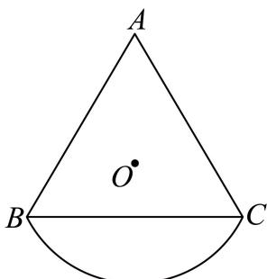
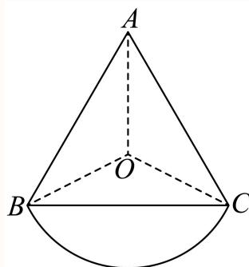
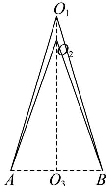
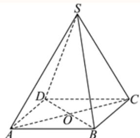
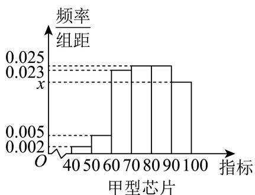
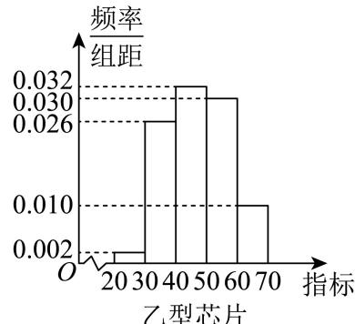
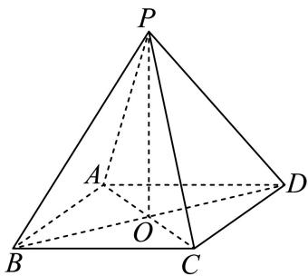
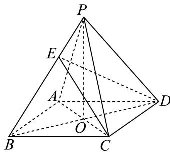
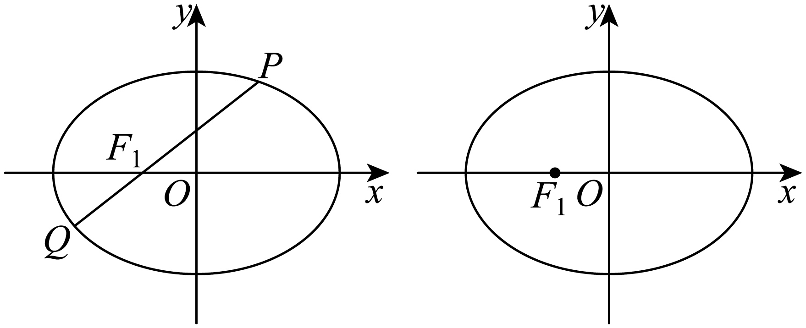
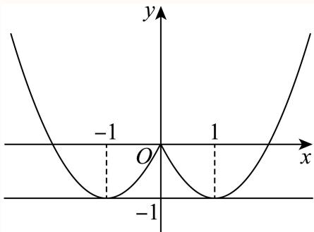

# 2025一模 奉贤区原卷 · 教师版

> 本地预览：题目、答案及分类尚未全部审定。校对使用的PDF为高中工作台解析版，尚未逐区确认区级印刷原卷。

## 填空题

按本区原卷题号顺序排列。

### 奉贤 · 第1题

设全集 $U=\{1,2,3,4\}$，集合 $A=\{2,4\}$，则 $\overline A=$ ______。

> 本题资料或解析有待核事项，预览不可作为已审定成品。

**考点：** 有限集合的补集运算

**难度依据：** 按全集删除集合已有元素

**核查说明：** 仅核本题所列字段及页面；不等于全卷终审。；题干与解析已用于人工归类，尚未完成整题公式校净与独立数学终审。；题干补集横线漏识；同名PDF第1页文字层确认是A的补集。

【答案】{1, 3}.

【解析】

利用补集的定义可得出结合A.–

因为全集U = {1, 2, 3, 4}，集合 $A = \{ 2 , 4 \}$ ，则 $\overline { { A } } = \{ 1 , 3 \}$

故答案为：{1, 3}.

### 奉贤 · 第2题

若直线 $l_1:x+ay-2=0$ 与直线 $l_2:ax+y-2=0$ 互相垂直，则 $a=$______。

**考点：** 一般式直线垂直的系数条件

**难度依据：** 用系数内积为零避免漏斜率不存在情形

**核查说明：** 题干与解析已用于人工归类，尚未完成整题公式校净与独立数学终审。

【答案】0

【解析】

根据直线互相垂直求出a的值.

由题意得 $1 \times a + a \times 1 = 0$ ，解得a = 0.

故答案为：0

### 奉贤 · 第3题

已知 $x\in\mathbb R$，则不等式 $x^2-x+2>0$ 的解集为 $\underline{\qquad}$。

**考点：** 判别式判断二次不等式恒正

**难度依据：** 二次项正且判别式负

**核查说明：** 题干与解析已用于人工归类，尚未完成整题公式校净与独立数学终审。

【答案】$\mathbb R$。

【解析】

利用二次函数的判别式的符号，判断不等式恒成立。

因为 $\Delta=1-8=-7<0$，所以不等式 $x^2-x+2>0$ 的解集为 $\mathbb R$。

故答案为：$\mathbb R$。

### 奉贤 · 第4题

设 $f(x)=\begin{cases}\ln x+1,&x>0,\\2^x+1,&x\leq 0.\end{cases}$ 若 $f(x_0)=1$，则 $x_0=$______。

> 本题资料或解析有待核事项，预览不可作为已审定成品。

**考点：** 分段指数对数函数的给值求自变量

**难度依据：** 须分别检查两段方程与区间

**核查说明：** 题干与解析已用于人工归类，尚未完成整题公式校净与独立数学终审。；题干分段函数缺少x>0时ln x+1这一整支；已定向下载同名PDF，第1页文字层确认两支为ln x+1(x>0)、2^x+1(x≤0)，本分类未改底稿。

【答案】$1$

【解析】

根据分段函数，分 $x_0>0$ 和 $x_0\le0$ 求解即可。

当 $x_0>0$ 时，$f(x_0)=\ln x_0+1=1$，解得 $x_0=1$，满足条件；

当 $x_0\le0$ 时，$f(x_0)=2^{x_0}+1=1$，方程无解。

所以 $x_0=1$。

故答案为：$1$。

### 奉贤 · 第5题

若 $A,B,C,D,E$ 五人站成一排，如果 $A,B$ 必须相邻，那么排法共 $\underline{\qquad}$ 种。

**考点：** 相邻排列的捆绑法

**难度依据：** 整体排列后补内部排列

**核查说明：** 题干与解析已用于人工归类，尚未完成整题公式校净与独立数学终审。

【答案】$48$。

【解析】

元素相邻问题运用捆绑法求解。

第一步：把 $A,B$ 捆绑当作一个元素，与 $C,D,E$ 进行排列，共有 $\mathrm A_4^4$ 种；

第二步：$A,B$ 之间进行排列，共有 $\mathrm A_2^2$ 种；

根据分步计数原理可知，排法的总数共有 $\mathrm A_4^4\mathrm A_2^2=48$ 种。

故答案为：$48$。

### 奉贤 · 第6题

$\left(x^6+\frac{1}{x\sqrt{x}}\right)^5$ 的二项展开式中的常数项为 $\underline{\qquad}$。（用数字作答）

**考点：** 含分数指数的二项展开常数项

**难度依据：** 准确列指数并令其为零

**核查说明：** 题干与解析已用于人工归类，尚未完成整题公式校净与独立数学终审。

【答案】$5$。

【解析】

写出展开式的通项，令 $x$ 的指数为 $0$ 即可。

由题意可知：

$$
T_{r+1}=\mathrm C_5^r x^{30-6r}\left(\frac{1}{x\sqrt{x}}\right)^r=\mathrm C_5^r x^{30-6r}x^{-\frac32r}=\mathrm C_5^r x^{30-\frac{15}{2}r}.
$$

令 $30-\frac{15}{2}r=0$，得 $r=4$，所以常数项为 $\mathrm C_5^4=5$。

故答案为：$5$。

### 奉贤 · 第7题

已知抛物线 $x^2=ay\left(a>0\right)$ 上有一点 $P$ 到准线的距离为 $6$，点 $P$ 到 $x$ 轴的距离为 $4$，则抛物线的焦点坐标为 $\underline{\qquad}$。

**考点：** 抛物线准线距离与焦点参数

**难度依据：** 先定纵坐标再用准线距离反求参数

**核查说明：** 题干与解析已用于人工归类，尚未完成整题公式校净与独立数学终审。

【答案】$(0,2)$。

【解析】

根据题意求出点 $P$ 的纵坐标，结合点 $P$ 到准线的距离可求出 $a$ 的值，即可得出抛物线焦点的坐标。

抛物线 $x^2=ay\left(a>0\right)$ 的准线方程为 $y=-\frac a4$。

设点 $P(x,y)$，则 $y\geq0$，由于点 $P$ 到准线的距离为 $y+\frac a4=6$，可得 $y=6-\frac a4$。

因为点 $P$ 到 $x$ 轴的距离为 $4$，则 $y=4$，所以 $6-\frac a4=4$，解得 $a=8$。

故抛物线的方程为 $x^2=8y$，其焦点坐标为 $(0,2)$。

故答案为：$(0,2)$。

### 奉贤 · 第8题

在复平面内，$O$ 为坐标原点，复数 $z_1=\mathrm i(-4-3\mathrm i)$，$z_2=12+5\mathrm i$ 对应的点分别为 $Z_1,Z_2$，其中 $\mathrm i$ 为虚数单位，则 $\langle\overrightarrow{OZ_1},\overrightarrow{OZ_2}\rangle$ 的大小为 ______。

> 本题资料或解析有待核事项，预览不可作为已审定成品。

**考点：** 复数运算与复平面坐标；坐标数量积求向量夹角

**难度依据：** 复数乘法转坐标后求余弦与夹角

**核查说明：** 仅核本题所列字段及页面；不等于全卷终审。；题干与解析已用于人工归类，尚未完成整题公式校净与独立数学终审。；题干夹角括号缺失，需规范向量夹角符号。

【解析】

由复数乘法运算求得 $z_1$，进而得到 $\overrightarrow{OZ_1},\overrightarrow{OZ_2}$，利用向量数量积运算和模长公式求得 $\cos\langle\overrightarrow{OZ_1},\overrightarrow{OZ_2}\rangle$，进而得到 $\langle\overrightarrow{OZ_1},\overrightarrow{OZ_2}\rangle$。

因为 $z_1=\mathrm i(-4-3\mathrm i)=3-4\mathrm i$，$z_2=12+5\mathrm i$，

所以 $\overrightarrow{OZ_1}=(3,-4)$，$\overrightarrow{OZ_2}=(12,5)$，

$$
\cos\left\langle\overrightarrow{OZ_1},\overrightarrow{OZ_2}\right\rangle=\frac{\overrightarrow{OZ_1}\cdot\overrightarrow{OZ_2}}{\left|\overrightarrow{OZ_1}\right|\left|\overrightarrow{OZ_2}\right|}=\frac{3\times12-20}{\sqrt{3^2+(-4)^2}\times\sqrt{12^2+5^2}}=\frac{16}{65},
$$

所以 $\langle\overrightarrow{OZ_1},\overrightarrow{OZ_2}\rangle=\arccos\frac{16}{65}$。

### 奉贤 · 第9题

甲乙两人下棋，每局两人获胜的可能性一样，某一天两人要进行一场三局两胜的比赛，最终胜者赢得100元奖金，第一局比赛甲获胜，后因为有其他事情而中止比赛，则甲应该分 $\underline{\qquad}$ 元奖金才公平？

**考点：** 中止赛制的条件胜率和公平分奖

**难度依据：** 当前比分下用乙再连胜的补事件

**核查说明：** 题干与解析已用于人工归类，尚未完成整题公式校净与独立数学终审。

【答案】$75$。

【解析】

分别求出甲、乙最终获胜的概率，即可求出答案。

乙最后获胜的情况为第二局、第三局必须乙胜，其概率为 $\frac12\times\frac12=\frac14$。

即甲最终获胜的概率为 $\frac34$，乙最终获胜的概率为 $\frac14$。

故甲的奖金为 $100\times\frac34=75$ 元。

故答案为：$75$。

### 奉贤 · 第10题

申辉中学高一（8）班设计了一个“水滴状”班徽的平面图（如图），徽章由等腰三角形 $ABC$ 及以弦 $BC$ 和劣弧 $BC$ 所围成的弓形所组成，其中 $AB=AC$，劣弧 $BC$ 所在的圆为三角形的外接圆，圆心为 $O$。

已知 $\angle BAC=\theta$，$\theta\in\left(0,\frac{\pi}{2}\right)$，外接圆的半径是 $2$，则该图形的面积为 $\underline{\qquad}$。（用含 $\theta$ 的表达式表示）

**考点：** 圆心角圆周角与扇形三角形面积建模

**难度依据：** 分割复合图形并用圆周角关系表示面积

**核查说明：** 题干与解析已用于人工归类，尚未完成整题公式校净与独立数学终审。

【答案】$4\theta+4\sin\theta$

【解析】

连接 $OB,OA,OC$，求出 $S_{\triangle AOB}$、$S_{\triangle AOC}$、$S_{\text{扇形}BOC}$ 可得答案。

连接 $OB,OA,OC$，则 $OB=OA=OC=2$，$\angle BOC=2\theta$，

$$
\angle AOB=\angle AOC=\frac{2\pi-\angle BOC}{2}=\pi-\theta,
$$

$$
S_{\triangle AOB}=S_{\triangle AOC}=\frac{1}{2}\times2\times2\sin(\pi-\theta)=2\sin\theta,
$$

$$
S_{\text{扇形}BOC}=\frac{1}{2}\times2\theta\times2\times2=4\theta,
$$

所以该图形的面积为 $4\theta+4\sin\theta$。

故答案为：$4\theta+4\sin\theta$。

### 奉贤 · 第11题

上海市奉贤区奉城镇的古建筑万佛阁（图1）的屋檐下常系挂风铃（图2），风吹铃动，悦耳清脆，亦称惊鸟铃，一般一个惊鸟铃由铜铸造而成，由铃身和铃舌组成，为了知道一个惊鸟铃的质量，可以通过计算该惊鸟铃的体积，然后由物理学知识计算出该惊鸟铃的质量，因此我们需要作出一些合理的假设：
假设1：铃身且可近似看作由一个较大的圆锥挖去一个较小的圆锥；
假设2：两圆锥的轴在同一条直线上；
假设3：铃身内部有一个挂铃舌的部位的体积忽略不计。
截面图如下（图3），其中 $O_1O_3=20\,\mathrm{cm}$，$O_2O_3=18\,\mathrm{cm}$，$AB=16\,\mathrm{cm}$，则制作100个这样的惊鸟铃的铃身至少需要 $\underline{\qquad}$ 千克铜。（铜的密度为 $8.9\,\mathrm{g/cm^3}$）（结果精确到个位）

图1

图2

图3

**考点：** 圆锥挖空体积与质量估算

**难度依据：** 作两个圆锥体积差后处理密度与单位

**核查说明：** 题干与解析已用于人工归类，尚未完成整题公式校净与独立数学终审。

【来源解析版答案】$120$。

【解析】

两圆锥的底面半径均为 $8\,\mathrm{cm}$，高分别为 $20\,\mathrm{cm}$ 和 $18\,\mathrm{cm}$。故制作100个铃身所需铜的质量为

$100\times\frac{1}{3}\pi\times 8^2\times(20-18)\times 8.9\div1000=\frac{2848\pi}{75}\approx119.297\,\mathrm{kg}$。

【审校说明】来源解析以 $\pi\approx3.14$ 算得约 $119.236\,\mathrm{kg}$，给出的答案为 $120$。若按购买整千克且用量不得不足理解“至少需要”，须向上取整为 $120\,\mathrm{kg}$；若按通常的四舍五入精确到个位，则为 $119\,\mathrm{kg}$。题干未明确要求整千克购买，取整存在歧义，待原卷及官方答案进一步核实。

### 奉贤 · 第12题

已知集合 $M=\{P_0,P_1,P_2,\cdots,P_n\}$，$n\geq2$，$n\in\mathbb N$，是由函数 $y=\cos x$，$x\in[0,2\pi]$ 的图象上两两不相同的点构成的点集，集合 $S=\{a\mid a=\overrightarrow{OP_0}\cdot\overrightarrow{OP_i},\ i=0,1,2,\cdots,n,\ n\geq2,\ n\in\mathbb N\}$，其中 $P_0(0,1)$、$P_1(\pi,-1)$。若集合 $S$ 中的元素按照从小到大的顺序排列能构成公差为 $d$ 的等差数列，当 $d\in\left\{\frac12,1\right\}$ 时，则符合条件的点集 $M$ 的个数为________。

> 本题资料或解析有待核事项，预览不可作为已审定成品。

**考点：** 坐标数量积提取纵坐标；有限等差数列公差分类；余弦函数定值点枚举；有必选点约束的集合计数；点集到数集映射的重合与去重

**难度依据：** 公差两种情形下按同纵坐标点的非空选择计数

**核查说明：** 题干与解析已用于人工归类，尚未完成整题公式校净与独立数学终审。；原解多个余弦值与横坐标被错排，计数思路可辨但公式未校净。

【答案】$60$。

【校订说明】以下解析依据题设重新整理，非来源解析逐字转录。

【解析】设 $P_i=(x_i,y_i)$，则 $\overrightarrow{OP_0}\cdot\overrightarrow{OP_i}=y_i=\cos x_i$。因此 $S\subseteq[-1,1]$，且 $-1,1\in S$。

当 $d=1$ 时，$S=\{-1,0,1\}$。纵坐标为 $0$ 的点有两个，须至少选一个，有 $3$ 种选法；除已选的 $P_0$ 外，纵坐标为 $1$ 的点 $(2\pi,1)$ 可选可不选，有 $2$ 种选法；纵坐标为 $-1$ 的点只有已选的 $P_1$。故有 $2\times3=6$ 个点集。

当 $d=\frac12$ 时，$S=\left\{-1,-\frac12,0,\frac12,1\right\}$。纵坐标为 $-\frac12$、$0$、$\frac12$ 的点各有两个，每组均须至少选一个，各有 $3$ 种选法；点 $(2\pi,1)$ 可选可不选。故有 $2\times3^3=54$ 个点集。

两种情形互不重合，故所求为 $6+54=60$。

## 选择题

按本区原卷题号顺序排列。

### 奉贤 · 第13题

在 $\triangle ABC$ 中，“$C=\frac{\pi}{2}$”是“$\sin^2A+\sin^2B=1$”的（　）

A. 充分不必要条件

B. 必要不充分条件

C. 充要条件

D. 既不充分也不必要条件

**考点：** 三角命题的充分必要性与反例；三角形内角关系及平方和恒等式

**难度依据：** 充分性用互余关系必要性需构造非直角反例

**核查说明：** 题干与解析已用于人工归类，尚未完成整题公式校净与独立数学终审。

【答案】A

【解析】

结合同角三角函数关系、诱导公式，分别从充分性、必要性两方面来说明即可。

一方面：

$$
C=\frac{\pi}{2}\Rightarrow A+B=\frac{\pi}{2}\Rightarrow\sin A=\sin\left(\frac{\pi}{2}-B\right)=\cos B,
$$

所以 $\sin^2A+\sin^2B=\cos^2B+\sin^2B=1$。

另一方面，当 $A=\frac{2\pi}{3}$，$B=C=\frac{\pi}{6}$ 时，$\sin^2A+\sin^2B=\left(\frac{\sqrt3}{2}\right)^2+\left(\frac12\right)^2=1$，但 $C\ne\frac{\pi}{2}$。

所以“$C=\frac{\pi}{2}$”是“$\sin^2A+\sin^2B=1$”的充分不必要条件。

故选：A。

### 奉贤 · 第14题

函数 $y = \log _ { 2 } \sin x + \log _ { 2 } \cos x$ ，则下列命题正确的是（ ）

A. 函数是偶函数

B. 函数定义域是 $\left( 0 , { \frac { \pi } { 2 } } \right)$

C. 函数最大值−1

D. 函数的最小正周期为π

**考点：** 复合对数函数定义域与周期；正弦余弦同正区域及二倍角最值

**难度依据：** 周期不能只看化简式还需保留原定义域

**核查说明：** 题干与解析已用于人工归类，尚未完成整题公式校净与独立数学终审。

【答案】C

【解析】

求出函数f(x)的定义域，可判断AB选项；利用二倍角的正弦公式以及正弦函数的有界性可判断C选项；利用正弦型函数的周期性可判断D选项.

设 $f \left( x \right) = \log _ { 2 } \sin x + \log _ { 2 } \cos x$ ，由 $\left\{ { \begin{array} { l } { \sin x > 0 } \\ { \cos x > 0 } \end{array} } \right.$ 可得 $2 k \pi < x < 2 k \pi + { \frac { \pi } { 2 } } ( k \in { \bf Z } )$

所以，函数f(x)的定义域为 $\left\{ x \Big \vert 2 k \pi < x < 2 k \pi + \frac { \pi } { 2 } , k \in \mathbf { Z } \right\}$ ，定义域不关于原点对称

所以，函数f(x)不是偶函数，A错B错；

当 $2 k \pi < x < 2 k \pi + \frac { \pi } { 2 } ( k \in { \bf Z } )$ 时，则 $4 k \pi < 2 x < 4 k \pi + \pi \left( k \in \mathbf { Z } \right)$

$$
f (x) = \log_ {2} (\sin x \cos x) = \log_ {2} \left(\frac {1}{2} \sin 2 x\right) \leq \log_ {2} \frac {1}{2} = - 1,
$$

当且仅当 $2 x = \frac { \pi } { 2 } + 4 k \pi \left( k \in \mathbf { Z } \right)$ 时，即当 $x = { \frac { \pi } { 4 } } + 2 k \pi \left( k \in { \mathbf { Z } } \right)$ 时，函数f(x)取最大值−1，C对；

因为 $f \left( 2 \pi + x \right) = \log _ { 2 } \sin \left( 2 \pi + x \right) + \log _ { 2 } \cos \left( 2 \pi + x \right) = \log _ { 2 } \sin x + \log _ { 2 } \cos x = f \left( x \right)$

结合函数f(x)的定义域可知，函数f(x)的最小正周期为2π，D错.故选：C.

### 奉贤 · 第15题

在四棱锥 $S - A B C D$ 中，若 $\overrightarrow { S A } = x \overrightarrow { S B } + y \overrightarrow { S C } + z \overrightarrow { S D }$ ，则实数组(x, y, z)可能是（ ）

A. $( 1 , - 1 , 1 )$

B. $( 1 , 0 , - 1 )$

C. $( 1 , 0 , 0 )$

D. $( 1 , - 1 , - 1 )$

**考点：** 空间向量线性表示与共面约束；四棱锥底面形状的可实现性

**难度依据：** 向量线性式须检验能否构成真实四棱锥

**核查说明：** 题干与解析已用于人工归类，尚未完成整题公式校净与独立数学终审。

【答案】A

【解析】（根据题意审校重建，非来源解析逐字转录）

设底面所在平面的法向量为 $\boldsymbol n$。由于 $S$ 不在底面内，$\overrightarrow{SA}\cdot\boldsymbol n\ne 0$；又因为 $A,B,C,D$ 均在底面内，所以 $\overrightarrow{SA},\overrightarrow{SB},\overrightarrow{SC},\overrightarrow{SD}$ 在 $\boldsymbol n$ 方向上的投影相同。将题设等式两边与 $\boldsymbol n$ 作数量积，得 $x+y+z=1$。因此 B、D 均不可能。

对于 C，等式变为 $\overrightarrow{SA}=\overrightarrow{SB}$，即 $A=B$，与四棱锥的顶点互异矛盾，故 C 不可能。

对于 A，当底面 $ABCD$ 为平行四边形时，由对角线互相平分，得 $\overrightarrow{SA}+\overrightarrow{SC}=\overrightarrow{SB}+\overrightarrow{SD}$，即 $\overrightarrow{SA}=\overrightarrow{SB}-\overrightarrow{SC}+\overrightarrow{SD}$，故 A 可以成立。

故选 A。

### 奉贤 · 第16题

已知数列 $\left\{ a _ { n } \right\}$ 不是常数列，前n项和为 $S _ { n } , \ a _ { n } > 0$ ．若对任意正整数n，存在正整数m，使得$| S _ { n } - a _ { m } | < a _ { 1 }$ ，则称 $\left\{ a _ { n } \right\}$ 是“可控数列”．现给出两个命题：
①若各项均为正整数的等差数列 $\left\{ a _ { n } \right\}$ 满足公差 $d = 3$ ，则 $\left\{ a _ { n } \right\}$ 是“可控数列”；
②若等比数列 $\left\{ a _ { n } \right\}$ 是“可控数列”，则其公比 $q \in \left( 0 , \frac { 1 } { 2 } \right]$
则下列判断正确的是（ ）

A. ①与②均为真命题

B. ①与②均为假命题

C. ①为假命题，②为真命题

D. ①为真命题，②为假命题

> 本题资料或解析有待核事项，预览不可作为已审定成品。

**考点：** 可控数列的等差反例与等比参数；全称存在量词下的数列逼近；绝对值邻近条件与几何和界

**难度依据：** 需理解每个n可另选m的量词并验证反例与参数

**核查说明：** 题干与解析已用于人工归类，尚未完成整题公式校净与独立数学终审。；原解排除q>1时疑似把“对每个n存在m”换成固定m后令n增大，量词证明需独立核查，不按原解直接定稿。

【答案】C

【解析】

对于①，取 $a_n=3n-2$，各项均为正整数，公差为 $3$。当 $n=2$ 时，$S_2=5$，对任意正整数 $m$，

$$|S_2-a_m|=|7-3m|\geq 1=a_1.$$

因此该数列不可控，①为假命题。

对于②，由各项为正且不是常数列，知 $q>0$ 且 $q\ne1$。令 $T_n=\frac{S_n}{a_1}=\frac{q^n-1}{q-1}$，可控条件为：对每个正整数 $n$，存在正整数 $m_n$，使得

$$|T_n-q^{m_n-1}|<1.$$

若 $q>1$，两边除以 $q^n$ 并令 $n\to\infty$，得

$$q^{m_n-n-1}\longrightarrow\frac1{q-1}.$$

由于 $q$ 的整数次幂在任一正的有界闭区间内只有有限个，故指数 $m_n-n-1$ 最终固定为某个整数 $k$，且 $q^k=\frac1{q-1}$。于是对充分大的 $n$，

$$|T_n-q^{m_n-1}|=\frac1{q-1}<1,$$

从而 $q>2$。但此时 $\frac1q<\frac1{q-1}<1$，区间 $(\frac1q,1)$ 中没有 $q$ 的整数次幂，矛盾。所以 $q>1$ 不可能。

若 $0<q<1$，则 $T_n\geq1$，且对任意正整数 $m$ 有 $q^{m-1}\leq1$。因此可控当且仅当每个 $n$ 都满足 $T_n<2$：必要性由 $T_n-q^{m-1}<1$ 得到，充分性取 $m=1$ 即可。又 $T_n=\frac{1-q^n}{1-q}$ 严格递增，极限为 $\frac1{1-q}$，且每一项都小于该极限，故上述条件等价于 $\frac1{1-q}\leq2$，即 $0<q\leq\frac12$。特别地，$q=\frac12$ 时每个有限的 $n$ 均有 $T_n<2$。

故②为真命题，选 C。

【来源说明】工作台整理解析版的 $q>1$ 论证固定 $m$ 后选取 $n$，不能排除 $m$ 随 $n$ 变化；上面重新证明，原识别记录保留在底稿中。区级原印刷卷尚未核验。

## 解答题

按本区原卷题号顺序排列。

### 奉贤 · 第17题

已知函数 $y=f(x)$，其中 $f(x)=a^x$（常数 $a>0$ 且 $a\ne1$）。

（1）（6分）若函数 $y=f(x)$ 的图象过点 $(2,9)$，求关于 $x$ 的不等式 $f(|2x-1|)>3$ 的解集；

（2）（8分）若存在 $x\in(0,1]$，使得数列 $f(1)$、$f(tx)$、$f(x^2+2)$ 是等比数列，求实数 $t$ 的取值范围。

> 本题资料或解析有待核事项，预览不可作为已审定成品。

**考点：** （1）定底数后解绝对值不等式；（2）等比条件化为参数函数并求受限值域

**难度依据：** （1）定底数后解绝对值不等式；（2）等比条件化为参数函数并求受限值域

**核查说明：** 仅完成本题所述针对性校核；不代表其他题或全卷数学通过。；题干与解析已用于人工归类，尚未完成整题公式校净与独立数学终审。；第2问原OCR的存在量词乱码已按高中工作台解析版修订；整题仍待终审。

【答案】（1）$(-\infty,0)\cup(1,+\infty)$；（2）$[2,+\infty)$。

【解析】

（1）由 $f(2)=a^2=9$，结合 $a>0$，得 $a=3$。因此 $f(|2x-1|)>3$ 等价于 $|2x-1|>1$，解得 $x<0$ 或 $x>1$。所求解集为 $(-\infty,0)\cup(1,+\infty)$。

（2）由于 $a>0$ 且 $a\ne1$，三个函数值构成等比数列等价于 $a^{2tx}=a^{1+x^2+2}$，即 $2tx=x^2+3$。由 $x\in(0,1]$，得

$$
t=g(x)=\frac{x}{2}+\frac{3}{2x}.
$$

在 $(0,1]$ 上，$g'(x)=\frac{x^2-3}{2x^2}<0$，因此 $g(x)$ 连续且严格递减；又 $g(1)=2$，当 $x\to0^+$ 时 $g(x)\to+\infty$，故其值域为 $[2,+\infty)$。于是实数 $t$ 的取值范围是 $[2,+\infty)$。

### 奉贤 · 第18题

某芯片代工厂生产甲、乙两种型号的芯片，为了解芯片的某项指标，从这两种芯片中各抽取100件进行检测，获得该项指标的频率分布直方图，如图所示：

假设数据在组内均匀分布，以样本估计总体，以事件发生的频率作为相应事件发生的概率
(1) (6分)求频率分布直方图中x的值并估计乙型芯片该项指标的平均值（同一组中的数据用该组区间的中点值为代表）；
(2) (8分)已知甲型芯片指标在[80, 100)为航天级芯片，乙型芯片指标在[60, 70)为航天为航天级芯片．现分别采用分层抽样的方式，从甲型芯片指标在[70,90)内取2件，乙型芯片指标在[50,70)内取4件，再从这6件中任取2件，求至少有一件为航天级芯片的概率

> 本题资料或解析有待核事项，预览不可作为已审定成品。

**考点：** （1）直方图面积归一与组中值均值；（2）分层确定样本组成再算至少一个事件

**难度依据：** （1）直方图面积归一与组中值均值；（2）分层确定样本组成再算至少一个事件

**核查说明：** 工作台整理解析版题干有重复字，原解析误写芯片型号；区级原印刷卷待核。；题干与解析已用于人工归类，尚未完成整题公式校净与独立数学终审。；解析第（2）问芯片型号及枚举已回源修正并二次自查；非独立复核。

【答案】（1）$x=0.020$，乙型芯片指标的估计平均值为 $47$；（2）$\frac35$。

【解析】

（1）由甲型芯片频率分布直方图各组频率之和为 $1$，得

$$10(0.002+0.005+0.023+0.025+0.025+x)=1，$$

解得 $x=0.020$。以组中点代表该组数据，乙型芯片指标的估计平均值为

$$10(25\times0.002+35\times0.026+45\times0.032+55\times0.030+65\times0.010)=47。$$

（2）按分层抽样，甲型芯片在 $[70,80)$ 和 $[80,90)$ 中各抽取 $1$ 件；乙型芯片在 $[50,60)$ 和 $[60,70)$ 中分别抽取 $3$ 件和 $1$ 件。因此这 $6$ 件中有 $2$ 件航天级芯片、$4$ 件非航天级芯片。

利用对立事件，从 $6$ 件中任取 $2$ 件，至少有一件为航天级芯片的概率为

$$1-\frac{\binom42}{\binom62}=\frac35。$$

【来源说明】所核工作台整理解析版题干中“为航天为航天级芯片”为重复字样；原解析第（2）问将乙型芯片误写成甲型。上述解析按图及题意更正，原始识别文本保留在底稿。区级原印刷卷尚未核验。

### 奉贤 · 第19题

如图为正四棱锥 $P-ABCD$，$O$ 为底面 $ABCD$ 的中心。

（1）（6分）求证：$CD\parallel$ 平面 $PAB$，平面 $PAC\perp$ 平面 $PBD$；

（2）（8分）设 $E$ 为 $PB$ 上的一点，$\overrightarrow{BE}=\frac23\overrightarrow{BP}$。在下面两问中选一个：

①若 $AD=AP=3\sqrt2$，求直线 $EC$ 与平面 $BED$ 所成角的大小；

②已知平面 $ECD$ 与平面 $ABCD$ 所成锐二面角的大小为 $\arctan\frac{\sqrt2}{2}$，若 $AD=3\sqrt2$，求 $AP$ 的长。

> 本题资料或解析有待核事项，预览不可作为已审定成品。

**考点：** （1）证明线面平行与面面垂直；（2）选①建立坐标求线面角，选②由二面角反求棱长

**难度依据：** （1）证明线面平行与面面垂直；（2）选①建立坐标求线面角，选②由二面角反求棱长

**核查说明：** 题干与解析已用于人工归类，尚未完成整题公式校净与独立数学终审。；题干同时有图1图2和两种选做题，考点已分别标注，不得漏掉选②。

【解析】

（1）底面 $ABCD$ 为正方形，故 $AB\parallel CD$。又 $AB\subset$ 平面 $PAB$，$CD\not\subset$ 平面 $PAB$，所以 $CD\parallel$ 平面 $PAB$。

由正四棱锥的性质，$PO\perp$ 平面 $ABCD$，故 $PO\perp AC$；又 $AC\perp BD$，且 $PO\cap BD=O$，$PO,BD\subset$ 平面 $PBD$，所以 $AC\perp$ 平面 $PBD$。因为 $AC\subset$ 平面 $PAC$，所以平面 $PAC\perp$ 平面 $PBD$。

（2）选①：以 $O$ 为原点，分别以 $OB,OC,OP$ 的方向为 $x,y,z$ 轴正方向建立空间直角坐标系。由 $AD=AP=3\sqrt2$，得 $OB=OC=OP=3$，于是

$$B(3,0,0),\quad C(0,3,0),\quad P(0,0,3),\quad A(0,-3,0)。$$

由 $\overrightarrow{BE}=\frac23\overrightarrow{BP}$，得 $E(1,0,2)$，因此 $\overrightarrow{EC}=(-1,3,-2)$。由（1）知 $\overrightarrow{AC}=(0,6,0)$ 为平面 $BED$ 的一个法向量。设直线 $EC$ 与平面 $BED$ 所成角为 $\theta$，则

$$\sin\theta=\frac{|\overrightarrow{AC}\cdot\overrightarrow{EC}|}{|\overrightarrow{AC}|\,|\overrightarrow{EC}|}=\frac{3}{\sqrt{14}}=\frac{3\sqrt{14}}{14}。$$

故所求角为 $\arcsin\frac{3\sqrt{14}}{14}$。

选②：沿用上述坐标系，设 $OP=h>0$。由 $AD=3\sqrt2$，得

$$B(3,0,0),\quad D(-3,0,0),\quad C(0,3,0),\quad P(0,0,h),\quad E\left(1,0,\frac{2h}{3}\right)。$$

于是 $\overrightarrow{CD}=(-3,-3,0)$，$\overrightarrow{EC}=(-1,3,-\frac{2h}{3})$，平面 $ECD$ 的一个法向量为 $\boldsymbol n=(1,-1,-\frac6h)$。底面 $ABCD$ 的一个法向量为 $(0,0,1)$。设两平面所成锐二面角为 $\theta$，则

$$\tan\theta=\frac{\sqrt{1^2+(-1)^2}}{6/h}=\frac{\sqrt2\,h}{6}。$$

由 $\tan\theta=\frac{\sqrt2}{2}$，得 $h=3$，所以 $AP=\sqrt{AO^2+OP^2}=3\sqrt2$。

【来源说明】对照工作台整理解析版第12—13页重建并二次自查；区级原印刷卷尚未核验，未获独立复核，非整题终审。

### 奉贤 · 第20题

椭圆 $\Gamma:\dfrac{x^2}{a^2}+y^2=1\ (a>1)$ 的左右焦点分别为 $F_1,F_2$，设 $P(x_0,y_0)$ 是第一象限内椭圆上的一点，$PF_1$ 的延长线交椭圆于点 $Q(x_1,y_1)$。

（1）（4分）若椭圆的离心率为 $\dfrac{\sqrt2}{2}$，求 $a$ 的值；

（2）（6分）若 $a=\sqrt2$，$\overrightarrow{PQ}\cdot\overrightarrow{OF_1}=\dfrac{12}{5}$，求 $x_0$；

（3）（8分）若 $a=2$，过点 $T(0,t)$ 的直线 $l$ 与椭圆 $\Gamma$ 交于 $M,N$ 两点，且 $|MN|=2$，则当 $t\geqslant 0$ 时，判断符合要求的直线有几条，并说明理由。

**考点：** （1）离心率定参数；（2）向量约束与焦点弦联立；（3）按参数讨论定长弦数目并补竖直线

**难度依据：** （1）离心率定参数；（2）向量约束与焦点弦联立；（3）按参数讨论定长弦数目并补竖直线

**核查说明：** 题干、题图及解析已对照工作台整理版修订；区级印刷原卷未确认，尚未整题终审。

【解析】

（1）由 $c^2=a^2-1$ 及 $\dfrac ca=\dfrac{\sqrt2}{2}$，得 $a=\sqrt2$。

（2）此时 $F_1(-1,0)$。由 $P$ 在第一象限，设直线 $PQ$ 为 $x=ky-1\ (k>0)$。代入椭圆方程得

$$ (k^2+2)y^2-2ky-1=0，\qquad |y_0-y_1|=\frac{\sqrt{8k^2+8}}{k^2+2}。 $$

由于 $y_0>y_1$，$\overrightarrow{OF_1}=(-1,0)$，故

$$\overrightarrow{PQ}\cdot\overrightarrow{OF_1}=k(y_0-y_1)=\frac{k\sqrt{8k^2+8}}{k^2+2}=\frac{12}{5}。$$

令 $u=k^2>0$，平方并化简得 $7u^2-47u-72=0$，故 $u=8$，$k=2\sqrt2$。代回直线与椭圆方程，取第一象限对应的根得 $y_0=\dfrac{\sqrt2}{2}$，因此 $x_0=1$。

（3）椭圆为 $\dfrac{x^2}{4}+y^2=1$。过 $T$ 的竖直直线是 $x=0$，无论 $t\geqslant0$ 取何值，它与椭圆的弦长均为 $2$，故始终有一条。

对于非竖直直线，设 $l:y=mx+t$。联立椭圆方程并利用两交点的横坐标差，得

$$|MN|^2=\frac{16(1+m^2)(4m^2+1-t^2)}{(4m^2+1)^2}。$$

令 $|MN|=2$，化简得

$$ (12-4t^2)m^2+3-4t^2=0。$$

反之，若实数 $m$ 满足此式，则上式中的弦长平方等于 $4$，且对应交点判别式大于零，因此不会引入不符合条件的直线。分类可得：

- 当 $0\leqslant t<\dfrac{\sqrt3}{2}$ 或 $t\geqslant\sqrt3$ 时，非竖直直线有 $0$ 条；
- 当 $t=\dfrac{\sqrt3}{2}$ 时，非竖直直线有 $1$ 条；
- 当 $\dfrac{\sqrt3}{2}<t<\sqrt3$ 时，非竖直直线有 $2$ 条。

加上竖直直线，以上三种情形分别有 **1、2、3 条**符合要求的直线。

### 奉贤 · 第21题

若函数 $\boldsymbol { \cdot } \boldsymbol { y } = \boldsymbol { f } \left( \boldsymbol { x } \right)$ 的图象上存在k个不同点 $P _ { 1 \setminus } \ P _ { 2 \setminus } \ \cdots \ P _ { k } \left( k \geq 2 , k \in \mathbf { N } \right)$ 处的切线重合，则称该切线为函数 $y = f \left( x \right)$ 的一条k点切线，该函数具有k点切线性质
(1) (4分)判断函数 $y = x ^ { 2 } - 2 | x | , x \in \mathbf { R }$ 的奇偶性并写出它的一条2点切线方程（无需理由）；
(2) (6分)设 $f \left( x \right) = \mathrm { e } ^ { x } - \ln x$ ，判断函数 $y = f \left( x \right)$ 是否具有k点切线性质，并说明理由；
(3) (8分)设 $y \left( x \right) = \cos x + 2 x$ ，证明：对任意的 $m \ge 3 , m \in \mathbf { N }$ ，函数 $y = g \left( x \right)$ 具有m点切线性质，并求出所有相应的切线方程

> 本题资料或解析有待核事项，预览不可作为已审定成品。

**考点：** （1）偶性和双切线；（2）导数严格单调排除公切线；（3）比较斜率截距并用三角周期构造任意多个切点

**难度依据：** （1）偶性和双切线；（2）导数严格单调排除公切线；（3）比较斜率截距并用三角周期构造任意多个切点

**核查说明：** 题干与解析已用于人工归类，尚未完成整题公式校净与独立数学终审。；第3问题干g误写y，原解多处三角符号乱码，公切线论证待终审。

【解析】

(1) 令h $( x ) = x ^ { 2 } - 2 \left| x \right|$ ，其中 $\mathbf { { \boldsymbol { x } } } \in \mathbf { { \boldsymbol { R } } }$ ，则h $( - x ) = ( - x ) ^ { 2 } - 2 \left| - x \right| = x ^ { 2 } - 2 \left| x \right| = h \left( x \right)$

$$
h (x) = x ^ {2} - 2 | x |
$$

$$
h \left(x\right) = \left\{ \begin{array}{l} x ^ {2} + 2 x, x \leq 0 \\ x ^ {2} - 2 x, x > 0 \end{array} \right.,
$$

由图可知，函数 $y = x ^ { 2 } - 2 \left| x \right|$ |的一条2点切线方程为 $y = - 1$

(2) 因为 $f \left( x \right) = \mathrm { e } ^ { x } - \ln x$ ，该函数的定义域为 $( 0 , + \infty )$ ，且 $f ^ { \prime } \left( x \right) = \mathrm { e } ^ { x } - \frac { 1 } { x }$

令 ${ \bf \nabla } \tilde { \bf \Delta } p \left( x \right) = { \bf e } ^ { x } - \frac { 1 } { x }$ ，其中 $\boldsymbol { \mathscr { x } } > 0$ ，则 $\left| p ^ { \prime } \left( x \right) \right. = \mathbf { e } ^ { x } + \frac { 1 } { x ^ { 2 } } > 0$

所以，函数 $f ^ { \prime } \left( x \right)$ 在 $( 0 , + \infty )$ 上为增函数，

因此，不可能存在a、 $b \in ( 0 , + \infty ) \operatorname { E } a \neq b ,$ ，使得 $f ^ { \prime } \left( a \right) = f ^ { \prime } \left( b \right)$ )，

因此，函数 $f \left( x \right) = \mathrm { e } ^ { x } - \ln x .$ 不具有k点性质.

(3) 取点 $P _ { 1 } ( x _ { 1 } , \cos x _ { 1 } + 2 x _ { 1 } ) , P _ { 2 } ( x _ { 2 } , \cos x _ { 2 } + 2 x _ { 2 } ) , P _ { 3 } ( x _ { 3 } , \cos x _ { 3 } + 2 x _ { 3 } )$

因为 $g \left( x \right) = \cos x + 2 x$ ，则 $g ^ { \prime } \left( x \right) = 2 - \sin x .$

所以，曲线 $y = g \left( x \right)$ 在点 $P _ { 1 }$ 处的切线方程为 $y - \cos x _ { 1 } - 2 x _ { 1 } = \left( 2 - \sin x _ { 1 } \right) \left( x - x _ { 1 } \right)$

即y = (2 − sin x1)x + x1 sin x1 + cos x1，

曲线 $\dot { \bar { z } } y = g \left( x \right)$ 在点 $P _ { 2 }$ 处的切线方程为 $y = ( 2 - \sin x _ { 2 } ) x + x _ { 2 } \sin x _ { 2 } + \cos x _ { 2 }$

曲线 $y = g \left( x \right)$ 在点 $P _ { 3 }$ 处的切线方程为 $y = ( 2 - \sin x _ { 3 } ) x + x _ { 3 } \sin x _ { 3 } + \cos x _ { 3 }$ 费

由题意可知，这三条切线重合，

x1 sin x1 + cos x1 = x2 sin x2 + cos x2 = x3 sin x3 + cos x3

由上得 $\sin x _ { 1 } = \sin x _ { 2 } = \sin x _ { 3 }$ ，则 $\log x _ { 1 } = \pm \cos x _ { 2 }$ 2 $\cos x _ { 2 } = \pm \cos x _ { 3 }$ $\cos x _ { 3 } = \pm \cos x _ { 1 }$

（i）若 $\begin{array} { r } { \ \mathrm { ~ : ~ } \cos x _ { 1 } = - \cos x _ { 2 } , \ \cos x _ { 2 } = - \cos x _ { 3 } , \ \cos x _ { 3 } = - \cos x _ { 1 } } \end{array}$

则 $\ l { \cos { x _ { 1 } } } = \cos { x _ { 2 } } = \cos { x _ { 3 } } = 0 { _ { ! } }$ ，所以， $x _ { 1 } \sin x _ { 1 } = x _ { 2 } \sin x _ { 2 } = x _ { 3 } \sin x _ { 3 }$

因为sin $x _ { 1 } = \sin x _ { 2 } = \sin x _ { 3 } \neq 0$ ，则 $x _ { 1 } = x _ { 2 } = x _ { 3 }$ （舍去）；

（ii）若 $\cos x _ { 1 } = \cos x _ { 2 }$ $\cos x _ { 2 } = \cos x _ { 3 }$ $\cos x _ { 3 } = \cos x _ { 1 } { \mathrm { ~ } } ^ { \circ }$ 中至少有一个成立，

不妨设 $\cos x _ { 1 } = \cos x _ { 2 }$ ，则 $x _ { 1 } \sin x _ { 1 } = x _ { 2 } \sin x _ { 2 }$ ，

若sin $x _ { 1 } = \sin x _ { 2 } \neq 0$ ，则 $x _ { 1 } = x _ { 2 } ~ ( \widehat { \pm } \pm )$ ），所以，sin $x _ { 1 } = \sin x _ { 2 } = 0$

故 $\begin{array} { r } { \cos x _ { 1 } = \cos x _ { 2 } = 1 \sharp \sharp \cos x _ { 1 } = \cos x _ { 2 } = - 1 . } \end{array}$

综上所述，m点切线方程为 $y = 2 x - 1$ 和 $y = 2 x + 1$

