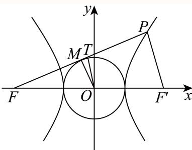
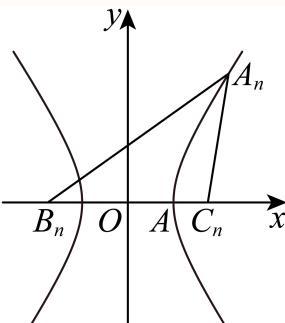
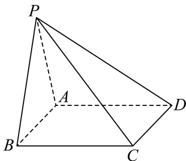
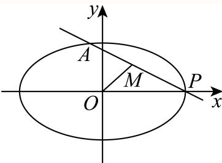
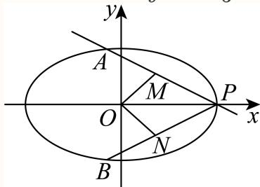

# 2025一模 宝山区原卷 · 教师版

> 本地预览：题目、答案及分类尚未全部审定。校对使用的PDF为高中工作台解析版，尚未逐区确认区级印刷原卷。

## 填空题

按本区原卷题号顺序排列。

### 宝山 · 第1题

…
集合 $A = ( - 1 , 1 ) , B = \mathbf { Z } ,$ ，则A ∩ B =

**考点：** 区间与整数集合求交

**难度依据：** 涉及区间与整数集合求交；难度为教师预估，需结合原题条件复核。

**核查说明：** 依据现有底稿归类，尚未逐页校卷、公式校净或独立数学终审。

【答案】{0}.

【解析】

根据集合的交集运算即可.

因为集合A = (−1, 1), B = Z，则 $A \cap B = \{ 0 \}$

故答案为：{0}.

### 宝山 · 第2题

…
函数 $\cdot y = \cos { 2 x } + 1$ 的最小正周期为

**考点：** 余弦函数最小正周期

**难度依据：** 涉及余弦函数最小正周期；难度为教师预估，需结合原题条件复核。

**核查说明：** 依据现有底稿归类，尚未逐页校卷、公式校净或独立数学终审。

【答案】π.

【解析】

应用余弦型函数的周期公式求解即可.

因为函数 $y = \cos 2 x + 1$ ，所以 $T = { \frac { 2 \pi } { 2 } } = \pi .$

即函数 $y = \cos { 2 x } + 1$ 的最小正周期为π.

故答案为：π.

### 宝山 · 第3题

…
设i为虚数单位，若(a − 2) + (2a − 1)i为纯虚数，则实数a = .

**考点：** 纯虚数实部为零与虚部非零

**难度依据：** 涉及纯虚数实部为零与虚部非零；难度为教师预估，需结合原题条件复核。

**核查说明：** 依据现有底稿归类，尚未逐页校卷、公式校净或独立数学终审。

【答案】2

【解析】

根据已知条件，列出方程即可求解.

因为 $( a - 2 ) + ( 2 a - 1 ) \mathrm { i }$ i为纯虚数，所以 $\left\{ { \begin{array} { l l } { 2 a - 1 \neq 0 } \\ { a - 2 = 0 } \end{array} } \right.$ ，即 $\left\{ { a \neq \frac { 1 } { 2 } } \right.$ ，

所以a = 2.

故答案为：2

### 宝山 · 第4题

…
在(x+2)5的展开式中x3的系数为

**考点：** 二项展开通项与系数

**难度依据：** 涉及二项展开通项与系数；难度为教师预估，需结合原题条件复核。

**核查说明：** 依据现有底稿归类，尚未逐页校卷、公式校净或独立数学终审。

【答案】40

【解析】

利用二项式展开式通项，即可直接求解.

由题知，设(x+2)5展开式中通项为 $\mathrm { C } _ { 5 } ^ { k } \cdot x ^ { 5 - k } \cdot 2 ^ { k }$

令5 − k = 3，则 $k = 2 , \ \mathrm { C _ { 5 } ^ { 2 } } \cdot 2 ^ { 2 } = 4 0 .$

故答案为：40

### 宝山 · 第5题

…
已知a, b为实数，且函数 $\langle y = x ^ { 2 } + a x + 1 , x \in [ b , 4 ]$ 是偶函数，则a − b =

**考点：** 偶函数定义域对称与二次函数参数

**难度依据：** 涉及偶函数定义域对称与二次函数参数；难度为教师预估，需结合原题条件复核。

**核查说明：** 依据现有底稿归类，尚未逐页校卷、公式校净或独立数学终审。

【答案】4.

【解析】

根据函数的奇偶性与二次函数的对称性即可得a,b的值，从而得所求.

因为函数 $\ t y = x ^ { 2 } + a x + 1 , x \in [ b , 4 ]$ 是偶函数，

所以函数定义域关于原点对称，且函数图象关于你y轴对称，

所以b = −4，且 $- { \frac { a } { 2 } } = 0 \Rightarrow a = 0 ,$

所以 $a - b = 0 - ( - 4 ) = 4 .$

故答案为：4.

### 宝山 · 第6题

…
某运动员在某次男子10米气手枪射击比赛中的得分数据（单位：环）为：9.6，9.9，9.2，9.4，9.9，10.1，10.2，9.7，9.6，9.3，10.0，10.4，则这组数据的第25百分位数为

**考点：** 数据排序与百分位数

**难度依据：** 涉及数据排序与百分位数；难度为教师预估，需结合原题条件复核。

**核查说明：** 依据现有底稿归类，尚未逐页校卷、公式校净或独立数学终审。

【答案】9.5.

【解析】

将数据从小到大排序，再根据百分位数的概念求解即可

分数据从小到大为：9.2，9.3，9.4，9.6，9.6，9.7，9.9，9.9，10.0，10.1，10.2，10.4，

共12个数，则 $1 2 \times 2 5 \% = 3 .$

所以这组数据的第25百分位数为 $\frac { 9 . 4 + 9 . 6 } { 2 } = 9 . 5$

故答案为：9.5.

### 宝山 · 第7题

…
已知关于正整数x的方程 ${ \bf C } _ { 1 2 } ^ { x - 1 } = { \bf C } _ { 1 2 } ^ { 5 x - 5 }$ ，则该方程的解为

**考点：** 组合数相等与下标范围

**难度依据：** 涉及组合数相等与下标范围；难度为教师预估，需结合原题条件复核。

**核查说明：** 依据现有底稿归类，尚未逐页校卷、公式校净或独立数学终审。

【答案】1或3

【解析】

利用组合数的性质得到方程，解方程，结合x的取值范围即可求解.

根据组合数的性质，由 $\mathrm { C } _ { 1 2 } ^ { x - 1 } = \mathrm { C } _ { 1 2 } ^ { 5 x - 5 }$

可知： $\left\{ \begin{array} { l l } { x - 1 = 5 x - 5 } \\ { 0 \leq x - 1 \leq 1 2 } \\ { 0 \leq 5 x - 5 \leq 1 2 } \\ { x \in \mathrm { Z } } \end{array} \right.$ $\left\{ \begin{array} { l l } { \left( x - 1 \right) + \left( 5 x - 5 \right) = 1 2 } \\ { 0 \leq x - 1 \leq 1 2 } \\ { 0 \leq 5 x - 5 \leq 1 2 } \\ { x \in \mathrm { Z } } \end{array} \right. ,$

即 $\left\{ \begin{array} { l l } { x = 1 } \\ { 1 \leq x \leq 1 3 } \\ { 1 \leq x \leq \displaystyle \frac { 1 7 } { 5 } } \\ { x \in \mathrm { Z } } \end{array} \right.$ $\left\{ \begin{array} { l l } { x = 3 } \\ { 1 \leq x \leq 1 3 } \\ { 1 \leq x \leq \displaystyle \frac { 1 7 } { 5 } } \\ { x \in \mathrm { Z } } \end{array} \right.$ ，所以x = 1和x = 3均满足题意，

所以该方程的解为：1或3.

故答案为：1或3

### 宝山 · 第8题

…
若 $9 ^ { a } = 4 ^ { b } = m$ ，且 ${ \frac { 1 } { a } } + { \frac { 1 } { b } } = 2$ ，则m = .

**考点：** 指数关系与对数换底

**难度依据：** 涉及指数关系与对数换底；难度为教师预估，需结合原题条件复核。

**核查说明：** 依据现有底稿归类，尚未逐页校卷、公式校净或独立数学终审。

【答案】6.

【解析】

利用换底公式可得 $\mathbf { \partial } \cdot a = { \frac { \lg m } { \lg 9 } } , b = { \frac { \lg m } { \lg 4 } }$ 根据题目条件结合对数的运算性质可得结果

$$
\because 9 ^ {a} = 4 ^ {b} = m > 0, \therefore a = \log_ {9} m = \frac {\lg m}{\lg 9}, b = \log_ {4} m = \frac {\lg m}{\lg 4},
$$

$$
\because \frac {1}{a} + \frac {1}{b} = 2,
$$

$$
\therefore \frac {\lg 9}{\lg m} + \frac {\lg 4}{\lg m} = \frac {\lg 9 + \lg 4}{\lg m} = \frac {\lg 3 6}{\lg m} = \log_ {m} 3 6 = 2,
$$

$$
\therefore m ^ {2} = 3 6,
$$

$$
\because m > 0, \therefore m = 6.
$$

故答案为：6.

### 宝山 · 第9题

…
过双曲线 ${ \frac { x ^ { 2 } } { 9 } } - { \frac { y ^ { 2 } } { 1 6 } } = 1$ 的左焦点F作圆 $x ^ { 2 } + y ^ { 2 } = 9$ 的切线，切点为M.延长切线交双曲线的右支于点 P，O为坐标原点，点T为线段FP的中点，则|OT| =

> 本题资料或解析有待核事项，预览不可作为已审定成品。

**考点：** 双曲线定义与切线几何

**难度依据：** 涉及双曲线定义与切线几何；难度为教师预估，需结合原题条件复核。

**核查说明：** 原解中参数a的数值前后冲突，线段位置关系亦需回源核验。；依据现有底稿归类，尚未逐页校卷、公式校净或独立数学终审。

【答案】5

【解析】

根据双曲线的定义，中位线的性质，可转化为 $| O T | - | M T | = | F M | - 3$ ，根据勾股定理计算$| F M | = 4$ 然后利用 $| O T | - | M T | = 1 \mathcal { \bar { X } } | O T | ^ { 2 } = | M T | ^ { 2 } + | O M | ^ { 2 }$ 解方程求解即可.如图，

取双曲线右焦点 $F ^ { \prime }$ ，连接 $P F ^ { \prime }$ ，由题知， $a = 3 , b = 4$ ，所以 $. c = 5$

因为O为 $F F ^ { \prime }$ ，T为PF的中点，所以TO为 $\triangle P F F ^ { \prime }$ 的中位线，

可得|OT| = 1 |PF ′|, |FT| = 1 |PF|.又|MT| = |FT| − |FM| 1 |PF| − |FM|，

所以 $| O T | - | M T | = \frac { 1 } { 2 } ( | P F ^ { \prime } | - | P F | ) + | F M | = | F M | - 3 ,$

又 $. a = \sqrt { 3 } , | F M | = \sqrt { | O F | ^ { 2 } - 3 ^ { 2 } } = 4 _ { \mathrm { { } } }$ ，所以 $| O T | - | M T | = 1$ ，又 $| O T | ^ { 2 } = | M T | ^ { 2 } + | O M | ^ { 2 }$

所以 $| O T | ^ { 2 } = ( | O T | - 1 ) ^ { 2 } + 9$ ，解得 $| O T | = 5$

故答案为：5

### 宝山 · 第10题

…
将棱长为2的正四面体绕着它的某一条棱旋转一周所得的几何体的体积为

**考点：** 正四面体旋转体的体积

**难度依据：** 涉及正四面体旋转体的体积；难度为教师预估，需结合原题条件复核。

**核查说明：** 依据现有底稿归类，尚未逐页校卷、公式校净或独立数学终审。

【答案】2π

【解析】

先求出四面体其中一个面的高，确定正四面体旋转后得到两个同底的圆锥，利用圆锥体积公式求解即可.

如图为棱长为2的正四面体，作 $B D \bot A C , B D \cap A C$ 于点D，

在 $\triangle A B C$ 中， $| A B | = 2 , \angle B A C = 6 0 ^ { \circ } , | B D | = | A B | \cdot \sin 6 0 ^ { \circ } = { \sqrt { 3 } } ,$

根据题意，正四面体旋转后得到两个同底的圆锥，

底面半径等于 $| B D | = { \sqrt { 3 } }$ ，高等于 ${ \frac { | A C | } { 2 } } = 1$ ，

所以旋转后几何体的体积为： $V = 2 \times { \frac { 1 } { 3 } } \cdot \pi \cdot \left( { \sqrt { 3 } } \right) ^ { 2 } = 2 \pi$

故答案为：2π

### 宝山 · 第11题

…
某物流公司为了扩大业务量，计划改造一间高为6米，底面积为24平方米，且背面靠墙的长方体形状的仓库.因仓库的背面靠墙，无须建造费用，设仓库前面墙体的长为x米 $( 4 \leq x \leq 6 )$ .现有甲、乙两支工程队参加竞标，甲队的报价方案为：仓库前面新建墙体每平方米400元，左右两面新建墙体每平方米300元，屋顶和地面以及其他共计28800元；乙队给出的整体报价为
$( 1 + \frac { 2 } { x } ) \ \times 6 k \times 1 0 ^ { 4 } \overrightarrow { \mathcal { T } } \ \left( k > 0 \right)$ .不考虑其他因素，若乙队要确保竞标成功，则实数k的取值范围 是

> 本题资料或解析有待核事项，预览不可作为已审定成品。

**考点：** 报价建模与区间最小值

**难度依据：** 涉及报价建模与区间最小值；难度为教师预估，需结合原题条件复核。

**核查说明：** 题干与解析对区间端点写法不一致，报价单位有识别乱码。；依据现有底稿归类，尚未逐页校卷、公式校净或独立数学终审。

【答案】$\left( 0 \mathrm { ~ , ~ } \frac { 2 } { 3 } \right)$

【解析】

根据题意得甲工程队整体报价，由题意可得 $( 1 + { \frac { 2 } { x } } ) \ \times 6 k \times 1 0 ^ { 4 } < 2 4 0 0 x + { \frac { 8 6 4 0 0 } { x } } + 2 8 8 0 0$ ，孤立参数根据对勾函数的性质确定函数 ${ \mathrm { \dot { y } } } = 2 4 x + 2 4 0 + { \frac { 3 8 4 } { x + 2 } } = 2 4 \left( x + 2 \right) + { \frac { 3 8 4 } { x + 2 } } + 1 9 2$ 单调性从而得最小值即可得实数k的取值范围.

若仓库前面墙体的长为x米 $\left( 4 < x < 6 \right)$ ），则左右两面墙宽度为 $\frac { 2 4 } { x }$

则甲工程整体报价为 $4 0 0 \times 6 x + 3 0 0 \times 6 \times { \frac { 2 4 } { x } } \times 2 + 2 8 8 0 0 = 2 4 0 0 x + { \frac { 8 6 4 0 0 } { x } } + 2 8 8 0 0 ,$

若 $\cal { Z }$ 队要确保竞标成功则 $( 1 + \frac { 2 } { x } ) \ \times 6 k \times 1 0 ^ { 4 } < 2 4 0 0 x + \frac { 8 6 4 0 0 } { x } + 2 8 8 0 0 ,$

所以 $6 k \times 1 0 ^ { 4 } < { \frac { 2 4 0 0 x + { \frac { 8 6 4 0 0 } { x } } + 2 8 8 0 0 } { 1 + { \frac { 2 } { x } } } } = { \frac { 2 4 x ^ { 2 } + 2 8 8 x + 8 6 4 } { x + 2 } } \times 1 0 ^ { 2 }$ ，则

$$
6 k \times 1 0 ^ {2} <   \frac {2 4 x ^ {2} + 2 8 8 x + 8 6 4}{x + 2} = \frac {2 4 x (x + 2) + 2 4 0 (x + 2) + 3 8 4}{x + 2} = 2 4 x + 2 4 0 + \frac {3 8 4}{x + 2},
$$

因为 $4 \le x \le 6$ ，所以函数 ${ \mathrm { \Delta } } \psi = 2 4 x + 2 4 0 + { \frac { 3 8 4 } { x + 2 } } = 2 4 \left( x + 2 \right) + { \frac { 3 8 4 } { x + 2 } } + 1 9 2 ,$

当且仅当 $2 4 \left( x + 2 \right) = \frac { 3 8 4 } { x + 2 }$ 时，即x = 2时，函数有最小值，

所以函数 $y = 2 4 \left( x + 2 \right) + \frac { 3 8 4 } { x + 2 } + 1 9 2$ 在[4,6]上单调递增，故

$$
y _ {\min} = 2 4 \times 6 + \frac {3 8 4}{6} + 1 9 2 = 4 0 0,
$$

故 $6 k \times 1 0 ^ { 2 } < 4 0 0$ ，则 $k < \frac { 2 } { 3 }$ ，所以实数k的取值范围是 $\left( 0 \mathrm { ~ , ~ } \frac { 2 } { 3 } \right)$

故答案为： $\left( 0 \mathrm { ~ , ~ } \frac { 2 } { 3 } \right)$

### 宝山 · 第12题

已知平面向量$\vec a$、$\vec b$满足$|\vec a|=1$，$|\vec b|=m\in(1,2)$，且对任意单位向量$\vec c$，都有$|\vec a\cdot\vec c|+|\vec b\cdot\vec c|\leq\sqrt6$，则$\vec a\cdot\vec b$的最大值为______。（用含$m$的式子表示）

> 本题资料或解析有待核事项，预览不可作为已审定成品。

**考点：** 单位向量投影的全称约束与数量积最值

**难度依据：** 涉及单位向量投影的全称约束与数量积最值；难度为教师预估，需结合原题条件复核。

**核查说明：** 仅修复所列OCR公式及其定界符错位；原解数学疑点和其他可渲染错识未因此消除。；原解析保留在源字段及精确补丁old中；本题针对性纠错已独立复核，不外推为全卷数学终审。；原解以单一上界条件排除钝角的推理不充分，须复核全称约束及最值可取性。；依据现有底稿归类，尚未逐页校卷、公式校净或独立数学终审。

【答案】

$$
\begin{cases}
m,&1<m\leq\sqrt6-1,\\
\dfrac{5-m^2}{2},&\sqrt6-1<m<2.
\end{cases}
$$

【解析·针对原解缺口重新证明】

原解由$|\vec a+\vec b|$的上界排除钝角，依据不充分。全称条件应同时控制$\vec a+\vec b$和$\vec a-\vec b$，因此先求投影绝对值之和的最大值。

对任意单位向量$\vec c$，有

$$
|\vec a\cdot\vec c|+|\vec b\cdot\vec c|
=\max\{(\vec a+\vec b)\cdot\vec c,(\vec a-\vec b)\cdot\vec c,(-\vec a+\vec b)\cdot\vec c,(-\vec a-\vec b)\cdot\vec c\}.
$$

由于$\vec v\cdot\vec c\leq|\vec v|$，且当$\vec c$与非零向量$\vec v$同向时等号成立，故

$$
\max_{|\vec c|=1}\bigl(|\vec a\cdot\vec c|+|\vec b\cdot\vec c|\bigr)
=\max\{|\vec a+\vec b|,|\vec a-\vec b|\}.
$$

令$u=|\vec a\cdot\vec b|$，则题设等价于

$$
1+m^2+2u\leq6.
$$

又$0\leq u\leq m$，所以

$$
\vec a\cdot\vec b\leq u\leq\min\left\{m,\frac{5-m^2}{2}\right\}.
$$

下面验证上界能取到。

当$1<m\leq\sqrt6-1$时，令$\vec a$、$\vec b$同向，则$\vec a\cdot\vec b=m$，且$|\vec a+\vec b|=1+m\leq\sqrt6$，$|\vec a-\vec b|=m-1<\sqrt6$，满足题设。

当$\sqrt6-1<m<2$时，令两向量夹角$\theta$满足

$$
\cos\theta=\frac{5-m^2}{2m}.
$$

此时$0<\dfrac{5-m^2}{2m}<1$，所取夹角存在，并有$\vec a\cdot\vec b=\dfrac{5-m^2}{2}$。又

$$
|\vec a+\vec b|^2=6,\qquad |\vec a-\vec b|^2=2m^2-4<6,
$$

故仍满足全称条件。两段在$m=\sqrt6-1$处相等，所求最大值如上。

本段为独立复算后重写的纠错解析，不冒充原PDF文字；原解完整留存于来源字段和补丁记录。

## 选择题

按本区原卷题号顺序排列。

### 宝山 · 第13题

设 $\cdot a b > 0$ ,则 $^ { \ast } a > b ^ { \prime \prime }$ $\ddot { } \frac { \mathrm { ~ . ~ } } { a } < \frac { \mathrm { ~ 1 ~ } } { b } ,$ ”的（ ）

A. 充分非必要条件

B. 必要非充分条件

C. 充分必要条件

D. 既非充分也非必要条件

**考点：** 倒数比较的充要条件

**难度依据：** 涉及倒数比较的充要条件；难度为教师预估，需结合原题条件复核。

**核查说明：** 依据现有底稿归类，尚未逐页校卷、公式校净或独立数学终审。

【答案】C

【解析】

由 $a b > 0 \boxed { \mathrm { H } }$ 推出a,b同号,则根据 $\{ a > b$ 分类讨论可得出 ${ \frac { 1 } { a } } < { \frac { 1 } { b } }$ ,根据 ${ \frac { 1 } { a } } < { \frac { 1 } { b } }$ ,两边同乘 $a b \overline { { \Pi } }$ 得$a > b ,$ 即可选出选项.解:由题知 $\vert a b > 0$ ,则a, b同号,当 $a > b > 1$ 0时,有 $0 < \frac { 1 } { a } < \frac { 1 } { b }$ 当 $0 > a > b \sharp \frac { \ d H } { \ d t }$ ,有 $\frac { 1 } { a } < \frac { 1 } { b } < 0$ 故 $\mathbf { \chi } _ { \mathbf { \chi } _ { a } } > t$ 能推出 ${ \frac { 1 } { a } } < { \frac { 1 } { b } }$ 当 ${ \frac { 1 } { a } } < { \frac { 1 } { b } }$ 成立时,又 $. a b > 0$ 对不等式两边同时乘以ab可得 $b < a .$ 故 $^ { * } a > b ^ { * }$ 是 $\ddot { } \frac { \mathrm { ~ \scriptsize ~ 1 ~ } } { a } < \frac { \mathrm { ~ \scriptsize ~ 1 ~ } } { b }$ ”的充分必要条件.故选:C

### 宝山 · 第14题

…
下列函数中，在区间 $( 0 , + \infty )$ 上是严格增函数且存在零点的是（ ）

A. $y = \mathbf { e } ^ { x }$

B. $y = \sqrt { x } + 2$

C. $y = - \log _ { \frac { 1 } { 7 } } x$

D. $y = ( x - 2 ) ^ { 2 }$

> 本题资料或解析有待核事项，预览不可作为已审定成品。

**考点：** 函数单调性与零点

**难度依据：** 涉及函数单调性与零点；难度为教师预估，需结合原题条件复核。

**核查说明：** 题干与解析中对数底数不一致，须回源。；依据现有底稿归类，尚未逐页校卷、公式校净或独立数学终审。

【答案】C

【解析】

根据函数的零点为方程的根，结合解析式判断函数的单调性，即可得答案.

对于A：因为 $y = \mathbf { e } ^ { x } > 0$ ，所以不存在零点，故A错误；

对于B：令 $y = \sqrt { x } + 2 = 0 \Rightarrow \sqrt { x }$ = −2没有实数解，所以不存在零点，故B错误；

对于C：令 $\mathbf { \tilde { \rho } } y = - \log _ { \frac { 1 } { \alpha } } x = 0 \Rightarrow x = 1$ ，所以零点为1，又因为 $y = - \log _ { \frac { 1 } { 2 } } x = \log _ { 2 } x $

所以 $y = - \log _ { \frac { 1 } { \alpha } } { x } \# ( 0 , + \infty )$ 为增函数，故C正确；

对于D： $y = ( x - 2 ) ^ { 2 } \overleftrightarrow { \pm } ( 2 , + \infty )$ 单调递增，在 $( - \infty , 2 )$ 单调递减，故D错误.

故选：C.

### 宝山 · 第15题

…
如图，正四棱柱 $A B C D - A _ { 1 } B _ { 1 } C _ { 1 } D _ { 1 }$ 的底面ABCD边长为1，E为AD上任意一点，F为 $C C _ { 1 }$ 中点，若棱 $C _ { 1 } D _ { 1 }$ 上至少存在一点P使得 $P E \bot P F$ ，则棱长 $A A _ { 1 }$ 的最大值为（ ）

A. $\frac { \sqrt { 2 } } { 2 }$

B. 1

C. $\sqrt { 2 }$

D. 2

**考点：** 空间直角条件与坐标判别

**难度依据：** 涉及空间直角条件与坐标判别；难度为教师预估，需结合原题条件复核。

**核查说明：** 依据现有底稿归类，尚未逐页校卷、公式校净或独立数学终审。

【答案】A

【解析】

建立空间直角坐标系，设出点P、E、F的坐标，结合已知条件得到方程 $n ^ { 2 } - n + 2 h ^ { 2 } = 0$ ，根据方程解的情况求出h的取值范围即可求解.

根据已知条件，以D为坐标原点，DA、 $\mathit { D C } , \ \mathit { D D } _ { 1 }$ 分别为x、y、z轴的空间直角坐标系，

设正四棱柱的高为2h，令E (m, 0, 0)，F (0, 1, h)，P (0, n, 2h)，

所以 $\overrightarrow { P E } = ( m , - n , - 2 h ) , \overrightarrow { P F } = ( 0 , 1 - n , - h )$

因为 $P E \bot P F$ ，所以 $\overrightarrow { P E } \cdot \overrightarrow { P F } = 0$ ，即 $- n \left( 1 - n \right) + \left( - 2 h \right) \cdot \left( - h \right) = 0$

整理得： $n ^ { 2 } - n + 2 h ^ { 2 } = 0$ ，因为棱 $C _ { 1 } D _ { 1 }$ 上至少存在一点P使得 $P E \bot P F .$

所以关于 得的方程 $n ^ { 2 } - n + 2 h ^ { 2 } = 0$ ，n至少有一个解，

即 $\Delta = ( - 1 ) ^ { 2 } - 4 \times 1 \times 2 h ^ { 2 } \geq 0 \quad$ ，整理得： $1 - 8 h ^ { 2 } \ge 0$ ，解得 $- \frac { \sqrt { 2 } } { 4 } \leq h \leq \frac { \sqrt { 2 } } { 4 }$

又因为 $h > 0$ ，所以 $\dot { 0 } < h \leq \frac { \sqrt { 2 } } { 4 }$ ，所以棱长 $A A _ { 1 }$ 的最大值为 $2 h = 2 \times { \frac { \sqrt { 2 } } { 4 } } = { \frac { \sqrt { 2 } } { 2 } }$ 故选：A

### 宝山 · 第16题

…
设 $\triangle A _ { n } B _ { n } C _ { n }$ 的三边长分别为 $a _ { n } , b _ { n } , c _ { n }$ ，面积为 $S _ { n }$ （n为正整数）．若 $b _ { 1 } - c _ { 1 } = \frac { 1 } { 2 } a _ { 1 }$ ，其中$c _ { 1 } > { \frac { 1 } { 4 } } a _ { 1 } , a _ { n + 1 } = a _ { n } , b _ { n + 1 } = c _ { n } + { \frac { 1 } { 4 } } a _ { n } , c _ { n + 1 } = b _ { n } + { \frac { 1 } { 4 } } a _ { n }$ ，则（ ）

A. $\{ S _ { n } \}$ 为严格减数列

B. $\{ S _ { n } \}$ 为严格增数列

C. $\left\{ S _ { 2 n - 1 } \right\}$ }为严格增数列， $\{ S _ { 2 n } \}$ 为严格减数列

D. $\{ S _ { 2 n - 1 } \}$ 为严格减数列， $\{ S _ { 2 n } \}$ 为严格增数列

> 本题资料或解析有待核事项，预览不可作为已审定成品。

**考点：** 边长递推与双曲线轨迹

**难度依据：** 涉及边长递推与双曲线轨迹；难度为教师预估，需结合原题条件复核。

**核查说明：** 轨迹完整性与面积单调的原证明不充分，须数学复核。；依据现有底稿归类，尚未逐页校卷、公式校净或独立数学终审。

【答案】B

【解析（回源净化）】

由 $a_{n+1}=a_n$，知 $a_n=a_1$。经平移、旋转或翻折，可把各三角形的底边 $B_nC_n$ 重合为同一条线段 $BC$，其中 $|BC|=a_1$，这些刚体变换不改变边长和面积。

由递推关系，得

$$b_{n+1}-c_{n+1}=c_n-b_n=-(b_n-c_n).$$

结合 $b_1-c_1=\frac12a_1$，可知

$$|b_n-c_n|=\frac12a_1.$$

因此，顶点 $A_n$ 到定点 $B,C$ 的距离之差的绝对值恒为 $\frac12a_1$。根据双曲线的定义，$A_n$ 在以 $B,C$ 为焦点的同一条双曲线上。

同时，

$$b_{n+1}+c_{n+1}=b_n+c_n+\frac12a_1.$$

故 $s_n=b_n+c_n$ 为公差为 $\frac12a_1>0$ 的等差数列，严格递增。原解据此指出：两焦点距离之和增大，顶点到焦点连线的距离增大，从而面积增大。下面补明这一转化。

以 $BC$ 的中点为原点、$BC$ 所在直线为 $x$ 轴，则 $B=(-\frac{a_1}2,0)$，$C=(\frac{a_1}2,0)$。该双曲线的实半轴长为 $\frac{a_1}4$，虚半轴长为 $\frac{\sqrt3a_1}4$，方程为

$$\frac{x^2}{a_1^2/16}-\frac{y^2}{3a_1^2/16}=1.$$

记 $A_n=(x_n,y_n)$。将到两焦点距离的平方作差，并利用距离差的绝对值为 $\frac12a_1$，得

$$2a_1|x_n|=\left|b_n^2-c_n^2\right|=\frac12a_1s_n,$$

故 $|x_n|=\frac14s_n$，代入双曲线方程，得

$$y_n^2=\frac3{16}(s_n^2-a_1^2).$$

又由 $c_1>\frac14a_1$ 和 $b_1=c_1+\frac12a_1$，知 $s_1>a_1$，所以各项均有 $s_n>a_1$。随着 $s_n$ 严格增大，$|y_n|$ 也严格增大。

由面积公式

$$S_n=\frac12a_1|y_n|,$$

知 $\{S_n\}$ 为严格增数列，其奇数项子列和偶数项子列也均为严格增数列。

故选B。

整理说明：保留源PDF第9—10页的双曲线解法及原图；清除OCR误添的竖线、字形及下一节标题，并补明“两焦点距离之和增大推出高度增大”的论证。原始解析保存在回源补丁记录及来源字段中。

## 解答题

按本区原卷题号顺序排列。

### 宝山 · 第17题

…
如图，四棱锥 $P - A B C D$ 中，底面ABCD为矩形， $P A = P B = A D = 3$ $A B = 4$ ，且该四棱锥的体积为 $4 { \sqrt { 5 } } .$

(1) (6分)证明：平面PAB⊥底面 $A B C D$ ；
(2) (8分)求异面直线PC和AB所成角的余弦值.

**考点：** （1）体积与面面垂直；（2）异面直线夹角

**难度依据：** 涉及（1）体积与面面垂直；（2）异面直线夹角；难度为教师预估，需结合原题条件复核。

**核查说明：** 依据现有底稿归类，尚未逐页校卷、公式校净或独立数学终审。

【解析】

(1) 证明：设该四棱锥的高为 ，则体积 $\mathtt { W } = { \frac { 1 } { 3 } } S \times h = { \frac { 1 } { 3 } } \times 3 \times 4 h = 4 { \sqrt { 5 } }$ ，从 ${ \overline { { \Pi } } } h = { \sqrt { 5 } }$ 等腰 $\triangle P A B ^ { \rvert }$ 中，设边AB的中点为E，易知 $P E \bot A B ,$

在Rt $\triangle P A E ^ { \rvert }$ 中， $P A = 3 , A E = 2$ ，所以 $P E = { \sqrt { 5 } }$

所以该四棱锥的高为h即为 $P E = { \sqrt { 5 } }$ ，

即 $P E \bot$ 底面 $A B C D$ ，又 $P E \subset \mp$ 面 $P A B$ ，

所以面 $P A B \bot$ 底面 $A B C D$

(2) 因为 $A B / / C D$

所以 $\angle P C D$ 即为异面直线PC和AB所成的角或其补角；

由（1）知平面 $P A B \bot$ 底面 $A B C D ,$ ，且平面 $P A B \cap$ 底面 $A B C D = A B$

在矩形 $A B C D$ 中， $C B \bot A B .$ ，所以 $C B \bot$ 平面 $P A B$

因为 $P B \subset { \overline { { 4 } } }$ 面 $P A B ,$ ，从而 $C B \bot P B$

Rt $\triangle P B C$ 中， $P B = B C = 3$ ，所以 $P C = 3 { \sqrt { 2 } } ,$

同理可得 $P D = 3 { \sqrt { 2 } } .$

$\triangle P C D$ 中， $P C = P D = 3 { \sqrt { 2 } } , C D = 4$

由余弦定理可得 $\langle \cos \angle P C D = \frac { P C ^ { 2 } + C D ^ { 2 } - P D ^ { 2 } } { 2 P C \cdot C D } = \frac { 1 8 + 1 6 - 1 8 } { 2 \times 3 \sqrt { 2 } \times 4 } = \frac { \sqrt { 2 } } { 3 } ,$

所以异面直线PC和AB所成角的余弦值为 $\frac { \sqrt { 2 } } { 3 }$

### 宝山 · 第18题

…
在 $\triangle A B C ^ {  }$ 中，已知 $\displaystyle { 1 6 ^ { 2 } + c ^ { 2 } = a ^ { 2 } + b c }$
(1) (6分)若 $\mathbf { \dot { s i n } } C = 2 \sin B$ ，且 $b = 2$ ，求 $\triangle A B C$ 的面积；
(2) (8分)若 $\dot { \boldsymbol { b } } + \boldsymbol { c } = 1$ ,求a的取值范围.

> 本题资料或解析有待核事项，预览不可作为已审定成品。

**考点：** （1）正余弦定理与面积；（2）周长约束和边长范围

**难度依据：** 涉及（1）正余弦定理与面积；（2）周长约束和边长范围；难度为教师预估，需结合原题条件复核。

**核查说明：** 题干边长关系公式识别损坏，须回源。；依据现有底稿归类，尚未逐页校卷、公式校净或独立数学终审。

【解析】

(1) 由正弦定理得 ${ \frac { c } { b } } = { \frac { \sin C } { \sin B } } = 2$ ，又 $b = 2$ ，从而 $c = 4 .$

由 $| b ^ { 2 } + c ^ { 2 } = a ^ { 2 } + b c$ 得 $\cos A = { \frac { b ^ { 2 } + c ^ { 2 } - a ^ { 2 } } { 2 b c } } = { \frac { b c } { 2 b c } } = { \frac { 1 } { 2 } }$ ，

从而 $A = { \frac { \pi } { 3 } }$

所以 $\triangle A B C$ 的面积 $S = { \frac { 1 } { 2 } } b c \sin A = { \frac { 1 } { 2 } } \times 2 \times 4 \times \sin { \frac { \pi } { 3 } } = 2 { \sqrt { 3 } } .$

(2) 由 $\displaystyle { | a ^ { 2 } = b ^ { 2 } + c ^ { 2 } - b c = \left( b + c \right) ^ { 2 } - 3 b c = 1 - 3 b c }$

又 $. b c \leq \left( { \frac { b + c } { 2 } } \right) ^ { 2 } = { \frac { 1 } { 4 } }$ ，当且仅当 $b = c = { \frac { 1 } { 2 } }$ 时取等号，

从而 $a ^ { 2 } \geq 1 - { \frac { 3 } { 4 } } = { \frac { 1 } { 4 } } ;$ ，所以 $\tan \geq { \frac { 1 } { 2 } }$ ，

又因为 $\triangle A B C$ 中， $b + c > a$ ，从而 $a < 1$ ，

所以a的范围是 $\left[ { \frac { 1 } { 2 } } , 1 \right)$

### 宝山 · 第19题

…
甲乙两人轮流掷质地均匀的骰子，每人每次掷两颗
(1) (4分)甲掷一次，求两颗骰子点数不同的概率；
(2) (4分)甲乙各掷一次，求甲的点数和恰好比乙的点数和大7的概率；
(3) (6分)若第一次掷出点数之和大于6的人为胜者，同时比赛结束；否则，由另一人继续投掷，直到比赛结束.例如，甲乙先后轮流掷出的点数之和为：5、4、3、7，此时乙为胜者.设甲先投掷，求甲最终获胜的概率.

**考点：** （1）骰子点数概率；（2）点数和差计数；（3）轮流比赛与等比级数

**难度依据：** 涉及（1）骰子点数概率；（2）点数和差计数；（3）轮流比赛与等比级数；难度为教师预估，需结合原题条件复核。

**核查说明：** 依据现有底稿归类，尚未逐页校卷、公式校净或独立数学终审。

【解析】

(1) 甲掷一次，两颗骰子点数相等的概率为 ${ \frac { 6 } { 6 \times 6 } } = { \frac { 1 } { 6 } }$ 所以两颗骰子点数不同的概率为 $1 - { \frac { 1 } { 6 } } = { \frac { 5 } { 6 } }$

(2) 甲的点数和恰好比乙的点数和大7点的情形如下表：

| 甲的点数 | 乙的点数 | 甲的点数和 | 乙的点数和 |
|---|---|---|---|
| (3,6)、(4,5)、(5,4)、(6,3) | (1,1) | 9 | 2 |
| (4,6)、(5,5)、(6,4) | (1,2)、(2,1) | 10 | 3 |
| (5,6)、(6,5) | (1,3)、(2,2)、(3,1) | 11 | 4 |
| (6,6) | (1,4)、(2,3)、(3,2)、(4,1) | 12 | 5 |

所以 $P = { \frac { 4 \times 1 + 3 \times 2 + 2 \times 3 + 1 \times 4 } { 6 ^ { 4 } } } = { \frac { 5 } { 3 2 4 } }$

另解：设掷一次两颗骰子的点数和为X，则 $X = 2 , 3 , 4 \ , \ \cdots , 1 2$

$$
P (X = 2) = P (X = 1 2) = \frac {1 \times 1}{6 \times 6} = \frac {1}{3 6};
$$

$$
P (X = 3) = P (X = 1 1) = \frac {2}{6 \times 6} = \frac {1}{1 8};
$$

$$
P (X = 4) = P (X = 1 0) = \frac {3}{6 \times 6} = \frac {1}{1 2};
$$

$$
P (X = 5) = P (X = 9) = \frac {4}{6 \times 6} = \frac {1}{9};
$$

$$
P (X = 6) = P (X = 8) = \frac {5}{6 \times 6} = \frac {5}{3 6};
$$

$$
P (X = 7) = \frac {6}{6 \times 6} = \frac {1}{6}.
$$

所以甲的点数和恰好比乙的点数和大7点的概率为

$$
\frac {1}{3 6} \times \frac {1}{9} + \frac {1}{1 8} \times \frac {1}{1 2} + \frac {1}{1 2} \times \frac {1}{1 8} + \frac {1}{9} \times \frac {1}{3 6} = \frac {5}{3 2 4}.
$$

(3) 由（2）可知掷两颗骰子点数和大于6的概率为

$$
\sum_ {i = 7} ^ {1 2} P (X = i) = \frac {1}{6} + \frac {5}{3 6} + \frac {1}{9} + \frac {1}{1 2} + \frac {1}{1 8} + \frac {1}{3 6} = \frac {7}{1 2}.
$$

若甲第一轮获胜，概率为 $P _ { 1 } = { \frac { 7 } { 1 2 } }$ ；

若甲第二轮获胜，即第一轮投掷后两人的点数和都不大于6，概率为 $P _ { 2 } = \left( { \frac { 5 } { 1 2 } } \right) ^ { 2 } \times { \frac { 7 } { 1 2 } }$ 若甲第三轮获胜，即前两轮投掷后两人的点数和都不大于6，概率为 $P _ { 3 } = \left( { \frac { 5 } { 1 2 } } \right) ^ { 4 } \times { \frac { 7 } { 1 2 } }$ ；

由以上可得，若甲第 $n \left( n \ge 1 \right)$ 轮获胜，即前 $n - 1$ 轮投掷后两人的点数和都不大于6，概率为 $P _ { n } = \left\lceil \left( { \frac { 5 } { 1 2 } } \right) ^ { 2 } \right\rceil ^ { n - 1 } \times { \frac { 7 } { 1 2 } } = \left( { \frac { 5 } { 1 2 } } \right) ^ { 2 n - 2 } \times { \frac { 7 } { 1 2 } }$

于是， $P _ { 1 } , P _ { 2 } , P _ { 3 } , \cdots , P _ { n } , \cdots$ ⋯组成一个以 $\frac { 7 } { 1 2 }$ 为首项， $\left( { \frac { 5 } { 1 2 } } \right) ^ { 2 }$ 为公比的无穷等比数列.

$$
P _ {1} + P _ {2} + P _ {3} + \dots + P _ {n} = \frac {\frac {7}{1 2} \times \left[ 1 - \left(\frac {5}{1 2}\right) ^ {2 n} \right]}{1 - \left(\frac {5}{1 2}\right) ^ {2}},
$$

所以甲最终获胜的总概率为 $P _ { 1 } + P _ { 2 } + P _ { 3 } + \cdots + P _ { n } + \cdots = { \frac { \frac { 7 } { 1 2 } } { 1 - \left( { \frac { 5 } { 1 2 } } \right) ^ { 2 } } } = { \frac { 1 2 } { 1 7 } } .$

### 宝山 · 第20题

…
已知椭圆 $\ : : \frac { x ^ { 2 } } { 9 } + \frac { y ^ { 2 } } { 3 } = 1 \ :$ ，直线l经过椭圆Γ的右顶点P且与椭圆交于另一点A，设线段AP的中点为M.

(1) (4分)求椭圆Γ的焦距和离心率；
(2) (6分)若 $k _ { O M } = - \frac { 1 } { 3 } .$ ，求直线AP的方程；
(3) (8分)过点P再作一条直线与椭圆Γ交于点B，线段BP的中点为N.若 $O M \bot O N$ ，则直线AB是否经过定点？若经过定点，求出定点坐标；若不经过定点，请说明理由

> 本题资料或解析有待核事项，预览不可作为已审定成品。

**考点：** （1）椭圆离心率；（2）弦中点斜率；（3）向量垂直与定点

**难度依据：** 涉及（1）椭圆离心率；（2）弦中点斜率；（3）向量垂直与定点；难度为教师预估，需结合原题条件复核。

**核查说明：** 仅修复所列OCR公式及其定界符错位；原解数学疑点和其他可渲染错识未因此消除。；第（3）问舍根及特殊位置须回核。；依据现有底稿归类，尚未逐页校卷、公式校净或独立数学终审。

【解析】

(1) $\boxed { \ d } a = 3 , b = \sqrt { 3 } / \boxed { \sharp } c = \sqrt { a ^ { 2 } - b ^ { 2 } } = \sqrt { 6 } ,$ ，所以焦距 $\dot { 2 c } = 2 \sqrt { 6 }$ ，离心率 $e = { \frac { c } { a } } = { \frac { \sqrt { 6 } } { 3 } }$

(2)

$P \left( 3 , 0 \right)$ ，设直线AP的方程 $x = t y + 3$

与椭圆Γ: $: { \frac { x ^ { 2 } } { 9 } } + { \frac { y ^ { 2 } } { 3 } } = 1$ ，联立 ${ \left\{ \begin{array} { l l } { x = t y + 3 } \\ { { \frac { x ^ { 2 } } { 9 } } + { \frac { y ^ { 2 } } { 3 } } = 1 } \end{array} \right. }$ 得： $\frac { \left( t y + 3 \right) ^ { 2 } } { 9 } + \frac { y ^ { 2 } } { 3 } = 1$

整理得： $\ ( t ^ { 2 } + 3 ) y ^ { 2 } + 6 t y = 0$ $y _ { A } + y _ { P } = { \frac { - 6 t } { t ^ { 2 } + 3 } } , y _ { A } y _ { P } = 0$

因为点M与点P不重合，M为 $A P ^ { \varepsilon }$ 中点，所 $ \ [ \times \ - y _ { M } = \frac { y _ { A } + y _ { P } } { 2 } = \frac { - 3 t } { t ^ { 2 } + 3 }$

代入方程 $x = t y + 3$ ，解得 $x _ { M } = \frac { - 3 t ^ { 2 } } { t ^ { 2 } + 3 } + 3 = \frac { 9 } { t ^ { 2 } + 3 }$ 所以可得点M $\left( { \frac { 9 } { t ^ { 2 } + 3 } } , { \frac { - 3 t } { t ^ { 2 } + 3 } } \right)$

于是由 $k _ { O M } = \frac { - 3 t } { 9 } = - \frac { 1 } { 3 }$ 得 $\mathbf { \boldsymbol { \cdot } } t = 1$ ，直线AP的方程： $x - y - 3 = 0$

(3)

①当直线A 斜率存在时，设方程为： $y = k x + m$ ，与椭圆Γ: $\frac { x ^ { 2 } } { 9 } + \frac { y ^ { 2 } } { 3 } = 1$

联立 ${ \left\{ \begin{array} { l l } { y = k x + m } \\ { { \frac { x ^ { 2 } } { 9 } } + { \frac { y ^ { 2 } } { 3 } } = 1 } \end{array} \right. } ,$ 得： $\frac { x ^ { 2 } } { 9 } + \frac { ( k x + m ) ^ { 2 } } { 3 } = 1$

整理得： $\big ( 3 k ^ { 2 } + 1 \big ) x ^ { 2 } + 6 k m x + 3 m ^ { 2 } - 9 = 0 ,$

设A $( x _ { 1 } , y _ { 1 } ) , B \left( x _ { 2 } , y _ { 2 } \right)$ ，由韦达定理得 $\begin{cases}x_1+x_2=\dfrac{-6km}{3k^2+1},\\x_1x_2=\dfrac{3m^2-9}{3k^2+1}.\end{cases}$

且 $\Delta = 3 6 k ^ { 2 } m ^ { 2 } - 4 \left( 3 k ^ { 2 } + 1 \right) \left( 3 m ^ { 2 } - 9 \right) > 0 \nonumber$ ，化简得 $m ^ { 2 } - 9 k ^ { 2 } - 3 < 0$

又 $P \left( 3 , 0 \right)$ ，从而 $M \left( { \frac { x _ { 1 } + 3 } { 2 } } , { \frac { y _ { 1 } } { 2 } } \right)$ $N \left( { \frac { x _ { 2 } + 3 } { 2 } } , { \frac { y _ { 2 } } { 2 } } \right)$

由 $O M \bot O N ^ { \overline { { \Pi } } }$ 得 ${ \overrightarrow { O M } } \cdot { \overrightarrow { O N } } = 0$ ，从而 $\left( x _ { 1 } + 3 \right) \left( x _ { 2 } + 3 \right) + y _ { 1 } y _ { 2 } = 0$

又因为 $\begin{array} { r } { \lvert y _ { 1 } = k x _ { 1 } + m , y _ { 2 } = k x _ { 2 } + m , } \end{array}$

所以上式化为： $\left( x _ { 1 } + 3 \right) \left( x _ { 2 } + 3 \right) + \left( k x _ { 1 } + m \right) \left( k x _ { 2 } + m \right) = 0$

整理得： $\begin{array} { r } { \big ( k ^ { 2 } + 1 \big ) x _ { 1 } x _ { 2 } + \big ( k m + 3 \big ) \big ( x _ { 1 } + x _ { 2 } \big ) + m ^ { 2 } + 9 = 0 , } \end{array}$

韦达定理代入： $\frac { \left( k ^ { 2 } + 1 \right) \left( 3 m ^ { 2 } - 9 \right) } { 3 k ^ { 2 } + 1 } + \frac { - 6 k m \cdot \left( k m + 3 \right) } { 3 k ^ { 2 } + 1 } + m ^ { 2 } + 9 = 0 ,$

化简得： $9 k ^ { 2 } - 9 k m + 2 m ^ { 2 } = 0 .$

$\left( 3 k - 2 m \right) \left( 3 k - m \right) = 0$ ，所以 $m = 3 k \not \equiv \hat { \chi } m = \frac { 3 } { 2 } k$

当m = 3k时，直线AB为： $y = k x + 3 k = k \left( x + 3 \right)$

直线AB经过点(−3,0)，舍去；

当 $m = \frac { 3 } { 2 }$ k时，直线AB为： $y = k x + { \frac { 3 } { 2 } } k = k \left( x + { \frac { 3 } { 2 } } \right)$ ，

此时 $\frac 9 4 k ^ { 2 } - 9 k ^ { 2 } - 3 < 0 !$ 成立，直线AB经过定点 $\left( - \frac { 3 } { 2 } , 0 \right)$

②当直线AB斜率不存在时，设 $A ( m , n ) , \ B ( m , - n )$

则M $\bar { I } \left( \frac { m + 3 } { 2 } , \frac { n } { 2 } \right) , \ N \left( \frac { m + 3 } { 2 } , \frac { - n } { 2 } \right) , \ \overrightarrow { O M } = \left( \frac { m + 3 } { 2 } , \frac { n } { 2 } \right) , \ \overrightarrow { O N } = \left( \frac { m + 3 } { 2 } , \frac { - n } { 2 } \right)$

代入 $\overrightarrow { O M } \cdot \overrightarrow { O N } = 0 .$ ，得 $n ^ { 2 } = \left( m + 3 \right) ^ { 2 }$

与 ${ \frac { m ^ { 2 } } { 9 } } + { \frac { n ^ { 2 } } { 3 } } = 1$ 联立得： $2 m ^ { 2 } + 9 m + 9 = 0$ 解得 $m = - \frac { 3 } { 2 }$

此时直线AB也经过点 $\left( - \frac { 3 } { 2 } , 0 \right)$

综上，直线AB经过定点 $\left( - \frac { 3 } { 2 } , 0 \right)$

### 宝山 · 第21题

…
已知 $y = f ( x ) , y = g ( x )$ 都是定义在实数集上的可导函数. 对于正整数k，当m、n分别是y = f(x)和$y = g ( x )$ 的驻点时，记 $\Delta x = | m - n | ;$ ，若 $\Delta x \leq k$ ，则称f(x)和g(x)满足P(k)性质；当x1、 $\mathbf { \mathscr { x } } _ { 2 } \in \mathbf { \mathscr { R } }$ 且 $g ( x _ { 1 } ) \neq g ( x _ { 2 } )$ 时，记 $\Delta y = \left| { \frac { f ( x _ { 1 } ) - f ( x _ { 2 } ) } { g ( x _ { 1 } ) - g ( x _ { 2 } ) } } \right|$ ，若 $\Delta y \ge k$ ，则称f(x)和g(x)满足Q(k)性质
(1) (4分)若f(x) = 2x + 1，g(x) = x，判断f(x)和g(x)是否满足Q(2)性质，并说明理由；
(2) (6分)若 $f ( x ) = ( x - 1 ) ^ { 2 } , g ( x ) = \frac { a x + 1 } { e ^ { x } }$ ，且f(x)和g(x)满足P(1)性质，求实数a的取值范围；
(3) (8分)若y = f(x)的最小正周期为4，且g(−1) = f(−1)，g(1) = f(1).当 $\pmb { x } \in [ - 1 , 3 ] \mathbb { H }$ 时，y = f(x)的驻点与其两侧区间的部分数据如下表所示：

| $x$ | $-1$ | $(-1,1)$ | $1$ | $(1,3)$ | $3$ |
|---|---|---|---|---|---|
| $f'(x)$ | $0$ | $+$ | $0$ | $-$ | $0$ |
| $f(x)$ | 极小值$-1$ | | 极大值$1$ | | 极小值$-1$ |

已知f(x)和g(x)满足Q(k)性质，请写 $\mathbb { H } f ( x ) = g ( x )$ 的充要条件，并说明理由.

> 本题资料或解析有待核事项，预览不可作为已审定成品。

**考点：** （1）验证新定义；（2）驻点与距离；（3）割线比及函数相等证明

**难度依据：** 涉及（1）验证新定义；（2）驻点与距离；（3）割线比及函数相等证明；难度为教师预估，需结合原题条件复核。

**核查说明：** 已恢复缺失部分，但题干仍有OCR乱码，须校净后才能发布。；第（3）问驻点数据表缺失；原解极值符号前后冲突。；依据现有底稿归类，尚未逐页校卷、公式校净或独立数学终审。

【解析】

(1) Δy = (2x1 + 1) − (2x2 + 1) x2 − x1 = 2(x1 − x2) x2 − x1 = 2 ≥ 2.

所以f(x)和g(x)是满足Q(2)性质.

(2) 由 $f ^ { \prime } ( x ) = 2 ( x - 1 )$ 可知，驻点m = 1，

又 $\cdot g ^ { \prime } \left( x \right) = \frac { a - 1 - a x } { e ^ { x } }$

当a = 0时，g(x)不存在驻点；

当a ≠ 0时，g(x)的驻点 $n = { \frac { a - 1 } { a } } $

由题意可知 $\left| { \frac { a - 1 } { a } } - 1 \right| \leq 1$

解得 $: a \in ( - \infty , - 1 ] \cup [ 1 , + \infty )$ ，

(3) f(x) = g(x)的充要条件是k = 1.

首先证明必要性：

当 $f ( x ) = g ( x )$ 时，由题意可知f(x)不是常函数，所以 $\Delta y = \left| { \frac { f ( x _ { 1 } ) - f ( x _ { 2 } ) } { g ( x _ { 1 } ) - g ( x _ { 2 } ) } } \right| = 1$ 因为f(x)和g(x)满足Q(k)性质，所以 $\Delta y \geq k .$ ，所以 $k \leq 1$

又k是正整数，故k = 1.

其次证明充分性：

由 题 意 可 知 −1 ≤ f(x) ≤ 1 ， g(−1) = f(−1) = −1 ， g(1) = f(1) = 1 ， 且$\left| { \frac { f ( x _ { 1 } ) - f ( x _ { 2 } ) } { g ( x _ { 1 } ) - g ( x _ { 2 } ) } } \right| \geq 1 ,$

① 当 $x \neq 4 k \pm 1 ( k \in \mathbf { Z } )$ ）时，可知 $\mathbb { J } g ( x ) \neq g ( - 1 )$ .

否则，若存在 $x _ { 0 } \neq 4 k \pm 1 ( k \in { \bf Z } )$ ），有 $\dot { g } ( x _ { 0 } ) = g ( - 1 ) = - 1$ ，

因为 $- 1 < f ( x _ { 0 } ) < 1$ ，所以 $\displaystyle \left| \frac { f ( x _ { 0 } ) - f ( 1 ) } { g ( x _ { 0 } ) - g ( 1 ) } \right| = \frac { | f ( x _ { 0 } ) - 1 | } { 2 } < 1$ 与已知矛盾.

同理， $g ( x ) \neq g ( 1 )$

故 f(x) − f(−1)( ) − (−1) = f(x) + 1g(x) + 1 = f(x) + 1|g(x) + 1| ≥ 1，

所以 $| g ( x ) + 1 | \leq f ( x ) + 1$ ，即 $- f ( x ) - 2 \leq g ( x ) \leq f ( x )$ .

同理， $\left| { \frac { f ( x ) - f ( 1 ) } { g ( x ) - g ( 1 ) } } \right| = \left| { \frac { f ( x ) - 1 } { g ( x ) - 1 } } \right| = { \frac { 1 - f ( x ) } { | g ( x ) - 1 | } } \geq 1$ ，得 $f ( x ) \leq g ( x ) \leq 2 - f ( x )$

所以f(x) = g(x).

②当x = 4k − 1（k ∈ Z）时，f(4k − 1) = −1，

任意t ∈ (−1,1)，有−1 < f(t) < 1，又由①可知， $f ( t ) = g ( t )$

若存在k ∈ Z, t0 ∈ (−1, 1)有g(4k − 1) = g(t0)，则g(4k − 1) ∈ (−1, 1)，

由已知 $\left| { \frac { f ( 4 k - 1 ) - f ( - 1 ) } { g ( 4 k - 1 ) - g ( - 1 ) } } \right| \geq 1$ ，其中f(4k − 1) = f(−1) = −1，

于是有0 ≥ 1，矛盾，所以g(4k − 1) ≠ g(t).

所以 $\left| { \frac { f ( 4 k - 1 ) - f ( t ) } { g ( 4 k - 1 ) - g ( t ) } } \right| = \left| { \frac { - 1 - f ( t ) } { g ( 4 k - 1 ) - g ( t ) } } \right| = { \frac { 1 + f ( t ) } { | g ( 4 k - 1 ) - f ( t ) | } } \geq 1 ,$

得 $- 1 \le g ( 4 k - 1 ) \le 1 + 2 f ( t )$

因 为 −1 < f(t) < 1 ， 所 以 $- 1 < 1 + 2 f ( t ) < 3$ ， 从 而 g(4k − 1) = −1 ， 即g(4k − 1) = f(4k − 1).

③当x = 4k + 1（k ∈ Z）时，f(4k + 1) = 1，

任意t ∈ (−1, 1)，有−1 < f(t) < 1，同理可得g(4k + 1) ≠ g(t)，

所以 f(4k + 1) − f(t)g(4k + 1) − g(t) = 1 − f(t)g(4k + 1) − g(t) = 1 − f(t)|g(4k + 1) − f(t)| ≥ 1，

得−1 + 2f(t) ≤ g(4k + 1) ≤ 1，

因 为 −1 < f(t) < 1 ， 所 以 $- 3 < 1 + 2 f ( t ) < 1$ ， 从 而 $g ( 4 k + 1 ) = - 1$ ， 即$g ( 4 k + 1 ) = f ( 4 k + 1 )$

综上，f(x) = g(x) .

（3）另解：（反证法）

由 题 意 可 知 −1 ≤ f(x) ≤ 1 ， g(−1) = f(−1) = −1 ， g(1) = f(1) = 1 ， 且$\left| { \frac { f ( x _ { 1 } ) - f ( x _ { 2 } ) } { g ( x _ { 1 } ) - g ( x _ { 2 } ) } } \right| \geq 1 .$

② 任意 $x \in ( - 1 , 1 )$ )时，可知g(x) ≠ g(−1).

否则，若存在 $x _ { 0 } \in \left( - 1 , 1 \right)$ ，使g(x0) = g(−1) = −1，

因为 $- 1 < f ( x _ { 0 } ) < 1$ ，所以 $\displaystyle \left| \frac { f ( x _ { 0 } ) - f ( 1 ) } { g ( x _ { 0 } ) - g ( 1 ) } \right| = \frac { | f ( x _ { 0 } ) - 1 | } { 2 } < 1$ 与已知矛盾.

同理， $g ( x ) \neq g ( 1 )$

②先证任意 $x \in ( - 1 , 1 )$ )时，有 $f ( x ) = g ( x )$

反证，若存在 $x _ { 0 } \in \left( - 1 , 1 \right)$ ，使 $f ( x _ { 0 } ) \neq g ( x _ { 0 } )$

若 $1 > f ( x _ { 0 } ) > g ( x _ { 0 } ) [$ 时，

则 $\left| { \frac { f ( x _ { 0 } ) - f ( 1 ) } { g ( x _ { 0 } ) - g ( 1 ) } } \right| = \left| { \frac { f ( x _ { 0 } ) - 1 } { g ( x _ { 0 } ) - 1 } } \right| < 1$ 与已知矛盾.

若 $- 1 < f ( x _ { 0 } ) < g ( x _ { 0 } ) \mathbb { H } \}$ ，

则 $\left| { \frac { f ( x _ { 0 } ) - f ( - 1 ) } { g ( x _ { 0 } ) - g ( - 1 ) } } \right| = \left| { \frac { f ( x _ { 0 } ) + 1 } { g ( x _ { 0 } ) + 1 } } \right| < 1$ 与已知矛盾.

由于 $\dot { \boldsymbol g } ( - 1 ) = \boldsymbol f ( - 1 ) = - 1 , \boldsymbol g ( 1 ) = \boldsymbol f ( 1 ) = 1$

可得，任意 $x \in [ - 1 , 1 ]$ 时，有 $f ( x ) = g ( x )$

③下证任意 $x \in ( - \infty , - 1 ) \cup ( 1 , + \infty ) \mathbb { H } \mathbb { 1 }$ ，有 $f ( x ) = g ( x )$

反证，若存在 $x _ { 0 } \in \left( - \infty , - 1 \right) \cup \left( 1 , + \infty \right)$ ，使 $f ( x _ { 0 } ) \neq g ( x _ { 0 } )$

由于− $\cdot 1 \leq f ( x ) \leq 1$ ，可得存在 $m \in [ - 1 , 1 ]$ ]满足 $f ( x _ { 0 } ) = f ( m ) = g ( m )$ .

则 $\left| \frac { f ( x _ { 0 } ) - f ( m ) } { g ( x _ { 0 } ) - g ( m ) } \right| = \left| \frac { 0 } { g ( x _ { 0 } ) - f ( x _ { 0 } ) } \right| < 1 $ 与已知矛盾.

综上， $f ( x ) = g ( x )$

