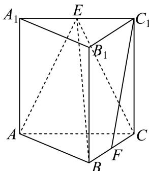

# 2025一模 崇明区原卷 · 教师版

> 本地预览：题目、答案及分类尚未全部审定。校对使用的PDF为高中工作台解析版，尚未逐区确认区级印刷原卷。

## 填空题

按本区原卷题号顺序排列。

### 崇明 · 第1题

已知集合 $A = \{ 1 , 2 , 3 , 4 , 5 \}$ $B = \left\{ x \mid x > { \sqrt { 5 } } \right\}$ ，则 $A \cap B =$

**考点：** 集合交集

**难度依据：** 涉及集合交集；难度为教师预估，需结合原题条件复核。

**核查说明：** 依据现有底稿归类，尚未逐页校卷、公式校净或独立数学终审。

【答案】{3, 4, 5}

【解析】

根据交集运算求解.

因为集合 $A = \{ 1 , 2 , 3 , 4 , 5 \} , B = \left\{ x \mid x > { \sqrt { 5 } } \right\}$

所以 $A \cap B = \{ 3 , 4 , 5 \}$ ，

故答案为：{3, 4, 5}

### 崇明 · 第2题

不等式 $\frac { x - 1 } { 2 x + 1 } <$ 0的解为

**考点：** 分式不等式与端点

**难度依据：** 涉及分式不等式与端点；难度为教师预估，需结合原题条件复核。

**核查说明：** 依据现有底稿归类，尚未逐页校卷、公式校净或独立数学终审。

【答案】$\left( - { \frac { 1 } { 2 } } , 1 \right)$

【解析】

将分式不等式转化为一元二次不等式后可求原不等式的解.

不等式 $\frac { x - 1 } { 2 x + 1 } <$ < 0的解即为 $\left( x - 1 \right) \left( 2 x + 1 \right) < 0$

故原不等式的解为 $x \in \left( { - { \frac { 1 } { 2 } } , 1 } \right)$

故答案为： $\left( - { \frac { 1 } { 2 } } , 1 \right)$

### 崇明 · 第3题

若复数z满足2z + z¯ = 1 + i其中i为虚数单位，则z = .

**考点：** 共轭复数方程与实虚部分离

**难度依据：** 涉及共轭复数方程与实虚部分离；难度为教师预估，需结合原题条件复核。

**核查说明：** 依据现有底稿归类，尚未逐页校卷、公式校净或独立数学终审。

【答案】${ \frac { 1 } { 3 } } + i$

【解析】

设 $z = a + b i ( a , \ b \in R )$ ，根据实虚部分别相等可解.

解: $z = a + b i ( a , \ b \in R )$ ，则 $\bar { z } = a - b i ( a , \ b \in R )$

所以， $2 a + 2 b i + a - b i = 1 + i , a = \frac { 1 } { 3 } , b = 1$

$$
z = \frac {1}{3} + i,
$$

故答案为： ${ \frac { 1 } { 3 } } + i$

根据复数相等求复数，解决的关键是实虚部分别相等求解；基础题.

### 崇明 · 第4题

(x − 1)7的二项展开式中x3的系数为

**考点：** 二项展开指定项系数

**难度依据：** 涉及二项展开指定项系数；难度为教师预估，需结合原题条件复核。

**核查说明：** 依据现有底稿归类，尚未逐页校卷、公式校净或独立数学终审。

【答案】35

【解析】

写出展开式的通项，利用通项计算可得.

二项 $\mathbb { X } ( x - 1 ) ^ { 7 }$ 展开式的通项为 ${ \cal T } _ { r + 1 } = \mathrm { C } _ { 7 } ^ { r } x ^ { 7 - r } ( - 1 ) ^ { r } ( 0 \leq r \leq 7 \mathrm { H } r \in \mathrm { N } )$

${ \widehat { \vec { \times } } } 7 - r = 3$ ，解得r = 4，所以 $T _ { 5 } = \mathrm { C } _ { 7 } ^ { 4 } x ^ { 3 } { ( - 1 ) } ^ { 4 } = 3 5 x ^ { 3 }$ ，

所以二项展开式中x3的系数为35.

故答案为：35

### 崇明 · 第5题

双曲线 $x ^ { 2 } - { \frac { y ^ { 2 } } { 4 } } = 1$ 的渐近线方程是

**考点：** 双曲线渐近线

**难度依据：** 涉及双曲线渐近线；难度为教师预估，需结合原题条件复核。

**核查说明：** 依据现有底稿归类，尚未逐页校卷、公式校净或独立数学终审。

【答案】$y = \pm 2 x$

【解析】

将双曲线方程中的1变为0后可得渐近线方程.

双曲线 $x ^ { 2 } - { \frac { y ^ { 2 } } { 4 } } = 1$ 的渐近线方程为 $x ^ { 2 } - { \frac { y ^ { 2 } } { 4 } } = 0 \mathbb { H } y = \pm 2 x$

故答案为： $y = \pm 2 x$

### 崇明 · 第6题

已知x,y为正实数，且满足 $4 x + y = 4 0$ ，则x⋅y的最大值是

**考点：** 基本不等式及等号条件

**难度依据：** 涉及基本不等式及等号条件；难度为教师预估，需结合原题条件复核。

**核查说明：** 依据现有底稿归类，尚未逐页校卷、公式校净或独立数学终审。

【答案】100

【解析】

利用基本不等式的变形，得到 $x y \leq \frac { 1 } { 4 } \times \left( \frac { 4 x + y } { 2 } \right) ^ { 2 }$ ，即可求解.因为 $4 x + y = 4 0$

所以 $x y = { \frac { 1 } { 4 } } \times 4 x \times y \leq { \frac { 1 } { 4 } } \times \left( { \frac { 4 x + y } { 2 } } \right) ^ { 2 } = 1 0 0 ,$

当且仅当 $4 x = y _ { ; }$ ，即 $\lvert \boldsymbol { x } = 5 , \boldsymbol { y } = 2 0$ 时，等号成立.

即xy的最大值为100.

故答案为：100

### 崇明 · 第7题

已知 $\vec { | a } = ( 1 , 2 ) , \vec { b } = ( 2 , k )$ ，如果 $\overrightarrow { a } / / \overrightarrow { b }$ ，那么实数k的值为

**考点：** 平面向量共线坐标条件

**难度依据：** 涉及平面向量共线坐标条件；难度为教师预估，需结合原题条件复核。

**核查说明：** 依据现有底稿归类，尚未逐页校卷、公式校净或独立数学终审。

【答案】4.

【解析】

根据向量的坐标表示即可.

由题意得1 $\mathbf { \nabla } \times k = 2 \times 2$ ，则k = 4.

故答案为：4.

### 崇明 · 第8题

已知 $f \left( x \right) = \left\{ { \begin{array} { l } { 2 ^ { x } - 1 , x > 1 } \\ { x - 1 , x \leq 1 } \end{array} } \right.$ ，关于x的方程f(x) = 2的解x =

**考点：** 分段函数方程

**难度依据：** 涉及分段函数方程；难度为教师预估，需结合原题条件复核。

**核查说明：** 依据现有底稿归类，尚未逐页校卷、公式校净或独立数学终审。

【答案】$\log _ { 2 } 3$

【解析】

根据分段函数的形式分段求解即可.

f(x) = 2等价于 $\left\{ { \begin{array} { l l } { 2 ^ { x } - 1 = 2 } \\ { x > 1 } \end{array} } \right.$ 或 $\left\{ { x - 1 = 2 \atop x \leq 1 } \right.$

故 $x = \log _ { 2 } 3$ ，

故答案为： $\log _ { 2 } 3$

### 崇明 · 第9题

在空间直角坐标系中，点(1,2,3)关 $\operatorname { F } x O y$ 平面的对称点的坐标是

**考点：** 空间点关于坐标平面对称

**难度依据：** 涉及空间点关于坐标平面对称；难度为教师预估，需结合原题条件复核。

**核查说明：** 依据现有底稿归类，尚未逐页校卷、公式校净或独立数学终审。

【答案】(1, 2, −3).

【解析】

根据空间点关于坐标平面的对称点特征可求对称点的坐标.

点(1, 2, 3)关于xOy平面的对称点的坐标为(1, 2, −3)，

故答案为：(1, 2, −3).

### 崇明 · 第10题

某校四个植树小队，在植树节这天种下柏树的棵数分别为10,x,10,8，若这组数据的中位数和平均数相等，那么x =

**考点：** 平均数与中位数的排序分类

**难度依据：** 涉及平均数与中位数的排序分类；难度为教师预估，需结合原题条件复核。

**核查说明：** 依据现有底稿归类，尚未逐页校卷、公式校净或独立数学终审。

【答案】12或8.

【解析】

利用平均数，中位数的性质结合分类讨论求解即可.

当x ≤ 8时，将数据进行排列，得到x,8,10,10，

因为这组数据的中位数和平均数相等，所以 ${ \frac { 2 8 + x } { 4 } } = { \frac { 8 + 1 0 } { 2 } }$ ，解得x = 8，

当8 < x < 10时，将数据进行排列，得到8,x,10,10，

因为这组数据的中位数和平均数相等，所以 ${ \frac { 2 8 + x } { 4 } } = { \frac { x + 1 0 } { 2 } }$

解得 $x = 8$ ，与范围不符，故排除

当 $x \geq 1 0 \mathbb { H } ]$ ，将数据进行排列，得到8,10,10,x，

因为这组数据的中位数和平均数相等，所以 ${ \frac { 2 8 + x } { 4 } } = { \frac { 1 0 + 1 0 } { 2 } }$

解得 $x = 1 2$ ，经检验，x = 8和x = 12均符合题意.

故答案为：12或8.

### 崇明 · 第11题

已知 $f(x)=A\sin(\omega x+\frac\pi6)$（$A>0,\omega>0$），若函数 $y=f(x)$ 在区间 $[0,2\pi]$ 上有且仅有3个零点和1个极小值点，则 $\omega$ 的取值范围是______。

> 本题资料或解析有待核事项，预览不可作为已审定成品。

**考点：** 正弦零点及极小值点个数与频率

**难度依据：** 涉及正弦零点及极小值点个数与频率；难度为教师预估，需结合原题条件复核。

**核查说明：** 题干极小值点个数缺失；须回源核对。；依据现有底稿归类，尚未逐页校卷、公式校净或独立数学终审。

【答案】$\left[ { \frac { 1 7 } { 1 2 } } , { \frac { 5 } { 3 } } \right)$

【解析】

根据零点个数和极小值点的个数可得关于ω的不等式，故可求其取值范围.

当 $x \in [ 0 , 2 \pi ]$ 时， $\omega x + \frac { \pi } { 6 } \in \left[ \frac { \pi } { 6 } , 2 \omega \pi + \frac { \pi } { 6 } \right]$ ，

因为函数 $y = f ( x )$ 在区间 $[ 0 , 2 \pi ]$ 上有且仅有3个零点和1个极小值点，

所以 $3 \pi \leq 2 \omega \pi + \frac { \pi } { 6 } < \frac { 7 \pi } { 2 }$ ，故 $\left[ { \boldsymbol { \omega } } \in \left[ { \frac { 1 7 } { 1 2 } } , { \frac { 5 } { 3 } } \right) \right.$

故答案为： $\left[ { \frac { 1 7 } { 1 2 } } , { \frac { 5 } { 3 } } \right)$

### 崇明 · 第12题

已知函数 $\cdot y = f ( x )$ 的定义域 $D = \{ 1 , 2 , 3 , 4 \}$ ，值域 $A = \{ 5 , 6 , 7 \}$ ，则函数 $\cdot y = f ( x )$ 为增函数的概率是

> 本题资料或解析有待核事项，预览不可作为已审定成品。

**考点：** 有限集合函数计数与单调性概率

**难度依据：** 涉及有限集合函数计数与单调性概率；难度为教师预估，需结合原题条件复核。

**核查说明：** 题称增函数而原解计数包含相等函数值，严格递增定义下不成立，须回核原题及术语。；依据现有底稿归类，尚未逐页校卷、公式校净或独立数学终审。

【答案】$\frac { 1 } { 1 2 }$

【解析】

求出所有函数的个数，再求出增函数的个数，利用古典概型的概率公式可求对应的概率.

若函数 $\langle y = f ( x )$ 的定义域为{1, 2, 3, 4}，值域为{5, 6, 7}，

则不同的函数的个数为 $\mathrm { C _ { 4 } ^ { 2 } \mathrm { P _ { 3 } ^ { 3 } = 3 6 } }$ ，

其中增函数共有3个：

（1） $f \left( 1 \right) = f ( 2 ) = 5 , f ( 3 ) = 6 , f ( 4 ) = 7 ;$

（2） $f \left( 1 \right) = 5 , f ( 2 ) = f ( 3 ) = 6 , f ( 4 ) = 7 ;$

（3） $f \left( 1 \right) = 5 , f ( 2 ) = 6 , f ( 3 ) = f ( 4 ) = 7 ;$

故所求概率为 ${ \frac { 3 } { 3 6 } } = { \frac { 1 } { 1 2 } }$ ，

故答案为： $\frac { 1 } { 1 2 }$

## 二、选择题

## 选择题

按本区原卷题号顺序排列。

### 崇明 · 第13题

下列函数中，在其定义域上既是奇函数又是严格增函数的是（　）。

A. $y=x^3$

B. $y=\mathrm e^x$

C. $y=\lg x$

D. $y=\sin x$

> 本题资料或解析有待核事项，预览不可作为已审定成品。

**考点：** 奇偶性与严格单调性

**难度依据：** 涉及奇偶性与严格单调性；难度为教师预估，需结合原题条件复核。

**核查说明：** 题干选项不完整，须核题图及原卷。；依据现有底稿归类，尚未逐页校卷、公式校净或独立数学终审。

【答案】A

【解析】

利用奇偶性的定义及基本函数的性质逐个判断即可.

对于A， $y = x ^ { 3 }$ 的定义域为R，且 $\left( - x \right) ^ { 3 } = - x ^ { 3 }$ ，所以 $. y = x ^ { 3 }$ 为奇函数，

又 $. y = x ^ { 3 }$ 是严格增函数，正确；

对于B，y = ex的定义域为R，且 $\mathrm { e } ^ { - x } \neq - \mathrm { e } ^ { x }$ ，所以 $\boldsymbol { \mathscr { s } } _ { } = \mathrm { e } ^ { x }$ 不为奇函数，错误；

对于C，y = lgx的定义域为 $( 0 , + \infty )$ ，不关于原点对称，

所以y = lgx不具有奇偶性，y = lgx是严格增函数，错误；

对于D，y = sinx的定义域为R，且sin(−x) = −sinx，所以y = sinx为奇函数，

但y = sinx为周期函数，不是定义域R上的严格增函数，错误.

故选：A

### 崇明 · 第14题

已知直线l和平面α，则“l垂直于α内的两条直线”是“l⊥α”的（ ）

A. 充分非必要条件

B. 必要非充分条件

C. 充要条件

D. 非充分非必要条件

**考点：** 线面垂直的充要条件

**难度依据：** 涉及线面垂直的充要条件；难度为教师预估，需结合原题条件复核。

**核查说明：** 依据现有底稿归类，尚未逐页校卷、公式校净或独立数学终审。

【答案】B

【解析】

利用直线与平面垂直的判定定理，即可得出结论.

根据直线与平面垂直的判定定理可知：

如果一条直线垂直于平面内的两条相交直线，那么这条直线垂直于这个平面.

而“l垂直于α内的两条直线”，没有满足相交，

所以不一定能推出直线与平面垂直，

但是如果一条直线与平面垂直，一定能推出这条直线垂直于平面内的所有直线，

即可得：“l垂直于α内的两条直线”是“l⊥α”的必要不充分条件.

故选：B.

### 崇明 · 第15题

抛掷一红一绿两颗质地均匀的骰子，记录骰子朝上面的点数，若用x表示红色骰子的点数，用y表示绿色骰子的点数，用 $( x , y )$ 表示一次试验结果，设事件 $E \colon x + y = 8$ ；事件F：至少有一颗点数为6；事件 $G \colon x > 4$ ；事件 $H \colon y \leq 4$ .则下列说法正确的是（ ）

A. 事件E与事件F为互斥事件

B. 事件F与事件G为互斥事件

C. 事件E与事件G相互独立

D. 事件G与事件H相互独立

> 本题资料或解析有待核事项，预览不可作为已审定成品。

**考点：** 互斥与独立事件判定

**难度依据：** 涉及互斥与独立事件判定；难度为教师预估，需结合原题条件复核。

**核查说明：** 原解对事件H的不等式与列举结果不一致，须回核原题。；依据现有底稿归类，尚未逐页校卷、公式校净或独立数学终审。

【答案】D

【解析】

A选项，写出事件E,F包含的情况，得到 $E \cap F \neq \emptyset$ ，A错误；B选项，写出事件G包含的情况，结合A选项，得到 $F \cap G \neq \emptyset$ ，B错误；C选项，写出事件 $E \cap G$ 包含的情况，故$P \left( E G \right) \neq P \left( E \right) P \left( G \right)$ ，C错误；D选项，写出事件H和 $G \cap H$ 包含的情况，得到$P \left( G \cap H \right) = P \left( G \right) P \left( H \right)$ ，D正确.

A选项，事件 $E \colon x + y = 8$ 包含的情况有(2, 6), (3, 5), (4, 4), (5, 3), (6, 2)，

事件F：至少有一颗点数为6包含的情况有

(1, 6), (2, 6), (3, 6), (4, 6), (5, 6), (6, 6), (6, 1), (6, 2), (6, 3), (6, 4), (6, 5)，

故 $E \cap F \neq \emptyset$ ，事件E与事件F不为互斥事件，A错误；

B选项，事件G:x > 4包含的情况有

(5, 1), (5, 2), (5, 3), (5, 4), (5, 5), (5, 6), (6, 1), (6, 2), (6, 3), (6, 4), (6, 5), (6, 6)，

故 $F \cap G \neq \emptyset$ ，事件F与事件G不为互斥事件，B错误；

C选项，抛掷一红一绿两颗质地均匀的骰子，共有6×6 = 36种情况，

故 $P \left( E \right) = \frac { 5 } { 3 6 } , P \left( G \right) = \frac { 1 2 } { 3 6 } = \frac { 1 } { 3 }$

事件 $E \cap G$ 包含的情况为 $( 5 , 3 ) , ( 6 , 2 )$ ，故 $P \left( E G \right) = \frac { 2 } { 3 6 } = \frac { 1 } { 1 8 }$

故 $P \left( E G \right) \neq P \left( E \right) P \left( G \right)$ ，故事件E与事件G不相互独立，C错误；

D选项，事件 $H \colon y \leq 4$ 包含的情况有

(1, 1), (1, 2), (1, 3), (2, 1), (2, 2), (2, 3), (3, 1), (3, 2), (3, 3), (4, 1), (4, 2), (4, 3)，

(5, 1), (5, 2), (5, 3), (6, 1), (6, 2), (6, 3)，共18种情况，

故 $P \left( H \right) = \frac { 1 8 } { 3 6 } = \frac { 1 } { 2 }$

事件G ∩ H包含的情况有：(5, 1), (5, 2), (5, 3), (6, 1), (6, 2), (6, 3)，

故 $P \left( G \cap H \right) = \frac { 6 } { 3 6 } = \frac { 1 } { 6 } .$ ，

故选：D

因为 $P \left( G \cap H \right) = P \left( G \right) P \left( H \right)$ ，所以事件G与事件H相互独立，D正确

### 崇明 · 第16题

已知数列 $\left\{ a _ { n } \right\}$ ，若存在数列 $\left\{ b _ { n } \right\}$ 满足对任意正整数n，都有 $\left( a _ { n } - b _ { n } \right) \left( a _ { n + 1 } - b _ { n + 1 } \right) < 0$ ，则称数列$\left\{ b _ { n } \right\}$ 是 $\left\{ a _ { n } \right\}$ 的交错数列.有下列两个命题：①对任意给定的等差数列 $\left\{ a _ { n } \right\}$ ，不存在等差数列 $\left\{ b _ { n } \right\}$ ，使得 $\left\{ b _ { n } \right\}$ 是 $\left\{ a _ { n } \right\}$ 的交错数列；②对任意给定的等比数列 $\left\{ a _ { n } \right\}$ ，都存在等比数列 $\left\{ b _ { n } \right\}$ ，使得 $\left\{ b _ { n } \right\}$ 是 $\left\{ a _ { n } \right\}$ 的交错数列.下列结论正确的是（ ）

A. ①与②都是真命题；

B. ①为真命题，②为假命题；

C. ①为假命题，②为真命题；

D. $\textcircled { 1 } \frac { \ d H } { \ d z }$ ②都是假命题

> 本题资料或解析有待核事项，预览不可作为已审定成品。

**考点：** 交错数列定义与等差等比构造

**难度依据：** 涉及交错数列定义与等差等比构造；难度为教师预估，需结合原题条件复核。

**核查说明：** 原解对公比q<0仅称由对称性成立，缺少明确构造或证明，须补证。；依据现有底稿归类，尚未逐页校卷、公式校净或独立数学终审。

【答案】A

【解析】

对于①：根据等差数列通项公式为一次函数形式分析判断；对于②：根据等比数列通项公式为指数型，并举例说明即可.

对于①：因为数列 $\{ a _ { n } \} , \{ b _ { n } \}$ 均为等差数列，

设 $a _ { n } = k n + m , b _ { n } = c n + d ,$ ，则 $a _ { n } - b _ { n } = ( k - c ) n + m - d ,$

若 $\ : \dot { k } - c > 0 \ :$ ，可知当 $n > - \frac { m - d } { k - c }$ 时， $a _ { n } - b _ { n } >$ 0恒成 $\vdots \vdots$ ，不满足交错数列；

若 $k - c = 0$ ，可知 $\boldsymbol { { \mathrm { I } } a _ { n } } - \boldsymbol { b _ { n } }$ 的符号不变，不满足交错数列；

若 $k - c < 0$ ，可知当 $n > - \frac { m - d } { k - c }$ 时， $a _ { n } - b _ { n } <$ 0恒成 $\vdots \vdots$ ，不满足交错数列；

综上所述：对任意等差数列 $\{ a _ { n } \} , \{ b _ { n } \} , \{ b _ { n } \}$ 均不是 $\{ a _ { n } \}$ 的交错数列，故①正确；

对于②：因为数列 $\{ a _ { n } \}$ 为等比数列，设 $a _ { n } = a q ^ { n } , a q \neq 0$ ，等比数列 $\left\{ a _ { n } \right\}$ 的公比为 $\mathsf { I }$

不妨假设 $a > 0 , q > 0 , b _ { n } = a ( - 2 q ) ^ { n }$ ，此时等比数列 $\{ b _ { n } \}$ 的公比为 $- 2 q < 0$

当n为奇数，则 $| b _ { n } = - a q ^ { n } \cdot 2 ^ { n } < a q ^ { n } = a _ { n } ;$ ；

当 $n$ 为偶数，则 $b _ { n } = a q ^ { n } \cdot 2 ^ { n } > a q ^ { n } = a _ { n }$ ；

满足 $\left\{ b _ { n } \right\}$ 是 $\{ a _ { n } \}$ 的交错数列，

若等比数列 $\left\{ a _ { n } \right\}$ 的公比为 $q < 0$ ，根据对称结构，上述结论依然成立，

同理若 $\dot { a } < 0 , q > 0 , b _ { n } = a ( - 2 q ) ^ { n }$ ，此时等比数列 $\left\{ b _ { n } \right\}$ 的公比为 $- 2 q < 0$

当 $n$ 为奇数，则 $b _ { n } = - a q ^ { n } \cdot 2 ^ { n } > a q ^ { n } = a _ { n }$ ；

当 $n$ 为偶数，则 $b _ { n } = a q ^ { n } \cdot 2 ^ { n } < a q ^ { n } = a _ { n }$ ；

满足 $\left\{ b _ { n } \right\}$ 是 $\{ a _ { n } \}$ 的交错数列，

若等比数列 $\{ a _ { n } \}$ 的公比为 $q < 0 ,$ ，根据对称结构，上述结论依然成立，

综上所述：对任意给定的等比数列 $\{ a _ { n } \}$ ，都存在等比数列 $\left\{ b _ { n } \right\}$ ，使得 $\left\{ b _ { n } \right\}$ 是 $\{ a _ { n } \}$ 的交错数列，故②正确；

故选：A.

关键点点睛：数列是特殊的函数，根据数列的特性，准确构造相应的函数，借助函数性质分析求解是解题的关键，背景函数的条件，应紧扣题中的限制条件.

## 三、解答题

## 解答题

按本区原卷题号顺序排列。

### 崇明 · 第17题

如图，在直三棱柱 $A B C - A _ { 1 } B _ { 1 } C _ { 1 }$ 中，E、F分别为 $A _ { 1 } C _ { 1 }$ 、BC的中点， $A A _ { 1 } = A B = B C = 2 \quad$ $C _ { 1 } F \bot A B .$

(1) (6分)求证： $C _ { 1 } F / /$ 平面ABE；
(2) (8分)求点C到平面ABE的距离.

> 本题资料或解析有待核事项，预览不可作为已审定成品。

**考点：** （1）中点构造线面平行；（2）等体积法求点面距离

**难度依据：** 涉及（1）中点构造线面平行；（2）等体积法求点面距离；难度为教师预估，需结合原题条件复核。

**核查说明：** 原解中G的中点位置及长度运算文字存在矛盾，须回核。；依据现有底稿归类，尚未逐页校卷、公式校净或独立数学终审。

【解析】

(1) 取AB中点G，连接 $F G , E G$ ，则 $F G / / A C$ • $F G = { \frac { 1 } { 2 } } A C .$

又 $C _ { 1 } E / / A C$ $C _ { 1 } E = { \frac { 1 } { 2 } } A C$ ，所以 $F G / / C _ { 1 } E$ ，且 $F G = C _ { 1 } E$

所以四边形 $F G E C _ { 1 }$ 是平行四边形，所以 $C _ { 1 } F / / E G$

又 $E G \subset$ 平面 $A B E$ $C _ { 1 } F \not \subset$ 平面ABE，所以 $C _ { 1 } F / /$ 平面 $A B E$ ；

(2) 由（1）点G是AC中点，连接 $E B _ { 1 }$

因为 $| C _ { 1 } C \bot$ 平面 $A B C , A B \subset { \overline { { \Psi } } } \widehat { \mathbb { H } } A B C .$ ，所以 $C _ { 1 } C \bot A B ,$

又 $C _ { 1 } F \bot A B ,$ ，且 $\begin{array} { r } { C _ { 1 } F \cap C _ { 1 } C = C _ { 1 } , C _ { 1 } F , C _ { 1 } C \subset  { \mathbb { T } }  { \mathbb { H } } B _ { 1 } C _ { 1 } C B , } \end{array}$

所以 $A B \bot$ 平面 $B _ { 1 } C _ { 1 } C B$ $B C \subset$ 平面 $B _ { 1 } C _ { 1 } C B _ { 3 }$ ，所 $\complement B \bot A B .$

所以 $S _ { \triangle A B C } = \frac { 1 } { 2 } \times 2 \times 2 = 2 , A _ { 1 } E = \frac { 1 } { 2 } A _ { 1 } C _ { 1 } = \frac { 1 } { 2 } \sqrt { A A _ { 1 } ^ { 2 } + A _ { 1 } C _ { 1 } ^ { 2 } } = \frac { 1 } { 2 } \sqrt { 2 ^ { 2 } + 2 ^ { 2 } } = \sqrt { 2 } ,$

$$
B _ {1} E = \sqrt {2},
$$

$$
A E = \sqrt {A A _ {1} ^ {2} + A _ {1} E ^ {2}} = \sqrt {6}, B E = \sqrt {B B _ {1} ^ {2} + B _ {1} E ^ {2}} = \sqrt {4 + 1} = \sqrt {6},
$$

所以 $\triangle A B E$ 为等腰三角形，则 $E G \bot A B ,$ ，且 $E G = { \sqrt { A E ^ { 2 } - A G ^ { 2 } } } = { \sqrt { 5 } } ,$

所以 $S _ { \triangle A B E } = \frac { 1 } { 2 } A B \cdot E G = \sqrt { 5 } ,$

设点C到平面ABE的距离为h，由 $V _ { C - A B E } = V _ { E - A B C }$ 得 $\frac { 1 } { 3 } S _ { \triangle A B E } \cdot h = \frac { 1 } { 3 } S _ { \triangle A B C } \cdot A A _ { 1 }$

所以 $\frac { 1 } { 3 } \times \sqrt { 5 } h = \frac { 1 } { 3 } \times 2 \times 2$ ，所以 $h = { \frac { 4 { \sqrt { 5 } } } { 5 } }$ 即点 到平面 的距离为 $\frac { 4 { \sqrt { 5 } } } { 5 }$

### 崇明 · 第18题

在 $\triangle A B C ^ { \prime }$ 中，已知点D是BC边上一点，且BD = 1，CD = 3.
(1) (6分)若 $A D \bot B C$ ，且 $\angle A B D = 2 \angle A C D$ ，求AD的长；
(2) (8分)若 $\angle A B D = 5 5 ^ { \circ } , \angle A C D = 3 2 ^ { \circ }$ ，求AD的长（结果精确到0.01）.

**考点：** （1）正切倍角解三角形；（2）正余弦定理求长度

**难度依据：** 涉及（1）正切倍角解三角形；（2）正余弦定理求长度；难度为教师预估，需结合原题条件复核。

**核查说明：** 依据现有底稿归类，尚未逐页校卷、公式校净或独立数学终审。

【解析】

(1) 因为 $A D \bot B C ,$ ，所以 $\tan \angle A B D = { \frac { A D } { 1 } } , \tan \angle A C D = { \frac { A D } { 3 } }$

又 $\angle A B D = 2 \angle A C D$ ，所以 $\tan \angle A B D = \frac { 2 \tan \angle A C D } { 1 - \tan ^ { 2 } \angle A C D }$

即 $A D = { \frac { 2 \times { \frac { A D } { 3 } } } { 1 - \left( { \frac { A D } { 3 } } \right) ^ { 2 } } }$ 解得 $A D = { \sqrt { 3 } } .$

(2) 在 $\triangle A B C ^ { \ r }$ 中， $\angle B A C = 9 3 ^ { \circ } , B C = 4$ ，由正弦定理得 ${ \frac { B C } { \sin \angle B A C } } = { \frac { A C } { \sin \angle A B C } }$

所以 $A C = { \frac { B C \cdot \sin \angle A B C } { \sin \angle B A C } } \approx 3 . 2 8 1$

在△ACD中，由余弦定理得

$$
A D = \sqrt {A C ^ {2} + D C ^ {2} - 2 A C \cdot D C \cdot \cos \angle A C D} \approx 1. 7 5.
$$

### 崇明 · 第19题

王老师将全班40名学生的高一数学期中考试（满分100分）成绩分成5组，绘制成如图所示的频率分布直方图，现将[50, 60)记作第一组，[60, 70)、[70, 80)、[80, 90)、[90, 100]分别记作第二、三、四、五组．已知第一组、第二组的频率之和为0.3，第一组和第五组的频率相同

(1) (4分)估计此次考试成绩的平均值（同一组数据用该组数据的中点值代替）；
(2) (5分)王老师将测试成绩在[80, 90)和[90, 100]内的试卷进行分析，再从中选2人的试卷进行优秀答卷展示，求被选中进行优秀答卷展示的这2人的测试成绩至少1个在[90,100]内的概率；
(3) (5分)已知第二组考生成绩的平均数和方差分别为65和40，第四组考生成绩的平均数和方差分别为83和70，据此计算第二组和第四组所有学生成绩的方差

**考点：** （1）频率直方图估计；（2）组合概率；（3）合并方差

**难度依据：** 涉及（1）频率直方图估计；（2）组合概率；（3）合并方差；难度为教师预估，需结合原题条件复核。

**核查说明：** 依据现有底稿归类，尚未逐页校卷、公式校净或独立数学终审。

【解析】

(1) 由题意得 $\left\{ { 1 0 a + 1 0 b = 0 . 3 \atop 1 0 ( 0 . 0 4 5 + 0 . 0 2 0 + a ) = 0 . 7 } \right.$ 解得 $\left\{ { a = 0 . 0 0 5 , } \atop { b = 0 . 0 2 5 . } \right.$

所以平均数等 $\mp 5 5 \times 0 . 0 5 + 6 5 \times 0 . 2 5 + 7 5 \times 0 . 4 5 + 8 5 \times 0 . 2 + 9 5 \times 0 . 0 5 = 7 4 . 5$

(2) 由题意，[80, 90)内有8人，[90, 100]内有2人，

所以被选中进行优秀答卷展示的这2人的测试成绩至少1个在[90,100]内的概率为

1 $- \ : \frac { \mathrm { C } _ { 8 } ^ { 2 } } { \mathrm { C } _ { 1 0 } ^ { 2 } } = \frac { 1 7 } { 4 5 } .$

(3) 设第二组、第四组的平均数与方差分别为 $\bar { \jmath _ { x _ { 1 } , x _ { 2 } , s _ { 1 } ^ { 2 } , s _ { 2 } ^ { 2 } } }$ ，

由题意，第二组、第四组分别有10人和8人，

所以成绩在第二组、第四组的平均数 $t \overline { { x } } = \frac { 6 5 \times 1 0 + 8 3 \times 8 } { 1 0 + 8 } = 7 3$

成绩在第二组、第四组的方差 $s ^ { 2 } = { \frac { 1 } { 1 8 } } \left\lceil \sum _ { i = 1 } ^ { 1 0 } \left( x _ { i } - { \overline { { x } } } \right) ^ { 2 } + \sum _ { j = 1 } ^ { 8 } \left( y _ { j } - { \overline { { x } } } \right) ^ { 2 } \right\rceil$

$$
= \frac {1}{1 8} \left\{ \right.\left\{\sum_ {i = 1} ^ {1 0} \left[ (x _ {i} - \overline {{x _ {1}}}) + (\overline {{x _ {1}}} - \overline {{x}}) \right] ^ {2} + \sum_ {j = 1} ^ {8} \left[ (y _ {j} - \overline {{x _ {2}}}) + (\overline {{x _ {2}}} - \overline {{x}}) \right] ^ {2} \right\}
$$

$$
= \frac {5}{9} \left[ s _ {1} ^ {2} + (\overline {{x _ {1}}} - \overline {{x}}) ^ {2} \right] + \frac {4}{9} \left[ s _ {2} ^ {2} + (\overline {{x _ {2}}} - \overline {{x}}) ^ {2} \right]
$$

$$
= \frac {5}{9} \times [ 4 0 + (6 5 - 7 3) ^ {2} ] + \frac {4}{9} \times [ 7 0 + (8 3 - 7 3) ^ {2} ] = \frac {4 0 0}{3}
$$

故估计成绩在第二组、第四组的方差是 $\frac { 4 0 0 } { 3 }$

### 崇明 · 第20题

已知椭圆Γ: ${ \frac { y ^ { 2 } } { 4 } } + { \frac { x ^ { 2 } } { 3 } } = 1$ ，点 $F _ { 1 }$ 、 $F _ { 2 }$ 分别是椭圆的下焦点和上焦点，过点 $F _ { 2 }$ 的直线l与椭圆交于A、B两点
(1) (4分)若直线l平行于x轴，求线段AB的长；
(2) (6分)若点A在y轴左侧，且− ${ \overrightarrow { F _ { 1 } A } } \cdot { \overrightarrow { F _ { 2 } A } } = { \frac { 9 } { 4 } }$ ，求直线l的方程；
(3) (8分)已知椭圆上的点C满足 $| C A | = | C B |$ ，是否存在直线l使得△ABC的重心在x轴上？若存在，请求出直线l的方程，若不存在，请说明理由

> 本题资料或解析有待核事项，预览不可作为已审定成品。

**考点：** （1）焦点弦长；（2）数量积求弦；（3）等腰与重心条件

**难度依据：** 涉及（1）焦点弦长；（2）数量积求弦；（3）等腰与重心条件；难度为教师预估，需结合原题条件复核。

**核查说明：** 原解上焦点坐标及后续分母前后不一致，须回核。；依据现有底稿归类，尚未逐页校卷、公式校净或独立数学终审。

【解析】

(1) 由题意， $F _ { 1 } ( 0 , - 1 )$ 、 $F _ { 2 } ( 1 , 0 )$ ，所以直线l的方程是 $y = 1$ ，

代入 ${ \frac { y ^ { 2 } } { 4 } } + { \frac { x ^ { 2 } } { 3 } } = 1$ 中，得 $x = \pm \frac { 3 } { 2 }$ ，所以 $| A B | = 3$

(2) 设 $A ( x _ { 0 } , y _ { 0 } ) ( x _ { 0 } < 0 )$ ，则 $\overrightarrow { F _ { 1 } A } = ( x _ { 0 } , y _ { 0 } + 1 ) , \overrightarrow { F _ { 2 } A } = ( x _ { 0 } , y _ { 0 } - 1 )$

所以 $\overrightarrow { { \cal F } _ { 1 } A } \cdot \overrightarrow { { \cal F } _ { 2 } A } = x _ { 0 } ^ { 2 } + \left( y _ { 0 } + 1 \right) \left( y _ { 0 } - 1 \right) = \frac { 9 } { 4 }$

又 $\frac { y _ { 0 } ^ { 2 } } { 4 } + \frac { x _ { 0 } ^ { 2 } } { 3 } = 1$ ，所以 $\left\{ { x _ { 0 } = - { \frac { 3 } { 2 } } } \right.$ 所以A点坐标是 $\left( - { \frac { 3 } { 2 } } , 1 \right)$ 或 $\left( - { \frac { 3 } { 2 } } , - 1 \right)$

所以直线l的方程是 $y = 1 \textcircled { \sharp } \hat { \chi } y = \frac { 4 } { 3 } x + 1$

(3) 当直线l的斜率存在时，设直线l的方程为 $\textstyle | y = k x + 1$

代入 ${ \frac { y ^ { 2 } } { 4 } } + { \frac { x ^ { 2 } } { 3 } } = 1 \#$ ，得 $( 3 k ^ { 2 } + 4 ) x ^ { 2 } + 6 k x - 9 = 0$ ，此时 $\Delta = 1 4 4 k ^ { 2 } + 1 4 4 > 0$

设 $\cdot A ( x _ { 1 } , y _ { 1 } ) \cdot \ B ( x _ { 2 } , y _ { 2 } ) \cdot \ C ( x _ { 3 } , y _ { 3 } )$

则 $\lvert x _ { 1 } + x _ { 2 } = \frac { - 6 k } { 3 k ^ { 2 } + 4 }$ ，所以AB中点M $\left( { \frac { - 3 k } { 3 k ^ { 2 } + 4 } } , { \frac { 4 } { 3 k ^ { 2 } + 4 } } \right)$

又 $\triangle A B C$ 的重心在x轴上，所以 $y _ { 1 } + y _ { 2 } + y _ { 3 } = 0$

即 $k ( x _ { 1 } + x _ { 2 } ) + 2 + y _ { 3 } = 0$ ，故 $y _ { 3 } = - { \frac { 8 } { 3 k ^ { 2 } + 4 } } .$

因为 $| C A | = | C B |$ ，所以 $M C \bot A B$

所以 $\overrightarrow { M C } \cdot \overrightarrow { A B } = \left( x _ { 3 } + \frac { 3 k } { 3 k ^ { 2 } + 4 } , y _ { 3 } - \frac { 4 } { 3 k ^ { 2 } + 4 } \right) \cdot ( x _ { 1 } - x _ { 2 } , y _ { 1 } - y _ { 2 } ) _ { t w i t h }$

因为 $x _ { 1 } - x _ { 2 } \neq 0$ ，所以 $x _ { 3 } + { \frac { 3 k } { 3 k ^ { 2 } + 4 } } + { \bigg ( } y _ { 3 } - { \frac { 4 } { 3 k ^ { 2 } + 4 } } { \bigg ) } k = 0 ,$

所以 $x _ { 3 } = { \frac { 9 k } { 3 + 4 k ^ { 2 } } }$ ，所以 $C \left( \frac { 9 k } { 3 + 4 k ^ { 2 } } , - \frac { 8 } { 3 k ^ { 2 } + 4 } \right)$ ，

因为点C在椭圆上，所以 ${ \frac { \left( - { \frac { 8 } { 3 k ^ { 2 } + 4 } } \right) ^ { 2 } } { 4 } } + { \frac { \left( { \frac { 9 k } { 3 + 4 k ^ { 2 } } } \right) ^ { 2 } } { 3 } } = 1$ ，解得k = 0或 $k = \pm \frac { \sqrt { 3 } } { 3 }$ 当直线l的斜率不存在时，直线l的方程为 $x = 0$ 9

此时A、B恰为长轴顶点，点C为短轴顶点，满足题意

综上所述，存在直线l使得 $\triangle A B C$ 的重心在x轴上，

其方程为： $y = \pm { \frac { \sqrt { 3 } } { 3 } } x + 1$ 或 $y = 1$ 或 $x = 0$

### 崇明 · 第21题

定义：若曲线 $C _ { 1 }$ 和曲线 $C _ { 2 }$ 有公共点P，且曲线 $C _ { 1 }$ 在点P处的切线与曲线 $C _ { 2 }$ 在点P处的切线重合，则 称 $C _ { 1 }$ 与 $C _ { 2 }$ 在点P处“一线切”.
(1) (4分)已知圆 $( x - a ) ^ { 2 } + y ^ { 2 } = r ^ { 2 } ( r > 0 ) ^ { \underline { { H } } }$ 与曲线 $y = x ^ { 2 }$ 在点(1,1)处“一线切”，求实数a的值；
(2) (6分)设 $f ( x ) = x ^ { 2 } + 2 x + a , g ( x ) = \ln ( x + 1 )$ ，若曲线 $y = f ( x ) ^ { \perp }$ 与曲线 $y = g ( x )$ 在点P处“一线切”，求实数a的值；
(3) (8分)定义在R上的函数 $y = f ( x )$ 的图象为连续曲线，函数 $y = f ( x )$ 的导函数为 $\vert y = f ^ { \prime } ( x )$ ，对任意的 $| x \in \mathbf { R }$ ，都有 $\left\{ \begin{array} { l l } { \displaystyle | f ^ { \prime } ( x ) | \geq | f \left( x \right) } \\ { \displaystyle | f \left( x \right) | < \sqrt { 2 } } \end{array} \right.$ 成立.是否存在点P使得曲线 $\mathbf { \dot { y } } = f ( x ) \sin x$ 和曲线 $; y = 1$ 在点P处“一线切”？若存在，请求出点P的坐标，若不存在，请说明理由.

> 本题资料或解析有待核事项，预览不可作为已审定成品。

**考点：** （1）切线斜率；（2）曲线公切线；（3）导数条件下的公切线问题

**难度依据：** 涉及（1）切线斜率；（2）曲线公切线；（3）导数条件下的公切线问题；难度为教师预估，需结合原题条件复核。

**核查说明：** 第（3）问绝对值符号缺失，须回源。；依据现有底稿归类，尚未逐页校卷、公式校净或独立数学终审。

【解析】

(1) $y ^ { \prime } = 2 x$ ，所以曲线 $\dot { \boldsymbol { y } } = x ^ { 2 }$ 在点(1,1)处的切线方程为 $y - 1 = 2 ( x - 1 )$ ，

即 $2 x - y - 1 = 0 .$

因为圆 $( x - a ) ^ { 2 } + y ^ { 2 } = r ^ { 2 } ( r > 0 ) .$ 与曲线 $y = x ^ { 2 }$ 在点(1,1)处“一线切”，

所以直线 $2 x - y - 1 = 0 ^ { \underline { { i } } }$ 与圆 $( x - a ) ^ { 2 } + y ^ { 2 } = r ^ { 2 } ( r > 0 )$ 在点(1,1)处相切，

所以 $\left\{ { \begin{array} { l } { ( 1 - a ) ^ { 2 } + 1 = r ^ { 2 } } \\ { \displaystyle { \frac { | 2 a - 1 | } { \sqrt { 5 } } } = r } \end{array} } \right.$ ，所以a = 3.

(2) 设 $P ( x _ { 0 } , y _ { 0 } ) , f ^ { \prime } \left( x \right) = 2 x + 2 , g ^ { \prime } \left( x \right) = \frac { 1 } { x + 1 }$

由题意， ${ \left\{ \begin{array} { l l } { f ( x _ { 0 } ) = g ( x _ { 0 } ) } \\ { f ^ { \prime } ( x _ { 0 } ) = g ^ { \prime } ( x _ { 0 } ) } \end{array} \right. } ,$ 所以 $\left\{ { \begin{array} { l } { x _ { 0 } ^ { 2 } + 2 x _ { 0 } + a = \ln \left( x _ { 0 } + 1 \right) } \\ { \displaystyle 2 x _ { 0 } + 2 = { \frac { 1 } { x _ { 0 } + 1 } } } \end{array} } \right.$

解得 $x _ { 0 } = - 1 + { \frac { \sqrt { 2 } } { 2 } } , a = { \frac { 1 } { 2 } } - { \frac { 1 } { 2 } } \mathrm { l n } 2$

(3) 假设存在 $P ( x _ { 0 } , 1 )$ 满足题意，

则有 $f ( x _ { 0 } ) \sin x _ { 0 } = 1$ ，对函数 $y = f ( x ) \sin x$ 求导得： $y ^ { \prime } = f ^ { \prime } ( x ) \sin x + f ( x ) \cos x$

于是 $f ^ { \prime } ( x _ { 0 } ) \sin x _ { 0 } + f ( x _ { 0 } ) \cos x _ { 0 } = 0 , \mathbb { H } f ^ { \prime } ( x _ { 0 } ) \sin x _ { 0 } = - f ( x _ { 0 } ) \cos x _ { 0 }$

平方得 $\cdot [ f ^ { \prime } ( x _ { 0 } ) ] ^ { 2 } \sin ^ { 2 } x _ { 0 } = [ f ( x _ { 0 } ) ] ^ { 2 } \cos ^ { 2 } x _ { 0 } = [ f ( x _ { 0 } ) ] ^ { 2 } ( 1 - \sin ^ { 2 } x _ { 0 } )$

即有 $[ f ^ { \prime } ( x _ { 0 } ) ] ^ { 2 } \sin ^ { 2 } x _ { 0 } + [ f ( x _ { 0 } ) ] ^ { 2 } \sin ^ { 2 } x _ { 0 } = [ f ( x _ { 0 } ) ] ^ { 2 }$ ，因此 $f ^ { \prime } ( x _ { 0 } ) ] ^ { 2 } \cdot { \frac { 1 } { [ f ( x _ { 0 } ) ] ^ { 2 } } } + 1 = [ f ( x _ { 0 } ) ] ^ { 2 } ,$

整理得 $[ f ^ { \prime } ( x _ { 0 } ) ] ^ { 2 } + [ f ( x _ { 0 } ) ] ^ { 2 } = [ f ( x _ { 0 } ) ] ^ { 4 }$ ，而恒有 $\left| f ^ { \prime } \left( x \right) \right| \geq \left| f \left( x \right) \right|$ |成立，

则有 $[ f ^ { \prime } ( x _ { 0 } ) ] ^ { 2 } \geq [ f ( x _ { 0 } ) ] ^ { 2 }$ ，从而 $[ f ( x _ { 0 } ) ] ^ { 4 } \geq 2 [ f ( x _ { 0 } ) ] ^ { 2 }$ ，显然 $f ( x _ { 0 } ) \neq 0$

于是 $[ f ( x _ { 0 } ) ] ^ { 2 } \geq 2$ ，即 $f \left( x _ { 0 } \right) \mid \geq { \sqrt { 2 } } \overleftrightarrow { { \mathfrak { f } } } \left| f \left( x \right) \right| < { \sqrt { 2 } }$ 恒成立矛盾，

所以假设不成立，即不存在点P满足条件

