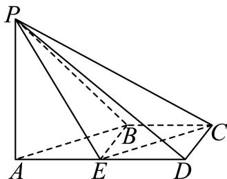

# 2025一模 徐汇区原卷 · 学生版

> 本地预览：题目、答案及分类尚未全部审定。校对使用的PDF为高中工作台解析版，尚未逐区确认区级印刷原卷。

## 填空题

按本区原卷题号顺序排列。

### 徐汇 · 第1题

不等式 $x ^ { 2 } - 4 x + 3 < 0$ 的解集是

### 徐汇 · 第2题

已知函数 $y=f(x)$，其中 $f(x)=\begin{cases}\ln x,&x>0,\\-1,&x\le0,\end{cases}$，则 $f(1)=$______。

> 本题资料或解析有待核事项，预览不可作为已审定成品。

### 徐汇 · 第3题

在(1+x)n的二项展开式中，若各项系数和为32，则正整数n的值为 .

### 徐汇 · 第4题

已知向量 $\vec { a } = ( 2 , 5 , 1 ) , \vec { b } = ( 4 , m , 5 )$ ，若 ${ \vec { a } } \cdot { \vec { b } } = 3$ ，则实数m的值为

### 徐汇 · 第5题

设 $a , b \in \mathbf { R } , f \left( x \right) = x ^ { 3 } + 3 \sin x + b .$ .若函数 $y = f \left( x \right)$ 是定义在 $[ - a , 2 a - 1 ]$ 上的奇函数，则 $a + b =$

### 徐汇 · 第6题

已知m,n为空间中两条不同的直线，α,β为两个不同的平面，若 $m \subset \alpha , \alpha \cap \beta = n$ ，则 $m / / n$ 是 $m / / \beta$ 的 条件.（填：“充分非必要”､“必要非充分”、“充要”、“既非充分又非必要”中的一个）

### 徐汇 · 第7题

某景点对30天内每天的游客人数（单位：万人）进行统计，得到样本的茎叶图（如下表），则该样本的第75百分位数是______。

| 茎 | 叶 |
|---|---|
| 1 | 2 5 |
| 2 | 0 2 3 3 |
| 3 | 1 2 4 4 8 9 |
| 4 | 5 5 5 7 7 8 8 9 |
| 5 | 0 0 1 1 4 7 9 |
| 6 | 1 7 8 |

> 本题资料或解析有待核事项，预览不可作为已审定成品。

### 徐汇 · 第8题

已知复数z1和复数z2满足 $z _ { 1 } + z _ { 2 } = 3 + 4 \mathbf { i } , \overline { { z _ { 1 } } } - \overline { { z _ { 2 } } } = - 2 + \mathbf { i }$ （i为虚数单位），则 z21 − z22 = .

> 本题资料或解析有待核事项，预览不可作为已审定成品。

### 徐汇 · 第9题

设 $a \in \mathbf { R } , f \left( x \right) = x ^ { 2 } + a x + \ln x$ ，若函数y = f(x)存在两个不同的极值点，则a的取值范围为

> 本题资料或解析有待核事项，预览不可作为已审定成品。

### 徐汇 · 第10题

已知椭圆 ${ \frac { x ^ { 2 } } { a ^ { 2 } } } + { \frac { y ^ { 2 } } { b ^ { 2 } } } = 1 ( a > b > 0 )$ 的左､右焦点分别为 $F _ { 1 } , F _ { 2 }$ ，P为椭圆上一点，且 $\angle P F _ { 2 } F _ { 1 } = \frac { \pi } { 3 }$ 若此椭圆的离心率为 ${ \sqrt { 3 } } - 1$ ，则 $\angle P F _ { 1 } F _ { 2 }$ 的大小为

### 徐汇 · 第11题

徐汇滨江作为2024年上海国际鲜花展的三个主会场之一，吸引了广大市民前往观展并拍照留念.图中的花盆是种植鲜花的常见容器，它可视作两个圆台的组合体，上面圆台的上､下底面直径分别为
30cm和26cm，下面圆台的上､下底面直径分别为24cm和18cm，且两个圆台侧面展开图的圆弧所对 的圆心角相等.若上面圆台的高为8cm，则该花盆上､下两部分母线长的总和为 cm.

> 本题资料或解析有待核事项，预览不可作为已审定成品。

### 徐汇 · 第12题

已知定义域为A = {1,2,3}的函数 $\cdot y = f \left( x \right)$ 的值域也是A，所有这样的函数 $y = f \left( x \right)$ 形成全集B.设非空集合 $C \subseteq B$ 且$\overline{C}$中的每一个函数都是C中的两个函数（可以相同）的复合函数，则集合C的元素个数的最小值为

> 本题资料或解析有待核事项，预览不可作为已审定成品。

## 选择题

按本区原卷题号顺序排列。

### 徐汇 · 第13题

下列抛物线中，焦点坐标为 $\left( 0 , { \frac { 1 } { 8 } } \right)$ 的是（）

A. $y ^ { 2 } = { \frac { 1 } { 2 } } x$

B. $y ^ { 2 } = { \frac { 1 } { 4 } } x$

C. $x ^ { 2 } = { \frac { 1 } { 2 } } y$

D. $x ^ { 2 } = { \frac { 1 } { 4 } } y$

### 徐汇 · 第14题

一个不透明的盒子中装有若干个红球和5个黑球，这些球除颜色外均相同.每次将球充分搅匀后，任意摸出1个球记下颜色后再放回盒子.经过重复摸球足够多次试验后发现，摸到黑球的频率稳定在0.1左右，则据此估计盒子中红球的个数约为（ ）

A. 40个

B. 45个

C. 50个

D. 55个

### 徐汇 · 第15题

已知函数 $y=f(x)$ 与它的导函数 $y=f'(x)$ 的定义域均为 $\mathbf R$。若函数 $y=f(x)$ 是偶函数且 $y=f'(x)$ 在 $(-\infty,0)$ 上是严格增函数，则下列各表中，可能成为 $y=f(x)$ 取值的是（　）。

A.

| $x$ | 1 | 2 | 3 | 4 |
|---|---|---|---|---|
| $f(x)$ | 2.8188 | 1.0000 | 0.3644 | 0.2468 |

B.

| $x$ | 1 | 2 | 3 | 4 |
|---|---|---|---|---|
| $f(x)$ | 0.7580 | 1.0000 | 1.3188 | 1.7979 |

C.

| $x$ | 1 | 2 | 3 | 4 |
|---|---|---|---|---|
| $f(x)$ | 2.4132 | 1.0000 | 1.5885 | 4.1116 |

D.

| $x$ | 1 | 2 | 3 | 4 |
|---|---|---|---|---|
| $f(x)$ | 0.8664 | 1.0000 | 1.1188 | 1.2240 |

### 徐汇 · 第16题

已知数列 $\left\{ a _ { n } \right\}$ 的前n项和为 $S _ { n }$ ，设 $t _ { n } = { \frac { S _ { n } } { n } }$ （n为正整数）.若存在常数c，使得任意两两不相等的正整数 $\because \ : j , k ,$ 都有 $( i - j ) t _ { k } + ( j - k ) t _ { i } + ( k - i ) t _ { j } = c ,$ ，则称数列 $\left\{ a _ { n } \right\}$ 为“轮换均值数列”.现有下列两个命题：①任意等差数列 $\left\{ a _ { n } \right\}$ 都是“轮换均值数列”.②存在公比不为1的等比数列 $\left\{ b _ { n } \right\}$ 是“轮换均值数列”.则下列说法正确的是（ ）

A. ①是真命题，②是假命题

B. ①是假命题，②是真命题

C. ①､②都是真命题

D. ①､②都是假命题

> 本题资料或解析有待核事项，预览不可作为已审定成品。

## 解答题

按本区原卷题号顺序排列。

### 徐汇 · 第17题

已知 $\mid f \left( x \right) = a \sin \omega x + b \cos \omega x \left( \omega > 0 \right)$ ，若定义在R上的函数 $y = f \left( x \right)$ 的最小正周期为π，且对任意的 $\mathbf { { \boldsymbol { x } } \in \mathbf { { \boldsymbol { R } } } }$ ，都有 $f \left( x \right) \leq f \left( { \frac { \pi } { 1 2 } } \right) = 4 .$
(1) (6分)求实数a, b的值；
(2) (8分)设 $x _ { 1 } , x _ { 2 } \in ( 0 , \pi )$ ，当 $x _ { 1 } \neq x _ { 2 }$ 时， $f \left( x _ { 1 } \right) = f \left( x _ { 2 } \right) = - 2$ ，求 $x _ { 1 } + x _ { 2 }$ 的值.

### 徐汇 · 第18题

如图，在四棱锥 $P - A B C D$ 中， $A D / / B C , \angle A D C = \angle P A B = \frac { \pi } { 2 } , B C = C D = \frac { 1 } { 2 } A D$ .E为棱AD的中点，异面直线PA与CD所成角的大小为 $\frac { \pi } { 2 }$

(1) (6分)求证： $C D / { \bar { \lambda } }$ 平面PBE；
(2) (8分)若二面角 $P - C D - A$ 的大小为 $\frac { \pi } { 4 }$ ，求直线PA与平面PCE所成角的正弦值.

### 徐汇 · 第19题

某企业招聘员工，指定“英语听说”､“信息技术”､“逻辑推理”作为三门考试课程，有两种考试方案.方案一：参加三门课程的考试，至少有两门及格为通过；
方案二：在三门课程中，随机选取两门，并参加这两门课程的考试，两门都及格为通过
假设某应聘者参加三门指定课程考试及格的概率分别是 $. p _ { 1 } , p _ { 2 } , p _ { 3 } \left( p _ { 1 } \in ( 0 , 1 ) , i = 1 , 2 , 3 \right)$ )，且三门课程考试是否及格相互之间没有影响
(1) (6分)分别求该应聘者选方案一考试通过的概率 $: T _ { 1 }$ 和选方案二考试通过的概率 $\it { \Delta } T _ { 2 }$ ；
(2) (8分)试比较该应聘者在上述两种方案下考试通过的概率的大小，并说明理由.

> 本题资料或解析有待核事项，预览不可作为已审定成品。

### 徐汇 · 第20题

已知过点 $P \left( 3 , { \sqrt { 2 } } \right)$ 的双曲线C的渐近线方程为 $x \pm { \sqrt { 3 } } y = 0$ .如图所示，过双曲线C的右焦点F作与 坐标轴都不垂直的直线l交C的右支于A,B两点.

(1) (4分)求双曲线C的标准方程；
(2) (6分)已知点Q $\left( { \frac { 3 } { 2 } } , 0 \right)$ ，求证： $\angle A Q F = \angle B Q F$
(3) (8分)若以AB为直径的圆被直线 $x = \frac { 3 } { 2 }$ 截得的劣弧为 $\widehat { M N }$ ，则 $\widehat { M N }$ 所对圆心角的大小是否为定值？若是，求出该定值；若不是，请说明理由.

> 本题资料或解析有待核事项，预览不可作为已审定成品。

### 徐汇 · 第21题

已知定义域为D的函数 $\mathbf { \boldsymbol { y } } = \mathbf { \boldsymbol { f } } \left( \boldsymbol { x } \right)$ ，其导函数为 $\begin{array} { r } { I y = f ^ { \prime } \left( x \right) } \end{array}$ ，若点(x0,y0)在导函数 $y = f ^ { \prime } \left( x \right)$ 图象上，且满足 $f ^ { \prime } \left( x _ { 0 } \right) \cdot f ^ { \prime } \left( y _ { 0 } \right) \geq 0$ ，则称 $\scriptstyle { \mathrm { \{ } } x _ { 0 } $ 为函数 $\boldsymbol { \cdot } \boldsymbol { y } = \boldsymbol { f } \left( \boldsymbol { x } \right)$ 的一个“T类数”，函数 $y = f \left( x \right)$ 的所有“T类数”构成的集合称为“T类集”.
(1) (4分)若 $ \dot { \cdot } f \left( x \right) = \sin { x }$ ，分别判断 $\frac { \pi } { 2 }$ 和 $\frac { 3 \pi } { 4 }$ 是否为函数 ${ \bf \dot { \boldsymbol { y } } } = f ( { \boldsymbol { x } } ) \mathbb { H } ^ { \cdot \cdot } { \boldsymbol { T } }$ 类数”，并说明理由；
(2) (6分)设 $\boldsymbol { \cdot } \boldsymbol { y } = \boldsymbol { f } ^ { \prime } \left( \boldsymbol { x } \right)$ 的图象在R上连续不断，集合 $M = \{ x \mid f ^ { \prime } ( x ) = 0 \}$ }.记函数 $\boldsymbol { \cdot } \boldsymbol { y } = \boldsymbol { f } \left( \boldsymbol { x } \right)$ 的“T类集”为集合S，若S ⊂ R，求证： $M \neq \emptyset ;$
(3) (8分)已知 $\mid f \left( x \right) = - \frac { 1 } { \omega } \mathrm { c o s } \left( \omega x + \varphi \right) \left( \omega > 0 \right)$ ，若函数y = f(x)的“T类集”为R时φ的取值构成集 合A，求当φ ∈ A时ω的最大值

> 本题资料或解析有待核事项，预览不可作为已审定成品。

