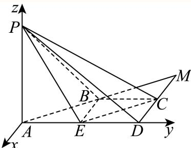
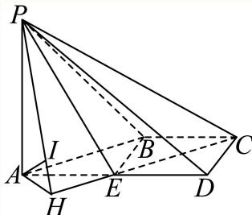

# 2025一模 徐汇区原卷 · 教师版

> 本地预览：题目、答案及分类尚未全部审定。校对使用的PDF为高中工作台解析版，尚未逐区确认区级印刷原卷。

## 填空题

按本区原卷题号顺序排列。

### 徐汇 · 第1题

不等式 $x ^ { 2 } - 4 x + 3 < 0$ 的解集是

**考点：** 一元二次不等式因式分解

**难度依据：** 一元二次不等式因式分解；按所需步骤与推理量估计

**核查说明：** 题干与解析已用于人工归类，尚未完成整题公式校净与独立数学终审。

【解析】

由 $x ^ { 2 } - 4 x + 3 < 0$ ，得 $( x - 1 ) ( x - 3 ) < 0$ ，解得 $1 < x < 3$ ，故答案为: (1, 3)

### 徐汇 · 第2题

已知函数 $y=f(x)$，其中 $f(x)=\begin{cases}\ln x,&x>0,\\-1,&x\le0,\end{cases}$，则 $f(1)=$______。

> 本题资料或解析有待核事项，预览不可作为已审定成品。

**考点：** 分段对数函数代值

**难度依据：** 分段对数函数代值；按所需步骤与推理量估计

**核查说明：** 题干与解析已用于人工归类，尚未完成整题公式校净与独立数学终审。；分段函数只识别到x>0一段；题干其余分支缺失，须回源。

【答案】0

【解析】

根据分段函数解析式求函数值.

由解析式知f(1) = ln 1 = 0.

故答案为：0

### 徐汇 · 第3题

在(1+x)n的二项展开式中，若各项系数和为32，则正整数n的值为 .

**考点：** 赋值求二项式系数和

**难度依据：** 赋值求二项式系数和；按所需步骤与推理量估计

**核查说明：** 题干与解析已用于人工归类，尚未完成整题公式校净与独立数学终审。

【答案】5.

【解析】

令x = 1，解出2n = 32即可.

因为 $( 1 + x ) ^ { n } = \mathbf { C } _ { n } ^ { 0 } + \mathbf { C } _ { n } ^ { 1 } x + \cdots + \mathbf { C } _ { n } ^ { n } x ^ { n }$ ，且各项系数和为32，

令x = 1，则 $2 ^ { n } = \mathbf { C } _ { n } ^ { 0 } + \mathbf { C } _ { n } ^ { 1 } + \cdots + \mathbf { C } _ { n } ^ { n } = 3 2$ ，解得n = 5，

所以正整数 的值为5.

故答案为：5.

### 徐汇 · 第4题

已知向量 $\vec { a } = ( 2 , 5 , 1 ) , \vec { b } = ( 4 , m , 5 )$ ，若 ${ \vec { a } } \cdot { \vec { b } } = 3$ ，则实数m的值为

**考点：** 空间向量数量积坐标运算

**难度依据：** 空间向量数量积坐标运算；按所需步骤与推理量估计

**核查说明：** 题干与解析已用于人工归类，尚未完成整题公式校净与独立数学终审。

【答案】−2

【解析】

利用空间向量的数量积的坐标运算公式即可求解.

因为 $\vec { \jmath _ { a } } = ( 2 , 5 , 1 ) , \vec { b } = ( 4 , m , 5 )$ ，所以 $\begin{array} { r } { \ell { \stackrel {  } { a } } \cdot { \stackrel {  } { b } } = 2 \times 4 + 5 m + 1 \times 5 = 5 m + 1 3 = 3 . } \end{array}$ 所以 $\scriptstyle { m = - 2 }$

故答案为：−2

### 徐汇 · 第5题

设 $a , b \in \mathbf { R } , f \left( x \right) = x ^ { 3 } + 3 \sin x + b .$ .若函数 $y = f \left( x \right)$ 是定义在 $[ - a , 2 a - 1 ]$ 上的奇函数，则 $a + b =$

**考点：** 奇函数定义域对称与函数值

**难度依据：** 奇函数定义域对称与函数值；按所需步骤与推理量估计

**核查说明：** 题干与解析已用于人工归类，尚未完成整题公式校净与独立数学终审。

【答案】1.

【解析】

利用奇函数的定义域关于原点对称，且满足 $f \left( - x \right) + f \left( x \right) = 0$ ，即可求出结果.由函数 $\boldsymbol { \cdot } \boldsymbol { y } = \boldsymbol { f } \left( \boldsymbol { x } \right)$ 是定义在 $[ - a , 2 a - 1 ]$ 上的奇函数，可知−a + 2a − 1 = 0 ⇒ a = 1，再由 $\mid f \left( - x \right) + f \left( x \right) = \left( - x \right) ^ { 3 } + 3 \sin \left( - x \right) + b + x ^ { 3 } + 3 \sin x + b = 2 b = 0 \Rightarrow b = 0 ,$ 所以a + b = 1，

故答案为：1.

### 徐汇 · 第6题

已知m,n为空间中两条不同的直线，α,β为两个不同的平面，若 $m \subset \alpha , \alpha \cap \beta = n$ ，则 $m / / n$ 是 $m / / \beta$ 的 条件.（填：“充分非必要”､“必要非充分”、“充要”、“既非充分又非必要”中的一个）

**考点：** 线面平行判定与性质；充要条件

**难度依据：** 线面平行判定与性质；充要条件；按所需步骤与推理量估计

**核查说明：** 题干与解析已用于人工归类，尚未完成整题公式校净与独立数学终审。

【答案】充要.

【解析】

根据线面平行的判定定理和性质定理结合充分条件和必要条件的定义即可得解.

充分性：因为 $m \subset \alpha , \alpha \cap \beta = n , m / / n$

所以m,n共面，

又因为α,β为两个不同的平面， $n \subset \beta ,$

所以 $\mathbf { \nabla } . m \not \subset \beta ,$

所以 $. m / / \beta _ { \mathrm { i } }$ ，故充分性成立；

必要性：因为 $m \subset \alpha , \alpha \cap \beta = n$ ，所以 $\textstyle { \mathcal { n } } \subset \alpha$

又因为 $| m / / \beta ,$ ，所以 $m / / n$ ，故必要性成立，

所以 $m / / n$ 是 $m / / $ β的充要条件.

故答案为：充要.

### 徐汇 · 第7题

某景点对30天内每天的游客人数（单位：万人）进行统计，得到样本的茎叶图（如下表），则该样本的第75百分位数是______。

| 茎 | 叶 |
|---|---|
| 1 | 2 5 |
| 2 | 0 2 3 3 |
| 3 | 1 2 4 4 8 9 |
| 4 | 5 5 5 7 7 8 8 9 |
| 5 | 0 0 1 1 4 7 9 |
| 6 | 1 7 8 |

> 本题资料或解析有待核事项，预览不可作为已审定成品。

**考点：** 茎叶图百分位数

**难度依据：** 茎叶图百分位数；按所需步骤与推理量估计

**核查说明：** 题干与解析已用于人工归类，尚未完成整题公式校净与独立数学终审。；茎叶图未呈现，无法凭底稿复核百分位数。

【答案】51.

【解析】

根据百分位数的定义求解即可.

因为30 × 75% = 22.5，

所以该样本的第75百分位数是按照从小到大的顺序排列的第23个数，即为51.

故答案为：51.

### 徐汇 · 第8题

已知复数z1和复数z2满足 $z _ { 1 } + z _ { 2 } = 3 + 4 \mathbf { i } , \overline { { z _ { 1 } } } - \overline { { z _ { 2 } } } = - 2 + \mathbf { i }$ （i为虚数单位），则 z21 − z22 = .

> 本题资料或解析有待核事项，预览不可作为已审定成品。

**考点：** 共轭与平方差的模

**难度依据：** 共轭与平方差的模；按所需步骤与推理量估计

**核查说明：** 题干与解析已用于人工归类，尚未完成整题公式校净与独立数学终审。；题干目标的模号缺失，解析计算的是平方差的模，须回源。；原解将复数差与其共轭之差直接等同；该步一般不成立，须校对。

【答案】$5 { \sqrt { 5 } } .$

【解析】

${ \stackrel { \wedge } { \times } } z _ { 1 } = a + b \mathrm { i } , z _ { 2 } = c + d \mathrm { i } { \mathrm { ~ , ~ } } a , b , c , d \in \mathrm { R }$ ，由复数的减法与共轭复数的概念可得

$z _ { 1 } - z _ { 2 } = { \overline { { z _ { 1 } } } } - { \overline { { z _ { 2 } } } }$ ，结合复数的乘方运算性质、复数的乘法法则、复数的模长即可得求解 $\left| z _ { 1 } ^ { 2 } - z _ { 2 } ^ { 2 } \right|$ 的值.

设 $z _ { 1 } = a + b \mathrm { i } , z _ { 2 } = c + d \mathrm { i } , a , b , c , d \in \mathrm { R } ,$

则z − z = (a − c) + (b − d)i, z − z = (a − bi) − (c − di) = (a − c) − (b − d)i，–

所以 $\begin{array} { r } { \left. z _ { 1 } - z _ { 2 } = \overline { { z _ { 1 } } } - \overline { { z _ { 2 } } } , \right. } \end{array}$

因为 $z _ { 1 } + z _ { 2 } = 3 + 4 \mathrm { i } , \overline { { z _ { 1 } } } - \overline { { z _ { 2 } } } = - 2 + \mathrm { i } ,$

所以z2 − z2 = (z1 + z2) (z1 − z2) = (3 + 4i) (−2 − i) = −6 − 3i − 8i − 4i2 = −2 − 11i，

则 z2 − z2 = |−2 − 11i| = √(−2)2 + (−11)2 = 5√5.

故答案为： $5 { \sqrt { 5 } } .$

### 徐汇 · 第9题

设 $a \in \mathbf { R } , f \left( x \right) = x ^ { 2 } + a x + \ln x$ ，若函数y = f(x)存在两个不同的极值点，则a的取值范围为

> 本题资料或解析有待核事项，预览不可作为已审定成品。

**考点：** 导数零点与极值点个数

**难度依据：** 导数零点与极值点个数；按所需步骤与推理量估计

**核查说明：** 题干与解析已用于人工归类，尚未完成整题公式校净与独立数学终审。；原解称正半轴内有两个异号零点，且导数表达、二次式顶点有误识或错误，须回核。

【答案】$\left( - \infty , - 2 { \sqrt { 2 } } \right)$

【解析】

函数y = f(x)存在两个不同的极值点等价于y = f′ (x)在(0,+∞)内有两个异号零点，进而转化 为 $f ^ { \prime } \left( x \right) = 0 / \mathbb { E } ( 0 , + \infty )$ 内有两个不等根即可求解.

解：易知函数 $f \left( x \right) = x ^ { 2 } + a x + \ln x$ 的定义域为 $( 0 , + \infty )$

f′ (x) = 2x + a + 1 2x2 + ax + 1 ，

因为函数 $y = f \left( x \right)$ 存在两个不同的极值点，

所以 ${ f ^ { \prime } } \left( x \right) = 0 / { \widehat { \pm } } ( 0 , + \infty )$ 内有两个不等根，

设 $z _ { g } \left( x \right) = 2 x ^ { 2 } + a x + 1 , \ x \in \left( 0 , + \infty \right)$ ，

则只需 $\left\{ { \begin{array} { l } { g ( 0 ) > 0 } \\ { \Delta > 0 } \\ { - { \cfrac { a } { 2 } } > 0 } \end{array} } \right.$ ，即 $\left\{ { { a ^ { 2 } } - 8 > 0 } \right.$

所以 $a < - 2 { \sqrt { 2 } }$ ，则a的取值范围为 $\left( - \infty , - 2 { \sqrt { 2 } } \right)$

故答案为： $\left( - \infty , - 2 { \sqrt { 2 } } \right)$

### 徐汇 · 第10题

已知椭圆 ${ \frac { x ^ { 2 } } { a ^ { 2 } } } + { \frac { y ^ { 2 } } { b ^ { 2 } } } = 1 ( a > b > 0 )$ 的左､右焦点分别为 $F _ { 1 } , F _ { 2 }$ ，P为椭圆上一点，且 $\angle P F _ { 2 } F _ { 1 } = \frac { \pi } { 3 }$ 若此椭圆的离心率为 ${ \sqrt { 3 } } - 1$ ，则 $\angle P F _ { 1 } F _ { 2 }$ 的大小为

**考点：** 椭圆焦点三角形；正余弦定理

**难度依据：** 椭圆焦点三角形；正余弦定理；按所需步骤与推理量估计

**核查说明：** 题干与解析已用于人工归类，尚未完成整题公式校净与独立数学终审。

【答案】${ \frac { \pi } { 6 } } .$

【解析】

设 $| P F _ { 2 } | = x$ ，由椭圆的定义得 $| P F _ { 1 } | = 2 a - x$ ，利用余弦定理求得 $x = { \bigg ( } { \sqrt { 3 } } - 1 { \bigg ) } a$ ，再由正弦定理即可求得 $\sin \angle P F _ { 1 } F _ { 2 } = \frac { 1 } { 2 }$ ，继而得到 $\angle P F _ { 1 } F _ { 2 }$ .

如图，设 $P F _ { 2 } | = x ,$ ，则 $P F _ { 1 } | = 2 a - x$ ，因 $e = { \frac { c } { a } } = { \sqrt { 3 } } - 1$ ，故 $\dot { \boldsymbol { c } } = \bigg ( \sqrt { 3 } - 1 \bigg ) \boldsymbol { a }$

由余弦定理， $| P F _ { 1 } | ^ { 2 } = | P F _ { 2 } | ^ { 2 } + | F _ { 1 } F _ { 2 } | ^ { 2 } - 2 | P F _ { 2 } | \cdot | F _ { 1 } F _ { 2 } | \cos { \frac { \pi } { 3 } } ,$

即 $( 2 a - x ) ^ { 2 } = 4 c ^ { 2 } + x ^ { 2 } - 2 c x$

将 $\dot { \boldsymbol { c } } = \bigg ( \sqrt { 3 } - 1 \bigg ) \boldsymbol { a }$ 代入，整理得： $4 a ^ { 2 } - 4 a x + x ^ { 2 } = 4 { \Big ( } 4 - 2 { \sqrt { 3 } } { \Big ) } a ^ { 2 } + x ^ { 2 } - 2 { \Big ( } { \sqrt { 3 } } - 1 { \Big ) } a x$

解得 $x = { \frac { 4 { \sqrt { 3 } } - 6 } { 3 - { \sqrt { 3 } } } } a = \left( { \sqrt { 3 } } - 1 \right) a$ ，则有 $| P F _ { 2 } | = \Big ( \sqrt { 3 } - 1 \Big ) a , | P F _ { 1 } | = \Big ( 3 - \sqrt { 3 } \Big ) a ,$

由正弦定理： ${ \frac { \left| P F _ { 2 } \right| } { \sin \angle P F _ { 1 } F _ { 2 } } } = { \frac { \left| P F _ { 1 } \right| } { \sin { \frac { \pi } { 3 } } } }$ 即 ${ \frac { \left( { \sqrt { 3 } } - 1 \right) a } { \sin \angle P F _ { 1 } F _ { 2 } } } = { \frac { \left( 3 - { \sqrt { 3 } } \right) a } { \frac { \sqrt { 3 } } { 2 } } }$

解得 $\sin \angle P F _ { 1 } F _ { 2 } = \frac { 1 } { 2 }$

因0 $< \angle P F _ { 1 } F _ { 2 } < \frac { 2 \pi } { 3 }$ ，故 $\angle P F _ { 1 } F _ { 2 } = \frac { \pi } { 6 }$

故答案为： ${ \frac { \pi } { 6 } } .$

### 徐汇 · 第11题

徐汇滨江作为2024年上海国际鲜花展的三个主会场之一，吸引了广大市民前往观展并拍照留念.图中的花盆是种植鲜花的常见容器，它可视作两个圆台的组合体，上面圆台的上､下底面直径分别为
30cm和26cm，下面圆台的上､下底面直径分别为24cm和18cm，且两个圆台侧面展开图的圆弧所对 的圆心角相等.若上面圆台的高为8cm，则该花盆上､下两部分母线长的总和为 cm.

> 本题资料或解析有待核事项，预览不可作为已审定成品。

**考点：** 圆台展开扇形与母线

**难度依据：** 圆台展开扇形与母线；按所需步骤与推理量估计

**核查说明：** 题干与解析已用于人工归类，尚未完成整题公式校净与独立数学终审。；源解末行母线长度之和与前文数值不一致，需核原解和题图。

【答案】$5 \sqrt { 1 7 }$

【解析】

设出圆台的母线长及底面半径，根据圆台的母线长公式 $l = \sqrt { h ^ { 2 } + \left( r _ { 1 } - r _ { 2 } \right) ^ { 2 } }$ 结合条件即得.

设上面圆台的母线长为 $\boldsymbol { \lvert l _ { 1 } }$ ，上面半径为 $ 1 r _ { 1 } = 1 5 \mathrm { c m }$ ,下半圆半径为 $r _ { 2 } = 1 3 \mathrm { c m }$ ,高为 $h = 8 \mathrm { c m }$

根据圆台的母线长公式l = $\sqrt { h ^ { 2 } + ( r _ { 1 } - r _ { 2 } ) ^ { 2 } }$ ，带入数值计算得到

$$
l _ {1} = \sqrt {8 ^ {2} + (1 5 - 1 3) ^ {2}} = \sqrt {6 8} = 2 \sqrt {1 7} \mathrm{cm};
$$

设下面圆台的母线长为l ，上面半径为 $r _ { 3 } = 1 2 \mathrm { { c m } } .$ ,下半圆半径为 $r _ { 4 } = 9 \mathrm { c m }$

由于两个圆台侧面展开图的圆弧所对的圆心角相等，可以得到 $\frac { r _ { 1 } - r _ { 2 } } { l _ { 1 } } = \frac { r _ { 3 } - r _ { 4 } } { l _ { 2 } }$ ，带入数值

计算得到 $| l _ { 2 } = { \frac { ( r _ { 3 } - r _ { 4 } ) l _ { 1 } } { r _ { 1 } - r _ { 2 } } } = { \frac { ( 1 2 - 9 ) \times 2 { \sqrt { 1 7 } } } { 1 5 - 1 3 } } = 3 { \sqrt { 1 7 } } \mathrm { c m }$

所以该花盆上､下两部分母线长的总和为 $\scriptstyle 1 2 { \sqrt { 1 7 } } + 3 { \sqrt { 1 7 } } = 5 { \sqrt { 1 7 } } { \mathrm { c m } }$

故答案为： $5 \sqrt { 1 7 }$

### 徐汇 · 第12题

已知定义域为A = {1,2,3}的函数 $\cdot y = f \left( x \right)$ 的值域也是A，所有这样的函数 $y = f \left( x \right)$ 形成全集B.设非空集合 $C \subseteq B$ 且$\overline{C}$中的每一个函数都是C中的两个函数（可以相同）的复合函数，则集合C的元素个数的最小值为

> 本题资料或解析有待核事项，预览不可作为已审定成品。

**考点：** 有限集合与函数复合；函数复合计数

**难度依据：** 需要理解复合与有限集合约束并分情形构造；题干符号待核，评级暂定。

**核查说明：** 已恢复缺失部分，但题干仍有OCR乱码，须校净后才能发布。；题干与解析已用于人工归类，尚未完成整题公式校净与独立数学终审。；题干C与补集的区别在解析中严重丢失，按底稿字面恒等函数构成单元素集合已满足，源答案2不适用于该字面题意；须回源确认定义。

【答案】2.

【解析】

根据题意可得集合B有6个不同的元素，且非空集合 $C \subseteq B , \ { \overline { { C } } } \subseteq B \mathbb { H } { \overline { { C } } } \cup C = B$ ，对C分类讨论可求得集合 的元素个数的最小值

因为定义域为 $A = \{ 1 , 2 , 3 \}$ 的函数 $\boldsymbol { \cdot } \boldsymbol { y } = \boldsymbol { f } \left( \boldsymbol { x } \right)$ 的值域也是A，

所以这样的不同的函数有 $\mathrm { A _ { 3 } ^ { 3 } } = 6 \mathrm { \uparrow }$ ，所以集合B有6个不同的元素，

又非空集合 $\cdot C \subseteq B , \ { \overline { { C } } } \subseteq B \mathbb { H } { \overline { { C } } } \cup C = B ,$

又C中的每一个函数都是C中的两个函数（可以相同）的复合函数，–

若C中只有1个函数，则 $| \overline { { C } } |$ 中有5个函数，

又C中函数与自身的复合函数只能表示一个函数，故不能得到 $| \overline { { C } } |$ 中5个函数，不符合题意，

若C中只有2个函数，则C中有4个函数，–

若C中2个函数的复合函数有 $2 \times 2 = 4$ ，如果这4个函数是C中4个函数时，符合题意，此时只–

需验证即可.

6个不同函数为 $f _ { 1 } ( x ) \colon 1 \to 1 , 2 \to 2 , 3 \to 3 , f _ { 2 } ( x ) \colon 1 \to 1 , 2 \to 3 , 3 \to 2$

$$
f _ {3} (x): 1 \rightarrow 2, 2 \rightarrow 1, 3 \rightarrow 3, f _ {4} (x): 1 \rightarrow 2, 2 \rightarrow 3, 3 \rightarrow 1,
$$

f5(x): 1 → 3, 2 → 1, 3 → 2， $f _ { 6 } ( x ) \colon 1 \to 3 , 2 \to 2 , 3 \to 1$

若 $C = \{ f _ { 4 } ( x ) , f _ { 6 } ( x ) \}$ ，此时 $\mathsf { F } \overline { { C } } = \{ f _ { 1 } ( x ) , f _ { 2 } ( x ) , f _ { 3 } ( x ) , f _ { 5 } ( x ) \}$ ，

$$
f _ {6} (f _ {6} (x)) = f _ {1} (x), \quad f _ {4} (f _ {6} (x)) = f _ {2} (x),
$$

$$
f _ {6} (f _ {4} (x)) = f _ {3} (x), \quad f _ {4} (f _ {4} (x)) = f _ {5} (x),
$$

所以集合C的元素个数的最小值为2.

故答案为：2.

方法点睛：利用已知先确定集合B有6个不同的元素，按照C中函数是C中函数的复合函数，找到两集合元素的关系，验证即可.

## 二、选择题

## 选择题

按本区原卷题号顺序排列。

### 徐汇 · 第13题

下列抛物线中，焦点坐标为 $\left( 0 , { \frac { 1 } { 8 } } \right)$ 的是（）

A. $y ^ { 2 } = { \frac { 1 } { 2 } } x$

B. $y ^ { 2 } = { \frac { 1 } { 4 } } x$

C. $x ^ { 2 } = { \frac { 1 } { 2 } } y$

D. $x ^ { 2 } = { \frac { 1 } { 4 } } y$

**考点：** 抛物线焦点与标准方程

**难度依据：** 抛物线焦点与标准方程；按所需步骤与推理量估计

**核查说明：** 题干与解析已用于人工归类，尚未完成整题公式校净与独立数学终审。

【答案】C

【解析】

故选：C.

抛物线的标准方程为: $x ^ { 2 } = 2 p y$ ，焦点坐标为 $\left( 0 , { \frac { p } { 2 } } \right)$ ，由题意得 ${ \frac { p } { 2 } } = { \frac { 1 } { 8 } }$ ，所以 $p = \frac 1 4$ ，所以抛物线的标准方程为: $x ^ { 2 } = { \frac { 1 } { 2 } } y$

### 徐汇 · 第14题

一个不透明的盒子中装有若干个红球和5个黑球，这些球除颜色外均相同.每次将球充分搅匀后，任意摸出1个球记下颜色后再放回盒子.经过重复摸球足够多次试验后发现，摸到黑球的频率稳定在0.1左右，则据此估计盒子中红球的个数约为（ ）

A. 40个

B. 45个

C. 50个

D. 55个

**考点：** 频率估计概率与古典概型

**难度依据：** 频率估计概率与古典概型；按所需步骤与推理量估计

**核查说明：** 题干与解析已用于人工归类，尚未完成整题公式校净与独立数学终审。

【答案】B

【解析】

因为重复摸球次数足够多，所以将频率视为概率，应用古典概型概率的计算公式计算即可.设红球个数为a，

由题意可得： $\frac { 5 } { a + 5 } = 0 . 1$ ，解得：a = 45.

故选：B

### 徐汇 · 第15题

已知函数 $y=f(x)$ 与它的导函数 $y=f'(x)$ 的定义域均为 $\mathbf R$。若函数 $y=f(x)$ 是偶函数且 $y=f'(x)$ 在 $(-\infty,0)$ 上是严格增函数，则下列各表中，可能成为 $y=f(x)$ 取值的是（　）。

A.

| $x$ | 1 | 2 | 3 | 4 |
|---|---|---|---|---|
| $f(x)$ | 2.8188 | 1.0000 | 0.3644 | 0.2468 |

B.

| $x$ | 1 | 2 | 3 | 4 |
|---|---|---|---|---|
| $f(x)$ | 0.7580 | 1.0000 | 1.3188 | 1.7979 |

C.

| $x$ | 1 | 2 | 3 | 4 |
|---|---|---|---|---|
| $f(x)$ | 2.4132 | 1.0000 | 1.5885 | 4.1116 |

D.

| $x$ | 1 | 2 | 3 | 4 |
|---|---|---|---|---|
| $f(x)$ | 0.8664 | 1.0000 | 1.1188 | 1.2240 |

**考点：** 偶函数导数与数据变化率

**难度依据：** 偶函数导数与数据变化率；按所需步骤与推理量估计

**核查说明：** 题干与解析已用于人工归类，尚未完成整题公式校净与独立数学终审。

【答案】B

【解析】

利用导函数的奇偶性和单调性以及正负取值，去分析原函数，即可得到判断函数 $y = f \left( x \right)$ 是偶函数，则 $f \left( - x \right) = f \left( x \right)$ ，两边求导得： $- f ^ { \prime } \left( - x \right) = f ^ { \prime } \left( x \right)$ 所以可知导函数 $y = f ^ { \prime } \left( x \right)$ 是奇函数，

由于函数 $y = f \left( x \right) ^ { \perp }$ 与它的导函数 $y = f ^ { \prime } \left( x \right)$ 的定义域均为R，

所以 $y = f ^ { \prime } \left( 0 \right) = 0$ ，又因为 $y = f ^ { \prime } \left( x \right)$ 在 $( - \infty , 0 )$ 上是严格增函数，

所以 $y = f ^ { \prime } \left( x \right)$ 在 $( 0 , + \infty )$ 上是严格增函数，

由于 $y = f \left( x \right)$ 是可导函数，所以它的图象是连续曲线，示意图如下：

则 $y = f ^ { \prime } \left( x \right)$ 在 $( 0 , + \infty )$ 上恒为正数且递增，

即 $y = f \left( x \right)$ 在 $( 0 , + \infty )$ 上单调递增，且变化率越来越大，

故AC显然错误，而D的变化率越来越小，所以只能选B，

故选：B.

### 徐汇 · 第16题

已知数列 $\left\{ a _ { n } \right\}$ 的前n项和为 $S _ { n }$ ，设 $t _ { n } = { \frac { S _ { n } } { n } }$ （n为正整数）.若存在常数c，使得任意两两不相等的正整数 $\because \ : j , k ,$ 都有 $( i - j ) t _ { k } + ( j - k ) t _ { i } + ( k - i ) t _ { j } = c ,$ ，则称数列 $\left\{ a _ { n } \right\}$ 为“轮换均值数列”.现有下列两个命题：①任意等差数列 $\left\{ a _ { n } \right\}$ 都是“轮换均值数列”.②存在公比不为1的等比数列 $\left\{ b _ { n } \right\}$ 是“轮换均值数列”.则下列说法正确的是（ ）

A. ①是真命题，②是假命题

B. ①是假命题，②是真命题

C. ①､②都是真命题

D. ①､②都是假命题

> 本题资料或解析有待核事项，预览不可作为已审定成品。

**考点：** 前项均值与等差等比数列；轮换均值定义

**难度依据：** 需把新定义转成数列关系并逐项论证；关键符号和一项证明待核。

**核查说明：** 题干与解析已用于人工归类，尚未完成整题公式校净与独立数学终审。；题干i、j、k处有乱码，源解关于②仅称很难成立而缺严格证明，须回源及审解。

【答案】A

【解析】

根 据 题 意 ， 对 于 ① ， 设 等 差 数 列 $\left\{ a _ { n } \right\}$ 的 公 差 为 d ， 由 等 差 数 列 的 性 质 可 得$( i - j ) t _ { k } + ( j - k ) t _ { i } + ( k - i ) t _ { j } = 0 \bar { \mathsf { E } }$ 可得 $c = 0$ ，即可得①正确；对于②，设等比数列 $\left\{ b _ { n } \right\}$ 的公比为q，由等比数列的通项公式分析 $( i - j ) t _ { 1 } + ( j - k ) t _ { 1 } + ( k - i ) t _ { 1 } = 0$ ，可得 $\cdot c = 0$ ，可得②不正确，综合即可得答案.对于①，设等差数列 $\{ a _ { n } \}$ 的公差为d，则 $t _ { n } = { \frac { S _ { n } } { n } } = { \frac { n a _ { 1 } + { \frac { n \left( n - 1 \right) } { 2 } } d } { n } } = a _ { 1 } + { \frac { n - 1 } { 2 } } d ,$ 代入 $( i - j ) t _ { k } + ( j - k ) t _ { i } + ( k - i ) t _ { j } = c$ 可得 $( i - j ) a _ { 1 } + \frac { ( i - j ) \left( k - 1 \right) } { 2 } d + ( j - k ) a _ { 1 } + \frac { ( j - k ) \left( i - 1 \right) } { 2 } d + ( k - i ) a _ { 1 } + \frac { ( k - i ) \left( j - 1 \right) } { 2 } d$ $( i - j ) \left[ a _ { 1 } + \frac { ( k - 1 ) } { 2 } d \right] ^ { - } + ( j - k ) \left[ a _ { 1 } + \frac { ( i - 1 ) } { 2 } d \right] + ( k - i ) \left[ a _ { 1 } + \frac { ( j - 1 ) } { 2 } d \right]$ $= a _ { 1 } \left[ \left( i - j \right) + \left( j - k \right) + \left( k - i \right) \right] + { \frac { d } { 2 } } [ \left( i - j \right) \left( k - 1 \right) + \left( j - k \right) \left( i - 1 \right) + \left( k - i \right) \left( j - 1 \right) ]$ $= a _ { 1 } \times 0 + { \frac { d } { 2 } } [ i k - i - j k + j + j i - j - k i + k + k j - k - i j + i ]$ $= \frac { d } { 2 } \times 0 = 0$ 即可得到c = 0，①正确；对于②，设等比数列 $\left\{ b _ { n } \right\}$ 的公比为q，则 $\left| t _ { n } = { \frac { S _ { n } } { n } } = { \frac { b _ { 1 } \left( 1 - q ^ { n } \right) } { n \left( 1 - q \right) } } \right.$ 代入 $( i - j ) t _ { k } + ( j - k ) t _ { i } + ( k - i ) t _ { j } = c ,$ 可得 $( i - j ) \times { \frac { b _ { 1 } \left( 1 - q ^ { k } \right) } { k \left( 1 - q \right) } } + ( j - k ) \times { \frac { b _ { 1 } \left( 1 - q ^ { i } \right) } { i \left( 1 - q \right) } } + ( k - i ) \times { \frac { b _ { 1 } \left( 1 - q ^ { j } \right) } { j \left( 1 - q \right) } }$ $= \frac { b _ { 1 } } { 1 - q } \left[ \left( i - j \right) \times \frac { \left( 1 - q ^ { k } \right) } { k } + \left( j - k \right) \times \frac { \left( 1 - q ^ { i } \right) } { i } + \left( k - i \right) \times \frac { \left( 1 - q ^ { j } \right) } { j } \right]$ 要使其为常数，化简后会发现很难对于任意的i,j,k都满足为常数（因为公比 $\dot { \boldsymbol { \mathbf { \rho } } } _ { i } q \neq 1 )$ 故不存在公比不为1的等比数列 $\left\{ b _ { n } \right\}$ 是“轮换均值数列.②不正确.故选：A

## 三、解答题

## 解答题

按本区原卷题号顺序排列。

### 徐汇 · 第17题

已知 $\mid f \left( x \right) = a \sin \omega x + b \cos \omega x \left( \omega > 0 \right)$ ，若定义在R上的函数 $y = f \left( x \right)$ 的最小正周期为π，且对任意的 $\mathbf { { \boldsymbol { x } } \in \mathbf { { \boldsymbol { R } } } }$ ，都有 $f \left( x \right) \leq f \left( { \frac { \pi } { 1 2 } } \right) = 4 .$
(1) (6分)求实数a, b的值；
(2) (8分)设 $x _ { 1 } , x _ { 2 } \in ( 0 , \pi )$ ，当 $x _ { 1 } \neq x _ { 2 }$ 时， $f \left( x _ { 1 } \right) = f \left( x _ { 2 } \right) = - 2$ ，求 $x _ { 1 } + x _ { 2 }$ 的值.

**考点：** （1）周期振幅及最值点求参数；（2）三角方程及区间根

**难度依据：** 振幅周期与三角方程；按所需步骤与推理量估计

**核查说明：** 题干与解析已用于人工归类，尚未完成整题公式校净与独立数学终审。

【解析】

(1) $f \left( x \right) = a \sin \omega x + b \cos \omega x = { \sqrt { a ^ { 2 } + b ^ { 2 } } } \sin \left( \omega x + \varphi \right)$

由f(x)的最小正周期为π，知ω = 2，

$$
\because f (x) \leq f \left(\frac {\pi}{1 2}\right) = a \sin \frac {\pi}{6} + b \cos \frac {\pi}{6} = 4,
$$

$$
\therefore \left\{ \begin{array}{l} \frac {1}{2} a + \frac {\sqrt {3}}{2} b = 4 \\ a ^ {2} + b ^ {2} = 1 6 \end{array} \Rightarrow \left\{ \begin{array}{l} a = 2 \\ b = 2 \sqrt {3}. \end{array} \right. \right.
$$

(2) 由（1）可得： $f \left( x \right) = 2 \sin 2 x + 2 { \sqrt { 3 } } \cos 2 x = 4 \sin \left( 2 x + { \frac { \pi } { 3 } } \right)$

$$
\because 4 \sin \left(2 x + \frac {\pi}{3}\right) = - 2 \Rightarrow \sin \left(2 x + \frac {\pi}{3}\right) = - \frac {1}{2},
$$

$\therefore 2 x + { \frac { \pi } { 3 } } = 2 k \pi - { \frac { \pi } { 6 } }$ 或 $2 x + { \frac { \pi } { 3 } } = 2 k \pi + { \frac { 7 } { 6 } } \pi ,$ 即 $x = k \pi - { \frac { \pi } { 4 } }$ 或 $x = k \pi + { \frac { 5 } { 1 2 } } \pi$ ，k ∈ Z，

又 $x _ { 1 } , x _ { 2 } \in ( 0 , \pi )$ ，则不妨令 $x _ { 1 } = \frac { 3 } { 4 } \pi , x _ { 2 } = \frac { 5 } { 1 2 } \pi$ ，故 $x _ { 1 } + x _ { 2 } = { \frac { 7 } { 6 } } \pi .$

### 徐汇 · 第18题

如图，在四棱锥 $P - A B C D$ 中， $A D / / B C , \angle A D C = \angle P A B = \frac { \pi } { 2 } , B C = C D = \frac { 1 } { 2 } A D$ .E为棱AD的中点，异面直线PA与CD所成角的大小为 $\frac { \pi } { 2 }$

(1) (6分)求证： $C D / { \bar { \lambda } }$ 平面PBE；
(2) (8分)若二面角 $P - C D - A$ 的大小为 $\frac { \pi } { 4 }$ ，求直线PA与平面PCE所成角的正弦值.

**考点：** （1）中点与线面平行判定；（2）二面角转线面角

**难度依据：** 线面平行与二面角及线面角；空间法向量求线面角；按所需步骤与推理量估计

**核查说明：** 题干与解析已用于人工归类，尚未完成整题公式校净与独立数学终审。

【解析】

(1) 因为 $A D / / B C , B C = \frac { 1 } { 2 } A D$ ,E为棱AD的中点，

所以 $B C / / E D$ 且 $B C = E D$ ，所以四边形BCDE是平行四边形.

所以 $C D / / B E$ ，又 $B E \subset$ 平面 $P B E , C D$ 不在平面PBE上，

由线面平行的判定定理知， $C D / /$ 平面PBE.

(2) 解法一：因为 $\angle P A B = { \frac { \pi } { 2 } }$ ，即 $P A \bot A B ,$ ，且异面直线PA与CD所成的角为 $\frac { \pi } { 2 }$ ，即 $P A \bot C D$ ，

又 $A B \cap C D = M , A B , C D \subset \exists \overrightarrow { \mathbb { E } } \overrightarrow { \mathbb { E } } \overrightarrow { \mathbb { E } } A B C D , A P \perp$ 平面 $A B C D$

又 $C D \bot A D$ ，由三垂线定理可得 $C D \bot P D$

因此 $\angle P D A$ 是二面角 $P - C D - A$ 的平面角， $\angle P D A = { \frac { \pi } { 4 } }$ ，所以 $P A = A D$

不妨设 $A D = 2 a$ ，则 $B C = C D = { \frac { 1 } { 2 } } A D = a .$

以A为坐标原点，平行于CD的直线为x轴，AD所在直线为y轴，AP所在直线为z轴，

建立如图所示的空间直角坐标系，

所以 $P \left( 0 , 0 , 2 a \right) , E \left( 0 , a , 0 \right) , C \left( - a , 2 a , 0 \right)$ ，（其 $\# a > 0 )$ )，

则 $| \overrightarrow { E C } = ( - a , a , 0 ) , \overrightarrow { P E } = ( 0 , a , - 2 a ) , \overrightarrow { A P } = ( 0 , 0 , 2 a )$

设平面PCE的一个法向量为 $\vec { \mid n } = ( x , y , z )$

则 $\left\{ { \begin{array} { l } { { \vec { n } } \cdot { \overrightarrow { P E } } = 0 } \\ { { \vec { n } } \cdot { \overrightarrow { E C } } = 0 } \end{array} } \right. ,$ 可得 $\left\{ { \begin{array} { l } { y - 2 z = 0 } \\ { - x + y = 0 } \end{array} } \right.$

令y = 2，则 $x = 2 , z = 1$ ，可 $\stackrel {  } { \uparrow } \stackrel {  } { \vec { \cdot } } \vec { n } = ( 2 , 2 , 1 )$

设直线PA与平面PCE所成角为θ，

AP ⋅ n → 2 1 则sin θ = cos = = = 3 × 2 3 AP →n

即直线 $P A {  }$ 平面PCE所成角的正弦值为 $\frac 1 3$

解法二：过A作 $A H \bot C E$ ，交CE的延长线于H，连接PH，

由（1）知： $C D / / B E$

因为 $P A \bot C D$ ，所以 $P A \bot B E$

因为 $\angle A D C = \angle P A B = { \frac { \pi } { 2 } }$ ，即 $P A \bot A B$

又 $A B \cap B E = B , A B , B E \subset$ 平面 $A B C D$ ，所以 $P A \bot$ 平面 $A B C D$

因为 $C E \subset$ 平面 $A B C D$ ，所以 $P A \bot C E$

又AH是PH在平面 $A B C D$ 上的射影，由三垂线定理知， $P H \bot C E$

又 $P A \cap P H = P$ ，所以 $C E \bot$ 平面 $P A H$

再过A作 $A I \bot P H$ ，交 $P H \mp I$

因为 $C E \bot$ 平面 $P A H , A I \subset$ 平面 $P A H$ ，所以 $A I \bot C E$

又 $P H \cap C E = H .$ ，所以 $A I \perp$ 平面 $P C E$ ，所以 $\angle A P I$ 即为直线PA与平面PCE的所成角，

因为 $^ { \prime } C D \bot A D , P A \bot$ 平面 $A B C D$ ，由三垂线定理 $C D \bot P D$

因此 $\angle P D A$ 是二面角 $P - C D - A$ 的平面角， $\angle P D A = { \frac { \pi } { 4 } }$

设 $B C = C D = { \frac { 1 } { 2 } } A D = x \left( x > 0 \right)$ ，则 $A D = P A = 2 x$

因为 $B C = C D , C D \bot A D .$ ,所以四边形BCDE为正方形，

所以 $\angle C E D = \angle A E H = { \frac { \pi } { 4 } }$

所以 $A H = { \frac { \sqrt { 2 } } { 2 } } x$ ，所以 $\tan \angle A P I = \tan \angle A P H = { \frac { A H } { P A } } = { \frac { { \frac { { \sqrt { 2 } } } { 2 } } x } { 2 x } } = { \frac { \sqrt { 2 } } { 4 } }$

所以 $\sin \angle A P I = { \frac { 1 } { 3 } }$

即直线 $P A -$ 与平面PCE所成角的正弦值为 $\frac 1 3$

### 徐汇 · 第19题

某企业招聘员工，指定“英语听说”､“信息技术”､“逻辑推理”作为三门考试课程，有两种考试方案.方案一：参加三门课程的考试，至少有两门及格为通过；
方案二：在三门课程中，随机选取两门，并参加这两门课程的考试，两门都及格为通过
假设某应聘者参加三门指定课程考试及格的概率分别是 $. p _ { 1 } , p _ { 2 } , p _ { 3 } \left( p _ { 1 } \in ( 0 , 1 ) , i = 1 , 2 , 3 \right)$ )，且三门课程考试是否及格相互之间没有影响
(1) (6分)分别求该应聘者选方案一考试通过的概率 $: T _ { 1 }$ 和选方案二考试通过的概率 $\it { \Delta } T _ { 2 }$ ；
(2) (8分)试比较该应聘者在上述两种方案下考试通过的概率的大小，并说明理由.

> 本题资料或解析有待核事项，预览不可作为已审定成品。

**考点：** （1）互相独立事件的方案概率；（2）作差比较方案

**难度依据：** 独立事件分类与方案概率比较；按所需步骤与推理量估计

**核查说明：** 题干与解析已用于人工归类，尚未完成整题公式校净与独立数学终审。；题干概率参数的下标与量词识别不一致，须对照原卷。

【解析】

(1) 记该应聘者对三门指定课程考试及格的事件分别为 $A , B , C ,$

则 $P \left( A \right) = p _ { 1 } , P \left( B \right) = p _ { 2 } , P \left( C \right) = p _ { 3 } .$

应聘者选方案一考试通过的概率

$$
\begin{array}{l} T _ {1} = P \left(A \cap B \cap \overline {{C}}\right) + P \left(\overline {{A}} \cap B \cap C\right) + P \left(A \cap \overline {{B}} \cap C\right) + P \left(A \cap B \cap C\right) \\ = p _ {1} p _ {2} \left(1 - p _ {3}\right) + p _ {2} p _ {3} \left(1 - p _ {1}\right) + p _ {1} p _ {3} \left(1 - p _ {2}\right) + p _ {1} p _ {2} p _ {3} \\ = p _ {1} p _ {2} + p _ {2} p _ {3} + p _ {3} p _ {1} - 2 p _ {1} p _ {2} p _ {3} \end{array}
$$

应聘者选方案二考试通过的概率

$$
\begin{array}{l} T _ {2} = \frac {1}{3} P (A \cap B) + \frac {1}{3} P (B \cap C) + \frac {1}{3} P (A \cap C) \\ = \frac {1}{3} (p _ {1} p _ {2} + p _ {2} p _ {3} + p _ {3} p _ {1}). \end{array}
$$

$$
\begin{array}{l} (2) T _ {1} - T _ {2} = \frac {2}{3} (p _ {1} p _ {2} + p _ {2} p _ {3} + p _ {3} p _ {1}) - 2 p _ {1} p _ {2} p _ {3} \\ = \frac {2}{3} [ p _ {1} p _ {2} (1 - p _ {3}) + p _ {2} p _ {3} (1 - p _ {1}) + p _ {3} p _ {1} (1 - p _ {2}) ], \end{array}
$$

因为 $\vert p _ { 1 } , p _ { 2 } , p _ { 3 } \in ( 0 , 1 )$ ，所以 $T _ { 1 } - T _ { 2 } > 0$ ,即 $\lceil T _ { 1 } > T _ { 2 }$

故 $\mathrm { T } _ { 1 } > \mathrm { T } _ { 2 }$ ，即选方案一，该应聘者考试通过的概率较大.

### 徐汇 · 第20题

已知过点 $P \left( 3 , { \sqrt { 2 } } \right)$ 的双曲线C的渐近线方程为 $x \pm { \sqrt { 3 } } y = 0$ .如图所示，过双曲线C的右焦点F作与 坐标轴都不垂直的直线l交C的右支于A,B两点.

(1) (4分)求双曲线C的标准方程；
(2) (6分)已知点Q $\left( { \frac { 3 } { 2 } } , 0 \right)$ ，求证： $\angle A Q F = \angle B Q F$
(3) (8分)若以AB为直径的圆被直线 $x = \frac { 3 } { 2 }$ 截得的劣弧为 $\widehat { M N }$ ，则 $\widehat { M N }$ 所对圆心角的大小是否为定值？若是，求出该定值；若不是，请说明理由.

> 本题资料或解析有待核事项，预览不可作为已审定成品。

**考点：** （1）渐近线及过点确定双曲线；（2）焦点弦与斜率对称；（3）直径圆与定角

**难度依据：** 双曲线焦点弦与圆心角定值；按所需步骤与推理量估计

**核查说明：** 题干与解析已用于人工归类，尚未完成整题公式校净与独立数学终审。；联立方程及部分长分式有识别损坏，须核原解。

【解析】

(1) 因为双曲线C的渐近线方程为 $x \pm { \sqrt { 3 } } y = 0$

所以设双曲线方程为 $x ^ { 2 } - 3 y ^ { 2 } = \lambda ( \lambda \neq 0 )$ )，又双曲线过点 $P \left( 3 , { \sqrt { 2 } } \right)$ ，

则 $\lambda = 9 - 3 \times 2 = 3 ,$

所以双曲线的方程为 $x ^ { 2 } - 3 y ^ { 2 } = 3$ ，即 ${ \frac { x ^ { 2 } } { 3 } } - y ^ { 2 } = 1$

(2) 由(1)可知F(2,0)，l的斜率存在且不为0，所以设l的方程为 $\mathinner { | { y = k \left( x - 2 \right) } }$ )，

联立 $\left\{ { { y = k \left( x - 2 \right) } } _ { \left[ { x ^ { 2 } - 3 y ^ { 2 } } \right. } \right.$ ，消去y得 $\big ( 1 - 3 k ^ { 2 } \big ) x ^ { 2 } + 1 2 k ^ { 2 } x - 1 2 k ^ { 2 } - 3 = 0 ,$

设 $A \left( x _ { 1 } , y _ { 1 } \right) , B \left( x _ { 2 } , y _ { 2 } \right)$ ，由题意得 $\left\{ \begin{array} { l l } { \displaystyle 1 - 3 k ^ { 2 } \neq 0 } \\ { \Delta > 0 } \\ { \displaystyle x _ { 1 } + x _ { 2 } = \frac { - 1 2 k ^ { 2 } } { 1 - 3 k ^ { 2 } } > 0 } \\ { \displaystyle x _ { 1 } \cdot x _ { 2 } = \frac { - 1 2 k ^ { 2 } - 3 } { 1 - 3 k ^ { 2 } } > 0 } \end{array} \right.$

所以 $\mathfrak { i } \in \left( - \infty , - \frac { \sqrt { 3 } } { 3 } \right) \cup \left( \frac { \sqrt { 3 } } { 3 } , + \infty \right)$ $\left\{ \begin{array} { l l } { \displaystyle x _ { 1 } + x _ { 2 } = \frac { - 1 2 k ^ { 2 } } { 1 - 3 k ^ { 2 } } } \\ { \displaystyle x _ { 1 } \cdot x _ { 2 } = \frac { - 1 2 k ^ { 2 } - 3 } { 1 - 3 k ^ { 2 } } } \end{array} , \right.$

所以 $\dot { \mathfrak { c } } _ { A Q } + k _ { B Q } = \frac { y _ { 1 } } { x _ { 1 } - \frac { 3 } { 2 } } + \frac { y _ { 2 } } { x _ { 2 } - \frac { 3 } { 2 } } = \frac { k \left( \dot { x _ { 1 } } - 2 \right) } { x _ { 1 } - \frac { 3 } { 2 } } + \frac { k \left( x _ { 2 } - 2 \right) } { x _ { 2 } - \frac { 3 } { 2 } }$

k [2x1x2 − 7 (x + x ) + 6] k [2 (−12k2 − 3) + 72 × 12k2 + 6 (1 − 3k2) 2 = x1x2 − 32 (x1 + x2) + 94 −12k2 − 3 + 32 × 12k2 + 9 (1 − 3k2) 4 4

所以 $k _ { A Q } = - k _ { B Q }$ ，即 $\angle A Q F = \angle B Q F$ 得证.

(3) 由(2)可知 $| \Delta = 1 2 k ^ { 2 } + 1 2 >$ 0恒成立， $x _ { 1 } + x _ { 2 } = { \frac { - 1 2 k ^ { 2 } } { 1 - 3 k ^ { 2 } } }$

所以圆心到 $x = \frac { 3 } { 2 }$ 的距离 ${ \dot { \iota } } d = \left| { \frac { 6 k ^ { 2 } } { 3 k ^ { 2 } - 1 } } - { \frac { 3 } { 2 } } \right| = \left| { \frac { 3 k ^ { 2 } + 3 } { 2 ( 3 k ^ { 2 } - 1 ) } } \right|$

$$
\text {半径} r = \frac {| A B |}{2} = \frac {1}{2} \sqrt {1 + k ^ {2}} \frac {\sqrt {1 2 k ^ {2} + 1 2}}{| 1 - 3 k ^ {2} |} = \frac {\sqrt {3} (1 + k ^ {2})}{| 3 k ^ {2} - 1 |},
$$

设 $\widehat { M N }$ 所对圆心角为θ，

$$
\text {则} \cos {\frac {\theta}{2}} = {\frac {d}{r}} = \left| {\frac {3 \left(k ^ {2} + 1\right)}{2 \left(3 k ^ {2} - 1\right)}} \right| \cdot \left| {\frac {3 k ^ {2} - 1}{\sqrt {3} \left(1 + k ^ {2}\right)}} \right| = {\frac {\sqrt {3}}{2}},
$$

因为 $\widehat { M N }$ 为劣弧，所以 $\theta \in ( 0 , \pi )$

所以 ${ \frac { \theta } { 2 } } = { \frac { \pi } { 6 } }$ ，所以 $\theta = \frac { \pi } { 3 }$ ，即 $\widehat { M N }$ 所对圆心角的大小为定值 $\frac { \pi } { 3 }$

### 徐汇 · 第21题

已知定义域为D的函数 $\mathbf { \boldsymbol { y } } = \mathbf { \boldsymbol { f } } \left( \boldsymbol { x } \right)$ ，其导函数为 $\begin{array} { r } { I y = f ^ { \prime } \left( x \right) } \end{array}$ ，若点(x0,y0)在导函数 $y = f ^ { \prime } \left( x \right)$ 图象上，且满足 $f ^ { \prime } \left( x _ { 0 } \right) \cdot f ^ { \prime } \left( y _ { 0 } \right) \geq 0$ ，则称 $\scriptstyle { \mathrm { \{ } } x _ { 0 } $ 为函数 $\boldsymbol { \cdot } \boldsymbol { y } = \boldsymbol { f } \left( \boldsymbol { x } \right)$ 的一个“T类数”，函数 $y = f \left( x \right)$ 的所有“T类数”构成的集合称为“T类集”.
(1) (4分)若 $ \dot { \cdot } f \left( x \right) = \sin { x }$ ，分别判断 $\frac { \pi } { 2 }$ 和 $\frac { 3 \pi } { 4 }$ 是否为函数 ${ \bf \dot { \boldsymbol { y } } } = f ( { \boldsymbol { x } } ) \mathbb { H } ^ { \cdot \cdot } { \boldsymbol { T } }$ 类数”，并说明理由；
(2) (6分)设 $\boldsymbol { \cdot } \boldsymbol { y } = \boldsymbol { f } ^ { \prime } \left( \boldsymbol { x } \right)$ 的图象在R上连续不断，集合 $M = \{ x \mid f ^ { \prime } ( x ) = 0 \}$ }.记函数 $\boldsymbol { \cdot } \boldsymbol { y } = \boldsymbol { f } \left( \boldsymbol { x } \right)$ 的“T类集”为集合S，若S ⊂ R，求证： $M \neq \emptyset ;$
(3) (8分)已知 $\mid f \left( x \right) = - \frac { 1 } { \omega } \mathrm { c o s } \left( \omega x + \varphi \right) \left( \omega > 0 \right)$ ，若函数y = f(x)的“T类集”为R时φ的取值构成集 合A，求当φ ∈ A时ω的最大值

> 本题资料或解析有待核事项，预览不可作为已审定成品。

**考点：** （1）T类数定义代入；（2）导函数连续与零点存在；（3）三角导函数复合条件与参数最值

**难度依据：** T类数与导函数复合；导数连续零点与三角函数值域；按所需步骤与推理量估计

**核查说明：** 题干与解析已用于人工归类，尚未完成整题公式校净与独立数学终审。；第（2）问S⊂R须回源核实是否为真包含；关系影响证明。

【解析】

(1) ∵ $f ^ { \prime } \left( x \right) = \cos x , \cdot ; y _ { 0 } = f ^ { \prime } \left( { \frac { \pi } { 2 } } \right) = 0 , f ^ { \prime } \left( y _ { 0 } \right) = \cos 0 = 1$ ，

$\therefore f ^ { \prime } \left( x _ { 0 } \right) \cdot f ^ { \prime } \left( y _ { 0 } \right) = f ^ { \prime } \left( { \frac { \pi } { 2 } } \right) \cdot f ^ { \prime } \left( 0 \right) = 0 \geq 0 , { \therefore } \ { \frac { \pi } { 2 } }$ 是函数 $f \left( x \right) = \sin { x } |$ 的“T类数”；

$$
\because f ^ {\prime} (x) = \cos x \therefore y _ {1} = f ^ {\prime} \left(\frac {3 \pi}{4}\right) = - \frac {\sqrt {2}}{2}, f ^ {\prime} \left(y _ {1}\right) = \cos \left(- \frac {\sqrt {2}}{2}\right) > 0,
$$

$\therefore f ^ { \prime } \left( x _ { 1 } \right) \cdot f ^ { \prime } \left( y _ { 1 } \right) < 0 , \therefore { \frac { 3 \pi } { 4 } }$ 不是函数f (x) = sin x的“T类数”.

(2) 因为函数y = f(x)的“T类集”为集合S，且 $S \subset \mathbf { R }$

所以存在 $\mathbf { \Psi } _ { \mathbf { \mathcal { X } } 0 } \in \mathbf { \mathbb { R } } \mathbf { \Psi } _ { \mathbf { \mathcal { X } } }$ ，使得 $: y _ { 0 } = f ^ { \prime } ( x _ { 0 } ) \mathbb { H } f ^ { \prime } ( x _ { 0 } ) \cdot f ^ { \prime } ( y _ { 0 } ) < 0 ,$

若x0 = y0，则 $f ^ { \prime } \left( x _ { 0 } \right) \cdot f ^ { \prime } \left( y _ { 0 } \right) = \left[ f ^ { \prime } \left( y _ { 0 } \right) \right] ^ { 2 } \geq 0$ ，所以 $x _ { 0 } \neq y _ { 0 }$

因为函数y = f′ (x)的图象是连续不断的，

不妨设 $x _ { 0 } < y _ { 0 }$ ，由零点存在定理知，必存在 $x _ { 1 } \in ( x _ { 0 } , y _ { 0 } )$ 使得 $f ^ { \prime } \left( x _ { 1 } \right) = 0$

所以y = f′ (x)存在零点，即M ≠ ∅.

(3) $f \left( x \right) = - \frac { 1 } { \omega } \mathrm { c o s } \left( \omega x + \varphi \right) \left( \omega > 0 \right)$ ，则 $f ^ { \prime } \left( x \right) = \sin \left( \omega x + \varphi \right)$

先证明ω ≤ π：

因为函数 $f \left( x \right) = - \frac { 1 } { \omega } \mathrm { c o s } \left( \omega x + \varphi \right) \left( \omega > 0 \right)$ )的“T类集”为R，

所以对任意 $\boldsymbol { x } _ { 0 } \in \mathbf { R }$

$\widehat { \smile } y _ { 0 } = f ^ { \prime } \left( x _ { 0 } \right)$ ，则 $y _ { 0 } \cdot f ^ { \prime } \left( y _ { 0 } \right) \geq 0 ,$

因为函数 $f ^ { \prime } \left( x \right) = \sin \left( \omega x + \varphi \right) \left( \omega > 0 \right)$ 的值域为[−1,1]，

所以当 $y _ { 0 } \in ( 0 , 1 ]$ ]时，必有 $f ^ { \prime } \left( y _ { 0 } \right) \geq 0$

即 $f ^ { \prime } \left( x \right) = \sin \left( \omega x + \varphi \right) \geq 0 \left( \omega > 0 \right)$ 对于 $\dot { \boldsymbol { x } } \in ( 0 , 1 ]$ ]恒成立，

所以函数y = f′ (x)的最小正周期T应有 $\frac { T } { 2 } \geq 1 - 0 .$ ，即T $= \frac { 2 \pi } { \omega } \ge 2$ ，则 $\omega \leq \pi .$

再证明0 ∈ A，此时 $\left. f ^ { \prime } \left( x \right) = \sin \left( \omega x \right) \right.$ ，对于任意 $x _ { 0 } \in \mathbf { R } , f ^ { \prime } ( x _ { 0 } ) f ^ { \prime } ( y _ { 0 } ) = y _ { 0 } \sin \left( \omega y _ { 0 } \right)$

当 $y _ { 0 } = f ^ { \prime } \left( x _ { 0 } \right) \in \left[ 0 , 1 \right]$ 时， $0 \leq \omega y _ { 0 } \leq \omega \leq \pi$ ，则 $f ^ { \prime } \left( y _ { 0 } \right) \in [ 0 , 1 ] , f ^ { \prime } \left( x _ { 0 } \right) \cdot f ^ { \prime } \left( y _ { 0 } \right) \geq 0 ;$

当 $\mathrm { \Delta } \mathfrak { j } y _ { 0 } = f ^ { \prime } \left( x _ { 0 } \right) \in \left[ - 1 , 0 \right]$ ]时， $- \pi \leq - \omega \leq \omega y _ { 0 } \leq 0$ ，则 $f ^ { \prime } \left( y _ { 0 } \right) \in [ - 1 , 0 ] , f ^ { \prime } \left( x _ { 0 } \right) \cdot f ^ { \prime } \left( y _ { 0 } \right) \geq 0$

所以φ = 0时函数 $f \left( x \right) = - \frac { 1 } { \omega } \mathrm { c o s } \left( \omega x + \varphi \right) \left( \omega > 0 \right)$ )的“T类集”为R，即0 ∈ A.

我们不难发现，上述过程中 ${ \widehat { \vec { \times } } } \omega = \pi$ 也成立.因此，ω的最大值是π.

