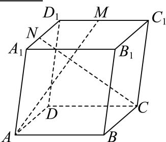
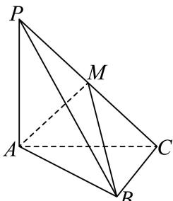

# 2025一模 普陀区原卷 · 学生版

> 本地预览：题目、答案及分类尚未全部审定。校对使用的PDF为高中工作台解析版，尚未逐区确认区级印刷原卷。

## 填空题

按本区原卷题号顺序排列。

### 普陀 · 第1题

设全集U = {−1, 0, 1, 2, 4}，若集合A = {−1, 2, 4}，则A = .

### 普陀 · 第2题

已知某抛物线的准线方程为y＝1，则该抛物线的标准方程为

### 普陀 · 第3题

设i为虚数单位，若复数z满足 $z \cdot { \overline { { z } } } + z - { \overline { { z } } } = 4 + 2 \mathrm { i }$ ，则|z| = .

### 普陀 · 第4题

若 $\left( x + x ^ { 2 } \right) ^ { 5 } = a _ { 0 } x ^ { 5 } + a _ { 1 } x ^ { 6 } + a _ { 2 } x ^ { 7 } + a _ { 3 } x ^ { 8 } + a _ { 4 } x ^ { 9 } + a _ { 5 } x ^ { 1 0 }$ ，则 $\stackrel { \cdot } { a } _ { 3 }$ 的值为

### 普陀 · 第5题

设 $n \geq 1 , \ m \geq 1 , \ m _ { \setminus } \ n \in \mathbf { N }$ ，等差数列 $\left\{ a _ { n } \right\}$ 的首项 $\overset { \cdot } { a _ { 1 } } = 0$ ，公差 $d \neq 0$ ，若 $a _ { m } = \sum _ { i = 1 } ^ { 1 1 } a _ { i }$ ，则m的值 为

### 普陀 · 第6题

设△ABC的内角A，B，C的对边分别为a， $b , \ c ,$ 若b = 4， $\sin \left( A + { \frac { \pi } { 3 } } \right) = 0$ $\triangle A B C$ 的面积为 $\sqrt { 3 }$ ，则a的值为

### 普陀 · 第7题

设椭圆 $C \colon { \frac { x ^ { 2 } } { a ^ { 2 } } } + { \frac { y ^ { 2 } } { b ^ { 2 } } } = 1 ( a > b > 0 )$ 的左、右焦点分别为 $F _ { 1 } , \ F _ { 2 } ,$ ，左顶点为A，若椭圆C的离心率为 $\frac 1 3$ ，则 $\frac { | F _ { 2 } A | } { | A F _ { 1 } | }$ 的值为

### 普陀 · 第8题

若圆锥PO的体积为 $\frac { 2 { \sqrt { 2 } } \pi } { 3 }$ ，它的母线与底面所成的角的余弦值为 $\frac 1 3$ ，则圆锥PO的表面积为

### 普陀 · 第9题

设λ ∈ R，在如图所示的平行六面体 $A B C D - A _ { 1 } B _ { 1 } C _ { 1 } D _ { 1 }$ 1中， $\angle A _ { 1 } A B = \angle A _ { 1 } A D = \angle B A D = { \frac { \pi } { 3 } } .$ $A A _ { 1 } = 2 , A B = A D = 1$ ，点M是棱 $C _ { 1 } D _ { 1 }$ 的中点， $\xrightarrow { \xrightarrow { } } { \lambda _ { 1 } N } = \overline { { \lambda A _ { 1 } D _ { 1 } } }$ ，若 $\stackrel { \longrightarrow } { A M } . \stackrel { \longrightarrow } { C N } = 2$ ，则λ的值为

> 本题资料或解析有待核事项，预览不可作为已审定成品。

### 普陀 · 第10题

设平面上四点P、Q、M、N满足： $| P M | = | P N | = 4 , | P Q | = 2$ ，若 $\stackrel { \longrightarrow } { Q M } \cdot \stackrel { \longrightarrow } { Q N } = 0$ ，则 $\vert M N \vert$ |的最小值为

> 本题资料或解析有待核事项，预览不可作为已审定成品。

### 普陀 · 第11题

设t ∈ R，直线l: $x + y - t = 0 \div$ 与曲线 $C _ { 1 } { : } y = { \frac { 1 } { 4 } } x ^ { 2 } \left( 0 \leq x \leq 4 \right)$ )和曲线 $C _ { 2 } { : } y = 2 x ^ { \frac { 1 } { 2 } }$ 分别交于P、Q两 点，则|PQ|的最大值是

> 本题资料或解析有待核事项，预览不可作为已审定成品。

### 普陀 · 第12题

设 $a > b > 0$ ，函数 $\boldsymbol { \mathfrak { y } } = \boldsymbol { \mathfrak { f } } \left( \boldsymbol { \mathfrak { x } } \right)$ 的表达式为 $f \left( x \right) = \ \left| x - { \frac { 1 } { x } } + \ln x \right|$ ，若 $f \left( a \right) = f \left( b \right)$ ，且关于x的方程$\left| x ^ { 2 } + a x + 2 a b \right| + \left| x ^ { 2 } - a x + 2 a b \right| = 2 a \left| x \right|$ 的整数解有且仅有4个，则a的取值范围是

> 本题资料或解析有待核事项，预览不可作为已审定成品。

## 选择题

按本区原卷题号顺序排列。

### 普陀 · 第13题

设 $\alpha\in\mathbb{R}$，则“$\cos 2\alpha=\frac{1}{3}$”是“$\sin\alpha=\frac{\sqrt{3}}{3}$”的（　）

A. 充分非必要条件

B. 必要非充分条件

C. 充要条件

D. 既非充分又非必要条件

> 本题资料或解析有待核事项，预览不可作为已审定成品。

### 普陀 · 第14题

某机构对2014年至2023年的中国新能源汽车的年销售量进行了统计，结果如图所示（单位：万辆），则下列结论中正确的是（ ）

原图所列中国新能源汽车年销售量数据如下（单位：万辆；按原图年份顺序列示）：

| 年份 | 年销售量 |
|---|---|
| 2014 | 7.5 |
| 2015 | 33.1 |
| 2016 | 50.7 |
| 2017 | 77.7 |
| 2018 | 125.6 |
| 2019 | 120.6 |
| 2020 | 136.6 |
| 2021 | 352.1 |
| 2022 | 688.7 |
| 2023 | 728 |

A. 这十年中国新能源汽车年销售量的中位数为123

B. 这十年中国新能源汽车年销售量的极差为721

C. 这十年中国新能源汽车年销售量的第70百分位数为136.6

D. 这十年中的前五年的年销售量的方差小于后五年的年销售量的方差

> 本题资料或解析有待核事项，预览不可作为已审定成品。

### 普陀 · 第15题

设a > 0且 $a \neq 1$ ，k、m、n都是正整数，数列 $\left\{ a _ { n } \right\}$ 的通项公式为 $\mathfrak { l } a _ { n } = \left\{ \begin{array} { l l } { ( a - 6 ) n + 2 1 , ( 1 \leq n \leq m ) } \\ { a ^ { n - 3 } , ( n > m ) } \end{array} \right.$ ，记数列 $\left\{ a _ { n } \right\}$ 中前k项的最小值为 $ { \lvert h _ { k } }$ ，由所有 $h _ { k }$ 的值所组成的集合记为A，若集合A中仅有四个元素，则下列说法中错误的是（ ）

A. 当m = 3时，a的取值范围是(1,6)

B. 不存在a和m的值，使得 $. a _ { 4 } \notin A$

C. 当m = 4时，a的取值范围是(3, 6)

D. 存在a和m的值，使得 $\cdot a _ { 5 } \notin A$

> 本题资料或解析有待核事项，预览不可作为已审定成品。

### 普陀 · 第16题

在平面直角坐标系中，将函数 $y=f(x)$ 的图象绕坐标原点 $O$ 逆时针旋转 $\frac{\pi}{4}$ 后，所得曲线仍然是某个函数的图象，则称函数 $y=f(x)$ 为“R函数”。对于命题：

①设 $m\in\mathbf R$，若函数 $g(x)=(m-1)x+\frac1x$ 为“R函数”，则 $m>1$；

②设 $k\in\mathbf R$，若函数 $h(x)=\frac{k(x+1)}{\mathrm e^x}$ 为“R函数”，则满足条件的 $k$ 的整数值至少有4个。

则下列结论中正确的是（　）。

A. ①为真②为真

B. ①为真②为假

C. ①为假②为真

D. ①为假②为假

> 本题资料或解析有待核事项，预览不可作为已审定成品。

## 解答题

按本区原卷题号顺序排列。

### 普陀 · 第17题

图1所示的平行四边形ABCD中， $C A = C B = 1 , \ C D = { \sqrt { 2 } }$ 现将 $\triangle D A C$ 沿AC折起，得到如图2所示的三棱锥 $P - A B C$ ，记棱PC的中点为M，且. $. P B = { \sqrt { 3 } }$

图1

图2
(1) (6分)求证： $A M \bot B C$ ；
(2) (8分)记棱AB的中点为E，在直线CE上作出点N，使得 $P N / /$ 平面MAB，请说明理由，并求出二面角 $P - N B - A$ 的大小.

### 普陀 · 第18题

设函数 $\cdot y = f \left( x \right)$ 的表达式为 $f \left( x \right) = \sin \left( \omega x \right)$ ，其中 $\omega > 0$
(1) (6分)设ω = 1， $m \in \mathbf { R }$ ，若有且只有一个 $\cdot x _ { 0 } \in ( 0 , m )$ ，使得函数 $y = f \left( x + { \frac { \pi } { 4 } } \right)$ 取得最小值，求m的取值范围；
(2) (8分)若对任意的 $| x \in \mathrm { R } .$ ，皆有 $f \left( x \right) + f \left( \frac { 2 \pi } { 3 } - x \right) = 0$ 恒成立，且函数 $y = f \left( x \right)$ 在区间 $\left( - { \frac { \pi } { 8 } } , 0 \right)$ 上是严格增函数，求函数 $y = f \left( x \right)$ 的最小正周期.

> 本题资料或解析有待核事项，预览不可作为已审定成品。

### 普陀 · 第19题

机器人竞技是继电子竞技之后热门的科技竞技项目.某区为了参加市机器人竞技总决赛，开展了区内选拔赛，其中A、B、C、D四人进入区内个人组决赛，按照规则每人与其他三人各进行一场比赛，且这三场比赛互相独立.下表统计的是A在近期热身中分别与B、C、D三人比赛的情况.

| 对手 | B | C | D |
| --- | ---: | ---: | ---: |
| 比赛的次数 | 12 | 10 | 15 |
| A获胜的次数 | 4 | 5 | 12 |

(1) (6分)根据表格中的数据，试估计在区内决赛中A至少获胜一场的概率；
(2) (8分)根据表格中的数据，请给B、C、D三人设计一个出场顺序，使得A在这三场比赛中连胜两场的概率最大，并说明理由.

> 本题资料或解析有待核事项，预览不可作为已审定成品。

### 普陀 · 第20题

设 $m > 0 , \ m > 0 , \ F _ { 1 \setminus } \ F _ { 2 }$ 分别是双曲线Γ: ${ \frac { x ^ { 2 } } { a ^ { 2 } } } - y ^ { 2 } = 1$ 的左、右焦点，直线 $l { : } x - m y - 2 = 0 { \stackrel { 4 } { - } }$ 经过 点 $F _ { 2 ^ { - } }$ 与Γ的右支交于A、B两点，点O是坐标原点.
(1) (4分)若点M是Γ上的一点， $\vert M F _ { 1 } \vert = 2$ ，求 $| M F _ { 2 }$ |的值；
(2) (6分)设λ、 $\mu \in \mathbf { R } _ { : }$ ，点P在直线 $\dot { z } x = 6 .$ 上，若点O、A、P、B满足： $\overrightarrow { O A } = \lambda \overrightarrow { B P } , \overrightarrow { O B } = \mu \overrightarrow { A P }$ 求点P的坐标；
(3) (8分)设AO的延长线与Γ交于G点，若向量− $\xrightarrow { }$ 与 $\overbrace { O B }$ 满足： $\overrightarrow { O A } \cdot \overrightarrow { O B } \geq 1 7$ ，求 $\triangle G A B$ 的面积S 的取值范围.

> 本题资料或解析有待核事项，预览不可作为已审定成品。

### 普陀 · 第21题

设t > 1，n ≥ 1， $n \in \mathbf { N } _ { : }$ ，若正项数列 $\left\{ a _ { n } \right\}$ 满足 $\frac { 1 } { t } a _ { n } < a _ { n + 1 } < a _ { n } .$ ，则称数列 $\left\{ a _ { n } \right\}$ 具有性质 $\mathbf { \partial } ^ { \ast } P \left( t \right) ^ { \ast }$
(1) (4分)设 $m \geq 1 , m \in \mathbf { N }$ ，若数列10，7，m，4，3具有性质 $^ { \ast } P ( 2 ) ^ { \ast }$ ，求满足条件的m的值；
(2) (6分)设数列{a }的通项公式为 $\left\{ a _ { n } \right\}$ $\lvert a _ { n } = \left( n + 1 \right) \left( \frac { t } { 9 } \right) ^ { n }$ ，问是否存在t使得数列 $\left\{ a _ { n } \right\}$ 具有性质 ${ } ^ { \ast } P \left( t \right)$ ”？若存在，求出满足条件的t的取值范围，若不存在，请说明理由；
(3) (8分)设函数y = f (x)的表达式为 $f \left( x \right) = \ln \left( \mathrm { e } ^ { x } - 1 \right) - \ln x$ ，数列 $\left\{ a _ { n } \right\}$ 的前n项和为 $S _ { n }$ ，且满足 $a _ { 1 } = { \frac { 2 } { 3 } } , a _ { n + 1 } = f ( a _ { n } )$ ，证明：数列 $\left\{ a _ { n } \right\}$ 具有性质 $^ { \ast } P ( 3 ) ^ { \ast }$ ，并比较 $S _ { n }$ 与 $1 - { \frac { 1 } { 3 ^ { n } } }$ 的大小.

> 本题资料或解析有待核事项，预览不可作为已审定成品。

