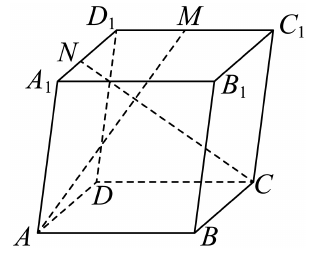
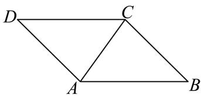
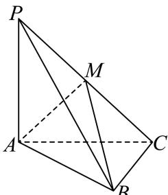

# 2025一模 普陀区原卷 · 学生版

> 本地预览：题目、答案及分类尚未全部审定。校对使用的PDF为高中工作台解析版，尚未逐区确认区级印刷原卷。

## 填空题

按本区原卷题号顺序排列。

### 普陀 · 第1题

设全集U = {−1, 0, 1, 2, 4}，若集合A = {−1, 2, 4}，则A = .

### 普陀 · 第2题

已知某抛物线的准线方程为y＝1，则该抛物线的标准方程为

### 普陀 · 第3题

设i为虚数单位，若复数z满足 $z \cdot { \overline { { z } } } + z - { \overline { { z } } } = 4 + 2 \mathrm { i }$ ，则|z| = .

### 普陀 · 第4题

若 $(x+x^2)^5=a_0x^5+a_1x^6+a_2x^7+a_3x^8+a_4x^9+a_5x^{10}$，则 $a_3$ 的值为_______。

### 普陀 · 第5题

设 $n\ge1$，$m\ge1$，$m,n\in\mathbb N$，等差数列 $\{a_n\}$ 的首项 $a_1=0$，公差 $d\ne0$，若 $a_m=\sum_{i=1}^{11}a_i$，则 $m$ 的值为 $\underline{\qquad}$。

### 普陀 · 第6题

设 $\triangle ABC$ 的内角 $A,B,C$ 的对边分别为 $a,b,c$，若 $b=4$，$\sin\left(A+\frac{\pi}{3}\right)=0$，$\triangle ABC$ 的面积为 $\sqrt{3}$，则 $a$ 的值为 $\underline{\qquad}$。

> 本题资料或解析有待核事项，预览不可作为已审定成品。

### 普陀 · 第7题

设椭圆 $C:\dfrac{x^2}{a^2}+\dfrac{y^2}{b^2}=1\ (a>b>0)$ 的左、右焦点分别为 $F_1$、$F_2$，左顶点为 $A$，若椭圆 $C$ 的离心率为 $\dfrac{1}{3}$，则 $\dfrac{|F_2A|}{|AF_1|}$ 的值为_______。

### 普陀 · 第8题

若圆锥 $PO$ 的体积为 $\dfrac{2\sqrt{2}\pi}{3}$，它的母线与底面所成的角的余弦值为 $\dfrac{1}{3}$，则圆锥 $PO$ 的表面积为_______。

### 普陀 · 第9题

设 $\lambda\in\mathbb{R}$，在如图所示的平行六面体 $ABCD-A_1B_1C_1D_1$ 中，$\angle A_1AB=\angle A_1AD=\angle BAD=\frac{\pi}{3}$，$AA_1=2$，$AB=AD=1$，点 $M$ 是棱 $C_1D_1$ 的中点，$\overrightarrow{A_1N}=\lambda\overrightarrow{A_1D_1}$，若 $\overrightarrow{AM}\cdot\overrightarrow{CN}=2$，则 $\lambda$ 的值为 $\underline{\qquad}$。

> 本题资料或解析有待核事项，预览不可作为已审定成品。

### 普陀 · 第10题

设平面上四点 $P$、$Q$、$M$、$N$ 满足：$|PM|=|PN|=4$，$|PQ|=2$，若 $\overrightarrow{QM}\cdot\overrightarrow{QN}=0$，则 $|MN|$ 的最小值为 $\underline{\qquad}$。

> 本题资料或解析有待核事项，预览不可作为已审定成品。

### 普陀 · 第11题

设 $t\in\mathbb R$，直线 $l:x+y-t=0$ 与曲线 $C_1:y=\frac14x^2\ (0\le x\le4)$ 和曲线 $C_2:y=2\sqrt{x}$ 分别交于 $P$、$Q$ 两点，则 $|PQ|$ 的最大值是________。

> 本题资料或解析有待核事项，预览不可作为已审定成品。

### 普陀 · 第12题

设 $a>b>0$，函数 $y=f(x)$ 的表达式为 $f(x)=\left|x-\frac1x+\ln x\right|$，若 $f(a)=f(b)$，且关于 $x$ 的方程

$$|x^2+ax+2ab|+|x^2-ax+2ab|=2a|x|$$

的整数解有且仅有4个，则 $a$ 的取值范围是 $\underline{\qquad}$。

> 本题资料或解析有待核事项，预览不可作为已审定成品。

## 选择题

按本区原卷题号顺序排列。

### 普陀 · 第13题

设 $\alpha\in\mathbb{R}$，则“$\cos 2\alpha=\frac{1}{3}$”是“$\sin\alpha=\frac{\sqrt{3}}{3}$”的（　）

A. 充分非必要条件

B. 必要非充分条件

C. 充要条件

D. 既非充分又非必要条件

> 本题资料或解析有待核事项，预览不可作为已审定成品。

### 普陀 · 第14题

某机构对2014年至2023年的中国新能源汽车年销售量进行了统计。原统计图未收录，根据原图整理的数据如下（单位：万辆）：

| 年份 | 年销售量 |
|---|---|
| 2014 | 7.5 |
| 2015 | 33.1 |
| 2016 | 50.7 |
| 2017 | 77.7 |
| 2018 | 125.6 |
| 2019 | 120.6 |
| 2020 | 136.6 |
| 2021 | 352.1 |
| 2022 | 688.7 |
| 2023 | 728 |

下列结论中正确的是（ ）

A. 这十年中国新能源汽车年销售量的中位数为123

B. 这十年中国新能源汽车年销售量的极差为721

C. 这十年中国新能源汽车年销售量的第70百分位数为136.6

D. 这十年中的前五年的年销售量的方差小于后五年的年销售量的方差

> 本题资料或解析有待核事项，预览不可作为已审定成品。

### 普陀 · 第15题

设 $a>0$ 且 $a\ne1$，$k、m、n$ 都是正整数，数列 $\{a_n\}$ 的通项公式为 $a_n=\begin{cases}(a-6)n+21,&1\le n\le m,\\a^{n-3},&n>m,\end{cases}$，记数列 $\{a_n\}$ 中前 $k$ 项的最小值为 $h_k$，由所有 $h_k$ 的值所组成的集合记为 $A$，若集合 $A$ 中仅有四个元素，则下列说法中错误的是（　）

A. 当 $m=3$ 时，$a$ 的取值范围是 $(1,6)$

B. 不存在 $a$ 和 $m$ 的值，使得 $a_4\notin A$

C. 当 $m=4$ 时，$a$ 的取值范围是 $(3,6)$

D. 存在 $a$ 和 $m$ 的值，使得 $a_5\notin A$

> 本题资料或解析有待核事项，预览不可作为已审定成品。

### 普陀 · 第16题

在平面直角坐标系中，将函数 $y=f(x)$ 的图象绕坐标原点 $O$ 逆时针旋转 $\frac{\pi}{4}$ 后，所得曲线仍然是某个函数的图象，则称函数 $y=f(x)$ 为“R函数”。对于命题：

①设 $m\in\mathbf R$，若函数 $g(x)=(m-1)x+\frac1x$ 为“R函数”，则 $m>1$；

②设 $k\in\mathbf R$，若函数 $h(x)=\frac{k(x+1)}{\mathrm e^x}$ 为“R函数”，则满足条件的 $k$ 的整数值至少有4个。

则下列结论中正确的是（　）。

A. ①为真②为真

B. ①为真②为假

C. ①为假②为真

D. ①为假②为假

> 本题资料或解析有待核事项，预览不可作为已审定成品。

## 解答题

按本区原卷题号顺序排列。

### 普陀 · 第17题

图1所示的平行四边形ABCD中， $C A = C B = 1 , \ C D = { \sqrt { 2 } }$ 现将 $\triangle D A C$ 沿AC折起，得到如图2所示的三棱锥 $P - A B C$ ，记棱PC的中点为M，且. $. P B = { \sqrt { 3 } }$

图1

图2
(1) (6分)求证： $A M \bot B C$ ；
(2) (8分)记棱AB的中点为E，在直线CE上作出点N，使得 $P N / /$ 平面MAB，请说明理由，并求出二面角 $P - N B - A$ 的大小.

### 普陀 · 第18题

设函数 $y=f(x)$ 的表达式为 $f(x)=\sin(\omega x)$，其中 $\omega>0$。

（1）（6分）设 $\omega=1$，$m\in\mathbb R$，若有且只有一个 $x_0\in(0,m)$，使得函数 $y=f\left(x+\frac\pi4\right)$ 取得最小值，求 $m$ 的取值范围；

（2）（8分）若对任意的 $x\in\mathbb R$，皆有 $f(x)+f\left(\frac{2\pi}{3}-x\right)=0$ 成立，且函数 $y=f(x)$ 在区间 $\left(-\frac\pi8,0\right)$ 上是严格增函数，求函数 $y=f(x)$ 的最小正周期。

> 本题资料或解析有待核事项，预览不可作为已审定成品。

### 普陀 · 第19题

机器人竞技是继电子竞技之后热门的科技竞技项目.某区为了参加市机器人竞技总决赛，开展了区内选拔赛，其中A、B、C、D四人进入区内个人组决赛，按照规则每人与其他三人各进行一场比赛，且这三场比赛互相独立.下表统计的是A在近期热身中分别与B、C、D三人比赛的情况.

| 对手 | B | C | D |
| --- | ---: | ---: | ---: |
| 比赛的次数 | 12 | 10 | 15 |
| A获胜的次数 | 4 | 5 | 12 |

(1) (6分)根据表格中的数据，试估计在区内决赛中A至少获胜一场的概率；
(2) (8分)根据表格中的数据，请给B、C、D三人设计一个出场顺序，使得A在这三场比赛中连胜两场的概率最大，并说明理由.

> 本题资料或解析有待核事项，预览不可作为已审定成品。

### 普陀 · 第20题

设 $m > 0 , \ m > 0 , \ F _ { 1 \setminus } \ F _ { 2 }$ 分别是双曲线Γ: ${ \frac { x ^ { 2 } } { a ^ { 2 } } } - y ^ { 2 } = 1$ 的左、右焦点，直线 $l { : } x - m y - 2 = 0 { \stackrel { 4 } { - } }$ 经过 点 $F _ { 2 ^ { - } }$ 与Γ的右支交于A、B两点，点O是坐标原点.
(1) (4分)若点M是Γ上的一点， $\vert M F _ { 1 } \vert = 2$ ，求 $| M F _ { 2 }$ |的值；
(2) (6分)设λ、 $\mu \in \mathbf { R } _ { : }$ ，点P在直线 $\dot { z } x = 6 .$ 上，若点O、A、P、B满足： $\overrightarrow { O A } = \lambda \overrightarrow { B P } , \overrightarrow { O B } = \mu \overrightarrow { A P }$ 求点P的坐标；
(3) (8分)设AO的延长线与Γ交于G点，若向量− $\xrightarrow { }$ 与 $\overbrace { O B }$ 满足： $\overrightarrow { O A } \cdot \overrightarrow { O B } \geq 1 7$ ，求 $\triangle G A B$ 的面积S 的取值范围.

> 本题资料或解析有待核事项，预览不可作为已审定成品。

### 普陀 · 第21题

设t > 1，n ≥ 1， $n \in \mathbf { N } _ { : }$ ，若正项数列 $\left\{ a _ { n } \right\}$ 满足 $\frac { 1 } { t } a _ { n } < a _ { n + 1 } < a _ { n } .$ ，则称数列 $\left\{ a _ { n } \right\}$ 具有性质 $\mathbf { \partial } ^ { \ast } P \left( t \right) ^ { \ast }$
(1) (4分)设 $m \geq 1 , m \in \mathbf { N }$ ，若数列10，7，m，4，3具有性质 $^ { \ast } P ( 2 ) ^ { \ast }$ ，求满足条件的m的值；
(2) (6分)设数列{a }的通项公式为 $\left\{ a _ { n } \right\}$ $\lvert a _ { n } = \left( n + 1 \right) \left( \frac { t } { 9 } \right) ^ { n }$ ，问是否存在t使得数列 $\left\{ a _ { n } \right\}$ 具有性质 ${ } ^ { \ast } P \left( t \right)$ ”？若存在，求出满足条件的t的取值范围，若不存在，请说明理由；
(3) (8分)设函数y = f (x)的表达式为 $f \left( x \right) = \ln \left( \mathrm { e } ^ { x } - 1 \right) - \ln x$ ，数列 $\left\{ a _ { n } \right\}$ 的前n项和为 $S _ { n }$ ，且满足 $a _ { 1 } = { \frac { 2 } { 3 } } , a _ { n + 1 } = f ( a _ { n } )$ ，证明：数列 $\left\{ a _ { n } \right\}$ 具有性质 $^ { \ast } P ( 3 ) ^ { \ast }$ ，并比较 $S _ { n }$ 与 $1 - { \frac { 1 } { 3 ^ { n } } }$ 的大小.

> 本题资料或解析有待核事项，预览不可作为已审定成品。

