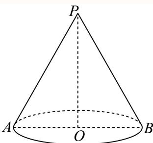
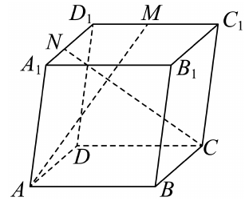
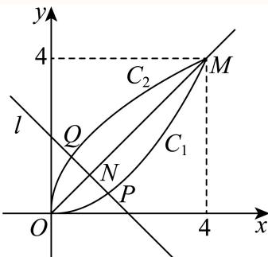
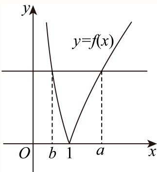
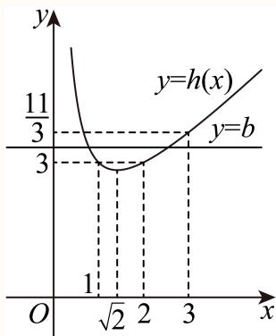
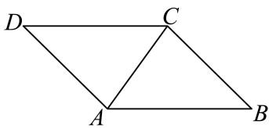
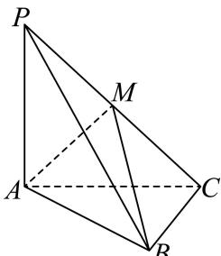
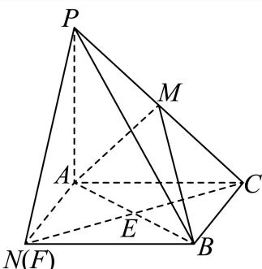
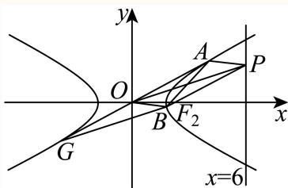

# 2025一模 普陀区原卷 · 教师版

> 本地预览：题目、答案及分类尚未全部审定。校对使用的PDF为高中工作台解析版，尚未逐区确认区级印刷原卷。

## 填空题

按本区原卷题号顺序排列。

### 普陀 · 第1题

设全集U = {−1, 0, 1, 2, 4}，若集合A = {−1, 2, 4}，则A = .

**考点：** 有限集合的补集运算

**难度依据：** 由全集直接取补集

**核查说明：** 题干与解析已用于人工归类，尚未完成整题公式校净与独立数学终审。

【答案】{0, 1}.

【解析】

根据补集的定义求解即可.

因为 $U = \{ - 1 , 0 , 1 , 2 , 4 \}$ ，集合A = {−1, 2, 4}，

所以 ${ \overline { { A } } } = \{ 0 , 1 \}$

故答案为：{0, 1}.

### 普陀 · 第2题

已知某抛物线的准线方程为y＝1，则该抛物线的标准方程为

**考点：** 准线方程反求抛物线标准式

**难度依据：** 先判断开口方向再确定参数

**核查说明：** 题干与解析已用于人工归类，尚未完成整题公式校净与独立数学终审。

【答案】$x ^ { 2 } = - 4 y$

【解析】

设出抛物线的标准方程后，根据准线方程可解得结果.依题意可设抛物线的标准方程为：

$$
x ^ {2} = - 2 p y (p > 0),
$$

由 ${ \frac { p } { 2 } } = 1$ ，解得p = 2，

所以该抛物线的标准方程为： $x ^ { 2 } = - 4 y$

故答案为： $x ^ { 2 } = - 4 y$

本题考查了根据准线方程求抛物线的标准方程，属于基础题.

### 普陀 · 第3题

设i为虚数单位，若复数z满足 $z \cdot { \overline { { z } } } + z - { \overline { { z } } } = 4 + 2 \mathrm { i }$ ，则|z| = .

**考点：** 复数相等与共轭乘积求模

**难度依据：** 取实部即可识别模平方

**核查说明：** 题干与解析已用于人工归类，尚未完成整题公式校净与独立数学终审。

【答案】2。

【解析】

设 $z=a+b\mathrm{i}$，其中 $a,b\in\mathbb{R}$，则 $z\bar z+z-\bar z=a^2+b^2+2b\mathrm{i}$。由复数相等得 $a^2+b^2=4$，$2b=2$，所以 $b=1$，$a=\pm\sqrt{3}$。故 $|z|=2$。

### 普陀 · 第4题

若 $(x+x^2)^5=a_0x^5+a_1x^6+a_2x^7+a_3x^8+a_4x^9+a_5x^{10}$，则 $a_3$ 的值为_______。

**考点：** 提公因式后二项式系数定位

**难度依据：** 转化为一加x的五次展开

**核查说明：** 题干与解析已用于人工归类，尚未完成整题公式校净与独立数学终审。

【答案】10。

【解析】

因为 $(x+x^2)^5=x^5(1+x)^5$，所以 $a_3$ 是 $(1+x)^5$ 中 $x^3$ 的系数，即 $a_3=\binom{5}{3}=10$。

### 普陀 · 第5题

设 $n\ge1$，$m\ge1$，$m,n\in\mathbb N$，等差数列 $\{a_n\}$ 的首项 $a_1=0$，公差 $d\ne0$，若 $a_m=\sum_{i=1}^{11}a_i$，则 $m$ 的值为 $\underline{\qquad}$。

**考点：** 等差数列通项和前n项和关系

**难度依据：** 用首项为零消去公差

**核查说明：** 题干与解析已用于人工归类，尚未完成整题公式校净与独立数学终审。

【答案】$56$。

【解析】

由等差数列通项公式及求和公式，得 $(m-1)d=\frac{11\times10}{2}d$。又 $d\ne0$，所以 $m=56$。

故答案为：$56$。

### 普陀 · 第6题

设 $\triangle ABC$ 的内角 $A,B,C$ 的对边分别为 $a,b,c$，若 $b=4$，$\sin\left(A+\frac{\pi}{3}\right)=0$，$\triangle ABC$ 的面积为 $\sqrt{3}$，则 $a$ 的值为 $\underline{\qquad}$。

> 本题资料或解析有待核事项，预览不可作为已审定成品。

**考点：** 三角内角范围求角及面积余弦定理

**难度依据：** 由正弦零值筛角再由面积求边

**核查说明：** 未检查网站实际渲染及跨页布局。；题干与解析已用于人工归类，尚未完成整题公式校净与独立数学终审。

【答案】$\sqrt { 2 1 }$

【解析】

由已知得A的大小，再根据 $\triangle A B C$ 的面积公式得c的值，从而由余弦定理可得a的值.

$$
\because A \in (0, \pi), \therefore A + \frac {\pi}{3} \in \left(\frac {\pi}{3}, \frac {4 \pi}{3}\right),
$$

又 $\sin \left( A + { \frac { \pi } { 3 } } \right) = 0 .$ ，所以 $A + { \frac { \pi } { 3 } } = \pi$ ，故 $A = \frac { 2 \pi } { 3 }$ ，则 $\triangle A B C$ 的面积 $S _ { \triangle A B C } = \frac { 1 } { 2 } b c \sin A = \frac { 1 } { 2 } \times 4 \times c \sin \frac { 2 \pi } { 3 } = \sqrt { 3 }$ ，所以 $c = 1$， 由余弦定理得 $a ^ { 2 } = b ^ { 2 } + c ^ { 2 } - 2 b c \cos A = 1 6 + 1 - 2 \times 4 \times 1 \times \left( - { \frac { 1 } { 2 } } \right) = 2 1 ,$ 故 $a = \sqrt { 2 1 }$

故答案为： $\sqrt { 2 1 }$

### 普陀 · 第7题

设椭圆 $C:\dfrac{x^2}{a^2}+\dfrac{y^2}{b^2}=1\ (a>b>0)$ 的左、右焦点分别为 $F_1$、$F_2$，左顶点为 $A$，若椭圆 $C$ 的离心率为 $\dfrac{1}{3}$，则 $\dfrac{|F_2A|}{|AF_1|}$ 的值为_______。

**考点：** 椭圆顶点焦点距离比与离心率

**难度依据：** 把线段长度写成a加减c

**核查说明：** 题干与解析已用于人工归类，尚未完成整题公式校净与独立数学终审。

【答案】2。

【解析】

由题意，$F_1(-c,0)$，$F_2(c,0)$，$A(-a,0)$，则 $|F_2A|=a+c$，$|AF_1|=a-c$。由离心率 $\dfrac{c}{a}=\dfrac{1}{3}$，得 $a=3c$，所以 $\dfrac{|F_2A|}{|AF_1|}=\dfrac{a+c}{a-c}=2$。

### 普陀 · 第8题

若圆锥 $PO$ 的体积为 $\dfrac{2\sqrt{2}\pi}{3}$，它的母线与底面所成的角的余弦值为 $\dfrac{1}{3}$，则圆锥 $PO$ 的表面积为_______。

**考点：** 圆锥线面角体积与表面积；直角三角形中的余弦边比

**难度依据：** 先由夹角确定母线半径比例再用体积定尺度

**核查说明：** 题干与解析已用于人工归类，尚未完成整题公式校净与独立数学终审。

【答案】$4\pi$。

【解析】

设圆锥底面半径为 $r$，母线长为 $l$。由母线与底面所成角的余弦值为 $\dfrac{1}{3}$，得 $\dfrac{r}{l}=\dfrac{1}{3}$，即 $l=3r$，故圆锥的高为 $\sqrt{l^2-r^2}=2\sqrt{2}r$。

由体积 $\dfrac{1}{3}\pi r^2\cdot 2\sqrt{2}r=\dfrac{2\sqrt{2}\pi}{3}$，得 $r=1$，$l=3$。因此圆锥的表面积为 $\pi rl+\pi r^2=4\pi$。

### 普陀 · 第9题

设 $\lambda\in\mathbb{R}$，在如图所示的平行六面体 $ABCD-A_1B_1C_1D_1$ 中，$\angle A_1AB=\angle A_1AD=\angle BAD=\frac{\pi}{3}$，$AA_1=2$，$AB=AD=1$，点 $M$ 是棱 $C_1D_1$ 的中点，$\overrightarrow{A_1N}=\lambda\overrightarrow{A_1D_1}$，若 $\overrightarrow{AM}\cdot\overrightarrow{CN}=2$，则 $\lambda$ 的值为 $\underline{\qquad}$。

> 本题资料或解析有待核事项，预览不可作为已审定成品。

**考点：** 非正交空间基底的数量积展开；平行六面体中点与棱上点的向量表示

**难度依据：** 基底不正交需逐项计入夹角

**核查说明：** 仅修复所列OCR公式及其定界符错位；原解数学疑点和其他可渲染错识未因此消除。；题干与解析已用于人工归类，尚未完成整题公式校净与独立数学终审。；题干点N的向量等式严重错识，原解指向A1N=λA1D1，须视觉回核后修复。

【答案】$\frac13$。

【解析】设 $\boldsymbol{u}=\overrightarrow{AB}$，$\boldsymbol{v}=\overrightarrow{AD}$，$\boldsymbol{w}=\overrightarrow{AA_1}$。由题意，

$$\overrightarrow{AM}=\boldsymbol{v}+\boldsymbol{w}+\frac12\boldsymbol{u},\qquad
\overrightarrow{CN}=\boldsymbol{w}+(\lambda-1)\boldsymbol{v}-\boldsymbol{u}.$$

由边长与夹角可得 $\boldsymbol{u}^2=\boldsymbol{v}^2=1$，$\boldsymbol{w}^2=4$，$\boldsymbol{u}\cdot\boldsymbol{v}=\frac12$，$\boldsymbol{u}\cdot\boldsymbol{w}=\boldsymbol{v}\cdot\boldsymbol{w}=1$。因此

$$\overrightarrow{AM}\cdot\overrightarrow{CN}=\frac72+\frac94(\lambda-1)=2,$$

解得 $\lambda=\frac13$。

### 普陀 · 第10题

设平面上四点 $P$、$Q$、$M$、$N$ 满足：$|PM|=|PN|=4$，$|PQ|=2$，若 $\overrightarrow{QM}\cdot\overrightarrow{QN}=0$，则 $|MN|$ 的最小值为 $\underline{\qquad}$。

> 本题资料或解析有待核事项，预览不可作为已审定成品。

**考点：** 数量积零转直角圆周关系；双圆约束中的弦长最值

**难度依据：** 将垂直条件转圆再用距离约束确定最短弦

**核查说明：** 题干与解析已用于人工归类，尚未完成整题公式校净与独立数学终审。；原解将r²=8−2√7舍去却随后取其为最小值，又出现r>4的不可能分支；结论不能替代证明，须重核。

【答案】$2\sqrt7-2$。

【解析】设 $O$ 为 $MN$ 的中点。由 $\overrightarrow{QM}\cdot\overrightarrow{QN}=0$，得 $OQ=OM=ON$。令 $OM=OQ=r$，$OP=m$，由 $PM=PN=4$，得

$$r^2+m^2=16.$$

又 $PQ=2$，由三角形边长关系得 $|m-r|\le2$，从而

$$16-2mr=(m-r)^2\le4,\qquad mr\ge6.$$

于是 $(m+r)^2=16+2mr\ge28$，所以 $m+r\ge2\sqrt7$。结合 $m-r\le2$，得 $2r\ge2\sqrt7-2$。

当 $r=\sqrt7-1$，$m=\sqrt7+1$ 时，取 $Q$ 在线段 $OP$ 上，使 $OQ=r$，并取过 $O$ 且垂直于 $OP$ 的直径 $MN$，则 $PQ=2$，$PM=PN=4$，且 $\overrightarrow{QM}\cdot\overrightarrow{QN}=0$。因此最小值为 $2\sqrt7-2$。

【审校说明】本解析为独立重建。来源解析错误舍去了 $r^2=8-2\sqrt7$，并错误纳入 $r>4$；来源答案与上述结论一致。

### 普陀 · 第11题

设 $t\in\mathbb R$，直线 $l:x+y-t=0$ 与曲线 $C_1:y=\frac14x^2\ (0\le x\le4)$ 和曲线 $C_2:y=2\sqrt{x}$ 分别交于 $P$、$Q$ 两点，则 $|PQ|$ 的最大值是________。

> 本题资料或解析有待核事项，预览不可作为已审定成品。

**考点：** 反函数图像对称与参数最值；垂直对称轴的截线长度

**难度依据：** 借互逆曲线对称性降为点到对称轴的距离

**核查说明：** 题干与解析已用于人工归类，尚未完成整题公式校净与独立数学终审。；来源解析联立及后续变形有误；现行解析已独立重建并复算。

【答案】$\sqrt2$。

【校订说明】以下解答依据题设重新整理并独立复算；配图来自解析版，并非题干原图。原解析及其识别稿应另行保留。

【解析】设 $P=(u,\frac14u^2)$，其中 $0\le u\le4$。由于 $P$ 在直线 $l$ 上，$t=u+\frac14u^2$。点 $(\frac14u^2,u)$ 在 $C_2$ 和直线 $l$ 上；又 $x+2\sqrt{x}$ 在 $[0,+\infty)$ 上严格递增，故直线与 $C_2$ 的交点唯一，即 $Q=(\frac14u^2,u)$。

因此

$$
|PQ|=\sqrt2\left(u-\frac14u^2\right)
=\sqrt2\left[1-\frac14(u-2)^2\right]\le\sqrt2.
$$

当 $u=2$ 时，$t=3$，$P=(2,1)$，$Q=(1,2)$，等号成立。故最大值为 $\sqrt2$。

### 普陀 · 第12题

设 $a>b>0$，函数 $y=f(x)$ 的表达式为 $f(x)=\left|x-\frac1x+\ln x\right|$，若 $f(a)=f(b)$，且关于 $x$ 的方程

$$|x^2+ax+2ab|+|x^2-ax+2ab|=2a|x|$$

的整数解有且仅有4个，则 $a$ 的取值范围是 $\underline{\qquad}$。

> 本题资料或解析有待核事项，预览不可作为已审定成品。

**考点：** 单调函数倒数反对称关系；绝对值三角不等式等号与整数解；函数约束联动整数解计数

**难度依据：** 先推出ab为一再将四个整数根转为两个正整数解

**核查说明：** 仅修复所列OCR公式及其定界符错位；原解数学疑点和其他可渲染错识未因此消除。；题干与解析已用于人工归类，尚未完成整题公式校净与独立数学终审。

【答案】$\left[3,\frac{11}{3}\right)$。

【解析】令 $g(x)=x-\frac1x+\ln x$（$x>0$）。因为 $g'(x)=1+\frac1{x^2}+\frac1x>0$，所以 $g(x)$ 在 $(0,+\infty)$ 上严格递增。又 $g(1)=0$，且 $g(\frac1x)=-g(x)$。由 $a>b>0$ 及 $|g(a)|=|g(b)|$，可得 $0<b<1<a$，并有 $g(b)=-g(a)=g(\frac1a)$，因此 $b=\frac1a$。

将 $ab=1$ 代入方程。由绝对值三角不等式的等号条件，原方程等价于

$$ (x^2+2)^2-a^2x^2\leq 0\quad\Longleftrightarrow\quad x^2+2\leq a|x|。$$

显然 $x=0$ 不满足条件，且整数解关于原点成对。对正整数 $n$，上述不等式等价于 $a\geq n+\frac2n$。当 $n=1,2$ 时，右端均为 $3$；当 $n\geq2$ 时，

$$\left(n+1+\frac2{n+1}\right)-\left(n+\frac2n\right)=1-\frac2{n(n+1)}>0。$$

因此，恰有两个正整数解当且仅当 $3\leq a<3+\frac23=\frac{11}{3}$。反之，在此范围内取 $b=\frac1a$，满足 $a>b>0$ 和 $f(a)=f(b)$，且整数解恰为 $\pm1,\pm2$。故所求范围为 $\left[3,\frac{11}{3}\right)$。

【审校说明】解析依来源题意独立重建。以上保留来源辅助图；第二张图中水平线标注 $y=b$ 为来源笔误，应为 $y=a$。

## 选择题

按本区原卷题号顺序排列。

### 普陀 · 第13题

设 $\alpha\in\mathbb{R}$，则“$\cos 2\alpha=\frac{1}{3}$”是“$\sin\alpha=\frac{\sqrt{3}}{3}$”的（　）

A. 充分非必要条件

B. 必要非充分条件

C. 充要条件

D. 既非充分又非必要条件

> 本题资料或解析有待核事项，预览不可作为已审定成品。

**考点：** 二倍角命题的充分必要条件；二倍角公式与符号分支

**难度依据：** 平方关系不能确定正弦符号

**核查说明：** 题干与解析已用于人工归类，尚未完成整题公式校净与独立数学终审。；题干α范围大段乱码；同名PDF第9页文字层已确认“设α∈R”，本分类不改源稿。

【答案】B

【解析】

由 $\cos 2\alpha=1-2\sin^2\alpha$，可得 $\cos 2\alpha=\dfrac13$ 等价于 $\sin\alpha=\dfrac{\sqrt3}{3}$ 或 $\sin\alpha=-\dfrac{\sqrt3}{3}$。

因此，$\sin\alpha=\dfrac{\sqrt3}{3}$ 能推出 $\cos 2\alpha=\dfrac13$；反之，当 $\sin\alpha=-\dfrac{\sqrt3}{3}$ 时，前者成立而后者不成立。故“$\cos 2\alpha=\dfrac13$”是“$\sin\alpha=\dfrac{\sqrt3}{3}$”的必要非充分条件，选 B。

### 普陀 · 第14题

某机构对2014年至2023年的中国新能源汽车年销售量进行了统计。原统计图未收录，根据原图整理的数据如下（单位：万辆）：

| 年份 | 年销售量 |
|---|---|
| 2014 | 7.5 |
| 2015 | 33.1 |
| 2016 | 50.7 |
| 2017 | 77.7 |
| 2018 | 125.6 |
| 2019 | 120.6 |
| 2020 | 136.6 |
| 2021 | 352.1 |
| 2022 | 688.7 |
| 2023 | 728 |

下列结论中正确的是（ ）

A. 这十年中国新能源汽车年销售量的中位数为123

B. 这十年中国新能源汽车年销售量的极差为721

C. 这十年中国新能源汽车年销售量的第70百分位数为136.6

D. 这十年中的前五年的年销售量的方差小于后五年的年销售量的方差

> 本题资料或解析有待核事项，预览不可作为已审定成品。

**考点：** 统计图读数与中位数百分位数方差

**难度依据：** 逐个核对统计量并比较数据波动

**核查说明：** 题干与解析已用于人工归类，尚未完成整题公式校净与独立数学终审。；题干统计图在MD未保留图片引用；已定位同名PDF第9页，须提取原统计图后才能发布。

【答案】D
【解析】
将十个数据由小到大排列。中位数为 $\frac{120.6+125.6}{2}=123.1$，故 A 错误；极差为 $728-7.5=720.5$，故 B 错误。由 $10\times70\%=7$，按来源采用的百分位数规则，第70百分位数为 $\frac{136.6+352.1}{2}=244.35$，故 C 错误。前五年的平均数为 $58.92$，方差为 $1635.4336$；后五年的平均数为 $405.2$，方差为 $68106.964$，故 D 正确。选 D。

【说明】解析根据来源和题目数据重建，方差计算为补充内容，并非来源逐字转录。

### 普陀 · 第15题

设 $a>0$ 且 $a\ne1$，$k、m、n$ 都是正整数，数列 $\{a_n\}$ 的通项公式为 $a_n=\begin{cases}(a-6)n+21,&1\le n\le m,\\a^{n-3},&n>m,\end{cases}$，记数列 $\{a_n\}$ 中前 $k$ 项的最小值为 $h_k$，由所有 $h_k$ 的值所组成的集合记为 $A$，若集合 $A$ 中仅有四个元素，则下列说法中错误的是（　）

A. 当 $m=3$ 时，$a$ 的取值范围是 $(1,6)$

B. 不存在 $a$ 和 $m$ 的值，使得 $a_4\notin A$

C. 当 $m=4$ 时，$a$ 的取值范围是 $(3,6)$

D. 存在 $a$ 和 $m$ 的值，使得 $a_5\notin A$

> 本题资料或解析有待核事项，预览不可作为已审定成品。

**考点：** 分段数列前缀最小值的不同取值；分段线性指数函数的单调性；前缀最小值集合的元素计数

**难度依据：** 按底数及分段位置追踪最小值更新次数

**核查说明：** PDF第11页原解未逐式复核；新解按题干独立完成，需复核分支及最终渲染。；题干与解析已用于人工归类，尚未完成整题公式校净与独立数学终审。；原解多处把通项讨论称为递推，部分分支解释跳步，需逐项核验前缀最小值集合。

【答案】C

【解析】

记 $h_k=\min\{a_1,\ldots,a_k\}$。当且仅当新的一项严格小于此前所有项时，集合 $A$ 增加一个元素。

当 $0<a<1$ 时，指数段严格递减并趋于 $0$。若 $a_m>0$，则指数段会产生无穷多个新的最小值；若 $a_m\leq0$，则前 $m$ 项严格递减且指数段均为正，故 $A$ 恰有 $m$ 个元素。因此恰有四个元素时，$m=4$，且 $4a-3\leq0$，即 $0<a\leq\frac34$。

当 $a>1$ 时，指数段严格递增，只需考虑其首项是否刷新最小值。若 $a\geq6$，前一段非递减，故 $A$ 至多有两个元素；若 $1<a<6$，前一段严格递减，故只有 $m=3$ 或 $m=4$ 可能恰有四个元素。当 $m=3$ 时，前三项末项为 $3a+3$，指数段首项为 $a$，因此恰有四个元素。当 $m=4$ 时，前四项末项为 $4a-3$，指数段首项为 $a^2$，要恰有四个元素，须 $a^2\geq4a-3$，即 $a\geq3$。

综上，$m=3$ 时 $1<a<6$，故A正确；所有符合条件的情形中，第4项都属于 $A$，故B正确；$m=4$ 时 $a\in(0,\frac34]\cup[3,6)$，故C错误；取 $m=4,a=4$，则前四项为 $19,17,15,13$，之后各项从 $16$ 起严格递增，故 $a_5=16\notin A$，D正确。

故选：C。

### 普陀 · 第16题

在平面直角坐标系中，将函数 $y=f(x)$ 的图象绕坐标原点 $O$ 逆时针旋转 $\frac{\pi}{4}$ 后，所得曲线仍然是某个函数的图象，则称函数 $y=f(x)$ 为“R函数”。对于命题：

①设 $m\in\mathbf R$，若函数 $g(x)=(m-1)x+\frac1x$ 为“R函数”，则 $m>1$；

②设 $k\in\mathbf R$，若函数 $h(x)=\frac{k(x+1)}{\mathrm e^x}$ 为“R函数”，则满足条件的 $k$ 的整数值至少有4个。

则下列结论中正确的是（　）。

A. ①为真②为真

B. ①为真②为假

C. ①为假②为真

D. ①为假②为假

> 本题资料或解析有待核事项，预览不可作为已审定成品。

**考点：** 旋转后仍为函数的图像判定；斜截线交点唯一性与导数参数范围

**难度依据：** 旋转定义转一一性再分别分析两种函数

**核查说明：** 仅修复所列OCR公式及其定界符错位；原解数学疑点和其他可渲染错识未因此消除。；仅核本题所列字段及页面；不等于全卷终审。；题干与解析已用于人工归类，尚未完成整题公式校净与独立数学终审。

【答案】B

【解析（回源校订）】

点 $(x,f(x))$ 绕原点逆时针旋转 $\frac\pi4$ 后，其横坐标为 $\frac{x-f(x)}{\sqrt2}$。旋转后的曲线仍为函数图像，等价于不同的 $x$ 对应不同的 $x-f(x)$，也就是函数 $f(x)-x$ 在原定义域上为一一对应。

①令 $G(x)=g(x)-x=(m-2)x+\frac1x$，$x\ne0$。

当 $m=2$ 时，$G(x)=\frac1x$ 在 $\mathbf R\setminus\{0\}$ 上为一一对应，满足条件。

当 $m>2$ 时，令 $c=m-2>0$。对任意 $t>2\sqrt c$，方程 $cx+\frac1x=t$ 等价于 $cx^2-tx+1=0$，有两个不同的正根，不满足一一对应。

当 $m<2$ 时，$c=m-2<0$。函数 $cx+\frac1x$ 在 $(-\infty,0)$ 和 $(0,+\infty)$ 上分别严格递减，且两个分支的值域均为 $\mathbf R$，因此任意水平直线均与两分支各交一次，也不满足条件。

所以 $g(x)$ 为“R函数”当且仅当 $m=2$。由 $m=2>1$，命题①正确。

②令 $H(x)=h(x)-x=\frac{k(x+1)}{\mathrm e^x}-x$，则

$$H'(x)=-kx\mathrm e^{-x}-1=-\frac{kx+\mathrm e^x}{\mathrm e^x}.$$

$H$ 在 $\mathbf R$ 上连续，一一对应等价于严格单调。又 $H'(0)=-1<0$，故若满足条件，则只能严格递减，从而必须对任意 $x\in\mathbf R$ 有 $kx+\mathrm e^x\ge0$。

当 $x>0$ 时，该条件为 $k\ge-\frac{\mathrm e^x}{x}$。令 $u(x)=\frac{\mathrm e^x}{x}$，有 $u'(x)=\frac{\mathrm e^x(x-1)}{x^2}$，故 $u$ 在 $(0,1)$ 上严格减，在 $(1,+\infty)$ 上严格增，最小值为 $u(1)=\mathrm e$。因此此部分条件等价于 $k\ge-\mathrm e$。

当 $x<0$ 时，该条件为 $k\le-\frac{\mathrm e^x}{x}$。右端恒正，且当 $x\to-\infty$ 时趋于0，所以此部分条件等价于 $k\le0$。当 $x=0$ 时原不等式恒成立。

因此必要条件为 $-\mathrm e\le k\le0$。

反过来，当 $-\mathrm e<k\le0$ 时，对任意 $x$ 均有 $H'(x)<0$；当 $k=-\mathrm e$ 时，$H'(x)\le0$，且只在 $x=1$ 处等于0，在该点两侧均严格为负，故 $H$ 仍在 $\mathbf R$ 上严格递减。区间内所有 $k$ 均满足条件。

综上，$h(x)$ 为“R函数”当且仅当 $k\in[-\mathrm e,0]$。符合条件的整数仅为 $-2,-1,0$，共3个，命题②错误。

故选B。

校订说明：原PDF中间两行的 $x-1$ 为笔误，已按题设统一为 $x+1$ 并独立复算；原导数、参数区间及答案B不变。原错行及原解析保留在回源补丁记录中，不作为当前解题步骤。

## 解答题

按本区原卷题号顺序排列。

### 普陀 · 第17题

图1所示的平行四边形ABCD中， $C A = C B = 1 , \ C D = { \sqrt { 2 } }$ 现将 $\triangle D A C$ 沿AC折起，得到如图2所示的三棱锥 $P - A B C$ ，记棱PC的中点为M，且. $. P B = { \sqrt { 3 } }$

图1

图2
(1) (6分)求证： $A M \bot B C$ ；
(2) (8分)记棱AB的中点为E，在直线CE上作出点N，使得 $P N / /$ 平面MAB，请说明理由，并求出二面角 $P - N B - A$ 的大小.

**考点：** （1）勾股与线面垂直传递；（2）构造矩形顶点给出点N并找二面角平面角

**难度依据：** （1）勾股与线面垂直传递；（2）构造矩形顶点给出点N并找二面角平面角

**核查说明：** 题干与解析已用于人工归类，尚未完成整题公式校净与独立数学终审。

【解析】

(1) 因为 $C A = C B = D A = 1$ $C D = A B = { \sqrt { 2 } }$

$$
C A ^ {2} + C B ^ {2} = A B ^ {2} = 2,
$$

所 $\angle A C B = 9 0 ^ { \circ }$ ，所以 $\angle D A C = 9 0 ^ { \circ }$ ，即 $D A \bot A C , B C \bot C A$

图2中， $P A = D A = 1 , A B = \sqrt { 2 } , P B = \sqrt { 3 } ,$

则 $P A ^ { 2 } + A B ^ { 2 } = P B ^ { 2 } = 3$ ,所以 $P A \bot A B .$ ，又 $P A \bot A C$

又 $A B , A C$ 为平面ABC内两条相交直线，

所以 $P A \bot$ 面 $A B C ,$ ，又BC在面 $A B C$

所以 $P A \bot B C$ 又 $B C \bot C A$

PA,CA为平面PAC内两条相交直线，

所以 $B C \bot$ 面 $P A C ,$ ，又AM在面PAC内，

所以 $A M \bot B C$

(2)

N(F)

以 $C A , C B$ 为临边，构造矩形 $A C B F$ ,连接 $C F ,$ ，易知过点 $E _ { : }$ ，

因为 $E , M$ 分别为 $\lceil C F , C P$ 的中点，

所以 $P F / / M E$ ，又ME在平面 $M A B ^ { \flat }$ 内，PF在平面 $M A B _ { , } ^ { \prime }$ 外，所以 $P F / /$ 平面 $M A B$ 4

即点F就是N点，

由（1）知 $P A \bot$ 面 $A C B N$ ，BN在面ACBN内，

所以 $B N \bot P A$ ，又 $B N \bot A N$

AN,PA是平面 $P A N$ 内两条相交直线，

所以 $B N \bot$ 面 $P A N$ ，PN在面 $P A N |$ 内，

所以 $P N \bot B N ,$ ，又 $A N \bot B N$

所以 $\angle P N A$ 为二面角 $P - N B - A$ 的平面角，

因为 $P A \bot A N , P A = A N .$

所以 $\angle P N A = 4 5 ^ { \circ }$ 。

所以二面角 $P - N B - A$ 的大小为 $4 5 ^ { \circ }$ .

### 普陀 · 第18题

设函数 $y=f(x)$ 的表达式为 $f(x)=\sin(\omega x)$，其中 $\omega>0$。

（1）（6分）设 $\omega=1$，$m\in\mathbb R$，若有且只有一个 $x_0\in(0,m)$，使得函数 $y=f\left(x+\frac\pi4\right)$ 取得最小值，求 $m$ 的取值范围；

（2）（8分）若对任意的 $x\in\mathbb R$，皆有 $f(x)+f\left(\frac{2\pi}{3}-x\right)=0$ 成立，且函数 $y=f(x)$ 在区间 $\left(-\frac\pi8,0\right)$ 上是严格增函数，求函数 $y=f(x)$ 的最小正周期。

> 本题资料或解析有待核事项，预览不可作为已审定成品。

**考点：** （1）开区间仅一个极小点；（2）恒等关系给离散频率再用单调区间限界

**难度依据：** （1）开区间仅一个极小点；（2）恒等关系给离散频率再用单调区间限界

**核查说明：** 题干和解析已对照工作台整理版修订并独立复算；区级印刷原卷未确认，尚未整题终审。

【答案】（1）$\left(\frac{5\pi}{4},\frac{13\pi}{4}\right]$；（2）$\frac{2\pi}{3}$。

【解析】

（1）当 $\omega=1$ 时，$f\left(x+\frac\pi4\right)=\sin\left(x+\frac\pi4\right)$。其取得最小值 $-1$ 的点满足

$$x=\frac{5\pi}{4}+2k\pi,\quad k\in\mathbb Z。$$

在正半轴上，前两个这样的点分别为 $\frac{5\pi}{4}$ 和 $\frac{13\pi}{4}$。区间 $(0,m)$ 中恰有一个这样的点，故

$$\frac{5\pi}{4}<m\leq\frac{13\pi}{4}。$$

（2）由和差化积，对任意 $x\in\mathbb R$，

$$f(x)+f\left(\frac{2\pi}{3}-x\right)=2\sin\frac{\omega\pi}{3}\cos\left[\omega\left(x-\frac\pi3\right)\right]=0。$$

令 $x=\frac\pi3$，得 $\sin\frac{\omega\pi}{3}=0$；结合 $\omega>0$，得 $\omega=3k$，其中 $k\in\mathbb N^*$。反之，这些 $\omega$ 均满足上述恒等式。

令 $t=\omega x$，则 $x\in\left(-\frac\pi8,0\right)$ 对应 $t\in\left(-\frac{\omega\pi}{8},0\right)$。因为 $\sin t$ 在该区间严格递增，所以 $-\frac{\omega\pi}{8}\geq-\frac\pi2$，即 $0<\omega\leq4$。结合 $\omega=3k$，得 $\omega=3$；它满足所给单调性条件。因此最小正周期为

$$T=\frac{2\pi}{\omega}=\frac{2\pi}{3}。$$

### 普陀 · 第19题

机器人竞技是继电子竞技之后热门的科技竞技项目.某区为了参加市机器人竞技总决赛，开展了区内选拔赛，其中A、B、C、D四人进入区内个人组决赛，按照规则每人与其他三人各进行一场比赛，且这三场比赛互相独立.下表统计的是A在近期热身中分别与B、C、D三人比赛的情况.

| 对手 | B | C | D |
| --- | ---: | ---: | ---: |
| 比赛的次数 | 12 | 10 | 15 |
| A获胜的次数 | 4 | 5 | 12 |

(1) (6分)根据表格中的数据，试估计在区内决赛中A至少获胜一场的概率；
(2) (8分)根据表格中的数据，请给B、C、D三人设计一个出场顺序，使得A在这三场比赛中连胜两场的概率最大，并说明理由.

> 本题资料或解析有待核事项，预览不可作为已审定成品。

**考点：** （1）频率估计概率并求至少一胜；（2）按不同中间选手比较相邻两胜概率

**难度依据：** （1）频率估计概率并求至少一胜；（2）按不同中间选手比较相邻两胜概率

**核查说明：** 题干与解析已用于人工归类，尚未完成整题公式校净与独立数学终审。；题干说下表但MD没有表格或题图；同名PDF已定位原表，且“连胜两场”是否含三连胜需明确语义，原解只算恰好相邻两胜。

【解析】

(1)由表格可估计A与B的比赛中A获胜的概率 (1) 由表格可估计A与B的比赛中A获胜的概率 $P _ { 1 } = { \frac { 4 } { 1 2 } } = { \frac { 1 } { 3 } }$

A与C的比赛中A获胜的概率 $P _ { 2 } = { \frac { 5 } { 1 0 } } = { \frac { 1 } { 2 } }$ ，A与D的比赛中A获胜的概率 $P _ { 3 } = { \frac { 1 2 } { 1 5 } } = { \frac { 4 } { 5 } } .$ 则估计在区内决赛中A三场全输的概率 $\overline { { P ^ { \prime } } } = \left( 1 - P _ { 1 } \right) \left( 1 - P _ { 2 } \right) \left( 1 - P _ { 3 } \right) = \frac { 2 } { 3 } \times \frac { 1 } { 2 } \times \frac { 1 } { 5 } = \frac { 1 } { 1 5 }$

所以估计在区内决赛中A至少获胜一场的概率 $P = 1 - P ^ { \prime } = { \frac { 1 4 } { 1 5 } }$

(2) ①当比赛安排为BCD时，A连胜两场的概率为 $P _ { 1 } P _ { 2 } ( 1 - P _ { 3 } ) + ( 1 - P _ { 1 } ) P _ { 2 } P _ { 3 } = { \frac { 3 } { 1 0 } }$ ②当比赛安排为BDC时，A连胜两场的概率为 $P _ { 1 } P _ { 3 } ( 1 - P _ { 2 } ) + ( 1 - P _ { 1 } ) P _ { 3 } P _ { 2 } = \frac { 2 } { 5 } ;$ ③当比赛安排为CBD时，A连胜两场的概率为 $P _ { 2 } P _ { 1 } ( 1 - P _ { 3 } ) + ( 1 - P _ { 2 } ) P _ { 1 } P _ { 3 } = \frac { 1 } { 6 } ;$ ④当比赛安排为CDB时，A连胜两场的概率为 $P _ { 2 } P _ { 3 } \left( 1 - P _ { 1 } \right) + ( 1 - P _ { 2 } ) P _ { 3 } P _ { 1 } = \frac { 2 } { 5 }$ ⑤当比赛安排为DBC时，A连胜两场的概率为 $P _ { 3 } P _ { 1 } ( 1 - P _ { 2 } ) + ( 1 - P _ { 3 } ) P _ { 1 } P _ { 2 } = \frac { 1 } { 6 } ;$ ⑥当比赛安排为DCB时，A连胜两场的概率为 $P _ { 3 } P _ { 2 } \left( 1 - P _ { 1 } \right) + ( 1 - P _ { 3 } ) P _ { 2 } P _ { 1 } = \frac { 3 } { 1 0 }$ 由 $\frac { 1 } { 6 } < \frac { 3 } { 1 0 } < \frac { 2 } { 5 }$ ，则当比赛安排为CDB或BDC时，A连胜两场的概率最大

### 普陀 · 第20题

设 $m > 0 , \ m > 0 , \ F _ { 1 \setminus } \ F _ { 2 }$ 分别是双曲线Γ: ${ \frac { x ^ { 2 } } { a ^ { 2 } } } - y ^ { 2 } = 1$ 的左、右焦点，直线 $l { : } x - m y - 2 = 0 { \stackrel { 4 } { - } }$ 经过 点 $F _ { 2 ^ { - } }$ 与Γ的右支交于A、B两点，点O是坐标原点.
(1) (4分)若点M是Γ上的一点， $\vert M F _ { 1 } \vert = 2$ ，求 $| M F _ { 2 }$ |的值；
(2) (6分)设λ、 $\mu \in \mathbf { R } _ { : }$ ，点P在直线 $\dot { z } x = 6 .$ 上，若点O、A、P、B满足： $\overrightarrow { O A } = \lambda \overrightarrow { B P } , \overrightarrow { O B } = \mu \overrightarrow { A P }$ 求点P的坐标；
(3) (8分)设AO的延长线与Γ交于G点，若向量− $\xrightarrow { }$ 与 $\overbrace { O B }$ 满足： $\overrightarrow { O A } \cdot \overrightarrow { O B } \geq 1 7$ ，求 $\triangle G A B$ 的面积S 的取值范围.

> 本题资料或解析有待核事项，预览不可作为已审定成品。

**考点：** （1）由焦点和定义求距离；（2）向量关系转平行四边形与中点；（3）数量积限定参数后求三角形面积范围

**难度依据：** （1）由焦点和定义求距离；（2）向量关系转平行四边形与中点；（3）数量积限定参数后求三角形面积范围

**核查说明：** 题干与解析已用于人工归类，尚未完成整题公式校净与独立数学终审。；题干a>0误写为重复m>0，部分向量标签残缺，需视觉回源。

【解析】

(1) 双曲线 ${ \frac { x ^ { 2 } } { a ^ { 2 } } } - y ^ { 2 } = 1$ 的右焦点 $F _ { 2 }$ 的坐标为 $\left( \sqrt { a ^ { 2 } + 1 } , 0 \right)$

因为 $x - m y - 2 = ($ 0过点 $F _ { 2 }$ ，

所以 ${ \sqrt { a ^ { 2 } + 1 } } - 2 = 0$ ，所 $\lambda a = { \sqrt { 3 } }$

因为 $| M F _ { 1 } | = 2 < a + \sqrt { a ^ { 2 } + 1 } = \sqrt { 3 } + 2 ,$

所以点M在双曲线 ${ \frac { x ^ { 2 } } { a ^ { 2 } } } - y ^ { 2 }$ = 1的左支上，

由双曲线定义知 $| M F _ { 2 } | - | M F _ { 1 } | = 2 \sqrt { 3 }$ ，又 $\vert M F _ { 1 } \vert = 2$

所以 $| M F _ { 2 } | = 2 \sqrt { 3 } + 2 \ /$

(2) 由（1）知， $a = { \sqrt { 3 } } ,$ ，则双曲线Γ: ${ \frac { x ^ { 2 } } { 3 } } - y ^ { 2 } = 1$

联立 $\left\{ { \begin{array} { l l } { x - m y - 2 = 0 } \\ { x ^ { 2 } - 3 y ^ { 2 } = 3 } \end{array} } \right.$ ，消去x得 $\left( m ^ { 2 } - 3 \right) y ^ { 2 } + 4 m y + 1 = 0$

则 $| \Delta = 1 6 m ^ { 2 } - 4 m ^ { 2 } + 1 2 = 1 2 m ^ { 2 } + 1 2 > 0 ,$

设A $( x _ { 1 } , y _ { 1 } ) , B \left( x _ { 2 } , y _ { 2 } \right)$ ，则 $y _ { 1 } + y _ { 2 } = { \frac { - 4 m } { m ^ { 2 } - 3 } } , y _ { 1 } y _ { 2 } = { \frac { 1 } { m ^ { 2 } - 3 } } ,$

所以 $x _ { 1 } + x _ { 2 } = m y _ { 1 } + 2 + m y _ { 2 } + 2 = m \left( y _ { 1 } + y _ { 2 } \right) + 4 = { \frac { - \mathbf { 1 } { \overset { \triangledown } { \mathbf { \theta } } } } { m ^ { 2 } - 3 } } ,$

$$
x _ {1} x _ {2} = (m y _ {1} + 2) (m y _ {2} + 2) = m ^ {2} y _ {1} y _ {2} + 2 m (y _ {1} + y _ {2}) + 4 = \frac {- 3 m ^ {2} - 1 2}{m ^ {2} - 3},
$$

又 $y _ { 1 } y _ { 2 } < 0$ ，所 $\downarrow m ^ { 2 } < 3$

因为点O、A、P、B满足： $\overrightarrow { O A } = \lambda \overrightarrow { B P } , \overrightarrow { O B } = \mu \overrightarrow { A P } ,$

所以 $O A / / B P , O B / / A P$ ，所以四边形 $O A P B$ 为平行四边形，

故 $O P  A B _ { - } ^ { 1 }$ 互相平分，点P在直线 $x = 6 \mathrm { { E } }$

所以 ${ \frac { x _ { 1 } + x _ { 2 } } { 2 } } = { \frac { - 6 } { m ^ { 2 } - 3 } } = 3 \quad$ ，又 $m > 0$ ，所以 $m = 1$

所以点P的纵坐标为 $y _ { 1 } + y _ { 2 } = { \frac { - 4 } { 1 - 3 } } = 2 .$

所以点P的坐标为(6,2).

(3) 因为− $\overrightarrow { O A } \cdot \overrightarrow { O B } \geq 1 7$

所以 $x _ { 1 } x _ { 2 } + y _ { 1 } y _ { 2 } = { \frac { - 3 m ^ { 2 } - 1 2 } { m ^ { 2 } - 3 } } + { \frac { 1 } { m ^ { 2 } - 3 } } \geq 1 7 ,$

所以 $m ^ { 2 } \geq 2 ,$ ，又 $m ^ { 2 } < 3$ ，所以2 $\leq m ^ { 2 } < 3$

由双曲线的对称性可得 $G ( - x _ { 1 } , - y _ { 1 } ) , S _ { \triangle A G B } = 2 S _ { \triangle A O B }$ ，

所以 $S _ { \triangle A G B } = 2 S _ { \triangle A O B } = 2 \times \frac { 1 } { 2 } \times | O F | \times | y _ { 2 } - y _ { 1 } | = 2 | y _ { 2 } - y _ { 1 } |$

所以 $S _ { \triangle A G B } = 2 \sqrt { ( y _ { 2 } + y _ { 1 } ) ^ { 2 } - 4 y _ { 2 } y _ { 1 } } = 4 \sqrt { 3 } { \frac { \sqrt { m ^ { 2 } + 1 } } { 3 - m ^ { 2 } } }$ ，

${ \mathfrak { H } } t = { \sqrt { m ^ { 2 } + 1 } } , \ t \in \left\lceil { \sqrt { 3 } } , 2 \right\rceil$ ，即 $m ^ { 2 } = t ^ { 2 } - 1$

所以 $S _ { \triangle A G B } = { \frac { 4 \sqrt { 3 } t } { 4 - t ^ { 2 } } } = { \frac { 4 \sqrt { 3 } } { { \frac { 4 } { t } } - t } }$

因为 $\displaystyle y = { \frac { 4 } { t } } - 1$ t在区间 $\left[ { \sqrt { 3 } } , 2 \right)$ 上单调递减，当 $t \in \left[ \sqrt { 3 } , 2 \right)$ 时， $y = { \frac { 4 } { t } } - t > 0$

所以 $\displaystyle { \boldsymbol { \cdot } } { \boldsymbol { y } } = { \frac { 4 { \sqrt { 3 } } } { \displaystyle { \frac { 4 } { t } } - t } }$ 在 $\left[ { \sqrt { 3 } } , 2 \right)$ 上单调递增，所以 ${ \frac { 4 { \sqrt { 3 } } } { { \frac { 4 } { t } } - t } } \geq 1 2$

所以△GAB的面积S的取值范围为 $[ 1 2 , + \infty )$

### 普陀 · 第21题

设t > 1，n ≥ 1， $n \in \mathbf { N } _ { : }$ ，若正项数列 $\left\{ a _ { n } \right\}$ 满足 $\frac { 1 } { t } a _ { n } < a _ { n + 1 } < a _ { n } .$ ，则称数列 $\left\{ a _ { n } \right\}$ 具有性质 $\mathbf { \partial } ^ { \ast } P \left( t \right) ^ { \ast }$
(1) (4分)设 $m \geq 1 , m \in \mathbf { N }$ ，若数列10，7，m，4，3具有性质 $^ { \ast } P ( 2 ) ^ { \ast }$ ，求满足条件的m的值；
(2) (6分)设数列{a }的通项公式为 $\left\{ a _ { n } \right\}$ $\lvert a _ { n } = \left( n + 1 \right) \left( \frac { t } { 9 } \right) ^ { n }$ ，问是否存在t使得数列 $\left\{ a _ { n } \right\}$ 具有性质 ${ } ^ { \ast } P \left( t \right)$ ”？若存在，求出满足条件的t的取值范围，若不存在，请说明理由；
(3) (8分)设函数y = f (x)的表达式为 $f \left( x \right) = \ln \left( \mathrm { e } ^ { x } - 1 \right) - \ln x$ ，数列 $\left\{ a _ { n } \right\}$ 的前n项和为 $S _ { n }$ ，且满足 $a _ { 1 } = { \frac { 2 } { 3 } } , a _ { n + 1 } = f ( a _ { n } )$ ，证明：数列 $\left\{ a _ { n } \right\}$ 具有性质 $^ { \ast } P ( 3 ) ^ { \ast }$ ，并比较 $S _ { n }$ 与 $1 - { \frac { 1 } { 3 ^ { n } } }$ 的大小.

> 本题资料或解析有待核事项，预览不可作为已审定成品。

**考点：** （1）按定义筛整数；（2）比值上下界求参数；（3）导数证明递推上下界并与等比级数比较

**难度依据：** （1）按定义筛整数；（2）比值上下界求参数；（3）导数证明递推上下界并与等比级数比较

**核查说明：** 题干与解析已用于人工归类，尚未完成整题公式校净与独立数学终审。；第2问通项的指数n漏识；原解把随n趋近9而不取9的界写成最大值并给t>3，t=3实际满足严格下界，须独立复核参数端点。

【解析】

(1) 已知数列10, 7, m, 4, 3具有性质P (2)，

则
由
由 $| \frac { 1 } { 2 } \times 1 0 < 7 < 1 0 , ~ \frac { 1 } { 2 } \times 7 < m < 7 , ~ \frac { 1 } { 2 } m < 4 < m , ~ \frac { 1 } { 2 } \times 4 < 3 < 4 ,$ $\frac { 1 } { 2 } \times 7 < m < 7$ 可得 $\frac { 7 } { 2 } < m < 7$ $\frac { 1 } { 2 } m < 4 < m .$ ，可得 $4 < m < 8$

综合可得 $4 < m < 7 ,$ ，又因为 $m \in \mathbf { N }$ ，所以m = 5或m = 6；

(2) 假设存在t使得数列a 具有性质“P(t)”，

$$
\frac {1}{t} a _ {n} <   a _ {n + 1} <   a _ {n}, \text {即} \frac {1}{t} (n + 1) \left(\frac {t}{9}\right) ^ {n} <   (n + 2) \left(\frac {t}{9}\right) ^ {n + 1} <   (n + 1) \left(\frac {t}{9}\right) ^ {n}.
$$

由 1 (n + 1)( t9 < (n + 2) ( t9 n+1可得： $\frac { 1 } { t } ( n + 1 ) < ( n + 2 ) \frac { t } { 9 }$

即9 $\left( n + 1 \right) < t ^ { 2 } \left( n + 2 \right)$

所以 $t ^ { 2 } > \frac { 9 \left( n + 1 \right) } { n + 2 } = 9 - \frac { 9 } { n + 2 } , t ^ { 2 } > ( 9 - \frac { 9 } { n + 2 } ) _ { m a x }$ ,则 $t ^ { 2 } > 9$

所以 $; > 3 .$

$\mathbb { H } ( n + 2 ) \bigg ( \frac { t } { 9 } \bigg ) ^ { n + 1 } < ( n + 1 ) \bigg ( \frac { t } { 9 } \bigg ) ^ { n }$ ，可得t $< { \frac { 9 \left( n + 1 \right) } { n + 2 } }$

所以 $t < 9 - \frac { 9 } { n + 2 } , ~ t < ( 9 - \frac { 9 } { n + 2 } ) _ { m i n } .$ ,则 $t < 6 ,$

综上， $3 < t < 6 ,$

所以存在t使得数列 $\{ a _ { n } \}$ 具有性质 $\mathbf { \partial } ^ { \ast } P \left( t \right) ^ { \ast }$ ，t的取值范围是(3,6)；

(3) 令h (x) = x − ex + 1，则 $h ^ { \prime } \left( x \right) = 1 - \mathrm { e } ^ { x } < 0$

所以h(x)在(0,+∞)上单调递减，

所以h $\left( x \right) < h \left( 0 \right) = 0$ ，即 $x - \mathrm { e } ^ { x } + 1 < 0 .$

所以 $\mathrm { e } ^ { x } - 1 > x ,$

所以当x > 0时，ln $( \mathrm { e } ^ { x } - 1 ) > \ln x > 0$ ，故 $\ln { \left( \mathrm { e } ^ { x } - 1 \right) } - \ln { x } > 0$

所以 $f \left( x \right) = \ln \left( \mathrm { e } ^ { x } - 1 \right) - \ln x > 0$ ，且函数f(x)的定义域为 $( 0 , + \infty )$

$$
\text { 又 } a _ {n + 1} = f (a _ {n}), a _ {1} = \frac {2}{3} > 0,
$$

所以 $a _ { n } > 0 , n \in \mathrm { N } ^ { * }$ ，

因为 $\left| a _ { n + 1 } \right| = f \left( a _ { n } \right) = \ln \left( \mathrm { e } ^ { a _ { n } } - 1 \right) - \ln { a _ { n } }$ ，

所以 $a _ { n + 1 } - a _ { n } = \ln { ( \mathrm { e } ^ { a _ { n } } - 1 ) } - \ln { a _ { n } } - a _ { n } = \ln { ( \mathrm { e } ^ { a _ { n } } - 1 ) } - \ln { a _ { n } } \mathrm { e } ^ { a _ { n } } ,$

令 $\cdot g \left( x \right) = x \mathrm { e } ^ { x } - ( \mathrm { e } ^ { x } - 1 ) , x > 0 ,$

则 $g ^ { \prime } \left( x \right) = \mathrm { e } ^ { x } + x \mathrm { e } ^ { x } - \mathrm { e } ^ { x } = x \mathrm { e } ^ { x } > 0 ,$

所以函数 $: g \left( x \right) = x \mathrm { { e } } ^ { x } - ( \mathrm { { e } } ^ { x } - 1 ) \ddagger ( 0 , + \infty )$ 上单调递增，

所以当x > 0时， $g \left( x \right) > 0 ,$

所以当x > 0时， $\ln x \mathrm { e } ^ { x } > \ln ( \mathrm { e } ^ { x } - 1 ) , \forall a _ { n } > 0 ,$

故an+1 − an = ln (ean − 1) − ln an − an = ln (ean − 1) − ln anean < 0

所以 $. a _ { n + 1 } < a _ { n }$ 2

因为 $\scriptstyle { | a _ { n + 1 } = f \left( a _ { n } \right) }$ ，

所以 $a _ { n + 1 } - { \frac { 1 } { 3 } } a _ { n } = \ln { ( \mathrm { e } ^ { a _ { n } } - 1 ) } - \ln { a _ { n } } - { \frac { 1 } { 3 } } a _ { n }$

令m (x) = ln (ex − 1) − ln x − 13 x = ln (ex − 1) − ln xe 13 x， x > 0 ，

$$
\text {令} n (x) = \mathrm{e} ^ {x} - 1 - x \mathrm{e} ^ {\frac {1}{3} x}, x > 0
$$

$$
\left| n ^ {\prime} (x) = \mathrm{e} ^ {x} - \mathrm{e} ^ {\frac {1}{3} x} - \frac {1}{3} x \mathrm{e} ^ {\frac {1}{3} x} = \mathrm{e} ^ {\frac {1}{3} x} \left(\mathrm{e} ^ {\frac {2}{3} x} - 1 - \frac {1}{3} x\right), \right.
$$

令φ (x) = e 23 x − 1 − 1 x，x > 0，

则 $ \varphi ^ { \prime } ( x ) = \frac { 2 } { 3 } \mathrm { e } ^ { \frac { 2 } { 3 } x } - \frac { 1 } { 3 } > 0 ,$

所以函数 $\varphi \left( x \right) = { \mathrm { e } } ^ { \frac { 2 } { 3 } x } - 1 - \frac { 1 } { 3 } ;$ x在 $( 0 , + \infty )$ 上单调递增，

所以当x > 0时， $\varphi \left( x \right) = \mathrm { e } ^ { \frac { 2 } { 3 } x } - 1 - \frac { 1 } { 3 } x > 0 _ { ! }$

所以当x > 0时， $n ^ { \prime } \left( x \right) > 0$ ，

所以函数 $n \left( x \right) = \mathrm { e } ^ { x } - 1 - x \mathrm { e } ^ { \frac { 1 } { 3 } x } \overleftarrow { \ast } ( 0 , + \infty )$ 上单调递增，

所以当x > 0时， $n \left( x \right) > 0 .$

所以当 $x > 0 \sharp { \bmod { \bmod { \bmod { \bmod { \bmod { \bmod { \delta } } } } } } }$ $\mathrm { e } ^ { x } - 1 > x \mathrm { e } ^ { \frac { 1 } { 3 } x } > 0 .$ ，

故ln $( \mathrm { e } ^ { x } - 1 ) > \ln \left( x \mathrm { e } ^ { \frac { 1 } { 3 } x } \right)$

所以当x > 0时， $m \left( x \right) = \ln \left( \mathrm { e } ^ { x } - 1 \right) - \ln x - \frac { 1 } { 3 } x > 0 ,$

又 $. a _ { n } > 0 ,$ ，所以ln $( { \mathrm { e } } ^ { a _ { n } } - 1 ) - \ln a _ { n } - { \frac { 1 } { 3 } } a _ { n } > 0 ,$

所以 $a _ { n + 1 } > { \frac { 1 } { 3 } } a _ { n } .$

综上，数列 $\{ a _ { n } \}$ 具有性质“P(3)”，

因为 $\vert a _ { n + 1 } > \frac { 1 } { 3 } a _ { n }$ ，所以 $\frac { a _ { n + 1 } } { a _ { n } } > \frac { 1 } { 3 }$ ，

所以当 $n \geq 2 , n \in \mathrm { N } ^ { * } \mathbb { H } _ { 2 } ^ { }$ ， $a _ { n } = { \frac { a _ { n } } { a _ { n - 1 } } } \cdot { \frac { a _ { n - 1 } } { a _ { n - 2 } } } \cdot \cdot \cdot { \frac { a _ { 2 } } { a _ { 1 } } } a _ { 1 } > a _ { 1 } \left( { \frac { 1 } { 3 } } \right) ^ { n - 1 } = 2 { \left( { \frac { 1 } { 3 } } \right) } ^ { n } ,$

所以，当n = 1时， $S _ { 1 } = a _ { 1 } = \frac { 2 } { 3 } = 1 - \frac { 1 } { 3 }$

当 $n \geq 2 , n \in \mathrm { N } ^ { * }$ 时，

$$
S _ {n} = a _ {1} + a _ {2} + \dots + a _ {n} > \frac {2}{3} + 2 \left(\frac {1}{3}\right) ^ {2} + 2 \left(\frac {1}{3}\right) ^ {3} + \dots + 2 \left(\frac {1}{3}\right) ^ {n} = \frac {\frac {2}{3} \left(1 - \frac {1}{3 ^ {n}}\right)}{1 - \frac {1}{3}} = 1 -
$$

$$
\frac {1}{3 ^ {n}}
$$

所以 $S _ { n } \geq 1 - \frac { 1 } { 3 ^ { n } } ( n \in \mathbf { N } ^ { * } )$

综上，数列 $a _ { n }$ 具有性质 $^ { \ast } P \left( 3 \right) ^ { \ast }$ ，且 $S _ { n } \geq 1 - \frac { 1 } { 3 ^ { n } } ( n \in \mathbf { N } ^ { * } )$

