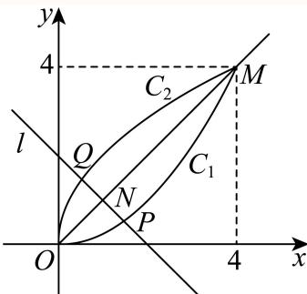
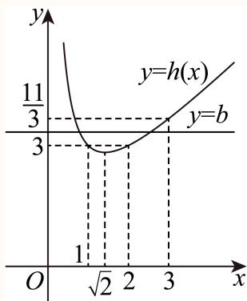
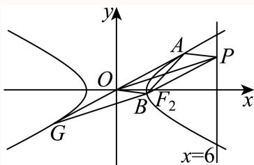

# 2025一模 普陀区原卷 · 教师版

> 本地预览：题目、答案及分类尚未全部审定。校对使用的PDF为高中工作台解析版，尚未逐区确认区级印刷原卷。

## 填空题

按本区原卷题号顺序排列。

### 普陀 · 第1题

设全集U = {−1, 0, 1, 2, 4}，若集合A = {−1, 2, 4}，则A = .

**考点：** 有限集合的补集运算

**难度依据：** 由全集直接取补集

**核查说明：** 题干与解析已用于人工归类，尚未完成整题公式校净与独立数学终审。

【答案】{0, 1}.

【解析】

根据补集的定义求解即可.

因为 $U = \{ - 1 , 0 , 1 , 2 , 4 \}$ ，集合A = {−1, 2, 4}，

所以 ${ \overline { { A } } } = \{ 0 , 1 \}$

故答案为：{0, 1}.

### 普陀 · 第2题

已知某抛物线的准线方程为y＝1，则该抛物线的标准方程为

**考点：** 准线方程反求抛物线标准式

**难度依据：** 先判断开口方向再确定参数

**核查说明：** 题干与解析已用于人工归类，尚未完成整题公式校净与独立数学终审。

【答案】$x ^ { 2 } = - 4 y$

【解析】

设出抛物线的标准方程后，根据准线方程可解得结果.依题意可设抛物线的标准方程为：

$$
x ^ {2} = - 2 p y (p > 0),
$$

由 ${ \frac { p } { 2 } } = 1$ ，解得p = 2，

所以该抛物线的标准方程为： $x ^ { 2 } = - 4 y$

故答案为： $x ^ { 2 } = - 4 y$

本题考查了根据准线方程求抛物线的标准方程，属于基础题.

### 普陀 · 第3题

设i为虚数单位，若复数z满足 $z \cdot { \overline { { z } } } + z - { \overline { { z } } } = 4 + 2 \mathrm { i }$ ，则|z| = .

**考点：** 复数相等与共轭乘积求模

**难度依据：** 取实部即可识别模平方

**核查说明：** 题干与解析已用于人工归类，尚未完成整题公式校净与独立数学终审。

【答案】2.

【解析】

设复数 $z = a + b \mathrm { i } , \ a , b \in \mathrm { R }$ ,计算出 $z \cdot { \overline { { z } } } + z - { \overline { { z } } } = a ^ { 2 } + b ^ { 2 } + 2 b \mathrm { i }$ ，利用复数相等求出a、b，即得|z|.

设复数 $z = a + b \mathrm { i } , \ a , b \in \mathrm { R }$ ,则–z = a − bi，

所以z ⋅ –z + z − –z = (a + bi) (a − bi) + a + bi − (a − bi) = a2 + b2 + 2bi，

因为 $| z \cdot { \overline { { z } } } + z - { \overline { { z } } } = 4 + 2 \mathrm { i } , $

所以 $a ^ { 2 } + b ^ { 2 } + 2 b \mathrm { i } = 4 + 2 \mathrm { i }$

则 $\left\{ { a ^ { 2 } + b ^ { 2 } = 4 \atop 2 b = 2 } \right.$ ，解得 $\left\{ \begin{array} { l l } { a = \pm { \sqrt { 3 } } } \\ { b = 1 } \end{array} \right.$

所以 $| z | = { \sqrt { \left( \pm { \sqrt { 3 } } \right) ^ { 2 } + 1 ^ { 2 } } } = 2$

故答案为：2.

### 普陀 · 第4题

若 $\left( x + x ^ { 2 } \right) ^ { 5 } = a _ { 0 } x ^ { 5 } + a _ { 1 } x ^ { 6 } + a _ { 2 } x ^ { 7 } + a _ { 3 } x ^ { 8 } + a _ { 4 } x ^ { 9 } + a _ { 5 } x ^ { 1 0 }$ ，则 $\stackrel { \cdot } { a } _ { 3 }$ 的值为

**考点：** 提公因式后二项式系数定位

**难度依据：** 转化为一加x的五次展开

**核查说明：** 题干与解析已用于人工归类，尚未完成整题公式校净与独立数学终审。

【答案】10.

【解析】

化简结合二项式定理求 $x ^ { 8 }$ 项的系数.

因为 $\left( x + x ^ { 2 } \right) ^ { 5 } = a _ { 0 } x ^ { 5 } + a _ { 1 } x ^ { 6 } + a _ { 2 } x ^ { 7 } + a _ { 3 } x ^ { 8 } + a _ { 4 } x ^ { 9 } + a _ { 5 } x ^ { 1 0 } ,$

所以 $\begin{array} { r } { x ^ { 5 } ( 1 + x ) ^ { 5 } = a _ { 0 } x ^ { 5 } + a _ { 1 } x ^ { 6 } + a _ { 2 } x ^ { 7 } + a _ { 3 } x ^ { 8 } + a _ { 4 } x ^ { 9 } + a _ { 5 } x ^ { 1 0 } } \end{array}$

所以 $x ^ { 5 } ( 1 + x ) ^ { \sharp }$ 5的展开式的第 $r + 1$ 项的表达式 $T _ { r + 1 } = x ^ { 5 } \mathrm { C } _ { 5 } ^ { r } x ^ { r } , ~ r = 0 , 1 , 2 , 3 , 4 , 5$

所以 $a _ { 3 } = \mathrm { C } _ { 5 } ^ { 3 } = 1 0$

故答案为：10.

### 普陀 · 第5题

设 $n \geq 1 , \ m \geq 1 , \ m _ { \setminus } \ n \in \mathbf { N }$ ，等差数列 $\left\{ a _ { n } \right\}$ 的首项 $\overset { \cdot } { a _ { 1 } } = 0$ ，公差 $d \neq 0$ ，若 $a _ { m } = \sum _ { i = 1 } ^ { 1 1 } a _ { i }$ ，则m的值 为

**考点：** 等差数列通项和前n项和关系

**难度依据：** 用首项为零消去公差

**核查说明：** 题干与解析已用于人工归类，尚未完成整题公式校净与独立数学终审。

【答案】56.

【解析】

由等差数列通项公式及求和公式列出等式即可求解.

由 $a _ { m } = \sum _ { i = 1 } ^ { 1 1 } a _ { i } , a _ { 1 } = 0 ,$

可得 $( m - 1 ) d = \frac { 1 1 \times 1 0 } { 2 } \times d ,$ ，又 $d \neq 0$

解得： $m = 5 6 .$

故答案为：56.

### 普陀 · 第6题

设△ABC的内角A，B，C的对边分别为a， $b , \ c ,$ 若b = 4， $\sin \left( A + { \frac { \pi } { 3 } } \right) = 0$ $\triangle A B C$ 的面积为 $\sqrt { 3 }$ ，则a的值为

**考点：** 三角内角范围求角及面积余弦定理

**难度依据：** 由正弦零值筛角再由面积求边

**核查说明：** 题干与解析已用于人工归类，尚未完成整题公式校净与独立数学终审。

【答案】$\sqrt { 2 1 }$

【解析】

由已知得A的大小，再根据 $\triangle A B C$ 的面积公式得c的值，从而由余弦定理可得a的值.

$$
\because A \in (0, \pi), \therefore A + \frac {\pi}{3} \in \left(\frac {\pi}{3}, \frac {4 \pi}{3}\right),
$$

又 $\sin \left( A + { \frac { \pi } { 3 } } \right) = 0 .$ ，所以 $A + { \frac { \pi } { 3 } } = \pi$ ，故 $A = \frac { 2 \pi } { 3 }$ ，则 $\triangle A B C$ 的面积 $S _ { \triangle A B C } = \frac { 1 } { 2 } b c \sin A = \frac { 1 } { 2 } \times 4 \times c \sin \frac { 2 \pi } { 3 } = \sqrt { 3 }$ ，所 $\triangleright c = 1$ 由余弦定理得 $a ^ { 2 } = b ^ { 2 } + c ^ { 2 } - 2 b c \cos A = 1 6 + 1 - 2 \times 4 \times 1 \times \left( - { \frac { 1 } { 2 } } \right) = 2 1 ,$ 故 $a = \sqrt { 2 1 }$

故答案为： $\sqrt { 2 1 }$

### 普陀 · 第7题

设椭圆 $C \colon { \frac { x ^ { 2 } } { a ^ { 2 } } } + { \frac { y ^ { 2 } } { b ^ { 2 } } } = 1 ( a > b > 0 )$ 的左、右焦点分别为 $F _ { 1 } , \ F _ { 2 } ,$ ，左顶点为A，若椭圆C的离心率为 $\frac 1 3$ ，则 $\frac { | F _ { 2 } A | } { | A F _ { 1 } | }$ 的值为

**考点：** 椭圆顶点焦点距离比与离心率

**难度依据：** 把线段长度写成a加减c

**核查说明：** 题干与解析已用于人工归类，尚未完成整题公式校净与独立数学终审。

【答案】2.

【解析】

根据题意写出焦点与左顶点的坐标，表示出线段长，利用离心率写出等量关系，可得答案.

由题意可得 $F _ { 1 } \left( - c , 0 \right) , F _ { 2 } \left( c , 0 \right) , A \left( - a , 0 \right)$ ，则 $F _ { 2 } A \vert = a + c , \vert A F _ { 1 } \vert = a - c$

由椭圆离心率为 $\frac { 1 } { 3 }$ ，可得 ${ \frac { c } { a } } = { \frac { 1 } { 3 } }$ ，则 $a = 3 c ,$

所以 ${ \frac { | F _ { 2 } A | } { | A F _ { 1 } | } } = { \frac { a + c } { a - c } } = { \frac { 3 c + c } { 3 c - c } } = 2 .$

故答案为：2.

### 普陀 · 第8题

若圆锥PO的体积为 $\frac { 2 { \sqrt { 2 } } \pi } { 3 }$ ，它的母线与底面所成的角的余弦值为 $\frac 1 3$ ，则圆锥PO的表面积为

**考点：** 圆锥线面角体积与表面积；直角三角形中的余弦边比

**难度依据：** 先由夹角确定母线半径比例再用体积定尺度

**核查说明：** 题干与解析已用于人工归类，尚未完成整题公式校净与独立数学终审。

【解析】

由题意作图，根据线面角的定义，可得圆锥的母线与底面半径的等量关系，利用扇形面积公式以及圆的面积公式，可得答案.

由题意可作图如下：

在圆锥PO中，易知 $P O \bot A B$ ，且 $\angle P B O$ 为母线与底面所成的角，

由母线与底面所成的角的余弦值为 $\frac 1 3$ ，则 $\cos \angle P B O = \frac { 1 } { 3 }$

在 $\mathrm { R t } \triangle P O B \sharp$ ， ${ \frac { O B } { P B } } = { \frac { 1 } { 3 } }$ ，可得 $P B = 3 O B$ ，则 $P O = 2 \sqrt { 2 } O B$

圆锥PO的体积V = $\frac { 1 } { 3 } \cdot P O \cdot O B ^ { 2 } \pi = \frac { 2 \sqrt { 2 } } { 3 } O B ^ { 3 } \pi = \frac { 2 \sqrt { 2 } \pi } { 3 }$ ，解得 $O B = 1$ ，则 $P B = 3$ 圆O的周长为 $\textstyle | C = 2 \pi \cdot O B = 2 \pi$ ，则圆锥侧面展开图的面积 $\displaystyle { \left\{ S _ { 1 } = \frac { 1 } { 2 } \cdot P B \cdot C = 3 \pi \right. }$ 圆锥底面面积 $\begin{array} { r } { | S _ { 2 } = \pi \cdot O B ^ { 2 } = \pi } \end{array}$ 所以圆锥的表面积 $\begin{array} { r } { \mathbb { S } = S _ { 1 } + S _ { 2 } = 4 \pi . } \end{array}$ 故答案为：4π.

### 普陀 · 第9题

设λ ∈ R，在如图所示的平行六面体 $A B C D - A _ { 1 } B _ { 1 } C _ { 1 } D _ { 1 }$ 1中， $\angle A _ { 1 } A B = \angle A _ { 1 } A D = \angle B A D = { \frac { \pi } { 3 } } .$ $A A _ { 1 } = 2 , A B = A D = 1$ ，点M是棱 $C _ { 1 } D _ { 1 }$ 的中点， $\xrightarrow { \xrightarrow { } } { \lambda _ { 1 } N } = \overline { { \lambda A _ { 1 } D _ { 1 } } }$ ，若 $\stackrel { \longrightarrow } { A M } . \stackrel { \longrightarrow } { C N } = 2$ ，则λ的值为

> 本题资料或解析有待核事项，预览不可作为已审定成品。

**考点：** 非正交空间基底的数量积展开；平行六面体中点与棱上点的向量表示

**难度依据：** 基底不正交需逐项计入夹角

**核查说明：** 仅修复所列OCR公式及其定界符错位；原解数学疑点和其他可渲染错识未因此消除。；题干与解析已用于人工归类，尚未完成整题公式校净与独立数学终审。；题干点N的向量等式严重错识，原解指向A1N=λA1D1，须视觉回核后修复。

【答案】$\frac 1 3$

【解析】

以 $\overrightarrow { A B } , \overrightarrow { A D } , \overrightarrow { A A _ { 1 } }$ 为基底表示 $\overrightarrow{AM},\overrightarrow{CN}$ ，结合题意运用数量积及向量数乘运算即可求解

$$
\overrightarrow {A _ {1} N} = \lambda \overrightarrow {A _ {1} D _ {1}} = \lambda \overrightarrow {A D},
$$

$$
\overrightarrow {A M} = \overrightarrow {A D _ {1}} + \overrightarrow {D _ {1} M} = \overrightarrow {A D} + \overrightarrow {A A _ {1}} + \frac {1}{2} \overrightarrow {A B},
$$

$$
\overrightarrow {C N} = \overrightarrow {A N} - \overrightarrow {A C} = \overrightarrow {A A _ {1}} + \overrightarrow {A _ {1} N} - \overrightarrow {A B} - \overrightarrow {A D}
$$

$$
= \overrightarrow {A A _ {1}} + \overrightarrow {\lambda A _ {1} D _ {1}} - \overrightarrow {A B} - \overrightarrow {A D} = \overrightarrow {A A _ {1}} + (\lambda - 1) \overrightarrow {A D} - \overrightarrow {A B},
$$

$$
\overrightarrow {A M} \cdot \overrightarrow {C N} = \left(\overrightarrow {A D} + \overrightarrow {A A _ {1}} + \frac {1}{2} \overrightarrow {A B}\right) \cdot \left(\overrightarrow {A A _ {1}} + (\lambda - 1) \overrightarrow {A D} - \overrightarrow {A B}\right) = 2,
$$

$$
\overrightarrow {A D} \cdot \overrightarrow {A A _ {1}} + (\lambda - 1) \overrightarrow {A D} ^ {2} - \overrightarrow {A D} \cdot \overrightarrow {A B} + \overrightarrow {A A _ {1}} ^ {2} + (\lambda - 1) \overrightarrow {A D} \cdot \overrightarrow {A A _ {1}} - \overrightarrow {A A _ {1}} \cdot \overrightarrow {A B} + \frac {1}{2} \overrightarrow {A B} \cdot \overrightarrow {A A _ {1}} +
$$

$$
\frac {1}{2} \overrightarrow {A B} \cdot (\lambda - 1) \overrightarrow {A D} - \frac {1}{2} \overrightarrow {A B} ^ {2} = 2
$$

由 $\stackrel { \triangledown } { | \angle A _ { 1 } A B = \angle A _ { 1 } A D = \angle B A D = \frac { \pi } { 3 } , } ~ A A _ { 1 } = 2 , ~ A B = A D = 1 ,$

$$
\begin{array}{l} 1 \times 2 \times \frac {1}{2} + (\lambda - 1) - 1 \times 1 \times \frac {1}{2} + 4 + (\lambda - 1) \times 1 \times 2 \times \frac {1}{2} - 2 \times 1 \times \frac {1}{2} + \frac {1}{2} \times 1 \times 2 \times \frac {1}{2} + \\ \frac {1}{2} (\lambda - 1) \times 1 \times 1 \times \frac {1}{2} - \frac {1}{2} \times 1 = 2 \end{array}
$$

${ \frac { 9 } { 4 } } ( \lambda - 1 ) + { \frac { 7 } { 2 } } = 2$ ，解得 $\lambda = \frac { 1 } { 3 }$

故答案为： $\frac 1 3$

### 普陀 · 第10题

设平面上四点P、Q、M、N满足： $| P M | = | P N | = 4 , | P Q | = 2$ ，若 $\stackrel { \longrightarrow } { Q M } \cdot \stackrel { \longrightarrow } { Q N } = 0$ ，则 $\vert M N \vert$ |的最小值为

> 本题资料或解析有待核事项，预览不可作为已审定成品。

**考点：** 数量积零转直角圆周关系；双圆约束中的弦长最值

**难度依据：** 将垂直条件转圆再用距离约束确定最短弦

**核查说明：** 题干与解析已用于人工归类，尚未完成整题公式校净与独立数学终审。；原解将r²=8−2√7舍去却随后取其为最小值，又出现r>4的不可能分支；结论不能替代证明，须重核。

【解析】

首先分析向量关系，建立平面直角坐标系，设点的坐标，根据已知条件得到 $m = { \frac { 6 } { r \sin \theta } } .$ ，消去m得到 $\sin ^ { 2 } \theta = { \frac { 3 6 } { - r ^ { 4 } + 1 6 r ^ { 2 } } }$ ，借助三角函数的值域得到r的取值范围，最后最后求(MN)的最小值即可.

已知 $\overrightarrow { 1 Q M } \cdot \overrightarrow { Q N } = 0 .$ ，则这两个向量垂直，所 $\xrightarrow [ {  { Q M } \perp  { Q N } } ] { \longrightarrow }$ .则Q再以MN为直径的圆上.

以原点O建立平面直角坐标系，设 $M ( r , 0 )$ ，N(−r, 0)，P(0, m)，Q(r cos θ, r sin θ).

由 $O P ^ { 2 } + O M ^ { 2 } = 1 6 $ ，可得 $r ^ { 2 } + m ^ { 2 } = 1 6$ ，对于r2 $\cos ^ { 2 } \theta + ( r \sin \theta - m ) ^ { 2 } = 4 { \mathrm { . } }$

$\backprime ^ { 2 } + m ^ { 2 } = 1$ 6解出 $\mathsf { \Pi } _ { 1 } m = \pm { \sqrt { 1 6 - r ^ { 2 } } }$ ，代入 $\displaystyle { \sqrt { r ^ { 2 } \cos ^ { 2 } \theta + ( r \sin \theta - m ) ^ { 2 } } = 4 \sharp }$ ，经过化简可以得$m = { \frac { 6 } { r \sin \theta } }$

将 $\mathbf { \dot { \sigma } } m = { \frac { 6 } { r \sin \theta } }$ 代入 $\setminus r ^ { 2 } + m ^ { 2 } = 1 6$ ，得到 $r ^ { 2 } + \frac { 3 6 } { r ^ { 2 } \sin ^ { 2 } \theta } = 1 6$ ，进一步变形为$\sin ^ { 2 } \theta = { \frac { 3 6 } { - r ^ { 4 } + 1 6 r ^ { 2 } } } .$

因为 $\sin ^ { 2 } \theta \in ( 0 , 1 ]$ ，所以 $\frac { 3 6 } { - r ^ { 4 } + 1 6 r ^ { 2 } } \in ( 0 , 1 ]$ .

当 ${ \frac { 3 6 } { - r ^ { 4 } + 1 6 r ^ { 2 } } } = 1$ 时，解方程 $\displaystyle - r ^ { 4 } + 1 6 r ^ { 2 } - 3 6 = 0$

$\widehat { \sf x } t = r ^ { 2 }$ ，则方程变为 $- t ^ { 2 } + 1 6 t - 3 6 = 0$ ，可得 $\lvert { \cdot } t = 8 \pm 2 \sqrt { 7 }$

因为 $\begin{array} { r } { { \boldsymbol { \mathsf { t } } } = r ^ { 2 } > 0 } \end{array}$ ，所以 $r ^ { 2 } = 8 + 2 \sqrt { 7 } ( r ^ { 2 } = 8 - 2 \sqrt { 7 }$ 舍去），则 $r = \sqrt { 7 } + 1$ ；

当 ${ \frac { 3 6 } { - r ^ { 4 } + 1 6 r ^ { 2 } } } =$ 0时， $- r ^ { 4 } + 1 6 r ^ { 2 }  + \infty , r ^ { 2 }  + \infty , r  + \infty$ 或者 $r \to 0$

又因为 $r > 0$ 且存在其他条件限制，所以 $r \in \left\lceil \sqrt { 7 } - 1 , \sqrt { 7 } + 1 \right\rceil \cup ( 4 , + \infty )$

因为 $M N = 2 r$ ，当r取最小值 $r _ { \mathrm { m i n } } = \sqrt { 7 } - 1$ 时， $( M N ) _ { \mathrm { m i n } } = 2 \left( { \sqrt { 7 } } - 1 \right) = 2 { \sqrt { 7 } } - 2$

$$
2 \sqrt {7} - 2
$$

### 普陀 · 第11题

设t ∈ R，直线l: $x + y - t = 0 \div$ 与曲线 $C _ { 1 } { : } y = { \frac { 1 } { 4 } } x ^ { 2 } \left( 0 \leq x \leq 4 \right)$ )和曲线 $C _ { 2 } { : } y = 2 x ^ { \frac { 1 } { 2 } }$ 分别交于P、Q两 点，则|PQ|的最大值是

> 本题资料或解析有待核事项，预览不可作为已审定成品。

**考点：** 反函数图像对称与参数最值；垂直对称轴的截线长度

**难度依据：** 借互逆曲线对称性降为点到对称轴的距离

**核查说明：** 题干与解析已用于人工归类，尚未完成整题公式校净与独立数学终审。；原解联立方程中常数和换元后的常数有错识，须重排并复算。

【答案】${ \sqrt { 2 } } .$

【解析】

根据题意可得曲线 $C _ { 1 } , C _ { 2 }$ 对应的函数关于直线 ${ \dot { \boldsymbol { \cdot } } } y = x .$ 对称，直线l关于直线 $\dot { \boldsymbol { { \mathfrak { z } } } } { \boldsymbol { y } } = { \boldsymbol { \mathfrak { x } } }$ 对称，从而可得 $P , Q$ 关于直线 ${ \dot { y } } = x$ 对称，利用直线与直线相交、曲线与直线相交得坐标，结合函数性质可得|PQ|的最值.

曲线 $C _ { 1 } : y = \frac { 1 } { 4 } x ^ { 2 } \left( 0 \leq x \leq 4 \right)$ )和曲线 $C _ { 2 } { : } y = 2 x ^ { \frac { 1 } { 2 } }$ 对应的函数互为反函数，则 $C _ { 1 } , C _ { 2 }$ 关于直线

y = x对称，

又 $\{ y = \frac { 1 } { 4 } x ^ { 2 }  \Rightarrow \{ x = 0 _ { \scriptscriptstyle \boxplus \atop y = 0 } \} \{ x = 4 \atop y = 4  ,$ 即两曲线交点坐标为 $O \left( 0 , 0 \right) , M \left( 4 , 4 \right)$

又直线l: $x + y - t = 0 .$ 与直线 $y = x$ 相互垂直，则直线l关于直线 $y = x \mathbb { M }$ 称，

所以 $P , Q$ 关于直线 $y = x$ 对称，设直线 $y = x ^ { \underline { { I } } }$ 与直线l相交与N，且 $P Q \bot O M \mp N$

$\left\{ x + y - t = 0 \atop y = x \right\} x = { \frac { t } { 2 } }$ ，则 $N \left( \frac { t } { 2 } , \frac { t } { 2 } \right)$ ，且 $\frac { t } { 2 } \in [ 0 , 4 ]$ ，所以 $t \in [ 0 , 8 ]$

联立 $\left\{ y = { \frac { 1 } { 4 } } x ^ { 2 } \right. \qquad \Rightarrow x ^ { 2 } + 4 x - t ^ { 2 } = 0 ,$ 解得 $x = { \frac { - 4 \pm { \sqrt { 1 6 + 1 6 t } } } { 2 } } = - 2 \pm 2 { \sqrt { 1 + t } } ,$

因为 $0 \leq x _ { P } \leq 4 , $ ，所以 $x _ { P } = - 2 + 2 { \sqrt { 1 + t } } .$

则|PQ| = 2 |PN| = 2√2 |xP − xN | = 2√2 2√1 + t − 2 − t = √2 4√1 + t − t − 4 ，

令 $\cdot m = { \sqrt { 1 + t } } , 0 \leq t \leq 8$ ，则1 $. \leq m \leq 3$ ，则 $t = m ^ { 2 } - 1$ ，

所以 $\left| 4 { \sqrt { 1 + t } } - t \right| = \left| 4 m - m ^ { 2 } + 1 \right| = \left| - ( m - 2 ) ^ { 2 } + 1 \right|$

因为 $1 \leq m \leq 3$ ，所 $\mathscr { L } \lambda - ( m - 2 ) ^ { 2 } + 1 \in [ 0 , 1 ]$ ，所以 $\big | - ( m - 2 ) ^ { 2 } + 1 \big | _ { \operatorname* { m a x } } = 1$

故 $P Q$ |的最大值为 ${ \sqrt { 2 } } .$ .

故答案为： ${ \sqrt { 2 } } .$

### 普陀 · 第12题

设 $a > b > 0$ ，函数 $\boldsymbol { \mathfrak { y } } = \boldsymbol { \mathfrak { f } } \left( \boldsymbol { \mathfrak { x } } \right)$ 的表达式为 $f \left( x \right) = \ \left| x - { \frac { 1 } { x } } + \ln x \right|$ ，若 $f \left( a \right) = f \left( b \right)$ ，且关于x的方程$\left| x ^ { 2 } + a x + 2 a b \right| + \left| x ^ { 2 } - a x + 2 a b \right| = 2 a \left| x \right|$ 的整数解有且仅有4个，则a的取值范围是

> 本题资料或解析有待核事项，预览不可作为已审定成品。

**考点：** 单调函数倒数反对称关系；绝对值三角不等式等号与整数解；函数约束联动整数解计数

**难度依据：** 先推出ab为一再将四个整数根转为两个正整数解

**核查说明：** 仅修复所列OCR公式及其定界符错位；原解数学疑点和其他可渲染错识未因此消除。；题干与解析已用于人工归类，尚未完成整题公式校净与独立数学终审。

【答案】$\left[ 3 , { \frac { 1 1 } { 3 } } \right)$

【解析】

令 $\mathbf { \dot { \sigma } } _ { g } ( x ) = x - { \frac { 1 } { x } } + \ln x .$ ，利用导数分析函数 ${ \bf \dot { \boldsymbol { g } } } \left( \boldsymbol { x } \right)$ 的单调性，作出函数f(x)的图象，结合已知条 件 分 析 得 出 $a b = 1$ ， 由 绝 对 值 三 角 不 等 式 分 析 得 出 $\left( x ^ { 2 } + 2 \right) ^ { 2 } - a ^ { 2 } x ^ { 2 } \le 0$ 令$p \left( x \right) = \left( x ^ { 2 } + 2 \right) ^ { 2 } - a ^ { 2 } x ^ { 2 }$ ，分析其奇偶性，可知，当 $x > 0 \mathbb { H } { \mathrm { , } } { \mathrm { ] } }$ ，满足不等 ${ \vec { x } } \mathbf { ( } a \geq x + { \frac { 2 } { x } }$ 的整数解有且只有2个，令 $h \left( x \right) = x + \frac { 2 } { x } ( x > 0 )$ ，数形结合可得出实数a的取值范围.

令 $\mathbf { \dot { \sigma } } _ { g } \left( x \right) = x - { \frac { 1 } { x } } + \ln x .$ ，其中 ${ \boldsymbol { \mathscr { x } } } > 0$ ，则 $g ^ { \prime } \left( x \right) = 1 + \frac { 1 } { x ^ { 2 } } + \frac { 1 } { x } >$ 0恒成立，

所以函数 $y \left( x \right) \# ( 0 , + \infty )$ 上单调递增，且 $g \left( 1 \right) = 0$

作出函数f(x)的图象如下图所示：

由a $> b >$ 0结合图可知， $0 < b < 1 < a _ { : }$ ，由 $f \left( a \right) = f \left( b \right)$ ，可得 $- g \left( b \right) = g \left( a \right)$

对任意的 $\left| x \in \left( 0 , + \infty \right) , g \left( { \frac { 1 } { x } } \right) = { \frac { 1 } { x } } - x + \ln { \frac { 1 } { x } } = { \frac { 1 } { x } } - x - \ln x = - g \left( x \right) \right|$

所以 $g \left( b \right) = - g \left( a \right) = g \left( \frac { 1 } { a } \right)$ ，故 $b = { \frac { 1 } { a } }$ ，即 $a b = 1$

由绝对值三角不等式可得

$$
\left| x ^ {2} + a x + 2 a b \right| + \left| x ^ {2} - a x + 2 a b \right| \geq \left| (x ^ {2} + a x + 2 a b) - (x ^ {2} - a x + 2 a b) \right| = 2 a | x |,
$$

当且仅当 $\left( x ^ { 2 } + a x + 2 a b \right) \left( x ^ { 2 } - a x + 2 a b \right) \leq 0 \sharp$ ，等号成 $\begin{array} { r } { \underline { { \dot { \Pi } } } . } \end{array}$ ，

即 $\left( x ^ { 2 } + a x + 2 \right) \left( x ^ { 2 } - a x + 2 \right) \leq 0$ ，即 $\left( x ^ { 2 } + 2 \right) ^ { 2 } - a ^ { 2 } x ^ { 2 } \leq 0 .$ ，

$\gamma p \left( x \right) = \left( x ^ { 2 } + 2 \right) ^ { 2 } - a ^ { 2 } x ^ { 2 }$ ，其 $\boldsymbol { \mathrm { \sf { F } } } \boldsymbol { x } \in \mathbf { R }$ ，则 $p \left( 0 \right) = 4 > 0$

则 $x = 0$ 不满足 $\left( x ^ { 2 } + 2 \right) ^ { 2 } - a ^ { 2 } x ^ { 2 } \leq 0 \quad$

则 $| p ( - x ) = [ ( - x ) ^ { 2 } + 2 ] ^ { 2 } - a ^ { 2 } \cdot ( - x ) ^ { 2 } = ( x ^ { 2 } + 2 ) ^ { 2 } - a ^ { 2 } x ^ { 2 } = p ( x ) ,$

所以函数p(x)为偶函数，

所以当 $x > 0$ 时，由 $(x^2+2)^2-a^2x^2\leq0$可得 $x ^ { 2 } + 2 \leq a x$ ，可得 $\cdot a \geq x + { \frac { 2 } { x } }$

$h \left( x \right) = x + \frac { 2 } { x }$ ，其中 $x > 0$ 则函数h(x)在 $\left( 0 , { \sqrt { 2 } } \right)$ 上单调递减，在 $\left( { \sqrt { 2 } } , + \infty \right)$ 上单调递

因为 $h \left( 1 \right) = 3 , h \left( 2 \right) = 3 , h \left( 3 \right) = 3 + \frac { 2 } { 3 } = \frac { 1 1 } { 3 } .$ ，则 $h \left( 1 \right) = h \left( 2 \right) < h \left( 3 \right)$

由题意可知，当 $x > 0 \sharp { \mathfrak { f } }$ ，满足不等 $a\geq x+\frac2x$ 的整数解有且只有2个，如下图所示：

所以 $h \left( 1 \right) \leq a < h \left( 3 \right)$ ，即3 ≤ $a < \frac { 1 1 } { 3 }$

综上所述，实数 的取值范围是 $\left[ 3 , { \frac { 1 1 } { 3 } } \right)$ .

故答案为： $\left[ 3 , { \frac { 1 1 } { 3 } } \right)$

关键点点睛：解本题的关键在于分析函数 $\overset { \cdot } { \boldsymbol { g } } \left( \boldsymbol { x } \right) = \boldsymbol { x } - \frac { 1 } { \boldsymbol { x } } + \ln \boldsymbol { x }$ 的单调性以及 $g \left( { \frac { 1 } { x } } \right) = - g \left( x \right)$ 得出 $a b = 1$ ，然后再求解不等式整数解的个数时，利用图象能够清晰地将不等关系利用图形的形式呈现得更为具体、直观.

## 二、选择题

## 选择题

按本区原卷题号顺序排列。

### 普陀 · 第13题

设 $\alpha\in\mathbb{R}$，则“$\cos 2\alpha=\frac{1}{3}$”是“$\sin\alpha=\frac{\sqrt{3}}{3}$”的（　）

A. 充分非必要条件

B. 必要非充分条件

C. 充要条件

D. 既非充分又非必要条件

> 本题资料或解析有待核事项，预览不可作为已审定成品。

**考点：** 二倍角命题的充分必要条件；二倍角公式与符号分支

**难度依据：** 平方关系不能确定正弦符号

**核查说明：** 题干与解析已用于人工归类，尚未完成整题公式校净与独立数学终审。；题干α范围大段乱码；同名PDF第9页文字层已确认“设α∈R”，本分类不改源稿。

【答案】B

【解析】

根据余弦二倍角公式由 $\mathrm { I c o s 2 } \alpha = \frac { 1 } { 3 }$ 可得sinα的值，结合充分必要条件判断即可因为 $\cos 2 \alpha = \frac { 1 } { 3 }$ ，则 $\cos 2 \alpha = 1 - 2 \sin ^ { 2 } \alpha = { \frac { 1 } { 3 } }$ ，所 $B / \sin \alpha = { \frac { \sqrt { 3 } } { 3 } }$ 或 $\sin \alpha = - { \frac { \sqrt { 3 } } { 3 } }$ 则 $| { ^ { \circ } \cos 2 \alpha = \frac { 1 } { 3 } , \frac { \sqrt { 3 } } { \sqrt { \pm } } { ^ \circ \sin \alpha } = \frac { \sqrt { 3 } } { 3 } }$ ”的必要非充分条件.故选：B.

### 普陀 · 第14题

某机构对2014年至2023年的中国新能源汽车的年销售量进行了统计，结果如图所示（单位：万辆），则下列结论中正确的是（ ）

原图所列中国新能源汽车年销售量数据如下（单位：万辆；按原图年份顺序列示）：

| 年份 | 年销售量 |
|---|---|
| 2014 | 7.5 |
| 2015 | 33.1 |
| 2016 | 50.7 |
| 2017 | 77.7 |
| 2018 | 125.6 |
| 2019 | 120.6 |
| 2020 | 136.6 |
| 2021 | 352.1 |
| 2022 | 688.7 |
| 2023 | 728 |

A. 这十年中国新能源汽车年销售量的中位数为123

B. 这十年中国新能源汽车年销售量的极差为721

C. 这十年中国新能源汽车年销售量的第70百分位数为136.6

D. 这十年中的前五年的年销售量的方差小于后五年的年销售量的方差

> 本题资料或解析有待核事项，预览不可作为已审定成品。

**考点：** 统计图读数与中位数百分位数方差

**难度依据：** 逐个核对统计量并比较数据波动

**核查说明：** 题干与解析已用于人工归类，尚未完成整题公式校净与独立数学终审。；题干统计图在MD未保留图片引用；已定位同名PDF第9页，须提取原统计图后才能发布。

【答案】D

【解析】

由图表提取数据并按照由小到大排列，根据中位线、极差与百分位数定义，结合方差的性质，可得答案.

由图可得数据为：7.5, 33.1, 50.7, 77.7, 120.6, 125.6, 136.6, 352.1, 688.7, 728，

对于A，这十年中国新能源汽车年销售量的中位数为 ${ \frac { 1 2 5 . 6 + 1 2 0 . 6 } { 2 } } = 1 2 3 . 1$ ，故A错误；

对于B，这十年中国新能源汽车年销售量的极差为728−7.5 = 720.5，故B错误；对于C，由 ${ \frac { 7 0 } { 1 0 0 } } \times 1 0 = 7$ 则这十年中国新能源汽车年销售量的第70百分位数为$\frac { 1 3 6 . 6 + 3 5 2 . 1 } { 2 } = 2 4 4 . 3 5$ ，故C错误；对于D，由图表易知前五年的数据比后五年的数据稳定，则前五年的方差小于后五年的方差，故D正确.

故选：D.

### 普陀 · 第15题

设a > 0且 $a \neq 1$ ，k、m、n都是正整数，数列 $\left\{ a _ { n } \right\}$ 的通项公式为 $\mathfrak { l } a _ { n } = \left\{ \begin{array} { l l } { ( a - 6 ) n + 2 1 , ( 1 \leq n \leq m ) } \\ { a ^ { n - 3 } , ( n > m ) } \end{array} \right.$ ，记数列 $\left\{ a _ { n } \right\}$ 中前k项的最小值为 $ { \lvert h _ { k } }$ ，由所有 $h _ { k }$ 的值所组成的集合记为A，若集合A中仅有四个元素，则下列说法中错误的是（ ）

A. 当m = 3时，a的取值范围是(1,6)

B. 不存在a和m的值，使得 $. a _ { 4 } \notin A$

C. 当m = 4时，a的取值范围是(3, 6)

D. 存在a和m的值，使得 $\cdot a _ { 5 } \notin A$

> 本题资料或解析有待核事项，预览不可作为已审定成品。

**考点：** 分段数列前缀最小值的不同取值；分段线性指数函数的单调性；前缀最小值集合的元素计数

**难度依据：** 按底数及分段位置追踪最小值更新次数

**核查说明：** 题干与解析已用于人工归类，尚未完成整题公式校净与独立数学终审。；原解多处把通项讨论称为递推，部分分支解释跳步，需逐项核验前缀最小值集合。

【答案】C

【解析】

根据a不同的取值范围分析分段函数的性质，结合函数单调性，反证法，进而判断关于集合元素个数等命题的正确性，逐个判断真假即可.

对于A选项,当 $m = 3$ 时，对 ${ \vec { \mathbf { \tau } } } a \in ( 0 , 1 )$ )，根据分段函数的性质，会得到 $\displaystyle a _ { 1 } > a _ { 2 } > a _ { 3 } > . . . > a _ { n }$

由 $\mathbb { F } a \mathbb { E } ( 0 , 1 )$ )这个区间内，这样的递推会一直进行下去，所以集合A有无数个元素.

$\exists a \in ( 1 , 6 )$ 时，要满足 $a _ { 1 } > a _ { 2 } > a _ { 3 } > a _ { 4 }$ ，通过对分段函数的计算和分析，正好解得 $a \in ( 1 , 6 )$ 9

此时 $A = \{ a _ { 1 } , a _ { 2 } , a _ { 3 } , a _ { 4 } \}$ .并且当 $a \in [ 6 , + \infty )$ ，两个分段函数都是增函数，A中最多只存在两个元素.所以A选项正确.

对于B选项，当 $a \in ( 0 , 1 )$ 时，有 $a _ { 1 } > a _ { 2 } > a _ { 3 }$ 且 $a _ { 4 } > a _ { 5 } > a _ { 6 } > . . . > a _ { n }  0$

要想A有4个元素，根据函数的递推关系，如果 ${ \mathrm { : } } a _ { 3 } > 0$ ，那么根据函数性质会继续产生更多的元素，

所以必有 $\dot { \mathbf { \alpha } } a _ { 3 } \leq 0$ ，不然会有无数个元素.但是当a ≤ 0时，A中元素个数就不是4个了，

这就产生了矛盾，所以原命题正确，即B选项正确.

对于C选项，当 $a \in ( 0 , 1 )$ 时， $a _ { 1 } > a _ { 2 } > a _ { 3 } > a _ { 4 }$ ，令 $\cdot a _ { 4 } \leq 0$ ，通过对分段函数的计算解得$a \leq \frac { 3 } { 4 }$

由于 $a _ { 5 } > a _ { 6 } > . . . > a _ { n }  0$ ，此时 $A = \{ a _ { 1 } , a _ { 2 } , a _ { 3 } , a _ { 4 } \}$ ，这与选项中说的情况不符，所以C选项错误.

对于D选项，从前面的分析经验来看，要想 $a _ { 5 } \in A$ ，根据分段函数的性质，只能令 $\cdot m = 4$ $a _ { 5 } = a _ { 4 }$

由此得到方程 $4 ( a - 6 ) + 2 1 = a ^ { 2 }$ ，整理得 $\mathbf { \partial } : a ^ { 2 } - 4 a + 3 = 0$ ，解得 $\ Q = 1 \not \equiv \not \{ a = 3$

故选：C.

因为 $\lceil a \neq 1$ （根据前面的取值范围等条件），所以a = 3，D选项正确.

### 普陀 · 第16题

在平面直角坐标系中，将函数 $y=f(x)$ 的图象绕坐标原点 $O$ 逆时针旋转 $\frac{\pi}{4}$ 后，所得曲线仍然是某个函数的图象，则称函数 $y=f(x)$ 为“R函数”。对于命题：

①设 $m\in\mathbf R$，若函数 $g(x)=(m-1)x+\frac1x$ 为“R函数”，则 $m>1$；

②设 $k\in\mathbf R$，若函数 $h(x)=\frac{k(x+1)}{\mathrm e^x}$ 为“R函数”，则满足条件的 $k$ 的整数值至少有4个。

则下列结论中正确的是（　）。

A. ①为真②为真

B. ①为真②为假

C. ①为假②为真

D. ①为假②为假

> 本题资料或解析有待核事项，预览不可作为已审定成品。

**考点：** 旋转后仍为函数的图像判定；斜截线交点唯一性与导数参数范围

**难度依据：** 旋转定义转一一性再分别分析两种函数

**核查说明：** 仅修复所列OCR公式及其定界符错位；原解数学疑点和其他可渲染错识未因此消除。；仅核本题所列字段及页面；不等于全卷终审。；题干与解析已用于人工归类，尚未完成整题公式校净与独立数学终审。

【答案】B

【解析（回源校订）】

点 $(x,f(x))$ 绕原点逆时针旋转 $\frac\pi4$ 后，其横坐标为 $\frac{x-f(x)}{\sqrt2}$。旋转后的曲线仍为函数图像，等价于不同的 $x$ 对应不同的 $x-f(x)$，也就是函数 $f(x)-x$ 在原定义域上为一一对应。

①令 $G(x)=g(x)-x=(m-2)x+\frac1x$，$x\ne0$。

当 $m=2$ 时，$G(x)=\frac1x$ 在 $\mathbf R\setminus\{0\}$ 上为一一对应，满足条件。

当 $m>2$ 时，令 $c=m-2>0$。对任意 $t>2\sqrt c$，方程 $cx+\frac1x=t$ 等价于 $cx^2-tx+1=0$，有两个不同的正根，不满足一一对应。

当 $m<2$ 时，$c=m-2<0$。函数 $cx+\frac1x$ 在 $(-\infty,0)$ 和 $(0,+\infty)$ 上分别严格递减，且两个分支的值域均为 $\mathbf R$，因此任意水平直线均与两分支各交一次，也不满足条件。

所以 $g(x)$ 为“R函数”当且仅当 $m=2$。由 $m=2>1$，命题①正确。

②令 $H(x)=h(x)-x=\frac{k(x+1)}{\mathrm e^x}-x$，则

$$H'(x)=-kx\mathrm e^{-x}-1=-\frac{kx+\mathrm e^x}{\mathrm e^x}.$$

$H$ 在 $\mathbf R$ 上连续，一一对应等价于严格单调。又 $H'(0)=-1<0$，故若满足条件，则只能严格递减，从而必须对任意 $x\in\mathbf R$ 有 $kx+\mathrm e^x\ge0$。

当 $x>0$ 时，该条件为 $k\ge-\frac{\mathrm e^x}{x}$。令 $u(x)=\frac{\mathrm e^x}{x}$，有 $u'(x)=\frac{\mathrm e^x(x-1)}{x^2}$，故 $u$ 在 $(0,1)$ 上严格减，在 $(1,+\infty)$ 上严格增，最小值为 $u(1)=\mathrm e$。因此此部分条件等价于 $k\ge-\mathrm e$。

当 $x<0$ 时，该条件为 $k\le-\frac{\mathrm e^x}{x}$。右端恒正，且当 $x\to-\infty$ 时趋于0，所以此部分条件等价于 $k\le0$。当 $x=0$ 时原不等式恒成立。

因此必要条件为 $-\mathrm e\le k\le0$。

反过来，当 $-\mathrm e<k\le0$ 时，对任意 $x$ 均有 $H'(x)<0$；当 $k=-\mathrm e$ 时，$H'(x)\le0$，且只在 $x=1$ 处等于0，在该点两侧均严格为负，故 $H$ 仍在 $\mathbf R$ 上严格递减。区间内所有 $k$ 均满足条件。

综上，$h(x)$ 为“R函数”当且仅当 $k\in[-\mathrm e,0]$。符合条件的整数仅为 $-2,-1,0$，共3个，命题②错误。

故选B。

校订说明：原PDF中间两行的 $x-1$ 为笔误，已按题设统一为 $x+1$ 并独立复算；原导数、参数区间及答案B不变。原错行及原解析保留在回源补丁记录中，不作为当前解题步骤。

## 解答题

按本区原卷题号顺序排列。

### 普陀 · 第17题

图1所示的平行四边形ABCD中， $C A = C B = 1 , \ C D = { \sqrt { 2 } }$ 现将 $\triangle D A C$ 沿AC折起，得到如图2所示的三棱锥 $P - A B C$ ，记棱PC的中点为M，且. $. P B = { \sqrt { 3 } }$

图1

图2
(1) (6分)求证： $A M \bot B C$ ；
(2) (8分)记棱AB的中点为E，在直线CE上作出点N，使得 $P N / /$ 平面MAB，请说明理由，并求出二面角 $P - N B - A$ 的大小.

**考点：** （1）勾股与线面垂直传递；（2）构造矩形顶点给出点N并找二面角平面角

**难度依据：** （1）勾股与线面垂直传递；（2）构造矩形顶点给出点N并找二面角平面角

**核查说明：** 题干与解析已用于人工归类，尚未完成整题公式校净与独立数学终审。

【解析】

(1) 因为 $C A = C B = D A = 1$ $C D = A B = { \sqrt { 2 } }$

$$
C A ^ {2} + C B ^ {2} = A B ^ {2} = 2,
$$

所 $\angle A C B = 9 0 ^ { \circ }$ ，所以 $\angle D A C = 9 0 ^ { \circ }$ ，即 $D A \bot A C , B C \bot C A$

图2中， $P A = D A = 1 , A B = \sqrt { 2 } , P B = \sqrt { 3 } ,$

则 $P A ^ { 2 } + A B ^ { 2 } = P B ^ { 2 } = 3$ ,所以 $P A \bot A B .$ ，又 $P A \bot A C$

又 $A B , A C$ 为平面ABC内两条相交直线，

所以 $P A \bot$ 面 $A B C ,$ ，又BC在面 $A B C$

所以 $P A \bot B C$ 又 $B C \bot C A$

PA,CA为平面PAC内两条相交直线，

所以 $B C \bot$ 面 $P A C ,$ ，又AM在面PAC内，

所以 $A M \bot B C$

(2)

N(F)

以 $C A , C B$ 为临边，构造矩形 $A C B F$ ,连接 $C F ,$ ，易知过点 $E _ { : }$ ，

因为 $E , M$ 分别为 $\lceil C F , C P$ 的中点，

所以 $P F / / M E$ ，又ME在平面 $M A B ^ { \flat }$ 内，PF在平面 $M A B _ { , } ^ { \prime }$ 外，所以 $P F / /$ 平面 $M A B$ 4

即点F就是N点，

由（1）知 $P A \bot$ 面 $A C B N$ ，BN在面ACBN内，

所以 $B N \bot P A$ ，又 $B N \bot A N$

AN,PA是平面 $P A N$ 内两条相交直线，

所以 $B N \bot$ 面 $P A N$ ，PN在面 $P A N |$ 内，

所以 $P N \bot B N ,$ ，又 $A N \bot B N$

所以 $\angle P N A$ 为二面角 $P - N B - A$ 的平面角，

因为 $P A \bot A N , P A = A N .$

所以 $\angle P N A = 4 5 ^ { \circ }$ 。

所以二面角 $P - N B - A$ 的大小为 $4 5 ^ { \circ }$ .

### 普陀 · 第18题

设函数 $\cdot y = f \left( x \right)$ 的表达式为 $f \left( x \right) = \sin \left( \omega x \right)$ ，其中 $\omega > 0$
(1) (6分)设ω = 1， $m \in \mathbf { R }$ ，若有且只有一个 $\cdot x _ { 0 } \in ( 0 , m )$ ，使得函数 $y = f \left( x + { \frac { \pi } { 4 } } \right)$ 取得最小值，求m的取值范围；
(2) (8分)若对任意的 $| x \in \mathrm { R } .$ ，皆有 $f \left( x \right) + f \left( \frac { 2 \pi } { 3 } - x \right) = 0$ 恒成立，且函数 $y = f \left( x \right)$ 在区间 $\left( - { \frac { \pi } { 8 } } , 0 \right)$ 上是严格增函数，求函数 $y = f \left( x \right)$ 的最小正周期.

> 本题资料或解析有待核事项，预览不可作为已审定成品。

**考点：** （1）开区间仅一个极小点；（2）恒等关系给离散频率再用单调区间限界

**难度依据：** （1）开区间仅一个极小点；（2）恒等关系给离散频率再用单调区间限界

**核查说明：** 题干与解析已用于人工归类，尚未完成整题公式校净与独立数学终审。；第2问恒等式右端MD误成0.5并有乱码；同名PDF文字层明确为0，须回源改底稿再发布。

【解析】

(1) 当ω = 1时， $f \left( x \right) = \sin { x }$

则 $y = f \left( x + { \frac { \pi } { 4 } } \right) = \sin \left( x + { \frac { \pi } { 4 } } \right)$

当 $x \in ( 0 , m )$ 时， $x + \frac { \pi } { 4 } \in \left( \frac { \pi } { 4 } , m + \frac { \pi } { 4 } \right)$ ，

因为有且只有一个 $\cdot x _ { 0 } \in ( 0 , m )$ 使得函数 $y = f \left( x + { \frac { \pi } { 4 } } \right)$ 取得最小值，

所以 $\frac { 3 \pi } { 2 } < m + \frac { \pi } { 4 } \leq \frac { 7 \pi } { 2 }$ ，解得 $\frac { 5 \pi } { 4 } < m \leq \frac { 1 3 \pi } { 4 }$

所以m的取值范围是 $\left( { \frac { 5 \pi } { 4 } } , { \frac { 1 3 \pi } { 4 } } \right]$

(2) 因为对任意 $x \in \mathrm { R } , f \left( x \right) + f \left( { \frac { 2 \pi } { 3 } } - x \right) = 0$ 成立，

所以f(x)的图像关于点 $\left( { \frac { \pi } { 3 } } , 0 \right)$ 对称，

则 ${ \boldsymbol { \upsilon } } \times { \frac { \pi } { 3 } } = k \pi , k \in \mathrm { Z } ,$

解得 $\omega = 3 k , k \in { \mathrm { Z } }$ ，又因为 $\omega > 0$

所 $\mathcal { L } \omega = 3 k , k \in \mathbb { N } ^ { * }$

由 $- { \frac { \pi } { 8 } } < x < 0 , \omega > 0$ ，可得 $- \frac { \omega \pi } { 8 } < \omega x < 0 .$

因为函数 $f \left( x \right) = \sin \left( \omega x \right)$ 在区间 $\left( - \frac { \pi } { 8 } , 0 \right)$ 上是严格增函数，

$\widehat { \vec { \mathbf { \nabla } } } \widehat { \mathbf { \nabla } } t = \omega x \overline { { \vec { \mathbf { \nabla } } \vec { \mathbf { \nabla } } } }$ 得，函数 $y = \sin t / \mathbb { E } \left( - \frac { \Omega \pi } { 8 } , 0 \right)$ 上严格单调递增，

所以 $- \frac { \pi } { 2 } \leq - \frac { \omega \pi } { 8 }$ ，所以 $. 0 < \omega \leq 4$

所以 $k = 1 , ~ \omega = 3 , ~ f \left( x \right) = \sin { 3 x }$

所以函数 $y = f \left( x \right)$ 的最小正周期 $T = { \frac { 2 \pi } { \omega } } = { \frac { 2 \pi } { 3 } }$ .

### 普陀 · 第19题

机器人竞技是继电子竞技之后热门的科技竞技项目.某区为了参加市机器人竞技总决赛，开展了区内选拔赛，其中A、B、C、D四人进入区内个人组决赛，按照规则每人与其他三人各进行一场比赛，且这三场比赛互相独立.下表统计的是A在近期热身中分别与B、C、D三人比赛的情况.

| 对手 | B | C | D |
| --- | ---: | ---: | ---: |
| 比赛的次数 | 12 | 10 | 15 |
| A获胜的次数 | 4 | 5 | 12 |

(1) (6分)根据表格中的数据，试估计在区内决赛中A至少获胜一场的概率；
(2) (8分)根据表格中的数据，请给B、C、D三人设计一个出场顺序，使得A在这三场比赛中连胜两场的概率最大，并说明理由.

> 本题资料或解析有待核事项，预览不可作为已审定成品。

**考点：** （1）频率估计概率并求至少一胜；（2）按不同中间选手比较相邻两胜概率

**难度依据：** （1）频率估计概率并求至少一胜；（2）按不同中间选手比较相邻两胜概率

**核查说明：** 题干与解析已用于人工归类，尚未完成整题公式校净与独立数学终审。；题干说下表但MD没有表格或题图；同名PDF已定位原表，且“连胜两场”是否含三连胜需明确语义，原解只算恰好相邻两胜。

【解析】

(1)由表格可估计A与B的比赛中A获胜的概率 (1) 由表格可估计A与B的比赛中A获胜的概率 $P _ { 1 } = { \frac { 4 } { 1 2 } } = { \frac { 1 } { 3 } }$

A与C的比赛中A获胜的概率 $P _ { 2 } = { \frac { 5 } { 1 0 } } = { \frac { 1 } { 2 } }$ ，A与D的比赛中A获胜的概率 $P _ { 3 } = { \frac { 1 2 } { 1 5 } } = { \frac { 4 } { 5 } } .$ 则估计在区内决赛中A三场全输的概率 $\overline { { P ^ { \prime } } } = \left( 1 - P _ { 1 } \right) \left( 1 - P _ { 2 } \right) \left( 1 - P _ { 3 } \right) = \frac { 2 } { 3 } \times \frac { 1 } { 2 } \times \frac { 1 } { 5 } = \frac { 1 } { 1 5 }$

所以估计在区内决赛中A至少获胜一场的概率 $P = 1 - P ^ { \prime } = { \frac { 1 4 } { 1 5 } }$

(2) ①当比赛安排为BCD时，A连胜两场的概率为 $P _ { 1 } P _ { 2 } ( 1 - P _ { 3 } ) + ( 1 - P _ { 1 } ) P _ { 2 } P _ { 3 } = { \frac { 3 } { 1 0 } }$ ②当比赛安排为BDC时，A连胜两场的概率为 $P _ { 1 } P _ { 3 } ( 1 - P _ { 2 } ) + ( 1 - P _ { 1 } ) P _ { 3 } P _ { 2 } = \frac { 2 } { 5 } ;$ ③当比赛安排为CBD时，A连胜两场的概率为 $P _ { 2 } P _ { 1 } ( 1 - P _ { 3 } ) + ( 1 - P _ { 2 } ) P _ { 1 } P _ { 3 } = \frac { 1 } { 6 } ;$ ④当比赛安排为CDB时，A连胜两场的概率为 $P _ { 2 } P _ { 3 } \left( 1 - P _ { 1 } \right) + ( 1 - P _ { 2 } ) P _ { 3 } P _ { 1 } = \frac { 2 } { 5 }$ ⑤当比赛安排为DBC时，A连胜两场的概率为 $P _ { 3 } P _ { 1 } ( 1 - P _ { 2 } ) + ( 1 - P _ { 3 } ) P _ { 1 } P _ { 2 } = \frac { 1 } { 6 } ;$ ⑥当比赛安排为DCB时，A连胜两场的概率为 $P _ { 3 } P _ { 2 } \left( 1 - P _ { 1 } \right) + ( 1 - P _ { 3 } ) P _ { 2 } P _ { 1 } = \frac { 3 } { 1 0 }$ 由 $\frac { 1 } { 6 } < \frac { 3 } { 1 0 } < \frac { 2 } { 5 }$ ，则当比赛安排为CDB或BDC时，A连胜两场的概率最大

### 普陀 · 第20题

设 $m > 0 , \ m > 0 , \ F _ { 1 \setminus } \ F _ { 2 }$ 分别是双曲线Γ: ${ \frac { x ^ { 2 } } { a ^ { 2 } } } - y ^ { 2 } = 1$ 的左、右焦点，直线 $l { : } x - m y - 2 = 0 { \stackrel { 4 } { - } }$ 经过 点 $F _ { 2 ^ { - } }$ 与Γ的右支交于A、B两点，点O是坐标原点.
(1) (4分)若点M是Γ上的一点， $\vert M F _ { 1 } \vert = 2$ ，求 $| M F _ { 2 }$ |的值；
(2) (6分)设λ、 $\mu \in \mathbf { R } _ { : }$ ，点P在直线 $\dot { z } x = 6 .$ 上，若点O、A、P、B满足： $\overrightarrow { O A } = \lambda \overrightarrow { B P } , \overrightarrow { O B } = \mu \overrightarrow { A P }$ 求点P的坐标；
(3) (8分)设AO的延长线与Γ交于G点，若向量− $\xrightarrow { }$ 与 $\overbrace { O B }$ 满足： $\overrightarrow { O A } \cdot \overrightarrow { O B } \geq 1 7$ ，求 $\triangle G A B$ 的面积S 的取值范围.

> 本题资料或解析有待核事项，预览不可作为已审定成品。

**考点：** （1）由焦点和定义求距离；（2）向量关系转平行四边形与中点；（3）数量积限定参数后求三角形面积范围

**难度依据：** （1）由焦点和定义求距离；（2）向量关系转平行四边形与中点；（3）数量积限定参数后求三角形面积范围

**核查说明：** 题干与解析已用于人工归类，尚未完成整题公式校净与独立数学终审。；题干a>0误写为重复m>0，部分向量标签残缺，需视觉回源。

【解析】

(1) 双曲线 ${ \frac { x ^ { 2 } } { a ^ { 2 } } } - y ^ { 2 } = 1$ 的右焦点 $F _ { 2 }$ 的坐标为 $\left( \sqrt { a ^ { 2 } + 1 } , 0 \right)$

因为 $x - m y - 2 = ($ 0过点 $F _ { 2 }$ ，

所以 ${ \sqrt { a ^ { 2 } + 1 } } - 2 = 0$ ，所 $\lambda a = { \sqrt { 3 } }$

因为 $| M F _ { 1 } | = 2 < a + \sqrt { a ^ { 2 } + 1 } = \sqrt { 3 } + 2 ,$

所以点M在双曲线 ${ \frac { x ^ { 2 } } { a ^ { 2 } } } - y ^ { 2 }$ = 1的左支上，

由双曲线定义知 $| M F _ { 2 } | - | M F _ { 1 } | = 2 \sqrt { 3 }$ ，又 $\vert M F _ { 1 } \vert = 2$

所以 $| M F _ { 2 } | = 2 \sqrt { 3 } + 2 \ /$

(2) 由（1）知， $a = { \sqrt { 3 } } ,$ ，则双曲线Γ: ${ \frac { x ^ { 2 } } { 3 } } - y ^ { 2 } = 1$

联立 $\left\{ { \begin{array} { l l } { x - m y - 2 = 0 } \\ { x ^ { 2 } - 3 y ^ { 2 } = 3 } \end{array} } \right.$ ，消去x得 $\left( m ^ { 2 } - 3 \right) y ^ { 2 } + 4 m y + 1 = 0$

则 $| \Delta = 1 6 m ^ { 2 } - 4 m ^ { 2 } + 1 2 = 1 2 m ^ { 2 } + 1 2 > 0 ,$

设A $( x _ { 1 } , y _ { 1 } ) , B \left( x _ { 2 } , y _ { 2 } \right)$ ，则 $y _ { 1 } + y _ { 2 } = { \frac { - 4 m } { m ^ { 2 } - 3 } } , y _ { 1 } y _ { 2 } = { \frac { 1 } { m ^ { 2 } - 3 } } ,$

所以 $x _ { 1 } + x _ { 2 } = m y _ { 1 } + 2 + m y _ { 2 } + 2 = m \left( y _ { 1 } + y _ { 2 } \right) + 4 = { \frac { - \mathbf { 1 } { \overset { \triangledown } { \mathbf { \theta } } } } { m ^ { 2 } - 3 } } ,$

$$
x _ {1} x _ {2} = (m y _ {1} + 2) (m y _ {2} + 2) = m ^ {2} y _ {1} y _ {2} + 2 m (y _ {1} + y _ {2}) + 4 = \frac {- 3 m ^ {2} - 1 2}{m ^ {2} - 3},
$$

又 $y _ { 1 } y _ { 2 } < 0$ ，所 $\downarrow m ^ { 2 } < 3$

因为点O、A、P、B满足： $\overrightarrow { O A } = \lambda \overrightarrow { B P } , \overrightarrow { O B } = \mu \overrightarrow { A P } ,$

所以 $O A / / B P , O B / / A P$ ，所以四边形 $O A P B$ 为平行四边形，

故 $O P  A B _ { - } ^ { 1 }$ 互相平分，点P在直线 $x = 6 \mathrm { { E } }$

所以 ${ \frac { x _ { 1 } + x _ { 2 } } { 2 } } = { \frac { - 6 } { m ^ { 2 } - 3 } } = 3 \quad$ ，又 $m > 0$ ，所以 $m = 1$

所以点P的纵坐标为 $y _ { 1 } + y _ { 2 } = { \frac { - 4 } { 1 - 3 } } = 2 .$

所以点P的坐标为(6,2).

(3) 因为− $\overrightarrow { O A } \cdot \overrightarrow { O B } \geq 1 7$

所以 $x _ { 1 } x _ { 2 } + y _ { 1 } y _ { 2 } = { \frac { - 3 m ^ { 2 } - 1 2 } { m ^ { 2 } - 3 } } + { \frac { 1 } { m ^ { 2 } - 3 } } \geq 1 7 ,$

所以 $m ^ { 2 } \geq 2 ,$ ，又 $m ^ { 2 } < 3$ ，所以2 $\leq m ^ { 2 } < 3$

由双曲线的对称性可得 $G ( - x _ { 1 } , - y _ { 1 } ) , S _ { \triangle A G B } = 2 S _ { \triangle A O B }$ ，

所以 $S _ { \triangle A G B } = 2 S _ { \triangle A O B } = 2 \times \frac { 1 } { 2 } \times | O F | \times | y _ { 2 } - y _ { 1 } | = 2 | y _ { 2 } - y _ { 1 } |$

所以 $S _ { \triangle A G B } = 2 \sqrt { ( y _ { 2 } + y _ { 1 } ) ^ { 2 } - 4 y _ { 2 } y _ { 1 } } = 4 \sqrt { 3 } { \frac { \sqrt { m ^ { 2 } + 1 } } { 3 - m ^ { 2 } } }$ ，

${ \mathfrak { H } } t = { \sqrt { m ^ { 2 } + 1 } } , \ t \in \left\lceil { \sqrt { 3 } } , 2 \right\rceil$ ，即 $m ^ { 2 } = t ^ { 2 } - 1$

所以 $S _ { \triangle A G B } = { \frac { 4 \sqrt { 3 } t } { 4 - t ^ { 2 } } } = { \frac { 4 \sqrt { 3 } } { { \frac { 4 } { t } } - t } }$

因为 $\displaystyle y = { \frac { 4 } { t } } - 1$ t在区间 $\left[ { \sqrt { 3 } } , 2 \right)$ 上单调递减，当 $t \in \left[ \sqrt { 3 } , 2 \right)$ 时， $y = { \frac { 4 } { t } } - t > 0$

所以 $\displaystyle { \boldsymbol { \cdot } } { \boldsymbol { y } } = { \frac { 4 { \sqrt { 3 } } } { \displaystyle { \frac { 4 } { t } } - t } }$ 在 $\left[ { \sqrt { 3 } } , 2 \right)$ 上单调递增，所以 ${ \frac { 4 { \sqrt { 3 } } } { { \frac { 4 } { t } } - t } } \geq 1 2$

所以△GAB的面积S的取值范围为 $[ 1 2 , + \infty )$

### 普陀 · 第21题

设t > 1，n ≥ 1， $n \in \mathbf { N } _ { : }$ ，若正项数列 $\left\{ a _ { n } \right\}$ 满足 $\frac { 1 } { t } a _ { n } < a _ { n + 1 } < a _ { n } .$ ，则称数列 $\left\{ a _ { n } \right\}$ 具有性质 $\mathbf { \partial } ^ { \ast } P \left( t \right) ^ { \ast }$
(1) (4分)设 $m \geq 1 , m \in \mathbf { N }$ ，若数列10，7，m，4，3具有性质 $^ { \ast } P ( 2 ) ^ { \ast }$ ，求满足条件的m的值；
(2) (6分)设数列{a }的通项公式为 $\left\{ a _ { n } \right\}$ $\lvert a _ { n } = \left( n + 1 \right) \left( \frac { t } { 9 } \right) ^ { n }$ ，问是否存在t使得数列 $\left\{ a _ { n } \right\}$ 具有性质 ${ } ^ { \ast } P \left( t \right)$ ”？若存在，求出满足条件的t的取值范围，若不存在，请说明理由；
(3) (8分)设函数y = f (x)的表达式为 $f \left( x \right) = \ln \left( \mathrm { e } ^ { x } - 1 \right) - \ln x$ ，数列 $\left\{ a _ { n } \right\}$ 的前n项和为 $S _ { n }$ ，且满足 $a _ { 1 } = { \frac { 2 } { 3 } } , a _ { n + 1 } = f ( a _ { n } )$ ，证明：数列 $\left\{ a _ { n } \right\}$ 具有性质 $^ { \ast } P ( 3 ) ^ { \ast }$ ，并比较 $S _ { n }$ 与 $1 - { \frac { 1 } { 3 ^ { n } } }$ 的大小.

> 本题资料或解析有待核事项，预览不可作为已审定成品。

**考点：** （1）按定义筛整数；（2）比值上下界求参数；（3）导数证明递推上下界并与等比级数比较

**难度依据：** （1）按定义筛整数；（2）比值上下界求参数；（3）导数证明递推上下界并与等比级数比较

**核查说明：** 题干与解析已用于人工归类，尚未完成整题公式校净与独立数学终审。；第2问通项的指数n漏识；原解把随n趋近9而不取9的界写成最大值并给t>3，t=3实际满足严格下界，须独立复核参数端点。

【解析】

(1) 已知数列10, 7, m, 4, 3具有性质P (2)，

则
由
由 $| \frac { 1 } { 2 } \times 1 0 < 7 < 1 0 , ~ \frac { 1 } { 2 } \times 7 < m < 7 , ~ \frac { 1 } { 2 } m < 4 < m , ~ \frac { 1 } { 2 } \times 4 < 3 < 4 ,$ $\frac { 1 } { 2 } \times 7 < m < 7$ 可得 $\frac { 7 } { 2 } < m < 7$ $\frac { 1 } { 2 } m < 4 < m .$ ，可得 $4 < m < 8$

综合可得 $4 < m < 7 ,$ ，又因为 $m \in \mathbf { N }$ ，所以m = 5或m = 6；

(2) 假设存在t使得数列a 具有性质“P(t)”，

$$
\frac {1}{t} a _ {n} <   a _ {n + 1} <   a _ {n}, \text {即} \frac {1}{t} (n + 1) \left(\frac {t}{9}\right) ^ {n} <   (n + 2) \left(\frac {t}{9}\right) ^ {n + 1} <   (n + 1) \left(\frac {t}{9}\right) ^ {n}.
$$

由 1 (n + 1)( t9 < (n + 2) ( t9 n+1可得： $\frac { 1 } { t } ( n + 1 ) < ( n + 2 ) \frac { t } { 9 }$

即9 $\left( n + 1 \right) < t ^ { 2 } \left( n + 2 \right)$

所以 $t ^ { 2 } > \frac { 9 \left( n + 1 \right) } { n + 2 } = 9 - \frac { 9 } { n + 2 } , t ^ { 2 } > ( 9 - \frac { 9 } { n + 2 } ) _ { m a x }$ ,则 $t ^ { 2 } > 9$

所以 $; > 3 .$

$\mathbb { H } ( n + 2 ) \bigg ( \frac { t } { 9 } \bigg ) ^ { n + 1 } < ( n + 1 ) \bigg ( \frac { t } { 9 } \bigg ) ^ { n }$ ，可得t $< { \frac { 9 \left( n + 1 \right) } { n + 2 } }$

所以 $t < 9 - \frac { 9 } { n + 2 } , ~ t < ( 9 - \frac { 9 } { n + 2 } ) _ { m i n } .$ ,则 $t < 6 ,$

综上， $3 < t < 6 ,$

所以存在t使得数列 $\{ a _ { n } \}$ 具有性质 $\mathbf { \partial } ^ { \ast } P \left( t \right) ^ { \ast }$ ，t的取值范围是(3,6)；

(3) 令h (x) = x − ex + 1，则 $h ^ { \prime } \left( x \right) = 1 - \mathrm { e } ^ { x } < 0$

所以h(x)在(0,+∞)上单调递减，

所以h $\left( x \right) < h \left( 0 \right) = 0$ ，即 $x - \mathrm { e } ^ { x } + 1 < 0 .$

所以 $\mathrm { e } ^ { x } - 1 > x ,$

所以当x > 0时，ln $( \mathrm { e } ^ { x } - 1 ) > \ln x > 0$ ，故 $\ln { \left( \mathrm { e } ^ { x } - 1 \right) } - \ln { x } > 0$

所以 $f \left( x \right) = \ln \left( \mathrm { e } ^ { x } - 1 \right) - \ln x > 0$ ，且函数f(x)的定义域为 $( 0 , + \infty )$

$$
\text { 又 } a _ {n + 1} = f (a _ {n}), a _ {1} = \frac {2}{3} > 0,
$$

所以 $a _ { n } > 0 , n \in \mathrm { N } ^ { * }$ ，

因为 $\left| a _ { n + 1 } \right| = f \left( a _ { n } \right) = \ln \left( \mathrm { e } ^ { a _ { n } } - 1 \right) - \ln { a _ { n } }$ ，

所以 $a _ { n + 1 } - a _ { n } = \ln { ( \mathrm { e } ^ { a _ { n } } - 1 ) } - \ln { a _ { n } } - a _ { n } = \ln { ( \mathrm { e } ^ { a _ { n } } - 1 ) } - \ln { a _ { n } } \mathrm { e } ^ { a _ { n } } ,$

令 $\cdot g \left( x \right) = x \mathrm { e } ^ { x } - ( \mathrm { e } ^ { x } - 1 ) , x > 0 ,$

则 $g ^ { \prime } \left( x \right) = \mathrm { e } ^ { x } + x \mathrm { e } ^ { x } - \mathrm { e } ^ { x } = x \mathrm { e } ^ { x } > 0 ,$

所以函数 $: g \left( x \right) = x \mathrm { { e } } ^ { x } - ( \mathrm { { e } } ^ { x } - 1 ) \ddagger ( 0 , + \infty )$ 上单调递增，

所以当x > 0时， $g \left( x \right) > 0 ,$

所以当x > 0时， $\ln x \mathrm { e } ^ { x } > \ln ( \mathrm { e } ^ { x } - 1 ) , \forall a _ { n } > 0 ,$

故an+1 − an = ln (ean − 1) − ln an − an = ln (ean − 1) − ln anean < 0

所以 $. a _ { n + 1 } < a _ { n }$ 2

因为 $\scriptstyle { | a _ { n + 1 } = f \left( a _ { n } \right) }$ ，

所以 $a _ { n + 1 } - { \frac { 1 } { 3 } } a _ { n } = \ln { ( \mathrm { e } ^ { a _ { n } } - 1 ) } - \ln { a _ { n } } - { \frac { 1 } { 3 } } a _ { n }$

令m (x) = ln (ex − 1) − ln x − 13 x = ln (ex − 1) − ln xe 13 x， x > 0 ，

$$
\text {令} n (x) = \mathrm{e} ^ {x} - 1 - x \mathrm{e} ^ {\frac {1}{3} x}, x > 0
$$

$$
\left| n ^ {\prime} (x) = \mathrm{e} ^ {x} - \mathrm{e} ^ {\frac {1}{3} x} - \frac {1}{3} x \mathrm{e} ^ {\frac {1}{3} x} = \mathrm{e} ^ {\frac {1}{3} x} \left(\mathrm{e} ^ {\frac {2}{3} x} - 1 - \frac {1}{3} x\right), \right.
$$

令φ (x) = e 23 x − 1 − 1 x，x > 0，

则 $ \varphi ^ { \prime } ( x ) = \frac { 2 } { 3 } \mathrm { e } ^ { \frac { 2 } { 3 } x } - \frac { 1 } { 3 } > 0 ,$

所以函数 $\varphi \left( x \right) = { \mathrm { e } } ^ { \frac { 2 } { 3 } x } - 1 - \frac { 1 } { 3 } ;$ x在 $( 0 , + \infty )$ 上单调递增，

所以当x > 0时， $\varphi \left( x \right) = \mathrm { e } ^ { \frac { 2 } { 3 } x } - 1 - \frac { 1 } { 3 } x > 0 _ { ! }$

所以当x > 0时， $n ^ { \prime } \left( x \right) > 0$ ，

所以函数 $n \left( x \right) = \mathrm { e } ^ { x } - 1 - x \mathrm { e } ^ { \frac { 1 } { 3 } x } \overleftarrow { \ast } ( 0 , + \infty )$ 上单调递增，

所以当x > 0时， $n \left( x \right) > 0 .$

所以当 $x > 0 \sharp { \bmod { \bmod { \bmod { \bmod { \bmod { \bmod { \delta } } } } } } }$ $\mathrm { e } ^ { x } - 1 > x \mathrm { e } ^ { \frac { 1 } { 3 } x } > 0 .$ ，

故ln $( \mathrm { e } ^ { x } - 1 ) > \ln \left( x \mathrm { e } ^ { \frac { 1 } { 3 } x } \right)$

所以当x > 0时， $m \left( x \right) = \ln \left( \mathrm { e } ^ { x } - 1 \right) - \ln x - \frac { 1 } { 3 } x > 0 ,$

又 $. a _ { n } > 0 ,$ ，所以ln $( { \mathrm { e } } ^ { a _ { n } } - 1 ) - \ln a _ { n } - { \frac { 1 } { 3 } } a _ { n } > 0 ,$

所以 $a _ { n + 1 } > { \frac { 1 } { 3 } } a _ { n } .$

综上，数列 $\{ a _ { n } \}$ 具有性质“P(3)”，

因为 $\vert a _ { n + 1 } > \frac { 1 } { 3 } a _ { n }$ ，所以 $\frac { a _ { n + 1 } } { a _ { n } } > \frac { 1 } { 3 }$ ，

所以当 $n \geq 2 , n \in \mathrm { N } ^ { * } \mathbb { H } _ { 2 } ^ { }$ ， $a _ { n } = { \frac { a _ { n } } { a _ { n - 1 } } } \cdot { \frac { a _ { n - 1 } } { a _ { n - 2 } } } \cdot \cdot \cdot { \frac { a _ { 2 } } { a _ { 1 } } } a _ { 1 } > a _ { 1 } \left( { \frac { 1 } { 3 } } \right) ^ { n - 1 } = 2 { \left( { \frac { 1 } { 3 } } \right) } ^ { n } ,$

所以，当n = 1时， $S _ { 1 } = a _ { 1 } = \frac { 2 } { 3 } = 1 - \frac { 1 } { 3 }$

当 $n \geq 2 , n \in \mathrm { N } ^ { * }$ 时，

$$
S _ {n} = a _ {1} + a _ {2} + \dots + a _ {n} > \frac {2}{3} + 2 \left(\frac {1}{3}\right) ^ {2} + 2 \left(\frac {1}{3}\right) ^ {3} + \dots + 2 \left(\frac {1}{3}\right) ^ {n} = \frac {\frac {2}{3} \left(1 - \frac {1}{3 ^ {n}}\right)}{1 - \frac {1}{3}} = 1 -
$$

$$
\frac {1}{3 ^ {n}}
$$

所以 $S _ { n } \geq 1 - \frac { 1 } { 3 ^ { n } } ( n \in \mathbf { N } ^ { * } )$

综上，数列 $a _ { n }$ 具有性质 $^ { \ast } P \left( 3 \right) ^ { \ast }$ ，且 $S _ { n } \geq 1 - \frac { 1 } { 3 ^ { n } } ( n \in \mathbf { N } ^ { * } )$

