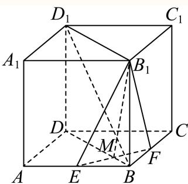

# 2025一模 杨浦区原卷 · 教师版

> 本地预览：题目、答案及分类尚未全部审定。校对使用的PDF为高中工作台解析版，尚未逐区确认区级印刷原卷。

## 填空题

按本区原卷题号顺序排列。

### 杨浦 · 第1题

已知集合 $A = \{ a , b \}$ ，则A的子集个数为

**考点：** 有限集合子集个数

**难度依据：** 有限集合子集个数；按所需步骤与推理量估计

**核查说明：** 题干与解析已用于人工归类，尚未完成整题公式校净与独立数学终审。

【答案】4.

【解析】

利用子集概念列举出即可得到答案.

集合A = {a, b},则集合A的子集有：∅ {a}, {b}, {a, b}

所以集合A的子集个数有4个.

故答案为：4.

### 杨浦 · 第2题

函数 $y = \sin 2 x$ 的最小正周期是

**考点：** 三角函数最小正周期

**难度依据：** 三角函数最小正周期；按所需步骤与推理量估计

**核查说明：** 题干与解析已用于人工归类，尚未完成整题公式校净与独立数学终审。

【答案】π

【解析】

$y = \sin 2 x$ 的最小正周期是 $\frac { 2 \pi } { 2 } = \pi .$

故答案为：π

### 杨浦 · 第3题

不等式 $\frac { x + 2 } { x - 1 } <$ 0的解集为

**考点：** 分式不等式符号分析

**难度依据：** 分式不等式符号分析；按所需步骤与推理量估计

**核查说明：** 题干与解析已用于人工归类，尚未完成整题公式校净与独立数学终审。

【答案】(−2, 1).

【解析】

首先将分式不等式转化为二次不等式，利用一元二次不等式的解法，求得其解集即可.

分式不等式 ${ \frac { x + 2 } { x - 1 } } < 0 \exists ]$ 以转化为 $( x + 2 ) ( x - 1 ) < 0$ ，解得 $- 2 < x < 1$

所以原不等式的解集为(−2,1).

故答案为：(−2, 1).

### 杨浦 · 第4题

已知函数 $\left[ { { y } \atop { y } } = { { x } ^ { 2 } } + a x + 1 \right]$ 是偶函数，则实数a的值为

**考点：** 偶函数与二次项系数

**难度依据：** 偶函数与二次项系数；按所需步骤与推理量估计

**核查说明：** 题干与解析已用于人工归类，尚未完成整题公式校净与独立数学终审。

【答案】0

【解析】

根据偶函数的性质即可求解.

由题意可知 $x \in \mathrm { R } , f \left( - x \right) = \left( - x \right) ^ { 2 } + a \left( - x \right) + 1 = x ^ { 2 } - a x + 1$

由于f(x)为偶函数，故 $f \left( x \right) = f \left( - x \right)$ ，即 $| x ^ { 2 } + a x + 1 = x ^ { 2 } - a x + 1$ ，即 $\lvert 2 a x = 0$

故答案为：0

### 杨浦 · 第5题

已知 $| | x + 3 | + | x - 5 | = 8$ ，则实数x的取值范围为

**考点：** 绝对值之和与分类讨论

**难度依据：** 绝对值之和与分类讨论；按所需步骤与推理量估计

**核查说明：** 题干与解析已用于人工归类，尚未完成整题公式校净与独立数学终审。

【答案】[−3, 5].

【解析】

讨论去绝对值求解.

由 $| x + 3 | + | x - 5 | = 8 ,$

当x < −3时，上式为 $\begin{array} { r } { - x - 3 + 5 - x = 8 } \end{array}$ ，解得x = −3（舍），

当x > 5时，上式为 $x + 3 + x - 5 = 8$ ，解得x = 5（舍），

$\ Ydashv 3 \leq x \leq$ 5时，上式为 $x + 3 + 5 - x = 8$

所以实数的x的取值范围为[−3,5].

故答案为：[−3, 5].

### 杨浦 · 第6题

已知 $\left| { \vec { a } } \right| = \left| { \vec { b } } \right| = 1$ ，若 $\left( \overrightarrow { 2 a } - \overrightarrow { b } \right) \perp \overrightarrow { b }$ ，则向 $\textstyle { \overrightarrow { \operatorname { E q } } } { \overrightarrow { a } } .$ 与 $\overrightarrow { \vert b }$ 的夹角的余弦值为

**考点：** 垂直数量积与夹角

**难度依据：** 垂直数量积与夹角；按所需步骤与推理量估计

**核查说明：** 题干与解析已用于人工归类，尚未完成整题公式校净与独立数学终审。

【答案】${ \frac { 1 } { 2 } } .$

【解析】

设向量 $\overrightarrow { a } \overrightarrow { \ – \mathbf { \nabla } } \overrightarrow { b }$ 的夹角为θ，根据向量垂直运算可得答案.

设向量 $\vec { \cdot } \vec { a } \vec { \ – } \vec { \jmath } _ { b } ^ {  }$ 的夹角为 $\theta \left( \theta \in \left[ 0 , \pi \right] \right)$ 1

若 $\left( \overrightarrow { 2 a } - \overrightarrow { b } \right) \perp \overrightarrow { b }$ ，则 $\left( { \widehat { 2 a } } - { \overrightarrow { b } } \right) \cdot { \overrightarrow { b } } = 0 ,$

所以2→a ⋅→b −→b 2 = 2 →b 2 b cos θ − = 2 cos θ − 1 = 0，

可得 $\cos \theta = { \frac { 1 } { 2 } }$

故答案为： ${ \frac { 1 } { 2 } } .$

### 杨浦 · 第7题

已知一个正四棱锥的每一条棱长都为2，则该四棱锥的体积为

**考点：** 正四棱锥高与体积

**难度依据：** 正四棱锥高与体积；按所需步骤与推理量估计

**核查说明：** 题干与解析已用于人工归类，尚未完成整题公式校净与独立数学终审。

【答案】$\frac { 4 { \sqrt { 2 } } } { 3 }$

【解析】

作出辅助线，求出正四棱锥的高，由锥体体积公式进行求解.

如图，正四棱锥P−ABCD，正方形ABCD的对角线相交于点O，连接PO，

则 $P O \bot$ 平面ABCD，

因为 $B D \subset$ 平面 $A B C D$ ，所以 $P O \bot B D$

其中 $B O = { \frac { 1 } { 2 } } B D = { \frac { 1 } { 2 } } { \sqrt { 2 ^ { 2 } + 2 ^ { 2 } } } = { \sqrt { 2 } } ,$

故 $O P = \sqrt { B P ^ { 2 } - O B ^ { 2 } } = \sqrt { 2 } ,$

所以该四棱锥的体积为 ${ \frac { 1 } { 3 } } A B \cdot B C \cdot O P = { \frac { 4 { \sqrt { 2 } } } { 3 } }$

故答案为： $\frac { 4 { \sqrt { 2 } } } { 3 }$

### 杨浦 · 第8题

某次杨浦区高三质量调研数学试卷中的填空题第八题，答对得5分，答错或不答得0分，全区共4000人参加调研，该题的答题正确率是60%，则该次调研中全区同学该题得分的方差为

> 本题资料或解析有待核事项，预览不可作为已审定成品。

**考点：** 二点分布的方差

**难度依据：** 二点分布的方差；按所需步骤与推理量估计

**核查说明：** 题干与解析已用于人工归类，尚未完成整题公式校净与独立数学终审。；区名为脱敏占位符，来源身份须回核。；原解均值一处误写为345，按列式应为3；原解方差计算使用3。

【答案】6.

【解析】

根据平均数和方差的定义计算求解即可.

同全区同学中答对的人数为 $4 0 0 0 \times 6 0 \% = 2 4 0 0$ 人，答错或不答的人数为1600人，

所以全区同学该题得分的平均数为 $\frac { 2 4 0 0 \times 5 + 1 6 0 0 \times 0 } { 4 0 0 0 } = 3 4 5$ ，

则全区同学该题得分的方差为 ${ \frac { 2 4 0 0 \times ( 5 - 3 ) ^ { 2 } + 1 6 0 0 \times ( 0 - 3 ) ^ { 2 } } { 4 0 0 0 } } = 6 .$

故答案为：6.

### 杨浦 · 第9题

将一个半径为1的球形石材加工成一个圆柱形摆件，则该圆柱形摆件侧面积的最大值为

**考点：** 球内接圆柱侧面积最值；基本不等式

**难度依据：** 球内接圆柱侧面积最值；基本不等式；按所需步骤与推理量估计

**核查说明：** 题干与解析已用于人工归类，尚未完成整题公式校净与独立数学终审。

【答案】2π.

【解析】

设圆柱形工件的高为h，底面半径为r，得到圆柱形工件的侧面积为 $S = 2 \pi r h$ ，再结合基本不等式求解侧面积的最大值.

设圆柱形工件的高为h，底面半径为r， ${ \frac { h ^ { 2 } } { 4 } } + r ^ { 2 } = 1$

则圆柱形工件的侧面积为 $S = 2 \pi r h = 2 \pi r \sqrt { 4 \left( 1 - r ^ { 2 } \right) } = 4 \pi \sqrt { r ^ { 2 } \left( 1 - r ^ { 2 } \right) } ;$

又因为 $1 = r ^ { 2 } + \left( 1 - r ^ { 2 } \right) \geq 2 { \sqrt { r ^ { 2 } \left( 1 - r ^ { 2 } \right) } }$ 当且仅当 $r ^ { 2 } = \big ( 1 - r ^ { 2 } \big ) , r = \frac { \sqrt { 2 } } { 2 }$ 时等号成立，

所以 $S = 4 \pi { \sqrt { r ^ { 2 } \left( 1 - r ^ { 2 } \right) } } \leq 4 \pi \times { \frac { 1 } { 2 } } = 2 \pi ,$

故答案为：2π.

### 杨浦 · 第10题

已知 $\begin{array} { r } { | f \left( x \right) = \left\{ \begin{array} { l l } { x ^ { \frac { 1 } { 3 } } , } & { 0 \leq x \leq a , } \\ { \log _ { 3 } x , } & { x > a } \end{array} \right. } \end{array}$ ，其中实数 $. a > 0$ .若函数 $\dot { \boldsymbol { y } } = f \left( \boldsymbol { x } \right) - 2$ 有且仅有2个零点，则a的取值范围为

**考点：** 分段函数零点与参数范围

**难度依据：** 分段函数零点与参数范围；按所需步骤与推理量估计

**核查说明：** 题干与解析已用于人工归类，尚未完成整题公式校净与独立数学终审。

【答案】[8, 9).

【解析】

由题意可知f(x) = 2有两根，通过方程求解即可.

由题意可知： $f \left( x \right) = 2$ 有两根，结合 $f \left( x \right)$ 在[0, a]和 $\textstyle | ( a , + \infty )$ 都是单调递增，

所以 $. x ^ { \frac { 1 } { 3 } } = 2$ 有一解，解得： $x = 8$

$\log _ { 3 } x = 2$ 有一解，解得： $x = 9$

所以 $8 \leq a < 9$

故答案为：[8, 9).

### 杨浦 · 第11题

中国探月工程又称“嫦娥工程”，是中国航天活动的第三个里程碑.在探月过程中，月球探测器需要进行变轨，即从一条椭圆轨道变到另一条不同的椭圆轨道上.若变轨前后的两条椭圆轨道均以月球中心为一个焦点，变轨后椭圆轨道上的点与月球中心的距离最小值保持不变，而距离最大值扩大为变轨前的4倍，椭圆轨道的离心率扩大为变轨前的2.5倍，则变轨前的椭圆轨道的离心率为（精确到0.01）

**考点：** 椭圆焦半径与离心率

**难度依据：** 椭圆焦半径与离心率；按所需步骤与推理量估计

**核查说明：** 题干与解析已用于人工归类，尚未完成整题公式校净与独立数学终审。

【答案】0.31.

【解析】

根据椭圆上点到焦点距离最小值为 $a - c ,$ ，到焦点距离最大值为 $[ a + c ,$ ，列式运算得解.

设变轨前的椭圆的长半轴长为 $[ a _ { 1 }$ ，短半轴长为 $b _ { 1 }$ ，半焦距为 $\lvert c _ { 1 }$ ，离心率为 $e _ { 1 }$ ，

变轨后的椭圆的长半轴长为 $\tan _ { 2 } .$ ，短半轴长为 $b _ { 2 }$ ，半焦距为 $c _ { 2 }$ ，离心率为 $\lvert e _ { 2 }$ ，

由题意可得 $\left\{ { \begin{array} { l } { a _ { 1 } - c _ { 1 } = a _ { 2 } - c _ { 2 } } \\ { 4 \left( a _ { 1 } + c _ { 1 } \right) = a _ { 2 } + c _ { 2 } } \\ { 2 . 5 { \frac { c _ { 1 } } { a _ { 1 } } } = { \frac { c _ { 2 } } { a _ { 2 } } } } \end{array} } \right.$ ，化简得 ${ \frac { 5 } { 2 } } \cdot { \frac { c _ { 1 } } { a _ { 1 } } } = { \frac { 3 a _ { 1 } + 5 c _ { 1 } } { 5 a _ { 1 } + 3 c _ { 1 } } }$

即 $\frac { 5 } { 2 } e _ { 1 } = \frac { 3 + 5 e _ { 1 } } { 5 + 3 e _ { 1 } }$ ，解得 $e _ { 1 } = { \frac { - 5 + { \sqrt { 6 5 } } } { 1 0 } } \approx 0 . 3 1$ （负值舍去）.

故答案为：0.31.

### 杨浦 · 第12题

已知实数 $a>0$，$\mathrm{i}$ 是虚数单位，设集合 $A=\{z\mid z=w+\frac1w,\ |w|>1,\ w\in\mathbf C,\ z\in\mathbf C\}$，集合 $B=\{z\mid |z-1+\mathrm{i}|=a,\ z\in\mathbf C\}$。如果 $B\subseteq A$，则 $a$ 的取值范围为______。

> 本题资料或解析有待核事项，预览不可作为已审定成品。

**考点：** 复变换与几何轨迹；圆与实轴线段相离；集合包含

**难度依据：** 需确定复变换值域并将包含问题转为圆与线段的位置关系；长解细节待审。

**核查说明：** 原MD漏失A的定义及a>0条件；从同名PDF文字层恢复完整题干。PDF第4页底部印刷裁切，A定义未完整可见，不能称已全题视觉确认。；题干与解析已用于人工归类，尚未完成整题公式校净与独立数学终审。；解法二纯虚数分支对q<0的构造及负实数分支符号存在问题，需审解；结论不据此改写。

【答案】$( 0 , 1 ) \cup \left( \sqrt { 1 0 } , + \infty \right)$

【解析】

解法一：明确集合A，B的几何意义，数形结合，根据几何意义即可求得参数范围.

解法二：先证明不属于A的复数z，恰好是那些区间[−2,2]上的实数，再利用该结论得到取值范围.

解法一：由于 $| w | > 1$ ，设 $w = r ( \cos \theta + \mathrm { i } \sin \theta ) , r > 1$ ，

$$
w + \frac {1}{w} = r (\cos \theta + \mathrm{i} \sin \theta) + \frac {1}{r (\cos \theta + \mathrm{i} \sin \theta)}
$$

$$
= r (\cos \theta + \mathrm{i} \sin \theta) + \frac {\cos \theta - \mathrm{i} \sin \theta}{r} = \left(r + \frac {1}{r}\right) \cos \alpha + \mathrm{i} \left(r - \frac {1}{r}\right) \sin \alpha ,
$$

设z对应点(x, y)，则 $x = \left( r + { \frac { 1 } { r } } \right) \cos \alpha , y = \left( r - { \frac { 1 } { r } } \right) \sin \alpha$

所以 ${ \frac { x ^ { 2 } } { \left( r + { \frac { 1 } { r } } \right) ^ { 2 } } } + { \frac { y ^ { 2 } } { \left( r - { \frac { 1 } { r } } \right) ^ { 2 } } } = 1$ ，其中 $r + \frac { 1 } { r } > 2 , r - \frac { 1 } { r } > 0$

当 $r > 1  { \mathbb { H } } )$ ，该方程的几何意义为表示所有椭圆的并集，

即平面上除去线段 $A _ { 1 } A _ { 2 }$ 的点的集合，其中 $A _ { 1 } ( - 2 , 0 ) , A _ { 2 } ( 2 , 0 )$

集合 $B = \{ z \mid | z - 1 + \mathbf { i } | = a , z \in \mathbf { C } \}$ 表示复平面上的圆，圆心为(1,−1)，半径为a，

如果 $B \subseteq A$ ，则该圆与线段 $A _ { 1 } A _ { 2 }$ 无公共点，

结合图形可知a的取值范围为(0,1)∪ $\left( { \sqrt { 1 0 } } , + \infty \right)$ ；

解法二：

先证明：不属于A的复数z，恰好是那些区间[−2,2]上的实数.

下设z是复数.

①情况一：z不是实数，也不是纯虚数.

设 ${ \boldsymbol { \cdot } } { \boldsymbol { z } } = r \cdot \mathrm { e } ^ { \mathrm { i } \alpha } \left( r \geq 0 , \alpha \in \mathbf { R } \right) , z ^ { 2 } - 4 = R \cdot \mathrm { e } ^ { \mathrm { i } \beta } \left( R \geq 0 , \beta \in \mathbf { R } \right)$ ，并令 $w _ { 1 } = { \frac { r \cdot \mathrm { e } ^ { \mathrm { i } \alpha } + { \sqrt { R } } \cdot \mathrm { e } ^ { \mathrm { i } \cdot { \frac { \beta } { 2 } } } } { 2 } }$ $w _ { 2 } = { \frac { r \cdot \mathrm { e } ^ { \mathrm { i } \alpha } - { \sqrt { R } } \cdot \mathrm { e } ^ { \mathrm { i } \cdot { \frac { \beta } { 2 } } } } { 2 } }$

则对 $k = 1 , 2 ,$ ，有 $\left( w _ { k } - { \frac { z } { 2 } } \right) ^ { 2 } = \left( w _ { k } - { \frac { r \cdot \mathrm { e } ^ { \mathrm { i } \alpha } } { 2 } } \right) ^ { 2 } = \left( { \frac { { \sqrt { R } } \cdot \mathrm { e } ^ { \mathrm { i } { \frac { \beta } { 2 } } } } { 2 } } \right) ^ { 2 } = { \frac { R \cdot \mathrm { e } ^ { \mathrm { i } \beta } } { 4 } } = { \frac { z ^ { 2 } - 4 } { 4 } }$ ，即

$$
w _ {k} ^ {2} - z \cdot w _ {k} + 1 = 0.
$$

假设 $w _ { k } = 0$ ，则 $| 0 = w _ { k } ^ { 2 } - z \cdot w _ { k } + 1 = 0 ^ { 2 } - z \cdot 0 + 1 = 1$ ，矛盾，所以 $w _ { k } \neq 0$ ，从而 $w _ { k } + \frac { 1 } { w _ { k } } = z .$

又因为 $\mathfrak { w } _ { 1 } \mathfrak { w } _ { 2 } = \frac { \left( r \cdot \mathrm { e } ^ { \mathrm { i } \alpha } \right) ^ { 2 } - \left( \sqrt { R } \cdot \mathrm { e } ^ { \mathrm { i } \cdot \frac { \beta } { 2 } } \right) ^ { 2 } } { 4 } = \frac { z ^ { 2 } - R \cdot \mathrm { e } ^ { \mathrm { i } \beta } } { 4 } = \frac { z ^ { 2 } - \left( z ^ { 2 } - 4 \right) } { 4 } = 1 ,$

所以 $1 = | 1 | = | w _ { 1 } w _ { 2 } | = | w _ { 1 } | | w _ { 2 } | .$

此时，假设 $| w _ { 1 } | = | w _ { 2 } | = 1 \colon$ ：由于

$$
w _ {1} = \frac {r \mathrm{e} ^ {\mathrm{i} \alpha} + \sqrt {R} \mathrm{e} ^ {\mathrm{i} \cdot \frac {\beta}{2}}}{2} = \left(\frac {r}{2} \cos \alpha + \frac {\sqrt {R}}{2} \cos \frac {\beta}{2}\right) + \left(\frac {r}{2} \sin \alpha + \frac {\sqrt {R}}{2} \sin \frac {\beta}{2}\right) \mathrm{i},
$$

故

$$
\begin{array}{l} 1 = 1 ^ {2} = | w _ {1} | ^ {2} = \left(\frac {r}{2} \cos \alpha + \frac {\sqrt {R}}{2} \cos \frac {\beta}{2}\right) ^ {2} + \left(\frac {r}{2} \sin \alpha + \frac {\sqrt {R}}{2} \sin \frac {\beta}{2}\right) ^ {2} = \frac {r ^ {2}}{4} + \frac {R}{4} + \frac {r \sqrt {R}}{2} \cos \\ \left(\alpha - \frac {\beta}{2}\right) \end{array}
$$

同理，根据 $| w _ { 2 } | = 1$ 可以得到 $1 = { \frac { r ^ { 2 } } { 4 } } + { \frac { R } { 4 } } - { \frac { r { \sqrt { R } } } { 2 } } \mathrm { c o s } \left( \alpha - { \frac { \beta } { 2 } } \right)$

对 $. = { \frac { r ^ { 2 } } { 4 } } + { \frac { R } { 4 } } + { \frac { r { \sqrt { R } } } { 2 } } \cos \left( \alpha - { \frac { \beta } { 2 } } \right)$ 和1 $= { \frac { r ^ { 2 } } { 4 } } + { \frac { R } { 4 } } - { \frac { r { \sqrt { R } } } { 2 } } \cos \left( \alpha - { \frac { \beta } { 2 } } \right)$ 相加和相减，

就能得到 $1 = { \frac { r ^ { 2 } } { 4 } } + { \frac { R } { 4 } } , { \frac { r { \sqrt { R } } } { 2 } } \mathrm { c o s } \left( \alpha - { \frac { \beta } { 2 } } \right) = 0 .$

若假设R = 0，则 $( z - 2 ) ( z + 2 ) = z ^ { 2 } - 4 = R \mathrm { e } ^ { \mathrm { i } \beta } = 0$ ，从而 $z = 2$ 或 $z = - 2$

这和情况一的定义矛盾，所以 $R > 0$

若假设 $\boldsymbol { r } = 0$ ，则 $z = r \cdot \mathrm { e } ^ { \mathrm { i } \alpha } = 0$ ，从而 $z = 0$ ，这和情况一的定义矛盾，所以 $r > 0$

这就得到 $\frac { r \sqrt { R } } { 2 } > 0 .$ ，所以 $\cos \left( \alpha - { \frac { \beta } { 2 } } \right)$ = 0，所以 $\frac { \beta } { 2 } = \alpha + \left( 2 m - 1 \right) \cdot \frac { \pi } { 2 } ( m \in \mathbf { Z } )$

即 $\displaystyle | \beta = 2 \alpha + ( 2 m - 1 ) \pi \left( m \in \mathbf { Z } \right)$

这就得到

R (reiα)2 ⋅ ei(2m−1)π R 2 − 4 = ⋅ eiβ = ⋅ ei(2α+(2m−1)π) = e2iα ⋅ ei(2m−1)π z2 2 i(2m−1)π r2 r2 所以 $z ^ { 2 } - 4 = { \frac { R } { r ^ { 2 } } } i$ z2或 $z ^ { 2 } - 4 = - { \frac { R } { r ^ { 2 } } } z ^ { 2 }$ ，无论哪种情况都能得到 $z ^ { 2 }$ 是实数，故可设 $z ^ { 2 } = c \in \mathbf { R }$ 若 $c \geq 0 .$ ，则 $0 = z ^ { 2 } - c = \left( z - { \sqrt { c } } \right) \left( z + { \sqrt { c } } \right)$ ，得 $z = \pm \sqrt { { \mathfrak { c } } }$ c是实数，这和情况一的定义矛盾. 若 $c < 0 _ { : }$ ，则 $0 = z ^ { 2 } - c = \left( z - \mathrm { i } { \sqrt { c } } \right) \left( z + \mathrm { i } { \sqrt { c } } \right)$ ，得 $z = \pm \mathrm { i } \sqrt { }$ c是纯虚数，这和情况一的定义矛 盾.

故前面的假设 $| w _ { 1 } | = | w _ { 2 } | = 1$ 不成立，所以结合 $\mathrm { ~ l ~ } = \left| w _ { 1 } \right| \left| w _ { 2 } \right|$ |可知，

一定存在k = 1,2使得 $| w _ { k } | > 1$ ，结合 $w _ { k } + \frac { 1 } { w _ { k } } = z ^ { \boxplus } \ddot { \star } \boxed { \| } z \in A$

②情况二：z是纯虚数.

此时设 $z = \dot { q 1 } ( q \neq 0 )$ ，则 $w = \frac { q + \sqrt { q ^ { 2 } + 4 } } { 2 }$ i满 $\dot { \Xi } | w | = { \frac { q + \sqrt { q ^ { 2 } + 4 } } { 2 } } > { \frac { 0 + \sqrt { 0 + 4 } } { 2 } } = 1$

$$
\begin{array}{l} {w + \frac {1}{w} = \frac {q + \sqrt {q ^ {2} + 4}}{2} \mathrm{i} + \frac {1}{\frac {q + \sqrt {q ^ {2} + 4}}{2} \mathrm{i}} = \frac {q + \sqrt {q ^ {2} + 4}}{2} \mathrm{i} - \frac {2}{q + \sqrt {q ^ {2} + 4}} \mathrm{i} = \frac {q + \sqrt {q ^ {2} + 4}}{2} \mathrm{i}} \\ {- \frac {\sqrt {q ^ {2} + 4} - q}{2} \mathrm{i} = q \mathrm{i} = z} \end{array}
$$

故 $z \in A .$

③情况三：z是实数， $\mathrm { { E } } z > 2 .$

此时 $w = \frac { z + \sqrt { z ^ { 2 } - 4 } } { 2 }$ 满足 $| w | = \left| { \frac { z + { \sqrt { z ^ { 2 } - 4 } } } { 2 } } \right| = { \frac { z + { \sqrt { z ^ { 2 } - 4 } } } { 2 } } > { \frac { 2 + { \sqrt { 2 ^ { 2 } - 4 } } } { 2 } } = 1 ,$

且 $\lfloor w + { \frac { 1 } { w } } = { \frac { z + { \sqrt { z ^ { 2 } - 4 } } } { 2 } } + { \frac { 2 } { z + { \sqrt { z ^ { 2 } - 4 } } } } = { \frac { z + { \sqrt { z ^ { 2 } - 4 } } } { 2 } } + { \frac { z - { \sqrt { z ^ { 2 } - 4 } } } { 2 } } = z ,$ ，故 $( z \in A$

④情况四：z是实数，且 $z < - 2$

此时 $w = \frac { - z + \sqrt { z ^ { 2 } - 4 } } { 2 }$ 满足

$$
| w | = \left| \frac {- z + \sqrt {z ^ {2} - 4}}{2} \right| = \frac {(- z) + \sqrt {(- z) ^ {2} - 4}}{2} > \frac {2 + \sqrt {2 ^ {2} - 4}}{2} = 1,
$$

且 $w + \frac { 1 } { w } = \frac { z - \sqrt { z ^ { 2 } - 4 } } { 2 } + \frac { 2 } { z - \sqrt { z ^ { 2 } - 4 } } = \frac { z - \sqrt { z ^ { 2 } - 4 } } { 2 } + \frac { z + \sqrt { z ^ { 2 } - 4 } } { 2 } = z ,$ ，故 $z \in A$

⑤情况五：z是实数， $\mathrm { E } z \in [ - 2 , 2 ]$

假设 $z \in A .$ 则存在复数w使得 $| w | > 1$ ，且 ${ \boldsymbol { \cdot } } { \boldsymbol { w } } + { \frac { 1 } { w } } = { \boldsymbol { z } } ,$ ，设 $w = r _ { 0 } \cdot \mathrm { e } ^ { \mathrm { i } \theta } \left( r _ { 0 } > 1 , \theta \in \mathbf { R } \right)$

$$
| z = w + \frac {1}{w} = r _ {0} \mathrm{e} ^ {\mathrm{i} \theta} + \frac {1}{r _ {0} \cdot \mathrm{e} ^ {\mathrm{i} \theta}} = r _ {0} \mathrm{e} ^ {\mathrm{i} \theta} + \frac {1}{r _ {0}} \mathrm{e} ^ {- \mathrm{i} \theta} = \left(r _ {0} + \frac {1}{r _ {0}}\right) \cos \theta + \mathrm{i} \left(r _ {0} - \frac {1}{r _ {0}}\right) \sin \theta .
$$

从而 $\left( r _ { 0 } + { \frac { 1 } { r _ { 0 } } } \right) \cos \theta = z , \left( r _ { 0 } - { \frac { 1 } { r _ { 0 } } } \right) \sin \theta = 0$ 而由 $r _ { 0 } > 1$ 可知 $\vert r _ { 0 } - \frac { 1 } { r _ { 0 } } > 1 - \frac { 1 } { 1 } = 0 .$ 所以 $\sin \theta = 0$ ，故 $| \cos \theta | = 1$

这就得到 ${ \mathrm { ~ : } } \geq | z | = \left| \left( r _ { 0 } + { \frac { 1 } { r _ { 0 } } } \right) \cos \theta \right| = r _ { 0 } + { \frac { 1 } { r _ { 0 } } } = { \frac { ( r _ { 0 } - 1 ) ^ { 2 } + 2 r _ { 0 } } { r _ { 0 } } } > { \frac { 2 r _ { 0 } } { r _ { 0 } } } = 2 ,$ ，矛盾.所以假设不成立，从而z ∉ A.

综合上面五种情况，就得到了结论：不属于A的复数z，恰好是那些区间[−2,2]上的实数现在回到原题，结合上面的结论，条件等价于B中包含的每个实数都不属于[−2,2].

一方面，若B中包含一个实数z，满足 $- 2 \leq z \leq 2$

则 $| a = | z - 1 + \mathbf { i } | = { \sqrt { ( z - 1 ) ^ { 2 } + 1 } } \geq 1 \quad$

$a = | z - 1 + \mathrm { i } | = { \sqrt { \left( z - 1 \right) ^ { 2 } + 1 } } = { \sqrt { \left( z + 2 \right) \left( z - 4 \right) + 1 0 } } \leq { \sqrt { 1 0 } }$ ，从而1 $\leq a \leq { \sqrt { 1 0 } } .$

另一方面，若 $1 \leq a \leq \sqrt { 1 0 }$ ，则实数 $z = 1 - \sqrt { a ^ { 2 } - 1 }$ 1满足

$$
z = 1 - \sqrt {a ^ {2} - 1} \geq 1 - \sqrt {\left(\sqrt {1 0}\right) ^ {2} - 1} = 1 - \sqrt {9} = - 2, z = 1 - \sqrt {a ^ {2} - 1} \leq 1 \leq 2.
$$

故B中包含一个实数z，满 $\begin{array} { r } { \mathbb { E } - 2 \le z \le 2 } \end{array}$

这就说明，B中包含一个实数z满足−2 ≤ z ≤ 2的充要条件是1 $\leq a \leq { \sqrt { 1 0 } } .$

所以a的取值范围是 $( 0 , 1 ) \cup \left( \sqrt { 1 0 } , + \infty \right)$

故答案为： $( 0 , 1 ) \cup \left( \sqrt { 1 0 } , + \infty \right)$

关键点点睛：本题的关键在于对复数知识和三角恒等变换的使用.

## 二、选择题

## 选择题

按本区原卷题号顺序排列。

### 杨浦 · 第13题

已知实数 $[ a \neq 0 ,$ ，则 $^ { * } a > 2 ^ { * }$ 是 $\ddot { } \frac { \mathrm { ~ \scriptsize ~ 1 ~ } } { a } < \frac { \mathrm { ~ \scriptsize ~ 1 ~ } } { 2 }$ ”的（ ）条件.

A. 充分非必要

B. 必要非充分

C. 充分必要

D. 既非充分也非必要

**考点：** 充分必要条件；分式不等式

**难度依据：** 充分必要条件；分式不等式；按所需步骤与推理量估计

**核查说明：** 题干与解析已用于人工归类，尚未完成整题公式校净与独立数学终审。

【答案】A

【解析】

根据分式不等式化简可得 $\cdot a > 2 \nexists \lambda a < 0$ 即可根据集合间的关系求解.由 $\frac { 1 } { a } < \frac { 1 } { 2 }$ 得 $\frac { 2 - a } { 2 a } < 0$ ，解得 $a > 2 \nexists \lambda a < 0$ •$\mathbb { F } \{ a | a >$ 2} $\{ a | a >$ 2或 $a < 0 \}$ ，$^ { * } a > 2 ^ { * }$ 是 $ { \mathrm { ~  ~ \cdot ~ } } \frac { 1 } { a } < \frac { 1 } { 2 }$ ”的充分不必要条件，故选：A

### 杨浦 · 第14题

如果A､B是独立事件，A,B分别是A､B的对立事件，那么以下等式不一定成立的是（ ）.

A. $P \left( A \cap B \right) = P \left( A \right) P \left( B \right)$

B. $P \left( { \overline { { A } } } \cap B \right) = P \left( { \overline { { A } } } \right) P \left( B \right)$

C. $P \left( A \cup B \right) = P \left( A \right) + P \left( B \right)$

D. $P \left( { \overline { { A } } } \cap { \overline { { B } } } \right) = \left[ 1 - P \left( A \right) \right] \left[ 1 - P \left( B \right) \right]$

> 本题资料或解析有待核事项，预览不可作为已审定成品。

**考点：** 独立事件与对立事件

**难度依据：** 独立事件与对立事件；按所需步骤与推理量估计

**核查说明：** 题干与解析已用于人工归类，尚未完成整题公式校净与独立数学终审。；题干对立事件记号与原解部分上划线有识别缺损。

【答案】C

【解析】

根据相互独立事件的定义以及性质，即可结合选项逐一求解.

对于A,由于A､B是独立事件，故 $P \left( A \cap B \right) = P \left( A \right) P \left( B \right)$ ，A正确，

对于B，由于A､B是独立事件，则 ${ \overline { { A } } } , B$ 也是相互独立事件，故 $P \left( { \overline { { A } } } \cap B \right) = P \left( { \overline { { A } } } \right) P \left( B \right)$ ，B正确，

对于C， $P \left( A \cup B \right) = P \left( A \right) + P \left( B \right) - P \left( A \cap B \right)$ ,故由 $\operatorname { F } P \left( A \cap B \right)$ )不一定为0，故C错误，对于D, 由于A､B是独立事件，则A,B也是相互独立事件，

P (A ∩ B) = P (A)P (B) = [1 − P (A)] [1 − P (B)],D正确，–

故选：C

### 杨浦 · 第15题

小李研究数学建模“雨中行”问题，在作出“降雨强度保持不变”､“行走速度保持不变”､“将人体视作一个长方体”等合理假设的前提下，他设了变量：
并构建模型如下：
当人迎风行走时，人体总的淋雨量为 $\mathrm { \Sigma } [ T = \frac { p w D } { v } [ d v _ { r } + h \left( v _ { w } + v \right) ]$
根据模型，小李对“雨中行”作出如下解释：
①若两人结伴迎风行走，则体型较高大魁梧的人淋雨是较大；
②若某人迎风行走，则走得越快淋雨量越小，若背风行走，则走得越慢淋雨量越小；
③若某人迎风行走了10秒，则行走距离越长淋雨量越大
这些解释合理的个数为（ ）

A. 0

B. 1

C. 2

D. 3

> 本题资料或解析有待核事项，预览不可作为已审定成品。

**考点：** 淋雨模型变量比较与单调性

**难度依据：** 淋雨模型变量比较与单调性；按所需步骤与推理量估计

**核查说明：** 题干与解析已用于人工归类，尚未完成整题公式校净与独立数学终审。；模型变量解释表缺失，无法核实全部实际含义。；原解背风分支符号变化的文字表述有误，且变量表缺失，需回核。

【答案】C

【解析】

利用作差法可以比较两人淋雨量判断①，结合函数的单调性可判断②③.①若两人结伴迎风行走，设体型较高大魁梧的人身高为 $\lvert h _ { 1 }$ ，宽度为w ，厚度为 $w _ { 1 }$ $\lvert d _ { 1 }$ ，另一人身高为h2，宽度为w2，厚度为 $\lvert d _ { 2 }$ ，则$\begin{array} { l } { \displaystyle { T _ { 1 } - T _ { 2 } = \frac { p w _ { 1 } D } { v } [ d _ { 1 } v _ { r } + h _ { 1 } \left( v _ { w } + v \right) ] - \frac { p w _ { 2 } D } { v } [ d _ { 2 } v _ { r } + h _ { 2 } \left( v _ { w } + v \right) ] = \frac { p D } { v } } } \\ { \displaystyle { \left[ v _ { r } \left( w _ { 1 } d _ { 1 } - w _ { 2 } d _ { 2 } \right) + \left( v _ { w } + v \right) \left( w _ { 1 } h _ { 1 } - w _ { 2 } h _ { 2 } \right) \right] } } \end{array}$ ，又 $h _ { 1 } > h _ { 2 } > 0 , w _ { 1 } > w _ { 2 } > 0 , d _ { 1 } > d _ { 2 } > 0 _ { }$ 则 $| w _ { 1 } d _ { 1 } > w _ { 2 } d _ { 2 } , ~ w _ { 1 } h _ { 1 } > w _ { 2 } h _ { 2 }$ 即 $1 T _ { 1 } - T _ { 2 } = \frac { p D } { v } [ v _ { r } \left( w _ { 1 } d _ { 1 } - w _ { 2 } d _ { 2 } \right) + \left( v _ { w } + v \right) \left( w _ { 1 } h _ { 1 } - w _ { 2 } h _ { 2 } \right) ] > 0 ,$ 即体型较高大魁梧的人淋雨是较大，①正确；②若某人迎风行走，则 $T = \frac { p w D } { v } [ d v _ { r } + h \left( v _ { w } + v \right) ] = \frac { p w D } { v } ( d v _ { r } + h v _ { w } ) + p w D h ,$ 则T随v的增大而减小，即走得越快淋雨量越小；若某人逆风行走，则 $T = \frac { p w D } { v } [ d v _ { r } + h \left( - v _ { w } + v \right) ] = \frac { p w D } { v } ( d v _ { r } - h v _ { w } ) + p w D h ,$ 当 $d v _ { r } - h v _ { w } >$ 0时，T随v的增大而减小，即走得越快淋雨量越小，当 $d v _ { r } - h v _ { w } <$ 0时，，T随v的增大而减小，即走得越慢淋雨量越小，当 $d v _ { r } - h v _ { w } =$ 0时，淋雨量与v无关，②错误；③若某人迎风行走了10秒，则 $\frac { D } { v } = 1 0$ 为定值，且 $\displaystyle v = { \frac { D } { 1 0 } }$ ，

则 $\left| T = 1 0 p w \right. \left\lceil d v _ { r } + h \left( v _ { w } + { \frac { D } { 1 0 } } \right) \right\rceil$

所以T随D的增大而增大，即行走距离越长淋雨量越大，③正确；

综上所述合理的解释有2个，

故选：C.

### 杨浦 · 第16题

设无穷数列 $\left\{ a _ { n } \right\}$ 的前n项和为 $S _ { n }$ ，且对任意的正整数 $n , a _ { n + 1 } = { \frac { S _ { n } } { a _ { n } } }$ ，则 $\sum _ { i = 1 } ^ { 5 } a _ { 2 i } - \sum _ { i = 1 } ^ { 6 } a _ { 2 i - 1 }$ 的值可能为（ ）

A. −6

B. 0

C. 6

D. 12

> 本题资料或解析有待核事项，预览不可作为已审定成品。

**考点：** 前项和递推与奇偶项求和

**难度依据：** 前项和递推与奇偶项求和；按所需步骤与推理量估计

**核查说明：** 仅修复所列OCR公式及其定界符错位；原解数学疑点和其他可渲染错识未因此消除。；题干与解析已用于人工归类，尚未完成整题公式校净与独立数学终审。

【答案】A

【解析】

根据 $a _ { n }$ 与 $S _ { n }$ 的关系，探索数列 $\left\{ a _ { n } \right\}$ 的结构特点，分别求出 $\sum _ { i = 1 } ^ { 5 } a _ { 2 i }$ 和 $\sum _ { i = 1 } ^ { 6 } a _ { 2 i - 1 }$ ，再根据 $a _ { n } \neq 0$ 及数列 $\{ a _ { n } \}$ 是无穷数列对各选项进行判断

当n = 1时， $a _ { 2 } = \frac { S _ { 1 } } { a _ { 1 } } = 1$

当 $n \geq$ 2时， $S _ { n } = a _ { n } a _ { n + 1 }$ ，所以 $S _ { n - 1 } = a _ { n - 1 } a _ { n }$

两式相减得： $a _ { n } = a _ { n } \left( a _ { n + 1 } - a _ { n - 1 } \right)$ ，因为 $\tan \neq 0$ ，所 $\mathbb { X } a _ { n + 1 } - a _ { n - 1 } = 1$

所以数列 $\{ a _ { n } \}$ 的奇数项是 $\psi _ { 1 } a _ { 1 }$ 为首项，1为公差的等差数列，且 $\lfloor a _ { 1 } \neq 0$

所以 $\cdot \sum _ { i = 1 } ^ { 6 } a _ { 2 i - 1 } = 6 a _ { 1 } + { \frac { 6 \times 5 } { 2 } } \times 1 = 6 a _ { 1 } + 1 5 .$

同理，数列 $\{ a _ { n } \}$ 的偶数项是以1为首项，1为公差的等差数列，

所以 $\cdot \sum _ { i = 1 } ^ { 5 } a _ { 2 i } = 5 \times 1 + { \frac { 5 \times 4 } { 2 } } \times 1 = 1 5 .$

所以 $\sum _ { i = 1 } ^ { 5 } a _ { 2 i } - \sum _ { i = 1 } ^ { 6 } a _ { 2 i - 1 } = 1 5 - 6 a _ { 1 } - 1 5 = - 6 a _ { 1 }$

若 $- 6 a _ { 1 } = - 6 { \Rightarrow } a _ { 1 } = 1$ ，则数列 $\{ a _ { n } \}$ 各项均不为0，数列 $\{ a _ { n } \}$ 是无穷数列，故A正确；

若 $\cdot 6 a _ { 1 } = 0 \Rightarrow a _ { 1 } = 0$ ，这与 $\dot { \iota } a _ { 1 } \neq 0$ 矛盾，故B错误；

若 $- 6 a _ { 1 } = 6 \Rightarrow a _ { 1 } = - 1$ ，根据奇数项成公差为1的等差数列，则 $a _ { 3 } = 0$ ，则 $\stackrel { } { a } _ { 4 }$ 无法求出，这与数列 $\{ a _ { n } \}$ 是无穷数列矛盾，故C错误；

若− $6 a _ { 1 } = 1 2 { \Rightarrow } a _ { 1 } = - 2$ ，根据奇数项成公差为1的等差数列，则 $a_5=0$ ，则 $a _ { 6 }$ 无法求出，这与数列 $\{ a _ { n } \}$ 是无穷数列矛盾，故D错误.

故选：A

关键点点睛：观察出数列的特点后，一定要注意 $a _ { n } \neq 0$ 及数列 $\{ a _ { n } \}$ 是无穷数列这两个条件的应用.

## 三、解答题

## 解答题

按本区原卷题号顺序排列。

### 杨浦 · 第17题

如图，在正方体 $A B C D - A _ { 1 } B _ { 1 } C _ { 1 } D _ { 1 }$ 中，点E、F分别是棱AB、BC的中点.

(1) (6分)求证： $E F \bot B D _ { 1 }$ ；
(2) (8分)求二面角 $B _ { 1 } - E F - B$ 的大小.

**考点：** （1）正方体线线垂直；（2）二面角

**难度依据：** 正方体垂直与二面角；向量证明垂直；按所需步骤与推理量估计

**核查说明：** 题干与解析已用于人工归类，尚未完成整题公式校净与独立数学终审。

【解析】

(1) 如图所示，连接AC，BD， $B _ { 1 } D _ { 1 }$ ，

由 $1 B C D - A _ { 1 } B _ { 1 } C _ { 1 } D _ { 1 }$ 为正方体，

可知 $A C \bot B D$ • $D D _ { 1 \perp }$ 平面 $A B C D$ ，又∵ $E F \subset$ 平面 $A B C D$

$$
\therefore D D _ {1} \perp E F,
$$

$\because E , \ F$ 分别为AB，BC中点，

$$
\therefore E F \parallel A C, \therefore E F \perp B D,
$$

$\because B D \cap D D _ { 1 } = D ,$ ，且BD， $D D _ { 1 } \subset$ 平面 $B D D _ { 1 } B _ { 1 }$

$\therefore E F \bot$ 平面 $B D D _ { 1 } B _ { 1 }$ ，

$\because B D _ { 1 } \subset$ 平面 $B D D _ { 1 } B _ { 1 }$ ，

$\therefore E F \bot B D _ { 1 }$ ；

(2) 设正方体 $A B C D - A _ { 1 } B _ { 1 } C _ { 1 } D _ { 1 }$ 棱长为4，

法一：

如图所示，设 $E F \cap B D = M$ ，连接 $B _ { 1 } M$

由（1）得 $E F \bot$ 平面 $B D D _ { 1 } B _ { 1 }$ ，

$\because B M , B _ { 1 } M \subset$ 平面 $B D D _ { 1 } B _ { 1 }$

$$
\therefore B M \perp E F, B _ {1} M \perp E F,
$$

∴二面角 $B _ { 1 } - E F -$ B的平面角即为 $\angle B _ { 1 } M B$

又 $B B _ { 1 } \bot B M _ { \cdot }$

在Rt $\triangle B B _ { 1 }$ M中， $B M = \frac { 1 } { 4 } B D = \frac { 1 } { 4 } \sqrt { A B ^ { 2 } + A D ^ { 2 } } = \sqrt { 2 } , B B _ { 1 } = 4 ,$

所以 $B _ { 1 } M = \sqrt { B _ { 1 } B ^ { 2 } + B M ^ { 2 } } = \sqrt { 4 ^ { 2 } + \sqrt { 2 } ^ { 2 } } = 3 \sqrt { 2 } ,$ ，所以 $\cos \angle B _ { 1 } M B = \frac { B M } { B _ { 1 } M } = \frac { 1 } { 3 }$

所以二面角 $B _ { 1 } - E F$ −B的余弦值为 $\frac 1 3$ ，即二面角 $B _ { 1 } - E F -$ B的大小为 $\operatorname { a r c c o s } { \frac { 1 } { 3 } }$ ；

法二：

如图所示，以点D为坐标原点，DA，DC， $D D _ { 1 }$ 方向分别为x轴，y轴，z轴建立空间直角坐标系 $D - x y z$

则B (4, 4, 0)，E (4, 2, 0)，F (2, 4, 0)， $B _ { 1 } \left( 4 , 4 , 4 \right)$ ，

即 $| \overrightarrow { E F } = ( - 2 , 2 , 0 ) , \overrightarrow { E B _ { 1 } } = ( 0 , 2 , 4 )$

设平面 $B _ { 1 } E F$ 的法向 $\stackrel { \triangledown } { \equiv } \vec { n } = ( x , y , z )$ ，则 $\left\{ \begin{array} { l } { \overrightarrow { E F } \bot \overrightarrow { n } } \\ { \overrightarrow { E B _ { 1 } } \bot \overrightarrow { n } } \end{array} \right. ,$ 则 $\left\{ { \begin{array} { l } { { \overrightarrow { E F } } \cdot { \overrightarrow { n } } = - 2 x + 2 y = 0 } \\ { { \overrightarrow { E B _ { 1 } } } \cdot { \overrightarrow { n } } = 2 y + 4 z = 0 } \end{array} } \right.$

令 $z = - 1$ ，则 $\vec { | n } = ( 2 , 2 , - 1 )$

易知平面 $B E F$ 的一个法向量为 $\overrightarrow { m } = \overrightarrow { B B _ { 1 } } = ( 0 , 0 , 4 )$

$$
\therefore \cos \left\langle \overrightarrow {n}, \overrightarrow {m} \right\rangle = \frac {\overrightarrow {n} \cdot \overrightarrow {m}}{\left| \overrightarrow {n} \right| \cdot \left| \overrightarrow {m} \right|} = \frac {- 4}{\sqrt {2 ^ {2} + 2 ^ {2} + (- 1) ^ {2}} \cdot 4} = - \frac {1}{3},
$$

∵二面角 $B _ { 1 } - E F - B$ 为锐二面角，

∴二面角 $B _ { 1 } - E F -$ B的余弦值为 $\frac 1 3$ ，

即二面角 $B _ { 1 } - E F - B$ 的大小为 $\operatorname { a r c c o s } { \frac { 1 } { 3 } }$

### 杨浦 · 第18题

已知 $\triangle A B C$ 的内角A､B､C所对边的长度分别为 $a , b , c .$
(1) (6分)若 $( a + b ) ^ { 2 } - c ^ { 2 } = 4 , C = 6 0 ^ { \circ }$ ，求 $\triangle A B C$ 的面积；
(2) (8分)若 ${ \frac { \cos C } { c } } = { \frac { \cos A } { 3 b - a } }$ ，求sinC的值.

**考点：** （1）余弦定理与三角形面积；（2）正余弦定理解角

**难度依据：** 余弦正弦定理解三角形；按所需步骤与推理量估计

**核查说明：** 题干与解析已用于人工归类，尚未完成整题公式校净与独立数学终审。

【解析】

(1) 由 $( a + b ) ^ { 2 } - c ^ { 2 } = 4$ ，得 $a ^ { 2 } + b ^ { 2 } - c ^ { 2 } = 4 - 2 a b$

由余弦定理得 $c ^ { 2 } = a ^ { 2 } + b ^ { 2 } - 2 a b \cos C$ ，即 $\displaystyle | a ^ { 2 } + b ^ { 2 } - c ^ { 2 } = a b$

所以 $4 - 2 a b = a b$ ，即 $\dot { a } b = \frac { 4 } { 3 }$ ，

所以 $\triangle A B C$ 的面积为 ${ \frac { 1 } { 2 } } a b \sin C = { \frac { 1 } { 2 } } \times { \frac { 4 } { 3 } } \times { \frac { \sqrt { 3 } } { 2 } } = { \frac { \sqrt { 3 } } { 3 } }$

(2) 由 ${ \frac { \cos C } { c } } = { \frac { \cos A } { 3 b - a } }$ ，由正弦定理得 ${ \frac { \cos C } { \sin C } } = { \frac { \cos A } { 3 \sin B - \sin A } }$

可得 $3 \sin B \cos C - \sin A \cos C = \cos A \sin C$

则3 $\sin B \cos C = \cos A \sin C + \sin A \cos C = \sin \left( A + C \right) = \sin B ,$

因为 $B \in ( 0 , \pi )$ ，所 $ { \lambda } \sin B > 0$

则 $\cos C = { \frac { 1 } { 3 } }$ ，又 $C \in ( 0 , \pi )$

所以s $\operatorname { i n } C = { \sqrt { 1 - \cos ^ { 2 } C } } = { \frac { 2 { \sqrt { 2 } } } { 3 } }$

### 杨浦 · 第19题

为加强学生睡眠监测督导，学校对高中三个年级学生的日均睡眠时间进行调查.根据分层随机抽样法，学校在高一､高二和高三年级中共抽取了100名学生的日均睡眠时间作为样本，其中高一35人，高二33人.已知该校高三年级一共512人.
(1) (4分)学校高中三个年级一共有多少个学生？
(2) (4分)若抽取100名学生的样本极差为2，数据如下表所示（其中 $x < 1 0 , n$ 是正整数）

| 日均睡眠时间（小时） | $x$ | 8.5 | 9 | 9.5 | 10 |
|---|---|---|---|---|---|
| 学生数量 | $n$ | 32 | 13 | 11 | 4 |

求该样本的第40百分位数。
(3) (6分)从这100名学生的样本中随机抽取三个学生的日均睡眠时间，求其中至少有1个数据来自高三学生的概率.

> 本题资料或解析有待核事项，预览不可作为已审定成品。

**考点：** （1）分层抽样估计总体；（2）极差与百分位数；（3）抽样概率及对立事件

**难度依据：** 分层抽样百分位及古典概型；按所需步骤与推理量估计

**核查说明：** 仅修复所列OCR公式及其定界符错位；原解数学疑点和其他可渲染错识未因此消除。；题干与解析已用于人工归类，尚未完成整题公式校净与独立数学终审。；第（2）问数据表缺失，无法核百分位。

【解析】

(1) 设学校高中三个年级一共有N个学生,

因为采用分层抽样法抽取一个容量为100的样本，

在高一年级抽取了35人，高二年级抽取了33人，

所以高三抽取的人数为： $100-35-33=32$

又因为高三年级一共512人，所以有： $\frac { 3 2 } { 5 1 2 } = \frac { 1 0 0 } { N }$ ，解得 $N = 1 6 0 0$

所以学校高中三个年级一共有1600个学生.

(2) 因为抽取100名学生的样本极差为2， $x < 1 0 , n$ 所以 $1 0 - x = 2 \Rightarrow x = 8$

$$
n = 1 0 0 - 3 2 - 1 3 - 1 1 - 4 = 4 0.
$$

又因为 $1 0 0 \times 0 . 4 = 4 0 .$ ，所以样本的第40百分位数为： ${ \frac { 8 + 8 . 5 } { 2 } } = 8 . 2 5 .$

(3) 因为100名学生的样本中随机抽取三个学生的总情况数为： $C _ { 1 0 0 } ^ { 3 } = 1 6 1 7 0 0 .$

其中至少有1个数据来自高三学生的情况为： $C _ { 3 2 } ^ { 1 } \cdot C _ { 6 8 } ^ { 2 } + C _ { 3 2 } ^ { 2 } \cdot C _ { 6 8 } ^ { 1 } + C _ { 3 2 } ^ { 3 } = 1 1 1 5 8 4$ 所以至少有1个数据来自高三学生的概率为：

$$
P = \frac {C _ {3 2} ^ {1} \cdot C _ {6 8} ^ {2} + C _ {3 2} ^ {2} \cdot C _ {6 8} ^ {1} + C _ {3 2} ^ {3}}{C _ {1 0 0} ^ {3}} = \frac {1 1 1 5 8 4}{1 6 1 7 0 0} = \frac {2 5 3 6}{3 6 7 5}.
$$

### 杨浦 · 第20题

如图所示，已知抛物线Γ: $y ^ { 2 } = x _ { : }$ ，点A､B､C､D是抛物线上的四个点，其中A､D在第一象限，B､C在第四象限，满足 $A B / / C D$ ，线段 $A C { \stackrel { E } { \doublebarwedge } } B D$ 交于点H.记线段AB与CD的中点分别为M､N.

(1) (4分)求拋物线Γ的焦点坐标；
(2) (6分)求证：点M､H､N三点共线；
(3) (8分)若2 $| H M | = | H N | = 2$ ，求四边形ABCD的面积.

> 本题资料或解析有待核事项，预览不可作为已审定成品。

**考点：** （1）抛物线焦点；（2）平行弦与交点共线；（3）长度条件及四边形面积

**难度依据：** 需联立平行弦和交点条件，证明共线并处理面积约束。

**核查说明：** 题干与解析已用于人工归类，尚未完成整题公式校净与独立数学终审。；第（3）问长度关系2|HM|=|HN|=2须核原卷。

【解析】

(1) 因抛物线方程为 $\boldsymbol { y } ^ { 2 } = \boldsymbol { x }$ ，则焦点坐标为 $\left( { \frac { 1 } { 4 } } , 0 \right)$ ；

(2) 证明：设 $A \left( x _ { 1 } , y _ { 1 } \right) , B \left( x _ { 2 } , y _ { 2 } \right) , C \left( x _ { 3 } , y _ { 3 } \right) , D \left( x _ { 4 } , y _ { 4 } \right)$

若 $x _ { 1 } = x _ { 2 } \ , \ x _ { 3 } = x _ { 4 }$ ，则直线AB，CD斜率不存在，

由对称性，可知M，N，H均在x轴上，则M，H，N三点共线；

若 $x _ { 1 } \neq x _ { 2 } \ , \ x _ { 3 } \neq x _ { 4 } ,$ ，则直线斜率存在，

直线 $A B ^ { - }$ 方程为： $y = \frac { y _ { 2 } - y _ { 1 } } { x _ { 2 } - x _ { 1 } } ( x - x _ { 1 } ) + y _ { 1 }$ ，结合 $y _ { 1 } ^ { 2 } = x _ { 1 } \ , \ y _ { 2 } ^ { 2 } = x _ { 2 }$

$$
\text {令} y = \frac {y _ {2} - y _ {1}}{x _ {2} - x _ {1}} \left(x - x _ {1}\right) + y _ {1} \Rightarrow \frac {\left(y - y _ {1}\right) \left(y _ {2} ^ {2} - y _ {1} ^ {2}\right)}{y _ {2} - y _ {1}} + y _ {1} ^ {2} = x \Rightarrow \left(y _ {1} + y _ {2}\right) y - y _ {1} y _ {2} = x,
$$

同理可得CD方程： $( y _ { 3 } + y _ { 4 } ) y - y _ { 3 } y _ { 4 } = x , A C$ 方程： $( y _ { 1 } + y _ { 3 } ) y - y _ { 1 } y _ { 3 } = x ,$

BD方程： $( y _ { 2 } + y _ { 4 } ) y - y _ { 2 } y _ { 4 } = x$ .设 $M \left( x _ { M } , y _ { M } \right) , N \left( x _ { N } , y _ { N } \right)$

因 $A B / / C D ;$ ，则 $y _ { 1 } + y _ { 2 } = y _ { 3 } + y _ { 4 } \Rightarrow { \frac { y _ { 1 } + y _ { 2 } } { 2 } } = { \frac { y _ { 3 } + y _ { 4 } } { 2 } } \Rightarrow y _ { M } = y _ { N } .$

则直线MN与x轴平行，设直线MN与线段AC，BD交点为 $P \left( x _ { P } , y _ { P } \right) , Q \left( x _ { Q } , y _ { Q } \right)$

将 $\dot { \cdot } y = \frac { y _ { 1 } + y _ { 2 } } { 2 }$ 代入直线AC方程，

$$
\left| x _ {P} = \left(y _ {1} + y _ {3}\right) \cdot \frac {y _ {1} + y _ {2}}{2} - y _ {1} y _ {3} = \frac {y _ {1} ^ {2} + y _ {2} \left(y _ {1} + y _ {3}\right) - y _ {1} y _ {3}}{2} \right.
$$

将 $\dot { \cdot } y = \frac { y _ { 3 } + y _ { 4 } } { 2 }$ 代入直线BD方程，

$$
x _ {Q} = \left(y _ {2} + y _ {4}\right) \cdot \frac {y _ {3} + y _ {4}}{2} - y _ {2} y _ {4} = \frac {y _ {4} ^ {2} + y _ {3} \left(y _ {2} + y _ {4}\right) - y _ {2} y _ {4}}{2}.
$$

注意到 $x _ { P } - x _ { Q } = \frac { y _ { 1 } ^ { 2 } \stackrel { \sim } { + } y _ { 2 } ( y _ { 1 } + y _ { 3 } ) - y _ { 1 } y _ { 3 } - y _ { 4 } ^ { 2 } \stackrel { \sim } { - } y _ { 3 } ( y _ { 2 } + y _ { 4 } ) + y _ { 2 } y _ { 4 } } { \supset }$

$$
= \frac {y _ {1} ^ {2} + y _ {1} y _ {2} - y _ {1} y _ {3} - \left(y _ {4} ^ {2} + y _ {3} y _ {4} - y _ {2} y _ {4}\right)}{2} = \frac {y _ {1} \left(y _ {1} + y _ {2} - y _ {3}\right) - y _ {4} \left(y _ {4} + y _ {3} - y _ {2}\right)}{2}
$$

$= { \frac { y _ { 1 } y _ { 4 } - y _ { 4 } y _ { 1 } } { 2 } } = 0$ ，又 ${ \it y } _ { P } = { \it y } _ { Q } = { \it y } _ { M } = { \it y } _ { N }$ ，则P，Q两点重合，

即P，Q为线段AC与BD交点H，且点M､H､N三点共线；

(3) 由（2），直线MN与x轴平行，

则2 $| H M | = | H N | = 2 \Rightarrow 2 \left( x _ { H } - x _ { M } \right) = x _ { N } - x _ { H } = 2 .$

又 $\small x _ { M } = \frac { x _ { 1 } + x _ { 2 } } { 2 } = \frac { y _ { 1 } ^ { 2 } + y _ { 2 } ^ { 2 } } { 2 }$ ，同理可得 $x _ { N } = \frac { y _ { 3 } ^ { 2 } + y _ { 4 } ^ { 2 } } { 2 }$

又由（2） $x _ { H } = \frac { y _ { 1 } ^ { 2 } + y _ { 2 } \left( y _ { 1 } + y _ { 3 } \right) - y _ { 1 } y _ { 3 } } { 2 } = \frac { y _ { 4 } ^ { 2 } + y _ { 3 } \left( y _ { 2 } + y _ { 4 } \right) - y _ { 2 } y _ { 4 } } { 2 }$ ，

则xH − xM = y21 + y2 (y1 + y3) − y1y3 − y21 + y22 = 1 ⇒y2 (y1 + y3) − y1y3 − y2 = 2，

$$
x _ {N} - x _ {H} = 2 = \frac {y _ {3} ^ {2} + y _ {4} ^ {2}}{2} - \frac {y _ {4} ^ {2} + y _ {3} (y _ {2} + y _ {4}) - y _ {2} y _ {4}}{2} \Rightarrow y _ {3} ^ {2} - y _ {3} (y _ {2} + y _ {4}) + y _ {2} y _ {4} = 4
$$

由 $\{ y _ { 1 } + y _ { 2 } = y _ { 3 } + y _ { 4 }$ ，则 $| y _ { 3 } ^ { 2 } - y _ { 3 } ( y _ { 2 } + y _ { 1 } + y _ { 2 } - y _ { 3 } ) + y _ { 2 } ( y _ { 1 } + y _ { 2 } - y _ { 3 } ) = 4 ,$

即2y2 + y2 − 3y2y3 − y1y3 + y1y2 = 4.

$$
\text {则} 2 y _ {3} ^ {2} + y _ {2} ^ {2} - 3 y _ {2} y _ {3} - y _ {1} y _ {3} + y _ {1} y _ {2} - \left[ y _ {2} \left(y _ {1} + y _ {3}\right) - y _ {1} y _ {3} - y _ {2} ^ {2} \right] = 2
$$

$$
\Rightarrow 2 y _ {3} ^ {2} + 2 y _ {2} ^ {2} - 4 y _ {2} y _ {3} = 2 \Rightarrow (y _ {3} - y _ {2}) ^ {2} = 1 \Rightarrow | y _ {3} - y _ {2} | = 1.
$$

如图，过B作MN平行线，交CD为E，则四边形MBEN为平行四边形，

结合2 $| H M | = | H N | = 2 $ ，则|BE| = 3， $S _ { \triangle B C E } = \frac { 1 } { 2 } | B E | \cdot | y _ { 3 } - y _ { 2 } | = \frac { 3 } { 2 }$

因 $A B / / C D$ ，则 $\triangle A H B \sim \triangle C H D$ ，结 $\triangle 2 | H M | = | H N |$

则 $\frac { | A B | } { | C D | } = \frac { | M H | } { | N H | } = \frac { | A H | } { | C H | } = \frac { | B H | } { | D H | } = \frac { 1 } { 2 }$ ，又M为AB中点，则N为DE中点

$$
S _ {\triangle B C E} = S _ {\triangle B N E} = \frac {1}{4} S _ {\triangle B C D}, S _ {\triangle B C D} = 2 S _ {\triangle A B D},
$$

则四边形 $A B C L$ 的面积S = $: S _ { \triangle B C D } + S _ { \triangle A B D } = 6 S _ { \triangle B C E } = 6 \times { \frac { 3 } { 2 } } = 9 .$

### 杨浦 · 第21题

已知 $\left| y = f \left( x \right) \right.$ 是定义域为[0,1]的函数，实数 $\{ p \in ( 0 , 1 )$ ，称函数
$y = ( 1 - p ) f \left( 0 \right) + p f \left( x \right) - f \left( p x \right) , x \in \left[ 0 , 1 \right]$ 为函数 $\begin{array} { r } { \dot { \boldsymbol { y } } = \boldsymbol { f } ( \boldsymbol { x } ) \dot { \boldsymbol { \mathrm { H } } } ^ { \prime } \dot { \boldsymbol { \mathrm { J } } } ^ {  } \boldsymbol { p } \dot { \boldsymbol { \cdot } } } \end{array}$ -生成函数”，记作$y = F _ { p } \left( x \right) , x \in \left[ 0 , 1 \right]$
(1) (4分)若 ${ \bf \dot { \cdot } } f \left( x \right) = \cos 2 \pi x$ ，求函数 $\boldsymbol { \cdot } \boldsymbol { y } = F _ { \frac { 1 } { 2 } } \left( x \right)$ 的值域；
(2) (6分)若 $f \left( x \right) = a x ^ { 2 } + \ln \left( 1 + x \right)$ ，函数 $\boldsymbol { \cdot } \boldsymbol { y } = F _ { \frac { 1 } { 3 } } \left( x \right)$ 满足 $F _ { \frac { 1 } { 3 } } \left( x \right) \geq 0$ 对任意的0 $\leq x \leq 1$ 恒成立，求实数a的取值范围；
(3) (8分)若 $y = f \left( x \right)$ 满足： $\textcircled { 1 } f \left( 0 \right) = 0 ; \textcircled { 2 } y = f \left( x \right)$ 在(0,1)上存在导函 ${ \ddot { \Sigma } } \nabla y = f ^ { \prime } \left( x \right)$ ，且 $y = f ^ { \prime } \left( x \right)$ 在(0,1)上是严格增函数；③对于任意 $p \in ( 0 , 1 ) , y = f \left( x \right)$ 的“p-生成函数 $\ ' y = F _ { p } \left( x \right) , x \in \left[ 0 , 1 \right]$ ]的图像是一段连续曲线，求证：函数 $\wp = { \frac { f \left( x \right) } { x } }$ 在(0,1)上是严格增函数.

> 本题资料或解析有待核事项，预览不可作为已审定成品。

**考点：** （1）生成函数三角变换求值域；（2）对数不等式恒成立求参数；（3）导数严格递增与商函数单调性

**难度依据：** 依次处理三角代换、对数恒成立以及由导数递增证明商函数单调。

**核查说明：** 仅核本题所列字段及页面；不等于全卷终审。；题干与解析已用于人工归类，尚未完成整题公式校净与独立数学终审。；定义标题及第（3）问公式夹杂OCR噪声，需回源。

【解析】

（1）
$$F_{\frac12}(x)=\left(1-\frac12\right)f(0)+\frac12f(x)-f\left(\frac12x\right)=\frac12\cos0+\frac12\cos2\pi x-\cos\pi x$$
$$=\cos^2\pi x-\cos\pi x=\left(\cos\pi x-\frac12\right)^2-\frac14,\quad x\in[0,1].$$

因为 $x\in[0,1]$，所以 $\pi x\in[0,\pi]$，$\cos\pi x\in[-1,1]$。

当 $\cos\pi x=\frac12$，即 $x=\frac13$ 时，取得最小值 $-\frac14$；当 $\cos\pi x=-1$，即 $x=1$ 时，取得最大值2。故值域为 $[-\frac14,2]$。

（2）$f(x)=ax^2+\ln(1+x)$，所以 $f(0)=0$，$f(\frac13x)=\frac19ax^2+\ln(1+\frac13x)$。

$$F_{\frac13}(x)=\frac23f(0)+\frac13f(x)-f\left(\frac13x\right)=\frac29ax^2+\frac13\ln(1+x)-\ln\left(1+\frac13x\right).$$

要求其对任意 $x\in[0,1]$ 非负。令

$$t(x)=\frac29ax^2+\frac13\ln(1+x)-\ln\left(1+\frac13x\right),\quad x\in[0,1].$$

则 $t(0)=0$，$t'(x)=\frac49ax+\frac1{3+3x}-\frac1{3+x}$，显然 $t'(0)=0$。

令 $q(x)=t'(x)$，则

$$q'(x)=\frac49a-\frac3{(3+3x)^2}+\frac1{(3+x)^2}.$$

令 $w(x)=q'(x)$，则

$$w'(x)=\frac{18}{(3+3x)^3}-\frac2{(3+x)^3}=\frac2{(\sqrt[3]3+\sqrt[3]3x)^3}-\frac2{(3+x)^3}.$$

令 $e(x)=\frac2{x^3}$，则 $e(x)$ 在 $(0,+\infty)$ 上严格减。

又 $r(x)=\sqrt[3]3+\sqrt[3]3x-(3+x)=\sqrt[3]3-3+(\sqrt[3]3-1)x$ 在 $[0,1]$ 上单调增，

$r(1)=\sqrt[3]3-3+\sqrt[3]3-1<0$，故 $\sqrt[3]3+\sqrt[3]3x<3+x$ 在 $[0,1]$ 上恒成立。

所以 $w'(x)=\frac2{(\sqrt[3]3+\sqrt[3]3x)^3}-\frac2{(3+x)^3}>0$，$q'(x)$ 在 $[0,1]$ 上单调递增。

其中 $q'(0)=\frac49a-\frac29$。若 $q'(0)\ge0$，即 $a\ge\frac12$，则 $q'(x)\ge0$ 在 $[0,1]$ 上恒成立，$t'(x)$ 在 $[0,1]$ 上单调递增，$t'(x)\ge t'(0)=0$，所以 $t(x)$ 在 $[0,1]$ 上单调递增，$t(x)\ge t(0)=0$，满足要求。

若 $a<\frac12$，则 $q'(0)=\frac49a-\frac29<0$，故存在适当的 $x_1\in(0,1)$，使得 $x\in(0,x_1)$ 时 $q'(x)<0$。故 $q(x)=t'(x)$ 在 $(0,x_1)$ 上单调递减，又 $t'(0)=0$，所以 $t(x)<0$ 在 $(0,x_1)$ 上恒成立，不合要求。

综上，$a$ 的取值范围为 $[\frac12,+\infty)$。

（3）$p\in(0,1)$，$F_p(x)=(1-p)f(0)+pf(x)-f(px)$，$x\in[0,1]$。

由于 $f(0)=0$，故 $F_p(x)=pf(x)-f(px)$。

$$F_p'(x)=pf'(x)-pf'(px)=p[f'(x)-f'(px)].$$

因为 $y=f'(x)$ 在 $(0,1)$ 上严格增，$x>px$，所以 $f'(x)-f'(px)>0$，$F_p'(x)>0$。

故 $F_p(x)=pf(x)-f(px)$ 在 $(0,1)$ 上单调递增，又 $F_p(0)=0$，故 $pf(x)>f(px)$ 在 $(0,1)$ 上恒成立。

两边同时除以 $px$，得 $\frac{f(x)}x>\frac{f(px)}{px}$。由于 $p$ 为 $(0,1)$ 上的任意数，故函数 $y=\frac{f(x)}x$ 在 $(0,1)$ 上是严格增函数。

