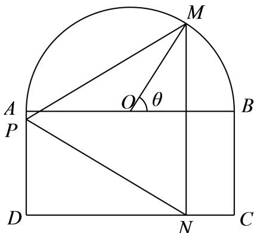

# 2025一模 松江区原卷 · 学生版

> 本地预览：题目、答案及分类尚未全部审定。校对使用的PDF为高中工作台解析版，尚未逐区确认区级印刷原卷。

## 填空题

按本区原卷题号顺序排列。

### 松江 · 第1题

已知集合 $A = [ 4 , + \infty )$ $B = \{ 2 , 4 , 6 , 8 \}$ ，则 $A \cap B =$ =

### 松江 · 第2题

若 $\mathrm { s i n } \theta = \frac { 4 } { 5 }$ ，则 $\mathrm { \ l c o s 2 \theta }$ =

### 松江 · 第3题

函数 $y = \log { ( 3 x + 1 ) } + \sqrt { 1 }$ −x的定义域是

> 本题资料或解析有待核事项，预览不可作为已审定成品。

### 松江 · 第4题

在 $\triangle A B C ^ { \ r }$ 中，角A、B、C所对的边分别为a、b、c，若a = 4， $b = { \sqrt { 3 } } , \ C = { \frac { 5 } { 6 } } \pi$ ，则c = .

### 松江 · 第5题

若复数z满足i⋅z = 2+3i（其中i是虚数单位），则复数z的共轭复数–z =

### 松江 · 第6题

已知一个圆锥的底面半径为3，其侧面积为15π，则该圆锥的高为

### 松江 · 第7题

已知 $( x + 2 ) ^ { 4 } = a _ { 0 } + a _ { 1 } x + a _ { 2 } x ^ { 2 } + a _ { 3 } x ^ { 3 } + a _ { 4 } x ^ { 4 }$ ，则 $a _ { 1 } + a _ { 2 } + a _ { 3 } + a _ { 4 } =$

### 松江 · 第8题

已知等比数列 $\left\{ a _ { n } \right\}$ 中， $\log _ { 2 } a _ { 1 } + \log _ { 2 } a _ { 4 } = 3 , 2 ^ { a _ { 2 } } \cdot 2 ^ { a _ { 3 } } = 6 4$ ，则 $| a _ { 1 0 } =$

### 松江 · 第9题

已知函数 $y = f \left( x \right)$ 的表达式为 $f \left( x \right) = \left\{ { \displaystyle \frac { 3 ^ { x } , x \ge 0 } { 3 ^ { x } } } , 1 \right\} \left. \qquad \right.$ 则满足 $f ( m ) \geq f ( m + 2 )$ 的实数m的最大值为

> 本题资料或解析有待核事项，预览不可作为已审定成品。

### 松江 · 第10题

已知点P为椭圆 ${ \frac { x ^ { 2 } } { 4 } } + { \frac { y ^ { 2 } } { 3 } } = 1$ 上任意一点，EF为圆 $N \colon ( x - 1 ) ^ { 2 } + y ^ { 2 } = 4$ 的任意一条直径，则 $\overrightarrow { P E } \cdot \overrightarrow { P F }$ 的取值范围是

> 本题资料或解析有待核事项，预览不可作为已审定成品。

### 松江 · 第11题

已知平面向量$\vec a$、$\vec b$的夹角为$\theta$，$\vec b-\vec a$与$\vec a$的夹角为$3\theta$，$|\vec a|=1$，$\vec a$和$\vec b-\vec a$在$\vec b$上的投影分别为$x$、$y$，则$x(y+\sin\theta)$的取值范围是______。

> 本题资料或解析有待核事项，预览不可作为已审定成品。

### 松江 · 第12题

交通信号灯由红灯、绿灯、黄灯组成．黄灯设置的时长与路口宽度、限定速度、停车距离有关．根据路况不同，道路的限定速度一般在30千米/小时至70千米/小时之间．由相关数据，驾驶员反应距离 $\dot { \mathbf { \sigma } } _ { s _ { 1 } }$ （单位：米）关于车速v（单位：米/秒）的函数模型为： $s _ { 1 } = 0 . 7 5 8 4 v ;$ ；刹车距离 $\dot { \mathbf { \sigma } } _ { s _ { 2 } }$ （单位：米）关于车速v（单位：米/秒）的函数模型为： $s _ { 2 } = 0 . 0 7 2 v ^ { 2 }$ ，反应距离与刹车距离之和称为停车距离．已知某个十字路口宽度为30米，为保证通行安全，黄灯亮的时间是允许限速车辆离停车线距离小于停车距离的汽车通过十字路口，则该路口黄灯亮的时间最多为 秒（结果精确到0.01秒）．

> 本题资料或解析有待核事项，预览不可作为已审定成品。

## 选择题

按本区原卷题号顺序排列。

### 松江 · 第13题

已知 $\vert a > b > 0$ ，以下四个数中最大的是（ ）

A. b

B. $\sqrt { a b }$

C. ${ \frac { a + b } { 2 } } $

D. ${ \sqrt { \frac { a ^ { 2 } + b ^ { 2 } } { 2 } } }$

### 松江 · 第14题

渐进式延迟退休方案是指采取较缓而稳妥的方式逐步延长退休年龄．对于男职工，新方案将延迟法定退休年龄每4个月延迟1个月，逐步将男职工的法定退休年龄从原六十周岁延迟至六十三周岁．如果男职工延迟法定退休年龄部分对照表如下表所示：

| 出生时间 | 1965年1月—4月 | 1965年5月—8月 | 1965年9月—12月 | 1966年1月—4月 | … |
|---|---|---|---|---|---|
| 改革后法定退休年龄 | 60岁＋1个月 | 60岁＋2个月 | 60岁＋3个月 | 60岁＋4个月 | … |

那么1974年5月出生的男职工退休年龄为（ ）

A. 62岁3个月

B. 62岁4个月

C. 62岁5个月

D. 63岁

> 本题资料或解析有待核事项，预览不可作为已审定成品。

### 松江 · 第15题

抛掷三枚硬币，若记“出现三个正面”、“两个正面一个反面”和“两个反面一个正面”分别为事件A、B和C，则下列说法错误的是（ ）

A. 事件A、B和C两两互斥

B. $P \left( A \right) + P \left( B \right) + P \left( C \right) = \frac { 7 } { 8 }$

C. 事件A与事件 $B \cup C$ 是对立事件

D. 事件 $A \cup B { \stackrel {  } { \exists } } B \cup C$ 相互独立

> 本题资料或解析有待核事项，预览不可作为已审定成品。

### 松江 · 第16题

设函数y = f (x)与 $y = g \left( x \right)$ 均是定义在R上的函数，有以下两个命题：①若y = f (x)是周期函数，且是R上的减函数，则函数y = f(x)必为常值函数；②若对任意的a， $b \in \mathbf { R }$ ，有$\left| f \left( a \right) - f \left( b \right) \right| \leq \left| g \left( a \right) - g \left( b \right) \right|$ |成立，且 $y = g \left( x \right)$ 是R上的增函数，则 $y = f \left( x \right) - g \left( x \right)$ 是R上的增函数．则以下选项正确的是（ ）

A. ①是真命题，②是假命题

B. 两个都是真命题

C. ①是假命题，②是真命题

D. 两个都是假命题

## 解答题

按本区原卷题号顺序排列。

### 松江 · 第17题

某日用品按行业质量标准分成五个等级，等级系数X依次为1、2、3、4、5，现从一批该日用品中随机抽取20件，对其等级系数进行统计分析，得到频率分布表如下：

| $X$ | $1$ | $2$ | $3$ | $4$ | $5$ |
|---|---|---|---|---|---|
| $f$ | $a$ | $0.2$ | $0.45$ | $b$ | $c$ |

(1) (6分)若所抽取的20件日用品中，等级系数为4的恰有3件，等级系数为5的恰有2件，求a、b、c的值；
(2) (8分)在（1）的条件下，将等级系数为4的3件日用品记为 $x _ { 1 } , \ x _ { 2 } , \ x _ { 3 }$ ，等级系数为5的2件日用品记为y1、y2，现从x1、x2、x3、y1、y2这5件日用品中任取两件（假定每件日用品被取出的可能性相同），写出所有可能的结果，并求这两件日用品的等级系数恰好相等的概率

> 本题资料或解析有待核事项，预览不可作为已审定成品。

### 松江 · 第18题

如图，已知AB⊥平面ACD，AB∥DE， $\triangle A C D$ 为等边三角形， $A D = D E = 2 A B$ ，F为CD的中点

（1）求证：AF∥平面BCE；
（2）求直线AD和平面BCE所成角的正弦值

### 松江 · 第19题

整治人居环境，打造美丽乡村，某村准备将一块由一个半圆和长方形组成的空地进行美化，如图，长方形的边AB为半圆的直径，O为半圆的圆心， $A B = 2 A D = 2 0 0 \mathrm { m }$ ，现要将此空地规划出一个等腰三角形区域PMN（底边 $M N \bot C D )$ 种植观赏树木，其余的区域种植花卉.设
$$
\angle M O B = \theta , \theta \in \left(0, \frac {\pi}{2} \right]
$$

(1) (6分)当 $\theta = \frac { \pi } { 3 }$ 时，求MN的长；
(2) (8分)求三角形区域PMN面积的最大值.

### 松江 · 第20题

如果一条双曲线的实轴和虚轴分别是一个椭圆的长轴和短轴，则称它们为“共轴”曲线．若双曲线 $C _ { 1 }$ 与椭圆 $C _ { 2 }$ 是“共轴”曲线，且椭圆 $C _ { 2 } \colon \frac { x ^ { 2 } } { 9 } + \frac { y ^ { 2 } } { b ^ { 2 } } = 1 ( 0 < b < 3 )$ $e _ { 1 } e _ { 2 } = { \frac { 4 { \sqrt { 5 } } } { 9 } } ( e _ { 1 }$ 、 $e _ { 2 }$ 分别为曲线 $\wp$ 、 $C _ { 2 }$ 的离心率）．已知点M(1,0)，点P为双曲线 $C _ { 1 }$ 上任意一点
(1) (4分)求双曲线 $C _ { 1 }$ 的方程；
(2) (6分)延长线段PM到点Q，且 $| P M | = 2 \left| M Q \right|$ ，若点Q在椭圆 $C _ { 2 }$ 上，试求点P的坐标；
(3) (8分)若点P在双曲线 $C _ { 1 }$ 的右支上，点A、B分别为双曲线 $C _ { 1 }$ 的左、右顶点，直线PM交双曲线的左支于点R，直线AP、BR的斜率分别为 $\mathit { \iota } _ { A P \setminus } \ k _ { B R }$ ．是否存在实数λ，使得 $k _ { A P } = \lambda k _ { B R } ?$ 若存在，求出λ的值；若不存在，请说明理由

> 本题资料或解析有待核事项，预览不可作为已审定成品。

### 松江 · 第21题

定义在D上的函数 $\cdot y = f \left( x \right)$ ，若对任意不同的两点 $A \left( x _ { 1 } , f \left( x _ { 1 } \right) \right) , B \left( x _ { 2 } , f \left( x _ { 2 } \right) \right) \left( x _ { 1 } < x _ { 2 } \right)$ ，都存在${ \boldsymbol x } _ { 0 } \in ( x _ { 1 } , x _ { 2 } )$ ，使得函数 $y = f \left( x \right)$ 在x 处的切线l与直线AB平行，则称函数 $\cdot y = f \left( x \right)$ 在D上处处相依，其中l称为直线AB的相依切线， $( x _ { 1 } , x _ { 2 } )$ 为函数 $\scriptstyle \left( y = f \left( x \right) \right.$ 在x 的相依区间．已知
$$
f (x) = - (a + 1) x ^ {2} + a x.
$$
(1) (4分)当a = 2时，函数 $F \left( x \right) = x ^ { 3 } + f \left( x \right)$ 在R上处处相依，证明：导函数 $\left[ { { y } = { F ^ { \prime } } \left( x \right) } \right.$ 在(0, 1)上有零点；
(2) (6分)若函数 ${ \tilde { \tau } } \left( x \right) = \ln x + { \frac { f \left( x \right) } { x ^ { 2 } } }$ 在 $( 0 , + \infty )$ 上处处相依，且对任意实数m、n， $m > n > 0$ 都有 $\frac { G \left( m \right) - G \left( n \right) } { m - n } \leq$ 1恒成立，求实数a的取值范围
(3) (8分)当a = 0时， $H \left( x \right) = \frac { \mathrm { e } ^ { x } } { \sqrt { - f \left( x \right) } } \left( x > 0 \right)$ $( x _ { 1 } , x _ { 2 } )$ 为函数 $\begin{array} { r } { \boldsymbol { y } = \boldsymbol { H } \left( \boldsymbol { x } \right) \mathcal { \left[ \pm \boldsymbol { x } \right. } \boldsymbol { x } _ { 0 } = 1 } \end{array}$ 的相依区间，证明： $x _ { 1 } + x _ { 2 } > 2$

> 本题资料或解析有待核事项，预览不可作为已审定成品。

