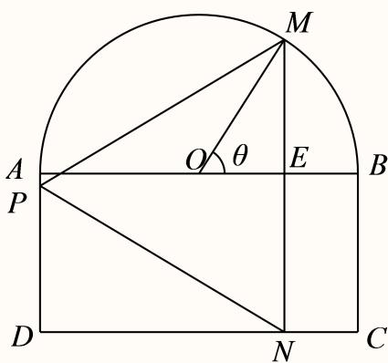
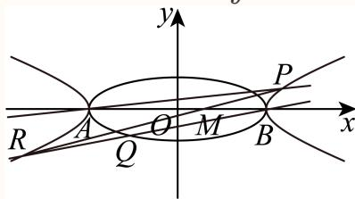

# 2025一模 松江区原卷 · 教师版

> 本地预览：题目、答案及分类尚未全部审定。校对使用的PDF为高中工作台解析版，尚未逐区确认区级印刷原卷。

## 填空题

按本区原卷题号顺序排列。

### 松江 · 第1题

已知集合 $A = [ 4 , + \infty )$ $B = \{ 2 , 4 , 6 , 8 \}$ ，则 $A \cap B =$ =

**考点：** 数集交集

**难度依据：** 数集交集；按所需步骤与推理量估计

**核查说明：** 题干与解析已用于人工归类，尚未完成整题公式校净与独立数学终审。

【答案】{4, 6, 8}.

【解析】

找出集合A与集合B的公共元素，即可确定出交集

因为集合 $A = [ 4 , + \infty ) , \ B = \{ 2 , 4 , 6 , 8 \}$

所以 $A \cap B = \{ 4 , 6 , 8 \}$ .

故答案为：{4, 6, 8}.

### 松江 · 第2题

若 $\mathrm { s i n } \theta = \frac { 4 } { 5 }$ ，则 $\mathrm { \ l c o s 2 \theta }$ =

**考点：** 二倍角公式

**难度依据：** 二倍角公式；按所需步骤与推理量估计

**核查说明：** 题干与解析已用于人工归类，尚未完成整题公式校净与独立数学终审。

【答案】$- { \frac { 7 } { 2 5 } }$

【解析】

∵ sinθ = 4 ,

$$
\cos 2 \theta = 1 - 2 \sin^ {2} \theta = 1 - 2 \times \left(\frac {4}{5}\right) ^ {2} = - \frac {7}{2 5},
$$

故答案为 $- { \frac { 7 } { 2 5 } }$

### 松江 · 第3题

函数 $y = \log { ( 3 x + 1 ) } + \sqrt { 1 }$ −x的定义域是

> 本题资料或解析有待核事项，预览不可作为已审定成品。

**考点：** 对数根式定义域；定义域不等式组

**难度依据：** 对数根式定义域；定义域不等式组；按所需步骤与推理量估计

**核查说明：** 题干与解析已用于人工归类，尚未完成整题公式校净与独立数学终审。；题干根号覆盖范围错误，解析为√(1−x)，须回源。

【答案】$\left( - { \frac { 1 } { 3 } } , 1 \right]$

【解析】

根据函数的解析式，列出使解析式有意义的不等式组，求出解集即可

要使函数 $\begin{array} { r } { \dot { \boldsymbol { y } } = \mathbb { g } \left( 3 \boldsymbol { x } + 1 \right) + \sqrt { 1 - \boldsymbol { x } } } \end{array}$ 有意义，则 $\left\{ { \begin{array} { l } { 3 x + 1 > 0 } \\ { 1 - x \geq 0 } \end{array} } \right.$ ，解得 $- { \frac { 1 } { 3 } } < x \leq 1$

即函数 $\begin{array} { r } { \dot { \boldsymbol { \cdot } } \boldsymbol { y } = \mathrm { l g } \left( 3 x + 1 \right) + \sqrt { 1 - x } } \end{array}$ 的定义域为 $\left( - { \frac { 1 } { 3 } } , 1 \right]$ .

故答案为： $\left( - { \frac { 1 } { 3 } } , 1 \right]$

### 松江 · 第4题

在 $\triangle A B C ^ { \ r }$ 中，角A、B、C所对的边分别为a、b、c，若a = 4， $b = { \sqrt { 3 } } , \ C = { \frac { 5 } { 6 } } \pi$ ，则c = .

**考点：** 余弦定理求边

**难度依据：** 余弦定理求边；按所需步骤与推理量估计

**核查说明：** 题干与解析已用于人工归类，尚未完成整题公式校净与独立数学终审。

【答案】${ \sqrt { 3 1 } } .$

【解析】

由余弦定理可得答案.

$$
c ^ {2} = a ^ {2} + b ^ {2} - 2 a b \cos C = 1 6 + 3 - 2 \times 4 \times \sqrt {3} \times \left(- \frac {\sqrt {3}}{2}\right) = 3 1,
$$

$$
\therefore c = \sqrt {3 1},
$$

故答案为： ${ \sqrt { 3 1 } } .$

### 松江 · 第5题

若复数z满足i⋅z = 2+3i（其中i是虚数单位），则复数z的共轭复数–z =

**考点：** 复数除法与共轭

**难度依据：** 复数除法与共轭；按所需步骤与推理量估计

**核查说明：** 题干与解析已用于人工归类，尚未完成整题公式校净与独立数学终审。

【答案】3+2i.

【解析】

利用复数的除法运算得到z，根据共轭复数的定义即可得到结果.

由题意得， $z = { \frac { 2 + 3 \mathrm { i } } { \mathrm { i } } } = { \frac { ( 2 + 3 \mathrm { i } ) \mathrm { i } } { \mathrm { i } ^ { 2 } } } = { \frac { - 3 + 2 \mathrm { i } } { - 1 } } = 3 - 2 \mathrm { i } ,$

∴–z = 3 + 2i.

故答案为：3+2i.

### 松江 · 第6题

已知一个圆锥的底面半径为3，其侧面积为15π，则该圆锥的高为

**考点：** 圆锥侧面积与高

**难度依据：** 圆锥侧面积与高；按所需步骤与推理量估计

**核查说明：** 题干与解析已用于人工归类，尚未完成整题公式校净与独立数学终审。

【答案】4

【解析】

根据给定条件，利用侧面积公式求出母线长，进而求出圆锥的高.

圆锥的底面半径r = 3，设其母线长为l，则 $\pi r l = 1 5 \pi$ ，解得l = 5，

所以该圆锥的高 $h = { \sqrt { l ^ { 2 } - r ^ { 2 } } } = { \sqrt { 5 ^ { 2 } - 3 ^ { 2 } } } = 4 .$

故答案为：4

### 松江 · 第7题

已知 $( x + 2 ) ^ { 4 } = a _ { 0 } + a _ { 1 } x + a _ { 2 } x ^ { 2 } + a _ { 3 } x ^ { 3 } + a _ { 4 } x ^ { 4 }$ ，则 $a _ { 1 } + a _ { 2 } + a _ { 3 } + a _ { 4 } =$

**考点：** 赋值法求系数和

**难度依据：** 赋值法求系数和；按所需步骤与推理量估计

**核查说明：** 题干与解析已用于人工归类，尚未完成整题公式校净与独立数学终审。

【答案】65.

【解析】

根据二项展开式，利用赋值法求解.

${ \stackrel { \wedge } { \sim } } x = 0 .$ ，则有 $a _ { 0 } = 2 ^ { 4 } = 1 6$

再 $\stackrel { \wedge } { \prec } x = 1$ ，则有 $\therefore a _ { 0 } + a _ { 1 } + a _ { 2 } + a _ { 3 } + a _ { 4 } = 3 ^ { 4 } = 8 1$

所以 $a _ { 1 } + a _ { 2 } + a _ { 3 } + a _ { 4 } = 8 1 - 1 6 = 6 5$

故答案为：65.

### 松江 · 第8题

已知等比数列 $\left\{ a _ { n } \right\}$ 中， $\log _ { 2 } a _ { 1 } + \log _ { 2 } a _ { 4 } = 3 , 2 ^ { a _ { 2 } } \cdot 2 ^ { a _ { 3 } } = 6 4$ ，则 $| a _ { 1 0 } =$

**考点：** 等比性质与对数指数转和积

**难度依据：** 等比性质与对数指数转和积；按所需步骤与推理量估计

**核查说明：** 题干与解析已用于人工归类，尚未完成整题公式校净与独立数学终审。

【答案】512或 $\frac { 1 } { 6 4 }$

【解析】

根据等比数列的性质可求 $. a _ { 1 0 }$ 的值.

因为 $\log _ { 2 } { a _ { 1 } } + \log _ { 2 } { a _ { 4 } } = \log _ { 2 } { ( a _ { 1 } \cdot a _ { 4 } ) } = 3$ ，所以 $\boldsymbol { a } _ { 1 } \cdot \boldsymbol { a } _ { 4 } = \boldsymbol { a } _ { 2 } \cdot \boldsymbol { a } _ { 3 } = 8$

因为 $1 2 ^ { a _ { 2 } } \cdot 2 ^ { a _ { 3 } } = 2 ^ { a _ { 2 } + a _ { 3 } } = 6 4$ ，所 $\textcircled { \cdot } \lambda a _ { 2 } + a _ { 3 } = 6$ ，解得 $a _ { 2 } = 2 , a _ { 3 } = 4 \sharp \hat { \chi } a _ { 2 } = 4 , a _ { 3 } = 2$

$\ Y _ { a _ { 2 } } = 2 , a _ { 3 } = \cdot$ 4时，q = 2，所以 $a _ { 1 0 } = 2 \times 2 ^ { 8 } = 5 1 2$ ；

当 $a _ { 2 } = 4 , a _ { 3 } = \dot { 2 }$ 2时， $q = \frac 1 2$ ，所以 $. a _ { 1 0 } = 4 \times { \bigg ( } { \frac { 1 } { 2 } } { \bigg ) } ^ { 8 } = { \frac { 1 } { 6 4 } } .$

故答案为：512或 $\frac { 1 } { 6 4 }$

### 松江 · 第9题

已知函数 $y = f \left( x \right)$ 的表达式为 $f \left( x \right) = \left\{ { \displaystyle \frac { 3 ^ { x } , x \ge 0 } { 3 ^ { x } } } , 1 \right\} \left. \qquad \right.$ 则满足 $f ( m ) \geq f ( m + 2 )$ 的实数m的最大值为

> 本题资料或解析有待核事项，预览不可作为已审定成品。

**考点：** 分段函数偶性及单调性；绝对值比较

**难度依据：** 分段函数偶性及单调性；绝对值比较；按所需步骤与推理量估计

**核查说明：** 题干与解析已用于人工归类，尚未完成整题公式校净与独立数学终审。；分段函数表达式严重损坏；不能仅依据解析补正文。

【答案】−1.

【解析】

结合偶函数定义可得f(x)为偶函数，再利用指数函数对称性解出不等式即可得.

当x > 0时，有 $f \left( - x \right) = { \frac { 1 } { 3 ^ { - x } } } = 3 ^ { x } = f \left( x \right)$ ，又f (x)定义域为R，故f (x)为偶函数，

又当x > 0时，f(x)单调递增，故对 $f \left( m \right) \geq f \left( m + 2 \right)$ 有 $| m | \geq | m + 2 |$ |

即 $m ^ { 2 } \geq \left( m + 2 \right) ^ { 2 }$ ，即有 $4 m + 4 \leq 0$ ，解得 $: m \leq - 1$

故m的最大值为−1.

故答案为：−1.

### 松江 · 第10题

已知点P为椭圆 ${ \frac { x ^ { 2 } } { 4 } } + { \frac { y ^ { 2 } } { 3 } } = 1$ 上任意一点，EF为圆 $N \colon ( x - 1 ) ^ { 2 } + y ^ { 2 } = 4$ 的任意一条直径，则 $\overrightarrow { P E } \cdot \overrightarrow { P F }$ 的取值范围是

> 本题资料或解析有待核事项，预览不可作为已审定成品。

**考点：** 数量积转距离平方；椭圆与焦点距离最值

**难度依据：** 数量积转距离平方；椭圆与焦点距离最值；按所需步骤与推理量估计

**核查说明：** 题干与解析已用于人工归类，尚未完成整题公式校净与独立数学终审。；解析中向量数量积与夹角余弦的符号步骤不一致，需审校。

【答案】[−3,5]

【解析】

利用向量运算将 $\overrightarrow { P E } \cdot \overrightarrow { P F }$ 转化为 $| - 4 + | \overrightarrow { N P } | ^ { 2 } .$ ，通过求 $| N P |$ 的取值范围来求得正确答案圆N的圆心为N(1,0)，半径为2.

因为PE ⋅ PF = (NE − NP) ⋅ (NF − NP)= NE ⋅ NF − NP ⋅ (NE + NF) + NP−−→ → → → → → → → → → → →

$$
= - \left| \overrightarrow {N E} \right| \cdot \left| \overrightarrow {N F} \right| \cdot \cos \pi - 0 + \left| \overrightarrow {N P} \right| ^ {2} = - 4 + \left| \overrightarrow {N P} \right| ^ {2}.
$$

又因为椭圆 ${ \frac { x ^ { 2 } } { 4 } } + { \frac { y ^ { 2 } } { 3 } } = 1$ 的 $\quad | a = 2 , b = { \sqrt { 3 } } , c = 1$ $N \left( 1 ~ , ~ 0 \right)$ 为椭圆的右焦点，

$$
P \left(x _ {0}, y _ {0}\right), \frac {x _ {0} ^ {2}}{4} + \frac {y _ {0} ^ {2}}{3} = 1, y _ {0} ^ {2} = 3 \left(1 - \frac {x _ {0} ^ {2}}{4}\right) = 3 - \frac {3 x _ {0} ^ {2}}{4},
$$

$$
| N P | = \sqrt {\left(x _ {0} - 1\right) ^ {2} + y _ {0} ^ {2}} = \sqrt {x _ {0} ^ {2} - 2 x _ {0} + 1 + 3 - \frac {3 x _ {0} ^ {2}}{4}}
$$

$$
= \sqrt {\frac {x _ {0} ^ {2}}{4} - 2 x _ {0} + 4} = \sqrt {\frac {x _ {0} ^ {2} - 8 x _ {0} + 1 6}{4}} = \sqrt {\frac {(x _ {0} - 4) ^ {2}}{4}} = \frac {4 - x _ {0}}{2} = 2 - \frac {1}{2} x _ {0},
$$

$$
- 2 \leq x _ {0} \leq 2, - 1 \leq - \frac {1}{2} x _ {0} \leq 1, 1 \leq 2 - \frac {1}{2} x _ {0} \leq 3,
$$

所以 $N P | \in [ 1 , 3 ] , | N P | ^ { 2 } \in [ 1 , 9 ]$

$$
\therefore \overrightarrow {P E} \cdot \overrightarrow {P F} \in [ - 3, 5 ].
$$

故答案为：[−3,5]

### 松江 · 第11题

已知平面向量$\vec a$、$\vec b$的夹角为$\theta$，$\vec b-\vec a$与$\vec a$的夹角为$3\theta$，$|\vec a|=1$，$\vec a$和$\vec b-\vec a$在$\vec b$上的投影分别为$x$、$y$，则$x(y+\sin\theta)$的取值范围是______。

> 本题资料或解析有待核事项，预览不可作为已审定成品。

**考点：** 投影与向量三角形；正弦定理和三角最值

**难度依据：** 需从向量投影还原三角关系，再用正弦定理处理最值；原题符号待核，评级暂定。

**核查说明：** 仅恢复题干；解析和其他题目未全面校净、未数学终审。；原解仍有向量模长等乱码及其他未审内容，需继续回核。；仅核本题所列字段及页面；不等于全卷终审。；题干与解析已用于人工归类，尚未完成整题公式校净与独立数学终审。；题干向量和投影对象乱码，需核题图及原卷。

【答案】$\left(\frac{\sqrt3-1}{4},\frac{\sqrt2}{2}\right]$

【解析】

根据题意可知 $\vec b-\vec a$ 与 $\vec b$ 的夹角为 $2\theta$，根据正弦定理可得 $|\vec b-\vec a|=\frac1{2\cos\theta}$，再根据投影定义表示 $x,y$，最后化简 $x(y+\sin\theta)$ 并利用三角函数性质求解。

因为平面向量 $\vec a,\vec b$ 的夹角为 $\theta$，$\vec b-\vec a$ 与 $\vec a$ 的夹角为 $3\theta$，所以 $\vec b-\vec a$ 与 $\vec b$ 的夹角为 $2\theta$。

由正弦定理，$\frac{|\vec b-\vec a|}{\sin\theta}=\frac{|\vec a|}{\sin2\theta}$，且 $|\vec a|=1$，所以 $|\vec b-\vec a|=\frac1{2\cos\theta}$。

因为 $0<\theta<\pi,0<2\theta<\pi,0<3\theta<\pi$，所以 $0<\theta<\frac\pi3$。

$\vec a$ 在 $\vec b$ 上的投影为 $x=|\vec a|\cos\theta=\cos\theta$，

$\vec b-\vec a$ 在 $\vec b$ 上的投影为 $y=|\vec b-\vec a|\cos2\theta=\frac{\cos2\theta}{2\cos\theta}$。

所以

$$x(y+\sin\theta)=\cos\theta\left(\frac{\cos2\theta}{2\cos\theta}+\sin\theta\right)=\frac12\cos2\theta+\frac12\sin2\theta=\frac{\sqrt2}{2}\sin\left(2\theta+\frac\pi4\right).$$

因为 $0<\theta<\frac\pi3$，所以 $0<2\theta<\frac{2\pi}{3}$，$\frac\pi4<2\theta+\frac\pi4<\frac{11\pi}{12}$。

$$\frac{\sqrt2}{2}\sin\frac{11\pi}{12}=\frac{\sqrt2}{2}\sin\frac{2\pi}{3}\cos\frac\pi4+\frac{\sqrt2}{2}\cos\frac{2\pi}{3}\sin\frac\pi4=\frac{\sqrt3-1}{4}.$$

当 $2\theta+\frac\pi4=\frac\pi2$ 时取得最大值 $\frac{\sqrt2}{2}$。

故 $x(y+\sin\theta)$ 的取值范围为 $\left(\frac{\sqrt3-1}{4},\frac{\sqrt2}{2}\right]$。

关键点点睛：此题考查平面向量、向量投影和三角函数恒等变换，关键是根据投影概念表示出 $x,y$。

### 松江 · 第12题

交通信号灯由红灯、绿灯、黄灯组成．黄灯设置的时长与路口宽度、限定速度、停车距离有关．根据路况不同，道路的限定速度一般在30千米/小时至70千米/小时之间．由相关数据，驾驶员反应距离 $\dot { \mathbf { \sigma } } _ { s _ { 1 } }$ （单位：米）关于车速v（单位：米/秒）的函数模型为： $s _ { 1 } = 0 . 7 5 8 4 v ;$ ；刹车距离 $\dot { \mathbf { \sigma } } _ { s _ { 2 } }$ （单位：米）关于车速v（单位：米/秒）的函数模型为： $s _ { 2 } = 0 . 0 7 2 v ^ { 2 }$ ，反应距离与刹车距离之和称为停车距离．已知某个十字路口宽度为30米，为保证通行安全，黄灯亮的时间是允许限速车辆离停车线距离小于停车距离的汽车通过十字路口，则该路口黄灯亮的时间最多为 秒（结果精确到0.01秒）．

> 本题资料或解析有待核事项，预览不可作为已审定成品。

**考点：** 停车距离模型的时间优化

**难度依据：** 需建立速度与距离时间函数并比较区间；题意和源解有冲突，评级暂定。

**核查说明：** 题干与解析已用于人工归类，尚未完成整题公式校净与独立数学终审。；题目求时间最多，源解直接取最大速度而未比较整个速度区间，需独立检验。；按底稿模型比较区间端点，30 km/h对应约4.96秒，大于70 km/h约3.70秒；需回核正式题意，不能直接替换源答案。

【解析】

依题意求出反应距离 $S _ { 1 }$ ，刹车距离 $S _ { 2 }$ ，即可得到路程s，再根据速度、路程、时间的关系计算可得；

解：依题意当小汽车最大限速 $v = 7 0 \mathrm { { k m } / h }$ （约 $| 1 9 . 4 4 \mathrm { m / s } )$ ）时，

反应距离 $S _ { 1 } = 0 . 7 5 8 4 \times 1 9 . 4 4 \approx 1 4 . 7 4 3 2 \mathrm { m }$ ，刹车距离 $S _ { 2 } = 0 . 0 7 2 \times 1 9 . 4 4 ^ { 2 } \approx 2 7 . 2 0 9 8 \mathrm { m }$ 又路口宽度为30m，所以 $\displaystyle { \mathcal { S } } = 4 1 . 9 5 3 + 3 0 = 7 1 . 9 5 3 \mathrm { m }$ 所以时间 $| t = { \frac { s } { v } } = { \frac { 7 1 . 9 5 3 } { 1 9 . 4 4 } } \approx 3 . 7 0 { \mathrm { s } }$ 故答案为：3.70

## 二、选择题

## 选择题

按本区原卷题号顺序排列。

### 松江 · 第13题

已知 $\vert a > b > 0$ ，以下四个数中最大的是（ ）

A. b

B. $\sqrt { a b }$

C. ${ \frac { a + b } { 2 } } $

D. ${ \sqrt { \frac { a ^ { 2 } + b ^ { 2 } } { 2 } } }$

**考点：** 算术几何均值与平方平均比较

**难度依据：** 算术几何均值与平方平均比较；按所需步骤与推理量估计

**核查说明：** 题干与解析已用于人工归类，尚未完成整题公式校净与独立数学终审。

【答案】D

【解析】

首先得 ${ \frac { a + b } { 2 } } > { \sqrt { a b } } > b$ ，而 ${ \sqrt { \frac { a ^ { 2 } + b ^ { 2 } } { 2 } } } , { \frac { a + b } { 2 } }$ 都是正数，故只需让它们的平方作差与0比较大小即可.由题意 $a > b > 0$ ，所以 $b = { \sqrt { b ^ { 2 } } } < { \sqrt { a b } }$ 由基本不等式可得 ${ \frac { a + b } { 2 } } \geq { \sqrt { a b } }$ 同时注意到 $\rfloor a \neq b$ ，所以 ${ \frac { a + b } { 2 } } > { \sqrt { a b } } > b$ $\left( { \sqrt { \frac { a ^ { 2 } + b ^ { 2 } } { 2 } } } \right) ^ { 2 } - \left( { \frac { a + b } { 2 } } \right) ^ { 2 } = { \frac { a ^ { 2 } + b ^ { 2 } } { 2 } } - { \frac { a ^ { 2 } + 2 a b + b ^ { 2 } } { 4 } } = { \frac { \left( a - b \right) ^ { 2 } } { 4 } } > 0 ,$ 4而 ${ \sqrt { \frac { a ^ { 2 } + b ^ { 2 } } { 2 } } } , { \frac { a + b } { 2 } }$ 都是正数，所以 ${ \sqrt { \frac { a ^ { 2 } + b ^ { 2 } } { 2 } } } > { \frac { a + b } { 2 } } > { \sqrt { a b } } > b$ 故选：D.

### 松江 · 第14题

渐进式延迟退休方案是指采取较缓而稳妥的方式逐步延长退休年龄．对于男职工，新方案将延迟法定退休年龄每4个月延迟1个月，逐步将男职工的法定退休年龄从原六十周岁延迟至六十三周岁．如果男职工延迟法定退休年龄部分对照表如下表所示：

| 出生时间 | 1965年1月—4月 | 1965年5月—8月 | 1965年9月—12月 | 1966年1月—4月 | … |
|---|---|---|---|---|---|
| 改革后法定退休年龄 | 60岁＋1个月 | 60岁＋2个月 | 60岁＋3个月 | 60岁＋4个月 | … |

那么1974年5月出生的男职工退休年龄为（ ）

A. 62岁3个月

B. 62岁4个月

C. 62岁5个月

D. 63岁

> 本题资料或解析有待核事项，预览不可作为已审定成品。

**考点：** 等差数列通项与退休年龄

**难度依据：** 等差数列通项与退休年龄；按所需步骤与推理量估计

**核查说明：** 题干与解析已用于人工归类，尚未完成整题公式校净与独立数学终审。；退休对照表缺失，不能复核具体数据。

【答案】C

【解析】

构造等差数列得出公差及首项，再应用等差数列通项公式计算即可.

设1965年5月出生的男职工退休年龄为 $( a _ { 1 } = 6 0 \frac { 1 } { 6 }$ 岁，则1966年5月出生的男职工退休年龄为$a _ { 2 } = 6 0 { \frac { 1 } { 6 } } + { \frac { 1 } { 4 } } { \frac { { \scriptscriptstyle 4 } { \scriptscriptstyle 4 } } { \scriptscriptstyle 5 } }$

所以公差为 $\frac 1 4$ ，设5月出生的男职工退休年龄为 $\{ a _ { n } \} , \{ a _ { n } \}$ 是首项为 $1 6 0 \frac { 1 } { 6 }$ ,公差为 $\frac 1 4$ 的等差数列，

1974年5月出生的男职工退休年龄为 $\displaystyle { \lvert a _ { 1 0 } = 6 0 \frac { 1 } { 6 } + 9 \times \frac { 1 } { 4 } = 6 2 \frac { 5 } { 1 2 } }$

故1974年5月出生的男职工退休年龄为62岁5个月.

故选：C.

### 松江 · 第15题

抛掷三枚硬币，若记“出现三个正面”、“两个正面一个反面”和“两个反面一个正面”分别为事件A、B和C，则下列说法错误的是（ ）

A. 事件A、B和C两两互斥

B. $P \left( A \right) + P \left( B \right) + P \left( C \right) = \frac { 7 } { 8 }$

C. 事件A与事件 $B \cup C$ 是对立事件

D. 事件 $A \cup B { \stackrel {  } { \exists } } B \cup C$ 相互独立

> 本题资料或解析有待核事项，预览不可作为已审定成品。

**考点：** 互斥对立与独立事件

**难度依据：** 互斥对立与独立事件；按所需步骤与推理量估计

**核查说明：** 题干与解析已用于人工归类，尚未完成整题公式校净与独立数学终审。；D选项事件符号识别损坏，须回源。

【答案】C

【解析】

利用互斥事件的定义判断A，；利用互斥事件概率加法公式求解判断B；利用对立事件的定义判断C；利用相互独立事件判断D.

抛掷三枚硬币，样本空间Ω = {(正,正,正),(正,正,反),(正,反,正),(反,正,正),

(正,反,反),(反,正,反),(反,反,正),(反,反,反)}，共8个样本点，

事件 $A = \{ ( \overline { { \mathbb { E } } } , \overline { { \mathbb { E } } } , \overline { { \mathbb { E } } } ) \}$ }， $B = \{ ( \overline { { \mathrm { I E } } } , \overline { { \mathrm { I E } } } , \overline { { \mathrm { \Omega } } } )$ ,(正,反,正),(反,正,正)}， $C = \{ ( \overline { { \mathbb { L } } } , \overline { { \mathbb { L } } } , \overline { { \mathbb { L } } } ) , ( \overline { { \mathbb { L } } } , \overline { { \mathbb { L } } } , \overline { { \mathbb { L } } } ) , ( \overline { { \mathbb { L } } } .$ 反,正)}，

对于A，事件A,B,C中任何两个事件都不能同时发生，事件A,B,C两两互斥，A正确；

对于B， $P \left( A \right) + P \left( B \right) + P \left( C \right) = \frac { 1 } { 8 } + \frac { 3 } { 8 } + \frac { 3 } { 8 } = \frac { 7 } { 8 }$ ，B正确；

对于C，事件A与 $B \cup C { \overline { { \mathsf { H } } } }$ 以同时不发生，事件A与事件 $B \cup C$ 不是对立事件，C错误；

对于D， $P \left( A + B \right) = P \left( A \right) + P \left( B \right) = \frac { 1 } { 8 } + \frac { 3 } { 8 } = \frac { 1 } { 2 } ,$

$$
P (B + C) = P (B) + P (C) = \frac {3}{8} + \frac {3}{8} = \frac {3}{4},
$$

$P \left[ ( A \cup B ) \cap ( B \cup C ) \right] = P \left( B \right) = { \frac { 3 } { 8 } } = P \left( A \cup B \right) P \left( B \cup C \right)$ ，则事件A∪B，B∪C相互独立，D正确.

故选：C

### 松江 · 第16题

设函数y = f (x)与 $y = g \left( x \right)$ 均是定义在R上的函数，有以下两个命题：①若y = f (x)是周期函数，且是R上的减函数，则函数y = f(x)必为常值函数；②若对任意的a， $b \in \mathbf { R }$ ，有$\left| f \left( a \right) - f \left( b \right) \right| \leq \left| g \left( a \right) - g \left( b \right) \right|$ |成立，且 $y = g \left( x \right)$ 是R上的增函数，则 $y = f \left( x \right) - g \left( x \right)$ 是R上的增函数．则以下选项正确的是（ ）

A. ①是真命题，②是假命题

B. 两个都是真命题

C. ①是假命题，②是真命题

D. 两个都是假命题

**考点：** 周期单调函数与函数增量；命题判断与反例

**难度依据：** 周期单调函数与函数增量；命题判断与反例；按所需步骤与推理量估计

**核查说明：** 题干与解析已用于人工归类，尚未完成整题公式校净与独立数学终审。

【答案】A

【解析】

用反证法判断命题①，用反例判断命题②

①若y = f(x)是周期函数，设T是它的正周期，即 $f ( x ) = f ( x + T )$

$$
x _ {1} <   x _ {2}
$$

$$
f (x _ {1}) \neq f (x _ {2})
$$

$$
f (x _ {1}) \geq f (x _ {2})
$$

$$
f (x _ {1}) > f (x _ {2})
$$

$$
l n = \left[ \frac {x _ {2} - x _ {1}}{T} \right] + 1
$$

$$
\left[ \frac {x _ {2} - x _ {1}}{T} \right]
$$

$$
\frac {x _ {2} - x _ {1}}{T}
$$

$$
x _ {1} + n T > x _ {2}
$$

$$
f (x _ {1}) = f (x _ {1} + n T)
$$

所以 $f ( x _ { 1 } + n T ) > f ( x _ { 2 } )$ ，这是f(x)是减函数矛盾，所以 $f ( x _ { 1 } ) \neq f ( x _ { 2 } )$ 不成立，

所以 $f ( x _ { 1 } ) = f ( x _ { 2 } )$ ，即f(x)是常值函数，①是真命题；

②取 $f ( x ) = x , g ( x ) = 2 x$ ，则对任意的 $a , b , | f ( a ) - f ( b ) | = | a - b | , | g ( a ) - g ( b ) | = 2 | a - b |$

满足 $\left| f \left( a \right) - f \left( b \right) \right| \leq \left| g \left( a \right) - g \left( b \right) \right|$

但 $f ( x ) - g ( x ) = - x$ 是减函数，②是假命题

故选：A

## 三、解答题

## 解答题

按本区原卷题号顺序排列。

### 松江 · 第17题

某日用品按行业质量标准分成五个等级，等级系数X依次为1、2、3、4、5，现从一批该日用品中随机抽取20件，对其等级系数进行统计分析，得到频率分布表如下：

| $X$ | $1$ | $2$ | $3$ | $4$ | $5$ |
|---|---|---|---|---|---|
| $f$ | $a$ | $0.2$ | $0.45$ | $b$ | $c$ |

(1) (6分)若所抽取的20件日用品中，等级系数为4的恰有3件，等级系数为5的恰有2件，求a、b、c的值；
(2) (8分)在（1）的条件下，将等级系数为4的3件日用品记为 $x _ { 1 } , \ x _ { 2 } , \ x _ { 3 }$ ，等级系数为5的2件日用品记为y1、y2，现从x1、x2、x3、y1、y2这5件日用品中任取两件（假定每件日用品被取出的可能性相同），写出所有可能的结果，并求这两件日用品的等级系数恰好相等的概率

> 本题资料或解析有待核事项，预览不可作为已审定成品。

**考点：** （1）频率和确定缺项；（2）枚举两件同等级的概率

**难度依据：** 频率表与古典概型；按所需步骤与推理量估计

**核查说明：** 题干与解析已用于人工归类，尚未完成整题公式校净与独立数学终审。；频率表缺失，第（1）问不能完整作答。

【解析】

(1) 因为等级系数为4的恰有3件，所以 $b = { \frac { 3 } { 2 0 } } = 0 . 1 5 ;$

等级系数为5的恰有2件，所以 $. c = { \frac { 2 } { 2 0 } } = 0 . 1 ;$

因为 $\displaystyle { | a + 0 . 2 + 0 . 4 5 + b + c = 1 }$ ，所以 $. a = 0 . 1$

(2) $\mathcal { M } x _ { 1 } , \ x _ { 2 } , \ x _ { 3 } , \ y _ { 1 } , \ y _ { 2 } \}$ 这5件日用品中任取两件，所有可能得结果有：

$\{ x _ { 1 } , x _ { 2 } \} , \{ x _ { 1 } , x _ { 3 } \} , \{ x _ { 1 } , y _ { 1 } \} , \{ x _ { 1 } , y _ { 2 } \} , \{ x _ { 2 } , x _ { 3 } \} , \{ x _ { 2 } , y _ { 1 } \} , \{ x _ { 2 } , y _ { 2 } \} , \{ x _ { 3 } , y _ { 1 } \} , \{ x _ { 3 } , y _ { 2 } \}$ $\{ y _ { 1 } , y _ { 2 } \}$ 共10种情况.

这两件日用品的等级系数恰好相等的结果有： $\{ x _ { 1 } , x _ { 2 } \} , ~ \{ x _ { 1 } , x _ { 3 } \} , ~ \{ x _ { 2 } , x _ { 3 } \} , ~ \{ y _ { 1 } , y _ { 2 } \}$ ，共4个.

$$
P = \frac {4}{1 0} = 0. 4.
$$

因为每种结果出现的可能性相同，所以这两件日用品的等级系数恰好相等的概率为：

### 松江 · 第18题

如图，已知AB⊥平面ACD，AB∥DE， $\triangle A C D$ 为等边三角形， $A D = D E = 2 A B$ ，F为CD的中点

（1）求证：AF∥平面BCE；
（2）求直线AD和平面BCE所成角的正弦值

**考点：** （1）中点连线与线面平行；（2）空间向量求线面角

**难度依据：** 线面平行及线面角；空间法向量；按所需步骤与推理量估计

**核查说明：** 题干与解析已用于人工归类，尚未完成整题公式校净与独立数学终审。

【解析】

（1）取CE的中点M，证明四边形BMFA为平行四边形，然后得：AF∥BM，进而得出答案.

（2）要求直线AD和平面BCE所成角的正弦值，通过建立空间直角坐标系，用向量法即可得出答案.

（1）取CE的中点M，连接BM,FM，因为 F为CD的中点.所以 $F M \| D E$ ，且 $F M = { \frac { 1 } { 2 } } D E$ 又因为 $A B \| D E$ ，AD = DE = 2AB，所以 $F M \| A B$ ，且 $F M = A B$

故四边形BMFA为平行四边形.所以AF∥BM

又因为 $B M \subset { \overline { { \Psi } } } { \overline { { \mathbb { H } } } } B C E$ ， AF ⊄平面BCE.

所以AF∥平面BCE.

（2）因为 $A B \bot$ 平面ACD， $\triangle A C D$ 为等边三角形.

以A为坐标原点，建立空间直角坐标系，如下图所示.

设 $A D = D E = 2 A B = 2 a$ ，

则A(0, 0, 0) ，D(0, 2a, 0)，E(0, 2a, 2a)，B(0, 0, a)，C (√3a, a, 0)

则 $\stackrel { \longrightarrow } { | A D } = ( 0 , 2 a , 0 )$ $\overrightarrow { B C } = \left( \sqrt { 3 } a , a , - a \right) , \overrightarrow { B E } = ( 0 , 2 a , a )$

设平面BCE的法向量为 $\vec { \Xi } = ( x , y , z )$ ，则

$$
\left\{ \begin{array}{l} \overrightarrow {n} \cdot \overrightarrow {B C} = 0 \\ \overrightarrow {n} \cdot \overrightarrow {B E} = 0 \end{array} \right.
$$

令 $y = 1$ ，得： $z = - 2 , x = - \sqrt { 3 }$ ，所 $\overrightarrow { \vert n } = \left( - \sqrt { 3 } , 1 , - 2 \right)$

设直线AD和平面BCE所成角为θ，则 $\sin \theta = { \frac { \left| { \overrightarrow { n } } \cdot { \overrightarrow { A D } } \right| } { \left| { \overrightarrow { n } } \right| \cdot \left| { \overrightarrow { A D } } \right| } } = { \frac { 2 a } { 2 a \times 2 { \sqrt { 2 } } } } = { \frac { \sqrt { 2 } } { 4 } }$

本题主要考查直线与平面平行及直线与平面所成角的知识，属于中档题目.

### 松江 · 第19题

整治人居环境，打造美丽乡村，某村准备将一块由一个半圆和长方形组成的空地进行美化，如图，长方形的边AB为半圆的直径，O为半圆的圆心， $A B = 2 A D = 2 0 0 \mathrm { m }$ ，现要将此空地规划出一个等腰三角形区域PMN（底边 $M N \bot C D )$ 种植观赏树木，其余的区域种植花卉.设
$$
\angle M O B = \theta , \theta \in \left(0, \frac {\pi}{2} \right]
$$

(1) (6分)当 $\theta = \frac { \pi } { 3 }$ 时，求MN的长；
(2) (8分)求三角形区域PMN面积的最大值.

**考点：** （1）三角函数求线段长；（2）面积函数与三角最值

**难度依据：** 圆与矩形面积建模及三角最值；按所需步骤与推理量估计

**核查说明：** 题干与解析已用于人工归类，尚未完成整题公式校净与独立数学终审。

【解析】

(1) 设MN与AB相交于点E，则 $M E = O M \cdot \sin { \frac { \pi } { 3 } } = 1 0 0 \times { \frac { \sqrt { 3 } } { 2 } } = 5 0 { \sqrt { 3 } } ,$ ，则 $M N = M E + E N = 5 0 { \sqrt { 3 } } + 1 0 0$ ，故MN的长为 ${ \Big ( } 5 0 { \sqrt { 3 } } + 1 0 0 { \Big ) } { \mathrm { m } }$

(2) 过点P作 $\mathrm { : P F \bot M N }$ 于点F，则 $\mathrm { P F = A E = 1 } 0 0 + 1 0 0 \cos \theta ,$ ，而 $\mathrm { M N = M E + E N = } 1 0 0 + 1 0 0 \sin \theta$ ，则三角形区域 $P M N$ 面积为 $S = { \frac { 1 } { 2 } } | M N | \cdot | P F | = 5 0 0 0 \left( 1 + \sin \theta \right) \left( 1 + \cos \theta \right)$ $= 5 0 0 0 \left( 1 + \sin \theta + \cos \theta + \sin \theta \cos \theta \right)$ ，设sin $\theta + \cos \theta = t$ ，因为 $\theta \in \left( 0 , \frac { \pi } { 2 } \right]$ ，所以$\theta + \frac { \pi } { 4 } \in \left( \frac { \pi } { 4 } , \frac { \Re } { 4 } \right]$ ，故 $t = \sin \theta + \cos \theta = { \sqrt { 2 } } \sin \left( \theta + { \frac { \pi } { 4 } } \right) \in \left[ 1 , { \sqrt { 2 } } \right]$ ，而 $\sin \theta \cos \theta = { \frac { t ^ { 2 } - 1 } { 2 } }$ ，则 $S = 5 0 0 0 \left( 1 + t + { \frac { t ^ { 2 } - 1 } { 2 } } \right) = 2 5 0 0 ( t + 1 ) ^ { 2 }$ ，故当 $t = \sqrt { 2 } \mathbb { H } ,$ ，S取得最大值，$S _ { \operatorname* { m a x } } = 2 5 0 0 \Big ( \sqrt { 2 } + 1 \Big ) ^ { 2 } = 7 5 0 0 + 5 0 0 0 \sqrt { 2 } \big ( \mathrm { m } ^ { 2 } \big )$

故三角形区域PMN面积的最大值为 ${ \bigg ( } 7 5 0 0 + 5 0 0 0 { \sqrt { 2 } } { \bigg ) } \mathrm { m } ^ { 2 }$

### 松江 · 第20题

如果一条双曲线的实轴和虚轴分别是一个椭圆的长轴和短轴，则称它们为“共轴”曲线．若双曲线 $C _ { 1 }$ 与椭圆 $C _ { 2 }$ 是“共轴”曲线，且椭圆 $C _ { 2 } \colon \frac { x ^ { 2 } } { 9 } + \frac { y ^ { 2 } } { b ^ { 2 } } = 1 ( 0 < b < 3 )$ $e _ { 1 } e _ { 2 } = { \frac { 4 { \sqrt { 5 } } } { 9 } } ( e _ { 1 }$ 、 $e _ { 2 }$ 分别为曲线 $\wp$ 、 $C _ { 2 }$ 的离心率）．已知点M(1,0)，点P为双曲线 $C _ { 1 }$ 上任意一点
(1) (4分)求双曲线 $C _ { 1 }$ 的方程；
(2) (6分)延长线段PM到点Q，且 $| P M | = 2 \left| M Q \right|$ ，若点Q在椭圆 $C _ { 2 }$ 上，试求点P的坐标；
(3) (8分)若点P在双曲线 $C _ { 1 }$ 的右支上，点A、B分别为双曲线 $C _ { 1 }$ 的左、右顶点，直线PM交双曲线的左支于点R，直线AP、BR的斜率分别为 $\mathit { \iota } _ { A P \setminus } \ k _ { B R }$ ．是否存在实数λ，使得 $k _ { A P } = \lambda k _ { B R } ?$ 若存在，求出λ的值；若不存在，请说明理由

> 本题资料或解析有待核事项，预览不可作为已审定成品。

**考点：** （1）离心率积确定共轴曲线；（2）分点坐标与交点；（3）顶点相关斜率比例

**难度依据：** 需识别共轴关系、设分点并通过参数与韦达关系证明斜率比例。

**核查说明：** 题干与解析已用于人工归类，尚未完成整题公式校净与独立数学终审。；共轴关系的符号与下标有误识，需回源。

【解析】

(1) 根据题意双曲线 $C _ { 2 } \colon \frac { x ^ { 2 } } { 9 } - \frac { y ^ { 2 } } { b ^ { 2 } } = 1 ( 0 < b < 3 )$ ，

因为 $\lceil e _ { 1 } e _ { 2 } = { \frac { { \sqrt { 9 - b ^ { 2 } } } } { 3 } } \times { \frac { { \sqrt { 9 + b ^ { 2 } } } } { 3 } } = { \frac { 4 { \sqrt { 5 } } } { 9 } }$ ，解得 $b = 1$

双曲线 $C _ { 1 }$ 的方程为 ${ \frac { x ^ { 2 } } { 9 } } - y ^ { 2 } = 1$ ；

(2)

由（1）知， $C _ { 1 } \colon \frac { x ^ { 2 } } { 9 } - y ^ { 2 } = 1 , C _ { 2 } \colon \frac { x ^ { 2 } } { 9 } + y ^ { 2 } = 1$

设 $P \left( x _ { 1 } , y _ { 1 } \right) , Q \left( x _ { 2 } , y _ { 2 } \right)$

已知 $M \left( 1 , 0 \right)$ ，又 $| P M | = 2 \left| M Q \right|$

所以 $x _ { 2 } = { \frac { 3 - x _ { 1 } } { 2 } } \ , y _ { 2 } = - { \frac { 1 } { 2 } } y _ { 1 }$ ，

由点Q在椭圆 $C _ { 2 } \bot$ ，则 ${ \frac { \left( { \frac { 3 - x _ { 1 } } { 2 } } \right) ^ { 2 } } { 9 } } + \left( - { \frac { 1 } { 2 } } y _ { 1 } \right) ^ { 2 } = 1$

又点P为双曲线 $C _ { 1 }$ 上任意一点，则 ${ \frac { x _ { 1 } ^ { 2 } } { 9 } } - y _ { 1 } ^ { 2 } = 1$ ，

联立，解得 $\left\{ \begin{array} { l l } { x _ { 1 } = 6 } \\ { y _ { 1 } = \pm { \sqrt { 3 } } } \end{array} \right.$ 或 $\left\{ { \begin{array} { l l } { x _ { 1 } = - 3 } \\ { y _ { 1 } = 0 } \end{array} } \right.$

当 $P \left( - 3 , 0 \right)$ 不满足题意，所以点P的坐标为 $\left( 6 , - { \sqrt { 3 } } \right)$ 或 $\left( 6 , { \sqrt { 3 } } \right)$ ；

(3) 当P、B重合时， $\lambda \in \mathrm { R }$ ；当P、B不重合时，存在实数λ = $\frac { 1 } { 2 }$ ，使得 $k _ { A P } = \frac { 1 } { 2 } k _ { B R }$ ，理由如下，

当P、B重合时，由题意 $k _ { B R } = 0$ ，则 $k _ { A P } = 0$ ，则 $\lambda \in \mathrm { R }$

当P、B不重合时， $k _ { B R } \neq 0$ ，设直线PR的方程为 $\begin{array} { r } { x = t y + 1 , P \left( x _ { 1 } , y _ { 1 } \right) , R \left( x _ { 3 } , y _ { 3 } \right) } \end{array}$

$\left\{ { \frac { x = t y + 1 } { 9 } } \right. \qquad { \mathrm { ~ } } x ^ { 2 } = 1 \qquad { \mathrm { ~ } }$ 得 $\ ( t ^ { 2 } - 9 ) y ^ { 2 } + 2 t y - 8 = 0$

因为双曲线的渐近线方程为 $\ I y = \pm \frac { x } { 3 }$

又直线PM交双曲线的左支于点R，右支于点P，所以 $t \in ( - 3 , 3 )$ ，

由韦达定理得， $y _ { 1 } + y _ { 3 } = { \frac { - 2 t } { t ^ { 2 } - 9 } } , y _ { 1 } y _ { 3 } = { \frac { - 8 } { t ^ { 2 } - 9 } }$ ，

$$
\frac {k _ {A P}}{k _ {B R}} = \frac {\frac {y _ {1}}{x _ {1} + 3}}{\frac {y _ {3}}{x _ {3} - 3}} = \frac {\frac {y _ {1}}{t y _ {1} + 4}}{\frac {y _ {3}}{t y _ {3} - 2}} = \frac {y _ {1}}{t y _ {1} + 4} \times \frac {t y _ {3} - 2}{y _ {3}} = \frac {t y _ {1} y _ {3} - 2 y _ {1}}{t y _ {1} y _ {3} + 4 y _ {3}}
$$

$$
= \frac {\frac {- 8 t}{t ^ {2} - 9} - 2 y _ {1}}{\frac {- 8 t}{t ^ {2} - 9} + 4 \left(\frac {- 2 t}{t ^ {2} - 9} - y _ {1}\right)} = \frac {- 8 t - 2 y _ {1} (t ^ {2} - 9)}{- 1 6 t - 4 y _ {1} (t ^ {2} - 9)} = \frac {1}{2} = \lambda ,
$$

所以存在实数 $\lambda = \frac { 1 } { 2 }$ ，使得k ${ \mathrm { \Delta } } _ { A P } = { \frac { 1 } { 2 } } k _ { B R }$

### 松江 · 第21题

定义在D上的函数 $\cdot y = f \left( x \right)$ ，若对任意不同的两点 $A \left( x _ { 1 } , f \left( x _ { 1 } \right) \right) , B \left( x _ { 2 } , f \left( x _ { 2 } \right) \right) \left( x _ { 1 } < x _ { 2 } \right)$ ，都存在${ \boldsymbol x } _ { 0 } \in ( x _ { 1 } , x _ { 2 } )$ ，使得函数 $y = f \left( x \right)$ 在x 处的切线l与直线AB平行，则称函数 $\cdot y = f \left( x \right)$ 在D上处处相依，其中l称为直线AB的相依切线， $( x _ { 1 } , x _ { 2 } )$ 为函数 $\scriptstyle \left( y = f \left( x \right) \right.$ 在x 的相依区间．已知
$$
f (x) = - (a + 1) x ^ {2} + a x.
$$
(1) (4分)当a = 2时，函数 $F \left( x \right) = x ^ { 3 } + f \left( x \right)$ 在R上处处相依，证明：导函数 $\left[ { { y } = { F ^ { \prime } } \left( x \right) } \right.$ 在(0, 1)上有零点；
(2) (6分)若函数 ${ \tilde { \tau } } \left( x \right) = \ln x + { \frac { f \left( x \right) } { x ^ { 2 } } }$ 在 $( 0 , + \infty )$ 上处处相依，且对任意实数m、n， $m > n > 0$ 都有 $\frac { G \left( m \right) - G \left( n \right) } { m - n } \leq$ 1恒成立，求实数a的取值范围
(3) (8分)当a = 0时， $H \left( x \right) = \frac { \mathrm { e } ^ { x } } { \sqrt { - f \left( x \right) } } \left( x > 0 \right)$ $( x _ { 1 } , x _ { 2 } )$ 为函数 $\begin{array} { r } { \boldsymbol { y } = \boldsymbol { H } \left( \boldsymbol { x } \right) \mathcal { \left[ \pm \boldsymbol { x } \right. } \boldsymbol { x } _ { 0 } = 1 } \end{array}$ 的相依区间，证明： $x _ { 1 } + x _ { 2 } > 2$

> 本题资料或解析有待核事项，预览不可作为已审定成品。

**考点：** （1）相依切线与零点存在；（2）割线斜率上界与参数；（3）等值两点与对称比较

**难度依据：** 需理解切线新定义，将割线约束转化为导数问题，再证明等值点关系。

**核查说明：** 题干与解析已用于人工归类，尚未完成整题公式校净与独立数学终审。；题干G(x)名称以及切点x₀有乱码；第（2）问从割线关系推得全域导数界的量词论证须补。

【解析】

(1) 当a = 2时， $F \left( x \right) = x ^ { 3 } - 3 x ^ { 2 } + 2 x$

∴ F′ (x) = 3x2 − 6x + 2，

所以 $F ^ { \prime } \left( 0 \right) = 2 > 0 , F ^ { \prime } \left( 1 \right) = - 1 < 0 $

即 $F ^ { \prime } \left( 0 \right) \cdot F ^ { \prime } \left( 1 \right) < 0$ ，又F(x)在R上处处相依，

所以函数 $\boldsymbol { \cdot } \boldsymbol { y } = \boldsymbol { F } ^ { \prime } \left( \boldsymbol { x } \right)$ 在(0, 1)上有零点.

$G \left( x \right) = \ln x + \frac { - ( a + 1 ) x ^ { 2 } + a x } { x ^ { 2 } } = \ln x + \frac { a } { x } - ( a + 1 ) , x \in ( 0 , + \infty ) ,$ $\therefore G ^ { \prime } \left( x \right) = \frac { 1 } { x } - \frac { a } { x ^ { 2 } } ,$

因为函数G(x)在 $( 0 , + \infty )$ 上处处相依，

所以 $\exists x _ { 0 } \in ( n , m ) , m > n > 0$ ，使得 ${ \frac { G \left( m \right) - G \left( n \right) } { m - n } } = G ^ { \prime } \left( x _ { 0 } \right)$

即 $\exists x _ { 0 } \in ( n , m )$ ，使得 $G ^ { \prime } \left( x _ { 0 } \right) \leq 1$ ，

$\therefore { \frac { 1 } { x } } - { \frac { a } { x ^ { 2 } } } \leq 1 , x _ { 0 } \in ( 0 , + \infty )$ ，即 $a \geq - x _ { 0 } ^ { 2 } + x _ { 0 } , x _ { 0 } \in ( 0 , + \infty )$

$$
\text {又} - x _ {0} ^ {2} + x _ {0} = - \left(x _ {0} - {\frac {1}{2}}\right) ^ {2} + {\frac {1}{4}} \leq {\frac {1}{4}},
$$

$$
\therefore a \geq \frac {1}{4}.
$$

所以实数 的取值范围为 $\left[ { \frac { 1 } { 4 } } , + \infty \right)$

(3) 当a = 0时， $H \left( x \right) = \frac { \mathrm { e } ^ { x } } { x } , x > 0$ ，则 $H ^ { \prime } \left( x \right) = { \frac { ( x - 1 ) \mathrm { e } ^ { x } } { x ^ { 2 } } }$ ，

因为 $( x _ { 1 } , x _ { 2 } )$ 为函数 $y = H \left( x \right)$ 的在 $x _ { 0 } = 1$ 的相依区间，

所以 $\frac { H \left( x _ { 2 } \right) - H \left( x _ { 1 } \right) } { x _ { 2 } - x _ { 1 } } = H ^ { \prime } \left( 1 \right)$ ，又H ′ (1) = 0，

则 $H \left( x _ { 1 } \right) = H \left( x _ { 2 } \right)$

因为 $0 < x < 1 , H ^ { \prime } \left( x \right) < 0$ ，即H(x)单调递减，

x > 1， $H ^ { \prime } \left( x \right) > 0 ,$ ，即H(x)单调递增，

所以0 $< x _ { 1 } < 1 < x _ { 2 }$ ，则1 $< 2 - x _ { 1 } < 2$

要证 $x _ { 1 } + x _ { 2 } > 2$ ，即证 $x _ { 2 } > 2 - x _ { 1 }$ ，即证 $H \left( x _ { 2 } \right) > H \left( 2 - x _ { 1 } \right)$ ，

即证 $H ( x _ { 1 } ) > H ( 2 - x _ { 1 } ) , 0 < x _ { 1 } < 1$

ex e2−x 令φ (x) = H (x) − H (2 − x) = , 0 < x < 1， x 2 − x

$$
\therefore \varphi^ {\prime} (x) = \frac {(x - 1) \left[ \mathrm{e} ^ {x} (x - 2) ^ {2} - x ^ {2} \mathrm{e} ^ {2 - x} \right]}{x ^ {2} (x - 2) ^ {2}},
$$

令 $\ : ( x ) = \mathrm { e } ^ { x } ( x - 2 ) ^ { 2 } - x ^ { 2 } \mathrm { e } ^ { 2 - x } , 0 < x < 1 \ :$ ，

$$
\therefore t ^ {\prime} (x) = \left(x ^ {2} - 2 x\right) \left(\mathrm{e} ^ {x} + \mathrm{e} ^ {2 - x}\right),
$$

因为 $\begin{array} { r } { \mathrm { 0 < } x < 1 , x ^ { 2 } - 2 x < 0 , \mathrm { e } ^ { x } + \mathrm { e } ^ { 2 - x } > \mathrm { 0 } . } \end{array}$

所以 $t ^ { \prime } \left( x \right) < 0$ ，即 ${ \bf \nabla } \cdot ( x ) \# ( 0 , 1 )$ 上单调递减，则t $( x ) > t ( 1 ) = 0$ •

所以 $\varphi ^ { \prime } \left( x \right) < 0$ ，即φ(x)在(0,1)上单调递减，

所以 $\varphi \left( x \right) > \varphi \left( 1 \right) = 0$ ，即 $H \left( x \right) > H \left( 2 - x \right)$ ，即证得 $H \left( x _ { 1 } \right) > H \left( 2 - x _ { 1 } \right)$ 成立.

从而证明得到 $x _ { 1 } + x _ { 2 } > 2$

