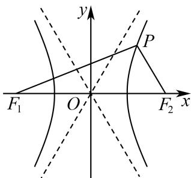
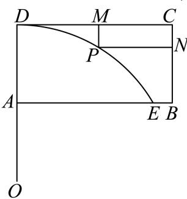
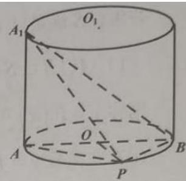
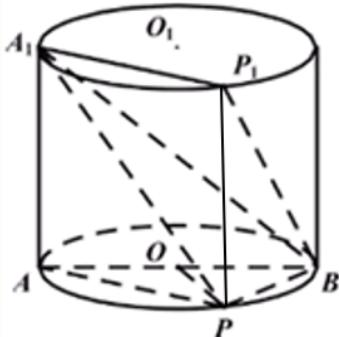

# 2025一模 浦东区原卷 · 教师版

> 本地预览：题目、答案及分类尚未全部审定。校对使用的PDF为高中工作台解析版，尚未逐区确认区级印刷原卷。

## 填空题

按本区原卷题号顺序排列。

### 浦东 · 第1题

若对数函数 $\langle y = \log _ { a } x ( a > 0 \mathbb { E } a \neq 1 )$ 的图象经过点(4, 2)，则实数a = .

**考点：** 对数函数代点求底数

**难度依据：** 对数函数代点求底数；按所需步骤与推理量估计

**核查说明：** 题干与解析已用于人工归类，尚未完成整题公式校净与独立数学终审。

【答案】2.

【解析】

直接将点代入计算即可.

将点(4, 2)代入 $. y = \log _ { a }$ x得 $2 = \log _ { a } 4$ ，解得a = 2

故答案为：2.

### 浦东 · 第2题

直线x − y + 1 = 0的倾斜角 .

**考点：** 直线斜率与倾斜角

**难度依据：** 直线斜率与倾斜角；按所需步骤与推理量估计

**核查说明：** 题干与解析已用于人工归类，尚未完成整题公式校净与独立数学终审。

【答案】$\frac { \pi } { 4 }$

【解析】

求出直线的斜率，再根据斜率与倾斜角之间的关系求解即可.

设直线x − y + 1 = 0的倾斜角为θ, $\theta \in [ 0 , \pi )$ ，

易知直线x−y+1 = 0的斜率为1，

所以 $\tan \theta = 1$

解得 $\theta = { \frac { \pi } { 4 } }$

故答案为： $\frac { \pi } { 4 }$

### 浦东 · 第3题

已知复数 $z _ { 1 } = 3 + \mathrm { i }$ $z _ { 2 } = a + 4 \mathrm { i }$ ${ \boldsymbol { a } } \in \mathbf { R }$ ，若 $z _ { 1 } - z _ { 2 }$ 为纯虚数，则 $| z _ { 2 } | =$

**考点：** 纯虚数条件与复数模

**难度依据：** 纯虚数条件与复数模；按所需步骤与推理量估计

**核查说明：** 题干与解析已用于人工归类，尚未完成整题公式校净与独立数学终审。

【答案】5.

【解析】

由纯虚数的概念得到a = 3，再由模长计算求解即可；

z1 − z2 = 3 + i − (a + 4i) = 3 − a − 3i，

因为 $z _ { 1 } - z _ { 2 }$ 为纯虚数，所以 $. a = 3$ .

所以 $z _ { 2 } = a + 4 \mathrm { i } = 3 + 4 \mathrm { i }$ ，所以 $\left| z _ { 2 } \right| = \sqrt { 3 ^ { 2 } + 4 ^ { 2 } } = 5$

故答案为：5.

### 浦东 · 第4题

$\left( x ^ { 2 } + { \frac { 1 } { x } } \right)$ 6 的展开式中 $x ^ { 3 }$ 的系数为 （用数字作答）

**考点：** 通项法求指定系数

**难度依据：** 通项法求指定系数；按所需步骤与推理量估计

**核查说明：** 题干与解析已用于人工归类，尚未完成整题公式校净与独立数学终审。

【解析】

$$
\because T _ {r + 1} = \mathrm{C} _ {6} ^ {\mathrm{r}} (x ^ {2}) ^ {6 - r} \left(\frac {1}{x}\right) ^ {r} = \mathrm{C} _ {6} ^ {\mathrm{r}} x ^ {1 2 - 3 r},
$$

∴ 令 12 − 3r = 3 ⇒ x = 3

$\therefore \left( x ^ { 2 } + { \frac { 1 } { x } } \right) ^ { 6 }$ 的展开式中 $x ^ { 3 }$ 的系数为 $\mathrm { C } _ { 6 } ^ { 3 } = 2 0$

### 浦东 · 第5题

在△ABC中，BC = 5， $\angle B = 4 5 ^ { \circ }$ $\angle C = 1 0 5 ^ { \circ }$ ，则AC =

**考点：** 正弦定理解三角形

**难度依据：** 正弦定理解三角形；按所需步骤与推理量估计

**核查说明：** 题干与解析已用于人工归类，尚未完成整题公式校净与独立数学终审。

【答案】$5 \sqrt { 2 }$

【解析】

根据给定条件，利用正弦定理列式计算即得.

在 $\triangle A B C ^ { \ r }$ 中，由 $\angle B = 4 5 ^ { \circ } , \angle C = 1 0 5 ^ { \circ }$ ，得 $\angle A = 3 0 ^ { \circ }$ ，

由正弦定理得， $A C = { \frac { B C \sin B } { \sin A } } = { \frac { 5 \times { \frac { \sqrt { 2 } } { 2 } } } { \frac { 1 } { 2 } } } = 5 { \sqrt { 2 } } .$

故答案为： $5 \sqrt { 2 }$

### 浦东 · 第6题

已知实数a、b满足 $a + 2 b = 1$ ，则 $3 ^ { a } + 9 ^ { b }$ 的最小值为

**考点：** 指数积定值与基本不等式

**难度依据：** 指数积定值与基本不等式；按所需步骤与推理量估计

**核查说明：** 题干与解析已用于人工归类，尚未完成整题公式校净与独立数学终审。

【答案】$2 { \sqrt { 3 } } .$

【解析】

利用基本不等式计算可求最小值.

因为 $| a + 2 b = 1 ,$ 9

所以 $\mathfrak { Z } ^ { a } + \mathfrak { g } ^ { b } = \mathfrak { Z } ^ { a } + \mathfrak { 3 } ^ { 2 b } \geq 2 \sqrt { \overline { { \mathfrak { 3 } ^ { a } \times \mathfrak { 3 } ^ { 2 b } } } } = 2 \sqrt { \overline { { \mathfrak { 3 } ^ { a + 2 b } } } } = 2 \sqrt { \mathfrak { 3 } } ,$

当且仅当 $3 ^ { a } = 3 ^ { 2 b }$ ，即 $\mathsf { I } a = \frac { 1 } { 2 } , b = \frac { 1 } { 4 }$ 时取等号，

故 $3 ^ { a } + 9 ^ { b }$ 的最小值为 $2 { \sqrt { 3 } } .$

故答案为： $2 { \sqrt { 3 } } .$

### 浦东 · 第7题

若等差数列 $\left\{ a _ { n } \right\}$ 满足 $a _ { 7 } + a _ { 8 } + a _ { 9 } = 0 , ~ a _ { 7 } + a _ { 1 0 } = 1$ ，则 $| a _ { 1 } =$

> 本题资料或解析有待核事项，预览不可作为已审定成品。

**考点：** 等差数列中项与通项

**难度依据：** 等差数列中项与通项；按所需步骤与推理量估计

**核查说明：** 题干与解析已用于人工归类，尚未完成整题公式校净与独立数学终审。；原解列方程时将a9的值误写为0，前文为1，须校对。

【答案】−7.

【解析】

根据等差数列性质可得 $a _ { 8 } = 0 , a _ { 9 } = 1$ ，再结合等差数列通项公式运算求解即可.

因为数列 $\{ a _ { n } \}$ 为等差数列，

则 $| a _ { 7 } + a _ { 8 } + a _ { 9 } = 3 a _ { 8 } = 0$ ，即 $\lvert { a _ { 8 } = 0 }$

且 $a _ { 7 } + a _ { 1 0 } = a _ { 8 } + a _ { 9 } = 1$ ，可得 ${ \bf { \ell } } a _ { 9 } = 1$

即 $\left\{ { \begin{array} { l } { a _ { 8 } = a _ { 1 } + 7 d = 0 } \\ { a _ { 9 } = a _ { 1 } + 8 d = 0 } \end{array} } \right.$ 解得 $\left\{ { a \atop d = 1 } \right.$

故答案为：−7.

### 浦东 · 第8题

已知函数 $y = f \left( x \right)$ 的表达式为 $f \left( x \right) = { \left\{ { \left( { \frac { 1 } { 2 } } \right) } ^ { x } - 3 , x \leq 0 \right.} _ { x ^ { 2 } , x > 0 }  $ ，则不等式 $f \left( x \right) \leq 1$ 的解集为

**考点：** 分段函数不等式；指数和二次不等式

**难度依据：** 分段函数不等式；指数和二次不等式；按所需步骤与推理量估计

**核查说明：** 题干与解析已用于人工归类，尚未完成整题公式校净与独立数学终审。

【答案】[−2, 1].

【解析】

根据题意分 $\cdot x \leq 0 \hbar \mathbb { \cdot } \mathbb { 1 } x > 0$ 两种情况，结合指数函数单调性解不等式即可

$$
f (x) \leq 1
$$

若 $x \leq 0$ ，则 $\left( { \frac { 1 } { 2 } } \right) ^ { x } - 3 \leq 1$ 即 $\left( { \frac { 1 } { 2 } } \right) ^ { x } \leq 4 = \left( { \frac { 1 } { 2 } } \right) ^ { - 2 }$ ，解得− $\cdot 2 \leq x \leq 0 _ { \mathrm { { i } } }$

若 $x > 0 .$ ，则 $x ^ { 2 } \leq 1$ ，解得 $0 < x \le 1 ;$

综上所述：不等式 $f \left( x \right) \leq$ 1的解集为[−2, 1].

故答案为：[−2, 1].

### 浦东 · 第9题

已知双曲线 $x ^ { 2 } - { \frac { y ^ { 2 } } { 3 } } = 1$ 的左、右焦点分别为 $F _ { \mathrm { 1 } } , \ F _ { \mathrm { 2 } }$ ，双曲线上的点P在第一象限，且 $P F _ { 2 }$ 与双曲线的一条渐近线平行，则 $\triangle P F _ { 1 } F _ { 2 }$ 的面积为

**考点：** 双曲线渐近线平行与焦点三角形

**难度依据：** 双曲线渐近线平行与焦点三角形；按所需步骤与推理量估计

**核查说明：** 题干与解析已用于人工归类，尚未完成整题公式校净与独立数学终审。

【答案】$\frac { 3 { \sqrt { 3 } } } { 2 }$

【解析】

根据题意先求出直线 $P F _ { 2 }$ 的方程，再与双曲线方程联立求出点P的坐标，即可根据三角形的面积公式求出 $\triangle P F _ { 1 } F _ { 2 }$ 的面积.

双曲线 $x ^ { 2 } - { \frac { y ^ { 2 } } { 3 } } = 1$ 的焦点 $F _ { 1 } ( - 2 , 0 ) , F _ { 2 } ( 2 , 0 )$ ，渐近线方程为 $y = \pm \sqrt { 3 } x$

依题意，直线 $P F _ { 2 }$ 的方程为 $y = - \sqrt { 3 } \left( x - 2 \right)$ ，

由 $\left\{ { \begin{array} { l } { y = - { \sqrt { 3 } } \left( x - 2 \right) } \\ { 3 x ^ { 2 } - y ^ { 2 } = 3 } \end{array} } \right.$ ，解得 $x = { \frac { 5 } { 4 } } , y = { \frac { 3 { \sqrt { 3 } } } { 4 } }$ ，则点P的坐标为 $\left( { \frac { 5 } { 4 } } , { \frac { 3 { \sqrt { 3 } } } { 4 } } \right)$

所以 $\triangle P F _ { 1 } F _ { 2 }$ 的面积为 ${ \frac { 1 } { 2 } } \times 4 \times { \frac { 3 { \sqrt { 3 } } } { 4 } } = { \frac { 3 { \sqrt { 3 } } } { 2 } }$

故答案为： $\frac { 3 { \sqrt { 3 } } } { 2 }$

### 浦东 · 第10题

某地要建造一个市民休闲公园长方形ABCD，如图，边 $A B = 2 \mathrm { k m }$ ，边 $A D = 1 \mathrm { k m }$ ，其中区域ADE开挖成一个人工湖，其他区域为绿化风景区．经测算，人工湖在公园内的边界是一段圆弧，且A、D位于圆心O的正北方向，E位于圆心O的北偏东 $\mathrm { \Delta } 6 0 ^ { \circ }$ 方向．拟定在圆弧P处修建一座渔人码头，供游客湖中泛舟，并在公园的边DC、CB开设两个门M、N，修建步行道PM、PN通往渔人码头，且PM⊥CD、PN⊥CB，则步行道PM、PN长度之和的最小值是 km．（精确到0.001）

**考点：** 圆弧距离和与辅助角最值；圆弧建模

**难度依据：** 圆弧距离和与辅助角最值；圆弧建模；按所需步骤与推理量估计

**核查说明：** 题干与解析已用于人工归类，尚未完成整题公式校净与独立数学终审。

【答案】1.172

【解析】

以O为原点建立坐标系，求出圆半径，并设出点P的坐标，借助辅助角公式及正弦函数的性质求出最小值.

以点O为原点，直线OA为y轴建立平面直角坐标系，连接OE，

令圆O的半径为r，则 $r - 1 = r \cos { 6 0 ^ { \circ } }$ ，解得 $r = 2$ ，设 $P ( 2 \cos \theta , 2 \sin \theta ) , \frac { \pi } { 6 } \leq \theta \leq \frac { \pi } { 2 }$

$$
P M + P N = 2 - 2 \sin \theta + 2 - 2 \cos \theta = 4 - 2 \sqrt {2} \sin \left(\theta + \frac {\pi}{4}\right) \geq 4 - 2 \sqrt {2},
$$

当且仅当 $\theta = { \frac { \pi } { 4 } }$ 时取等号， $4 - 2 \sqrt { 2 } \approx 1 . 1 7 2$

所以步行道PM、PN长度之和的最小值是1.172km.

故答案为：1.172

### 浦东 · 第11题

已知空间中三个单位向量 $\overrightarrow { O A _ { 1 } } \cdot \overrightarrow { O A _ { 2 } } \cdot \overrightarrow { O A _ { 3 } } , \overrightarrow { O A _ { 1 } } \cdot \overrightarrow { O A _ { 2 } } = \overrightarrow { O A _ { 2 } } \cdot \overrightarrow { O A _ { 3 } } = \overrightarrow { O A _ { 3 } } \cdot \overrightarrow { O A _ { 1 } } = 0$ ，P为空间中一点，且满足 $\left| \overrightarrow { O P } \cdot \overrightarrow { O A _ { 1 } } \right| = 1 , \left| \overrightarrow { O P } \cdot \overrightarrow { O A _ { 2 } } \right| = 2 , \left| \overrightarrow { O P } \cdot \overrightarrow { O A _ { 3 } } \right| = 3$ ，则点P个数的最大值为

> 本题资料或解析有待核事项，预览不可作为已审定成品。

**考点：** 正交单位向量与空间坐标计数

**难度依据：** 正交单位向量与空间坐标计数；按所需步骤与推理量估计

**核查说明：** 仅修复所列OCR公式及其定界符错位；原解数学疑点和其他可渲染错识未因此消除。；题干与解析已用于人工归类，尚未完成整题公式校净与独立数学终审。；向量之间连接符错误，须校正原始符号。

【答案】8.

【解析】

以O为原点，分别以 $\overrightarrow { \backslash O A _ { 1 } } \cdot \overrightarrow { O A _ { 2 } } \cdot \overrightarrow { O A _ { 3 } }$ 的方向为x轴、y轴、z轴的正方向建立空间直角坐标系，设 $P ( x , y , z )$ ，表示各向量坐标，利用数量积的坐标表示可得结果.

由题意得， $\overrightarrow { O A _ { 1 } } \bot \overrightarrow { O A _ { 2 } } , \overrightarrow { O A _ { 2 } } \bot \overrightarrow { O A _ { 3 } } , \overrightarrow { O A _ { 3 } } \bot \overrightarrow { O A _ { 1 } }$ ，且 $\left| \overrightarrow { O A _ { 1 } } \right| = \left| \overrightarrow { O A _ { 2 } } \right| = \left| \overrightarrow { O A _ { 3 } } \right| = 1 .$

以O为原点，分别以 $\overrightarrow{OA_1},\overrightarrow{OA_2},\overrightarrow{OA_3}$ 的方向为x轴、y轴、z轴的正方向建立空间直角坐标系，则 $\overrightarrow { O A _ { 1 } } = ( 1 , 0 , 0 ) , \overrightarrow { O A _ { 2 } } = ( 0 , 1 , 0 ) , \overrightarrow { O A _ { 3 } } = ( 0 , 0 , 1 )$

设 $P ( x , y , z )$ ，则 $\overrightarrow { \vert O P } = ( x , y , z )$

$$
\therefore \left| \overrightarrow {O P} \cdot \overrightarrow {O A _ {1}} \right| = | x | = 1, \quad \left| \overrightarrow {O P} \cdot \overrightarrow {O A _ {2}} \right| = | y | = 2, \quad \left| \overrightarrow {O P} \cdot \overrightarrow {O A _ {3}} \right| = | z | = 3,
$$

$$
\therefore x = \pm 1, y = \pm 2, z = \pm 3,
$$

∴点P坐标可能为(1, 2, 3)，(−1, 2, 3)，(1, −2, 3)，(−1, −2, 3)，(1, 2, −3)，(−1, 2, −3)，

$$
(1, - 2, - 3), (- 1, - 2, - 3),
$$

故点P个数的最大值为8.

故答案为：8.

### 浦东 · 第12题

已知在复数集中，等式 $x ^ { 4 } + a _ { 3 } x ^ { 3 } + a _ { 2 } x ^ { 2 } + a _ { 1 } x + a _ { 0 } = \left( x - z _ { 1 } \right) \left( x - z _ { 2 } \right) \left( x - z _ { 3 } \right) \left( x - z _ { 4 } \right)$ 对任意复数x恒成立，复数 $z _ { 1 } , ~ z _ { 2 } , ~ z _ { 3 } , ~ z _ { 4 }$ 在复平面上对应的4个点为某个单位圆内接正方形的4个顶点，$\{ a _ { 0 } , a _ { 1 } , a _ { 2 } , a _ { 3 } \} \subset \{ n | 1 \leq n \leq 2 0 2 4 , n \in \bf { Z } \}$ ，则满足条件的不同集合 $\{ a _ { 0 } , a _ { 1 } , a _ { 2 } , a _ { 3 } \}$ 个数为

> 本题资料或解析有待核事项，预览不可作为已审定成品。

**考点：** 复根与正方形共轭对称；整数参数计数

**难度依据：** 需利用复根的共轭对称、正方形结构和整数约束分类计数；题意与答案待核。

**核查说明：** 题干与解析已用于人工归类，尚未完成整题公式校净与独立数学终审。；源解以系数集合元素互异性排除圆心参数a=-1；底稿未明确要求各系数互异，该情形系数集合{2,4,6}满足当前字面条件，可能影响答案，须核原卷及独立复算。

【答案】10.

【解析】

由一元二次方程，复数根互为共轭复数根，一元四次方程可以分解为两个一元二次方程，因此四个根应该两两互为共轭复数根（或实数根），因此圆心在x轴上，据此分类讨论可求得结论.

$$
x ^ {4} + a _ {3} x ^ {3} + a _ {2} x ^ {2} + a _ {1} x + a _ {0} = (x - z _ {1}) (x - z _ {2}) (x - z _ {3}) (x - z _ {4})
$$

$$
= x ^ {4} - (z _ {1} + z _ {2} + z _ {3} + z _ {4}) x ^ {3} + (z _ {1} z _ {2} + z _ {1} z _ {3} + z _ {1} z _ {4} + z _ {2} z _ {3} + z _ {2} z _ {4} + z _ {3} z _ {4}) x ^ {2}
$$

$$
- \left(z _ {1} z _ {2} z _ {3} + z _ {1} z _ {2} z _ {4} + z _ {2} z _ {3} z _ {4}\right) x + z _ {1} z _ {2} z _ {3} z _ {4},
$$

对 比系数可得a0 = z1z2z3z4，a1 = − (z1z2z3 + z1z2z4 + z2z3z4)，

$$
a _ {2} = z _ {1} z _ {2} + z _ {1} z _ {3} + z _ {1} z _ {4} + z _ {2} z _ {3} + z _ {2} z _ {4} + z _ {3} z _ {4}, a _ {3} = - \left(z _ {1} + z _ {2} + z _ {3} + z _ {4}\right),
$$

复数 $z _ { 1 } , ~ z _ { 2 } , ~ z _ { 3 } , ~ z _ { 4 }$ 在复平面上对应的4个点为某个单位圆内接正方形的4个顶点情况1，四个根两两互为共轭复数，故圆心在x轴上，设单位的圆心为(a,0)，

不妨设 $z _ { 1 } = a + \frac { \sqrt { 2 } } { 2 } + \frac { \sqrt { 2 } } { 2 } \mathrm { i } , ~ z _ { 2 } = a - \frac { \sqrt { 2 } } { 2 } + \frac { \sqrt { 2 } } { 2 } \mathrm { i } ,$

$$
z _ {3} = a - \frac {\sqrt {2}}{2} - \frac {\sqrt {2}}{2} \mathrm{i}, z _ {4} = a + \frac {\sqrt {2}}{2} + \frac {\sqrt {2}}{2} \mathrm{i},
$$

$$
a _ {0} = z _ {1} z _ {2} z _ {3} z _ {4} = \left(a + \frac {\sqrt {2}}{2} + \frac {\sqrt {2}}{2} \mathrm{i}\right) \left(a - \frac {\sqrt {2}}{2} + \frac {\sqrt {2}}{2} \mathrm{i}\right) \left(a - \frac {\sqrt {2}}{2} - \frac {\sqrt {2}}{2} \mathrm{i}\right)
$$

$$
\left(a + \frac {\sqrt {2}}{2} + \frac {\sqrt {2}}{2} \mathrm{i}\right)
$$

$$
= \left[ \left(a + \frac {\sqrt {2}}{2} \mathrm{i}\right) ^ {2} - \frac {1}{2} \right] \left[ \left(a - \frac {\sqrt {2}}{2} \mathrm{i}\right) ^ {2} - \frac {1}{2} \right] = \left[ a ^ {2} + \sqrt {2} a \mathrm{i} - 1 \right] \left[ a ^ {2} - \sqrt {2} a \mathrm{i} - 1 \right]
$$

$$
\left[ (a ^ {2} - 1) + \sqrt {2} a \mathrm{i} \right] \left[ (a ^ {2} - 1) - \sqrt {2} a \mathrm{i} \right] = (a ^ {2} - 1) ^ {2} + 2 a ^ {2} = a ^ {4} + 1,
$$

类似计算可得 $\dot { \bf { \sigma } } a _ { 1 } = - \left( z _ { 1 } z _ { 2 } z _ { 3 } + z _ { 1 } z _ { 2 } z _ { 4 } + z _ { 2 } z _ { 3 } z _ { 4 } \right) = - 4 a ^ { 3 } ,$

$$
a _ {2} = z _ {1} z _ {2} + z _ {1} z _ {3} + z _ {1} z _ {4} + z _ {2} z _ {3} + z _ {2} z _ {4} + z _ {3} z _ {4} = 6 a ^ {2}, \quad a _ {3} = - (z _ {1} + z _ {2} + z _ {3} + z _ {4}) = - 4 a,
$$

因为 $\{ a _ { 0 } , a _ { 1 } , a _ { 2 } , a _ { 3 } \} \subset \{ n | 1 \leq n \leq 2 0 2 4 , n \in \bf { Z } \}$

所以a只能为负整数，又集合元素的互异性，从而可得 $\cdot a = - 2 , - 3 , - 4 , - 5 , - 6$ ，此时集合

$\{ a _ { 0 } , a _ { 1 } , a _ { 2 } , a _ { 3 } \}$ 的个数为5个，

情况2，四个根有2个为实数，另外2个为共轭复数故圆心在x轴上，设单位的圆心为(a,0)，不妨设 $z _ { 1 } = a - 1 , ~ z _ { 2 } = a + \mathrm { i } , ~ z _ { 3 } = a + 1 , ~ z _ { 4 } = a - \mathrm { i } ,$

计算可得 $\cdot a _ { 0 } = z _ { 1 } z _ { 2 } z _ { 3 } z _ { 4 } = a ^ { 4 } - 1 , a _ { 1 } = - \left( z _ { 1 } z _ { 2 } z _ { 3 } + z _ { 1 } z _ { 2 } z _ { 4 } + z _ { 2 } z _ { 3 } z _ { 4 } \right) = - 4 a ^ { 3 } ,$

$$
a _ {2} = z _ {1} z _ {2} + z _ {1} z _ {3} + z _ {1} z _ {4} + z _ {2} z _ {3} + z _ {2} z _ {4} + z _ {3} z _ {4} = 6 a ^ {2}, a _ {3} = - (z _ {1} + z _ {2} + z _ {3} + z _ {4}) = - 4 a,
$$

因为 $\{ a _ { 0 } , a _ { 1 } , a _ { 2 } , a _ { 3 } \} \subset \{ n | 1 \leq n \leq 2 0 2 4 , n \in \bf { Z } \}$ ，所以a只能为负整数，又集合元素的互异性，从而可得 $\cdot a = - 2 , - 3 , - 4 , - 5 , - 6$ ，此时集合 $\{ a _ { 0 } , a _ { 1 } , a _ { 2 } , a _ { 3 } \}$ 的个数为5个，

综上：满足条件的不同 $\{ a _ { 0 } , a _ { 1 } , a _ { 2 } , a _ { 3 } \}$ 的个数为10.

故答案为：10.

关键点点睛：重点在于一元二次方程，复数根互为共轭复数根，进而确定一元四次方程可以 分解为两个一元二次方程，从而4个根两两互为共轭复数根，进而确定圆心，从而分类讨论求 解.

## 二、选择题

## 选择题

按本区原卷题号顺序排列。

### 浦东 · 第13题

若实数a、b满足 $a ^ { 2 } > b ^ { 2 }$ ，下列不等式中恒成立的是（ ）

A. $a > b$

B. $\frac { 1 } { a } < \frac { 1 } { b }$

C. $a ^ { 2 } + b ^ { 2 } > 2 a b$

D. $a > | b |$

**考点：** 平方比较与反例

**难度依据：** 平方比较与反例；按所需步骤与推理量估计

**核查说明：** 题干与解析已用于人工归类，尚未完成整题公式校净与独立数学终审。

【答案】C

【解析】

由不等式的性质举反例可得ABD错误；作差由完全平方可得C正确；

对于A， $\widehat { \vec { \mathrm { { v } } } } a = - 2 , b = - 1$ ，满足 $a ^ { 2 } > b ^ { 2 }$ ，但 $a < b$ ，故A错误；

对于B， $\widehat { \vec { \triangledown } } a = - 2 , b = - 1$ ，满足 $a ^ { 2 } > b ^ { 2 }$ ，但 ${ \frac { 1 } { a } } > { \frac { 1 } { b } }$ ，故B错误；

对 $\mp \mathbf { C } ,$ ，因为实数a、b满足 $a ^ { 2 } > b ^ { 2 }$ ，所以 $a ^ { 2 } + b ^ { 2 } - 2 a b = \left( a - b \right) ^ { 2 } > 0$ ，故C正确；

对于D， $\stackrel { \wedge } { \prec } a = - 2 , b = - 1$ ，满足 $a ^ { 2 } > b ^ { 2 }$ ，但 $\lfloor a < \lvert b \rvert$ ，故D错误；

故选：C.

### 浦东 · 第14题

设m、n为两条直线，α、β为两个平面，且 $\alpha \cap \beta = n$ ．下述四个命题中为假命题的是（ ）

A. 若 $m \bot \alpha ,$ ，则 $m \perp n$

B. 若 $\dot { m } / / \alpha$ ，则 $\scriptstyle | m / / n$

C. 若 $\dot { \cdot } _ { m } / / \alpha$ 且 $. m / / \beta ,$ ，则 $m / / n$

D. 若 $m / / n ,$ ，则 $| m / / \alpha$ 或 $m / / \beta$

> 本题资料或解析有待核事项，预览不可作为已审定成品。

**考点：** 线面平行垂直关系判定；命题反例

**难度依据：** 线面平行垂直关系判定；命题反例；按所需步骤与推理量估计

**核查说明：** 题干与解析已用于人工归类，尚未完成整题公式校净与独立数学终审。；B选项反例把BB1称为平行底面，但它垂直底面；须更换有效反例并回核原题。

【答案】B

【解析】

选项A，利用线面垂直的性质，即可求解；选项B，在正方体中，通过取特例，即可求解；选项C和D，利用线面平行的性质和判定，即可求解.

对于选项A，因为 $\alpha \cap \beta = n$ ，所以n $\subset \alpha ,$ ，又 $m \bot \alpha$ ，所以 $m \perp n$ ，故选项A是真命题，

对于选项B，如图，取平面ABCD为α，平面 $A D D _ { 1 } A _ { 1 }$ 为β，则直线n为直线AD，取 $B B _ { 1 }$ 为直线m，

显然有 $\dot { m } / / \alpha$ ，但m与n异面，所以选项B为假命题，对于选项C，在α内任取不在直线n上的一点M，过m,M确定γ，则 $\gamma \cap \alpha = l _ { 1 }$ ，因为 $m / / \alpha$ ，所以 $m / / l _ { 1 }$ 2

同理可得 $m / / l _ { 2 } , l _ { 2 } \subset \beta ,$ ，所以 $l _ { 1 } / / l _ { 2 }$ ，又 $. l _ { 2 } \subset \beta , l _ { 1 } \notin \beta .$ ，故 $l _ { 1 } / / \beta _ { : }$

又 $l _ { 1 } \subset \alpha , \alpha \cap \beta = n$ ，所以 $l _ { 1 } / / n$ ，得到 $m / / n ,$ ，故选项C为真命题，

对于选项D，因为 $\alpha \cap \beta = n ,$ 所以 $n \subset \alpha , n \subset \beta ,$ ，若 $m \not \subset \alpha$ ，因为 $m / / n$ ，则 $m / / \alpha$ 若 $m \subset \alpha .$ ，易知 $\mid m \mid ^ { \ell } \beta ,$ ，又 $m / / n , \ n \subset \beta ,$ ，所 $\lfloor m / / \beta \rfloor$ ，故选项D为真命题，故选：B.

### 浦东 · 第15题

对一组数据3，3，3，1，1，5，5，2，4，若任意去掉其中一个数据，剩余数据的统计量一定会发生变化的为（ ）

A. 中位数

B. 众数

C. 平均数

D. 方差

> 本题资料或解析有待核事项，预览不可作为已审定成品。

**考点：** 均值中位数众数与方差变化

**难度依据：** 均值中位数众数与方差变化；按所需步骤与推理量估计

**核查说明：** 题干与解析已用于人工归类，尚未完成整题公式校净与独立数学终审。；源解析仅凭波动变化断言方差变化，需直接计算验证。

【答案】D

【解析】

求出给定数据组的中位数、众数、平均数，举例说明判断ABC；利用数据的波动大小判断D.数据由小到大排列为：1，1，2，3，3，3，4，5，5，其中位数、众数、平均数都为3，去掉数据1，剩余数据的中位数、众数都不变；去掉数据3，剩余数据的平均数不变，ABC不是；若任意去掉其中一个数据，剩余数据的波动性发生变化，方差一定发生变化，D是.故选：D

### 浦东 · 第16题

设函数 $\ b { \cdot } \ b { y } = \ b { F } \left( \ b { x } \right) , \ \ b { y } = \ b { G } \left( \ b { x } \right)$ 的定义域均为R，值域分别为A、B，且 $A \cap B = \emptyset$ ．若集合S满足以下两个条件：（1） $A \cup B \subseteq S ; ( 2 ) \complement _ { S } ( A \cup B )$ 是有限集，则称 $y = F ( x )$ 和 $y = G \left( x \right)$ 是S-互补函数给出以下两个命题：①存在函数 $\boldsymbol { \mathfrak { y } } = \boldsymbol { \mathfrak { f } } \left( \boldsymbol { \mathfrak { x } } \right)$ ，使得 $y = 2 ^ { f ( x ) }$ 和$y=\log_2 f(x)$是[0, 16]-互补函数；②存在函数 $\cdot y = g \left( x \right)$ ，使得y = sin g (x)和y = tan g (x)是 $[ 0 , + \infty )$ -互补函数．则（ ）

A. ①②都是真命题

B. ①是真命题，②是假命题

C. ①是假命题，②是真命题

D. ①②都是假命题

> 本题资料或解析有待核事项，预览不可作为已审定成品。

**考点：** S互补函数；值域构造与三角函数

**难度依据：** 需理解新定义并构造值域，尤其第二命题涉及递归区间构造；选项待核。

**核查说明：** 已恢复缺失部分，但题干仍有OCR乱码，须校净后才能发布。；题干与解析已用于人工归类，尚未完成整题公式校净与独立数学终审。；选择项C缺失；①中的对数底数丢失，需回核。

【答案】A

【解析】

对于①，取 $\ b { \mathscr { U } } = \ b { f } \left( \ b { x } \right)$ 的值域为(1,4)，得到 $y = 2 ^ { f ( x ) } \in ( 2 , 1 6 )$ )， $y = \log _ { 2 } f \left( x \right) \in \left( 0 , 2 \right)$ ，满足要求，①正确；对于②， $\mathbb { H } \mathbb { \chi } y = g \left( x \right)$ 是增函数， $t = g \left( x \right)$ ，先让 $y = g \left( x \right)$ )的值域包含 $\left[ { \frac { \pi } { 4 } } , { \frac { \pi } { 2 } } \right)$ ，根据正弦函数和正切函数的图象特征进行构造， 的值域有

$\left[ \arctan \left[ \sin \left( \arctan { \frac { \sqrt { 2 } } { 2 } } \right) \right] \right]$ $\arctan { \frac { \sqrt { 2 } } { 2 } } )$ 依次类推，得到答案

对于①，取 $\left\{ y = f \left( x \right) \right.$ 的值域为(1,4)，

故 $\langle y = 2 ^ { f ( x ) } \in ( 2 , 1 6 ) , y = \log _ { 2 } f ( x ) \in ( 0 , 2 ) _ { \mathrm { \Omega } }$

令 $\cdot S = [ 0 , 1 6 ] , A \in ( 2 , 1 6 ) , B \in ( 0 , 2 )$

满足 $A \cup B \subseteq ,$ S和 ${ \ I } \complement _ { S } \left( A \cup B \right)$ 是有限集，

从而 $y = 2 ^ { f ( x ) }$ 和 $\left. \vert y = \log _ { 2 } f \left( x \right) \right.$ 是[0,16]-互补函数，①正确；

对于②，取 $y = g \left( x \right)$ 是增函数， $t = g \left( x \right)$ ，由复合函数性质，

只需考虑 $y = \sin$ t和 $\boldsymbol { \lvert y = \mathrm { t a n } }$ t即可，

先让 $y = g \left( x \right)$ 的值域包含 $\left[ { \frac { \pi } { 4 } } , { \frac { \pi } { 2 } } \right)$ ，则 $y = \tan t > 1$ $y = \sin t \in \left[ { \frac { \sqrt { 2 } } { 2 } } , 1 \right)$

那么接下来考虑让 $\left( 0 , { \frac { \sqrt { 2 } } { 2 } } \right)$ 的部分被 $\boldsymbol { y } = \sin t \Re \mathbb { H } \boldsymbol { y } = \tan t \mathrm { { I } }$ 取得，

因为 $y = \tan$ t的值域没有 $\left\lceil { \frac { \sqrt { 2 } } { 2 } } , 1 \right\rceil$ 所以t的值域中没有 $\left[ \arctan { \frac { \sqrt { 2 } } { 2 } } , { \frac { \pi } { 4 } } \right)$

所以y = sint的值域没有 $\left[ \sin { \left( \arctan { \frac { \sqrt { 2 } } { 2 } } \right) } , \frac { \sqrt { 2 } } { 2 } \right)$

所以考虑让 $y = \tan \ i$ t的值域中有 $\left[ \sin { \left( \arctan { \frac { \sqrt { 2 } } { 2 } } \right) } , \frac { \sqrt { 2 } } { 2 } \right)$

则t的值域有 $\left[ \arctan \left[ \sin \left( \arctan { \frac { \sqrt { 2 } } { 2 } } \right) \right] , \arctan { \frac { \sqrt { 2 } } { 2 } } \right)$

依次类推，按照这样的方式构造下去，

可以得到满足题意的 $\left| y = g \left( x \right) \right.$ ，②正确.

故选：A

新定义问题的方法和技巧：

（1）可通过举例子的方式，将抽象的定义转化为具体的简单的应用，从而加深对信息的理解；

（2）可用 自 己的语言转述新信息所表达的内容，如果能清晰描述，那么说明对此信息理解的较为透彻；

（3）发现新信息与所学知识的联系，并从描述中体会信息的本质特征与规律；

（4）如果新信息是课本知识的推广，则要关注此信息与课本中概念的不同之处，以及什么情况下可以使用书上的概念.

## 三、解答题

## 解答题

按本区原卷题号顺序排列。

### 浦东 · 第17题

已知函数 $y = f \left( x \right)$ 的表达式为 $f \left( x \right) = \sin \omega x , \omega > 0$
(1) (6分)若函数 $y = f \left( x \right)$ 的最小正周期为 $\frac { \pi } { 2 }$ ，求ω的值及 $y = f \left( x \right)$ 的单调增区间；
(2) (8分)若ω = 2，设函数 $y = g \left( x \right)$ 的表达式为 $ \begin{array} { r } { | g ( x )  = f ( x ) + \sqrt { 3 } \cos 2 x } \end{array}$ ，求当 $x \in \left[ 0 , { \frac { \pi } { 2 } } \right]$ ]时，$y = g \left( x \right)$ 的值域

**考点：** （1）周期求参数和单调区间；（2）辅助角公式求区间值域

**难度依据：** 正弦周期单调区间及值域；按所需步骤与推理量估计

**核查说明：** 题干与解析已用于人工归类，尚未完成整题公式校净与独立数学终审。

【解析】

(1) 因为 $J \omega > 0 ,$ ，所以 $\frac { 2 \pi } { \omega } = \frac { \pi } { 2 }$ ，解得 $\omega = 4$

$$
f (x) = \sin 4 x,
$$

$\widehat { \vec { \triangledown } } - \frac { \pi } { 2 } + 2 k \pi \leq 4 x \leq \frac { \pi } { 2 } + 2 k \pi , k \in { \bf Z } ,$ ，解得 $- { \frac { \pi } { 8 } } + { \frac { k \pi } { 2 } } \leq x \leq { \frac { \pi } { 8 } } + { \frac { k \pi } { 2 } } , k \in \mathrm { Z }$

故单调递增区间为 $\left\lceil - { \frac { \pi } { 8 } } + { \frac { k \pi } { 2 } } , { \frac { \pi } { 8 } } + { \frac { k \pi } { 2 } } \right\rceil$ , k ∈ Z；

(2) ω = 2， $g \left( x \right) = \sin 2 x + \sqrt { 3 } \cos 2 x = 2 \sin \left( 2 x + \frac { \pi } { 3 } \right)$

$x \in \left[ 0 , { \frac { \pi } { 2 } } \right]$ 时， $2 x + { \frac { \pi } { 3 } } \in \left\lceil { \frac { \pi } { 3 } } , { \frac { 4 \pi } { 3 } } \right\rceil$ ]，故s $\sin \left( 2 x + { \frac { \pi } { 3 } } \right) \in \left[ - { \frac { \sqrt { 3 } } { 2 } } , 1 \right]$

所以 $\left. g \left( x \right) = 2 \sin \left( 2 x + \frac { \pi } { 3 } \right) \in \left[ - \sqrt { 3 } , 2 \right] \right.$

### 浦东 · 第18题

如图，已知AB为圆柱 $O O _ { 1 }$ 底面圆O的直径， $O A = 2$ ，母线 $A A _ { 1 }$ 长为3，点P为底面圆O的圆周上一点

(1) (6分)若 $\angle B O P = 9 0 ^ { \circ }$ ，求三棱锥 $A - P B A _ { 1 }$ 的体积；
(2) (8分)若 $\angle B O P = 6 0 ^ { \circ }$ ，求异面直线 $A _ { 1 } B {  } A P$ 所成的角的余弦值

> 本题资料或解析有待核事项，预览不可作为已审定成品。

**考点：** （1）圆柱中三棱锥体积；（2）异面直线角余弦

**难度依据：** 圆柱三棱锥体积与异面直线角；按所需步骤与推理量估计

**核查说明：** 题干与解析已用于人工归类，尚未完成整题公式校净与独立数学终审。；第（2）问异面直线名称间连接词丢失。

【解析】

(1) 依题意， $A A _ { 1 } \bot$ 平面 $A P B { \mathrm { : } }$ ，由 $\angle B O P = 9 0 ^ { \circ }$ ，得 $S _ { \triangle A P B } = \frac { 1 } { 2 } A B \cdot O P = \frac { 1 } { 2 } \times 4 \times 2 = 4$ 所以三棱锥 $A - P B A _ { 1 }$ 的体积 $V _ { A - P B A _ { 1 } } = V _ { A _ { 1 } - P B A } = \frac { 1 } { 3 } S _ { \triangle A P B } \cdot A A _ { 1 } = \frac { 1 } { 3 } \times 4 \times 3 = 4 .$

(2) 过点P作圆柱 $O O _ { 1 }$ 的母线 $P P _ { 1 }$ ，连接 $A _ { 1 } P _ { 1 } , B P _ { : }$

则 $P P _ { 1 } / / A A _ { 1 } , P P _ { 1 } = A A _ { 1 }$ ，于是四边形 $A P P _ { 1 } A _ { 1 }$ 为平行四边形， $A _ { 1 } P _ { 1 } / / A P$

因此 $\angle P _ { 1 } A _ { 1 } B$ 是异面直线 $A _ { 1 } B$ 与AP所成的角或其补角，

由 $\angle B O P = 6 0 ^ { \circ }$ ，得 $\angle A O P = 1 2 0 ^ { \circ } , A P = 2 O A \cos 3 0 ^ { \circ } = 2 { \sqrt { 3 } } , P B = O B = 2 ,$

则A1P1 = AP = 2√3，A1B = √AA2 + AB2 = √32 + 42 = 5，

由 $P P _ { 1 \perp }$ 平面 $A P B ,$ ，得 $P _ { 1 } B = { \sqrt { P P _ { 1 } ^ { 2 } + P B ^ { 2 } = { \sqrt { 3 ^ { 2 } + 2 ^ { 2 } } } } } = { \sqrt { 1 3 } } ,$

在 $\triangle A _ { 1 } P _ { 1 } B ^ { \vert }$ 中， $\cos \angle P _ { 1 } A _ { 1 } B = { \frac { A _ { 1 } P _ { 1 } ^ { 2 } + A _ { 1 } B ^ { 2 } - P _ { 1 } B ^ { 2 } } { 2 A _ { 1 } P _ { 1 } \cdot A _ { 1 } B } } = { \frac { 1 2 + 2 5 - 1 3 } { 2 \times 2 { \sqrt { 3 } } \times 5 } } = { \frac { 2 { \sqrt { 3 } } } { 5 } } ,$

所以异面直线 $A _ { 1 } B _ { \ l }$ 与AP所成的角的余弦值为 $\frac { 2 { \sqrt { 3 } } } { 5 }$

### 浦东 · 第19题

申辉中学为期两周的高一、高二年级校园篮球赛告一段落．高一小A、高二小B分别荣获了高一年级和高二年级比赛的年级MVP（最有价值球员）．以下是他们在各自8场比赛的二分球和三分球出手次数及其命中率

| 人物 | 二分球出手 | 二分球命中率 | 三分球出手 | 三分球命中率 |
|---|---|---|---|---|
| 小A | 100次 | 80% | 100次 | 40% |
| 小B | 190次 | 70% | 10次 | 30% |

现以两人的总投篮命中率（二分球+三分球）较高者评为校MVP（总投篮命中率=总命中次数÷总出手次数）
(1) (4分)小C认为，目测小A的二分球命中率和三分球命中率均高于小B，此次必定能评为校MVP，试通过计算判断小C的想法是否准确？
(2) (10分)小D是游戏爱好者，设置了一款由游戏人物小a、小b轮流投篮对战游戏，游戏规则如下：①游戏中小a的命中率始终为0.4，小b的命中率始终为0.3，②游戏中投篮总次数最多为$k \left( 3 \leq k \leq 2 0 , k \in \mathbf { Z } \right)$ 次，且同一个游戏人物不允许连续投篮．③游戏中若投篮命中，则游戏结束，投中者获得胜利；若直至第k次投篮都没有命中，则规定第二次投篮者获胜．若每次游戏对战前必须设置“第一次投篮人物”和“k”的值，请解答以下两个问题
（ⅰ）若小a第一次投篮，请证明小a获胜概率大；
（ⅱ）若小b第一次投篮，试问谁的获胜概率大？并说明理由

> 本题资料或解析有待核事项，预览不可作为已审定成品。

**考点：** （1）按出手次数加权求命中率；（2）①先手概率；②交替事件与末次规则分类

**难度依据：** 需分别处理加权命中率及有限轮交替事件，并区分先后手与轮数。

**核查说明：** 题干与解析已用于人工归类，尚未完成整题公式校净与独立数学终审。；第（1）问原始命中率数据表缺失，不能单凭解析重建为题干。

【解析】

(1) 由题意小A总出手200次，命中120次，命中率为： $\frac { 1 2 0 } { 2 0 0 } = 6 0 \%$ 小B总出手200次，命中136次，命中率为 $\frac { 1 3 6 } { 2 0 0 } = 6 8 \% > 6 0 \%$ 故小B获校MVP，所以小C的想法不正确；

(2) （ⅰ）证明：若第一次投篮人物为小a， $k \left( 3 \leq k \leq 2 0 , k \in \mathbf { Z } \right)$

小a获胜的概率为 $P _ { a } ,$ 小b获胜的概率为1−Pa，

$$
\left| P _ {a} \geq 0. 4 + 0. 7 \times 0. 6 \times 0. 4 = 0. 5 6 8 > 0. 5 > 1 - P _ {a}, \right.
$$

所以若小a第一次投篮，小a获胜概率大，

（ⅱ）若第一次投篮人物为小b， $k \left( 3 \leq k \leq 2 0 , k \in \mathbf { Z } \right)$

小b获胜的概率为P ，小a获胜的概率为1−P ，

则 $P _ { b } = 0 . 3 + 0 . 3 \times ( 0 . 7 \times 0 . 6 ) + \cdot \cdot \cdot 0 . 3 \times ( 0 . 7 \times 0 . 6 ) ^ { m }$

$$
= \frac {0 . 3 \times [ 1 - 0 . 4 2 ^ {m + 1} ]}{0 . 5 8} = \frac {1 5}{2 9} (1 - 0. 4 2 ^ {m + 1}),
$$

其中 $\mathfrak { i } m = \left\{ \begin{array} { l l } { \displaystyle \frac { k - 2 } { 2 } , k \in \{ 4 , 6 , 8 , 1 0 , 1 2 , 1 4 , 1 6 , 1 8 , 2 0 \} } \\ { \displaystyle \frac { k - 1 } { 2 } , k \in \{ 3 , 5 , 7 , 9 , 1 1 , 1 3 , 1 5 , 1 7 , 1 9 \} } \end{array} \right.$

由指数函数的单调性可知： $P _ { b } = \frac { 1 5 } { 2 9 } \big ( 1 - 0 . 4 2 ^ { m + 1 } \big )$ 随着m的增大而增大，计算可得： $f \left( 2 \right) < 0 . 5 < f \left( 3 \right)$

所以当 $m \geq 3$ 也就是 $7 \leq k \leq 2 0$ 0时， $P _ { b } > 0 . 5 > 1 - P _ { b }$

当 $m < 3$ 也就是 $3 \leq k \leq$ 6时， $P _ { b } < 0 . 5 < 1 - P _ { b }$

综上：若小b第一次投篮， $k \in \{ 3 , 4 , 5 , 6 \}$ 时，小a获胜概率大，

$k \in \{ k | 7 \leq k \leq 2 0 , k \in \mathrm { Z } \}$ 时，小b获胜概率大.

### 浦东 · 第20题

已知椭圆 ${ \frac { x ^ { 2 } } { 8 } } + { \frac { y ^ { 2 } } { 4 } } = 1$ 的左、右焦点分别为 $F _ { \mathrm { 1 } } , \ F _ { \mathrm { 2 } }$ ，过坐标原点的直线交椭圆于A、B两点，点A在第一象限

(1) (4分)若 $| O A | = { \sqrt { 6 } } .$ ，求点A的坐标；
(2) (6分)求− $\xrightarrow { } { \overrightarrow { A F _ { 1 } } + 3 \overrightarrow { A F _ { 2 } } }$ 的取值范围；
(3) (8分)若 $A E \bot x$ 轴，垂足为 $E ,$ ，连结BE并延长交椭圆于点 $^ { C , }$ ，求 $\triangle A B C { \overrightarrow { \mathbb { H } } }$ 积的最大值

> 本题资料或解析有待核事项，预览不可作为已审定成品。

**考点：** （1）椭圆与距离条件求点；（2）焦点向量模的取值范围；（3）椭圆弦与三角形面积最值

**难度依据：** 椭圆参数向量模与三角形面积；焦点向量模；按所需步骤与推理量估计

**核查说明：** 题干与解析已用于人工归类，尚未完成整题公式校净与独立数学终审。；第（2）问向量模符号丢失，须回源。

【解析】

(1) 由椭圆方程可知： $a = 2 { \sqrt { 2 } } , b = 2 , c = { \sqrt { a ^ { 2 } - b ^ { 2 } } } = 2$ ，则 $F _ { 1 } \left( - 2 , 0 \right) , F _ { 2 } \left( 2 , 0 \right)$

设直线 $O A \colon y = k x , k > 0 , A ( x _ { 0 } , y _ { 0 } ) , x _ { 0 } > 0 , y _ { 0 } > 0 ,$

可得 $\left\{ \begin{array} { l l } { y _ { 0 } = k x _ { 0 } } \\ { { \frac { x _ { 0 } ^ { 2 } } { 8 } } + { \frac { y _ { 0 } ^ { 2 } } { 4 } } = 1 } \end{array} \right. ,$ 解得 $x _ { 0 } ^ { 2 } = { \frac { 8 } { 1 + 2 k ^ { 2 } } }$

则 $\left. O A \right. = \sqrt { x _ { 0 } ^ { 2 } + y _ { 0 } ^ { 2 } } = \sqrt { x _ { 0 } ^ { 2 } + k ^ { 2 } x _ { 0 } ^ { 2 } } = 2 \sqrt { 2 } \sqrt { \frac { 1 + k ^ { 2 } } { 1 + 2 k ^ { 2 } } } = \sqrt { 6 } ,$ 解得 $k ^ { 2 } = { \frac { 1 } { 2 } } , k = { \frac { \sqrt { 2 } } { 2 } }$

则 $\textstyle | x _ { 0 } ^ { 2 } = 4$ ，即 $x _ { 0 } = 2 , y _ { 0 } = \frac { \sqrt { 2 } } { 2 } x _ { 0 } = \sqrt { 2 }$ ，所以 $A \left( 2 , { \sqrt { 2 } } \right)$

(2) 因为− $\overrightarrow { A F _ { 1 } } = ( - 2 - x _ { 0 } , - y _ { 0 } ) , \overrightarrow { A F _ { 2 } } = ( 2 - x _ { 0 } , - y _ { 0 } )$

可得 $\overrightarrow { A F _ { 1 } } + 3 \overrightarrow { A F _ { 2 } } = ( 4 - 4 x _ { 0 } , - 4 y _ { 0 } )$ ，

则 AF1 + 3AF2 = √(4 − 4x0)2 + (4y0)2 = 4√x20 + y20 − 2x0 + 1，−−→ →

因为 $\frac { x _ { 0 } ^ { 2 } } { 8 } + \frac { y _ { 0 } ^ { 2 } } { 4 } = 1$ ，则 $y _ { 0 } ^ { 2 } = 4 - { \frac { 1 } { 2 } } x _ { 0 } ^ { 2 } , x _ { 0 } \in \left( 0 , 2 { \sqrt { 2 } } \right)$ 2可得 $\left| \overrightarrow { A F _ { 1 } } + 3 \overrightarrow { A F _ { 2 } } \right| = 4 \sqrt { x _ { 0 } ^ { 2 } + 4 - \frac { 1 } { 2 } x _ { 0 } ^ { 2 } - 2 x _ { 0 } + 1 } = 4 \sqrt { \frac { 1 } { 2 } \left( x _ { 0 } - 2 \right) ^ { 2 } + 3 } \in \left[ 4 \sqrt { 3 } , 4 \sqrt { 5 } \right)$ 所以 $\left| \xrightarrow [ A F _ { 1 } + 3 A F _ { 2 } ] { } \right|$ 的取值范围为 $\left\lceil 4 { \sqrt { 3 } } , 4 { \sqrt { 5 } } \right)$

(3) 设 $C \left( x _ { 1 } , y _ { 1 } \right)$ 。

由题意可知： $A ( x _ { 0 } , y _ { 0 } ) , B ( - x _ { 0 } , - y _ { 0 } ) , E ( x _ { 0 } , 0 )$

则 $k = \frac { y _ { 0 } } { x _ { 0 } } , k _ { B C } = \frac { y _ { 0 } } { 2 x _ { 0 } } = \frac { 1 } { 2 }$ k，且 $\mathfrak { k } _ { A C } = \frac { y _ { 1 } - y _ { 0 } } { x _ { 1 } - x _ { 0 } } , \mathfrak { k } _ { B C } = \frac { y _ { 1 } + y _ { 0 } } { x _ { 1 } + x _ { 0 } }$

因为点A,C均在椭圆上，则 $\left\{ \begin{array} { l l } { \displaystyle \frac { x _ { 0 } ^ { 2 } } { 8 } + \frac { y _ { 0 } ^ { 2 } } { 4 } = 1 } \\ { \displaystyle \frac { x _ { 1 } ^ { 2 } } { 8 } + \frac { y _ { 1 } ^ { 2 } } { 4 } = 1 } \end{array} \right.$ ，两式相减得 $\frac { x _ { 1 } ^ { 2 } - x _ { 0 } ^ { 2 } } { 8 } + \frac { y _ { 1 } ^ { 2 } - y _ { 0 } ^ { 2 } } { 4 } = 0$

整理可得 $\frac { y _ { 1 } ^ { 2 } - y _ { 0 } ^ { 2 } } { x _ { 1 } ^ { 2 } - x _ { 0 } ^ { 2 } } = \frac { y _ { 1 } - y _ { 0 } } { x _ { 1 } - x _ { 0 } } \cdot \frac { y _ { 1 } + y _ { 0 } } { x _ { 1 } + x _ { 0 } } = - \frac { 1 } { 2 }$ ，即 $| k _ { A C } \cdot k _ { B C } = - \frac { 1 } { 2 }$

则 $k _ { A C } \left( \frac { 1 } { 2 } k \right) = - \frac { 1 } { 2 }$ ，即 $k _ { A C } \cdot k = - 1$ ，可知 $A B \bot A C$

又因为 $\tan \angle A B C = { \frac { k - { \frac { 1 } { 2 } } k } { 1 + k \times { \frac { 1 } { 2 } } k } } = { \frac { k } { k ^ { 2 } + 2 } }$ ，则 $A C | = | A B | \tan \angle A B C = \frac { k } { k ^ { 2 } + 2 } | A B | ,$

可得 $\triangle A B C$ 面积 $| S _ { \triangle A B C } = \frac { 1 } { 2 } | \stackrel { \sim } { A } | \boldsymbol { B } | \cdot | \boldsymbol { A } C | = \frac { 1 } { 2 } \times \frac { k } { k ^ { 2 } + 2 } | \boldsymbol { A } \boldsymbol { B } | ^ { 2 } = \frac { 1 } { 2 } \times \frac { k } { k ^ { 2 } + 2 } \times 4 | \boldsymbol { O } \boldsymbol { A } | ^ { 2 }$

$$
= \frac {2 k}{k ^ {2} + 2} \times 8 \left(\frac {1 + k ^ {2}}{1 + 2 k ^ {2}}\right) = \frac {1 6 (k ^ {3} + k)}{2 k ^ {4} + 5 k ^ {2} + 2},
$$

设 $f \left( k \right) = \frac { k ^ { 3 } + k } { 2 k ^ { 4 } + 5 k ^ { 2 } + 2 } , k > 0$ ，则 $f ^ { \prime } \left( k \right) = \frac { \left( 2 k ^ { 4 } + 3 k ^ { 2 } + 2 \right) \left( k + 1 \right) \left( 1 - k \right) } { \left( 2 k ^ { 4 } + 5 k ^ { 2 } + 2 \right) ^ { 2 } }$

当0 $< k <$ 1时， $f ^ { \prime } \left( k \right) > 0 ;$ ；当k > 1时， $f ^ { \prime } \left( k \right) < 0$ ；

可知f(k)在(0,1)内单调递增， $\textstyle { \overleftrightarrow { 1 } } ( 1 , + \infty )$ 内单调递减，则 $f \left( k \right) \leq f \left( 1 \right) = \frac { 2 } { 9 }$

所以 $\triangle A B C$ 面积的最大值为 $1 6 \times { \frac { 2 } { 9 } } = { \frac { 3 2 } { 9 } }$

### 浦东 · 第21题

过曲线y = f(x)上一点P作其切线，若恰有两条，则称P为f(x)的“A类点”；过曲线 $y = f ( x )$ 外一点 Q作其切线，若恰有三条，则称Q为f(x)的“B类点”；若点R为f(x)的“A类点”或“B类点”，且过R存 在两条相互垂直的切线，则称R为f(x)的“C类点”
(1) (4分)设 $f \left( x \right) = { \frac { 1 } { x ^ { 2 } } }$ ，判断点P(1,1)是否为f(x)的“A类点”，并说明理由；
(2) (6分)设 $f ( x ) = x ^ { 3 } - m x$ ，若点Q(2,0)为f(x)的“B类点”，且过点Q的三条切线的切点横坐标可构成等差数列，求实数m的值；
(3) (8分)设 $f \left( x \right) = \frac { x + 1 } { \mathrm { e } ^ { x } }$ ，证明：y轴上不存在f(x)的“C类点”

> 本题资料或解析有待核事项，预览不可作为已审定成品。

**考点：** （1）切点方程判断A类点；（2）三切线与等差根求参数；（3）切线斜率与垂直条件排除C类点

**难度依据：** 需将切线条数转为切点方程，并结合等差根及垂直条件证明。

**核查说明：** 题干与解析已用于人工归类，尚未完成整题公式校净与独立数学终审。；第（3）问原解将g(u)=b误写为g(u)=0；原题和推导须对照。

【解析】

(1) 函数 $f \left( x \right) = { \frac { 1 } { x ^ { 2 } } } , f ( 1 ) = 1$ ，点P在f(x)上，求导得 $f ^ { \prime } \left( x \right) = - { \frac { 2 } { x ^ { 3 } } }$ 设切点为 $( a , f ( a ) )$ ，切线方程为 $| y - { \frac { 1 } { a ^ { 2 } } } = - { \frac { 2 } { a ^ { 3 } } } ( x - a )$ ，即 $y = - \frac { 2 } { a ^ { 3 } } x + \frac { 3 } { a ^ { 2 } }$ 由切线过P(1,1)，得 $a ^ { 3 } - 3 a + 2 = 0 , ( a - 1 ) ^ { 2 } ( a + 2 ) = 0 .$ ,解得a = 1或a = −2，

因此切线方程为 $y = - 2 x + 3 , y = \frac { 1 } { 4 } x + \frac { 3 } { 4 }$ ，所以点P为f(x)的“A类点”

(2) 函数 $f ( x ) = x ^ { 3 } - m x$ ，求导得 $f ^ { \prime } ( x ) = 3 x ^ { 2 } - m$ ，设切点为(t, f(t))，

切线方程为 $y - ( t ^ { 3 } - m t ) = ( 3 t ^ { 2 } - m ) ( x - t )$ ，即 $y = ( 3 t ^ { 2 } - m ) x - 2 t ^ { 3 }$

切线过Q(2,0)，则 $2 t ^ { 3 } - 6 t ^ { 2 } + 2 m = 0$

依题意，方程 $2 t ^ { 3 } - 6 t ^ { 2 } + 2 m = 0$ 有三个不同解，且成等差数列，设为 $\tau _ { 1 } , t _ { 2 } , t _ { 3 }$ ，公差为d，$2 t ^ { 3 } - 6 t ^ { 2 } + 2 m = 2 ( t - t _ { 1 } ) ( t - t _ { 2 } ) ( t - t _ { 3 } )$

$$
= 2 t ^ {3} - 2 \left(t _ {1} + t _ {2} + t _ {3}\right) t ^ {2} + 2 \left(t _ {1} t _ {2} + t _ {1} t _ {3} + t _ {2} t _ {3}\right) t - 2 t _ {1} t _ {2} t _ {3},
$$

因此 $\left\{ { \begin{array} { l } { t _ { 1 } + t _ { 2 } + t _ { 3 } = 3 } \\ { t _ { 1 } t _ { 2 } + t _ { 1 } t _ { 3 } + t _ { 2 } t _ { 3 } = 0 } \\ { t _ { 1 } t _ { 2 } t _ { 3 } = - m } \end{array} } \right.$ ，则 $t _ { 2 } = 1 , \ t _ { 1 } + t _ { 3 } = 2 , \therefore t _ { 1 } t _ { 3 } = - 2$ 则 $m = - t _ { 1 } t _ { 2 } t _ { 3 } = 2$

当m = 2时， $f ( x ) = x ^ { 3 } - 2 x$ ，不过Q(2, 0)，

(3) 假设y轴上存在函数 $f \left( x \right) = \frac { x + 1 } { \mathrm { e } ^ { x } }$ 的“C类点”，记为R，设坐标为(0,b)，

求导得 $f ^ { \prime } \left( x \right) = - \frac { x } { \mathrm { e } ^ { x } }$ ，设切点为 $( u , f ( u ) )$ ，切线方程为 $\vert y - { \frac { u + 1 } { \mathrm { e } ^ { u } } } = - { \frac { u } { \mathrm { e } ^ { u } } } ( x - u )$ 即 $\vert y = - \frac { u } { \mathrm { e } ^ { u } } x + \frac { u ^ { 2 } + u + 1 } { \mathrm { e } ^ { u } }$ ，由切线过R(0,b)，得 $b = { \frac { u ^ { 2 } + u + 1 } { \mathrm { e } ^ { u } } }$ ，此方程至少有两个不同解，$\dot { \mathbb { Z } } g \left( u \right) = \frac { u ^ { 2 } + u + 1 } { \mathrm { e } ^ { u } }$ ，则 $g ^ { \prime } \left( u \right) = \frac { u - u ^ { 2 } } { \mathrm { e } ^ { u } }$ ，由g′(u) = 0，得u = 0或u = 1，

$u \in ( - \infty , 0 ) \cup ( 1 , + \infty )$ 时， $g ^ { \prime } ( u ) < 0 _ { : }$ ，函数g(u)是 $( - \infty , 0 ) , ( 1 , + \infty )$ 上的严格减函数，$u \in ( 0 , 1 )$ 时， $g ^ { \prime } ( u ) > 0 , g ( u ) \dot { \mathcal { H } } ( 0 , 1 )$ 上的严格增函数，

函数g(u)的极小值g(0) = 1，极大值 $\mathbf { \sigma } _ { g \left( 1 \right) } = \frac { 3 } { \mathbf { \varepsilon } _ { \mathrm { { e } } } }$ ，又 $\displaystyle { { g } \left( - 1 \right) = { \mathrm { e } } > \frac { 3 } { \mathrm { e } } , g \left( 2 \right) = \frac { 6 } { \mathrm { e } ^ { 2 } } < 1 }$ 当b = 1或 $\frac { 3 } { \mathrm { e } }$ 时，方程 $g ( u ) = 0$ 有两个不同解，当 $b \in \left( 1 , \frac { 3 } { \mathrm { e } } \right)$ 时，方程 $g ( u ) = 0$ 有三个不同解，

当b = 1时， $R ( 0 , 1 )$ 在f(x)上，其余情况下R在f(x)外，则 $b \in \left[ 1 , \frac { 3 } { \mathrm { e } } \right)$

设两垂直切线的斜率为 $\boldsymbol { { \ k } } _ { 1 } , \boldsymbol { { k } } _ { 2 }$ ，对应方程的两根为 $u _ { 1 } , u _ { 2 }$

$$
\left| k _ {1} k _ {2} = - \frac {u _ {1}}{\mathrm{e} ^ {u _ {1}}} \cdot \left(- \frac {u _ {2}}{\mathrm{e} ^ {u _ {2}}}\right) = \frac {u _ {1} u _ {2}}{\mathrm{e} ^ {u _ {1} + u _ {2}}} = - 1, \text {由} b = \frac {u ^ {2} + u + 1}{\mathrm{e} ^ {u}}, \right.
$$

$\cdot \mathtt { e } ^ { u _ { 1 } + u _ { 2 } } = \mathtt { e } ^ { u _ { 1 } } \cdot \mathtt { e } ^ { u _ { 2 } } = \frac { ( u _ { 1 } ^ { 2 } + u _ { 1 } + 1 ) ( u _ { 2 } ^ { 2 } + u _ { 2 } + 1 ) } { b ^ { 2 } }$ ，则有 $\dot { b } ^ { 2 } = { \frac { ( u _ { 1 } ^ { 2 } + u _ { 1 } + 1 ) ( u _ { 2 } ^ { 2 } + u _ { 2 } + 1 ) } { - u _ { 1 } u _ { 2 } } }$ $\begin{array} { r } { \mathbb { H } u _ { 1 } u _ { 2 } = - \mathrm { e } ^ { u _ { 1 } + u _ { 2 } } < 0 } \end{array}$ ，得 $u _ { 1 } , u _ { 2 } \frac { \ d H _ { 1 } } { \ d H _ { 2 } } \ d H _ { 2 } ^ { \square }$ ，不妨设 $u _ { 1 } < 0 < u _ { 2 }$

由均值不等式知， $\frac { u _ { 1 } ^ { 2 } + u _ { 1 } + 1 } { - u _ { 1 } } = - u _ { 1 } + \frac { 1 } { - u _ { 1 } } - 1 \ge 1 , \frac { u _ { 2 } ^ { 2 } + u _ { 2 } + 1 } { u _ { 2 } } = u _ { 2 } + \frac { 1 } { u _ { 2 } } + 1 \ge 3 ,$ 则 $b ^ { 2 } \geq 3$ ，与 $b ^ { 2 } \in \left[ 1 , \frac { 9 } { \mathrm { e } ^ { 2 } } \right)$ 矛盾，即 $u _ { 1 } , u _ { 2 }$ 不存在，

所以y轴上不存在f(x)的“C类点”.

