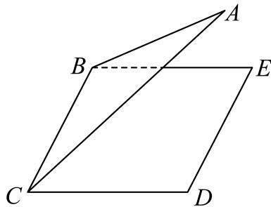
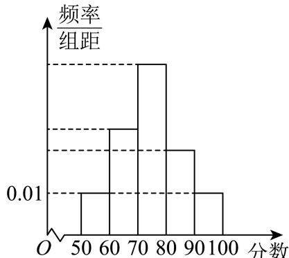

# 2025一模 虹口区原卷 · 学生版

> 本地预览：题目、答案及分类尚未全部审定。校对使用的PDF为高中工作台解析版，尚未逐区确认区级印刷原卷。

## 填空题

按本区原卷题号顺序排列。

### 虹口 · 第1题

已知集合 $A = \{ x | | x | < 2 \} , B = \{ 1 , 2 , 3 \}$ ，则A ∩ B =

### 虹口 · 第2题

函数 $\ y = \ln { \frac { x } { x - 1 } }$ 的定义域是

### 虹口 · 第3题

若tan α = 5，则tan 2α =

> 本题资料或解析有待核事项，预览不可作为已审定成品。

### 虹口 · 第4题

在(x−2)6的二项展开式中， $x ^ { 3 }$ 项的系数为

### 虹口 · 第5题

设a > 0且 $. a \neq 1$ ，则函数 $\{ y = 2 + \log _ { a }$ x的图像恒过的定点坐标为

### 虹口 · 第6题

若某圆锥的底面半径为1，高为1，则该圆锥的侧面积为 ．（结果保留π）

### 虹口 · 第7题

已知非零复数z满足|z − 1| = 1,|–z − i| = 1，则z的虚部为

> 本题资料或解析有待核事项，预览不可作为已审定成品。

### 虹口 · 第8题

已知$f(x)=\begin{cases}x^2-x,&x\geq0,\\f(-x),&x<0,\end{cases}$则$f(x)\leq6$的解集是____。

> 本题资料或解析有待核事项，预览不可作为已审定成品。

### 虹口 · 第9题

如图，已知正三角形ABC和正方形BCDE的边长均为2，且二面角 $A - B C - D$ 的大小为 $\frac { \pi } { 6 }$ ，则${ \overrightarrow { A C } } . { \overrightarrow { B D } } =$

### 虹口 · 第10题

双 曲 线 $C _ { 1 } \colon \frac { x ^ { 2 } } { a ^ { 2 } } - \frac { y ^ { 2 } } { b ^ { 2 } } = 1$ 的 左 、 右 焦 点 分 别 为 $F _ { 1 }$ 和 $F _ { 2 }$ ， 若 以 点 $F _ { 2 }$ 为 焦 点 的 抛 物 线$C _ { 2 } { : } y ^ { 2 } = 2 p x ( p > 0 ) \hat { \to } C _ { 1 }$ 在第一象限交于点P，且 $\angle P F _ { 1 } F _ { 2 } = \frac { \pi } { 4 }$ ，则 $C _ { 1 }$ 的离心率为

> 本题资料或解析有待核事项，预览不可作为已审定成品。

### 虹口 · 第11题

2024年10月30日“神舟十九号”载人飞船发射成功，标志着中国空间站建设进入新阶段．在飞船竖直升空过程中，某位记者用照相机在同一位置以同一姿势连续拍照两次．已知“神舟十九号”飞船船体实际长度为H，且在照片上飞船船体长度为h，比较两张照片，相对于照片中的同一固定参照物飞船上升了m．假设该记者连按拍照键间的反应时间为t，并忽略相机曝光时长，若用平均速度估算瞬时速度，则拍照时飞船的瞬时速度为 ．（用含有H、h、m、t的式子表示）

### 虹口 · 第12题

已知项数为10的数列 $\left\{ a _ { n } \right\}$ 中任一项均为集合 $\{ x | 1 \leq x \leq 1 0 , x \in \mathbf { N } \}$ 中的元素，且相邻两项满足$a _ { n } < a _ { n + 1 } + 3 , n = 1 , 2 , \cdots , 9 .$ ．若 $\left\{ a _ { n } \right\}$ 中任意两项都不相等，则满足条件的数列 $\{ a _ { n } \}$ 有 个

> 本题资料或解析有待核事项，预览不可作为已审定成品。

## 选择题

按本区原卷题号顺序排列。

### 虹口 · 第13题

已知 $\alpha\in(0,\pi)$，则“$\sin(\pi-\alpha)=\frac12$”是“$\cos\alpha=\frac{\sqrt3}2$”的（　）条件。

A. 充要

B. 充分非必要

C. 必要非充分

D. 既非充分又非必要

> 本题资料或解析有待核事项，预览不可作为已审定成品。

### 虹口 · 第14题

已知事件A和事件B满足A∩B = ∅，则下列说法正确的是（ ）

A. 事件A和事件B独立

B. 事件A和事件B互斥

C. 事件A和事件B对立

D. 事件A和事件B互斥

> 本题资料或解析有待核事项，预览不可作为已审定成品。

### 虹口 · 第15题

已知边长为2的正四面体A−BCD的内切球（球面与四面体四个面都相切的球）的球心为O，若空间中的动点P满足 $\overrightarrow { O P } = x \overrightarrow { O C } + y \overrightarrow { O B } + z \overrightarrow { O D } , x , y , z \in [ 0 , 1 ]$ ]，则点P的轨迹所形成的几何体的体积为（ ）

A. $\sqrt { 2 }$

B. $\frac { \sqrt { 2 } } { 3 }$

C. $2 \sqrt { 3 }$

D. $\frac { \sqrt { 3 } } { 3 }$

> 本题资料或解析有待核事项，预览不可作为已审定成品。

### 虹口 · 第16题

设数列 $\left\{ a _ { n } \right\}$ 的前四项分别为 $a _ { 1 } , ~ a _ { 2 } , ~ a _ { 3 } , ~ a _ { 4 }$ ，对于以下两个命题，说法正确的是（ ）
①存在等比数列 $\left\{ a _ { n } \right\}$ 以及锐角α，使 $\{ \sin \alpha , \cos \alpha , \tan \alpha \} = \{ a _ { 1 } , a _ { 2 } , a _ { 3 } \}$ 成立
②对任意等差数列 $\left\{ a _ { n } \right\}$ 以及锐角α，均不能使 $\{ \sin \alpha , \cos \alpha , \tan \alpha , \cot \alpha \} = \{ a _ { 1 } , a _ { 2 } , a _ { 3 } , a _ { 4 } \}$ 成立

A. ①是真命题，②是真命题

B. ①是真命题，②是假命题

C. ①是假命题，②是真命题

D. ①是假命题，②是假命题

> 本题资料或解析有待核事项，预览不可作为已审定成品。

## 解答题

按本区原卷题号顺序排列。

### 虹口 · 第17题

设 $\begin{array} { r } { f \left( x \right) = \sin \omega x ( \omega > 0 ) } \end{array}$
(1) (6分)当函数 $\boldsymbol { \cdot } \boldsymbol { y } = \boldsymbol { f } \left( \boldsymbol { x } \right)$ 的最小正周期为2π时，求 ${ \bf \dot { \boldsymbol { y } } } = f \left( { \boldsymbol { x } } \right) + \cos$ x在 $\left[ 0 , { \frac { \pi } { 2 } } \right]$ 上的最大值；
(2) (8分)若ω = 2，且在 $\triangle A B C \sharp$ ，角A、B、C所对的边长为a、b、c，锐角A满足
$f \left( A + { \frac { \pi } { 6 } } \right) = 0 , { \overrightarrow { A B } } \cdot { \overrightarrow { A C } } = 4$ ，求a的最小值

### 虹口 · 第18题

如图，已知在四棱柱 $A B C D - E F G H$ 中，EA⊥平面ABCD，N、M分别是EF、HD的中点

(1) (6分)求证： $H N / /$ 平面AFM；
(2) (8分)若底面ABCD为梯形， $A B / / C D , A B = E A = 2 , A D = D C = 1$ ，异面直线AB与EH所 成角为 $\frac { \pi } { 2 }$ ．求直线 $A N ^ { I }$ 与平面AFM所成角的正弦值

### 虹口 · 第19题

2024年法国奥运会落下帷幕．某平台为了解观众对本次奥运会的满意度，随机调查了本市1000名观众 ， 得 到 他 们 对 本 届 奥 运 会 的 满 意 度 评 分 （ 满 分 100 分 ）， 平 台 将 评 分 分 为[50, 60)、 [60, 70)、 [70, 80)、 [80, 90)、 [90, 100]共5层，绘制成频率分布直方图（如图1所示）．并在这些评分中以分层抽样的方式从这5层中再抽取了共20名观众的评分，绘制成茎叶图，但由于某种原因茎叶图受到了污损，可见部分信息如图2所示

图1

图2
(1) (4分)求图2中这20名观众的满意度评分的第35百分位数；
(2) (4分)若从图2中的20名观众中再任选取3人做深度采访，求其中至少有1名观众的评分大于等于90分的概率；
(3) (6分)已知这1000名观众的评分位于[50, 80)上的均值为67，方差为64.7，位于[50, 100]上的均值为73，方差为134.6，求这1000名观众的评分位于[80, 100]上的均值与方差

> 本题资料或解析有待核事项，预览不可作为已审定成品。

### 虹口 · 第20题

已知椭圆Γ: ${ \frac { x ^ { 2 } } { 4 } } + y ^ { 2 } = 1$ 1的左、右焦点分别为 $F _ { 1 } , F _ { 2 }$ ，右顶点为A，上顶点为B，设P为Γ上的一点(1) (4分)当 $P F _ { 1 } \bot F _ { 1 } F _ { 2 }$ 时，求 $| P F _ { 2 }$ |的值；
(2) (6分)若P点坐标为 $\left( 1 , { \frac { \sqrt { 3 } } { 2 } } \right)$ ，则在Γ上是否存在点Q使 $\triangle A P Q$ 的面积为 $\frac { { \sqrt { 3 } } + 1 } { 2 }$ ，若存在，请求出所有满足条件的点Q的坐标；若不存在，请说明理由；
(3) (8分)已知D点坐标为(0,m)，过点P和点D的直线l与椭圆Γ交于另一点T，当直线l与x轴和y轴 均不平行时，有 ${ \overrightarrow { P T } } \cdot \left( { \overrightarrow { B P } } + { \overrightarrow { B T } } \right) = 0$ ，求实数m的取值范围

> 本题资料或解析有待核事项，预览不可作为已审定成品。

### 虹口 · 第21题

设 $\overline { { a \in { \bf R } , F _ { a } \left( x \right) } } = \frac { f \left( x \right) - f \left( a \right) } { x - a } , x \in \left( a - 1 , a \right) \cup \left( a , a + 1 \right)$ ．若函数 $y = f \left( x \right)$ 满足 $F _ { a } \left( x \right) > 0$ 恒成 立，则称函数y = f (x)具有性质P (a)
(1) (4分)判断y = sinx是否具有性质P(0)，并说明理由；
(2) (6分)设 $f \left( x \right) = \mathrm { e } ^ { x } - x$ ，若函数 $\boldsymbol { \cdot } \boldsymbol { y } = \boldsymbol { f } \left( \boldsymbol { x } \right)$ 具有性质 $P \left( a \right)$ ，求实数a的取值范围；
(3) (8分)设函数y = f(x)的定义域为R，且对任意 ${ \bf { \dot { a } } } \in { \bf { R } }$ 以及 $t \in ( 0 , 1 )$ )，都有
$F _ { a } \left( a - t \right) < F _ { a } \left( a + t \right)$ ．若当x < 0时，恒有 $f \left( x \right) < 0$ ．求证：函数 $y = f \left( x \right)$ 对任意实数a均具有性质P (a)

