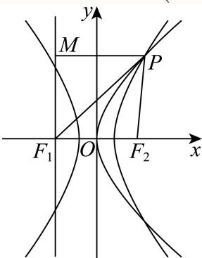
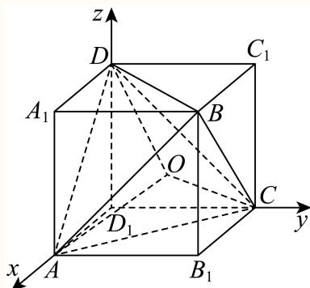
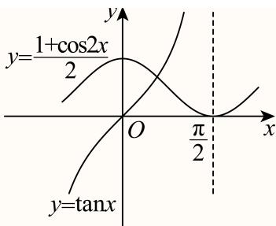
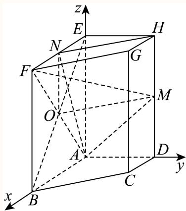
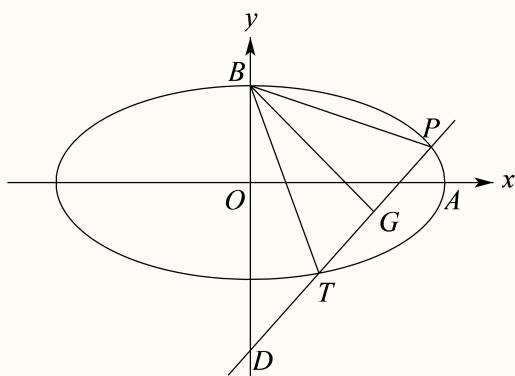

# 2025一模 虹口区原卷 · 教师版

> 本地预览：题目、答案及分类尚未全部审定。校对使用的PDF为高中工作台解析版，尚未逐区确认区级印刷原卷。

## 填空题

按本区原卷题号顺序排列。

### 虹口 · 第1题

已知集合 $A = \{ x | | x | < 2 \} , B = \{ 1 , 2 , 3 \}$ ，则A ∩ B =

**考点：** 集合交集

**难度依据：** 涉及集合交集；难度为教师预估，需结合原题条件复核。

**核查说明：** 依据现有底稿归类，尚未逐页校卷、公式校净或独立数学终审。

【答案】{1}.

【解析】

先求出集合A，再根据交集的定义求解即可.

由 $A = \{ x | | x | < 2 \} = \{ x | - 2 < x < 2 \} , B = \{ 1 , 2 , 3 \} ,$

则 $A \cap B = \{ 1 \}$

故答案为：{1}.

### 虹口 · 第2题

函数 $\ y = \ln { \frac { x } { x - 1 } }$ 的定义域是

**考点：** 对数真数条件与分式不等式

**难度依据：** 涉及对数真数条件与分式不等式；难度为教师预估，需结合原题条件复核。

**核查说明：** 依据现有底稿归类，尚未逐页校卷、公式校净或独立数学终审。

【答案】$\left( - \infty , 0 \right) \cup \left( 1 , + \infty \right)$

【解析】

由对数函数的定义可得 $\frac { x } { x - 1 } > 0$ ，解不等式即可得出答案

函数 $\ y = \ln { \frac { x } { x - 1 } }$ 的定义域是 $\frac { x } { x - 1 } > 0$

所以 $x \left( x - 1 \right) > 0$ ，解得： $x > 1 \not \equiv \not \chi < 0$

所以函数的定义域为： $\left( - \infty , 0 \right) \cup \left( 1 , + \infty \right)$

故答案为： $\left( - \infty , 0 \right) \cup \left( 1 , + \infty \right)$

### 虹口 · 第3题

若tan α = 5，则tan 2α =

> 本题资料或解析有待核事项，预览不可作为已审定成品。

**考点：** 正切二倍角

**难度依据：** 涉及正切二倍角；难度为教师预估，需结合原题条件复核。

**核查说明：** 解析推导得负五分之十二，但末尾答案文字识别损坏为5和12，须回源。；依据现有底稿归类，尚未逐页校卷、公式校净或独立数学终审。

【解析】

直接利用二倍角公式计算可得.

因为 $\tan \alpha = 5$

所以 $\tan 2 \alpha = { \frac { 2 \tan \alpha } { \underline { { { 1 } } } - \tan ^ { 2 } \alpha } } = { \frac { 2 \times 5 } { 1 - 5 ^ { 2 } } } = - { \frac { 5 } { 1 2 } } .$ 5故答案为：12

### 虹口 · 第4题

在(x−2)6的二项展开式中， $x ^ { 3 }$ 项的系数为

**考点：** 二项展开系数

**难度依据：** 涉及二项展开系数；难度为教师预估，需结合原题条件复核。

**核查说明：** 依据现有底稿归类，尚未逐页校卷、公式校净或独立数学终审。

【答案】−160.

【解析】

先求出 ${ ( x - 2 ) } ^ { 6 }$ 的通项，再令 $6 - r = 3$ ，代入计算可得答案.

二项 $\operatorname { \mathbb { E } } ( x - 2 ) ^ { 6 }$ 的通项公式为 $T _ { r + 1 } = \mathrm { C } _ { 6 } ^ { r } x ^ { 6 - r } ( - 2 ) ^ { r } = \mathrm { C } _ { 6 } ^ { r } ( - 2 ) ^ { r } \cdot x ^ { 6 - r }$

${ \widehat { \times } } 6 - r = 3$ ，可得r = 3，所以 $\mathrm { C _ { 6 } ^ { 3 } } ( - 2 ) ^ { 3 } = 2 0 \times ( - 8 ) = - 1 6 0$

故答案为：−160.

### 虹口 · 第5题

设a > 0且 $. a \neq 1$ ，则函数 $\{ y = 2 + \log _ { a }$ x的图像恒过的定点坐标为

**考点：** 对数函数图像定点

**难度依据：** 涉及对数函数图像定点；难度为教师预估，需结合原题条件复核。

**核查说明：** 依据现有底稿归类，尚未逐页校卷、公式校净或独立数学终审。

【答案】(1, 2).

【解析】

$\stackrel { \wedge } { \prec } x = 1$ ，求得y = 2恒成立，进而得到函数恒过定点，得到答案.

令x = 1，可得 $y = 2 + \log _ { a } 1$ = 2恒成立，

所以函数 $\begin{array} { r } { y = 2 + \log _ { a } : } \end{array}$ x的图象恒过定点(1,2).

故答案为：(1, 2).

### 虹口 · 第6题

若某圆锥的底面半径为1，高为1，则该圆锥的侧面积为 ．（结果保留π）

**考点：** 圆锥侧面积

**难度依据：** 涉及圆锥侧面积；难度为教师预估，需结合原题条件复核。

**核查说明：** 依据现有底稿归类，尚未逐页校卷、公式校净或独立数学终审。

【答案】$\sqrt { 2 } \pi$

【解析】

首先求出母线，再由侧面积公式计算可得.

因为圆锥的底面半径r = 1，高h = 1，设母线为l(l > 0)，则 $l = { \sqrt { r ^ { 2 } + h ^ { 2 } } } = { \sqrt { 2 } }$

所以该圆锥的侧面积为 $\pi r l = \sqrt { 2 } \pi$

故答案为： $\sqrt { 2 } \pi$

### 虹口 · 第7题

已知非零复数z满足|z − 1| = 1,|–z − i| = 1，则z的虚部为

> 本题资料或解析有待核事项，预览不可作为已审定成品。

**考点：** 共轭复数模与几何轨迹

**难度依据：** 涉及共轭复数模与几何轨迹；难度为教师预估，需结合原题条件复核。

**核查说明：** 原解先设实部、虚部均非零，是否允许此假设需核验。；依据现有底稿归类，尚未逐页校卷、公式校净或独立数学终审。

【解析】

设 $z = a + b \mathrm { i } \left( a b \neq 0 \right)$ ，根据复数的模得到方程组，解得即可.

设 $z = a + b \mathrm { i } \left( a b \neq 0 \right)$ ，则 $\overrightharpoon { z } = a - b \mathrm { i }$

因为 $| z - 1 | = 1 , | \overline { { z } } - \mathbf { i } | = 1$ ，所以 $\left\{ \begin{array} { l l } { \sqrt { \left( a - 1 \right) ^ { 2 } + b ^ { 2 } } = 1 } \\ { \sqrt { a ^ { 2 } + \left( - b - 1 \right) ^ { 2 } } = 1 } \end{array} \right.$ ，解得 $\left\{ { a = 1 \atop b = - 1 } \right.$ 或1 $\left\{ { a = 0 } \atop { b = 0 }  \right.$ （舍去），

所以z = 1 − i，则z的虚部为−1.

### 虹口 · 第8题

已知$f(x)=\begin{cases}x^2-x,&x\geq0,\\f(-x),&x<0,\end{cases}$则$f(x)\leq6$的解集是____。

> 本题资料或解析有待核事项，预览不可作为已审定成品。

**考点：** 分段函数奇偶性与不等式

**难度依据：** 涉及分段函数奇偶性与不等式；难度为教师预估，需结合原题条件复核。

**核查说明：** 题干缺分段或奇偶条件，须回源。；依据现有底稿归类，尚未逐页校卷、公式校净或独立数学终审。

【答案】[−3, 3]

【解析】

首先求出当x < 0时的解析式，再根据解析式分段得到不等式组，解得即可.

因为 $f \left( x \right) = \left\{ { x } ^ { 2 } - { x } , { x } \geq 0 \right.$

设 $x < 0$ ，则 $- x > 0$ ，所以 $f \left( x \right) = \left( - x \right) ^ { 2 } - \left( - x \right) = x ^ { 2 } + x$ ，

所以 $f \left( x \right) = \left\{ { x } ^ { 2 } - { x } , { x } \geq 0 \right.$

不等 $\operatorname { \mathbb { T } } \mathrm { f } \left( x \right) \leq 6$ ，即 $\left\{ { x ^ { 2 } } - { x } \leq 6 \right.$ 或 $\displaystyle \left\{ { \boldsymbol { x } } ^ { 2 } + { \boldsymbol { x } } \leq 6 \right.$ ，解得 $0 \leq x \leq 3 \Sigma \varnothing \varnothing - 3 \leq x < 0$

综上可得 $f \left( x \right) \leq$ 6的解集[−3, 3].

故答案为：[−3, 3]

### 虹口 · 第9题

如图，已知正三角形ABC和正方形BCDE的边长均为2，且二面角 $A - B C - D$ 的大小为 $\frac { \pi } { 6 }$ ，则${ \overrightarrow { A C } } . { \overrightarrow { B D } } =$

**考点：** 二面角与空间向量数量积

**难度依据：** 涉及二面角与空间向量数量积；难度为教师预估，需结合原题条件复核。

**核查说明：** 依据现有底稿归类，尚未逐页校卷、公式校净或独立数学终审。

【答案】−1.

【解析】

设 $F , G$ 分别为 $B C , D E$ 的中点，连接 $A F , F G ,$ ，分析可得 $\angle A F G$ 为二面角 $A - B C - D$ 的平面角，进而结合空间向量的线性运算及数量积求解即可

设 $F , G$ 分别为BC,DE的中点，连接 $A F , F G$

在正三角形ABC中， $A { \cal F } \bot B { \cal C } , A { \cal F } = \sqrt { 3 } .$

在正方形BCDE中， $F G / / C D , F G \bot B C , F G = C D = 2$

所以 $\angle A F G$ 为二面角 $A - B C - D$ 的平面角，即 $\angle A F G = { \frac { \pi } { 6 } }$

$$
\overrightarrow {A C} \cdot \overrightarrow {B D} = \left(\overrightarrow {A F} + \overrightarrow {F C}\right) \cdot \left(\overrightarrow {B C} + \overrightarrow {C D}\right) = \left(\overrightarrow {A F} + \frac {1}{2} \overrightarrow {B C}\right) \cdot \left(\overrightarrow {B C} + \overrightarrow {F G}\right)
$$

$$
\overrightarrow {A F} \cdot \overrightarrow {B C} + \overrightarrow {A F} \cdot \overrightarrow {F G} + \frac {1}{2} \overrightarrow {B C} ^ {2} + \frac {1}{2} \overrightarrow {B C} \cdot \overrightarrow {F G} = \sqrt {3} \times 2 \times \left(- \cos \frac {\pi}{6}\right) + \frac {1}{2} \times 2 ^ {2} = - 1.
$$

故答案为：−1.

### 虹口 · 第10题

双 曲 线 $C _ { 1 } \colon \frac { x ^ { 2 } } { a ^ { 2 } } - \frac { y ^ { 2 } } { b ^ { 2 } } = 1$ 的 左 、 右 焦 点 分 别 为 $F _ { 1 }$ 和 $F _ { 2 }$ ， 若 以 点 $F _ { 2 }$ 为 焦 点 的 抛 物 线$C _ { 2 } { : } y ^ { 2 } = 2 p x ( p > 0 ) \hat { \to } C _ { 1 }$ 在第一象限交于点P，且 $\angle P F _ { 1 } F _ { 2 } = \frac { \pi } { 4 }$ ，则 $C _ { 1 }$ 的离心率为

> 本题资料或解析有待核事项，预览不可作为已审定成品。

**考点：** 双曲线与抛物线定义、焦点三角形及离心率

**难度依据：** 需要联系两条圆锥曲线的焦点性质和余弦定理，教师预估。

**核查说明：** 题干连接抛物线与双曲线的文字识别缺损；解析需依照题图回源核对。；依据现有底稿归类，尚未逐页校卷、公式校净或独立数学终审。

【答案】${ \sqrt { 2 } } + 1$

【解析】

过P作抛物线准线的垂线，垂足为M，设 $| P F _ { 2 } | = t ,$ ，由 $F _ { 2 }$ 是抛物线的焦点，可得 $\vert P M \vert$ ，再由$\angle P F _ { 1 } F _ { 2 } = { \frac { \pi } { 4 } }$ ，可求得 $| P F _ { 1 } |$ $\mathrm { \# E } \triangle P F _ { 1 } F _ { 2 } $ 中由余弦定理可得 $| F _ { 1 } F _ { 2 } |$ ，再根据双曲线及离心率的定义可求出离心率

如图过P作抛物线准线的垂线，垂足为M，设 $| P F _ { 2 } | = t$

因为 $F _ { 2 }$ 是抛物线的焦点， $\therefore | P M | = | P F _ { 2 } | = t$

$$
\because \angle P F _ {1} F _ {2} = \frac {\pi}{4}, \therefore | P F _ {1} | = \frac {t}{\cos \angle F _ {1} P M} = \frac {t}{\cos \angle P F _ {1} F _ {2}} = \frac {t}{\cos \frac {\pi}{4}} = \sqrt {2} t,
$$

在 $\triangle P F _ { 1 } F _ { 2 }$ 中，由余弦定理得 $| P F _ { 2 } | ^ { 2 } = | P F _ { 1 } | ^ { 2 } + | F _ { 1 } F _ { 2 } | ^ { 2 } - 2 | P F _ { 1 } | \cdot | F _ { 1 } F _ { 2 } | \cdot \cos \angle P F _ { 1 } F _ { 2 } ,$

$$
\therefore t ^ {2} = \left(\sqrt {2} t\right) ^ {2} + \left| F _ {1} F _ {2} \right| ^ {2} - 2 \sqrt {2} t \cdot \left| F _ {1} F _ {2} \right| \cdot \frac {\sqrt {2}}{2},
$$

即 $| F _ { 1 } F _ { 2 } | ^ { 2 } - 2 t \cdot | F _ { 1 } F _ { 2 } | + t ^ { 2 } = 0$ ，解得 $F _ { 1 } F _ { 2 } | = t$

又 ${ \bf \nabla } \cdot { \bf F } _ { 1 }$ 和 $F _ { 2 }$ 是双曲线的左、右焦点，

$$
\therefore 2 c = \left| F _ {1} F _ {2} \right| = t, 2 a = \left| \left| P F _ {1} \right| - \left| P F _ {2} \right| \right| = \sqrt {2} t - t = (\sqrt {2} - 1) t
$$

$$
\therefore e = \frac {c}{a} = \frac {2 c}{2 a} = \frac {t}{(\sqrt {2} - 1) t} = \sqrt {2} + 1.
$$

故答案为： ${ \sqrt { 2 } } + 1$

### 虹口 · 第11题

2024年10月30日“神舟十九号”载人飞船发射成功，标志着中国空间站建设进入新阶段．在飞船竖直升空过程中，某位记者用照相机在同一位置以同一姿势连续拍照两次．已知“神舟十九号”飞船船体实际长度为H，且在照片上飞船船体长度为h，比较两张照片，相对于照片中的同一固定参照物飞船上升了m．假设该记者连按拍照键间的反应时间为t，并忽略相机曝光时长，若用平均速度估算瞬时速度，则拍照时飞船的瞬时速度为 ．（用含有H、h、m、t的式子表示）

**考点：** 比例尺与平均速度建模

**难度依据：** 涉及比例尺与平均速度建模；难度为教师预估，需结合原题条件复核。

**核查说明：** 依据现有底稿归类，尚未逐页校卷、公式校净或独立数学终审。

【答案】$\frac { H m } { h t }$

【解析】

先求出第二次拍照飞船的实际上升的高度，再由实际上升的高度除以该记者连按拍照键间的反应时间为t，即可求出拍照时飞船的瞬时速度.

设第二次拍照飞船的实际上升 $\vec { \rfloor } \boldsymbol { x } .$ ，

所以 ${ \frac { H } { h } } = { \frac { x } { m } }$ ，解得： $x = { \frac { H m } { h } }$ ，

所以拍照时飞船的瞬时速度为： $v = { \frac { x } { t } } = { \frac { H m } { h t } }$

故答案为： $\frac { H m } { h t }$

### 虹口 · 第12题

已知项数为10的数列 $\left\{ a _ { n } \right\}$ 中任一项均为集合 $\{ x | 1 \leq x \leq 1 0 , x \in \mathbf { N } \}$ 中的元素，且相邻两项满足$a _ { n } < a _ { n + 1 } + 3 , n = 1 , 2 , \cdots , 9 .$ ．若 $\left\{ a _ { n } \right\}$ 中任意两项都不相等，则满足条件的数列 $\{ a _ { n } \}$ 有 个

> 本题资料或解析有待核事项，预览不可作为已审定成品。

**考点：** 整数排列与相邻限制计数

**难度依据：** 涉及整数排列与相邻限制计数；难度为教师预估，需结合原题条件复核。

**核查说明：** 原解插入计数结尾乘数识别成问号，需核原文。；依据现有底稿归类，尚未逐页校卷、公式校净或独立数学终审。

【答案】13122.

【解析】

先将1,2,3任意排列，依次将4到10插入该数列，考虑满足条件 $a _ { n } < a _ { n + 1 } + 3 , n = 1 , 2 , \cdots , 9$ 求出其方法总数，即可得出答案.

由于 $\cdot a _ { n } < a _ { n + 1 } + 3 , n = 1 , 2 , \cdot \cdot \cdot , 9$ ，可以先将1,2,3任意排列，

再将4插入该数列，但不能在1的左边且与1相邻，共有 $\mathrm { 3 A _ { 3 } ^ { 3 } = 2 \times 3 ^ { 2 } }$ 种，

再将5插入该数列，同样5不能在1和2的左边且与1，2相邻，共有 $2 \times 3 ^ { 3 }$ 种，

再将6插入该数列，同样6不能在1，2和3的左边且与1,2,3相邻，共有 $2 \times 3 ^ { 4 }$ 种，

以此类推，将10插入该数列，共有 $? \times 3 ^ { 8 } = 1 3 1 2 2$ 种.

故答案为：13122.

## 二、选择题

## 选择题

按本区原卷题号顺序排列。

### 虹口 · 第13题

已知 $\alpha\in(0,\pi)$，则“$\sin(\pi-\alpha)=\frac12$”是“$\cos\alpha=\frac{\sqrt3}2$”的（　）条件。

A. 充要

B. 充分非必要

C. 必要非充分

D. 既非充分又非必要

> 本题资料或解析有待核事项，预览不可作为已审定成品。

**考点：** 三角诱导公式与充要条件

**难度依据：** 涉及三角诱导公式与充要条件；难度为教师预估，需结合原题条件复核。

**核查说明：** 题干及A选项可能在题图中，需核题图及原卷。；依据现有底稿归类，尚未逐页校卷、公式校净或独立数学终审。

【答案】C

【解析】

结合诱导公式及特殊角的三角函数值求出两个条件的α的值，进而结合充分、必要条件的定义判断即可.

由题意， $\alpha \in ( 0 , \pi )$

由 $\sin \left( \pi - \alpha \right) = \frac { 1 } { 2 }$ ，即 $\sin \alpha = \frac { 1 } { 2 }$ ，则 $\lvert \alpha = \frac { \pi } { 6 }$ 或 $\alpha = \frac { 5 \pi } { 6 }$

由 $\cos \alpha = { \frac { \sqrt { 3 } } { 2 } }$ ，则 $\alpha = \frac { \pi } { 6 }$

所以 $\sin \left( \pi - \alpha \right) = \frac { 1 } { 2 } ,$ ”是 ${ \mathrm { \ddot { c } o s } } \alpha = { \frac { \sqrt { 3 } } { 2 } } { \mathrm { \ddot { } } }$ ”的必要非充分条件

故选：C.

### 虹口 · 第14题

已知事件A和事件B满足A∩B = ∅，则下列说法正确的是（ ）

A. 事件A和事件B独立

B. 事件A和事件B互斥

C. 事件A和事件B对立

D. 事件A和事件B互斥

> 本题资料或解析有待核事项，预览不可作为已审定成品。

**考点：** 互斥、独立与对立事件

**难度依据：** 涉及互斥、独立与对立事件；难度为教师预估，需结合原题条件复核。

**核查说明：** 选项B、D识别相同，须回源核对。；依据现有底稿归类，尚未逐页校卷、公式校净或独立数学终审。

【答案】B

【解析】

根据互斥事件、相互独立事件的定义判断即可.

因为事件A和事件B满足A∩B = ∅，则一定可以得到事件A和事件B互斥，但不一定对立，故B正确，C错误；

因为 $P \left( A B \right) = 0$ ，当 $P \left( A \right)$ ，P(B)不为0时，事件A和事件B不独立，故A错误；

抛掷一枚骰子，记出现1点为事件A，出现2点为事件B，

故选：B

则A = {2, 3, 4, 5, 6}，– $\overline { { B } } = \{ 1 , 3 , 4 , 5 , 6 \}$ ，显然事件A和事件 $\overline { { B } }$ 不互斥，故D错误.

### 虹口 · 第15题

已知边长为2的正四面体A−BCD的内切球（球面与四面体四个面都相切的球）的球心为O，若空间中的动点P满足 $\overrightarrow { O P } = x \overrightarrow { O C } + y \overrightarrow { O B } + z \overrightarrow { O D } , x , y , z \in [ 0 , 1 ]$ ]，则点P的轨迹所形成的几何体的体积为（ ）

A. $\sqrt { 2 }$

B. $\frac { \sqrt { 2 } } { 3 }$

C. $2 \sqrt { 3 }$

D. $\frac { \sqrt { 3 } } { 3 }$

> 本题资料或解析有待核事项，预览不可作为已审定成品。

**考点：** 空间向量与平行六面体体积

**难度依据：** 涉及空间向量与平行六面体体积；难度为教师预估，需结合原题条件复核。

**核查说明：** 仅修复所列OCR公式及其定界符错位；原解数学疑点和其他可渲染错识未因此消除。；依据现有底稿归类，尚未逐页校卷、公式校净或独立数学终审。

【答案】A

【解析】

点P的轨迹是以 $|OC|,|OB|,|OD|$为邻边的平行六面体，求出以 $| O C | , | O B |$ 为邻边的平行四边形面积和点D到平面BOC距离，由柱体的体积公式即可得出答案

空间中的动点P满足 $\overrightarrow { O P } = x \overrightarrow { O C } + y \overrightarrow { O B } + z \overrightarrow { O D } , x , y , z \in [ 0 , 1 ]$ ，

则点P的轨迹是以 $| O C | , | O B | , | O D |$ |为邻边的平行六面体，

将正四面体 $A - B C D$ 放入如图所示的正方体 $A _ { 1 } B C _ { 1 } D - A B _ { 1 } C D _ { 1 } \sharp$ 中，

则正四面体 $A - B C D$ 的内切球心O为正方体的中心，

设正方体的棱长为a，所 $\ { } ^ { \ ' } a ^ { 2 } = 2$ ，所 $\downarrow a = \sqrt { 2 }$ ，

以 $D _ { 1 }$ 为坐标原点，建立如图所示的空间直角坐标系，

所以 $D \left( 0 , 0 , { \sqrt { 2 } } \right) , B \left( { \sqrt { 2 } } , { \sqrt { 2 } } , { \sqrt { 2 } } \right) , C \left( 0 , { \sqrt { 2 } } , 0 \right) , A \left( { \sqrt { 2 } } , 0 , 0 \right) , O \left( { \frac { { \sqrt { 2 } } } { 2 } } , { \frac { { \sqrt { 2 } } } { 2 } } , { \frac { { \sqrt { 2 } } } { 2 } } \right)$

$$
\overrightarrow {O B} = \left(\frac {\sqrt {2}}{2}, \frac {\sqrt {2}}{2}, \frac {\sqrt {2}}{2}\right), \overrightarrow {O C} = \left(- \frac {\sqrt {2}}{2}, \frac {\sqrt {2}}{2}, - \frac {\sqrt {2}}{2}\right), \overrightarrow {B C} = (- \sqrt {2}, 0, - \sqrt {2}).
$$

$$
\left| \overrightarrow {O B} \right| = \sqrt {\left(\frac {\sqrt {2}}{2}\right) ^ {2} + \left(\frac {\sqrt {2}}{2}\right) ^ {2} + \left(\frac {\sqrt {2}}{2}\right) ^ {2}} = \frac {\sqrt {6}}{2},
$$

$$
\left| \overrightarrow {O C} \right| = \sqrt {\left(- \frac {\sqrt {2}}{2}\right) ^ {2} + \left(\frac {\sqrt {2}}{2}\right) ^ {2} + \left(- \frac {\sqrt {2}}{2}\right) ^ {2}} = \frac {\sqrt {6}}{2},
$$

$$
\left| \overrightarrow {B C} \right| = \sqrt {\left(- \sqrt {2}\right) ^ {2} + \left(- \sqrt {2}\right) ^ {2}} = 2,
$$

$$
\cos \angle B O C = \frac {\left| \overrightarrow {O B} \right| ^ {2} + \left| \overrightarrow {O C} \right| ^ {2} - \left| \overrightarrow {B C} \right| ^ {2}}{2 \left| \overrightarrow {O B} \right| \cdot \left| \overrightarrow {O C} \right|} = \frac {\left(\frac {\sqrt {6}}{2}\right) ^ {2} + \left(\frac {\sqrt {6}}{2}\right) ^ {2} - 2 ^ {2}}{2 \times \frac {\sqrt {6}}{2} \times \frac {\sqrt {6}}{2}} = - \frac {1}{3},
$$

所以 $\sin \angle B O C = \sqrt { 1 - \cos ^ { 2 } \angle B O C } = \frac { 2 \sqrt { 2 } } { 3 } ,$ ，

所以 $\mathbb { \backslash } | O C | , | O B |$ 为邻边的平行四边形面积为：

$$
S = 2 \times \frac {1}{2} \cdot \left| \overrightarrow {O B} \right| \cdot \left| \overrightarrow {O C} \right| \sin \angle B O C = \left(\frac {\sqrt {6}}{2}\right) ^ {2} \times \frac {2 \sqrt {2}}{3} = \sqrt {2},
$$

设平面BOC的法向量为 $\vec { \vert n \vert } = ( x , y , z )$

→ √2 √2 √2 →n ⋅ OB = x + y + z = 0 则 2 2 2 →n ⋅ OC =−→ √2 x + √2 y − √2 = 0 2 2 2

取 $x = 1$ ，可得 $y = 0 , z = - 1$ ，所以 $\vec { n } = ( 1 , 0 , - 1 )$ , $\overrightarrow { D B } = \left( \sqrt { 2 } , \sqrt { 2 } , 0 \right)$

又因为点D到平面BOC距离为 $\dot { \iota } = \frac { \left| \overrightarrow { n } \cdot \overrightarrow { D B } \right| } { \left| \overrightarrow { n } \right| } = \frac { \sqrt { 2 } } { \sqrt { 2 } } = 1$

以 $| O C | , | O B | , | O D |$ |为邻边的平行六面体的体积为： $V = S \cdot d = { \sqrt { 2 } } \times 1 = { \sqrt { 2 } } .$

故选：A.

### 虹口 · 第16题

设数列 $\left\{ a _ { n } \right\}$ 的前四项分别为 $a _ { 1 } , ~ a _ { 2 } , ~ a _ { 3 } , ~ a _ { 4 }$ ，对于以下两个命题，说法正确的是（ ）
①存在等比数列 $\left\{ a _ { n } \right\}$ 以及锐角α，使 $\{ \sin \alpha , \cos \alpha , \tan \alpha \} = \{ a _ { 1 } , a _ { 2 } , a _ { 3 } \}$ 成立
②对任意等差数列 $\left\{ a _ { n } \right\}$ 以及锐角α，均不能使 $\{ \sin \alpha , \cos \alpha , \tan \alpha , \cot \alpha \} = \{ a _ { 1 } , a _ { 2 } , a _ { 3 } , a _ { 4 } \}$ 成立

A. ①是真命题，②是真命题

B. ①是真命题，②是假命题

C. ①是假命题，②是真命题

D. ①是假命题，②是假命题

> 本题资料或解析有待核事项，预览不可作为已审定成品。

**考点：** 等差等比数列与三角函数命题

**难度依据：** 涉及等差等比数列与三角函数命题；难度为教师预估，需结合原题条件复核。

**核查说明：** 第②命题解答对α=π/4的集合重复元素及排序论证较简略，需复核；末段区间及最大值公式识别损坏。；依据现有底稿归类，尚未逐页校卷、公式校净或独立数学终审。

【答案】A

【解析】

假设 $\sin \alpha , \ \tan \alpha , \ \cos \alpha )$ 成等比数列，可得 $\tan \alpha = { \frac { 1 + \cos 2 \alpha } { 2 } }$ ，在同一坐标系内作 $: y = \tan x$ 和 $y = \frac { 1 + \cos 2 x } { 2 }$ 的图象可判断①；分 $\alpha = \frac { \pi } { 4 } , \ \alpha \in \left( 0 , \frac { \pi } { 4 } \right) \Re \Re \alpha \in \left( \frac { \pi } { 4 } , \frac { \pi } { 2 } \right)$ ，求出$\sin \alpha , \cos \alpha , \tan \alpha , \cot \alpha$ 的最大值和最小值可知 $\sin \alpha + \cot \alpha = \cos \alpha + \tan \alpha$ 判断该方程是否有解可判断②.

对于①，若sinα，tanα，cosα成等比数列，即 $\tan ^ { 2 } \alpha = \sin \alpha \cos \alpha , \alpha \in \left( 0 , { \frac { \pi } { 2 } } \right)$

则 ${ \frac { \sin ^ { 2 } \alpha } { \cos ^ { 2 } \alpha } } = \sin \alpha \cos \alpha$ ，即 ${ \frac { \sin \alpha } { \cos ^ { 2 } \alpha } } = \cos \alpha$ ，得 $\tan \alpha = { \frac { 1 + \cos 2 \alpha } { 2 } }$

在同一坐标系内作 $\dot { y } = \tan x \Re \mathbb { H } y = \frac { 1 + \cos 2 x } { 2 }$ 的图象：

可知方程 $\tan \alpha = { \frac { 1 + \cos 2 \alpha } { 2 } } , \alpha \in \left( 0 , { \frac { \pi } { 2 } } \right)$ 有且只有一解，

所以存在等比数列 $\left\{ a _ { n } \right\}$ 以及锐角α，使 $\{ \sin \alpha , \cos \alpha , \tan \alpha \} = \{ a _ { 1 } , a _ { 2 } , a _ { 3 } \}$ 成立，①是真命题；对 $\operatorname { \overline { { f } } } ( 2 )$ ，假设存在等差数列 $\left\{ a _ { n } \right\}$ 以及锐角α，

使 $\{ \sin \alpha , \cos \alpha , \tan \alpha , \cot \alpha \} = \{ a _ { 1 } , a _ { 2 } , a _ { 3 } , a _ { 4 } \}$ 成立，则必有 $a _ { 1 } + a _ { 4 } = a _ { 2 } + a _ { 3 }$

当 $\alpha = \frac { \pi } { 4 }$ 时，显然不成立；

当 $\alpha \in \left( 0 , { \frac { \pi } { 4 } } \right)$ 时， $\operatorname* { m i n } \left\{ \sin \alpha , \cos \alpha , \tan \alpha , \cot \alpha \right\} = \sin \alpha ,$

max {sin α, cos α, tan α, cot α} = cot α，

所以 $\tan ( a _ { 1 } + a _ { 4 } = \sin \alpha + \cot \alpha , a _ { 2 } + a _ { 3 } = \cos \alpha + \tan \alpha$

所以 $\left. \sin \alpha + \cot \alpha = \cos \alpha + \tan \alpha \right.$

$$
\left| \sin \alpha - \cos \alpha = \frac {\sin \alpha}{\cos \alpha} - \frac {\cos \alpha}{\sin \alpha} = \frac {\sin^ {2} \alpha - \cos^ {2} \alpha}{\cos \alpha \cdot \sin \alpha}, \right.
$$

$1 = { \frac { \sin \alpha + \cos \alpha } { \cos \alpha \cdot \sin \alpha } }$ ，即 $\sin \alpha \cos \alpha - \sin \alpha - \cos \alpha = 0$ ，即 $\left( 1 - \cos \alpha \right) \left( 1 - \sin \alpha \right) = 1$

因为 $\alpha \in \left( 0 , { \frac { \pi } { 4 } } \right)$ ，所以 $0 < 1 - \cos \alpha < 1 , 0 < 1 - \sin \alpha < 1$

不存在这样的 ${ \bar { | } } \alpha \in \left( 0 , { \frac { \pi } { 4 } } \right)$ 使得等式成立；

当 $\alpha \in \left( { \frac { \pi } { 4 } } , { \frac { \pi } { 2 } } \right)$ 时， $\operatorname* { m i n } \left\{ \sin \alpha , \cos \alpha , \tan \alpha , \cot \alpha \right\} = \cos \alpha ;$

ma $: \{ \sin \alpha , \cos \alpha , \tan \alpha , \cot \alpha \} = \{ \sin \alpha ,$

所以 $\displaystyle a _ { 1 } + a _ { 4 } = \cos \alpha + \tan \alpha , ~ a _ { 2 } + a _ { 3 } = \sin \alpha + \cot \alpha ,$

所以 $\sin \alpha + \cot \alpha = \cos \alpha + \tan \alpha ,$

同理 $\left( 1 - \cos \alpha \right) \left( 1 - \sin \alpha \right) = 1$

因为 $\lceil \alpha \in \left( { \frac { \pi } { 4 } } , { \frac { \pi } { 2 } } \right)$ ，所以 $\ : 0 < 1 - \cos \alpha < 1 , 0 < 1 - \sin \alpha < 1 \ :$

不存在这样的 $\overset { \cdot } { \alpha } \in \left( 0 , \frac { \pi } { 4 } \right)$ 使得等式成立；

所以②是真命题.

故选：A.

思路点睛：与三角有关的方程是否有解的问题，可根据代数式的特征选择合适的范围，再根据范围判断一些特定代数式的符号，从而可判断方程是否有解

## 三、解答题

## 解答题

按本区原卷题号顺序排列。

### 虹口 · 第17题

设 $\begin{array} { r } { f \left( x \right) = \sin \omega x ( \omega > 0 ) } \end{array}$
(1) (6分)当函数 $\boldsymbol { \cdot } \boldsymbol { y } = \boldsymbol { f } \left( \boldsymbol { x } \right)$ 的最小正周期为2π时，求 ${ \bf \dot { \boldsymbol { y } } } = f \left( { \boldsymbol { x } } \right) + \cos$ x在 $\left[ 0 , { \frac { \pi } { 2 } } \right]$ 上的最大值；
(2) (8分)若ω = 2，且在 $\triangle A B C \sharp$ ，角A、B、C所对的边长为a、b、c，锐角A满足
$f \left( A + { \frac { \pi } { 6 } } \right) = 0 , { \overrightarrow { A B } } \cdot { \overrightarrow { A C } } = 4$ ，求a的最小值

**考点：** （1）辅助角公式与最值；（2）定角数量积和边长下界

**难度依据：** 涉及（1）辅助角公式与最值；（2）定角数量积和边长下界；难度为教师预估，需结合原题条件复核。

**核查说明：** 依据现有底稿归类，尚未逐页校卷、公式校净或独立数学终审。

【解析】

(1) 因为 $f \left( x \right) = \sin \omega x ( \omega > 0 )$ 且函数 $y = f \left( x \right)$ 的最小正周期为2π，

所以 $. T = \frac { 2 \pi } { \omega } = 2 \pi$ ，解得 $\omega = 1$ ，所以 $f \left( x \right) = \sin { x }$

$$
\text {当} y = f (x) + \cos x = \sin x + \cos x = \sqrt {2} \sin \left(x + \frac {\pi}{4}\right)
$$

由 $x \in \left[ 0 , { \frac { \pi } { 2 } } \right]$ ，则 $x + { \frac { \pi } { 4 } } \in \left\lceil { \frac { \pi } { 4 } } , { \frac { 3 \pi } { 4 } } \right\rceil$

所以当 $x + { \frac { \pi } { 4 } } = { \frac { \pi } { 2 } }$ ，即 $x = { \frac { \pi } { 4 } }$ 时 $y = f \left( x \right) + \cos x$ 取得最大值 ${ \sqrt { 2 } } .$

(2) 当ω = 2时， $f \left( x \right) = \sin 2 x ,$ ，则f $\left( A + { \frac { \pi } { 6 } } \right) = \sin \left( 2 A + { \frac { \pi } { 3 } } \right) = 0 \quad$

因为0 $< A < \frac { \pi } { 2 }$ ，所以 $\frac { \pi } { 3 } < 2 A + \frac { \pi } { 3 } < \frac { 4 \pi } { 3 }$ ，则 $2 A + { \frac { \pi } { 3 } } = \pi .$ ，解得 $A = \frac { \pi } { 3 }$ ；

因为 ${ \overrightarrow { A B } } \cdot { \overrightarrow { A C } } = b c \cos A = { \frac { 1 } { 2 } } b c = 4$ ，所以 $b c = 8$

由余弦定理 $a ^ { 2 } = b ^ { 2 } + c ^ { 2 } - 2 b c \cos A$

所以 $a ^ { 2 } = b ^ { 2 } + c ^ { 2 } - 8 \geq 2 b c - 8 = 8$ ，所以 $a \geq 2 { \sqrt { 2 } }$ ，当且仅当 $b = c = 2 { \sqrt { 2 } }$ 时取等号，故a的最小值为 $2 { \sqrt { 2 } } .$

### 虹口 · 第18题

如图，已知在四棱柱 $A B C D - E F G H$ 中，EA⊥平面ABCD，N、M分别是EF、HD的中点

(1) (6分)求证： $H N / /$ 平面AFM；
(2) (8分)若底面ABCD为梯形， $A B / / C D , A B = E A = 2 , A D = D C = 1$ ，异面直线AB与EH所 成角为 $\frac { \pi } { 2 }$ ．求直线 $A N ^ { I }$ 与平面AFM所成角的正弦值

**考点：** （1）中点构造平行；（2）空间坐标求线面角

**难度依据：** 涉及（1）中点构造平行；（2）空间坐标求线面角；难度为教师预估，需结合原题条件复核。

**核查说明：** 依据现有底稿归类，尚未逐页校卷、公式校净或独立数学终审。

【解析】

(1) 连接BE交AF于点O，连接ON，OM，

在四棱柱 $A B C D - E F G H \uparrow$ ，四边形ABFE，ADHE为平行四边形，所以O为AF的中点，

又N、M分别是EF、HD的中点，

所以 $. O N / / A .$ E且 $O N = { \frac { 1 } { 2 } } A E$ $H M / / A E$ 且 $H M = { \frac { 1 } { 2 } } A E$

所以 $O N / / H M$ 且 $O N = H M$ ，所以四边形ONHM为平行四边形，

所以 $H N / / O M$ ，又HN ⊄平面AFM， $O M \subset$ 平面AFM，所以 $H N / /$ 平面 $A F M$ ；

(2) 因为异面直线 $A B  E H$ 所成角为 $\frac { \pi } { 2 }$ ，又 $A D / / E H$

所以 $\angle B A D$ 即为异面直线AB与EH所成角，即 $\angle B A D = \frac { \pi } { 2 }$ ，即 $| A B \bot A D$ $\zeta E A \bot$ 平面 $A B C D$

如图建立空间直角坐标系，则A (0, 0, 0)，N (1, 0, 2)，F (2, 0, 2)，M (0, 1, 1)，

所以 $\stackrel {  } { A N } = ( 1 , 0 , 2 )$ 9 $\stackrel {  } { A F } = ( 2 , 0 , 2 )$ $\stackrel { \longrightarrow } { A M } = ( 0 , 1 , 1 )$

设平面AFM的法向量为 $\vec { n } = ( x , y , z )$ ，则 $\left\{ { \begin{array} { l } { { \vec { n } } \cdot { \overrightarrow { A F } } = 2 x + 2 z = 0 } \\ { { \vec { n } } \cdot { \overrightarrow { A M } } = y + z = 0 } \end{array} } \right.$ ， $\overrightarrow { \chi _ { n } } = \left( 1 , 1 , - 1 \right)$

设直线AN与平面AFM所成角为θ，则 $\sin \theta = { \frac { \left| { \overrightarrow { A N } } \cdot { \overrightarrow { n } } \right| } { \left| { \overrightarrow { A N } } \right| \cdot \left| { \overrightarrow { n } } \right| } } = { \frac { 1 } { { \sqrt { 3 } } \times { \sqrt { 5 } } } } = { \frac { \sqrt { 1 5 } } { 1 5 } } .$ 所以直线AN与平面AFM所成角的正弦值为 $\frac { \sqrt { 1 5 } } { 1 5 }$

### 虹口 · 第19题

2024年法国奥运会落下帷幕．某平台为了解观众对本次奥运会的满意度，随机调查了本市1000名观众 ， 得 到 他 们 对 本 届 奥 运 会 的 满 意 度 评 分 （ 满 分 100 分 ）， 平 台 将 评 分 分 为[50, 60)、 [60, 70)、 [70, 80)、 [80, 90)、 [90, 100]共5层，绘制成频率分布直方图（如图1所示）．并在这些评分中以分层抽样的方式从这5层中再抽取了共20名观众的评分，绘制成茎叶图，但由于某种原因茎叶图受到了污损，可见部分信息如图2所示

图1

图2
(1) (4分)求图2中这20名观众的满意度评分的第35百分位数；
(2) (4分)若从图2中的20名观众中再任选取3人做深度采访，求其中至少有1名观众的评分大于等于90分的概率；
(3) (6分)已知这1000名观众的评分位于[50, 80)上的均值为67，方差为64.7，位于[50, 100]上的均值为73，方差为134.6，求这1000名观众的评分位于[80, 100]上的均值与方差

> 本题资料或解析有待核事项，预览不可作为已审定成品。

**考点：** （1）茎叶图与百分位数；（2）组合概率；（3）合并方差

**难度依据：** 涉及（1）茎叶图与百分位数；（2）组合概率；（3）合并方差；难度为教师预估，需结合原题条件复核。

**核查说明：** 第（1）问解析中平均数误识为平方数。；依据现有底稿归类，尚未逐页校卷、公式校净或独立数学终审。

【解析】

(1) $\because 2 0 \times 0 . 3 5 = 7 ,$

∴第35百分位数为第7,8两个数的平方数 ${ \frac { 6 5 + 7 1 } { 2 } } = 6 8$

(2) 由图1可知，图2中[90, 100]有2人，

所以从图2中的20名观众中再任选取3人做深度采访，求其中至少有1名观众的评分大于等于90分设为事件A，

所以 $P \left( A \right) = 1 - \frac { \mathrm { C _ { 1 8 } ^ { 3 } } } { \mathrm { C _ { 2 0 } ^ { 3 } } } = 1 - \frac { 6 8 } { 9 5 } = \frac { 2 7 } { 9 5 } .$

(3) 由题意可知：落在[50,80)的频率为 $0 . 1 + 0 . 2 5 + 0 . 3 5 = 0 . 7$ ，落在[80, 100]的频率为0.3，

因为这1000名观众的评分位于[50,80)上的均值为67，方差为64.7，

位于[50, 100]上的均值为73，方差为134.6，

所以x1– $= 6 7 , s _ { 1 } ^ { 2 } = 6 4 . 7 , \overline { { x } } = 7 3 , s ^ { 2 } = 1 3 4 . 6 ,$

设这1000名观众的评分位于[80,100]上的均值与方差分别为 $\overline { { x _ { 2 } } } , s _ { 2 } ^ { 2 }$

所以x – $= 7 3 = \frac { 0 . 7 } { 0 . 7 + 0 . 3 } \times { 6 7 } + \frac { 0 . 3 } { 0 . 7 + 0 . 3 } \cdot \overline { { x _ { 2 } } } ,$ ，解得： ${ \overline { { x _ { 2 } } } } = 8 7 .$

$$
s ^ {2} = \frac {0 . 7}{0 . 7 + 0 . 3} \left[ 6 4. 7 + (6 7 - 7 3) ^ {2} \right] + \frac {0 . 3}{0 . 7 + 0 . 3} \left[ s _ {2} ^ {2} + (8 7 - 7 3) ^ {2} \right] = 1 3 4. 6,
$$

解得： $s _ { 2 } ^ { 2 } = 1 7 . 7 .$

这1000名观众的评分位于[80,100]上的均值与方差分别为87，17.7.

### 虹口 · 第20题

已知椭圆Γ: ${ \frac { x ^ { 2 } } { 4 } } + y ^ { 2 } = 1$ 1的左、右焦点分别为 $F _ { 1 } , F _ { 2 }$ ，右顶点为A，上顶点为B，设P为Γ上的一点(1) (4分)当 $P F _ { 1 } \bot F _ { 1 } F _ { 2 }$ 时，求 $| P F _ { 2 }$ |的值；
(2) (6分)若P点坐标为 $\left( 1 , { \frac { \sqrt { 3 } } { 2 } } \right)$ ，则在Γ上是否存在点Q使 $\triangle A P Q$ 的面积为 $\frac { { \sqrt { 3 } } + 1 } { 2 }$ ，若存在，请求出所有满足条件的点Q的坐标；若不存在，请说明理由；
(3) (8分)已知D点坐标为(0,m)，过点P和点D的直线l与椭圆Γ交于另一点T，当直线l与x轴和y轴 均不平行时，有 ${ \overrightarrow { P T } } \cdot \left( { \overrightarrow { B P } } + { \overrightarrow { B T } } \right) = 0$ ，求实数m的取值范围

> 本题资料或解析有待核事项，预览不可作为已审定成品。

**考点：** （1）椭圆焦点；（2）定面积与交点；（3）数量积与中点参数范围

**难度依据：** 涉及（1）椭圆焦点；（2）定面积与交点；（3）数量积与中点参数范围；难度为教师预估，需结合原题条件复核。

**核查说明：** 第（2）问平行线距离公式中的符号与随后解出的q不一致，须回源核对。；依据现有底稿归类，尚未逐页校卷、公式校净或独立数学终审。

【解析】

(1) 由椭圆方程知：a = 2，b = 1， $c = { \sqrt { 3 } } .$ ，则 $F _ { 1 } \left( - { \sqrt { 3 } } , 0 \right)$

设 $P \left( - { \sqrt { 3 } } , y _ { P } \right)$ $\therefore { \frac { 3 } { 4 } } + y _ { P } ^ { 2 } = 1$ ，解得： $| y _ { P } | = { \frac { 1 } { 2 } }$ ，即 $\left| P F _ { 1 } \right| = \frac { 1 } { 2 }$

由椭圆定义知： $| P F _ { 2 } | = 2 a - | P F _ { 1 } | = 4 - { \frac { 1 } { 2 } } = { \frac { 7 } { 2 } } .$ .

(2) 由（1）知：A (2, 0)，

$$
\because P \left(1, \frac {\sqrt {3}}{2}\right), \therefore | A P | = \sqrt {(2 - 1) ^ {2} + \left(0 - \frac {\sqrt {3}}{2}\right) ^ {2}} = \frac {\sqrt {7}}{2};
$$

若存在点Q，使 $\triangle A P Q$ 的面积为 $\frac { { \sqrt { 3 } } + 1 } { 2 }$

则点Q到直线AP的距离 $\dot { d } = \frac { \sqrt { 3 } + 1 } { | A P | } = \frac { 2 \sqrt { 2 1 } + 2 \sqrt { 7 } } { 7 }$

$\cdot k _ { A P } = \frac { \frac { \sqrt { 3 } } { 2 } - 0 } { 1 - 2 } = - \frac { \sqrt { 3 } } { 2 }$ ，∴直线AP方程为： $y = - { \frac { \sqrt { 3 } } { 2 } } ( x - 2 )$ ，即 ${ \sqrt { 3 } } x + 2 y - 2 { \sqrt { 3 } } = 0$ 设平行于直线 $A P .$ 且到直线 的距离为 $\frac { 2 { \sqrt { 2 1 } } + 2 { \sqrt { 7 } } } { 7 }$ 的直线方程为 ${ \sqrt { 3 } } x + 2 y + q = 0$ 1$\therefore { \frac { \left| { \boldsymbol { q } } + 2 { \sqrt { 3 } } \right| } { \sqrt { 7 } } } = { \frac { 2 { \sqrt { 2 1 } } + 2 { \sqrt { 7 } } } { 7 } }$ 解得： $q = 2 \not \equiv \not \chi q = - 2 - 4 \sqrt { 3 }$ ；当q = 2时，直线方程为 $\sqrt { 3 } x + 2 y + 2 = 0$

$\left\{ { \begin{array} { l } { { \sqrt { 3 } } x + 2 y + 2 = 0 } \\ { { \frac { x ^ { 2 } } { 4 } } + y ^ { 2 } = 1 } \end{array} } \right.$ 得： $4 x ^ { 2 } + 4 { \sqrt { 3 } } x = 0$ ，解得： $x = 0 \not \equiv \not \chi _ { x } = - \sqrt { 3 } ,$

$\therefore y = - 1$ 或 $y = \frac 1 2$ ，∴点 $Q \left( 0 , - 1 \right) \stackrel { \triangledown } { \lrcorner } Q \left( - \sqrt { 3 } , \frac { 1 } { 2 } \right)$ ；

当 $q = - 2 - 4 \sqrt { 3 } \mathrm { \AA }$ 时，直线方程为 ${ \sqrt { 3 } } x + 2 y - 2 - 4 { \sqrt { 3 } } = 0$

由 $\left\{ { \begin{array} { l } { { \sqrt { 3 } } x + 2 y - 2 - 4 { \sqrt { 3 } } = 0 } \\ { { \frac { x ^ { 2 } } { 4 } } + y ^ { 2 } = 1 } \end{array} } \right.$ 得： $x ^ { 2 } - { \Big ( } 6 + { \sqrt { 3 } } { \Big ) } x + 1 2 + 4 { \sqrt { 3 } } = 0$ ，方程无解，

即直线 ${ \sqrt { 3 } } x + 2 y - 2 - 4 { \sqrt { 3 } } = 0 .$ 与椭圆Γ无交点，此时不存在满足题意的点Q；

综上所述：存在满足条件的点Q，Q点坐标为(0,−1)或 $\left( - { \sqrt { 3 } } , { \frac { 1 } { 2 } } \right)$

(3) 由题意可设直线l: $y = k x + m , P \left( x _ { 1 } , y _ { 1 } \right) , T \left( x _ { 2 } , y _ { 2 } \right)$

由 $\left\{ { \begin{array} { l } { y = k x + m } \\ { { \frac { x ^ { 2 } } { 4 } } + y ^ { 2 } = 1 } \end{array} } \right.$ 得： $\big ( 1 + 4 k ^ { 2 } \big ) x ^ { 2 } + 8 k m x + 4 m ^ { 2 } - 4 = 0 ,$

$\therefore \Delta = 1 6 \left( 1 + 4 k ^ { 2 } - m ^ { 2 } \right) > 0 ,$ ，即 $k ^ { 2 } > \frac { m ^ { 2 } - 1 } { 4 } , ~ \div . { } x _ { 1 } + x _ { 2 } = - \frac { 8 k m } { 1 + 4 k ^ { 2 } } , ~ x _ { 1 } x _ { 2 } = \frac { 4 m ^ { 2 } - 4 } { 1 + 4 k ^ { 2 } }$

设线段PT中点为G，则 $\overrightarrow { B P } + \overrightarrow { B T } = 2 \overrightarrow { B G } , \therefore \overrightarrow { P T } \cdot \left( \overrightarrow { B P } + \overrightarrow { B T } \right) = \overrightarrow { P T } \cdot 2 \overrightarrow { B G } = 0 ,$

$\therefore P T \bot B G$ ，又G为PT中点， $\therefore | B P | = | B T |$

$\because B ( 0 , 1 ) , \therefore ( x _ { 1 } - 0 ) ^ { 2 } + ( y _ { 1 } - 1 ) ^ { 2 } = ( x _ { 2 } - 0 ) ^ { 2 } + ( y _ { 2 } - 1 ) ^ { 2 } \nonumber$ ，即

$$
x _ {1} ^ {2} + (k x _ {1} + m - 1) ^ {2} = x _ {2} ^ {2} + (k x _ {2} + m - 1) ^ {2}, \therefore (1 + k ^ {2}) (x _ {1} ^ {2} - x _ {2} ^ {2}) = 2 k (m - 1) (x _ {2} - x _ {1})
$$

∵直线l与x轴和y轴均不平行， $\therefore x _ { 2 } - x _ { 1 } \neq 0 , ~ \therefore \left( 1 + k ^ { 2 } \right) \left( x _ { 1 } + x _ { 2 } \right) = - 2 k \left( m - 1 \right)$

$$
\therefore - \frac {8 k m (1 + k ^ {2})}{1 + 4 k ^ {2}} = - 2 k (m - 1),
$$

整理可得： $k ^ { 2 } = - \frac { 3 m + 1 } { 4 } > 0$ ，即 $m < - \frac { 1 } { 3 }$

$\therefore k ^ { 2 } > { \frac { m ^ { 2 } - 1 } { 4 } } , ~ \therefore { - \frac { 3 m + 1 } { 4 } } > { \frac { m ^ { 2 } - 1 } { 4 } }$ ，解得： $- 3 < m < - \frac { 1 } { 3 }$

即实数 的取值范围为 $\left( - 3 , - { \frac { 1 } { 3 } } \right)$

### 虹口 · 第21题

设 $\overline { { a \in { \bf R } , F _ { a } \left( x \right) } } = \frac { f \left( x \right) - f \left( a \right) } { x - a } , x \in \left( a - 1 , a \right) \cup \left( a , a + 1 \right)$ ．若函数 $y = f \left( x \right)$ 满足 $F _ { a } \left( x \right) > 0$ 恒成 立，则称函数y = f (x)具有性质P (a)
(1) (4分)判断y = sinx是否具有性质P(0)，并说明理由；
(2) (6分)设 $f \left( x \right) = \mathrm { e } ^ { x } - x$ ，若函数 $\boldsymbol { \cdot } \boldsymbol { y } = \boldsymbol { f } \left( \boldsymbol { x } \right)$ 具有性质 $P \left( a \right)$ ，求实数a的取值范围；
(3) (8分)设函数y = f(x)的定义域为R，且对任意 ${ \bf { \dot { a } } } \in { \bf { R } }$ 以及 $t \in ( 0 , 1 )$ )，都有
$F _ { a } \left( a - t \right) < F _ { a } \left( a + t \right)$ ．若当x < 0时，恒有 $f \left( x \right) < 0$ ．求证：函数 $y = f \left( x \right)$ 对任意实数a均具有性质P (a)

**考点：** （1）差商新性质；（2）指数函数差商与参数；（3）差商比较证明

**难度依据：** 涉及（1）差商新性质；（2）指数函数差商与参数；（3）差商比较证明；难度为教师预估，需结合原题条件复核。

**核查说明：** 依据现有底稿归类，尚未逐页校卷、公式校净或独立数学终审。

【解析】

(1) 记 $\cdot F _ { 0 } \left( x \right) = \frac { \sin x - \sin 0 } { x - 0 } = \frac { \sin x } { x } , x \in ( - 1 , 0 ) \cup ( 0 , 1 )$

显然 $F _ { 0 } \left( - x \right) = { \frac { \sin \left( - x \right) } { - x } } = { \frac { \sin x } { x } }$ ，则其是偶函数.

当 $x \in ( 0 , 1 )$ 时， $\sin x > 0 ,$ ，故 $F _ { 0 } ( x ) > 0$

所以 $F _ { 0 } ( x ) > 0$ 对 $x \in ( - 1 , 0 ) \cup ( 0 , 1 )$ )恒成立， $y = \sin x$ 具有性质P(0).

(2) $f ^ { \prime } ( x ) = \mathrm { e } ^ { x } - 1$

当x > 0时 $f ^ { \prime } ( x ) > 0 , y = f ( x ) ^ { \overline { { \mathbb { M } } } }$ 格单调递增，

当x < 0时 $f ^ { \prime } ( x ) < 0 , y = f ( x ) ^ { \overline { { \mathbb { W } } } }$ 格单调递减.

若a ≥ 1，则a − 1 ≥ 0，函数y = f(x)在(a − 1,+∞)上严格单调递增， $F _ { a } ( x ) >$ 0恒成立，此时函数y = f(x)具有性质P(a).

若 ${ \dot { \mathbf { \zeta } } } a \leq 0 ,$ ，则函数y = f(x)在[a−1,a]上严格单调递减，

$$
F _ {a} \left(a - \frac {1}{2}\right) = \frac {f \left(a - \frac {1}{2}\right) - f (a)}{- \frac {1}{2}} <   0,
$$

故函数 $y = f ( x )$ 不具有性质 $P ( a )$ .

若 $0 < a < 1$ ，则函数y = f(x)在[a,a+1]上严格单调递增，

${ } ^ { \mathfrak { a } } F _ { a } ( x ) > \mathfrak { 1 }$ 0对x ∈ (a − 1, a) ∪ (a, a + 1)恒成立”等价 $\mathbb { F } ^ { \ast } f ( x ) < f ( a ) \mathbb { \forall } \mathbb { x } \in ( a - 1 , a )$ 恒成立”，而y = f(x)在[a−1,0]上严格单调递减，在[0,a]上严格单调递增，

故 $f ( a - 1 ) \leq f ( a )$ ，即 $| \mathrm { e } ^ { a - 1 } - ( a - 1 ) \leq \mathrm { e } ^ { a } - a \Leftrightarrow \mathrm { e } ^ { a } \geq { \frac { \mathrm { e } } { \mathrm { e } - 1 } } \Leftrightarrow a \geq \ln { \frac { \mathrm { e } } { \mathrm { e } - 1 } }$

即 $\ln \frac { \mathrm { ~ e ~ } } { \mathrm { ~ e ~ - ~ } 1 } \leq a < 1$

综上，a的取值范围是 $\left\lceil \ln \frac { \mathrm { ~ e ~ } } { \mathrm { ~ e ~ - ~ } 1 } , + \infty \right\rceil$

(3) 对任意a ∈ R及t ∈ (0, 1)，

都有 $F _ { a } \left( a - t \right) < F _ { a } \left( a + t \right) \Leftrightarrow \frac { f ( a - t ) - f ( a ) } { - t } < \frac { f ( a + t ) - f ( a ) } { t } ,$

即对任 $\vec { \Xi } \{ \in ( 0 , 1 ) , x \in \mathbf { R }$ 都有 $f ( x ) - f ( x - t ) < f ( x + t ) - f ( x ) ( * )$

假设存在b ∈ R使得 $y = f ( x )$ 不具有性质P(b)，

则存在 $x _ { 0 } \in ( b - 1 , b ) \cup ( b , b + 1 )$ 使得 ${ \bf \nabla } \cdot F _ { b } \left( x _ { 0 } \right) \leq 0 .$

若 $x _ { 0 } \in ( b - 1 , b )$ ，则 $b - x _ { 0 } \in ( 0 , 1 ) , f ( x _ { 0 } ) \geq f ( b )$

当 $f \left( x _ { 0 } \right) > f \left( b \right)$ 时，则 $\ddagger ( * ) \boxplus \boxplus \boxed { k } t = b - x _ { 0 } \in ( 0 , 1 )$

对任意 $\cdot n \geq 1 , n \in$ N有 $f ( b - ( n - 1 ) t ) - f ( b - n t ) < \cdot \cdot \cdot$

$$
<   f (b - t) - f (b - 2 t) <   f (b) - f \left(x _ {0}\right),
$$

于是 $\cdot f ( b ) - f ( b - n t ) < n [ f ( b ) - f \left( x _ { 0 } \right) ]$

即 $f ( b - n t ) - f ( b ) > n \left[ f \left( x _ { 0 } \right) - f ( b ) \right]$ .

而当 $n > \operatorname* { m a x } \left\{ { \frac { b } { t } } , { \frac { - f ( b ) } { f \left( x _ { 0 } \right) - f ( b ) } } \right\}$ 时， $b - n t < 0 , f ( b - n t ) < 0$

故有 $f ( b - n t ) - f ( b ) < - f ( b ) < n [ f \left( x _ { 0 } \right) - f ( b ) ]$ ，矛盾.

当 $f \left( x _ { 0 } \right) = f ( b )$ 时，记 $\ ! x _ { 1 } = { \frac { x _ { 0 } + b } { 2 } } > x _ { 0 } .$ ，则 $x _ { 1 } - x _ { 0 } = b - x _ { 1 } \in ( 0 , 1 )$

由(∗)得 $f ( x _ { 1 } - f ( x _ { 0 } ) < f ( b ) - f ( x _ { 1 } $ ，得

$$
f \left(x _ {1}\right) - f \left(x _ {0}\right) <   \frac {\left[ f \left(x _ {1}\right) - f \left(x _ {0}\right) \right] + \left[ f (b) - f \left(x _ {1}\right) \right]}{2} = 0,
$$

故 $\mathbf { \dot { \mathcal { f } } } \left( x _ { 0 } \right) > f ( x _ { 1 } ) , x _ { 1 } - x _ { 0 } \in ( 0 , 1 )$

与当 $f \left( x _ { 0 } \right) > f \left( b \right)$ 时同理可得矛盾.

若 $x _ { 0 } \in ( b , b + 1 )$ ，则 $x _ { 0 } - b \in ( 0 , 1 ) , f ( b ) \geq f \left( x _ { 0 } \right)$ ，与 $x _ { 0 } \in ( b - 1 , b )$ 时同理可得矛盾.

综上，假设不成立，即函数 $\cdot y = f ( x )$ 对任意实数a均具有性质P(a).

