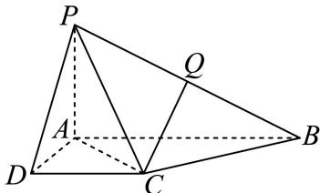

# 2025一模 金山区原卷 · 学生版

> 本地预览：题目、答案及分类尚未全部审定。校对使用的PDF为高中工作台解析版，尚未逐区确认区级印刷原卷。

## 填空题

按本区原卷题号顺序排列。

### 金山 · 第1题

已知全集U = {−1, 0, 1, 2}，集合 $A = \{ x | - 1 \leq x \leq 1 , x \in \mathrm { N } \}$ }，则A = –

### 金山 · 第2题

已知向量 $\overrightarrow { a } = ( 1 , 2 ) , \overrightarrow { b } = ( 3 , k )$ ， $\overrightarrow { \Pi } \overrightarrow { a } / \overrightarrow { b }$ ，则实数k =

### 金山 · 第3题

已知函数$y=f(x)$的表达式为$f(x)=\begin{cases}2^x,&x\leq2,\\\log_2 x,&x>2,\end{cases}$则$f(4)$的值为____。

> 本题资料或解析有待核事项，预览不可作为已审定成品。

### 金山 · 第4题

已知复数z = 2+i，其中i为虚数单位，则|iz|的值为

### 金山 · 第5题

(3x − 1)6的二项展开式中， $x ^ { 2 } ,$ 项的系数为

### 金山 · 第6题

以C (3, 4)为圆心且过点(1, −3)的圆的标准方程是

### 金山 · 第7题

已知某圆锥的侧面展开图是圆心角为 $\sqrt { 2 } \pi$ ，半径为2的扇形，则该圆锥的母线与底面所成角的大小

### 金山 · 第8题

已知 $| S _ { n }$ 是等差数列 $\left\{ a _ { n } \right\}$ 的前n项和，若 $2 a _ { 1 } + 3 a _ { 1 1 } = 2 0$ ,则 $S _ { 1 3 }$ 的值为

### 金山 · 第9题

在(0, 2π)内，使 $\mathrm { i } _ { \mathrm { s i n } } x \geq \cos x$ 成立的x的取值范围是

### 金山 · 第10题

某海滨浴场平面图是如图所示的半圆，其中O是圆心，直径MN为400米，P是弧MN的中点．一个急救中心A在栈桥OP中点上，计划在弧NP上设置一个瞭望台B，并在AB间修建浮桥．已知 $\angle A B O$ 越大，瞭望台B处的视线范围越大，则B处的视线范围最大时，AB的长度为 米．（结果精确到1米）

### 金山 · 第11题

抛掷一枚质地均匀的硬币n次（其中n为大于等于2的整数），设事件A：n次中既有正面朝上又有反面朝上，事件B：n次中至多有一次正面朝上，若事件A与事件B是独立的，则n的值为

> 本题资料或解析有待核事项，预览不可作为已审定成品。

### 金山 · 第12题

已知 $O$ 为坐标原点，向量 $\overrightarrow{OA},\overrightarrow{OB}$ 满足 $|\overrightarrow{OA}|+|\overrightarrow{OB}|=8$，将 $\overrightarrow{OA}$ 绕点 $O$ 按逆时针方向旋转 $90^\circ$，得到向量 $\overrightarrow{OC}$。若 $\overrightarrow{OB}+\overrightarrow{OC}=(-3,3)$，$\vec i=(1,0)$，则 $(\overrightarrow{OA}+\overrightarrow{OB})\cdot\vec i$ 的最大值为______。

> 本题资料或解析有待核事项，预览不可作为已审定成品。

## 选择题

按本区原卷题号顺序排列。

### 金山 · 第13题

函数 $\langle y = 1 - 2 \sin ^ { 2 }$ x是（ ）

A. 最小正周期为π的奇函数

B. 最小正周期为π的偶函数

C. 最小正周期为 $\frac { \pi } { 2 }$ 的奇函数

D. 最小正周期为 $\frac { \pi } { 2 }$ 的偶函数

### 金山 · 第14题

若 $^ { * } x > a ^ { * }$ 是 $^ {  } x ^ { 2 } - 2 x - 3 < 0 ^ { , }$ 的必要不充分条件，则实数a的取值范围是（ ）

A. $\left( - \infty - 1 \right)$

B. $( - \infty - 1 ]$

C. $( - 1 , + \infty )$

D. $[ - 1 , + \infty )$

### 金山 · 第15题

古希腊数学家阿波罗尼奥斯用不同的平面截同一圆锥，得到了圆锥曲线，其中的一种如图所示．用过M点且垂直于圆锥底面的平面截两个全等的对顶圆锥得到双曲线的一部分，已知高 $P O = 2$ ，底面圆的半径为4，M为母线PB的中点，平面与底面的交线 $E F \bot A B$ ，则双曲线的两条渐近线所成角的余弦值为（ ）

A. $\frac { 5 } { 6 }$

B. $\frac { 4 } { 5 }$

C. $\frac 3 4$

D. $\frac { 3 } { 5 }$

### 金山 · 第16题

已知三棱锥 $A _ { 1 } - A _ { 2 } A _ { 3 } A _ { 4 }$ 的侧棱长相等，且侧棱两两垂直．设P为该三棱锥表面（含棱）上异于顶点 $A _ { 1 } , A _ { 2 } , A _ { 3 } , A _ { 4 }$ 的点，记 $D = \{ d | d = | P A _ { i } | , i = 1 , 2 , 3 , 4 \}$ ．若集合D中有且只有2个元素，则符合条件的点P有（ ）个

A. 3

B. 6

C. 7

D. 10

> 本题资料或解析有待核事项，预览不可作为已审定成品。

## 解答题

按本区原卷题号顺序排列。

### 金山 · 第17题

已知常数 $. a > 1$ ，函数y = f(x)的表达式为 $f \left( x \right) = \log _ { a } \left( x + 2 \right) - \log _ { a } \left( 2 - x \right)$
(1) (6分)证明：函数 $y = f \left( x \right)$ 是奇函数；
(2) (8分)若函数y = f(x)在区间[0,1]上的最大值为2，求实数a的值

### 金山 · 第18题

如图，在四棱锥 $P - A B C D$ 中，底面ABCD是直角梯形， $\angle B A D = \angle C D A = 9 0 ^ { \circ }$ $P A \bot$ 平面$A B C D$ ，Q是PB的中点， $P A = A D = D C = 1 , A B = 2$

(1) (6分)证明： $C Q / /$ 平面 $P A D$
(2) (8分)求点D到平面PAC的距离

### 金山 · 第19题

某高中举行了一次知识竞赛．为了了解本次竞赛成绩情况，从中抽取了部分学生的成绩作为样本进行统计．将成绩进行整理后，依次分为五组（[50, 60), [60, 70), [70, 80), [80, 90), [90, 100]），其中第1组的频率为第2组和第4组频率的等比中项．请根据下面的频率分布直方图（如图所示）解决下列问题：

(1) (4分)求a、b的值；
(2) (4分)从样本数据在[50,60),[70,80)两个小组内的学生中，用分层抽样的方法抽取7名学生，再从这7名学生中随机选出2人，求选出的两人恰好来自不同小组的概率；
(3) (6分)某老师在此次竞赛成绩中抽取了10名学生的分数： $x _ { 1 } , x _ { 2 } , x _ { 3 } , \cdots , x _ { 1 0 } ,$ 已知这10个分数的平均数x = 88，方差– $s ^ { 2 } = 2 5$ ，若剔除其中的95和81两个分数，求剩余8个分数的平均数与方差

### 金山 · 第20题

已知椭圆 ${ \Gamma _ { 1 } } \colon \frac { { { x } ^ { 2 } } } { 4 } + \frac { { { y } ^ { 2 } } } { 3 } = 1$ ，抛物线 $\Gamma _ { 2 } { : } y ^ { 2 } = 2 p x ( p > 0 )$ 与 $\Gamma _ { 1 }$ 有一个相同的焦点F．过点F作互相垂直的两条直线l与l′，直线 $\lvert \underline { { E } } \rvert \Gamma _ { 1 }$ 交于点A、 $\mathbf { B } ,$ ，直线l′与 $\Gamma _ { 2 }$ 交于点C、D
(1) (4分)求椭圆 $\Gamma _ { 1 }$ 的离心率及抛物线 $\Gamma _ { 2 }$ 的方程；
(2) (6分)若直线l的倾斜角为 $\frac { 3 \pi } { 4 }$ ，求AB中点M的坐标；
(3) (8分)四边形ACBD的面积是否存在最小值，若存在，求出最小值；若不存在，请说明理由

> 本题资料或解析有待核事项，预览不可作为已审定成品。

### 金山 · 第21题

对于函数 $y = f \left( x \right)$ 图像上不同的三点 $A \left( x _ { 1 } , y _ { 1 } \right) , B \left( x _ { 2 } , y _ { 2 } \right) , M \left( x _ { 0 } , y _ { 0 } \right)$ （其中 $x _ { 0 } \in \left( x _ { 1 } , x _ { 2 } \right) )$ ），记点M处的切线为l，若 $l / / A B$ ，则称M为函数 $y = f \left( x \right)$ 在区间 $( x _ { 1 } , x _ { 2 } )$ 上的“T点”．特别地，当$x _ { 0 } = { \frac { x _ { 1 } + x _ { 2 } } { 2 } }$ ，则称M为函数 $\boldsymbol { \cdot } \boldsymbol { y } = \boldsymbol { f } \left( \boldsymbol { x } \right)$ 在区间 $( x _ { 1 } , x _ { 2 } )$ 上的“和谐T点”
(1) (4分)设 $f \left( x \right) = x ^ { 2 } , M \left( x _ { 0 } , y _ { 0 } \right)$ 是函数 $\boldsymbol { \cdot } \boldsymbol { y } = \boldsymbol { f } \left( \boldsymbol { x } \right)$ 在区间 $( 0 , n )$ 上的“T点”，若 $f ^ { \prime } \left( x _ { 0 } \right) = 1$ ，求实数n的值；
(2) (6分)设 $f \left( x \right) = a \sin 2 x + \cos x + x - 1$ ，若函数 $\boldsymbol { \cdot } \boldsymbol { y } = \boldsymbol { f } \left( \boldsymbol { x } \right)$ 在区间(0, 2π)上恰有3个“T点”，求所有满足条件的实数a的值组成的集合；
(3) (8分)设 $f \left( x \right) = \ln x + b x ^ { 2 } \left( b \in \mathrm { R } \right)$ ，试探究函数 $y = f \left( x \right)$ )的定义域内是否存在一个包含“和谐T点”的区间 $] ( x _ { 1 } , x _ { 2 } )$ ，若存在，求出该区间 $\mathbb { J } ( x _ { 1 } , x _ { 2 } )$ ；若不存在，请说明理由

> 本题资料或解析有待核事项，预览不可作为已审定成品。

