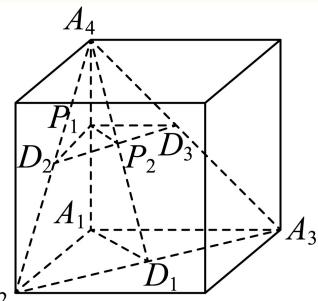
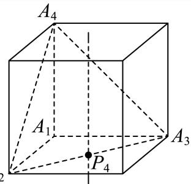
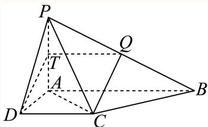

# 2025一模 金山区原卷 · 教师版

> 本地预览：题目、答案及分类尚未全部审定。校对使用的PDF为高中工作台解析版，尚未逐区确认区级印刷原卷。

## 填空题

按本区原卷题号顺序排列。

### 金山 · 第1题

已知全集U = {−1, 0, 1, 2}，集合 $A = \{ x | - 1 \leq x \leq 1 , x \in \mathrm { N } \}$ }，则A = –

**考点：** 集合补集

**难度依据：** 涉及集合补集；难度为教师预估，需结合原题条件复核。

**核查说明：** 依据现有底稿归类，尚未逐页校卷、公式校净或独立数学终审。

【答案】{−1,2}

【解析】

列举法改写集合A，再应用补运算求集合.

由题设A = {0, 1}，又U = {−1, 0, 1, 2}，故 $\overline { { A } } = \{ - 1 , 2 \}$

故答案为：{−1,2}

### 金山 · 第2题

已知向量 $\overrightarrow { a } = ( 1 , 2 ) , \overrightarrow { b } = ( 3 , k )$ ， $\overrightarrow { \Pi } \overrightarrow { a } / \overrightarrow { b }$ ，则实数k =

**考点：** 向量平行坐标条件

**难度依据：** 涉及向量平行坐标条件；难度为教师预估，需结合原题条件复核。

**核查说明：** 依据现有底稿归类，尚未逐页校卷、公式校净或独立数学终审。

【答案】6

【解析】

根据向量平行的坐标表示列方程求参数.

由题意 ${ \frac { 3 } { 1 } } = { \frac { k } { 2 } }$ ，则k = 6.

故答案为：6

### 金山 · 第3题

已知函数$y=f(x)$的表达式为$f(x)=\begin{cases}2^x,&x\leq2,\\\log_2 x,&x>2,\end{cases}$则$f(4)$的值为____。

> 本题资料或解析有待核事项，预览不可作为已审定成品。

**考点：** 分段函数求值

**难度依据：** 涉及分段函数求值；难度为教师预估，需结合原题条件复核。

**核查说明：** 分段函数另一支缺失，无法据现存题干求f(4)，须回源。；依据现有底稿归类，尚未逐页校卷、公式校净或独立数学终审。

【答案】2

【解析】

根据给定分段函数解析式，求函数值即可.

由题设 $f ( 4 ) = \log _ { 2 } 4 = 2 .$

故答案为：2

### 金山 · 第4题

已知复数z = 2+i，其中i为虚数单位，则|iz|的值为

**考点：** 复数运算与模

**难度依据：** 涉及复数运算与模；难度为教师预估，需结合原题条件复核。

**核查说明：** 依据现有底稿归类，尚未逐页校卷、公式校净或独立数学终审。

【答案】${ \sqrt { 5 } } .$

【解析】

先由z = 2+i，利用复数乘法求出iz，再用模长公式求其模长即得.

由z = 2 + i，可得 $\mathrm { i } z = \mathrm { i } ( 2 + \mathrm { i } ) = - 1 + 2 \mathrm { i }$ ，

故 $| \mathrm { i } z | = \sqrt { ( - 1 ) ^ { 2 } + 2 ^ { 2 } } = \sqrt { 5 } .$

故答案为： ${ \sqrt { 5 } } .$

### 金山 · 第5题

(3x − 1)6的二项展开式中， $x ^ { 2 } ,$ 项的系数为

**考点：** 二项式展开系数

**难度依据：** 涉及二项式展开系数；难度为教师预估，需结合原题条件复核。

**核查说明：** 依据现有底稿归类，尚未逐页校卷、公式校净或独立数学终审。

【答案】135.

【解析】

写出二项式的通项，取r = 4，即得 $x ^ { 2 }$ 项的系数.

(3x − 1)6的通项为 $\begin{array} { r } { \jmath T _ { r + 1 } = \mathrm { C } _ { 6 } ^ { r } ( 3 x ) ^ { 6 - r } ( - 1 ) ^ { r } = ( - 1 ) ^ { r } \times 3 ^ { 6 - r } \mathrm { C } _ { 6 } ^ { r } x ^ { 6 - r } ; } \end{array}$ ,

使6−r = 2，解得r = 4，即得x2项的系数为 $3 ^ { 2 } \mathrm { C } _ { 6 } ^ { 4 } = 9 \times 1 5 = 1 3 5$

故答案为：135.

### 金山 · 第6题

以C (3, 4)为圆心且过点(1, −3)的圆的标准方程是

**考点：** 圆的标准方程

**难度依据：** 涉及圆的标准方程；难度为教师预估，需结合原题条件复核。

**核查说明：** 依据现有底稿归类，尚未逐页校卷、公式校净或独立数学终审。

【答案】$\left( x - 3 \right) ^ { 2 } + \left( y - 4 \right) ^ { 2 } = 5 3 .$

【解析】

由圆心和圆上的点求出圆的半径，代入圆的标准方程即可.

圆心为 $C \left( 3 , 4 \right)$ ，圆过点(1,−3)，则圆的半径 $r = { \sqrt { \left( 3 - 1 \right) ^ { 2 } + \left( 4 + 3 \right) ^ { 2 } } } = { \sqrt { 5 3 } } ,$

所以圆的标准方程是 $\left( x - 3 \right) ^ { 2 } + \left( y - 4 \right) ^ { 2 } = 5 3$

故答案为： $\left( x - 3 \right) ^ { 2 } + \left( y - 4 \right) ^ { 2 } = 5 3 .$

### 金山 · 第7题

已知某圆锥的侧面展开图是圆心角为 $\sqrt { 2 } \pi$ ，半径为2的扇形，则该圆锥的母线与底面所成角的大小

**考点：** 扇形展开与圆锥线面角

**难度依据：** 涉及扇形展开与圆锥线面角；难度为教师预估，需结合原题条件复核。

**核查说明：** 依据现有底稿归类，尚未逐页校卷、公式校净或独立数学终审。

【解析】

根据扇形弧长与圆锥底面周长关系列方程求底面半径，结合圆锥的结构特征求该圆锥的母线与底面所成角余弦值，即可确定大小.

令底面半径为r，则 $2 \pi r = 2 \sqrt { 2 } \pi$ ，可得 $\cdot r = { \sqrt { 2 } } ,$ ，且圆锥母线为2，

所以该圆锥的母线与底面所成角的余弦值为 $\frac { \sqrt { 2 } } { 2 }$ ，故其大小为 $\frac { \pi } { 4 }$

$$
\frac {\pi}{4}
$$

### 金山 · 第8题

已知 $| S _ { n }$ 是等差数列 $\left\{ a _ { n } \right\}$ 的前n项和，若 $2 a _ { 1 } + 3 a _ { 1 1 } = 2 0$ ,则 $S _ { 1 3 }$ 的值为

**考点：** 等差数列通项与求和

**难度依据：** 涉及等差数列通项与求和；难度为教师预估，需结合原题条件复核。

**核查说明：** 依据现有底稿归类，尚未逐页校卷、公式校净或独立数学终审。

【答案】52.

【解析】

设等差数列 $\{ a _ { n } \}$ 的公差为d，利用等差数列通项公式和前n项和公式即可计算求解.设等差数列 $\{ a _ { n } \}$ 的公差为d，则由题得 $2 a _ { 1 } + 3 a _ { 1 1 } = 5 a _ { 1 } + 3 0 d = 2 0 \boxplus \boxed { ] } a _ { 1 } + 6 d = 4 _ { \cdot }$ 所以 $S _ { 1 3 } = 1 3 a _ { 1 } + \frac { 1 3 \times 1 2 } { 2 } d = 1 3 \left( a _ { 1 } + 6 d \right) = 1 3 \times 4 = 5 2 .$

故答案为：52.

### 金山 · 第9题

在(0, 2π)内，使 $\mathrm { i } _ { \mathrm { s i n } } x \geq \cos x$ 成立的x的取值范围是

**考点：** 三角不等式与图像

**难度依据：** 涉及三角不等式与图像；难度为教师预估，需结合原题条件复核。

**核查说明：** 依据现有底稿归类，尚未逐页校卷、公式校净或独立数学终审。

【答案】$\left[ { \frac { \pi } { 4 } } , { \frac { 5 \pi } { 4 } } \right]$

【解析】

解：在同一个坐标系中画出 $y = \sin x , y = \cos x$ 在(0,2π)内的函数图象，如图所示则使 $\sin x \geq \cos x$ 成立的x的取值范围是 $\left[ { \frac { \pi } { 4 } } , { \frac { 5 \pi } { 4 } } \right]$ ，

故答案为： $\left[ { \frac { \pi } { 4 } } , { \frac { 5 \pi } { 4 } } \right]$

### 金山 · 第10题

某海滨浴场平面图是如图所示的半圆，其中O是圆心，直径MN为400米，P是弧MN的中点．一个急救中心A在栈桥OP中点上，计划在弧NP上设置一个瞭望台B，并在AB间修建浮桥．已知 $\angle A B O$ 越大，瞭望台B处的视线范围越大，则B处的视线范围最大时，AB的长度为 米．（结果精确到1米）

**考点：** 余弦定理与视角最大值

**难度依据：** 涉及余弦定理与视角最大值；难度为教师预估，需结合原题条件复核。

**核查说明：** 依据现有底稿归类，尚未逐页校卷、公式校净或独立数学终审。

【解析】

令 $A B = x , \angle A B O = \theta \in \left( 0 , \frac { \pi } { 2 } \right)$ ，在 $\triangle A B O ^ { \rvert }$ 中应用余弦定理及基本不等式求最值，并确定取值条件，即可得答案

令AB = x， $\angle A B O = \theta \in \left( 0 , { \frac { \pi } { 2 } } \right)$ ，且 $O A = 1 0 0 , O B = 2 0 0$

在 $\triangle A B O ^ { \scriptscriptstyle \perp }$ 中， $\cos \theta = { \frac { x ^ { 2 } + 2 0 0 ^ { \overline { { 2 } } } - 1 0 0 ^ { 2 } } { 2 x \times 2 0 0 } } = { \frac { 1 } { 4 0 0 } } \cdot \left( x + { \frac { 3 0 0 0 0 } { x } } \right) \geq { \frac { 1 } { 4 0 0 } } \cdot 2 { \sqrt { x \cdot { \frac { 3 0 0 0 0 } { x } } } } = { \frac { \sqrt { 3 } } { 2 } }$

当且仅当 $x = 1 0 0 \sqrt { 3 } \approx 1 7 3$ 米时，cosθ取最小值，此时 $\angle A B O = \theta .$ 最大.

### 金山 · 第11题

抛掷一枚质地均匀的硬币n次（其中n为大于等于2的整数），设事件A：n次中既有正面朝上又有反面朝上，事件B：n次中至多有一次正面朝上，若事件A与事件B是独立的，则n的值为

> 本题资料或解析有待核事项，预览不可作为已审定成品。

**考点：** 独立事件与硬币次数

**难度依据：** 涉及独立事件与硬币次数；难度为教师预估，需结合原题条件复核。

**核查说明：** 原解仅由两个函数均递增断言解唯一，论证不足。；依据现有底稿归类，尚未逐页校卷、公式校净或独立数学终审。

【答案】3

【解析】

通过古典概率的计算公式计算 $P ( A ) , P ( B ) , P \left( A B \right)$ ，由A,B独立得 $P \left( A \right) \cdot P \left( B \right) = P \left( A B \right)$ 解方程即可.

由题意可知： $P \left( A \right) = \frac { 2 ^ { n } - 2 } { 2 ^ { n } } , P \left( B \right) = \frac { 1 + n } { 2 ^ { n } } , P \left( A B \right) = \frac { n } { 2 ^ { n } }$

因为A,B独立，所以 $P \left( A \right) \cdot P \left( B \right) = P \left( A B \right)$

即 ${ \frac { 2 ^ { n } - 2 } { 2 ^ { n } } } \cdot { \frac { 1 + n } { 2 ^ { n } } } = { \frac { n } { 2 ^ { n } } } \Rightarrow 2 ^ { n - 1 } = n + 1$ ，结合 $\cdot 2 ^ { n - 1 } , n + 1$ 均随n的增大而增大，$n = 3 .$

故答案为：3

### 金山 · 第12题

已知 $O$ 为坐标原点，向量 $\overrightarrow{OA},\overrightarrow{OB}$ 满足 $|\overrightarrow{OA}|+|\overrightarrow{OB}|=8$，将 $\overrightarrow{OA}$ 绕点 $O$ 按逆时针方向旋转 $90^\circ$，得到向量 $\overrightarrow{OC}$。若 $\overrightarrow{OB}+\overrightarrow{OC}=(-3,3)$，$\vec i=(1,0)$，则 $(\overrightarrow{OA}+\overrightarrow{OB})\cdot\vec i$ 的最大值为______。

> 本题资料或解析有待核事项，预览不可作为已审定成品。

**考点：** 旋转坐标、椭圆轨迹与投影最值

**难度依据：** 涉及旋转坐标、椭圆轨迹与投影最值；难度为教师预估，需结合原题条件复核。

**核查说明：** 题干向量与模长条件识别不清，原解参数亦有冲突，须回源。；依据现有底稿归类，尚未逐页校卷、公式校净或独立数学终审。

【解析】

设 $A ( x , y )$ ，则 $\boldsymbol { C } ( - y , x )$ ，进而得 $B ( y - 3 , 3 - x )$ ，结合 $\left| { \overrightarrow { O A } } \right| + \left| { \overrightarrow { O B } } \right| = { \mathrm { i } }$ 8分析得到A的轨迹为一个椭圆，并确定椭圆的右顶点P坐标，再利用向量数量积的坐标表示，将问题化为求$y = - x + m +$ 3的截距最大，即m最大且该直线过P点，即可求最值

设 $A ( x , y )$ ，则 $C ( - y , x )$ ，故 $\overrightarrow { O B } + \overrightarrow { O C } = ( x _ { B } - y , y _ { B } + x ) = ( - 3 , 3 )$

所以 $\begin{array} { l } { { \left\{ { x _ { B } } - y = - 3 \right. } } \\ { { \left. y _ { B } + x = 3 \right. } } \end{array}$ ，则 $\left\{ { \begin{array} { l } { x _ { B } = y - 3 } \\ { y _ { B } = 3 - x } \end{array} } \right.$ ，故 $B ( y - 3 , 3 - x )$

由 $\overrightarrow { \vert O A \vert } + \overrightarrow { \vert O B \vert } = \sqrt { x ^ { 2 } + y ^ { 2 } } + \sqrt { ( x - 3 ) ^ { 2 } + ( y - 3 ) ^ { 2 } } = 8 ,$

即 $A ( x , y )$ 到原点距离与 $\therefore A ( x , y )$ 到(3,3)的距离之和为8，

易知A的轨迹为一个椭圆，且 $2 a = 8 \Rightarrow a = 4$ $2 c = 2 { \sqrt { 3 } } \Rightarrow c = { \sqrt { 3 } }$ ，如下图，

若P为椭圆的右顶点，则 $| O P | = { \frac { 8 - 3 { \sqrt { 2 } } } { 2 } } + 3 { \sqrt { 2 } } = { \frac { 8 + 3 { \sqrt { 2 } } } { 2 } }$ ，且直线 $O P \colon y = x$ 易知 $\displaystyle { v _ { P } = y _ { P } = \frac { | O P | } { \sqrt { 2 } } = \frac { 4 \sqrt { 2 } + 3 } { 2 } }$ ，即 $P \left( \frac { 4 \sqrt { 2 } + 3 } { 2 } , \frac { 4 \sqrt { 2 } + 3 } { 2 } \right)$

由 $\left( \overrightarrow { O A } + \overrightarrow { O B } \right) \cdot \overrightarrow { i } ^ { \cdot } = ( x + y - 3 , y - x + 3 ) \cdot ( 1 , 0 ) = x + y - 3$ 令 $m = x + y - 3 \textcircled { 1 }$

所以，要使 $\left( \overrightarrow { O A } + \overrightarrow { O B } \right) \cdot \overrightarrow { i }$ 最大，只需 $y = - x + m +$ 3的截距最大，即m最大，

结合图知，该直线过P点即可，将P代入①，有 $m = { \frac { 4 { \sqrt { 2 } } + 3 } { 2 } } + { \frac { 4 { \sqrt { 2 } } + 3 } { 2 } } - 3 = 4 { \sqrt { 2 } } .$

$$
4 \sqrt {2}
$$

关键点点睛：首先得到A的轨迹为一个椭圆及其右顶点坐标，再应用向量数量积的坐标表示化为求 $m = x + y - \vdots$ 3最大为关键.

## 二、选择题

## 选择题

按本区原卷题号顺序排列。

### 金山 · 第13题

函数 $\langle y = 1 - 2 \sin ^ { 2 }$ x是（ ）

A. 最小正周期为π的奇函数

B. 最小正周期为π的偶函数

C. 最小正周期为 $\frac { \pi } { 2 }$ 的奇函数

D. 最小正周期为 $\frac { \pi } { 2 }$ 的偶函数

**考点：** 二倍角化简、周期与奇偶

**难度依据：** 涉及二倍角化简、周期与奇偶；难度为教师预估，需结合原题条件复核。

**核查说明：** 依据现有底稿归类，尚未逐页校卷、公式校净或独立数学终审。

【答案】B

【解析】

由余弦二倍角公式化简即可求解.

$$
y = 1 - 2 \sin^ {2} x = \cos 2 x
$$

所以最小正周期为π，且为偶函数.

故选：B

### 金山 · 第14题

若 $^ { * } x > a ^ { * }$ 是 $^ {  } x ^ { 2 } - 2 x - 3 < 0 ^ { , }$ 的必要不充分条件，则实数a的取值范围是（ ）

A. $\left( - \infty - 1 \right)$

B. $( - \infty - 1 ]$

C. $( - 1 , + \infty )$

D. $[ - 1 , + \infty )$

**考点：** 必要条件与区间包含

**难度依据：** 涉及必要条件与区间包含；难度为教师预估，需结合原题条件复核。

**核查说明：** 依据现有底稿归类，尚未逐页校卷、公式校净或独立数学终审。

【答案】B

【解析】

【分析】根据充分条件和必要条件的定义结合不等式进行判断即可

【详解】由 $\ : \mathrm { ~ \ : ~ } \mathrm { ~ \ : ~ } \mathrm { ~ \ : ~ } \mathrm { ~ \ : ~ } \mathrm { ~ \ : ~ } \mathrm { ~ \ : ~ } x ^ { 2 } - 2 x - 3 <$ < 0得 $- 1 < x < 3$

$\because x > a _ { \mathrm { \tiny \mathscr { L } } } ^ { \mathrm { \tiny \sharp } } - 1 < x <$ 3的必要不充分条件，

∴ a ≤ −1，

故选：B

### 金山 · 第15题

古希腊数学家阿波罗尼奥斯用不同的平面截同一圆锥，得到了圆锥曲线，其中的一种如图所示．用过M点且垂直于圆锥底面的平面截两个全等的对顶圆锥得到双曲线的一部分，已知高 $P O = 2$ ，底面圆的半径为4，M为母线PB的中点，平面与底面的交线 $E F \bot A B$ ，则双曲线的两条渐近线所成角的余弦值为（ ）

A. $\frac { 5 } { 6 }$

B. $\frac { 4 } { 5 }$

C. $\frac 3 4$

D. $\frac { 3 } { 5 }$

**考点：** 圆锥截面双曲线渐近线夹角

**难度依据：** 涉及圆锥截面双曲线渐近线夹角；难度为教师预估，需结合原题条件复核。

**核查说明：** 依据现有底稿归类，尚未逐页校卷、公式校净或独立数学终审。

【答案】D

【解析】

令双曲线为 ${ \frac { y ^ { 2 } } { a ^ { 2 } } } - { \frac { x ^ { 2 } } { b ^ { 2 } } } = 1$ ，根据已知建立合适坐标系，并求出双曲线参数，进而得渐近线方程，利用二倍角正切公式求得夹角正切值 $\tan \theta = { \frac { 4 } { 3 } }$ ，即可得其余弦值.

如下图建系，令双曲线为 ${ \frac { y ^ { 2 } } { a ^ { 2 } } } - { \frac { x ^ { 2 } } { b ^ { 2 } } } = 1$ ，且 $| O P | = 2$ ，则 $y _ { M } = - 1 , ~ a = 1$

如图， $| O H | = 2 , | O E | = 4$ ，则 $H E | = | H F | = 2 { \sqrt { 3 } }$ ，故 $F \left( 2 { \sqrt { 3 } } , - 2 \right)$

将F代入 $\cdot y ^ { 2 } - { \frac { x ^ { 2 } } { b ^ { 2 } } } = 1$ ，得 $4 - { \frac { 1 2 } { b ^ { 2 } } } = 1$ ，可得 $b ^ { 2 } = 4$ ，故渐近线为 $y = \pm \frac { 1 } { 2 } x$

若它们的夹角为θ，且 $\tan { \frac { \theta } { 2 } } = { \frac { 1 } { 2 } }$ ，则 $\tan \theta = { \frac { 2 \tan { \frac { \theta } { 2 } } } { 1 - \tan ^ { 2 } { \frac { \theta } { 2 } } } } = { \frac { 4 } { 3 } }$ ，故 $\cos \theta = { \frac { 3 } { 5 } }$

故选：D

### 金山 · 第16题

已知三棱锥 $A _ { 1 } - A _ { 2 } A _ { 3 } A _ { 4 }$ 的侧棱长相等，且侧棱两两垂直．设P为该三棱锥表面（含棱）上异于顶点 $A _ { 1 } , A _ { 2 } , A _ { 3 } , A _ { 4 }$ 的点，记 $D = \{ d | d = | P A _ { i } | , i = 1 , 2 , 3 , 4 \}$ ．若集合D中有且只有2个元素，则符合条件的点P有（ ）个

A. 3

B. 6

C. 7

D. 10

> 本题资料或解析有待核事项，预览不可作为已审定成品。

**考点：** 空间点到顶点距离集合的分类

**难度依据：** 涉及空间点到顶点距离集合的分类；难度为教师预估，需结合原题条件复核。

**核查说明：** 原解称四个顶点具有对称性，题设并非正四面体；应区分顶点A1与另外三个顶点，核验分情况计数。；依据现有底稿归类，尚未逐页校卷、公式校净或独立数学终审。

【答案】D

【解析】

设 $d _ { i } = | P A _ { i } |$ ，分P到两个顶点的距离a一样，到另外两个顶点的距离b一样，且 $. a \neq b ,$ ，和P到其中三个顶点的距离c一样，到另一个顶点的距离为e，且 $c \neq e _ { \cdot }$ ，两种情况，结合对称性，列举出满足题设的所有P点，即可得答案.

设 $\cdot d _ { i } = | P A _ { i } |$ ，情况如下：

①P到两个顶点的距离a一样，到另外两个顶点的距离b一样， $\boxed { a } a \neq b .$

由 $A _ { 1 } , A _ { 2 } , A _ { 3 } , A _ { 4 }$ 具有对称性，不妨讨论 $\therefore d _ { 1 } = d _ { 4 } , d _ { 2 } = d _ { 3 }$ ，

满足题意的P应同时在线段 $A _ { 1 } A _ { 4 } , A _ { 2 } A _ { 3 }$ 的中垂线面和三棱锥表面上，

即为其中垂面交线与三棱锥表面的交点，如图 $P _ { 1 } , P _ { 2 }$ 两点，

同理， $d _ { 1 } = d _ { 2 } , d _ { 3 } = d _ { 4 }$ 和 $\begin{array} { r } { [ d _ { 1 } = d _ { 3 } , d _ { 2 } = d _ { 4 } } \end{array}$ 也各有2个满足题意的P点，故共6个；

②P到其中三个顶点的距离c一样，到另一个顶点的距离为e，且 $c \neq e$

若P到 $A _ { 2 } , A _ { 3 } , A _ { 4 }$ 的距离一样，即 $d _ { 2 } = d _ { 3 } = d _ { 4 }$ ，则P为过 $\triangle A _ { 2 } A _ { 3 } A _ { 4 }$ 外心的垂线与三棱锥表面的交点，如图 $P _ { 3 }$ 和 $A _ { 1 }$ （舍）；

若P到 $A _ { 1 }$ 和 $A _ { 2 } , A _ { 3 } , A _ { 4 } \sharp$ 的两个距离一样，由 $A _ { 1 } , A _ { 2 } , A _ { 3 } , A _ { 4 }$ 具有对称性，

不妨讨论 $\mathscr { d } _ { 1 } = \mathscr { d } _ { 2 } = \mathscr { d } _ { 3 }$ ，则P为过 $\triangle A _ { 2 } A _ { 3 } A _ { 4 }$ 外心的垂线与三棱锥表面的交点，如图 $P _ { 4 }$ ，

同理， $d _ { 1 } = d _ { 3 } = d _ { 4 } \operatorname { \bar { \kappa } } \boxed { \mathrm { \uparrow } } d _ { 1 } = d _ { 2 } = d _ { 4 }$ 也各有1个满足题意的P点，共4个；

综上，共有10个满足题意的点.

故选：D

关键点点睛：依据题意将问题分成P到两个顶点的距离a一样，到另外两个顶点的距离b一样，且 $. a \neq b ,$ ，和P到其中三个顶点的距离c一样，到另一个顶点的距离为e，且c ≠ e两类为关键.

## 三、解答题

## 解答题

按本区原卷题号顺序排列。

### 金山 · 第17题

已知常数 $. a > 1$ ，函数y = f(x)的表达式为 $f \left( x \right) = \log _ { a } \left( x + 2 \right) - \log _ { a } \left( 2 - x \right)$
(1) (6分)证明：函数 $y = f \left( x \right)$ 是奇函数；
(2) (8分)若函数y = f(x)在区间[0,1]上的最大值为2，求实数a的值

**考点：** （1）对数定义域与奇偶；（2）区间最值反求底数

**难度依据：** 涉及（1）对数定义域与奇偶；（2）区间最值反求底数；难度为教师预估，需结合原题条件复核。

**核查说明：** 依据现有底稿归类，尚未逐页校卷、公式校净或独立数学终审。

【解析】

(1) 由 $\displaystyle \int _ { 2 - x > 0 } ^ { x + 2 > 0 } \mathop { } ^ { \prime \boxplus } - 2 < x < 2 ,$

所以函数 $y = f \left( x \right)$ 的定义域为(−2,2)，关于原点对称，

$$
f (- x) = \log_ {a} (- x + 2) - \log_ {a} (2 + x) = - f (x),
$$

所以函数 $y = f \left( x \right)$ 是奇函数；

$$
f (x) = \log_ {a} (x + 2) - \log_ {a} (2 - x) = \log_ {a} \frac {x + 2}{2 - x}, \tag {2}
$$

$$
\text {令} u = - \frac {x - 2 + 4}{x - 2} = - 1 - \frac {4}{x - 2},
$$

则 $\lvert u = - 1 - \frac { 4 } { x - 2 }$ 在[0,1]上单调递增，

又 $y = \log _ { a } x \left( a > 1 \right)$ 为增函数，

所以 $f \left( x \right) = \log _ { a } \left( x + 2 \right) - \log _ { a } \left( 2 - x \right)$ 在[0,1]上单调递增，

其最大值为 $f \left( 1 \right) = \log _ { a } 3 = 2$

解得 $a = { \sqrt { 3 } } .$

### 金山 · 第18题

如图，在四棱锥 $P - A B C D$ 中，底面ABCD是直角梯形， $\angle B A D = \angle C D A = 9 0 ^ { \circ }$ $P A \bot$ 平面$A B C D$ ，Q是PB的中点， $P A = A D = D C = 1 , A B = 2$

(1) (6分)证明： $C Q / /$ 平面 $P A D$
(2) (8分)求点D到平面PAC的距离

**考点：** （1）中点构造线面平行；（2）等体积法求点面距离

**难度依据：** 涉及（1）中点构造线面平行；（2）等体积法求点面距离；难度为教师预估，需结合原题条件复核。

**核查说明：** 依据现有底稿归类，尚未逐页校卷、公式校净或独立数学终审。

【解析】

(1) 取PA的中点T，连接 $D T , T Q$

因为 $\angle B A D = \angle C D A = 9 0 ^ { \circ }$ ，所以 $A B / / D C , ~ A B = 2 , ~ A D = 1$

因为 $\Gamma T , Q$ 分别是 $P A , P B$ 中点，得出 ${ ^ { 1 } T Q } / / { A B } / / D C , T Q = { \frac { 1 } { 2 } } A B = D C ,$

所以四边形 $D C Q T$ 是平行四边形，所以 $D T / / C Q$

$D T \subset$ 平面 $P A D , \ C Q \ \mathcal { L }$ 平面 $P A D .$ ，所以 $C Q / /$ 平面 $P A D$ ；

(2) $\angle C D A = 9 0 ^ { \circ }$ $A C = { \sqrt { A D ^ { 2 } + D C ^ { 2 } } } = { \sqrt { 2 } } ,$

$P A \bot$ 平面 $A B C D , A D , A C \subset$ 平面 $A B C D$ ，则 $P A \bot A D , P A \bot A C$

$$
S _ {\triangle P A C} = \frac {1}{2} | A C | \times | P A | = \frac {1}{2} \times \sqrt {2} \times 1 = \frac {\sqrt {2}}{2}, S _ {\triangle A C D} = \frac {1}{2} \times | D C | \times | A D | = \frac {1}{2},
$$

设点D到平面PAC的距离为 $^ { \dag , } d ,$ ，由 $V _ { D - P A C } = V _ { P - A C D }$ ，得 $\frac { 1 } { 3 } S _ { \triangle P A C } \times d = \frac { 1 } { 3 } S _ { \triangle A C D } \times | P A |$

${ \frac { 1 } { 3 } } \times { \frac { \sqrt { 2 } } { 2 } } \times d = { \frac { 1 } { 3 } } \times { \frac { 1 } { 2 } } \times 1$ ，得 $d = { \frac { \sqrt { 2 } } { 2 } }$

所以点D到平面PAC的距离为 $\frac { \sqrt { 2 } } { 2 }$

### 金山 · 第19题

某高中举行了一次知识竞赛．为了了解本次竞赛成绩情况，从中抽取了部分学生的成绩作为样本进行统计．将成绩进行整理后，依次分为五组（[50, 60), [60, 70), [70, 80), [80, 90), [90, 100]），其中第1组的频率为第2组和第4组频率的等比中项．请根据下面的频率分布直方图（如图所示）解决下列问题：

(1) (4分)求a、b的值；
(2) (4分)从样本数据在[50,60),[70,80)两个小组内的学生中，用分层抽样的方法抽取7名学生，再从这7名学生中随机选出2人，求选出的两人恰好来自不同小组的概率；
(3) (6分)某老师在此次竞赛成绩中抽取了10名学生的分数： $x _ { 1 } , x _ { 2 } , x _ { 3 } , \cdots , x _ { 1 0 } ,$ 已知这10个分数的平均数x = 88，方差– $s ^ { 2 } = 2 5$ ，若剔除其中的95和81两个分数，求剩余8个分数的平均数与方差

**考点：** （1）频率直方图与等比关系；（2）分层抽样概率；（3）剔除数据后的方差

**难度依据：** 涉及（1）频率直方图与等比关系；（2）分层抽样概率；（3）剔除数据后的方差；难度为教师预估，需结合原题条件复核。

**核查说明：** 依据现有底稿归类，尚未逐页校卷、公式校净或独立数学终审。

【解析】

(1) 由题设 $( 0 . 0 1 6 + a + 0 . 0 4 + 0 . 0 0 8 + b ) \times 1 0 = 1$ ，且 $( 0 . 0 1 6 \times 1 0 ) ^ { 2 } = 1 0 a \times 0 . 0 0 8 \times 1 0$ 所 ${ \updownarrow } a + b = 0 . 0 3 6$ 且 $a = 0 . 0 3 2 ,$ ，故b = 0.004，所 $\ ! { \ ! } a = 0 . 0 3 2 , \ : \ : b = 0 . 0 0 4 .$

(2) 由题图知：在[50, 60), [70, 80)两个小组内的学生人数比为2: 5，所以抽取7名学生中，来 自[50, 60), [70, 80)的分别为2人、5人，随机选出2人，两人恰好来自不同小组的概率 ${ \frac { \mathrm { C _ { 2 } ^ { 1 } C _ { 5 } ^ { 1 } } } { \mathrm { C _ { 7 } ^ { 2 } } } } = { \frac { 1 0 } { 2 1 } }$

(3) 由题设得 $x _ { 1 } + x _ { 2 } + x _ { 3 } + \cdot \cdot \cdot + x _ { 1 0 } = 8 8 0 _ { : }$

10s2 = (x1 − 88)2 + (x2 − 88)2 + ⋯ + (x10 − 88)2 = 250， 假设剔除的两个为 $| x _ { 1 } = 8 1 , x _ { 2 } = 9 5$ ，则平均值为 ${ \frac { 8 8 0 - 9 5 - 8 1 } { 8 } } = 8 8 $ 此时方差为

$$
\frac {(x _ {3} - 8 8) ^ {2} + (x _ {4} - 8 8) ^ {2} + \cdots + (x _ {1 0} - 8 8) ^ {2}}{8} = \frac {2 5 0 - (9 5 - 8 8) ^ {2} - (8 1 - 8 8) ^ {2}}{8} = 1 9.
$$

### 金山 · 第20题

已知椭圆 ${ \Gamma _ { 1 } } \colon \frac { { { x } ^ { 2 } } } { 4 } + \frac { { { y } ^ { 2 } } } { 3 } = 1$ ，抛物线 $\Gamma _ { 2 } { : } y ^ { 2 } = 2 p x ( p > 0 )$ 与 $\Gamma _ { 1 }$ 有一个相同的焦点F．过点F作互相垂直的两条直线l与l′，直线 $\lvert \underline { { E } } \rvert \Gamma _ { 1 }$ 交于点A、 $\mathbf { B } ,$ ，直线l′与 $\Gamma _ { 2 }$ 交于点C、D
(1) (4分)求椭圆 $\Gamma _ { 1 }$ 的离心率及抛物线 $\Gamma _ { 2 }$ 的方程；
(2) (6分)若直线l的倾斜角为 $\frac { 3 \pi } { 4 }$ ，求AB中点M的坐标；
(3) (8分)四边形ACBD的面积是否存在最小值，若存在，求出最小值；若不存在，请说明理由

> 本题资料或解析有待核事项，预览不可作为已审定成品。

**考点：** （1）椭圆与抛物线参数；（2）焦点弦中点；（3）垂直焦点弦所成面积最小值

**难度依据：** 涉及（1）椭圆与抛物线参数；（2）焦点弦中点；（3）垂直焦点弦所成面积最小值；难度为教师预估，需结合原题条件复核。

**核查说明：** 仅修复所列OCR公式及其定界符错位；原解数学疑点和其他可渲染错识未因此消除。；第（3）问中间不等式公式识别严重损坏，应回源核验。；依据现有底稿归类，尚未逐页校卷、公式校净或独立数学终审。

【解析】

(1) 由题设 $\mathbf { \cdot } \mathbf { \Gamma } _ { \mathbf { 1 } }$ 的离心率为 ${ \frac { c } { a } } = { \frac { 1 } { 2 } }$ ，且右焦点 $F ( 1 , 0 )$ ，即为 $\Gamma _ { 2 } { : } y ^ { 2 } = 2 p x ( p > 0 )$ 的焦点，所以 $\frac { p } { 2 } = 1 \Rightarrow p = 2$ ，所以 $\ b { \mathscr { z } } : \boldsymbol { y } ^ { 2 } = 4 \boldsymbol { x }$

综上，椭圆 $\Gamma _ { 1 }$ 的离心率 $\frac { 1 } { 2 }$ ，抛物线 $\Gamma _ { 2 } { : } y ^ { 2 } = 4 x ;$

(2) 由题设，知l: $y = - ( x - 1 )$ ，联立 $\Gamma _ { 1 } \colon \frac { x ^ { 2 } } { 4 } + \frac { y ^ { 2 } } { 3 } = 1$ ，则 ${ \frac { x ^ { 2 } } { 4 } } + { \frac { ( x - 1 ) ^ { 2 } } { 3 } } = 1$ 所以 $7 x ^ { 2 } - 8 x - 8 = 0$ ，显然 $\Delta > 0$ ，则 $x _ { A } + x _ { B } = { \frac { 8 } { 7 } }$ 则 $y _ { A } + y _ { B } = 2 - ( x _ { A } + x _ { B } ) = { \frac { 6 } { 7 } }$ 所以AB中点M的坐标为 $\left( { \frac { 4 } { 7 } } , { \frac { 3 } { 7 } } \right)$

(3)

依题意，若直线AB斜率为0，则 $| A B | = 4 , | C D | = 4$ ，此时 $S _ { A C B D } = { \frac { 1 } { 2 } } | A B | | C D | = 8 ;$ 若直线AB斜率不为0，设直线AB为y = k(x−1)，则直线CD为 $y = - \frac { 1 } { k } ( x - 1 )$ ，且 $k \neq 0$ 联 $\begin{array} { r } { \dot { \mathbb { U } } y = k ( x - 1 ) } \end{array}$ 与 ${ \frac { x ^ { 2 } } { 4 } } + { \frac { y ^ { 2 } } { 3 } } = 1$ ，得 $( 3 + 4 k ^ { 2 } ) x ^ { 2 } - 8 k ^ { 2 } x + 4 k ^ { 2 } - 1 2 = 0$ ，且 $\Delta > 0$

则 $x _ { A } + x _ { B } = { \frac { 8 k ^ { 2 } } { 3 + 4 k ^ { 2 } } } , x _ { A } x _ { B } = { \frac { 4 ( k ^ { 2 } - 3 ) } { 3 + 4 k ^ { 2 } } }$ ，所以 $| A B | = { \sqrt { 1 + k ^ { 2 } } } \cdot | x _ { A } - x _ { B } | = { \frac { 1 2 ( 1 + k ^ { 2 } ) } { 3 + 4 k ^ { 2 } } }$

联立 $\mathbf { \dot { \boldsymbol { y } } } = - \frac { 1 } { k } ( \boldsymbol { x } - 1 )$ 与 $y ^ { 2 } = 4 x$ ，得 $x ^ { 2 } - ( 2 + 4 k ^ { 2 } ) x + 1 = 0$ ，且 $\Delta > 0$

则 $x _ { C } + x _ { D } = 4 k ^ { 2 } + 2 , x _ { C } x _ { D } = 1$ ，所以 $\vert C D \vert = \sqrt { 1 + \frac { 1 } { k ^ { 2 } } } \cdot \vert x _ { C } - x _ { D } \vert = 4 \left( 1 + k ^ { 2 } \right)$ 所以

$$
S _ {A C B D} = \frac {1}{2} | A B | | C D | = 6 \times \frac {\left(k ^ {2} + \frac {3}{4}\right) ^ {2} + \frac {1}{2} \left(k ^ {2} + \frac {3}{4}\right) + \frac {1}{1 6}}{\frac {3}{4} + k ^ {2}} = 6 \times
$$

$$
\left[ \begin{array}{l} \left(k ^ {2} + \frac {3}{4}\right) + \frac {1}{1 6 \left(k ^ {2} + \frac {3}{4}\right)} + \frac {1}{2} \\ \hline \end{array} \right]
$$

$\geq6\left[2\sqrt{\left(k^2+\frac34\right)\frac{1}{16\left(k^2+\frac34\right)}}+\frac12\right]=6,$ 而 $k ^ { 2 } + \frac { 3 } { 4 } > \frac { 3 } { 4 }$ ，即等号不成立，

结合对勾函数性质知： $S _ { A C B D } \ 7 \mp k ^ { 2 } + \frac { 3 } { 4 } \in \left( \frac { 3 } { 4 } , + \infty \right)$ 上递增，即 $S _ { A C B D } > 8$ 综上， $S _ { A C B D } \geq 8$ ，且直线AB斜率为0，面积取得最小值为8.

### 金山 · 第21题

对于函数 $y = f \left( x \right)$ 图像上不同的三点 $A \left( x _ { 1 } , y _ { 1 } \right) , B \left( x _ { 2 } , y _ { 2 } \right) , M \left( x _ { 0 } , y _ { 0 } \right)$ （其中 $x _ { 0 } \in \left( x _ { 1 } , x _ { 2 } \right) )$ ），记点M处的切线为l，若 $l / / A B$ ，则称M为函数 $y = f \left( x \right)$ 在区间 $( x _ { 1 } , x _ { 2 } )$ 上的“T点”．特别地，当$x _ { 0 } = { \frac { x _ { 1 } + x _ { 2 } } { 2 } }$ ，则称M为函数 $\boldsymbol { \cdot } \boldsymbol { y } = \boldsymbol { f } \left( \boldsymbol { x } \right)$ 在区间 $( x _ { 1 } , x _ { 2 } )$ 上的“和谐T点”
(1) (4分)设 $f \left( x \right) = x ^ { 2 } , M \left( x _ { 0 } , y _ { 0 } \right)$ 是函数 $\boldsymbol { \cdot } \boldsymbol { y } = \boldsymbol { f } \left( \boldsymbol { x } \right)$ 在区间 $( 0 , n )$ 上的“T点”，若 $f ^ { \prime } \left( x _ { 0 } \right) = 1$ ，求实数n的值；
(2) (6分)设 $f \left( x \right) = a \sin 2 x + \cos x + x - 1$ ，若函数 $\boldsymbol { \cdot } \boldsymbol { y } = \boldsymbol { f } \left( \boldsymbol { x } \right)$ 在区间(0, 2π)上恰有3个“T点”，求所有满足条件的实数a的值组成的集合；
(3) (8分)设 $f \left( x \right) = \ln x + b x ^ { 2 } \left( b \in \mathrm { R } \right)$ ，试探究函数 $y = f \left( x \right)$ )的定义域内是否存在一个包含“和谐T点”的区间 $] ( x _ { 1 } , x _ { 2 } )$ ，若存在，求出该区间 $\mathbb { J } ( x _ { 1 } , x _ { 2 } )$ ；若不存在，请说明理由

> 本题资料或解析有待核事项，预览不可作为已审定成品。

**考点：** （1）差商与导数；（2）三角方程根数；（3）对称差商与切线斜率

**难度依据：** 涉及（1）差商与导数；（2）三角方程根数；（3）对称差商与切线斜率；难度为教师预估，需结合原题条件复核。

**核查说明：** 第（2）问原解中部分三角方程混入π−1，须回源核对。；依据现有底稿归类，尚未逐页校卷、公式校净或独立数学终审。

【解析】

(1) $f ^ { \prime } \left( x \right) = 2 x$ ，由 $f ^ { \prime } \left( x _ { 0 } \right) = 1$ 可得 $x _ { 0 } = \frac { 1 } { 2 }$ ，而 $k _ { A B } = \frac { 0 - n ^ { 2 } } { 0 - n } = n$ 因为M为函数 $y = f \left( x \right)$ 在区间(0,n)上的“T点”，故 $n = f ^ { \prime } \left( x _ { 0 } \right) = 1$

(2) $f ^ { \prime } \left( x \right) = 2 a \cos 2 x - \sin x + 1$

因为函数 $y = f \left( x \right)$ 在区间(0, 2π)上恰有3个“T点”，

所以 $2 a \cos 2 x - \sin x + 1 = { \frac { f \left( 0 \right) - f \left( 2 \pi \right) } { 0 - 2 \pi } } = { \frac { 0 - 2 \pi } { 0 - 2 \pi } } =$ 1在(0,2π)上有三个不同的解故 $4 a \sin ^ { 2 } x + \sin x - 2 a = 0 \# ( 0 , 2 \pi )$ 上有三个不同的解，

设 $: t = \sin x , x \in ( 0 , 2 \pi )$ ，则 $t \in [ - 1 , 1 ]$ ，

则 $4 a t ^ { 2 } + t - 2 a = 0 \# [ - 1 , 1 ]$ ]上有两个不同的根 $t _ { 1 } , t _ { 2 }$

且其中有且只有一个根为−1或1或0，

若一个根为1，则 $| a = - { \frac { 1 } { 2 } }$ ，此时另一个根为 $- \frac 1 2$

此时 $\sin x = 1$ 有一根 $x = { \frac { \pi } { 2 } }$ $\sin x = - \frac { 1 } { 2 } \# ( 0 , 2 \pi )$ 上有两个不同的解 ${ \frac { 7 \pi } { 6 } } , { \frac { 1 1 \pi } { 6 } }$

$$
4 a \sin^ {2} x + \sin x + \pi - 1 - 2 a = 0 \text {在} (0, 2 \pi)
$$

若一个根为−1，则 $a = \frac { 1 } { 2 }$ ，此时另一个根为 $\frac { 1 } { 2 }$ ，

同理可得 $4 a \sin ^ { 2 } x + \sin x + \pi - 1 - 2 a = 0 \# ( 0 , 2 \pi )$ 上有三个不同的解；

若一个根为0，则 $| a = 0$ ，此时 $4 a t ^ { 2 } + t - 2 a = 0 \ddot { \pm } [ - 1 , 1 ]$ 上仅有一个根，舍；

综上， $a = \pm { \frac { 1 } { 2 } } .$

(3) $f ^ { \prime } \left( x \right) = \frac { 1 } { x } + 2 b x .$

若存在含“和谐T点”的区间 $( x _ { 1 } , x _ { 2 } )$ 则 $\left\{ \begin{array} { l l } { \displaystyle x _ { 0 } = \frac { x _ { 1 } + x _ { 2 } } { 2 } } \\ { \displaystyle \frac { 1 } { x _ { 0 } } + 2 b x _ { 0 } = \frac { \ln x _ { 1 } - \ln x _ { 2 } + b \left( x _ { 1 } ^ { 2 } - x _ { 2 } ^ { 2 } \right) } { x _ { 1 } - x _ { 2 } } } \end{array} \right. ,$

其 $\# 0 < x _ { 1 } < x _ { 2 }$

整理得到： ${ \frac { \ln x _ { 1 } - \ln x _ { 2 } } { x _ { 1 } - x _ { 2 } } } = { \frac { 2 } { x _ { 1 } + x _ { 2 } } }$ 即ln $\frac { x _ { 1 } } { x _ { 2 } } = \frac { 2 \left( \displaystyle \frac { x _ { 1 } } { x _ { 2 } } - 1 \right) } { \displaystyle \frac { x _ { 1 } } { x _ { 2 } } + 1 }$

设 $\mathbf { \Psi } : = \frac { x _ { 1 } } { x _ { 2 } } \in ( 0 , 1 )$ ，故 $\ln t = { \frac { 2 \left( t - 1 \right) } { t + 1 } }$ ，设 $s \left( t \right) = \ln t - \frac { 2 \left( t - 1 \right) } { t + 1 } , 0 < t < 1$ ，

则 $s ^ { \prime } \left( t \right) = \frac { \left( t - 1 \right) ^ { 2 } } { t \left( t + 1 \right) ^ { 2 } } > 0$ ，故s(t)在(0,1)上为增函数，故 $s \left( t \right) < s \left( 1 \right) = 0$

$^ { \mathrm { t } } \ / \backslash \ln t < { \frac { 2 \left( t - 1 \right) } { t + 1 } } , 0 < t < 1$ $\operatorname { t } \langle \ln t = { \frac { 2 \left( t - 1 \right) } { t + 1 } }$ 不成立，

故函数 $y = f \left( x \right)$ 的定义域内不存在一个包含“和谐T点”的区间 $( x _ { 1 } , x _ { 2 } )$

