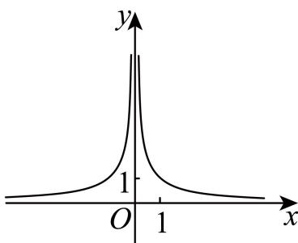
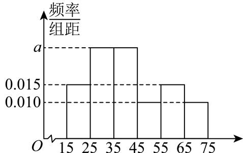

# 2025一模 长宁区原卷 · 学生版

> 本地预览：题目、答案及分类尚未全部审定。校对使用的PDF为高中工作台解析版，尚未逐区确认区级印刷原卷。

## 填空题

按本区原卷题号顺序排列。

### 长宁 · 第1题

设全集为R，集合 $A = \left\{ x | x ^ { 2 } - 2 x - 3 \geq 0 \right\}$ ，则A = –

### 长宁 · 第2题

已知圆锥的底面半径为1，母线长为2，则该圆锥的体积是 （结果保留π）

### 长宁 · 第3题

曲线y = lnx在点(1,0)处的切线方程为

### 长宁 · 第4题

以C(3,4)为圆心，√3为半径的圆的标准方程是

### 长宁 · 第5题

投掷两枚质地均匀的骰子，观察掷得的点数，则掷得的点数之和为7的概率是

### 长宁 · 第6题

$\left( x - { \frac { 1 } { x } } \right)$ 6 的二项展开式中的常数项是

### 长宁 · 第7题

已知 $| a \in \left\{ - 1 , - { \frac { 2 } { 3 } } , - { \frac { 1 } { 3 } } , { \frac { 1 } { 3 } } , { \frac { 2 } { 3 } } , 1 , 2 , 3 \right\}$ ,函数 $\mathbf { \dot { \boldsymbol { y } } } = \mathbf { \boldsymbol { x } } ^ { a }$ 的大致图像如图所示，则a =

### 长宁 · 第8题

已知向量 $\stackrel {  } { a } = ( 1 , 2 ) , \stackrel {  } { b } = ( 3 , - 1 )$ ，则向量 $\vec { b } \hbar \vec { \pm a }$ 方向上的投影的坐标是

### 长宁 · 第9题

已知 $\alpha : 2 ^ { x } + \log _ { 2 } x \leq 2 ,$ β: $x < m$ ，若α是β的充分条件，则实数m的取值范围是

### 长宁 · 第10题

若正实数a,b满足 $\therefore a b = 2 a + b$ ，则a+2b的最小值是

### 长宁 · 第11题

设O为坐标原点，从集合{1,2,3,4,5,6,7,8,9}中任取两个不同的元素x、y，组成A、B两点的坐标$( x , y ) , ( y , x )$ ，则 $S _ { \triangle A O B } \leq$ 10的概率为

### 长宁 · 第12题

点P、M、N分别位于正方体 $A B C D - A ^ { \prime } B ^ { \prime } C ^ { \prime } D ^ { \prime }$ 的面上，AB = 1，则 $\overrightarrow { P M } \cdot \overrightarrow { P N }$ 的最小值是

> 本题资料或解析有待核事项，预览不可作为已审定成品。

## 选择题

按本区原卷题号顺序排列。

### 长宁 · 第13题

已知复数z和–z，则下列说法正确的是（ ）

A. z + –z 一定是实数

B. $z - { \overline { { z } } } -$ 定是虚数

C. 若 $z + { \overline { { z } } } = 0$ ，则z是纯虚数

D. 若 $z - { \overline { { z } } } = 0$ ，则z是纯虚数

### 长宁 · 第14题

已知非零空间向 $\sharp { \vec { a } } , { \vec { b } }$ 和→c，则下列说法正确的是（ ）

A. $\vec { \mathcal { G } } \vec { a } \perp \vec { b } , \vec { a } \perp \vec { c }$ ，则 $\vec { \vert b \vert } / \vec { \vert c }$

B. $\stackrel { \scriptscriptstyle + } { \vec { \tau } } \vec { a } \perp \vec { b } , \vec { a } \perp \vec { c }$ ,则 $\vec { b } \perp \vec { c }$

C. $\overrightarrow { \mathcal { H } } \overrightarrow { a } \perp \overrightarrow { b } , \overrightarrow { a } / / \overrightarrow { c }$ ，则 $\stackrel {  } { b } / / \stackrel {  } { c }$

D. $\overrightarrow { \mathcal { H } } \overrightarrow { a } \perp \overrightarrow { b } , \overrightarrow { a } / / \overrightarrow { c }$ ，则 $\vec { | b \perp c | }$

### 长宁 · 第15题

已知函数 $y=\sin(\omega x+\frac\pi6)$（$\omega>0$）在区间 $(-\frac\pi2,\frac\pi3)$ 上单调递增，则 $\omega$ 的取值范围是（　）。

A. $(0,1]$

B. $(0,1)$

C. $(1,\frac43)$

D. $(0,\frac65]$

### 长宁 · 第16题

数列 $\left\{ a _ { n } \right\}$ 为严格增数列，且对任意的正整数n，都有 $\frac { a _ { n + 1 } } { n + 1 } \geq \frac { a _ { n } } { n }$ ，则称数列 $\left\{ a _ { n } \right\}$ 满足“性质 $\Omega ^ { \ast }$ ①存在等差数列 $\left\{ a _ { n } \right\}$ 满足“性质 $\Omega ^ { \ast }$ ；
②任意等比数列 $\left\{ a _ { n } \right\}$ ，若首项 $a _ { 1 } > 0$ ，则 $\left\{ a _ { n } \right\}$ 满足“性质 $\Omega ^ { \ast }$ ；
下列选项中正确的是（ ）

A. ①是真命题，②是真命题；

B. ①是真命题，②是假命题；

C. ①是假命题，②是真命题；

D. ①是假命题，②是假命题

> 本题资料或解析有待核事项，预览不可作为已审定成品。

## 解答题

按本区原卷题号顺序排列。

### 长宁 · 第17题

在 $\triangle A B C \sharp$ ，角A，B，C所对的边分别为a，b，c，且 $b \sin A - { \sqrt { 3 } } a \cos B = 0$
(1) (6分)求角B的大小；
(2) (8分)若 $\mathbf { \dot { b } } = 2 , \triangle A B C$ 的面积为 $\sqrt { 3 }$ ，请判断 $\triangle A B C$ 的形状，并说明理由

### 长宁 · 第18题

如图所示，四棱柱 $A B C D - A _ { 1 } B _ { 1 } C _ { 1 } D _ { 1 }$ 1的底面ABCD是正方形，O是底面的中心， $A _ { 1 } O \bot$ 平面$A B C D , A B = A A _ { 1 } = { \sqrt { 2 } }$

(1) (6分)求证： $A _ { 1 } C \bot$ 平面 $B D D _ { 1 } B _ { 1 }$ ；
(2) (8分)求直线 $O A _ { 1 }$ 1与平面 $A A _ { 1 } B$ 所成角的正弦值

> 本题资料或解析有待核事项，预览不可作为已审定成品。

### 长宁 · 第19题

2024年第七届中国国际进口博览会（简称进博会）于11月5日至10日在上海国家会展中心举行.为了解进博会参会者的年龄结构，某机构随机抽取了年龄在15-75岁之间的200名参会者进行调查，并按年龄绘制了频率分布直方图，分组区间为[15, 25), [25, 35), [35, 45), [45, 55), [55, 65), [65, 75].把年龄落在区间[15,35)内的人称为“青年人”，把年龄落在区间[35,65)内的人称为“中年人”，把年龄落在[65, 75]内的人称为“老年人”.

200名参会者的频率分布直方图
(1) (4分)求所抽取的“青年人”的人数；
(2) (10分)以分层抽样的方式从“青年人”“中年人”“老年人”中抽取10名参会者做进一步访谈，发现其中女性共4人，这4人中有3人是“中年人”.再用抽签法从所抽取的10名参会者中任选2人.
①简述如何采用抽签法任选2人；
②设事件A：2人均为“中年人”，事件B：2人中至少有1人为男性，判断事件A与事件B是否独立，并说明理由.

### 长宁 · 第20题

已知椭圆的左、右焦点分别为 $F _ { 1 } \left( - 1 , 0 \right) , F _ { 2 } \left( 1 , 0 \right)$ ，且经过点 $P \left( - 1 , { \frac { 3 } { 2 } } \right)$

(1) (4分)求该椭圆的离心率；
(2) (6分)点Q为椭圆上一点，且位于第三象限，若 $\triangle P Q F _ { 2 }$ 的面积为3，求点Q的坐标；
(3) (8分)A，B，C，D是椭圆上不重合的四个点，AB与CD相交于点F1，且− $F _ { 1 }$ $\stackrel { \longrightarrow } { A B } . \stackrel { \longrightarrow } { C D } = 0$ ，求 $| A B | + | C D |$ 的取值范围

> 本题资料或解析有待核事项，预览不可作为已审定成品。

### 长宁 · 第21题

双曲余弦函数 $\cosh x = { \frac { \mathrm { e } ^ { x } + \mathrm { e } ^ { - x } } { 2 } }$ ，双曲正弦函数 $\sinh x = { \frac { \mathrm { e } ^ { x } - \mathrm { e } ^ { - x } } { 2 } }$
(1) (4分)求函数 $\cosh x = { \frac { \mathrm { e } ^ { x } + \mathrm { e } ^ { - x } } { 2 } }$ 的单调增区间；
(2) (6分)若函数 $\mathrm { \Delta } y = \cosh 2 x - a \sinh x$ 在 $[ 0 , + \infty )$ 上的最小值是 $\frac 1 4$ ，求实数a的值；
(3) (8分)对任意 $x \in \mathbf { R } , \cosh \left( x \right) \geq \cos x + m x ^ { 2 }$ 恒成 $\begin{array} { r } { \dot { \overline { { \mathbf { \Gamma } } } } , } \end{array}$ ，求实数m的取值范围

> 本题资料或解析有待核事项，预览不可作为已审定成品。

