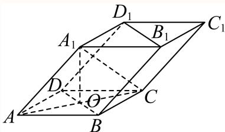
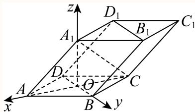

# 2025一模 长宁区原卷 · 教师版

> 本地预览：题目、答案及分类尚未全部审定。校对使用的PDF为高中工作台解析版，尚未逐区确认区级印刷原卷。

## 填空题

按本区原卷题号顺序排列。

### 长宁 · 第1题

设全集为R，集合 $A = \left\{ x | x ^ { 2 } - 2 x - 3 \geq 0 \right\}$ ，则A = –

**考点：** 解二次不等式并求补集

**难度依据：** 二次不等式与补集；解二次不等式并求补集

【答案】(−1, 3).

【解析】

先解一元二次不等式再根据补集定义计算即可.

由 $A = ( - \infty , - 1 ] \cup [ 3 , + \infty )$

则 $| \overline { { A } } = ( - 1 , 3 )$

故答案为：(−1, 3).

### 长宁 · 第2题

已知圆锥的底面半径为1，母线长为2，则该圆锥的体积是 （结果保留π）

**考点：** 母线、半径求高及体积

**难度依据：** 圆锥高与体积；母线、半径求高及体积

【答案】${ \frac { \sqrt { 3 } } { 3 } } \pi$

【解析】

做轴截面，根据母线与底面半径求出圆锥的高，计算体积即可.

如下图做出轴截面：

h = √l2 − r2 = √3

代入圆锥体积公式： $V = { \frac { 1 } { 3 } } \pi r ^ { 2 } h = { \frac { \sqrt { 3 } } { 3 } } \pi$

故答案为： ${ \frac { \sqrt { 3 } } { 3 } } \pi$

### 长宁 · 第3题

曲线y = lnx在点(1,0)处的切线方程为

**考点：** 求导并代入切线方程

**难度依据：** 对数函数切线；求导并代入切线方程

【答案】y = x − 1.

【解析】

求导，再根据导数的几何意义即可得解.

解： $y ^ { \prime } = { \frac { 1 } { x } }$

当x = 1时，y′ = 1，

所以曲线y = ln x在点(1, 0)处的切线方程为y = x − 1.

故答案为：y = x − 1.

### 长宁 · 第4题

以C(3,4)为圆心，√3为半径的圆的标准方程是

**考点：** 由圆心半径求方程

**难度依据：** 圆的标准方程；由圆心半径求方程

【答案】$( x - 3 ) ^ { 2 } + ( y - 4 ) ^ { 2 } = 3$

【解析】

直接根据已知写出圆的标准方程得解.

由题得圆的标准方程为 $( x - 3 ) ^ { 2 } + ( y - 4 ) ^ { 2 } = 3$

故答案为： $( x - 3 ) ^ { 2 } + ( y - 4 ) ^ { 2 } = 3$

### 长宁 · 第5题

投掷两枚质地均匀的骰子，观察掷得的点数，则掷得的点数之和为7的概率是

**考点：** 枚举点数和为7的结果

**难度依据：** 骰子古典概型；枚举点数和为7的结果

【答案】$\frac { 1 } { 6 }$

【解析】

由题可得投掷两枚质地均匀的骰子所对应点数的总情况数，然后可得掷得的点数之和为7的情况数，据此可得答案.

一枚骰子的点数有6种情况，则两枚骰子点数所对应总情况为36种.

又注意到点数之和为7的情况有：1，6；6，1；2，5；5，2；3，4；4，3共6种，

则掷得的点数之和为7的概率是 ${ \frac { 6 } { 3 6 } } = { \frac { 1 } { 6 } }$

故答案为： $\frac { 1 } { 6 }$

### 长宁 · 第6题

$\left( x - { \frac { 1 } { x } } \right)$ 6 的二项展开式中的常数项是

**考点：** 通项指数为零求常数项

**难度依据：** 二项展开常数项；通项指数为零求常数项

【答案】−20.

【解析】

由题可得展开式的第r+1项，令x指数为0，可得常数项对应r，即可得答案.

由题 $\left( x - { \frac { 1 } { x } } \right) ^ { \textsf { t } }$ 的二项展开式的第r+1项为 $\mathrm { C } _ { 6 } ^ { r } x ^ { 6 - r } \cdot \left( - 1 \right) ^ { r } \cdot \left( { \frac { 1 } { x } } \right) ^ { r } = ( - 1 ) ^ { r } \cdot \mathrm { C } _ { 6 } ^ { r } x ^ { 6 - 2 r }$

令 $6 - 2 r = 0 \Rightarrow r = 3$ ，则常数项为 $( - 1 ) ^ { 3 } \cdot \mathrm { C } _ { 6 } ^ { 3 } = - 2 0 .$

故答案为：−20.

### 长宁 · 第7题

已知 $| a \in \left\{ - 1 , - { \frac { 2 } { 3 } } , - { \frac { 1 } { 3 } } , { \frac { 1 } { 3 } } , { \frac { 2 } { 3 } } , 1 , 2 , 3 \right\}$ ,函数 $\mathbf { \dot { \boldsymbol { y } } } = \mathbf { \boldsymbol { x } } ^ { a }$ 的大致图像如图所示，则a =

**考点：** 结合奇偶性与单调性判断幂指数

**难度依据：** 幂函数图像辨识；结合奇偶性与单调性判断幂指数

【答案】$- { \frac { 2 } { 3 } }$

【解析】

根据图像的对称性，可得到函数的奇偶性；再由图像与坐标轴的关系，即可判断a的取值

因为图像关于y轴对称，所以函数是偶函数；

又因为图像与坐标轴无交点，所以指数a为负数.综上所述， $a = - { \frac { 2 } { 3 } } .$

故答案为： $- { \frac { 2 } { 3 } }$

### 长宁 · 第8题

已知向量 $\stackrel {  } { a } = ( 1 , 2 ) , \stackrel {  } { b } = ( 3 , - 1 )$ ，则向量 $\vec { b } \hbar \vec { \pm a }$ 方向上的投影的坐标是

**考点：** 利用数量积求投影

**难度依据：** 向量投影的坐标运算；利用数量积求投影

【答案】$\left( { \frac { 1 } { 5 } } , { \frac { 2 } { 5 } } \right)$

【解析】

利用向量的数量积运算以及投影坐标的概念求解

由 题 得 $\vec { a } \cdot \vec { b } = 1 \times 3 + 2 \times ( - 1 ) = 1 , | \vec { a } | = \sqrt { 5 } , | \vec { b } | = \sqrt { 1 0 }$ 所 以

$$
\cos <   \vec {a}, \vec {b} > = \frac {\vec {a} \cdot \vec {b}}{| \vec {a} | \cdot | \vec {b} |} = \frac {1}{\sqrt {5} \times \sqrt {1 0}} = \frac {\sqrt {2}}{1 0},
$$

与向 $\boldsymbol { \underline { { \mathbf { E } } } } \boldsymbol { \vec { a } }$ 的同向单位向量为 ${ \frac { \stackrel {  } { a } } { | \vec { a } | } } = ( { \frac { 1 } { \sqrt { 5 } } } , { \frac { 2 } { \sqrt { 5 } } } )$ ，

所 以 向 量 $\vec { b }$ 在 向 量 $\vec { a }$ 方 向 上 的 投 影 的 坐 标 为

$$
| \vec {b} | \cos <   \vec {a}, \vec {b} > \cdot \frac {\vec {a}}{| \vec {a} |} = \sqrt {1 0} \times \frac {\sqrt {2}}{1 0} \times \left(\frac {1}{\sqrt {5}}, \frac {2}{\sqrt {5}}\right) = \left(\frac {1}{5}, \frac {2}{5}\right).
$$

故答案为： $\left( { \frac { 1 } { 5 } } , { \frac { 2 } { 5 } } \right)$

### 长宁 · 第9题

已知 $\alpha : 2 ^ { x } + \log _ { 2 } x \leq 2 ,$ β: $x < m$ ，若α是β的充分条件，则实数m的取值范围是

**考点：** 利用单调性求解集并转化集合包含

**难度依据：** 指数对数不等式与充分条件；利用单调性求解集并转化集合包含

【答案】$( 1 , + \infty )$

【解析】

通过构造函数 $f ( x ) = 2 ^ { x } + \log _ { 2 } x , x \in ( 0 , + \infty )$ ，利用f(x)的单调性解不等式，再由题意将α是 $_ { ; \beta }$ 的充分条件转化为包含关系，进而求得参数m范围

设 $f ( x ) = 2 ^ { x } + \log _ { 2 } x , x \in ( 0 , + \infty )$

则 $f ( x ) \overleftarrow { \left. \pm ( 0 , + \infty ) \right. }$ 单调递增，又f(1) = 2，

所以 $2 ^ { x } + \log _ { 2 } x \leq 2$ ，即 $f ( x ) \leq f ( 1 )$ ，故 $0 < x \le 1$ .

则 $\alpha \colon 0 < x \leq 1$

由题意 $0 < x \le 1$ 是x < m的充分条件，则 $( 0 , 1 ] \subseteq ( - \infty , m )$ ，

所以有 $m > 1$ ，故实数m的取值范围是 $( 1 , + \infty )$

故答案为： $( 1 , + \infty )$

### 长宁 · 第10题

若正实数a,b满足 $\therefore a b = 2 a + b$ ，则a+2b的最小值是

**考点：** 由约束消元或平移后运用基本不等式

**难度依据：** 平移后乘积定值求最小值；由约束消元或平移后运用基本不等式

【答案】9.

【解析】

双变量最值，采取消元手段或者基本不等式处理即可.

解析一 $\because a b - b = ( a - 1 ) b = 2 a \Rightarrow b = { \frac { 2 a } { a - 1 } } ( a > 1 ) ,$

则 $a + 2 b = a + { \frac { 4 a } { a - 1 } } = a + 4 + { \frac { 4 } { a - 1 } } = a - 1 + { \frac { 4 } { a - 1 } } + 5 \geq 4 + 5 = 9$ ， 等 号 成 立 时$a = 3 , b = 3 .$

所以a+2b的最小值是9.

解析二 $\therefore a b - 2 a - b = 0 \Rightarrow ( a - 1 ) ( b - 2 ) = 2 ,$

则a + 2b = a − 1 + 2b − 4 + 5 ≥ 2√2 (a − 1) (b − 2) + 5 = 9，

等号成立时 $\left\{ { a \atop a + 2 b = 9 } \right. \Rightarrow \left\{ { a = 3 \atop b = 3 } \right.$ 所以a+2b的最小值是9.

故答案为：9.

### 长宁 · 第11题

设O为坐标原点，从集合{1,2,3,4,5,6,7,8,9}中任取两个不同的元素x、y，组成A、B两点的坐标$( x , y ) , ( y , x )$ ，则 $S _ { \triangle A O B } \leq$ 10的概率为

**考点：** 化面积约束为整数对不等式并枚举

**难度依据：** 坐标面积与古典概型；化面积约束为整数对不等式并枚举

【答案】${ \frac { 1 3 } { 3 6 } } .$

【解析】

设AB与直线y = x的交点为C，由面积关系可得 $\left| \begin{array} { r l r } { x ^ { 2 } - y ^ { 2 } } \end{array} \right| \le 2 0$ ，列表，结合古典概型运算求解

设AB与直线y = x的交点为C，由题意知A，B关于y = x对称，

可知C为线段AB的中点，且 $O C \bot A B$ ，则C $\left( { \frac { x + y } { 2 } } , { \frac { x + y } { 2 } } \right)$

$$
| A B | = \sqrt {(x - y) ^ {2} + (y - x) ^ {2}} = \sqrt {2} | x - y |, | O C | = \sqrt {\left(\frac {x + y}{2}\right) ^ {2} + \left(\frac {x + y}{2}\right) ^ {2}}
$$

$$
= \frac {\sqrt {2}}{2} | x + y |,
$$

则 $S _ { \triangle A O B } = { \frac { 1 } { 2 } } | A B | \cdot | O C | = { \frac { 1 } { 2 } } \left| x ^ { 2 } - y ^ { 2 } \right| \leq 1 0$ ，即 $\left| ~ x ^ { 2 } - y ^ { 2 } \right| \leq 2 0$

列表可得：

设样本空间为Ω， $S _ { \triangle A O B } \leq 1 0 $ 为事件A，

可得 ${ \mathit { n } } \left( \Omega \right) = 7 2 , { \mathit { n } } \left( A \right) = 2 6$

所以所求概率为 $P = \frac { n \left( A \right) } { n \left( \Omega \right) } = \frac { 2 6 } { 7 2 } = \frac { 1 3 } { 3 6 }$

故答案为： ${ \frac { 1 3 } { 3 6 } } .$

### 长宁 · 第12题

点P、M、N分别位于正方体 $A B C D - A ^ { \prime } B ^ { \prime } C ^ { \prime } D ^ { \prime }$ 的面上，AB = 1，则 $\overrightarrow { P M } \cdot \overrightarrow { P N }$ 的最小值是

> 本题资料或解析有待核事项，预览不可作为已审定成品。

**考点：** 建立空间坐标并处理表面约束

**难度依据：** 正方体表面数量积最值；建立空间坐标并处理表面约束

**核查说明：** 源解析由整体下界直接推断最优点位于同一面，论证不足；答案需独立复核。

【答案】$- \frac 1 2$

【解析】

建立空间直角坐标系可得 $\xrightarrow [ { P M } ] { } \xrightarrow [ { P N } ] { }$ 的坐标表达式，配方后可得最值.

如图建立以D为原点的空间直角坐标系，

设 $\boldsymbol { P } \left( x _ { 0 } , y _ { 0 } , z _ { 0 } \right) , \boldsymbol { M } \left( x _ { 1 } , y _ { 1 } , z _ { 1 } \right) , \boldsymbol { N } \left( x _ { 2 } , y _ { 2 } , z _ { 2 } \right)$ ，其中 $x _ { i } , y _ { i } , z _ { i } \left( i = 0 , 1 , 2 \right) \in \left[ 0 , 1 \right]$

$$
\overrightarrow {P M} = \left(x _ {1} - x _ {0}, y _ {1} - y _ {0}, z _ {1} - z _ {0}\right), \overrightarrow {P N} = \left(x _ {2} - x _ {0}, y _ {2} - y _ {0}, z _ {2} - z _ {0}\right)
$$

$$
\overrightarrow {| P M} \cdot \overrightarrow {P N} = (x _ {1} - x _ {0}) (x _ {2} - x _ {0}) + (y _ {1} - y _ {0}) (y _ {2} - y _ {0}) + (z _ {1} - z _ {0}) (z _ {2} - z _ {0})
$$

$$
\begin{array}{l} = \left(x _ {0} - \frac {x _ {1} + x _ {2}}{2}\right) ^ {2} + \left(y _ {0} - \frac {y _ {1} + y _ {2}}{2}\right) ^ {2} + \left(z _ {0} - \frac {z _ {1} + z _ {2}}{2}\right) ^ {2} \\ + x _ {1} x _ {2} - \frac {(x _ {1} + x _ {2}) ^ {2}}{4} + y _ {1} y _ {2} - \frac {(y _ {1} + y _ {2}) ^ {2}}{4} \\ + z _ {1} z _ {2} - \frac {(z _ {1} + z _ {2}) ^ {2}}{4} \geq x _ {1} x _ {2} - \frac {(x _ {1} + x _ {2}) ^ {2}}{4} + y _ {1} y _ {2} - \frac {(y _ {1} + y _ {2}) ^ {2}}{4} + z _ {1} z _ {2} - \frac {(z _ {1} + z _ {2}) ^ {2}}{4} \\ = - \frac {(x _ {1} - x _ {2}) ^ {2}}{4} - \frac {(y _ {1} - y _ {2}) ^ {2}}{4} - \frac {(z _ {1} - z _ {2}) ^ {2}}{4} = - \frac {1}{4} \left[ (x _ {1} - x _ {2}) ^ {2} + (y _ {1} - y _ {2}) ^ {2} + (z _ {1} - z _ {2}) ^ {2} \right] \end{array}
$$

$$
- \frac {1}{4} \left| \overrightarrow {M N} \right| ^ {2},
$$

$$
\text {仅当} x _ {0} = \frac {x _ {1} + x _ {2}}{2}, y _ {0} = \frac {y _ {1} + y _ {2}}{2}, z _ {0} = \frac {z _ {1} + z _ {2}}{2}
$$

则为使 $\overrightarrow { P M } \cdot \overrightarrow { P N }$ 最小，则应使 $\boxed { M N }$ 尽量的大，且P为MN中点.

又点P、M、N均位于正方体表面上，则P、M、N在正方体同一面上，

则当 $\boxed { M N }$ 为正方体一面的对角线，P为对角线中点时，满足题意此时 $\left| { \overrightarrow { M N } } \right| = { \sqrt { 2 } } ,$ 则 $- \frac { 1 } { 4 } \left| \overrightarrow { M N } \right| ^ { 2 } \geq - \frac { 1 } { 2 }$

故答案为： $- \frac 1 2$

关键点睛：本题解题的关键是建立坐标系利用坐标计算得 $\overrightarrow { P M } \cdot \overrightarrow { P N } \geq - \frac { 1 } { 4 } \left| \overrightarrow { M N } \right| ^ { 2 }$ ，再由取等条件得到P、M、N位置关系从而得解.

## 二、选择题

## 选择题

按本区原卷题号顺序排列。

### 长宁 · 第13题

已知复数z和–z，则下列说法正确的是（ ）

A. z + –z 一定是实数

B. $z - { \overline { { z } } } -$ 定是虚数

C. 若 $z + { \overline { { z } } } = 0$ ，则z是纯虚数

D. 若 $z - { \overline { { z } } } = 0$ ，则z是纯虚数

**考点：** 判断复数实部虚部及纯虚数条件

**难度依据：** 共轭复数与分类；判断复数实部虚部及纯虚数条件

【答案】A

【解析】
根据复数的加减法，结合虚数和纯虚数的定义即可逐一求解.
设 $z = a + b \mathrm { i } , b , a \in \mathrm { R }$ ,则 $\bar { z } = a - b \mathrm { i }$ ,故 $z + { \overline { { z } } } = 2 a$ 为实数，故A正确，
对于B， $z - { \overline { { z } } } = 2 b \mathrm { i }$ ，当b = 0时，此时z−–z为实数，故B错误，
对于C， $z + { \overline { { z } } } = 2 a = 0$ ,则a = 0，当b = 0时，此时z为实数，C错误，
对于D, $z - { \overline { { z } } } = 2 b \mathrm { i } = 0$ ，则b = 0，则z是实数，故D错误，
故选：A

### 长宁 · 第14题

已知非零空间向 $\sharp { \vec { a } } , { \vec { b } }$ 和→c，则下列说法正确的是（ ）

A. $\vec { \mathcal { G } } \vec { a } \perp \vec { b } , \vec { a } \perp \vec { c }$ ，则 $\vec { \vert b \vert } / \vec { \vert c }$

B. $\stackrel { \scriptscriptstyle + } { \vec { \tau } } \vec { a } \perp \vec { b } , \vec { a } \perp \vec { c }$ ,则 $\vec { b } \perp \vec { c }$

C. $\overrightarrow { \mathcal { H } } \overrightarrow { a } \perp \overrightarrow { b } , \overrightarrow { a } / / \overrightarrow { c }$ ，则 $\stackrel {  } { b } / / \stackrel {  } { c }$

D. $\overrightarrow { \mathcal { H } } \overrightarrow { a } \perp \overrightarrow { b } , \overrightarrow { a } / / \overrightarrow { c }$ ，则 $\vec { | b \perp c | }$

**考点：** 判断平行垂直命题与充分必要性

**难度依据：** 空间向量平行垂直的逻辑关系；判断平行垂直命题与充分必要性

【答案】D

【解析】

根据空间向量平行与垂直的定义判断即可.

若→a $\perp \vec { b } , \vec { a } \perp \vec { c }$ ，则 $\vec { \mathfrak { b } } / / \vec { c } \vec { \mathfrak { x } } \vec { b }$ 与→c不共线，故选项A与B错误；

故选：D.

若→a $\perp \vec { b } , \vec { a } / / \vec { c }$ ，则 $\vec { b } \perp \vec { c }$ ，故选项C错误，选项D正确.

### 长宁 · 第15题

已知函数 $y=\sin(\omega x+\frac\pi6)$（$\omega>0$）在区间 $(-\frac\pi2,\frac\pi3)$ 上单调递增，则 $\omega$ 的取值范围是（　）。

A. $(0,1]$

B. $(0,1)$

C. $(1,\frac43)$

D. $(0,\frac65]$

**考点：** 利用单调区间包含求频率范围

**难度依据：** 正弦函数单调区间与参数；利用单调区间包含求频率范围

【答案】A

【解析】

由题可得 $y = \sin t$ ，其中 $t = \omega x + \frac { \pi } { 6 }$ ，在 $\left( - \frac { \pi } { 2 } \omega + \frac { \pi } { 6 } , \frac { \pi } { 3 } \omega + \frac { \pi } { 6 } \right)$ 上单调递增，然后结合函数$y = \sin { \mathfrak { x } }$ x的单调性及 $\omega >$ 0可得答案.$x \in \left( - \frac { \pi } { 2 } , \frac { \pi } { 3 } \right) \Rightarrow \omega x + \frac { \pi } { 6 } \in \left( - \frac { \pi } { 2 } \omega + \frac { \pi } { 6 } , \frac { \pi } { 3 } \omega + \frac { \pi } { 6 } \right)$ •因 $\begin{array} { r } { | y = \sin : } \end{array}$ x在 $\left( - \displaystyle \frac { \pi } { 2 } + 2 k \pi , \displaystyle \frac { \pi } { 2 } + 2 k \pi \right)$ （其中 $k \in \mathbf { Z } )$ 上单调递增，则 $\left\{ \begin{array} { l } { \displaystyle \frac { \pi } { 3 } \omega + \displaystyle \frac { \pi } { 6 } \leq \displaystyle \frac { \bar { \pi } } { 2 } + 2 k \pi } \\ { \displaystyle - \frac { \pi } { 2 } \omega + \displaystyle \frac { \pi } { 6 } \geq - \displaystyle \frac { \pi } { 2 } + 2 k \pi } \end{array} \right. \Rightarrow \left\{ \begin{array} { l } { \displaystyle \omega \leq 1 + 6 k } \\ { \displaystyle \omega \leq \displaystyle \frac { 4 } { 3 } - 4 k } \end{array} \right. , k \in \mathrm { Z } .$ 又因 $\omega > 0$ ，则取 $k = 0 \Rightarrow \omega \leq 1$ ，则0 $< \omega \leq 1$

故选：A

### 长宁 · 第16题

数列 $\left\{ a _ { n } \right\}$ 为严格增数列，且对任意的正整数n，都有 $\frac { a _ { n + 1 } } { n + 1 } \geq \frac { a _ { n } } { n }$ ，则称数列 $\left\{ a _ { n } \right\}$ 满足“性质 $\Omega ^ { \ast }$ ①存在等差数列 $\left\{ a _ { n } \right\}$ 满足“性质 $\Omega ^ { \ast }$ ；
②任意等比数列 $\left\{ a _ { n } \right\}$ ，若首项 $a _ { 1 } > 0$ ，则 $\left\{ a _ { n } \right\}$ 满足“性质 $\Omega ^ { \ast }$ ；
下列选项中正确的是（ ）

A. ①是真命题，②是真命题；

B. ①是真命题，②是假命题；

C. ①是假命题，②是真命题；

D. ①是假命题，②是假命题

> 本题资料或解析有待核事项，预览不可作为已审定成品。

**考点：** 构造等差例子与等比反例

**难度依据：** 新定义数列的单调与比值性质；构造等差例子与等比反例

**核查说明：** 源解析等差构造仅写d≥a1，未完整说明严格递增所需d>0；题目定义符号存在识别噪声。

【解析】

根据等差数列基本量的计算即可判断①，根据等比数列为常数列时，即可判断②.

设等差数列的首项和公差分别为 $\tan , d ,$

若等差数列 $\{ a _ { n } \}$ 满足“性质Ω”；

由 ${ \frac { a _ { n + 1 } } { n + 1 } } \geq { \frac { a _ { n } } { n } } { \overline { { \mathbb { H } } } }$ 得 ${ \frac { a _ { n } + d } { n + 1 } } \geq { \frac { a _ { n } } { n } }$ ，故 $n a _ { n } + n d \geq n a _ { n } + a _ { n }$ ，即 $\lceil n d \geq a _ { 1 } + ( n - 1 ) d \Rightarrow d \geq a _ { 1 }$

，故只需要 $d \geq a _ { 1 }$ 即可满足“性质Ω”；故①是真命题，

设等比数列 $\{ a _ { n } \} = ( \frac 3 2 ) ^ { n }$ ，则 $\frac { 9 } { 8 } = \frac { a _ { 2 } } { 2 } < \frac { a _ { 1 } } { 1 } = \frac { 3 } { 2 }$ ，

因此存在等比数列 $\{ a _ { n } \}$ 不满足“性质 $\Omega ^ { \ast } ;$ ；故②是假命题

## 三、解答题

## 解答题

按本区原卷题号顺序排列。

### 长宁 · 第17题

在 $\triangle A B C \sharp$ ，角A，B，C所对的边分别为a，b，c，且 $b \sin A - { \sqrt { 3 } } a \cos B = 0$
(1) (6分)求角B的大小；
(2) (8分)若 $\mathbf { \dot { b } } = 2 , \triangle A B C$ 的面积为 $\sqrt { 3 }$ ，请判断 $\triangle A B C$ 的形状，并说明理由

**考点：** （1）正弦定理求角；（2）面积与余弦定理确定三角形

**难度依据：** 正弦定理与三角形边角；（1）正弦定理求角；（2）面积与余弦定理确定三角形

【解析】

(1) 由正弦定理可得 $\sin B \sin A - { \sqrt { 3 } } \sin A \cos B = 0 ,$

因为 $\sin A \neq 0$ ，所以 $\tan B = { \sqrt { 3 } } , B \in ( 0 , \pi )$ ,所以 $B = \frac { \pi } { 3 }$

(2) $S _ { \triangle A B C } = \frac { 1 } { 2 } a c \sin B = \sqrt { 3 } ,$

所以 $. a c = 4 .$

由余弦定理 $b ^ { 2 } = a ^ { 2 } + c ^ { 2 } - 2 a c \cos B = 4$ ，得 $a ^ { 2 } + c ^ { 2 } = 8$

即 ${ \frac { 1 6 } { c ^ { 2 } } } + c ^ { 2 } = 8$ ，解得 $c = 2 , a = 2$

所以 $\triangle A B C$ 是等边三角形.

### 长宁 · 第18题

如图所示，四棱柱 $A B C D - A _ { 1 } B _ { 1 } C _ { 1 } D _ { 1 }$ 1的底面ABCD是正方形，O是底面的中心， $A _ { 1 } O \bot$ 平面$A B C D , A B = A A _ { 1 } = { \sqrt { 2 } }$

(1) (6分)求证： $A _ { 1 } C \bot$ 平面 $B D D _ { 1 } B _ { 1 }$ ；
(2) (8分)求直线 $O A _ { 1 }$ 1与平面 $A A _ { 1 } B$ 所成角的正弦值

> 本题资料或解析有待核事项，预览不可作为已审定成品。

**考点：** （1）证明线面垂直；（2）空间向量或体积法求线面角

**难度依据：** 棱柱线面垂直与线面角；（1）证明线面垂直；（2）空间向量或体积法求线面角

**核查说明：** 仅修复所列OCR公式及其定界符错位；原解数学疑点和其他可渲染错识未因此消除。

【解析】

(1) 因为ABCD是正方形，所以 $A C \bot B D , O A = O C = 1$

因为 $A _ { 1 } O _ { - }$ ⊥底面 $A B C D$

所以 $A _ { 1 } O \bot B D$ ，又 $A _ { 1 } O \cap A C = O , A _ { 1 } O , A C$ 在平面 $A A _ { 1 } C \mathbb { N }$

所以 $B D \perp$ 平面 $A A _ { 1 } C , A _ { 1 } C$ 在平面 $A A _ { 1 } C \mathbb { N }$

所以 $B D \bot A _ { 1 } C$

由 $A A _ { 1 } = \sqrt { 2 } , O A = O C = 1 , A _ { 1 } O \bot$ 底面 $A B C D$

可得 $A _ { 1 } O = 1 , A _ { 1 } C = { \sqrt { 2 } }$

所以 $A A _ { 1 } ^ { 2 } + A _ { 1 } C ^ { 2 } = A C ^ { 2 }$ ，即有 $A A _ { 1 } \bot A _ { 1 } C ,$

因为 $A A _ { 1 } / / B B _ { 1 }$ ，所以 $B B _ { 1 } \bot A _ { 1 } C$

$B B _ { 1 }$ 和 $B D '$ 在平面 $B D D _ { 1 } B _ { 1 }$ 内，且 $B B _ { 1 } \cap B D = B$

所以 $A _ { 1 } C \bot$ 平面 $B D D _ { 1 } B _ { 1 }$

(2) 方法1：设点O到平面 $A A _ { 1 }$ B的距离为h，

$$
V _ {O - A _ {1} A B} = \frac {1}{3} \cdot S _ {A O B} \cdot O A _ {1} = \frac {1}{3} \cdot S _ {A A _ {1} B} \cdot h
$$

由题可知 $| O A _ { 1 } = 1 , S _ { A O B } = { \frac { 1 } { 2 } } , S _ { A A 1 B } = { \frac { 1 } { 2 } } \times { \sqrt { 2 } } \times { \sqrt { 2 } } \times { \frac { \sqrt { 3 } } { 2 } } = { \frac { \sqrt { 3 } } { 2 } }$

所以 $h = { \frac { 1 \times 1 } { \sqrt { 3 } } } = { \frac { \sqrt { 3 } } { 3 } }$

得直线 $O A _ { 1 }$ 与平面 $A A _ { 1 } B$ 所成角θ的正弦值sin $\theta = \frac { h } { O A _ { 1 } } = \frac { \sqrt { 3 } } { 3 }$

方法2：（建系）

以O为原点，射线 $; O A , ~ O B , ~ O A _ { 1 }$ 为x轴、y轴、z轴的正半轴，建立空间直角坐标系

可得 $A \left( 1 , 0 , 0 \right) , B \left( 0 , 1 , 0 \right) , A _ { 1 } \left( 0 , 0 , 1 \right)$

则 $\overrightarrow { \vert O A _ { 1 } } = ( 0 , 0 , 1 ) , \overrightarrow { A A _ { 1 } } = ( - 1 , 0 , 1 ) , \overrightarrow { A B } = ( - 1 , 1 , 0 )$

设平面 $A A _ { 1 }$ B的一个法向量为 $\vec { n } = ( x , y , z )$ 1

则 $\begin{cases}\vec n\cdot\overrightarrow{AA_1}=-x+z=0,\\\vec n\cdot\overrightarrow{AB}=-x+y=0.\end{cases}$ 令 $x = 1$ 可得 ${ \vec { n } } = ( 1 , 1 , 1 )$

直线 $; O A _ { 1 }$ 与平面 $A A _ { 1 } I$ B所成角θ的正弦值等于向量 $\overrightarrow { O A _ { 1 } }$ 与平面法向量→n的夹角余弦值的绝对

$$
\sin \theta = | \cos \left\langle \overrightarrow {O A _ {1}}, \overrightarrow {n} \right\rangle | = \left| \frac {\overrightarrow {O A _ {1}} \cdot \overrightarrow {n}}{| \overrightarrow {O A _ {1}} | \cdot | \overrightarrow {n} |} \right| = \frac {1}{\sqrt {3}} = \frac {\sqrt {3}}{3}.
$$

### 长宁 · 第19题

2024年第七届中国国际进口博览会（简称进博会）于11月5日至10日在上海国家会展中心举行.为了解进博会参会者的年龄结构，某机构随机抽取了年龄在15-75岁之间的200名参会者进行调查，并按年龄绘制了频率分布直方图，分组区间为[15, 25), [25, 35), [35, 45), [45, 55), [55, 65), [65, 75].把年龄落在区间[15,35)内的人称为“青年人”，把年龄落在区间[35,65)内的人称为“中年人”，把年龄落在[65, 75]内的人称为“老年人”.

200名参会者的频率分布直方图
(1) (4分)求所抽取的“青年人”的人数；
(2) (10分)以分层抽样的方式从“青年人”“中年人”“老年人”中抽取10名参会者做进一步访谈，发现其中女性共4人，这4人中有3人是“中年人”.再用抽签法从所抽取的10名参会者中任选2人.
①简述如何采用抽签法任选2人；
②设事件A：2人均为“中年人”，事件B：2人中至少有1人为男性，判断事件A与事件B是否独立，并说明理由.

**考点：** （1）直方图读数；（2）①设计抽样②求概率并判断独立

**难度依据：** 直方图与抽样概率；（1）直方图读数；（2）①设计抽样②求概率并判断独立

【解析】

(1) 由频率分布直方图可得 $( 2 a + 0 . 0 1 \times 2 + 0 . 0 1 5 \times 2 ) \times 1 0 = 1$ ，解得： $a = 0 . 0 2 5$ 又“青年人”占比为 $( 0 . 0 1 5 + 0 . 0 2 5 ) \times 1 0 = 0 . 4 ,$ 所以所抽取的“青年人”人数为 $2 0 0 \times 0 . 4 = 8 0 \lambda$ ；

(2) ①先将10名参会者进行编号：1、2、⋯、10，并将10个号码写在完全相同的纸片上放入某容器中充分混合均匀，再取出2张，2张纸片上所对应的参会者就是要选取的人②“青年人”“中年人”“老年人”的人数之比为 $0 . 0 4 \colon 0 . 0 5 \colon 0 . 0 1 = 4 \colon 5 \colon 1$

所以10人中“中年人”共有5人，

2人均为“中年人”的概率 $P \left( A \right) = \frac { \mathrm { C } _ { 5 } ^ { 2 } } { \mathrm { C } _ { 1 0 } ^ { 2 } } = \frac { 2 } { 9 } .$

2人中至少有1人为男性的概率 $P \left( B \right) = 1 - \frac { \mathrm { C } _ { 4 } ^ { 2 } } { \mathrm { C } _ { 1 0 } ^ { 2 } } = \frac { 1 3 } { 1 5 }$

2人均为“中年人”且至少有1人为男性的概率 $P \left( A \cap B \right) = \frac { \mathrm { C } _ { 2 } ^ { 2 } + \mathrm { C } _ { 2 } ^ { 1 } \mathrm { C } _ { 3 } ^ { 1 } } { \mathrm { C } _ { 1 0 } ^ { 2 } } = \frac { 7 } { 4 5 }$ 因为 $P \left( A \cap B \right) \neq P \left( A \right) \cdot P \left( B \right)$ ，所以事件A与事件B不独立.

### 长宁 · 第20题

已知椭圆的左、右焦点分别为 $F _ { 1 } \left( - 1 , 0 \right) , F _ { 2 } \left( 1 , 0 \right)$ ，且经过点 $P \left( - 1 , { \frac { 3 } { 2 } } \right)$

(1) (4分)求该椭圆的离心率；
(2) (6分)点Q为椭圆上一点，且位于第三象限，若 $\triangle P Q F _ { 2 }$ 的面积为3，求点Q的坐标；
(3) (8分)A，B，C，D是椭圆上不重合的四个点，AB与CD相交于点F1，且− $F _ { 1 }$ $\stackrel { \longrightarrow } { A B } . \stackrel { \longrightarrow } { C D } = 0$ ，求 $| A B | + | C D |$ 的取值范围

> 本题资料或解析有待核事项，预览不可作为已审定成品。

**考点：** （1）求椭圆离心率；（2）面积条件求点；（3）垂直焦点弦长度和范围

**难度依据：** 椭圆方程、面积及垂直焦点弦；（1）求椭圆离心率；（2）面积条件求点；（3）垂直焦点弦长度和范围

**核查说明：** 源解析第（2）问公式大段缺失，第（3）问弦长表达式破损，须回原卷核对。

【解析】

(1) 设椭圆的标准方程为 ${ \frac { x ^ { 2 } } { a ^ { 2 } } } + { \frac { y ^ { 2 } } { b ^ { 2 } } } = 1$ ， $a > 0 , b > 0$ ，由已知可得 $c = 1$

因为点 $P \left( - 1 , { \frac { 3 } { 2 } } \right)$ 在椭圆上，所以 ${ \frac { 1 } { a ^ { 2 } } } + { \frac { 9 } { 4 b ^ { 2 } } } = 1$ ，

又 $a ^ { 2 } = b ^ { 2 } + 1$ ，所 $\ ! \mathcal { V } \mathcal { a } ^ { 2 } = 4 , b ^ { 2 } = 3$

所以椭圆方程为 ${ \frac { x ^ { 2 } } { 4 } } + { \frac { y ^ { 2 } } { 3 } } = 1$

所以 $\displaystyle { \boldsymbol { \mathscr { e } } } = { \frac { c } { a } } = { \frac { 1 } { 2 } }$ ；

(2) $\textcircled { 1 } P F _ { 2 } = \frac { 5 } { 2 }$ ，直线 $P F _ { 2 }$ 的解析式为 $y = - \frac { 3 } { 4 } x + \frac { 3 } { 4 }$ ，

因为 $\triangle P Q F _ { 2 }$ 的面积为3，所以 $P F _ { 2 }$ 边上的高为 $\frac { 1 2 } { 5 }$

过Q做 $P F _ { 2 }$ 的平行线，则直线QR的解析式为 $y = - { \frac { 3 } { 4 } } x - { \frac { 9 } { 4 } }$

联立方程组 $\left\{ { \frac { x ^ { 2 } } { 4 } } + { \frac { y ^ { 2 } } { 3 } } = 1 \right. \qquad \quad \quad \quad \quad \quad \quad \quad \quad \quad \quad \quad \quad \quad \quad \quad \quad \quad \quad \quad \quad \quad \quad \quad \quad \quad \quad \quad \quad \quad \quad \quad \quad \quad \quad \quad \quad \quad \quad \quad \quad \quad \quad \quad \quad \quad \quad \quad \quad \quad \quad \quad \quad \quad \quad \quad \quad \quad \quad \quad \quad \quad \quad \quad \quad \quad \quad \quad \quad \quad \quad \quad \quad \quad \quad \quad \quad \quad \quad \quad \quad \quad \quad \quad \quad \quad \quad \quad \quad \quad \quad \quad \quad \quad \quad \quad \quad \quad \quad \quad \quad \quad \quad \quad \quad \quad \quad \quad \quad \quad \quad \quad \quad \quad \quad \quad \quad \quad \quad \quad \quad \quad \quad \quad \quad \quad \quad \quad \quad \quad \quad \quad \quad \quad \quad \quad \quad \quad \quad \quad \quad \quad \quad \quad \quad \quad \quad \quad \quad \quad \quad \quad \quad \quad \quad \quad \quad \quad \quad \quad \quad \quad \quad \quad \quad \quad \quad \quad \quad \quad \quad \quad \quad \quad \quad \quad \quad \quad \quad \quad \quad \quad \quad \quad \quad \quad \quad \quad \quad \quad \quad \quad \quad \quad \quad \quad \quad \quad \quad \quad \quad \quad \quad \quad \quad \quad \quad \quad \quad \quad \quad \quad \quad \quad \quad \quad \quad \quad \quad \quad \quad \quad \quad \quad \quad \quad \quad \quad \quad \quad \quad \quad \quad \quad \quad \quad \quad \quad \quad \quad \quad \quad \quad \quad \quad \quad \quad \quad \quad \quad \quad \quad \quad \quad \quad \quad \quad \quad \quad \quad \quad \quad \quad \quad \quad \quad \quad \quad \quad \quad \quad \quad \quad \quad \quad \quad \quad \quad \quad \quad \quad \quad \quad \quad \quad \quad \quad \quad \quad \quad \quad \quad \quad \quad \quad \quad \quad \quad \quad \quad \quad \quad \quad \quad \quad \quad \quad \quad \quad \quad \quad \quad \quad \quad \quad \quad \quad \quad \quad \quad \quad \quad \quad \quad \quad \quad \quad \quad \quad \quad \quad \quad \quad \quad \quad \quad \quad \quad \quad \quad \quad \quad \quad \quad \quad \quad \quad \quad \quad \quad \quad \quad \quad \quad \quad \quad \quad \quad \quad \quad \quad \quad$

解得： $\left\{ { \begin{array} { l } { x _ { 1 } = - 1 } \\ { y _ { 1 } = - { \cfrac { 3 } { 2 } } } \end{array} } \right.$ 或 $\left\{ { \begin{array} { l } { x _ { 1 } = - { \frac { 1 1 } { 7 } } } \\ { y _ { 1 } = - { \frac { 1 5 } { 1 4 } } } \end{array} } \right. ,$

所以点Q的坐标为 $\left( - 1 , - { \frac { 3 } { 2 } } \right)$ 或 $\left( - { \frac { 1 1 } { 7 } } , - { \frac { 1 5 } { 1 4 } } \right)$ ；

(3) ①若AB或CD垂直于x轴，则 $| A B | + | C D | = 7$

②若AB和CD不垂直于x轴，

设直线AB的解析式为 $y = k \left( x + 1 \right)$ ，点 $A \left( x _ { 1 } , y _ { 1 } \right) , B \left( x _ { 2 } , y _ { 2 } \right)$

联立方程组 $\left\{ { \frac { x ^ { 2 } } { 4 } } + { \frac { y ^ { 2 } } { 3 } } = 1 \right. \qquad $ ，得 $\big ( 3 + 4 k ^ { 2 } \big ) x ^ { 2 } + 8 k ^ { 2 } x + 4 k ^ { 2 } - 1 2 = 0 ,$

从而 $x _ { 1 } + x _ { 2 } = { \frac { - 8 k ^ { 2 } } { 3 + 4 k ^ { 2 } } } , x _ { 1 } x _ { 2 } = { \frac { 4 k ^ { 2 } - 1 2 } { 3 + 4 k ^ { 2 } } } ,$

$$
A B = \sqrt {1 + k ^ {2}} \cdot \sqrt {\left(\frac {- 8 k ^ {2}}{3 + 4 k ^ {2}}\right) - 4 \cdot \frac {4 k ^ {2} - 1 2}{3 + 4 k ^ {2}}} = \frac {1 2 (k ^ {2} + 1)}{3 + 4 k ^ {2}},
$$

同理 $C D = { \frac { 1 2 \left( k ^ { 2 } + 1 \right) } { 4 + 3 k ^ { 2 } } }$

$$
\begin{array}{l} | A B | + | C D | = \frac {1 2 (k ^ {2} + 1)}{3 + 4 k ^ {2}} + \frac {1 2 (k ^ {2} + 1)}{4 + 3 k ^ {2}} = \frac {8 4 (k ^ {4} + 2 k ^ {2} + 1)}{1 2 k ^ {4} + 2 5 k ^ {2} + 1 2} = 7. \\ \left(1 - \frac {1}{1 2 k ^ {2} + \frac {1 2}{k ^ {2}} + 2 5}\right) \end{array}
$$

因为 $1 2 k ^ { 2 } + { \frac { 1 2 } { k ^ { 2 } } } + 2 5 \geq 4 9$ ，所以 $\frac { 4 8 } { 7 } \leq | A B | + | C D | < 7$

综上， $| A B | + | C D |$ 的取值范围是 $\left[ { \frac { 4 8 } { 7 } } , 7 \right]$

### 长宁 · 第21题

双曲余弦函数 $\cosh x = { \frac { \mathrm { e } ^ { x } + \mathrm { e } ^ { - x } } { 2 } }$ ，双曲正弦函数 $\sinh x = { \frac { \mathrm { e } ^ { x } - \mathrm { e } ^ { - x } } { 2 } }$
(1) (4分)求函数 $\cosh x = { \frac { \mathrm { e } ^ { x } + \mathrm { e } ^ { - x } } { 2 } }$ 的单调增区间；
(2) (6分)若函数 $\mathrm { \Delta } y = \cosh 2 x - a \sinh x$ 在 $[ 0 , + \infty )$ 上的最小值是 $\frac 1 4$ ，求实数a的值；
(3) (8分)对任意 $x \in \mathbf { R } , \cosh \left( x \right) \geq \cos x + m x ^ { 2 }$ 恒成 $\begin{array} { r } { \dot { \overline { { \mathbf { \Gamma } } } } , } \end{array}$ ，求实数m的取值范围

> 本题资料或解析有待核事项，预览不可作为已审定成品。

**考点：** （1）导数与单调性；（2）换元求二次函数最值；（3）导数证明全域不等式

**难度依据：** 双曲函数换元及恒成立；（1）导数与单调性；（2）换元求二次函数最值；（3）导数证明全域不等式

**核查说明：** 第（3）问证明中根处符号表述有误，且第（2）问未单列a=0；待数学复核。

【解析】

(1) 由 $\cosh x = { \frac { \mathrm { e } ^ { x } + \mathrm { e } ^ { - x } } { 2 } } , x \in \mathbf { R } .$

则 $\left( \cosh x \right) ^ { \prime } = { \frac { \mathrm { e } ^ { x } - \mathrm { e } ^ { - x } } { 2 } }$ ，令 $\left( \cosh x \right) ^ { \prime } = 0$ ，解得x = 0，

当x > 0时， $\left( \cosh x \right) ^ { \prime } = \frac { \mathrm { e } ^ { x } - \mathrm { e } ^ { - x } } { 2 } > 0$ 则双曲余弦函数在(0,+∞)单调递增；

当x < 0时， ${ \bigl ( } \cosh x { \bigr ) } ^ { \prime } = { \frac { \mathrm { e } ^ { x } - \mathrm { e } ^ { - x } } { 2 } } < 0$ 则双曲余弦函数在(−∞,0)单调递减；

所以函数 $\cosh x = { \frac { \mathrm { e } ^ { x } + \mathrm { e } ^ { - x } } { 2 } }$ 的单调增区间是 $( 0 , + \infty )$

(2) $y = \cosh 2 x - a \sinh x = { \frac { \mathrm { e } ^ { 2 x } + \mathrm { e } ^ { - 2 x } } { 2 } } - a { \frac { \mathrm { e } ^ { x } - \mathrm { e } ^ { - x } } { 2 } } = { \frac { 1 } { 2 } } { \bigl ( } \mathrm { e } ^ { x } - \mathrm { e } ^ { - x } { \bigr ) } ^ { 2 } - { \frac { a } { 2 } } { \bigl ( } \mathrm { e } ^ { x } - \mathrm { e } ^ { - x } { \bigr ) } + 1 .$ $\mathfrak { P } t = \mathrm { e } ^ { x } - \mathrm { e } ^ { - x } , t ^ { \prime } = \mathrm { e } ^ { x } + \mathrm { e } ^ { - x } > 0 ,$

所以 $t = \mathrm { e } ^ { x } - \mathrm { e } ^ { - x }$ 在 $[ 0 , + \infty )$ 上是严格增函数，

则当 $x \in [ 0 , + \infty )$ 时， $t \in [ 0 , + \infty )$

函数 $\stackrel { \cdot } { y } = \frac { 1 } { 2 } t ^ { 2 } - \frac { a } { 2 } t + 1 = \frac { 1 } { 2 } \left( t - \frac { a } { 2 } \right) ^ { 2 } - \frac { 1 } { 8 } a ^ { 2 } + 1$

当a < 0时， $y = \frac { 1 } { 2 } t ^ { 2 } - \frac { a } { 2 } t + 1 ^ { \tt N E }$ 格增， $y _ { \mathrm { m i n } } = 1$ ，舍去，

当a > 0时， $y _ { \mathrm { m i n } } = - \frac { 1 } { 8 } a ^ { 2 } + 1 = \frac { 1 } { 4 }$ ，解得 $a = { \sqrt { 6 } }$

综上所述，实数a的值为 ${ \sqrt { 6 } } .$

(3) ①证明sinh (x) ≥ x ≥ sin x, x ∈ [0, +∞)，

令 ${ \bf \Pi } ^ { : } \left( x \right) = \sinh { \left( x \right) } - x , x \in [ 0 , + \infty ) ,$

ex + e−x 2√ex ⋅ e−x 则t′ (x) = cosh (x) − 1 = − 1 ≥ − 1 ≥ 0， 2 2

所以 $t \left( x \right) = \sinh \left( x \right) - x \ddagger [ 0 , + \infty )$ 上单调增，则t $\mathbf { \xi } ( x ) \geq t \left( 0 \right) = 0$

则当 $x \in [ 0 , + \infty ) , \ \sinh { ( x ) } - x \geq 0$ ，即sinh (x) ≥ x成立；

令s(x) = x − sin x, x ∈ [0, +∞)，

则 $s ^ { \prime } ( x ) = 1 - \cos x \geq 0 \quad$

所以 $s ( x ) \overleftarrow { \mathrm { i f } } [ 0 , + \infty )$ 上单调增，则 $s \left( x \right) \geq s \left( 0 \right) = 0$ 9

则当 $x \in [ 0 , + \infty )$ $x - \sin x \geq 0 _ { \mathrm { { i n } } } .$ ，即 $x \geq \sin x )$ 成立；

故sinh (x) ≥ x ≥ sin $x , x \in [ 0 , + \infty )$ ，得证.

②证明 $| \cosh ( x ) - \cos x - x ^ { 2 } \geq 0 ,$

令 $\begin{array} { r } { \mathrm { \tilde { { \varepsilon } } } _ { g } \left( x \right) = \cosh \left( x \right) - \cos x - x ^ { 2 } , g \left( 0 \right) = 0 , g ^ { \prime } \left( x \right) = \sinh \left( x \right) + \sin x - 2 x , g ^ { \prime } \left( 0 \right) = 0 , } \end{array}$

令 $\begin{array} { r } { \mathrm { \ i } \left( x \right) = g ^ { \prime } \left( x \right) = \sinh \left( x \right) + \sin x - 2 x , h ^ { \prime } \left( x \right) = \cosh \left( x \right) + \cos x - 2 \mathrm { \ i } } \end{array}$ 为偶函数.

令 $c \left( x \right) = h ^ { \prime } \left( x \right) = \cosh \left( x \right) + \cos x - 2 ,$ 且c(0) = 0，

则当 $x \in [ 0 , + \infty )$ 时，由①结论可知， $c ^ { \prime } \left( x \right) = \sinh \left( x \right) - \sin x \geq x - \sin x \geq 0 ,$

则 $| c ( x ) \geq c ( 0 ) = 0$ ，即当 $x \in [ 0 , + \infty )$ 时， $h ^ { \prime } ( x ) \geq 0 ,$

由偶函数性质得 $x \in \mathbf { R } , h ^ { \prime } \left( x \right) \geq 0$ ，从而 $g ^ { \prime } \left( x \right) = \sinh \left( x \right) + \sin x - 2 x$ 单调增， $\begin{array} { r } { \nabla g ^ { \prime } \left( 0 \right) = 0 . } \end{array}$

所以当 $x \in ( - \infty , 0 )$ 时， $g ^ { \prime } \left( x \right) < 0 , g ( x ) \# ( - \infty , 0 )$ 单调递减；

当x ∈ [0, +∞)时，g′ (x) ≥ 0，g(x)在[0, +∞)单调递增；

从而 $\begin{array} { r } { \dot { \boldsymbol { \lvert g } \left( \mathcal { x } \right) } \geq g \left( 0 \right) = \boldsymbol { 0 } , } \end{array}$ ，即有 $\operatorname { c o s h } \left( x \right) \geq \cos x + x ^ { 2 }$

③再证明：任意x ∈ R，当 $m \le 1$ 时， $\cosh \left( x \right) \geq \cos x + m x ^ { 2 }$ 恒成立.

$\mathtt { l } \mathtt { X } \varphi ( m ) = x ^ { 2 } m + \cos x - \cosh ( x ) , \ m \in ( - \infty , 1 ]$ ，其 $\boldsymbol { \mathrm { \sf { F } } } \boldsymbol { x } \in \mathbf { R }$

当x = 0时， $\varphi ( m ) = 0 \cdot m + \cos 0 - \cosh ( 0 ) = 0 , \cosh \left( x \right) \geq \cos x + m x ^ { 2 }$ 成立；

当x ≠ 0时， $x ^ { 2 } > 0 , \varphi ( m ) \# ( - \infty , 1 ]$ 单调递增，

则 $\varphi ( m ) \leq \varphi ( 1 ) = x ^ { 2 } + \cos x - \cosh ( x )$ ，由②已证 $x ^ { 2 } + \cos x - \cosh \left( x \right) \leq 0$

故φ(m) = x2m + cos x − cosh(x) ≤ 0，

即任意x ∈ R，当m ≤ 1时， $\cosh \left( x \right) \geq \cos x + m x ^ { 2 }$ 恒成立.

④再证明对任意的m > 1，都存在实数x，使得 $f \left( x \right) = \cosh \left( x \right) - \cos x - m x ^ { 2 } < 0 .$

令g1 (x) = cosh (x) − cos x − mx2, g1 (0) = 0, g′ (x) = sinh (x) + sin x − 2mx, g′ (0) = 0，

$\nmid \left( x \right) = g _ { 1 } ^ { \prime } \left( x \right) = \sinh \left( x \right) + \sin x - 2 m x , h _ { 1 } ^ { \prime } \left( x \right) = \cosh \left( x \right) + \cos x - 2 m .$ 为偶函数，

令c1 (x) = h′ (x) = cosh (x) + cos x − 2m，

则当 $| x \in [ 0 , + \infty ] \mathbb { H } \} , c _ { 1 } ^ { \prime } \left( x \right) = \sinh \left( x \right) - \sin x \geq x - \sin x \geq 0 ,$

所以 $. c _ { 1 } \left( x \right) = h _ { 1 } ^ { \prime } \left( x \right) = \cosh \left( x \right) + \cos x - 2 m$ 单调递增，

由于m > 1，所以c1 (0) = h′ (0) = 2 − 2m < 0，且当 $x \to + \infty , c _ { 1 } ( x ) \to + \infty$

(由于c (x) = cosh(x) + cosx − 2m是偶函数，由对称性以下只需要考虑 $x \geq 0 \mathbb { H } \mathbb { \mathrm { f } } . )$

所以存 $\begin{array} { r } { \left. \mathbb { E } x _ { 0 } > 0 \right. } \end{array}$ ，使得 $\mathsf { \Pi } _ { \mathsf { c } _ { 1 } } ^ { \mathsf { I } } \left( x _ { 0 } \right) = h _ { 1 } ^ { \prime } \left( x _ { 0 } \right) = c _ { 1 } \left( - x _ { 0 } \right) = 0$

从而当 $x \in [ 0 , x _ { 0 } ]$ ]时， $c _ { 1 } \left( x \right) \leq 0 ,$ ，即 $\begin{array} { r } { | h _ { 1 } ^ { ' } ( x ) \leq 0 , } \end{array}$ ，则 $| h _ { 1 } \left( x \right) \overleftarrow { \mathrm { i f } } [ 0 , x _ { 0 } ]$ ]单调递减；

当 $\vert x \in \left( x _ { 0 } , + \infty \right)$ 时， $c _ { 1 } \left( x \right) \geq 0 ,$ ，即 $| h _ { 1 } ^ { ' } ( x ) > 0$ ，则 $h _ { 1 } \left( x \right) \overleftarrow { \mathrm { i f } } \left( x _ { 0 } , + \infty \right)$ 单调递增；

又h (0) = 0,x → +∞时， $h _ { 1 } \left( x \right) \to + \infty .$

所以存在 $\dot { x } _ { 1 } > 0 ,$ ，使得 $\dot { \boldsymbol { \cdot } } h _ { 1 } \left( \boldsymbol { x } _ { 1 } \right) = 0 ,$ ，

即有当 $x \in [ 0 , x _ { 1 } ]$ ]时， $h _ { 1 } \left( x \right) \leq 0 _ { }$ ，即 $\begin{array} { r } { \mathbb { J } _ { g _ { 1 } ^ { ' } ( x ) } \le 0 , } \end{array}$ ，则 $\lvert _ { g _ { 1 } } ( x ) \rvert \mathbb { E } [ 0 , x _ { 1 } ]$ ]时单调递减；

当 $x \in ( x _ { 1 } , + \infty )$ 时， $h _ { 1 } \left( x \right) \geq 0 ,$ ，即 $\begin{array} { r } { | g _ { 1 } ^ { ' } ( x ) \ge 0 _ { : } } \end{array}$ ，则g (x)在(x ,+∞)时单调递增；

又 $g _ { 1 } ( 0 ) = 0 , x  + \infty$ 时， $g _ { 1 } ( x )  + \infty ,$

所以存在 $x _ { 2 } > 0 ;$ ，使得 $g _ { 1 } \left( x _ { 2 } \right) = 0$ ，当 $x \in ( 0 , x _ { 2 } )$ 时， $g _ { 1 } \left( x _ { 2 } \right) < 0 .$

对任意的 $m > 1$ ，都存在x，使得 $f \left( x \right) = \cosh \left( x \right) - \cos x - m x ^ { 2 } < 0 ,$ ，得证.

综上所述，实数m的取值范围为(−∞,1]

